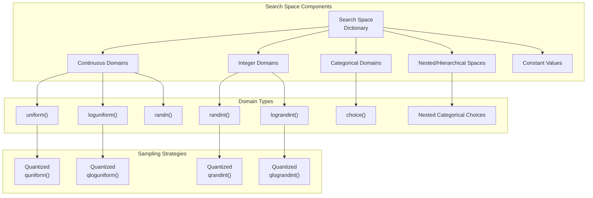
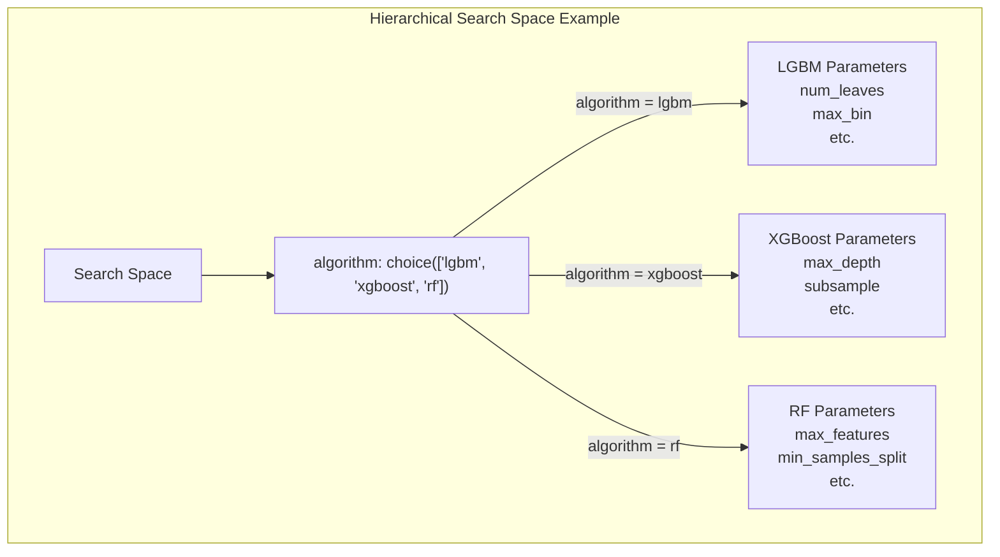
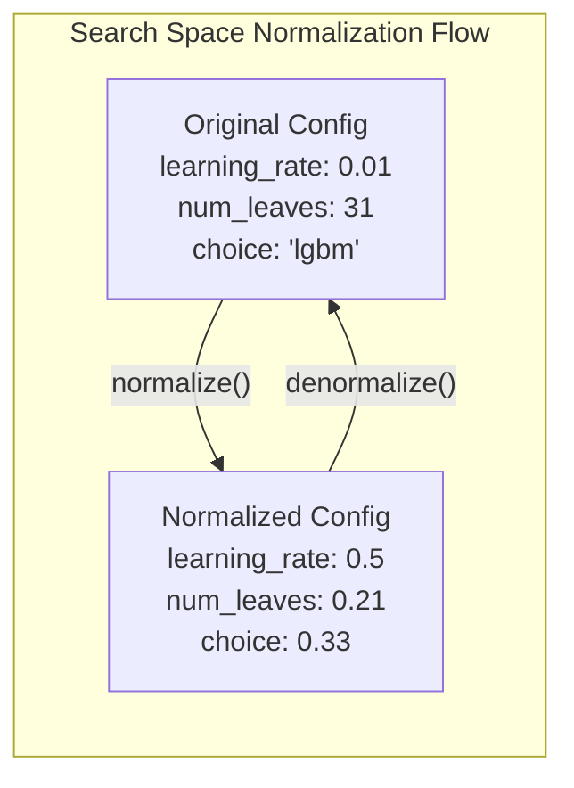
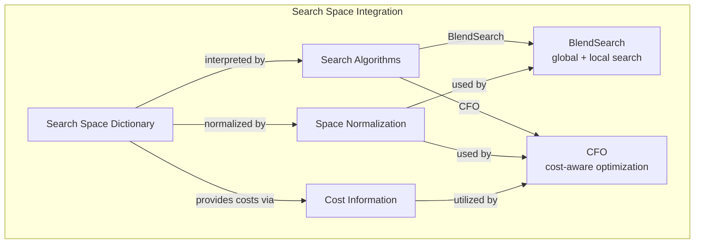

<!-- source: DeepWiki mcp.deepwiki.com · repo microsoft/FLAML · page 4.3 Search Space Definition · fetched 2026-10-26 -->

# Search Space

<details>
<summary>Relevant source files</summary>

The following files were used as context for generating this wiki page:

- [flaml/default/portfolio.py](flaml/default/portfolio.py)
- [flaml/tune/__init__.py](flaml/tune/__init__.py)
- [flaml/tune/result.py](flaml/tune/result.py)
- [flaml/tune/searcher/blendsearch.py](flaml/tune/searcher/blendsearch.py)
- [flaml/tune/searcher/flow2.py](flaml/tune/searcher/flow2.py)
- [flaml/tune/searcher/search_thread.py](flaml/tune/searcher/search_thread.py)
- [flaml/tune/space.py](flaml/tune/space.py)
- [flaml/tune/tune.py](flaml/tune/tune.py)
- [flaml/tune/utils.py](flaml/tune/utils.py)
- [notebook/tune_lexicographic.ipynb](notebook/tune_lexicographic.ipynb)
- [test/tune/test_lexiflow.py](test/tune/test_lexiflow.py)
- [test/tune/test_search_thread.py](test/tune/test_search_thread.py)
- [test/tune/test_searcher.py](test/tune/test_searcher.py)
- [test/tune/test_tune.py](test/tune/test_tune.py)
- [website/docs/Examples/Tune-Lexicographic-objectives.md](website/docs/Examples/Tune-Lexicographic-objectives.md)
- [website/docs/Use-Cases/Tune-User-Defined-Function.md](website/docs/Use-Cases/Tune-User-Defined-Function.md)

</details>


This document explains how search spaces are defined and manipulated for hyperparameter optimization in FLAML. Search spaces are a fundamental concept in FLAML's Tune system, determining the parameters that can be tuned and their possible values during optimization. For information about the search algorithms that operate on these spaces, see [Search Algorithms](#3.1).

## Overview of Search Spaces in FLAML

A search space in FLAML represents the domain of possible configurations to explore during hyperparameter optimization. Search spaces are typically defined as dictionaries where keys are parameter names and values define the possible ranges or choices for those parameters.



Sources: [flaml/tune/__init__.py:1-36](flaml/tune/__init__.py:1-36), [flaml/tune/utils.py:1-27](flaml/tune/utils.py:1-27)

## Defining Search Spaces

Search spaces are defined as Python dictionaries where each key is a parameter name and each value specifies the domain of possible values for that parameter.

### Basic Domain Types

FLAML provides several functions to define parameter domains:

| Domain Type | Function | Description |
|-------------|----------|-------------|
| Continuous (Uniform) | `uniform(lower, upper)` | Uniform distribution between lower and upper |
| Continuous (Log-Uniform) | `loguniform(lower, upper)` | Log-uniform distribution between lower and upper |
| Continuous (Normal) | `randn(mean, sd)` | Normal distribution with mean and standard deviation |
| Integer (Uniform) | `randint(lower, upper)` | Uniform integer distribution between lower and upper |
| Integer (Log-Uniform) | `lograndint(lower, upper)` | Log-uniform integer distribution between lower and upper |
| Categorical | `choice(categories)` | Categorical distribution over specified categories |

Sources: [flaml/tune/__init__.py:5-35](flaml/tune/__init__.py:5-35), [flaml/tune/utils.py:15-27](flaml/tune/utils.py:15-27)

### Quantized Domains

For cases where parameters must be discretized, FLAML provides quantized versions of continuous and integer domains:

| Quantized Domain | Function | Description |
|------------------|----------|-------------|
| Quantized Uniform | `quniform(lower, upper, q)` | Uniform distribution discretized by q |
| Quantized Log-Uniform | `qloguniform(lower, upper, q)` | Log-uniform distribution discretized by q |
| Quantized Integer | `qrandint(lower, upper, q)` | Integer distribution discretized by q |
| Quantized Log-Integer | `qlograndint(lower, upper, q)` | Log-uniform integer distribution discretized by q |
| Quantized Normal | `qrandn(mean, sd, q)` | Normal distribution discretized by q |

Sources: [flaml/tune/__init__.py:5-35](flaml/tune/__init__.py:5-35), [flaml/tune/space.py:70-110](flaml/tune/space.py:70-110)

### Example Search Space Definition

```python
search_space = {
    "learning_rate": loguniform(1e-4, 1e-1),
    "num_leaves": randint(10, 100),
    "max_depth": randint(3, 10),
    "min_child_samples": randint(1, 20),
    "subsample": uniform(0.5, 1.0),
    "model_type": choice(["lgbm", "xgboost", "rf"])
}
```

## Hierarchical Search Spaces

FLAML supports hierarchical search spaces where some parameters only apply when specific categorical choices are made. This is implemented using nested dictionaries within categorical domains.



Example of a hierarchical search space:

```python
search_space = {
    "algorithm": choice(["lgbm", "xgboost", "rf"]),
    "lgbm": {
        "num_leaves": randint(10, 100),
        "min_child_samples": randint(1, 20)
    },
    "xgboost": {
        "max_depth": randint(3, 10),
        "subsample": uniform(0.5, 1.0)
    },
    "rf": {
        "max_features": uniform(0.1, 1.0),
        "min_samples_split": randint(2, 20)
    }
}
```

For hierarchical search spaces, FLAML automatically handles the conditional parameters based on the selected categorical choice.

Sources: [flaml/tune/space.py:158-190](flaml/tune/space.py:158-190), [flaml/tune/space.py:425-452](flaml/tune/space.py:425-452)

## Manipulating Search Spaces

FLAML provides several functions for manipulating search spaces and configurations:

### Normalization and Denormalization

FLAML normalizes parameter values to a [0, 1] range for internal use by search algorithms, and denormalizes them back to their original ranges when needed:

- `normalize`: Transforms parameter values to a standardized [0, 1] range
- `denormalize`: Transforms normalized values back to their original ranges



Sources: [flaml/tune/space.py:272-422](flaml/tune/space.py:272-422)

### Cost-Aware Space Manipulation

FLAML supports cost-aware optimization by allowing users to specify low-cost points and choice costs in search spaces:

- `add_cost_to_space`: Adds cost information to the search space, helping algorithms prioritize less expensive configurations initially

Sources: [flaml/tune/space.py:193-269](flaml/tune/space.py:193-269)

### Variant Generation

FLAML can generate concrete configurations from a search space:

- `generate_variants_compatible`: Generates specific configurations from a search space definition, sampling values from the defined domains

Sources: [flaml/tune/space.py:22-28](flaml/tune/space.py:22-28)

### Completion of Partial Configurations

- `complete_config`: Completes a partial configuration by sampling missing values according to the search space definition
- Useful for suggesting full configurations when only some parameters have been specified

Sources: [flaml/tune/space.py:455-548](flaml/tune/space.py:455-548)

## Advanced Features

### Ordered vs. Unordered Categorical Parameters

Categorical parameters can be marked as ordered or unordered:

- Ordered categorical parameters establish a relationship between the categorical values (e.g., sizes like 'small', 'medium', 'large')
- Unordered categorical parameters have no intrinsic ordering (e.g., algorithm choices)

```python
# Unordered categorical parameter (the default for string categories)
model_type = choice(["lgbm", "xgboost", "rf"])

# Ordered categorical parameter (the default for numeric categories)
batch_size = choice([16, 32, 64, 128])

# Explicitly specify order for string categories
size = choice(["small", "medium", "large"], order=True)
```

FLAML automatically determines whether categories are ordered based on their types (numerical values are ordered by default, strings are unordered by default). This behavior can be overridden by explicitly specifying the `order` parameter.

Sources: [flaml/tune/utils.py:15-27](flaml/tune/utils.py:15-27), [flaml/tune/space.py:241-254](flaml/tune/space.py:241-254)

### Integration with Search Algorithms

The search space definition interfaces with FLAML's search algorithms, particularly BlendSearch and CFO (Cost-Frugal Optimization), which use the space information to efficiently explore the parameter space.



Sources: [flaml/tune/space.py:193-269](flaml/tune/space.py:193-269), [flaml/tune/space.py:272-422](flaml/tune/space.py:272-422)

## Integration with FLAML Tune

The search space functionality is a core component of FLAML's Tune system. When using `tune.run()`, you provide a search space and an evaluation function, and FLAML handles the exploration of the space efficiently.

```python
import flaml
from flaml import tune

def evaluation_function(config):
    # Evaluate model with the given config
    accuracy = train_and_evaluate_model(config)
    return {"accuracy": accuracy}

search_space = {
    "learning_rate": tune.loguniform(1e-4, 1e-1),
    "num_leaves": tune.randint(10, 100),
    "model_type": tune.choice(["lgbm", "xgboost", "rf"])
}

analysis = tune.run(
    evaluation_function,
    config=search_space,
    metric="accuracy",
    mode="max",
    num_samples=50
)
```

For more information on running hyperparameter optimization with FLAML's Tune system, see [Experiment Analysis](#3.3).

Sources: [flaml/tune/__init__.py:1-40](flaml/tune/__init__.py:1-40)

---

