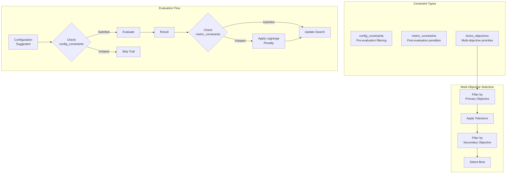
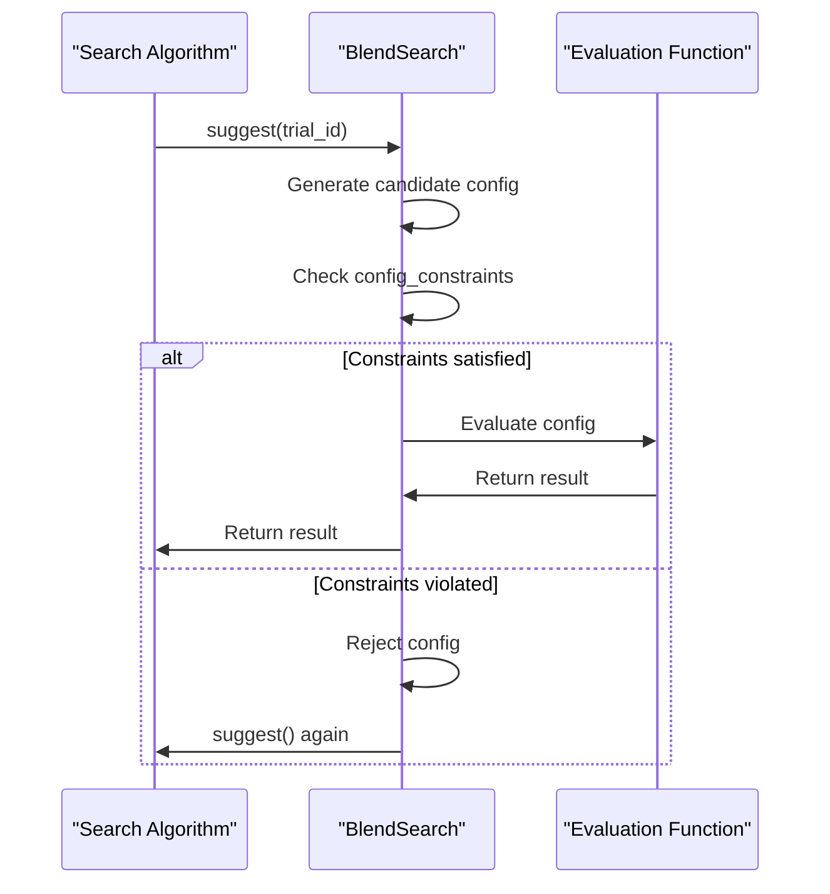
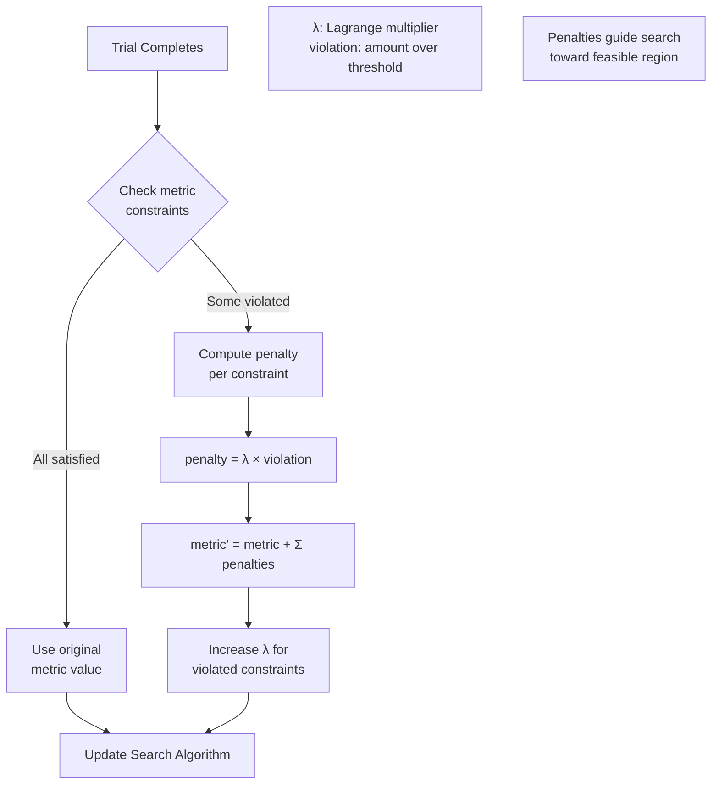
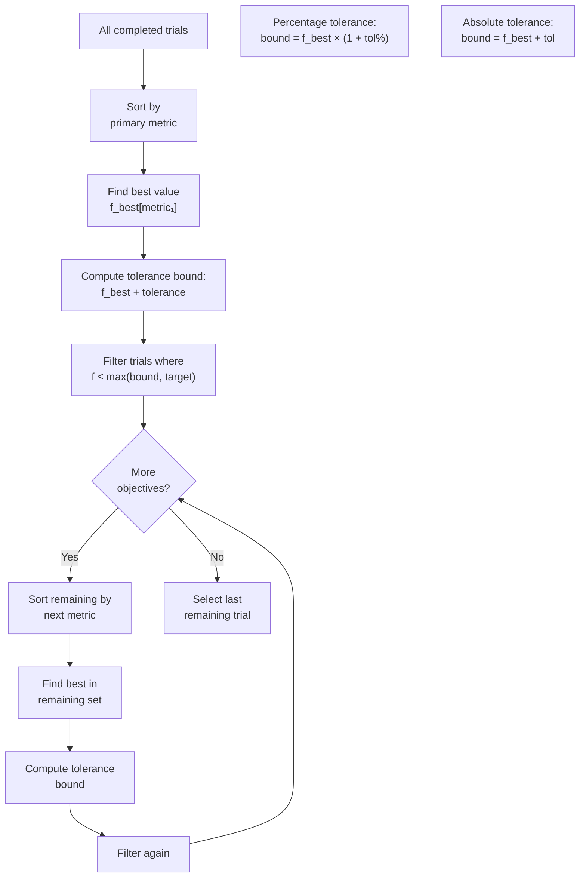

<!-- source: DeepWiki mcp.deepwiki.com · repo microsoft/FLAML · page 4.4 Constraints and Multi-Objective Optimization · fetched 2026-10-26 -->

# Constraints and Multi-Objective Optimization

<details>
<summary>Relevant source files</summary>

The following files were used as context for generating this wiki page:

- [flaml/default/portfolio.py](flaml/default/portfolio.py)
- [flaml/tune/__init__.py](flaml/tune/__init__.py)
- [flaml/tune/result.py](flaml/tune/result.py)
- [flaml/tune/searcher/blendsearch.py](flaml/tune/searcher/blendsearch.py)
- [flaml/tune/searcher/flow2.py](flaml/tune/searcher/flow2.py)
- [flaml/tune/searcher/search_thread.py](flaml/tune/searcher/search_thread.py)
- [flaml/tune/space.py](flaml/tune/space.py)
- [flaml/tune/tune.py](flaml/tune/tune.py)
- [flaml/tune/utils.py](flaml/tune/utils.py)
- [notebook/tune_lexicographic.ipynb](notebook/tune_lexicographic.ipynb)
- [test/tune/test_lexiflow.py](test/tune/test_lexiflow.py)
- [test/tune/test_search_thread.py](test/tune/test_search_thread.py)
- [test/tune/test_searcher.py](test/tune/test_searcher.py)
- [test/tune/test_tune.py](test/tune/test_tune.py)
- [website/docs/Examples/Tune-Lexicographic-objectives.md](website/docs/Examples/Tune-Lexicographic-objectives.md)
- [website/docs/Use-Cases/Tune-User-Defined-Function.md](website/docs/Use-Cases/Tune-User-Defined-Function.md)

</details>


FLAML's tune system supports advanced optimization scenarios including constraint satisfaction and multi-objective optimization with lexicographic preferences. These features enable users to optimize hyperparameters while respecting resource limits, performance requirements, or multiple competing objectives.

For information about search algorithms that implement these features, see [Search Algorithms](4.2). For details on defining search spaces, see [Search Space Definition](4.3).

## 1. Overview

FLAML provides three mechanisms for constrained and multi-objective optimization:

**Configuration Constraints (`config_constraints`)**: Filter out configurations before evaluation based on properties of the configuration itself (e.g., memory requirements, model size).

**Metric Constraints (`metric_constraints`)**: Enforce constraints on metric values after evaluation (e.g., precision >= 0.9, training time <= 60 seconds).

**Lexicographic Objectives (`lexico_objectives`)**: Optimize multiple objectives in priority order, where higher-priority objectives are optimized first, subject to tolerance bounds.



Sources: [flaml/tune/tune.py:255-257](), [flaml/tune/tune.py:411-439](), [flaml/tune/tune.py:428-460](), [flaml/tune/searcher/blendsearch.py:60-62](), [flaml/tune/searcher/blendsearch.py:106-112]()

## 2. Configuration Constraints

Configuration constraints (`config_constraints`) filter out invalid configurations before evaluation, preventing wasteful trials that would fail due to resource limits or other hard requirements.

### 2.1 Definition and Usage

Configuration constraints are specified as a list of tuples, where each tuple contains:
1. A function that takes a configuration dict and returns a numeric value
2. A comparison operator: `"<="`, `">="`, `"<"`, or `">"`
3. A threshold value

```python
def memory_required(config):
    """Estimate memory needed for this configuration."""
    return config["batch_size"] * config["hidden_size"] * config["num_layers"] * 4  # bytes

def model_size(config):
    """Estimate model parameter count."""
    return config["n_estimators"] * config["max_leaves"]

config_constraints = [
    (memory_required, "<=", 8 * 1024**3),  # Max 8GB memory
    (model_size, "<=", 1000),               # Max 1000 total leaves
]

analysis = tune.run(
    evaluation_function,
    config=search_space,
    config_constraints=config_constraints,
    metric="accuracy",
    mode="max"
)
```

Sources: [flaml/tune/tune.py:411-417](), [website/docs/Use-Cases/Tune-User-Defined-Function.md:417-431]()

### 2.2 Implementation

Configuration constraints are checked before trial evaluation in the search algorithm. Configurations that violate constraints are never evaluated, saving computation time.



The constraint checking logic is implemented in [flaml/tune/searcher/blendsearch.py:195-198]() where `config_constraints` are stored and applied during configuration suggestion.

Sources: [flaml/tune/searcher/blendsearch.py:106-111](), [flaml/tune/searcher/blendsearch.py:195-198]()

### 2.3 When to Use Config Constraints

Use configuration constraints when:
- Constraints can be evaluated from the configuration alone (no trial needed)
- You want to prevent evaluation of infeasible configurations
- Resource requirements (memory, disk space) are calculable from hyperparameters
- Model architecture constraints exist (e.g., layer sizes must satisfy certain relationships)

Sources: [website/docs/Use-Cases/Tune-User-Defined-Function.md:440-443]()

## 3. Metric Constraints

Metric constraints (`metric_constraints`) enforce requirements on evaluation metrics. Unlike config constraints, these are checked after evaluation completes. When violated, the search algorithm applies penalties to guide the search toward feasible regions.

### 3.1 Definition and Usage

Metric constraints are specified as a list of tuples containing:
1. A metric name (string) that must exist in the evaluation result
2. A comparison operator: `"<="` or `">="`
3. A threshold value

```python
def evaluate_model(config):
    # Train and evaluate
    accuracy = train_and_test(config)
    training_time = get_training_time()
    precision = compute_precision()
    
    return {
        "accuracy": accuracy,
        "training_time": training_time,
        "precision": precision
    }

metric_constraints = [
    ("precision", ">=", 0.9),      # Precision must be at least 90%
    ("training_time", "<=", 60),    # Training must complete within 60 seconds
]

analysis = tune.run(
    evaluate_model,
    config=search_space,
    metric="accuracy",
    mode="max",
    metric_constraints=metric_constraints
)
```

Sources: [flaml/tune/tune.py:417-419](), [website/docs/Use-Cases/Tune-User-Defined-Function.md:432-439]()

### 3.2 Implementation with Lagrange Multipliers

Metric constraints are enforced using Lagrange multipliers. When a constraint is violated, a penalty is added to the objective metric, steering the search algorithm away from infeasible regions.



The penalty calculation occurs in [flaml/tune/searcher/blendsearch.py:452-474]():

1. For each metric constraint, compute violation amount
2. Apply penalty proportional to violation: `penalty = λ × violation × metric_op`
3. Increase λ for violated constraints to emphasize them in future trials
4. Store modified metric as `metric + lagrange` suffix

```python
# Simplified penalty logic from BlendSearch.on_trial_complete
for i, constraint in enumerate(metric_constraints):
    metric_name, sign, threshold = constraint
    value = result.get(metric_name)
    if value:
        sign_op = 1 if sign == "<=" else -1
        violation = (value - threshold) * sign_op
        if violation > 0:
            # Add penalty term
            objective += penalty_weight[i] * violation * metric_op
            if penalty_weight[i] < MAX_PENALTY:
                penalty_weight[i] += violation
```

Sources: [flaml/tune/searcher/blendsearch.py:452-474](), [flaml/tune/searcher/blendsearch.py:197-200]()

### 3.3 Differences from Config Constraints

| Aspect | Config Constraints | Metric Constraints |
|--------|-------------------|-------------------|
| **Evaluation** | Before trial execution | After trial completion |
| **Input** | Configuration dict only | Evaluation result metrics |
| **Violation handling** | Skip trial entirely | Apply penalty to objective |
| **Use case** | Hard requirements (memory, feasibility) | Soft requirements (performance thresholds) |
| **Computation cost** | Near-zero | Requires full trial evaluation |

Sources: [website/docs/Use-Cases/Tune-User-Defined-Function.md:440-443]()

## 4. Lexicographic Multi-Objective Optimization

Lexicographic optimization handles multiple objectives by prioritizing them in order. The search optimizes the primary objective first, then optimizes secondary objectives among solutions within tolerance of the primary objective's optimum.

### 4.1 Lexicographic Objectives Structure

The `lexico_objectives` parameter is a dictionary with the following fields:

| Field | Type | Required | Description |
|-------|------|----------|-------------|
| `metrics` | list[str] | Yes | Objective names in priority order |
| `modes` | list[str] | No | Optimization mode per objective ("min" or "max"). Default: "min" for all |
| `targets` | dict | No | Target values per objective. Default: -∞ for "min", +∞ for "max" |
| `tolerances` | dict | No | Tolerance per objective (absolute or percentage string). Default: 0 |

```python
lexico_objectives = {
    "metrics": ["error_rate", "flops", "model_size"],
    "modes": ["min", "min", "min"],
    "targets": {
        "error_rate": 0.0,
        "flops": 0.0,
        "model_size": 0.0
    },
    "tolerances": {
        "error_rate": 0.01,      # Absolute tolerance
        "flops": "5%",            # Percentage tolerance
        "model_size": 0.0         # No tolerance
    }
}
```

Sources: [flaml/tune/tune.py:428-460](), [flaml/tune/searcher/blendsearch.py:120-149]()

### 4.2 Selection Algorithm

The lexicographic best selection algorithm works as follows:



Implementation in [flaml/tune/tune.py:81-120]():

```python
def lexico_best(self, trials):
    results = {index: trial.last_result for index, trial in enumerate(trials) 
               if trial.last_result}
    metrics = self.lexico_objectives["metrics"]
    modes = self.lexico_objectives["modes"]
    
    # Track best values and build histories
    f_best = {}
    histories = defaultdict(list)
    for time_index in range(len(results)):
        for objective, mode in zip(metrics, modes):
            value = results[keys[time_index]][objective]
            histories[objective].append(value if mode == "min" else -value)
    
    # Filter by each objective in priority order
    feasible_index = np.array([*range(len(histories[metrics[0]]))])
    for k_metric, k_mode in zip(metrics, modes):
        k_values = np.array(histories[k_metric])
        k_target = (tolerances["targets"][k_metric] 
                   if k_mode == "min" else -tolerances["targets"][k_metric])
        
        feasible_value = k_values.take(feasible_index)
        f_best[k_metric] = np.min(feasible_value)
        
        # Apply tolerance (absolute or percentage)
        if isinstance(tolerances[k_metric], str):
            # Percentage tolerance
            tolerance_bound = f_best[k_metric] * (
                1 + 0.01 * float(tolerances[k_metric].replace("%", ""))
            )
        else:
            # Absolute tolerance
            tolerance_bound = f_best[k_metric] + tolerances[k_metric]
        
        # Keep only trials within tolerance
        feasible_index_filter = np.where(
            feasible_value <= max(tolerance_bound, k_target)
        )[0]
        feasible_index = feasible_index.take(feasible_index_filter)
    
    best_trial = trials[feasible_index[-1]]
    return best_trial
```

Sources: [flaml/tune/tune.py:81-120](), [flaml/tune/searcher/flow2.py:339-410]()

### 4.3 Tolerance Types

**Absolute Tolerance**: Numeric value representing acceptable deviation.
```python
"tolerances": {"error_rate": 0.01}  # Accept up to 1% higher error
```

**Percentage Tolerance**: String with "%" suffix.
```python
"tolerances": {"flops": "5%"}  # Accept up to 5% more FLOPs
```

The percentage tolerance computes: `bound = f_best × (1 + tolerance/100)`

Sources: [flaml/tune/tune.py:107-114](), [flaml/tune/searcher/flow2.py:348-391]()

### 4.4 Search Algorithm Support

Lexicographic optimization is currently supported by **CFO** (Constrained Frugal Optimizer). When `lexico_objectives` is provided, `tune.run()` automatically uses CFO as the search algorithm:

```python
# CFO is automatically selected for lexicographic optimization
analysis = tune.run(
    evaluation_function,
    config=search_space,
    lexico_objectives=lexico_objectives,
    # search_alg parameter is overridden to use CFO
)
```

The search algorithm uses the lexicographic comparison in [flaml/tune/searcher/flow2.py:366-410]() to determine whether a new trial improves upon the incumbent.

Sources: [flaml/tune/tune.py:570-576](), [flaml/tune/searcher/flow2.py:128-135](), [flaml/tune/searcher/flow2.py:366-410]()

## 5. Best Practices

### 5.1 Choosing Between Constraint Types

**Use config_constraints when:**
- Constraints depend only on hyperparameter values
- Violations would cause trial failures (OOM, invalid configs)
- You want to prevent expensive evaluations of infeasible configs

**Use metric_constraints when:**
- Constraints depend on evaluation results
- You want soft requirements with gradual enforcement
- The constraint metric is cheap to compute during evaluation

**Use lexico_objectives when:**
- You have multiple competing objectives (accuracy vs. speed vs. size)
- One objective is clearly more important than others
- You can accept small degradation in primary objective for large gains in secondary objectives

Sources: [website/docs/Use-Cases/Tune-User-Defined-Function.md:440-443]()

### 5.2 Setting Tolerances for Lexicographic Optimization

Tolerances control the trade-off between objectives:

**Tight tolerance (small value)**: Optimizes primary objective aggressively, minimal room for secondary objective improvement.

**Loose tolerance (larger value)**: Allows more trade-off, potentially finding solutions with better secondary objectives at small cost to primary.

```python
# Conservative: Prioritize error rate heavily
lexico_objectives = {
    "metrics": ["error_rate", "inference_time"],
    "tolerances": {"error_rate": 0.001, "inference_time": 0.0}  # Tight
}

# Balanced: Allow more trade-off
lexico_objectives = {
    "metrics": ["error_rate", "inference_time"],
    "tolerances": {"error_rate": "5%", "inference_time": "0%"}  # Loose
}
```

Start with tight tolerances and gradually relax if the secondary objectives are not improving enough.

Sources: [test/tune/test_lexiflow.py:169-199](), [website/docs/Examples/Tune-Lexicographic-objectives.md:146-168]()

### 5.3 Combining Constraints and Multi-Objective Optimization

You can combine both constraint types with lexicographic objectives:

```python
def memory_size(config):
    return config["batch_size"] * config["model_size"]

analysis = tune.run(
    evaluation_function,
    config=search_space,
    # Config constraint: Hard memory limit
    config_constraints=[(memory_size, "<=", 1024**3)],
    # Metric constraint: Minimum precision
    metric_constraints=[("precision", ">=", 0.9)],
    # Multi-objective: Optimize error rate, then speed
    lexico_objectives={
        "metrics": ["error_rate", "inference_time"],
        "modes": ["min", "min"],
        "tolerances": {"error_rate": 0.01, "inference_time": 0.0}
    }
)
```

This ensures:
1. All evaluated configs fit in memory (config_constraints)
2. Solutions meet minimum precision (metric_constraints via penalties)
3. Among feasible solutions, error rate is optimized first, then speed (lexico_objectives)

Sources: [test/tune/test_tune.py:252-341]()

## 6. Practical Examples

### Example 1: Configuration Constraints for Memory Limits

```python
from flaml import tune

def estimate_memory(config):
    """Estimate memory requirement in bytes."""
    # Rough estimate: batch_size × sequence_length × hidden_size × 4 bytes
    return config["batch_size"] * config["seq_length"] * config["hidden_size"] * 4

def evaluate_model(config):
    # Training code here
    model = train_transformer(config)
    return {"accuracy": model.evaluate(), "training_time": model.time_elapsed}

search_space = {
    "batch_size": tune.choice([16, 32, 64, 128]),
    "seq_length": tune.randint(128, 512),
    "hidden_size": tune.choice([256, 512, 768, 1024]),
    "learning_rate": tune.loguniform(1e-5, 1e-3)
}

analysis = tune.run(
    evaluate_model,
    config=search_space,
    config_constraints=[
        (estimate_memory, "<=", 8 * 1024**3)  # Max 8GB
    ],
    metric="accuracy",
    mode="max",
    num_samples=50
)

print(f"Best config: {analysis.best_config}")
print(f"Best accuracy: {analysis.best_result['accuracy']}")
```

Sources: [website/docs/Use-Cases/Tune-User-Defined-Function.md:420-431](), [test/tune/test_tune.py:256-290]()

### Example 2: Metric Constraints for SLA Requirements

```python
from flaml import tune

def train_and_evaluate(config):
    import time
    start = time.time()
    
    # Train model
    model = train_model(config)
    training_time = time.time() - start
    
    # Evaluate
    accuracy = test_model(model)
    precision = compute_precision(model)
    
    return {
        "accuracy": accuracy,
        "precision": precision,
        "training_time": training_time
    }

analysis = tune.run(
    train_and_evaluate,
    config={
        "n_estimators": tune.randint(10, 1000),
        "max_depth": tune.randint(3, 15),
        "learning_rate": tune.loguniform(0.001, 0.3)
    },
    metric="accuracy",
    mode="max",
    metric_constraints=[
        ("precision", ">=", 0.9),        # SLA: precision must be ≥ 90%
        ("training_time", "<=", 300)     # SLA: training must complete in 5 minutes
    ],
    num_samples=100
)

best_result = analysis.best_result
print(f"Accuracy: {best_result['accuracy']:.3f}")
print(f"Precision: {best_result['precision']:.3f}")
print(f"Training time: {best_result['training_time']:.1f}s")
```

Sources: [website/docs/Use-Cases/Tune-User-Defined-Function.md:432-439](), [test/tune/test_tune.py:252-341]()

### Example 3: Lexicographic Objectives for Neural Architecture Search

```python
from flaml import tune
import torch
import torch.nn as nn

def count_flops(model, input_size=(1, 28, 28)):
    """Count model FLOPs using thop library."""
    import thop
    input_tensor = torch.randn(1, *input_size)
    flops, params = thop.profile(model, inputs=(input_tensor,), verbose=False)
    return flops, params

def evaluate_neural_net(config):
    # Build model from config
    model = build_model(config)
    
    # Train model
    train_model(model, config["n_epoch"])
    
    # Evaluate
    error_rate = 1.0 - compute_accuracy(model)
    flops, params = count_flops(model)
    
    return {
        "error_rate": error_rate,
        "flops": flops,
        "params": params
    }

search_space = {
    "n_layers": tune.randint(1, 5),
    "hidden_size": tune.randint(32, 512),
    "dropout": tune.uniform(0.1, 0.5),
    "learning_rate": tune.loguniform(1e-5, 1e-2),
    "n_epoch": tune.randint(5, 50)
}

# Optimize: 1st priority = low error, 2nd priority = few FLOPs
lexico_objectives = {
    "metrics": ["error_rate", "flops"],
    "modes": ["min", "min"],
    "tolerances": {
        "error_rate": 0.02,  # Accept up to 2% higher error
        "flops": "0%"        # Then minimize FLOPs exactly
    },
    "targets": {
        "error_rate": 0.0,
        "flops": 0.0
    }
}

analysis = tune.run(
    evaluate_neural_net,
    config=search_space,
    lexico_objectives=lexico_objectives,
    low_cost_partial_config={
        "n_layers": 1,
        "hidden_size": 32,
        "n_epoch": 5
    },
    time_budget_s=3600,
    num_samples=-1
)

best_trial = analysis.best_trial
print(f"Best config: {best_trial.config}")
print(f"Error rate: {best_trial.last_result['error_rate']:.4f}")
print(f"FLOPs: {best_trial.last_result['flops']:.2e}")
print(f"Parameters: {best_trial.last_result['params']:.2e}")
```

Sources: [test/tune/test_lexiflow.py:58-199](), [website/docs/Examples/Tune-Lexicographic-objectives.md:106-162]()

### Example 4: Combined Constraints and Multi-Objective Optimization

```python
from flaml import tune

def model_memory_requirement(config):
    """Estimate memory needed for model."""
    return config["n_estimators"] * config["max_leaves"] * 1024  # KB estimate

def evaluate_classifier(config):
    model = train_classifier(config)
    
    return {
        "accuracy": model.test_accuracy,
        "precision": model.precision,
        "inference_time_ms": model.avg_inference_time * 1000,
        "model_size_mb": model.size_in_bytes / (1024**2)
    }

search_space = {
    "n_estimators": tune.lograndint(4, 1000),
    "max_leaves": tune.lograndint(4, 1000),
    "learning_rate": tune.loguniform(0.001, 1.0),
    "min_child_weight": tune.uniform(0.5, 10)
}

analysis = tune.run(
    evaluate_classifier,
    config=search_space,
    # Hard memory limit (config constraint)
    config_constraints=[
        (model_memory_requirement, "<=", 500 * 1024)  # Max 500MB
    ],
    # Minimum precision requirement (metric constraint)
    metric_constraints=[
        ("precision", ">=", 0.85)
    ],
    # Multi-objective: accuracy first, then inference speed
    lexico_objectives={
        "metrics": ["accuracy", "inference_time_ms"],
        "modes": ["max", "min"],
        "tolerances": {
            "accuracy": "2%",           # Accept up to 2% lower accuracy
            "inference_time_ms": "0%"   # Then minimize latency
        }
    },
    low_cost_partial_config={
        "n_estimators": 4,
        "max_leaves": 4
    },
    time_budget_s=1800
)

best_result = analysis.best_result
print(f"Accuracy: {best_result['accuracy']:.3f}")
print(f"Precision: {best_result['precision']:.3f}")
print(f"Inference time: {best_result['inference_time_ms']:.2f} ms")
print(f"Model size: {best_result['model_size_mb']:.1f} MB")
```

Sources: [test/tune/test_tune.py:252-341](), [test/tune/test_lexiflow.py:202-226]()

## Summary

The Experiment Analysis component of FLAML provides powerful tools for analyzing the results of hyperparameter tuning experiments. Key capabilities include:

1. Accessing the best trial, configuration, and result based on specified metrics
2. Support for lexicographic optimization with multiple objectives
3. Integration with experiment tracking tools like MLflow
4. Flexible filtering and analysis options for trial results

This functionality makes it straightforward to interpret tuning results and extract the optimal configurations for your machine learning models.

---

