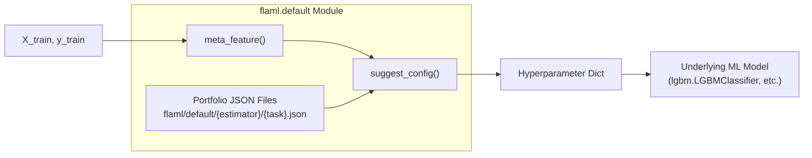
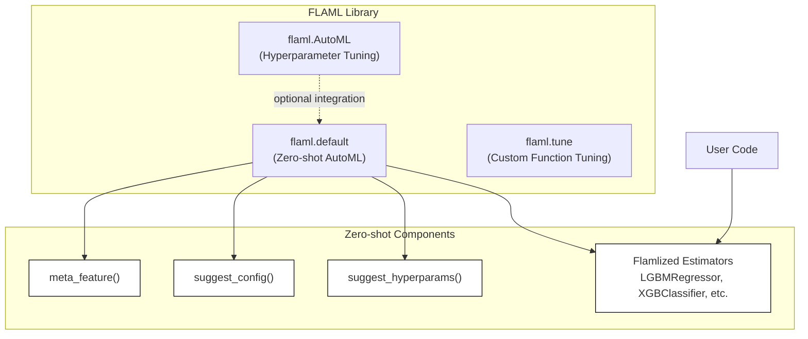
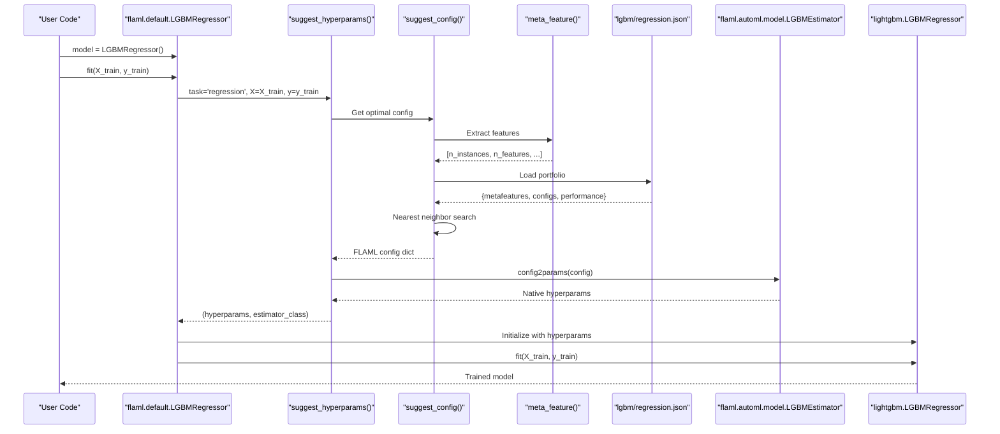
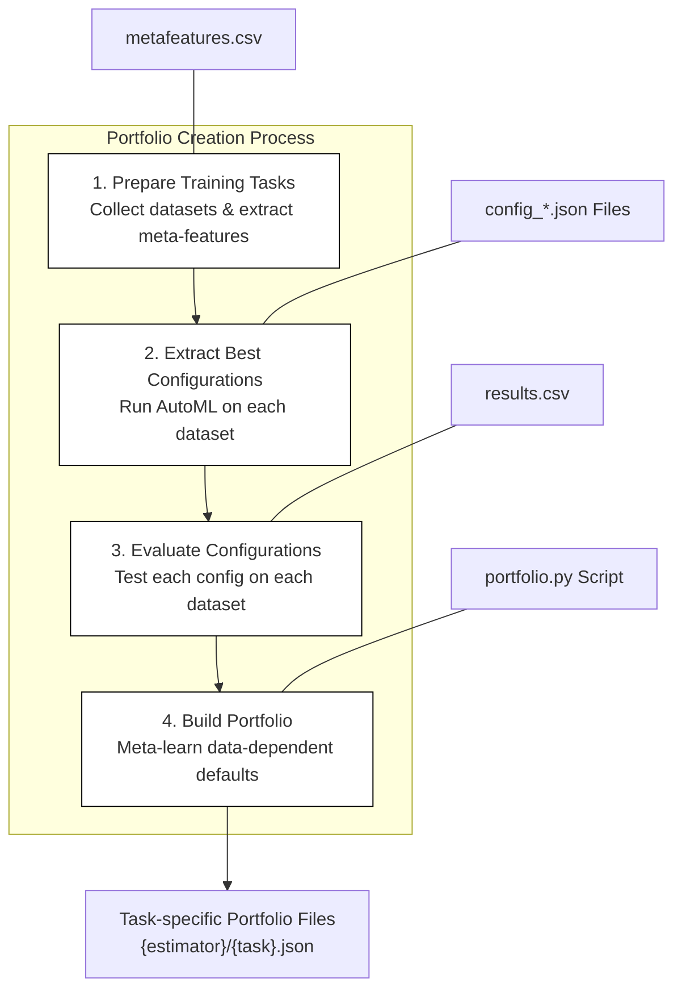
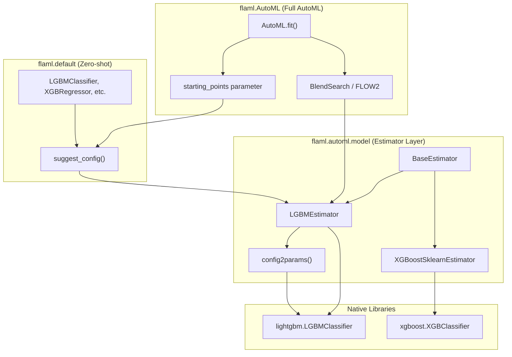

<!-- source: DeepWiki mcp.deepwiki.com · repo microsoft/FLAML · page 5 Zero-shot AutoML · fetched 2026-10-26 -->

# Zero-shot AutoML

<details>
<summary>Relevant source files</summary>

The following files were used as context for generating this wiki page:

- [.github/workflows/python-package.yml](.github/workflows/python-package.yml)
- [README.md](README.md)
- [flaml/version.py](flaml/version.py)
- [setup.py](setup.py)
- [website/docs/Best-Practices.md](website/docs/Best-Practices.md)
- [website/docs/Contribute.md](website/docs/Contribute.md)
- [website/docs/FAQ.md](website/docs/FAQ.md)
- [website/docs/Getting-Started.md](website/docs/Getting-Started.md)
- [website/docs/Installation.md](website/docs/Installation.md)
- [website/sidebars.js](website/sidebars.js)

</details>


## Purpose and Scope

Zero-shot AutoML is a lightweight approach for automated machine learning that delivers improved model configurations instantly, without the computational overhead of traditional hyperparameter tuning. This page explains how FLAML's Zero-shot AutoML works, how to use it in your projects, and how to customize it for your specific needs. For information about traditional AutoML with hyperparameter tuning, see [AutoML](#2).

Zero-shot AutoML leverages pre-built knowledge about good configurations for different datasets, allowing you to benefit from AutoML optimization with just the computational cost of training a single model.

## Overview

Zero-shot AutoML in FLAML provides drop-in replacements for standard ML estimators that automatically select data-dependent hyperparameters without requiring a tuning loop. The `flaml.default` module contains flamlized versions of common estimators (e.g., `LGBMClassifier`, `XGBRegressor`, `RandomForestClassifier`) that look up pre-computed optimal configurations based on dataset characteristics.



Sources: [flaml/default/suggest.py:23-109](), [setup.py:153]()

The approach enables instant configuration decisions by:
</thinking>

1. Extracting meta-features from your training dataset via `meta_feature()` [flaml/default/suggest.py:23-48]()
2. Using these meta-features to select the best configuration from a pre-built portfolio via `suggest_config()` [flaml/default/suggest.py:67-109]()
</old_str>

<old_str>
## Architecture

Zero-shot AutoML sits within the FLAML ecosystem as a lightweight alternative to full AutoML:



Sources: [flaml/default/suggest.py:1-176](), [README.md:117-126]()

### Key Components
</str>
<new_str>
## Architecture

The `flaml.default` module provides the zero-shot AutoML implementation as a lightweight alternative to `flaml.AutoML`:

```mermaid
flowchart TB
    subgraph "flaml.default Module Structure"
        direction TB
        suggest_py["flaml/default/suggest.py"]
        portfolio_py["flaml/default/portfolio.py"]
        PortfolioData["flaml/default/{estimator}/{task}.json<br>Pre-built configurations"]
    end
    
    subgraph "Core Functions"
        meta_feature["meta_feature(X, y, task)"]
        suggest_config["suggest_config(task, X, y, estimator)"]
        suggest_hyperparams["suggest_hyperparams(task, X, y, estimator)"]
        preprocess_and_suggest["preprocess_and_suggest_hyperparams()"]
        flamlize_estimator["flamlize_estimator(super_class, name, task)"]
    end
    
    subgraph "Flamlized Estimator Classes"
        LGBMClassifier["LGBMClassifier"]
        LGBMRegressor["LGBMRegressor"]
        XGBClassifier["XGBClassifier"]
        XGBRegressor["XGBRegressor"]
        RFClassifier["RandomForestClassifier"]
        RFRegressor["RandomForestRegressor"]
        ETClassifier["ExtraTreesClassifier"]
        ETRegressor["ExtraTreesRegressor"]
    end

    suggest_py --> meta_feature
    suggest_py --> suggest_config
    suggest_py --> suggest_hyperparams
    suggest_py --> preprocess_and_suggest
    suggest_py --> flamlize_estimator
    
    portfolio_py --> PortfolioData
    
    suggest_config --> PortfolioData
    flamlize_estimator --> LGBMClassifier
    flamlize_estimator --> LGBMRegressor
    flamlize_estimator --> XGBClassifier
    flamlize_estimator --> XGBRegressor
    flamlize_estimator --> RFClassifier
    flamlize_estimator --> RFRegressor
    flamlize_estimator --> ETClassifier
    flamlize_estimator --> ETRegressor
    
    UserCode["from flaml.default import LGBMClassifier"] --> LGBMClassifier
```



Sources: [flaml/default/suggest.py:1-263](), [flaml/default/portfolio.py:1-225](), [setup.py:153]()

### Module Components

1. Extracting meta-features from your training dataset
2. Using these meta-features to select the best configuration from a pre-built portfolio
3. Training a single model with the recommended configuration

This approach provides several advantages:

- **Instant decisions**: No hyperparameter tuning time required
- **Lower computation costs**: Only trains one model
- **Seamless integration**: Works as a drop-in replacement for standard ML libraries
- **Full data utilization**: Uses all training data for model training, not validation
- **Customizable knowledge**: Can be tailored to specific domains or historical data

## Architecture

Zero-shot AutoML sits within the FLAML ecosystem as a lightweight alternative to full AutoML:


Sources: [flaml/default/suggest.py:1-176](), [README.md:117-126]()

### Key Components

1. **Meta-feature Extraction**:
   - Computes dataset characteristics like number of instances/features/classes
   - Implemented in `meta_feature()` function in [flaml/default/suggest.py:23-48]()

2. **Configuration Portfolio**:
   - Pre-built collection of effective hyperparameter configurations
   - Stored in JSON files for different estimators and tasks
   - Located at `flaml/default/{estimator_name}/{task}.json`

3. **Configuration Prediction**:
   - Uses nearest neighbor matching to find similar datasets
   - Selects configurations that performed well on similar datasets
   - Implemented in `suggest_config()` function in [flaml/default/suggest.py:67-109]()

4. **Flamlized Estimators**:
   - Drop-in replacements for standard ML libraries
   - Automatically choose good configurations based on training data
   - Examples: `LGBMRegressor`, `XGBClassifier`, `RandomForestRegressor`, etc.

## Using Zero-shot AutoML

### Basic Usage with Flamlized Estimators

The simplest way to use Zero-shot AutoML is to import the "flamlized" versions of standard ML estimators:

```python
# Instead of:
# from lightgbm import LGBMRegressor

# Use:
from flaml.default import LGBMRegressor

# Then use normally:
model = LGBMRegressor()
model.fit(X_train, y_train)
predictions = model.predict(X_test)
```

This code behaves exactly like the original LightGBM API, but with automatic configuration selection behind the scenes.

Sources: [website/docs/Use-Cases/Zero-Shot-AutoML.md:14-33](), [README.md:117-126]()

### Currently Supported Estimators

Zero-shot AutoML supports the following estimators as drop-in replacements:

| Original Library | Flamlized Estimators |
|------------------|----------------------|
| LightGBM | `LGBMClassifier`, `LGBMRegressor` |
| XGBoost | `XGBClassifier`, `XGBRegressor` |
| scikit-learn | `RandomForestClassifier`, `RandomForestRegressor` |
| scikit-learn | `ExtraTreesClassifier`, `ExtraTreesRegressor` |

Sources: [website/docs/Use-Cases/Zero-Shot-AutoML.md:34-40]()

### Advanced Usage with Direct API Calls

For more control, you can use the underlying API functions directly:

```python
from flaml.default import suggest_hyperparams

# Get recommended hyperparameters and estimator class
hyperparams, estimator_class = suggest_hyperparams(
    task="regression", 
    X=X_train, 
    y=y_train, 
    estimator_or_predictor="lgbm"
)

# Create and train the model with the suggested configuration
model = estimator_class(**hyperparams)
model.fit(X_train, y_train)
```

For preprocessing support:

```python
from flaml.default import preprocess_and_suggest_hyperparams

# Get hyperparameters along with preprocessing transformers
hyperparams, estimator_class, X_transformed, y_transformed, \
feature_transformer, label_transformer = preprocess_and_suggest_hyperparams(
    task="classification", 
    X=X_train, 
    y=y_train, 
    estimator_or_predictor="xgb_limitdepth"
)

# Train the model with preprocessed data
model = estimator_class(**hyperparams)
model.fit(X_transformed, y_transformed)

# Apply the same preprocessing to test data
X_test_transformed = feature_transformer.transform(X_test)
predictions = model.predict(X_test_transformed)
```

Sources: [flaml/default/suggest.py:123-173](), [flaml/default/suggest.py:185-263](), [website/docs/Use-Cases/Zero-Shot-AutoML.md:47-88]()

### Combining with Hyperparameter Tuning

The `flaml.AutoML` class can leverage zero-shot configurations as warm-start initializations:

```python
from flaml import AutoML

automl = AutoML()
automl_settings = {
    "task": "classification",
    "starting_points": "data",  # Calls suggest_config() for initial config
    "estimator_list": ["lgbm"],
    "time_budget": 600,
}
automl.fit(X_train, y_train, **automl_settings)
```

When `starting_points="data"`:
1. `AutoML` extracts meta-features from `X_train`, `y_train`
2. Calls `suggest_config()` for each estimator in `estimator_list`
3. Uses the returned configuration as the first trial
4. Continues with cost-frugal search (BlendSearch/FLOW2) from that starting point

Custom portfolio locations can be specified:
```python
automl_settings = {
    "starting_points": "data:path/to/custom/portfolio",  # Custom location
    ...
}
```

This approach combines the instant benefit of zero-shot selection with iterative refinement, typically converging faster than random initialization.

Sources: [website/docs/Use-Cases/Zero-Shot-AutoML.md:90-108](), [flaml/automl/automl.py]()

## Behind the Scenes

### Flamlized Estimator Initialization Flow



Sources: [flaml/default/suggest.py:67-173](), [flaml/automl/model.py]()

The initialization process involves:

1. **User instantiation**: `model = LGBMRegressor()` triggers `flaml.default.LGBMRegressor.__init__()`
2. **Hyperparameter suggestion**: Calls `suggest_hyperparams()` with `task`, `X`, `y` from first `fit()` call
3. **Meta-feature extraction**: `meta_feature()` computes dataset fingerprint
4. **Portfolio lookup**: `suggest_config()` loads `flaml/default/lgbm/regression.json`
5. **Nearest-neighbor search**: Finds most similar dataset in portfolio based on Euclidean distance
6. **Config translation**: `LGBMEstimator.config2params()` converts FLAML config to native lightgbm parameters
7. **Native estimator creation**: Underlying `lightgbm.LGBMRegressor` is instantiated with selected hyperparameters
8. **Training**: Standard `fit()` call proceeds on the native estimator

The meta-features extracted by `meta_feature()` [flaml/default/suggest.py:23-48]() are:
- `NumberOfInstances`: `X.shape[0]`
- `NumberOfFeatures`: `X.shape[1]`
- `NumberOfClasses`: `len(np.unique(y))` for classification
- `PercentageOfNumericFeatures`: Ratio of numeric to total columns

### Meta-feature Extraction

The `meta_feature()` function extracts the following features from the training dataset:

```python
# Meta-features extracted from datasets
meta_features = [
    "NumberOfInstances",    # Number of rows in the dataset
    "NumberOfFeatures",     # Number of columns (predictors)
    "NumberOfClasses",      # Number of unique classes (for classification)
    "PercentageOfNumericFeatures"  # Proportion of numeric vs. categorical features
]
```

These features provide a simple but effective fingerprint of the dataset that can be used to find similar datasets in the portfolio.

Sources: [flaml/default/suggest.py:23-48]()

### Portfolio File Structure

Portfolio files follow this JSON schema:

```json
{
  "metafeatures": [
    [1000, 20, 0, 1.0],  // [n_instances, n_features, n_classes, pct_numeric]
    [5000, 50, 0, 0.8],
    ...
  ],
  "configurations": [
    {"n_estimators": 100, "num_leaves": 31, "learning_rate": 0.1, ...},
    {"n_estimators": 200, "num_leaves": 63, "learning_rate": 0.05, ...},
    ...
  ],
  "performance": [
    [0.95, 0.93, ...],  // Performance of each config on each dataset
    [0.94, 0.96, ...],
    ...
  ]
}
```

The `suggest_config()` algorithm [flaml/default/suggest.py:67-109]():
1. Normalizes query meta-features
2. Computes Euclidean distance to each portfolio dataset
3. Identifies nearest neighbor (minimum distance)
4. Returns the configuration that performed best on that dataset
5. Optionally returns top-k configurations ranked by performance

Portfolio files are generated offline using `flaml/default/portfolio.py` [flaml/default/portfolio.py:1-225]() which:
- Aggregates results from multiple AutoML runs across diverse datasets
- Computes meta-features for each dataset
- Evaluates each discovered configuration on each dataset (cross-evaluation)
- Stores the optimal configuration mappings in JSON format

Sources: [flaml/default/suggest.py:67-109](), [flaml/default/portfolio.py:1-225]()

## Customizing Zero-shot AutoML

### Using Custom Meta-learned Defaults

To use your own meta-learned defaults, specify the location of your portfolio files:

```python
from flaml.default import LGBMRegressor

# Use custom portfolio location
model = LGBMRegressor(default_location="path/to/portfolio")
model.fit(X_train, y_train)
```

Or with the direct API:

```python
from flaml.default import preprocess_and_suggest_hyperparams

# Use custom portfolio location
configs = preprocess_and_suggest_hyperparams(
    "classification", 
    X_train, 
    y_train, 
    "lgbm", 
    location="path/to/portfolio"
)
```

When using AutoML with zero-shot starting points:

```python
# Use custom portfolio location
automl_settings = {
    "task": "classification",
    "starting_points": "data:path/to/portfolio",
    "estimator_list": ["lgbm", "xgb_limitdepth", "rf"]
}
```

Sources: [website/docs/Use-Cases/Zero-Shot-AutoML.md:110-146]()

### Building Custom Portfolios

Creating your own meta-learned defaults involves three steps:



Sources: [website/docs/Use-Cases/Zero-Shot-AutoML.md:147-267](), [flaml/default/portfolio.py:1-225]()

#### Step 1: Prepare Training Tasks

Collect a diverse set of training tasks and extract meta-features for each task. Save the meta-features in a CSV file:

```csv
Dataset,NumberOfInstances,NumberOfFeatures,NumberOfClasses,PercentageOfNumericFeatures
dataset1,10000,20,0,1.0
dataset2,5000,15,2,0.8
dataset3,20000,100,5,0.3
```

#### Step 2: Extract Best Configurations

For each dataset, run AutoML with a sufficiently large budget and save the best configuration:

```python
automl.fit(X_train, y_train, estimator_list=["lgbm"], **settings)
automl.save_best_config("path/to/portfolio/lgbm/dataset1.json")
```

#### Step 3: Evaluate Configurations

Evaluate each saved configuration on each dataset and record the results in a CSV file:

```csv
task,fold,type,result,params
dataset1,0,regression,0.95,{'_modeljson': 'lgbm/dataset1.json'}
dataset1,0,regression,0.91,{'_modeljson': 'lgbm/dataset2.json'}
dataset2,0,binary,0.93,{'_modeljson': 'lgbm/dataset1.json'}
dataset2,0,binary,0.94,{'_modeljson': 'lgbm/dataset2.json'}
```

#### Step 4: Learn Data-dependent Defaults

Use the `portfolio.py` script to build the portfolio:

```bash
python portfolio.py --output path/to/output \
                    --input path/to/input \
                    --metafeatures path/to/metafeatures.csv \
                    --task binary \
                    --estimator lgbm xgboost rf
```

This generates:
- `{estimator}/{task}.json` for each estimator
- `all/{task}.json` for all estimators together

### Extending to Custom Estimators

The `flamlize_estimator()` function [flaml/default/suggest.py:265-end]() creates drop-in replacements for arbitrary estimator classes:

```python
import sklearn.ensemble as ensemble
from flaml.default import flamlize_estimator

# Create a flamlized version of ExtraTreesClassifier
ExtraTreesClassifier = flamlize_estimator(
    super_class=ensemble.ExtraTreesClassifier, 
    name="extra_tree",  # Must match a portfolio directory name
    task="classification"
)

# Use it like the original, but with automatic configuration
model = ExtraTreesClassifier()
model.fit(X_train, y_train)
```

**Requirements for custom estimators:**
1. Portfolio files must exist at `flaml/default/{name}/{task}.json`
2. The `name` parameter must match an estimator registered in `flaml.automl` (or provide custom config translation)
3. The base estimator must follow sklearn's `fit()`, `predict()` interface

**How `flamlize_estimator()` works:**
1. Creates a new class that inherits from `super_class`
2. Overrides `__init__()` to intercept initialization
3. If no hyperparameters are provided, calls `suggest_hyperparams(task, X, y, name)`
4. Passes the suggested hyperparameters to the original `super_class.__init__()`
5. All other methods delegate to the parent class

This pattern allows extending zero-shot AutoML to any sklearn-compatible estimator without modifying FLAML's core codebase.

Sources: [website/docs/Use-Cases/Zero-Shot-AutoML.md:251-267](), [flaml/default/suggest.py:265-end]()

## Relationship to FLAML AutoML System

Zero-shot AutoML integrates with FLAML's broader architecture:



**Key integration points:**

1. **Shared estimator classes**: Both `flaml.default` and `flaml.AutoML` use the same `BaseEstimator` subclasses (e.g., `LGBMEstimator`) [flaml/automl/model.py]()
   - These classes define `search_space()` and `config2params()` methods
   - Zero-shot uses `config2params()` to translate portfolio configs to native hyperparameters
   - AutoML uses `search_space()` for HPO and `config2params()` for final model training

2. **AutoML warm-start**: Setting `starting_points="data"` in `AutoML.fit()` internally calls `suggest_config()` [flaml/automl/automl.py]()

3. **Complementary use cases**:
   - Use `flaml.default` when: single model training, instant decision, no tuning budget
   - Use `flaml.AutoML` when: willing to spend compute for iterative improvement, need model selection across estimator types
   - Use both when: want good starting point for AutoML search

Sources: [flaml/default/suggest.py:123-173](), [flaml/automl/model.py](), [flaml/automl/automl.py]()

### Integration with AutoML

Set `starting_points="data"` in AutoML settings to use Zero-shot AutoML configurations as starting points:

```python
from flaml import AutoML

automl = AutoML()
automl_settings = {
    "task": "classification",
    "starting_points": "data",
    "time_budget": 600,
}
automl.fit(X_train, y_train, **automl_settings)
```

You can also combine Zero-shot AutoML with non-tuning mode in AutoML by setting:
- `max_iter=0` (to prevent tuning)
- `time_budget=None` (to eliminate time constraints)

### Spark Integration

Flamlized estimators work with pandas-on-Spark DataFrames for distributed data processing:

```python
from flaml.default import LGBMRegressor
from flaml.automl.spark.utils import to_pandas_on_spark

# Convert to pandas-on-spark dataframe
psdf = to_pandas_on_spark(dataframe)

# Zero-shot config selection happens on driver
# Meta-features are extracted from the pandas-on-Spark DataFrame
model = LGBMRegressor()
model.fit(psdf, y)  # Training occurs distributed on Spark cluster
```

**Note**: Meta-feature extraction calls `to_pandas()` on the input DataFrame to compute statistics, which may involve collecting data to the driver. For very large datasets, consider sampling before using zero-shot AutoML, or use `flaml.AutoML` with Spark estimators directly (e.g., `lgbm_spark`).

Sources: [website/docs/Examples/Integrate - Spark.md:1-130](), [test/spark/test_0sparkml.py:1-312]()

## Summary

Zero-shot AutoML provides an efficient way to get the benefits of AutoML without the computational overhead of hyperparameter tuning. By leveraging pre-built knowledge of effective configurations for different datasets, it delivers instant decisions that work well across a wide range of tasks.

Key benefits include:
- Single model training (no tuning iterations)
- Instant configuration decisions
- Seamless integration with existing code
- Full utilization of training data
- Ability to leverage historical tuning data

Whether used standalone or as a starting point for further tuning, Zero-shot AutoML offers a practical balance between performance and efficiency for machine learning projects.

---

