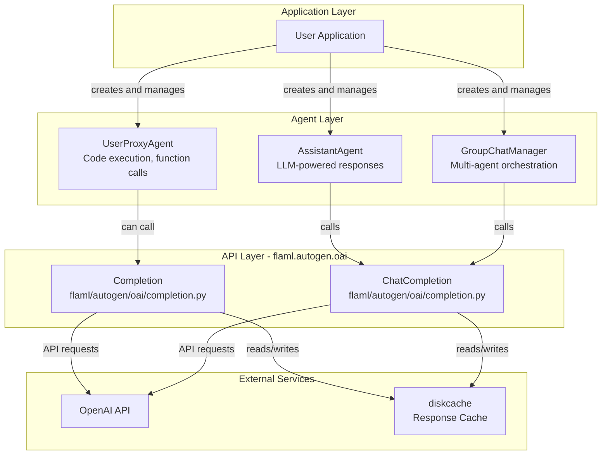
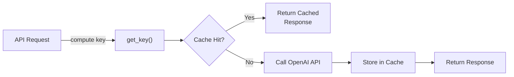
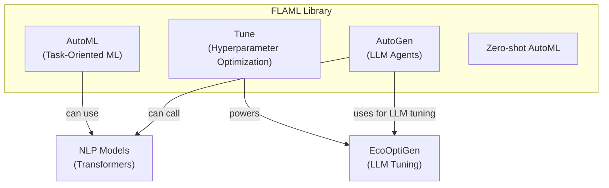

<!-- source: DeepWiki mcp.deepwiki.com · repo microsoft/FLAML · page 6 AutoGen · fetched 2026-10-26 -->

# AutoGen

<details>
<summary>Relevant source files</summary>

The following files were used as context for generating this wiki page:

- [flaml/autogen/oai/completion.py](flaml/autogen/oai/completion.py)
- [test/autogen/test_function_call.py](test/autogen/test_function_call.py)

</details>


AutoGen is a framework within FLAML for building LLM-powered applications using conversational agents. It provides infrastructure for creating multi-agent systems where specialized agents collaborate to solve complex tasks through conversation. AutoGen integrates OpenAI API wrappers, agent abstractions, conversation management, and code execution capabilities.

This page provides an overview of AutoGen's architecture and use cases. For detailed documentation on specific components, see:
- [Completion API](#6.1) - OpenAI API wrapper with caching, cost tracking, and hyperparameter tuning
- [Agent System](#6.2) - Agent abstractions, function calling, and code execution
- [Multi-Agent Conversations](#6.3) - Group chat and conversation patterns

## Architecture Overview

AutoGen consists of three main layers that work together to enable LLM-powered agent applications:

### High-Level Architecture



Sources:
- [flaml/autogen/oai/completion.py:42-46]()
- [flaml/autogen/oai/completion.py:1108-1113]()
- [flaml/autogen/oai/completion.py:109-134]()
- [test/autogen/test_function_call.py:66-67]()
- [test/autogen/test_function_call.py:81-82]()

## Core Components

AutoGen provides three main types of components:

### 1. Completion API Layer

The `Completion` and `ChatCompletion` classes in [flaml/autogen/oai/completion.py]() provide enhanced wrappers around OpenAI's API with:

| Feature | Description | Key Methods/Attributes |
|---------|-------------|------------------------|
| **Response Caching** | Disk-based cache using `diskcache` to avoid redundant API calls | `set_cache()`, `clear_cache()`, `cache_path` |
| **Cost Tracking** | Automatic cost calculation and budget management | `cost()`, `_total_cost`, `optimization_budget`, `inference_budget` |
| **Hyperparameter Tuning** | Use FLAML's `tune.run` to optimize prompt templates and model parameters | `tune()`, `default_search_space` |
| **Error Handling** | Automatic retry logic for rate limits and timeouts | `retry_time`, `retry_timeout`, `_get_response()` |
| **History Logging** | Track API calls and responses in compact or full format | `start_logging()`, `stop_logging()`, `logged_history` |

The API layer supports both completion models (`text-davinci-003`) and chat models (`gpt-3.5-turbo`, `gpt-4`), with automatic model detection based on the model name.

Sources:
- [flaml/autogen/oai/completion.py:42-117]()
- [flaml/autogen/oai/completion.py:123-151]()
- [flaml/autogen/oai/completion.py:497-682]()
- [flaml/autogen/oai/completion.py:684-804]()
- [flaml/autogen/oai/completion.py:1052-1106]()

### 2. Agent System

AutoGen provides agent abstractions for different roles in a conversation:

- **AssistantAgent**: LLM-powered agent that generates responses based on prompts
- **UserProxyAgent**: Represents the user, can execute code and call functions
- **GroupChatManager**: Orchestrates multi-agent conversations

These agents communicate through message passing and can be configured with different LLM backends, system messages, and execution capabilities. See [Agent System](#6.2) for details.

Sources:
- [test/autogen/test_function_call.py:66-67]()
- [test/autogen/test_function_call.py:81-82]()

### 3. Multi-Agent Orchestration

The `GroupChat` and `GroupChatManager` classes enable complex workflows where multiple specialized agents collaborate on tasks. Agents can be assigned different roles (planner, critic, executor, etc.) and the manager handles turn-taking and conversation flow. See [Multi-Agent Conversations](#6.3) for details.

Sources:
- [test/autogen/test_function_call.py:10-11]()

## Key Features

### Response Caching

AutoGen uses `diskcache` to cache OpenAI API responses, preventing redundant API calls and reducing costs. The cache key is computed from the request parameters, and cached responses are retrieved when the same request is made again.



Sources:
- [flaml/autogen/oai/completion.py:109-134]()
- [flaml/autogen/oai/completion.py:184-261]()

### Cost Tracking and Budget Management

AutoGen automatically tracks API costs using token counts and model pricing. It supports:

- **Per-call cost calculation**: Based on input/output tokens and model-specific pricing
- **Optimization budget**: Limit total cost during hyperparameter tuning
- **Inference budget**: Target cost per instance during evaluation

The `price1K` dictionary defines the cost per 1000 tokens for each model, with separate pricing for input and output tokens for chat models.

Sources:
- [flaml/autogen/oai/completion.py:64-85]()
- [flaml/autogen/oai/completion.py:991-1010]()
- [flaml/autogen/oai/completion.py:343-360]()

### Hyperparameter Tuning for LLMs

AutoGen integrates with FLAML's `tune.run` to optimize:

- **Model selection**: Choose between GPT-3.5, GPT-4, etc.
- **Prompt templates**: Test different prompt formulations
- **Sampling parameters**: `temperature`, `top_p`, `max_tokens`, `n` (number of completions)

The `tune()` method uses `BlendSearch` to efficiently explore the hyperparameter space while respecting budget constraints.

Sources:
- [flaml/autogen/oai/completion.py:87-106]()
- [flaml/autogen/oai/completion.py:497-682]()
- [flaml/autogen/oai/completion.py:636-658]()

## Main Use Cases

### 1. Enhanced OpenAI API Wrapper

Use `Completion.create()` or `ChatCompletion.create()` as drop-in replacements for OpenAI's API with automatic caching and cost tracking:

```python
# Basic usage with caching
response = ChatCompletion.create(
    model="gpt-3.5-turbo",
    messages=[{"role": "user", "content": "Hello!"}],
    use_cache=True  # Default
)

# With config_list for fallback models
response = Completion.create(
    config_list=[
        {"model": "gpt-4", "api_key": "..."},
        {"model": "gpt-3.5-turbo", "api_key": "..."}
    ],
    prompt="Explain quantum computing"
)
```

Sources:
- [flaml/autogen/oai/completion.py:684-804]()
- [flaml/autogen/oai/completion.py:762-793]()

### 2. Prompt and Model Optimization

Use `tune()` to find optimal prompts and hyperparameters for your task:

```python
# Define evaluation function
def eval_func(responses, **data):
    # Evaluate response quality
    return {"accuracy": ..., "cost": ...}

# Tune hyperparameters
best_config, analysis = Completion.tune(
    data=training_data,
    metric="accuracy",
    mode="max",
    eval_func=eval_func,
    inference_budget=0.05,  # $0.05 per instance
    optimization_budget=5.0,  # $5 total budget
    num_samples=100
)
```

Sources:
- [flaml/autogen/oai/completion.py:497-682]()
- [flaml/autogen/oai/completion.py:515-560]()

### 3. Multi-Agent Task Solving

Create specialized agents that collaborate on complex tasks:

- **Research automation**: Agents for planning, searching, analyzing, and presenting
- **Code generation and execution**: Engineer agent writes code, executor runs it
- **Iterative refinement**: Critic agents provide feedback on generated content
- **Domain expertise**: Specialized agents for different aspects of a problem

See [Multi-Agent Conversations](#6.3) for implementation details.

Sources:
- [test/autogen/test_function_call.py:40-62]()

### 4. Function Calling and Tool Use

Agents can invoke external functions and tools through the `function_map`:

```python
# Define function
def search_papers(query, max_results=10):
    # Search implementation
    return results

# Create agent with function
user_proxy = UserProxyAgent(
    name="user",
    function_map={"search_papers": search_papers}
)

# Agent can now call this function based on LLM's function_call
```

Sources:
- [test/autogen/test_function_call.py:80-130]()
- [test/autogen/test_function_call.py:19-62]()

## Completion API Methods

The `Completion` and `ChatCompletion` classes provide several key methods:

### API Methods Reference

| Method | Purpose | Key Parameters |
|--------|---------|----------------|
| `create()` | Make a completion request with optional caching and config fallback | `context`, `use_cache`, `config_list`, `raise_on_ratelimit_or_timeout` |
| `tune()` | Optimize hyperparameters using FLAML's search algorithms | `data`, `metric`, `mode`, `eval_func`, `inference_budget`, `optimization_budget` |
| `test()` | Evaluate a configuration on test data with aggregation | `data`, `eval_func`, `use_cache`, `agg_method` |
| `cost()` | Calculate the cost of an API response | `response` |
| `extract_text()` | Extract text content from completion response | `response` |
| `extract_text_or_function_call()` | Extract text or function call from chat response | `response` |
| `set_cache()` | Configure cache location and seed | `seed`, `cache_path_root` |
| `clear_cache()` | Clear cached responses | `seed`, `cache_path_root` |
| `start_logging()` | Begin tracking API calls and responses | `history_dict`, `compact`, `reset_counter` |
| `stop_logging()` | End tracking | - |

Sources:
- [flaml/autogen/oai/completion.py:684-804]()
- [flaml/autogen/oai/completion.py:497-682]()
- [flaml/autogen/oai/completion.py:858-988]()
- [flaml/autogen/oai/completion.py:991-1010]()
- [flaml/autogen/oai/completion.py:1013-1043]()
- [flaml/autogen/oai/completion.py:123-151]()
- [flaml/autogen/oai/completion.py:1052-1106]()

## Configuration and Templates

### Template Support

AutoGen supports template-based prompts and messages that are instantiated with context data:

- **String templates**: Use Python format strings: `"Complete: {prefix}"`
- **Callable templates**: Functions that take context dict and return strings
- **Message templates**: For chat models, each message's `content` can be a template

The `instantiate()` method handles template expansion with optional format string support.

Sources:
- [flaml/autogen/oai/completion.py:807-817]()
- [flaml/autogen/oai/completion.py:820-855]()
- [flaml/autogen/oai/completion.py:694-751]()

### Config List for Fallback

The `config_list` parameter allows specifying multiple API configurations with automatic fallback:

```python
config_list = [
    {
        "model": "gpt-4",
        "api_key": os.environ["AZURE_OPENAI_API_KEY"],
        "api_type": "azure",
        "api_base": os.environ["AZURE_OPENAI_API_BASE"],
        "api_version": "2023-03-15-preview"
    },
    {
        "model": "gpt-3.5-turbo",
        "api_key": os.environ["OPENAI_API_KEY"],
        "api_type": "open_ai"
    }
]
```

If the first config fails (authentication, rate limit, etc.), AutoGen automatically tries the next config in the list.

Sources:
- [flaml/autogen/oai/completion.py:607-611]()
- [flaml/autogen/oai/completion.py:706-734]()
- [flaml/autogen/oai/completion.py:762-793]()

## 7. Integration with FLAML

AutoGen is integrated with other FLAML components as one of the four main subsystems of the library. It particularly connects with:

1. **Tune**: AutoGen can leverage the hyperparameter optimization capabilities of Tune for LLM tuning
2. **EcoOptiGen**: Used for efficient LLM tuning within AutoGen
3. **NLP Models**: Can utilize transformer models also used by the AutoML system



Sources:
- [website/docs/Use-Cases/Autogen.md:1-3]()
- [website/docs/Examples/AutoGen-AgentChat.md:1-3]()

## Summary

AutoGen provides a flexible framework for building LLM-powered multi-agent systems that can collaborate on complex tasks. By offering different agent types, conversation management, and code execution capabilities, it enables the development of sophisticated applications that leverage the strengths of large language models within a structured agent-based architecture.

---

