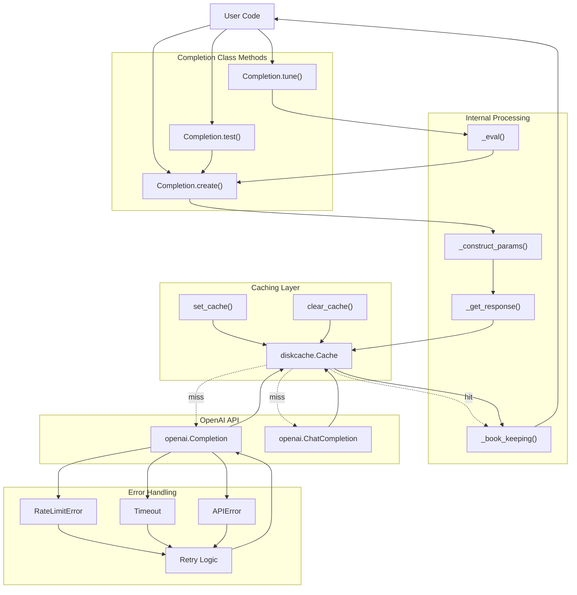
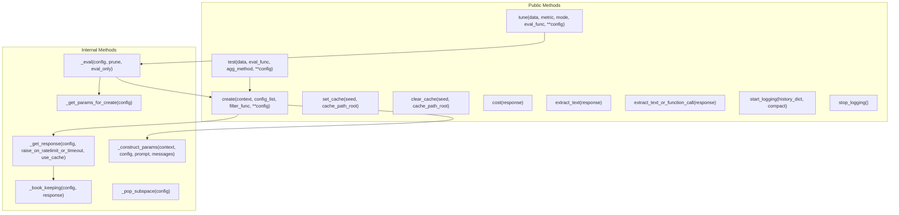
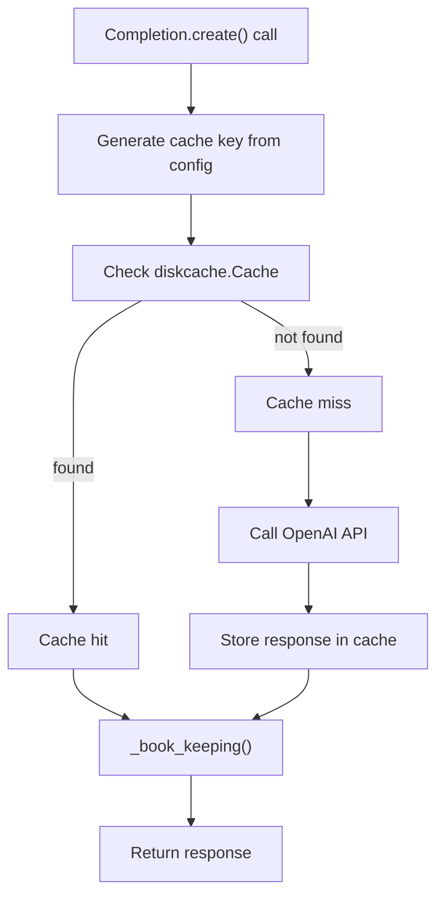
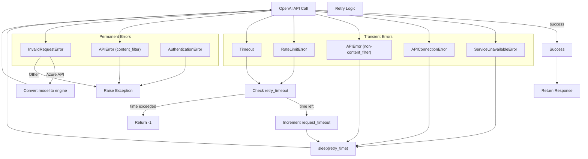
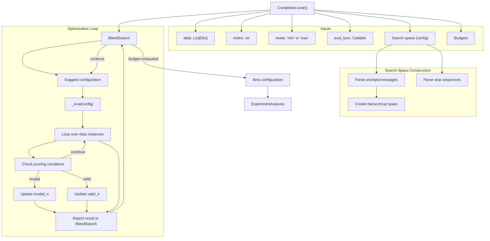
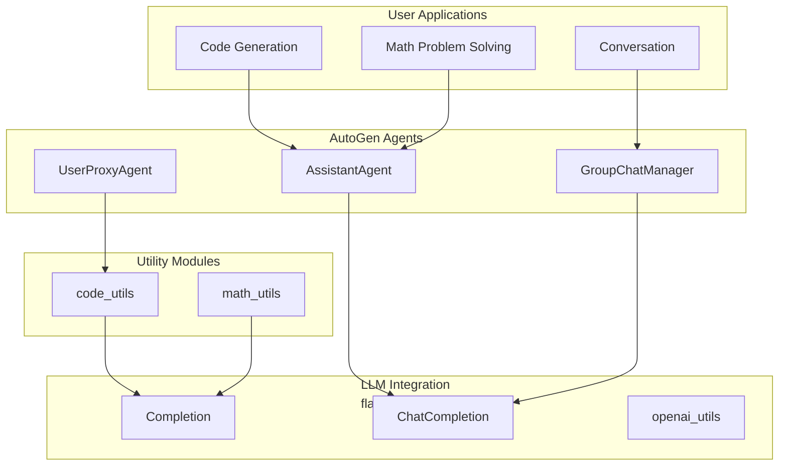

<!-- source: DeepWiki mcp.deepwiki.com · repo microsoft/FLAML · page 6.1 Completion API · fetched 2026-10-26 -->

# Completion API

<details>
<summary>Relevant source files</summary>

The following files were used as context for generating this wiki page:

- [flaml/autogen/oai/completion.py](flaml/autogen/oai/completion.py)

</details>


This page documents the Completion API in FLAML's AutoGen framework, which provides a wrapper around OpenAI's API with enhanced capabilities including response caching, cost tracking, error handling with retries, and hyperparameter tuning for prompts.

## Overview

The `Completion` class extends OpenAI's API with the following features:

- **Universal Support**: Works with both standard completion models and chat models
- **Response Caching**: Uses `diskcache` to avoid redundant API calls and control randomness
- **Cost Tracking**: Monitors and reports costs at request and optimization levels
- **Robust Error Handling**: Automatic retries for transient errors (rate limits, timeouts, API errors)
- **Hyperparameter Tuning**: Uses BlendSearch to optimize prompt configurations
- **Budget Management**: Controls costs through `inference_budget` and `optimization_budget`

Sources: [flaml/autogen/oai/completion.py:42-46](), [flaml/autogen/oai/completion.py:123-134](), [flaml/autogen/oai/completion.py:496-509]()

## Architecture

**Completion API Request Flow**



Sources: [flaml/autogen/oai/completion.py:684-804](), [flaml/autogen/oai/completion.py:184-261](), [flaml/autogen/oai/completion.py:496-682]()

## Core Components

### Completion Class

The `Completion` class [flaml/autogen/oai/completion.py:42-1106]() inherits from `openai.Completion` and provides enhanced functionality.

**Key Class Attributes**

| Attribute | Type | Description |
|-----------|------|-------------|
| `chat_models` | set | Models that support chat completion API |
| `price1K` | dict | Price per 1K tokens for each model |
| `default_search_space` | dict | Default hyperparameter search space for tuning |
| `seed` | int | Seed for cache path (default: 41) |
| `cache_path` | str | Path for response cache (default: `.cache/{seed}`) |
| `retry_time` | int | Seconds to wait before retry (default: 10) |
| `retry_timeout` | int | Maximum retry duration (default: 120) |
| `request_timeout` | int | Timeout for OpenAI request (default: 60) |

Sources: [flaml/autogen/oai/completion.py:48-115]()

**Supported Chat Models**

The following models are automatically routed to the ChatCompletion API:

```python
chat_models = {
    "gpt-3.5-turbo", "gpt-3.5-turbo-0301", "gpt-3.5-turbo-0613",
    "gpt-3.5-turbo-16k", "gpt-3.5-turbo-16k-0613", "gpt-35-turbo",
    "gpt-4", "gpt-4-32k", "gpt-4-32k-0314", "gpt-4-0314",
    "gpt-4-0613", "gpt-4-32k-0613",
}
```

Sources: [flaml/autogen/oai/completion.py:48-62]()

### ChatCompletion Class

The `ChatCompletion` class [flaml/autogen/oai/completion.py:1108-1114]() extends `Completion` with a modified default search space optimized for chat models:

```python
default_search_space = {
    "model": tune.choice(["gpt-3.5-turbo", "gpt-4"]),
    # ... other parameters from parent class
}
```

Sources: [flaml/autogen/oai/completion.py:1108-1113]()

### Class Methods Overview

**Completion Class Methods**



Sources: [flaml/autogen/oai/completion.py:123-1105]()

## Response Caching

The Completion API uses `diskcache` to cache responses, avoiding redundant API calls and enabling reproducible results.

**Cache Management Methods**

```python
# Set cache with a specific seed
Completion.set_cache(seed=42, cache_path_root=".cache")
# Cache path will be: .cache/42

# Clear specific cache
Completion.clear_cache(seed=42, cache_path_root=".cache")

# Clear all caches
Completion.clear_cache(cache_path_root=".cache")
```

Sources: [flaml/autogen/oai/completion.py:123-150]()

**Cache Key Generation**

The cache key is generated from the request configuration using the `get_key()` function, which creates a hash of:
- Model name
- Prompt or messages
- All other API parameters (temperature, max_tokens, etc.)

Sources: [flaml/autogen/oai/completion.py:191]()

**Caching Workflow**



Sources: [flaml/autogen/oai/completion.py:184-261]()

## Making API Calls

### The create() Method

The `create()` method [flaml/autogen/oai/completion.py:684-804]() is the primary interface for making completion requests.

**Basic Usage**

```python
response = Completion.create(
    context={"prefix": "Today I feel"},
    prompt="Complete the following sentence: {prefix}",
    model="gpt-3.5-turbo",
    temperature=0.7,
    max_tokens=100
)
```

**Method Signature**

```python
@classmethod
def create(
    cls,
    context: Optional[Dict] = None,
    use_cache: Optional[bool] = True,
    config_list: Optional[List[Dict]] = None,
    filter_func: Optional[Callable[[Dict, Dict, Dict], bool]] = None,
    raise_on_ratelimit_or_timeout: Optional[bool] = True,
    allow_format_str_template: Optional[bool] = False,
    **config,
)
```

Sources: [flaml/autogen/oai/completion.py:684-694]()

**Parameters**

| Parameter | Type | Description |
|-----------|------|-------------|
| `context` | Dict | Context for template instantiation |
| `use_cache` | bool | Whether to use cached responses (default: True) |
| `config_list` | List[Dict] | List of configurations to try in order |
| `filter_func` | Callable | Function to filter valid responses |
| `raise_on_ratelimit_or_timeout` | bool | Whether to raise errors on rate limits (default: True) |
| `allow_format_str_template` | bool | Allow format string templates (default: False) |
| `**config` | - | OpenAI API parameters (model, temperature, etc.) |

Sources: [flaml/autogen/oai/completion.py:697-751]()

### Template Instantiation

The `instantiate()` method [flaml/autogen/oai/completion.py:806-817]() supports both string templates and callable templates:

```python
# String template (when allow_format_str_template=True)
prompt = "Hello {name}, how are you?"
instantiated = Completion.instantiate(prompt, {"name": "Alice"}, allow_format_str_template=True)
# Result: "Hello Alice, how are you?"

# Callable template
prompt = lambda context: f"Hello {context['name']}, how are you?"
instantiated = Completion.instantiate(prompt, {"name": "Bob"})
# Result: "Hello Bob, how are you?"
```

Sources: [flaml/autogen/oai/completion.py:806-817]()

### config_list Support

The `config_list` parameter allows trying multiple configurations in order until one succeeds:

```python
response = Completion.create(
    config_list=[
        {
            "model": "gpt-4",
            "api_key": os.environ.get("AZURE_OPENAI_API_KEY"),
            "api_type": "azure",
            "api_base": os.environ.get("AZURE_OPENAI_API_BASE"),
        },
        {
            "model": "gpt-3.5-turbo",
            "api_key": os.environ.get("OPENAI_API_KEY"),
        },
    ],
    prompt="Hi",
)
```

The response includes:
- `config_id`: Index of the successful configuration
- `pass_filter`: Whether the response passed the filter function (if provided)
- `cost`: Total cost across all attempted configurations

Sources: [flaml/autogen/oai/completion.py:762-793]()

### Response Format

Responses include additional fields beyond the standard OpenAI response:

```python
{
    "choices": [...],  # Standard OpenAI response
    "usage": {...},
    "cost": 0.002,     # Computed cost in USD
    "config_id": 0,    # Which config was used (when config_list provided)
    "pass_filter": True,  # Filter result (when filter_func provided)
}
```

Sources: [flaml/autogen/oai/completion.py:753-758](), [flaml/autogen/oai/completion.py:155-156]()

## Cost Tracking

The Completion API tracks costs at multiple levels to maintain budget awareness.

### Price Dictionary

The `price1K` dictionary [flaml/autogen/oai/completion.py:64-85]() stores pricing per 1000 tokens:

```python
price1K = {
    "text-davinci-003": 0.02,
    "gpt-3.5-turbo": (0.0015, 0.002),  # (input, output) prices
    "gpt-4": (0.03, 0.06),
    "gpt-4-32k": (0.06, 0.12),
    # ... other models
}
```

For chat models, prices are tuples of (input_price, output_price).

Sources: [flaml/autogen/oai/completion.py:64-85]()

### Cost Computation

The `cost()` method [flaml/autogen/oai/completion.py:990-1010]() computes the cost of a response:

```python
@classmethod
def cost(cls, response: dict):
    """Compute the cost of an API call.
    
    Returns:
        The cost in USD. 0 if the model is not supported.
    """
    model = response["model"]
    usage = response["usage"]
    n_input_tokens = usage["prompt_tokens"]
    n_output_tokens = usage.get("completion_tokens", 0)
    price1K = cls.price1K[model]
    
    if isinstance(price1K, tuple):
        return (price1K[0] * n_input_tokens + price1K[1] * n_output_tokens) / 1000
    return price1K * (n_input_tokens + n_output_tokens) / 1000
```

Sources: [flaml/autogen/oai/completion.py:990-1010]()

### Total Cost Tracking

The `_total_cost` class variable tracks cumulative costs during optimization:

```python
_total_cost = 0  # Initialized at class level

# Updated during _eval()
cls._total_cost += query_cost

# Checked against optimization_budget
if cls.optimization_budget and cls._total_cost >= cls.optimization_budget:
    return {
        metric: 0,
        "total_cost": cls._total_cost,
        "cost": cost,
    }
```

Sources: [flaml/autogen/oai/completion.py:118](), [flaml/autogen/oai/completion.py:409-417]()

## Error Handling and Retries

The Completion API implements robust error handling with automatic retries for transient errors.

**Error Handling Flow**



Sources: [flaml/autogen/oai/completion.py:212-256]()

**Supported Error Types**

| Error Type | Retry Behavior |
|------------|----------------|
| `ServiceUnavailableError` | Retry after `retry_time` seconds |
| `APIConnectionError` | Retry after `retry_time` seconds |
| `APIError` (non-content_filter) | Retry after `retry_time` seconds |
| `RateLimitError` | Retry until `retry_timeout` exceeded |
| `Timeout` | Retry with increased timeout until `retry_timeout` exceeded |
| `InvalidRequestError` (Azure) | Convert model to engine and retry |
| `AuthenticationError` | Raise immediately |
| `APIError` (content_filter) | Raise immediately |

Sources: [flaml/autogen/oai/completion.py:212-256]()

**Configuration Parameters**

```python
# Class-level defaults
Completion.retry_time = 10        # Wait 10 seconds before retry
Completion.retry_timeout = 120    # Give up after 120 seconds
Completion.request_timeout = 60   # Request timeout

# Can be overridden per request
response = Completion.create(
    prompt="Hello",
    retry_timeout=60,  # Custom retry timeout for this request
    request_timeout=30,  # Custom request timeout
)
```

Sources: [flaml/autogen/oai/completion.py:110-115](), [flaml/autogen/oai/completion.py:205]()

## Hyperparameter Tuning

The `tune()` method [flaml/autogen/oai/completion.py:496-682]() uses BlendSearch to find optimal hyperparameters for LLM requests.

**Tuning Workflow**



Sources: [flaml/autogen/oai/completion.py:496-682]()

### Method Signature

```python
@classmethod
def tune(
    cls,
    data: List[Dict],
    metric: str,
    mode: str,
    eval_func: Callable,
    log_file_name: Optional[str] = None,
    inference_budget: Optional[float] = None,
    optimization_budget: Optional[float] = None,
    num_samples: Optional[int] = 1,
    logging_level: Optional[int] = logging.WARNING,
    **config,
)
```

Sources: [flaml/autogen/oai/completion.py:496-509]()

**Parameters**

| Parameter | Type | Description |
|-----------|------|-------------|
| `data` | List[Dict] | List of data instances for evaluation |
| `metric` | str | Metric to optimize (e.g., "success", "accuracy") |
| `mode` | str | "min" or "max" optimization |
| `eval_func` | Callable | Function to evaluate responses |
| `inference_budget` | float | Target average cost per instance (USD) |
| `optimization_budget` | float | Total budget for tuning (USD) |
| `num_samples` | int | Number of trials (-1 for unlimited) |
| `logging_level` | int | Logging level (default: WARNING) |
| `**config` | - | Search space configuration |

Sources: [flaml/autogen/oai/completion.py:515-545]()

### Default Search Space

```python
default_search_space = {
    "model": tune.choice([
        "text-ada-001",
        "text-babbage-001",
        "text-davinci-003",
        "gpt-3.5-turbo",
        "gpt-4",
    ]),
    "temperature_or_top_p": tune.choice([
        {"temperature": tune.uniform(0, 2)},
        {"top_p": tune.uniform(0, 1)},
    ]),
    "max_tokens": tune.lograndint(50, 1000),
    "n": tune.randint(1, 100),
    "prompt": "{prompt}",
}
```

Sources: [flaml/autogen/oai/completion.py:87-106]()

### Evaluation Function

The `eval_func` should take a list of responses and a data instance, returning a dictionary of metrics:

```python
def eval_func(responses, **data):
    """Evaluate a list of responses.
    
    Args:
        responses: List of response texts or function calls
        **data: Data instance fields (solution, test_cases, etc.)
    
    Returns:
        Dict of metrics (must include the metric being optimized)
    """
    solution = data["solution"]
    success_list = []
    n = len(responses)
    
    for response in responses:
        succeed = check_correctness(response, solution)
        success_list.append(succeed)
    
    return {
        "expected_success": 1 - pow(1 - sum(success_list) / n, n),
        "success": any(success_list),
    }
```

Sources: [flaml/autogen/oai/completion.py:519-536]()

### Pruning Mechanism

The `_eval()` method [flaml/autogen/oai/completion.py:325-494]() implements early pruning to save costs:

1. **Region-based Tracking**: Tracks valid/invalid configurations per (model, prompt, stop) region
2. **Token-based Bounds**: Uses `max_valid_n` and `min_invalid_n` to avoid exploring known invalid regions
3. **Progressive Evaluation**: Uses exponential search (n=1, 2, 4, 8, ...) to find optimal `n` value
4. **Hoeffding-Serfling Bound**: Statistical bound to decide when to prune based on partial data

Sources: [flaml/autogen/oai/completion.py:325-494]()

### Example Usage

```python
# Define evaluation function
def eval_func(responses, **data):
    correct = sum(1 for r in responses if check_answer(r, data["answer"]))
    return {"accuracy": correct / len(responses)}

# Tune hyperparameters
config, analysis = Completion.tune(
    data=[
        {"question": "What is 2+2?", "answer": "4"},
        {"question": "What is the capital of France?", "answer": "Paris"},
    ],
    metric="accuracy",
    mode="max",
    eval_func=eval_func,
    inference_budget=0.01,  # $0.01 per instance
    optimization_budget=0.5,  # $0.50 total
    prompt=["Q: {question}\nA:", "Question: {question}\nAnswer:"],
    model=["gpt-3.5-turbo", "gpt-4"],
)

# Use best configuration
response = Completion.create(
    context={"question": "What is 3+3?"},
    **config
)
```

Sources: [flaml/autogen/oai/completion.py:496-682]()

## Testing and Evaluation

The `test()` method [flaml/autogen/oai/completion.py:857-988]() evaluates a configuration on test data.

### Method Signature

```python
@classmethod
def test(
    cls,
    data,
    eval_func=None,
    use_cache=True,
    agg_method="avg",
    return_responses_and_per_instance_result=False,
    logging_level=logging.WARNING,
    **config,
)
```

Sources: [flaml/autogen/oai/completion.py:857-866]()

**Parameters**

| Parameter | Type | Description |
|-----------|------|-------------|
| `data` | List[Dict] | Test data instances |
| `eval_func` | Callable | Evaluation function (uses `_eval_func` from `tune()` if None) |
| `use_cache` | bool | Whether to use cached responses |
| `agg_method` | str/Callable/dict | Aggregation method across instances |
| `return_responses_and_per_instance_result` | bool | Return detailed results |
| `**config` | - | Configuration to test |

Sources: [flaml/autogen/oai/completion.py:871-917]()

### Aggregation Methods

**String Methods**

```python
# Average
result = Completion.test(data, eval_func, agg_method="avg")

# Median
result = Completion.test(data, eval_func, agg_method="median")
```

**Callable Method**

```python
import numpy as np

result = Completion.test(data, eval_func, agg_method=np.median)
```

**Dictionary of Callables**

```python
result = Completion.test(
    data,
    eval_func,
    agg_method={
        "median_success": np.median,
        "avg_success": np.mean,
        "max_success": np.max,
    }
)
```

Sources: [flaml/autogen/oai/completion.py:894-978]()

### Example Usage

```python
# Test a configuration
result = Completion.test(
    data=test_data,
    eval_func=eval_func,
    prompt="Q: {question}\nA:",
    model="gpt-3.5-turbo",
    temperature=0.7,
)

# Result: {"accuracy": 0.85, "cost": 0.05, "inference_cost": 0.01}

# Get detailed results
result_agg, result_list, responses_list = Completion.test(
    data=test_data,
    eval_func=eval_func,
    return_responses_and_per_instance_result=True,
    **config
)
```

Sources: [flaml/autogen/oai/completion.py:857-988]()

## Advanced Features

### Response Caching

AutoGen implements a caching mechanism to avoid redundant API calls:

```python
# Set the cache with a specific seed for reproducibility
autogen.Completion.set_cache(seed=41)

# Clear the cache
autogen.Completion.clear_cache()
```

The cache is stored in `.cache/{seed}` by default, with different seeds stored separately.

Sources: [flaml/autogen/oai/completion.py:123-150]()

### Error Handling and Retries

AutoGen provides robust error handling for various API errors:

- Rate limit errors: Retry after delay
- Timeout errors: Retry with increased timeout
- Connection errors: Retry after delay
- API errors: Handle according to the error type

This ensures resilience when working with external API services.

Sources: [flaml/autogen/oai/completion.py:183-261]()

### Cost Tracking

AutoGen tracks the cost of LLM requests, including:

- Cost per request
- Total cost for tuning
- Inference cost per instance

This helps maintain cost awareness and ensures that budgets are respected.

Sources: [flaml/autogen/oai/completion.py:64-85](), [flaml/autogen/oai/completion.py:411-418]()

## Integration with AutoGen Agents

The LLM integration serves as a foundation for AutoGen's agent capabilities, enabling agents to:

- Generate code and execute it
- Solve complex problems through reasoning
- Respond intelligently to user queries
- Participate in multi-agent conversations



Sources: [flaml/autogen/code_utils.py:1-28](), [flaml/autogen/math_utils.py:1-11]()

## Conclusion

AutoGen's LLM integration provides a comprehensive set of tools for interacting with large language models, with features like hyperparameter tuning, caching, error handling, and specialized utilities for code and math. This enables a wide range of applications, from code generation to mathematical problem solving, while optimizing for both performance and cost-effectiveness.

For more information on related topics, see:
- [AutoGen](#4): Overview of the AutoGen framework
- [Agent Chat](#4.1): Details about agent-based interactions
- [Group Chat](#4.2): Multi-agent conversation capabilities

---

