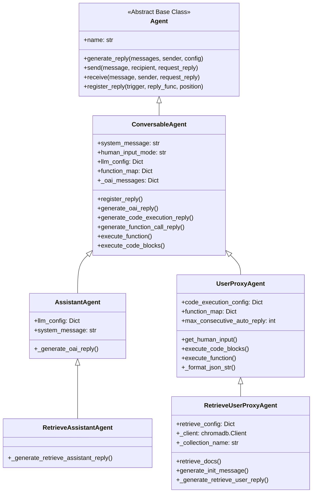
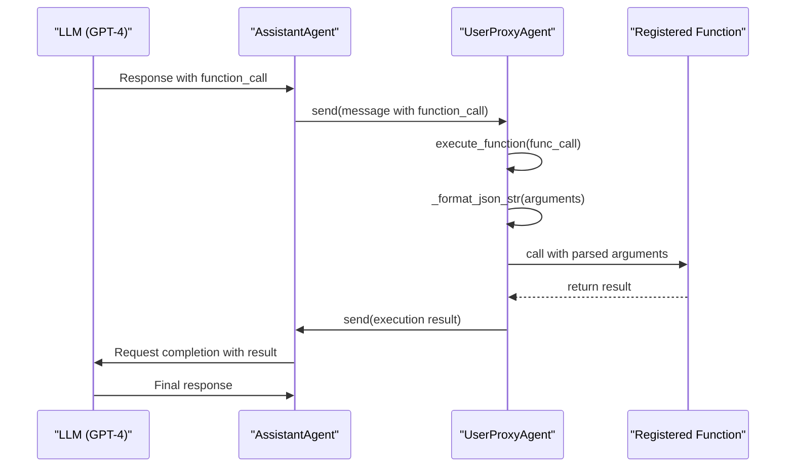
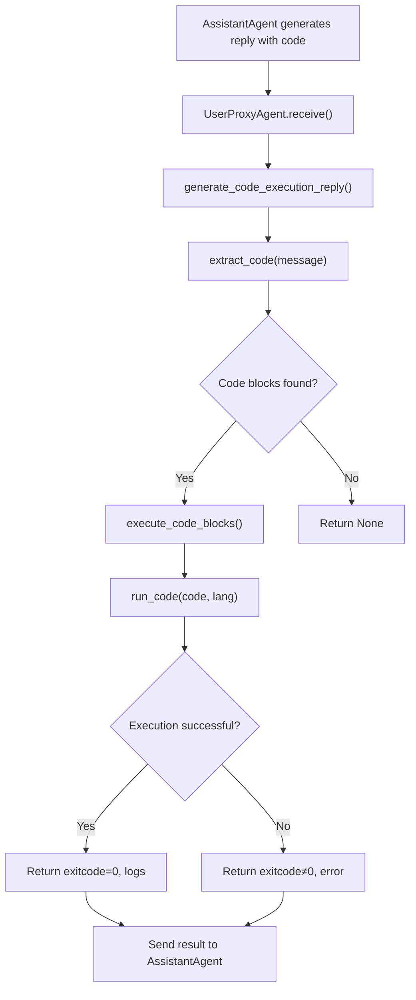
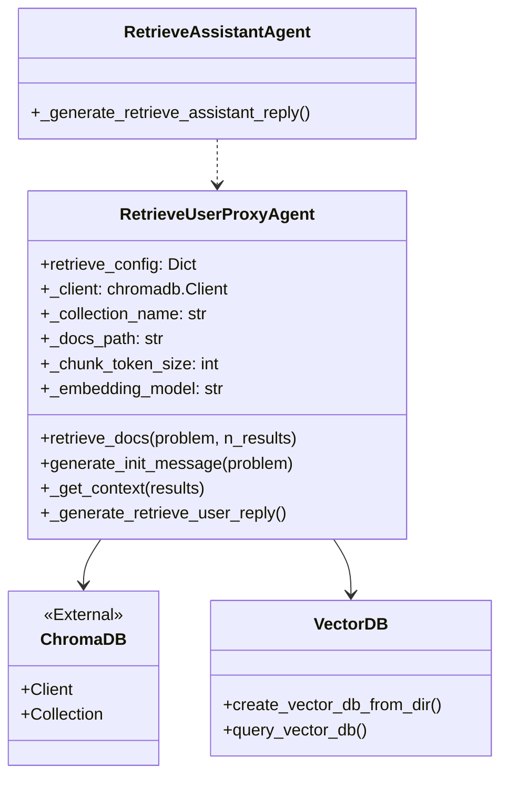
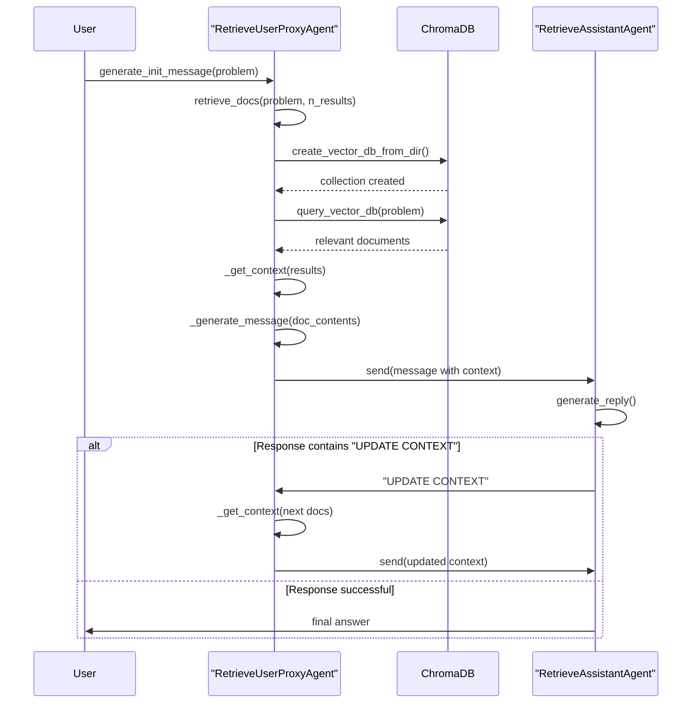

<!-- source: DeepWiki mcp.deepwiki.com · repo microsoft/FLAML · page 6.2 Agent System · fetched 2026-10-26 -->

# Agent System

<details>
<summary>Relevant source files</summary>

The following files were used as context for generating this wiki page:

- [.github/workflows/CD.yml](.github/workflows/CD.yml)
- [.github/workflows/deploy-website.yml](.github/workflows/deploy-website.yml)
- [Dockerfile](Dockerfile)
- [flaml/autogen/agentchat/contrib/retrieve_assistant_agent.py](flaml/autogen/agentchat/contrib/retrieve_assistant_agent.py)
- [flaml/autogen/agentchat/contrib/retrieve_user_proxy_agent.py](flaml/autogen/agentchat/contrib/retrieve_user_proxy_agent.py)
- [test/autogen/test_function_call.py](test/autogen/test_function_call.py)
- [test/automl/test_training_log.py](test/automl/test_training_log.py)
- [test/test_autovw.py](test/test_autovw.py)
- [website/package.json](website/package.json)
- [website/yarn.lock](website/yarn.lock)

</details>


## Purpose and Scope

This document explains the agent architecture in FLAML's AutoGen framework, focusing on the core agent types (`AssistantAgent` and `UserProxyAgent`), their capabilities, and specialized features. The agent system provides a flexible foundation for building LLM-powered applications with support for function calling, code execution, and retrieve-augmented generation (RAG).

Key topics covered:
- Agent architecture and base classes
- `AssistantAgent` and `UserProxyAgent` implementations
- Function calling capabilities for tool integration
- Code execution mechanisms
- Retrieve-augmented generation with ChromaDB

For information about the broader AutoGen framework, see page 6. For multi-agent conversations and group chat, see page 6.3.

## Agent Architecture

The agent system in AutoGen is built on a hierarchy of agent classes. The core architecture separates concerns between conversation management, LLM interaction, and code execution.

### Agent Class Hierarchy



Sources: [flaml/autogen/agentchat/user_proxy_agent.py:1-84](), [flaml/autogen/agentchat/contrib/retrieve_user_proxy_agent.py:1-307](), [flaml/autogen/agentchat/contrib/retrieve_assistant_agent.py:1-45]()

### Agent Base Class

The `Agent` class defines the fundamental interface for all agents:

| Method | Purpose |
|--------|---------|
| `generate_reply()` | Generate a reply based on received messages |
| `send()` | Send a message to another agent |
| `receive()` | Receive and process a message from another agent |
| `register_reply()` | Register custom reply functions for specific triggers |

### ConversableAgent

`ConversableAgent` extends `Agent` with conversation management capabilities:

**Key Attributes:**
- `system_message`: Defines the agent's role and behavior
- `human_input_mode`: Controls when human input is requested (`ALWAYS`, `TERMINATE`, `NEVER`)
- `llm_config`: Configuration for LLM API calls
- `function_map`: Maps function names to callable functions
- `_oai_messages`: Stores conversation history per sender

**Key Methods:**
- `generate_oai_reply()`: Generate LLM-based replies
- `generate_code_execution_reply()`: Execute code blocks
- `generate_function_call_reply()`: Handle function calls
- `execute_function()`: Execute a function from the function map

Sources: [flaml/autogen/agentchat/user_proxy_agent.py:6-83](), [test/autogen/test_function_call.py:80-130]()

### AssistantAgent

`AssistantAgent` is designed for automated LLM-powered responses:

**Characteristics:**
- Primary focus on generating LLM replies
- Does not execute code by default
- Configured with `llm_config` for OpenAI API
- System message typically describes task-solving capabilities

**Typical Use Cases:**
- Task reasoning and planning
- Code generation (without execution)
- Question answering
- Content creation

Sources: [flaml/autogen/agentchat/contrib/retrieve_assistant_agent.py:7-20]()

### UserProxyAgent

`UserProxyAgent` serves as an interface between humans and automated agents:

**Characteristics:**
- Executes code blocks by default
- Can prompt for human input based on `human_input_mode`
- Supports function execution via `function_map`
- Handles code execution results

**Configuration:**
```python
code_execution_config = {
    "work_dir": "coding",        # Working directory for code execution
    "use_docker": False,         # Whether to use Docker for isolation
    "timeout": 60,               # Execution timeout in seconds
    "last_n_messages": 3         # Number of messages to consider for code blocks
}
```

**Key Methods:**
- `get_human_input()`: Prompt user for input
- `execute_code_blocks()`: Extract and execute code from messages
- `execute_function()`: Execute functions with JSON argument parsing
- `_format_json_str()`: Format JSON strings for proper parsing

Sources: [flaml/autogen/agentchat/user_proxy_agent.py:1-84](), [test/autogen/test_function_call.py:80-130]()

## Function Calling Capabilities

AutoGen agents support function calling, allowing LLMs to invoke external tools and APIs. This feature enables agents to extend their capabilities beyond text generation.

### Function Registration

Functions are registered via the `function_map` parameter during agent initialization:

```python
def add_num(num_to_be_added):
    given_num = 10
    return num_to_be_added + given_num

user_proxy = UserProxyAgent(
    name="user",
    function_map={"add_num": add_num}
)
```

The agent can then execute functions when requested by the LLM through function calls.

Sources: [test/autogen/test_function_call.py:80-92]()

### Function Call Execution Flow



Sources: [test/autogen/test_function_call.py:80-130]()

### Function Schema Definition

Functions are defined using OpenAI's function calling schema:

```python
functions = [
    {
        "name": "eval_math_responses",
        "description": "Select a response for a math problem using voting",
        "parameters": {
            "type": "object",
            "properties": {
                "responses": {
                    "type": "array",
                    "items": {"type": "string"},
                    "description": "The responses in a list"
                },
                "solution": {
                    "type": "string",
                    "description": "The canonical solution"
                }
            },
            "required": ["responses"]
        }
    }
]
```

Sources: [test/autogen/test_function_call.py:19-39]()

### Function Execution Error Handling

The `execute_function()` method in `UserProxyAgent` handles various error cases:

| Error Type | Detection | Response |
|------------|-----------|----------|
| Function not found | Function name not in `function_map` | "Error: Function {name} not found." |
| Invalid JSON | JSON parsing fails | "You argument should follow json format." |
| Execution error | Function raises exception | "Error: {exception message}" |

The `_format_json_str()` method preprocesses JSON strings to handle common formatting issues before parsing.

Sources: [test/autogen/test_function_call.py:94-107](), [test/autogen/test_function_call.py:65-78]()

### Executing Class Methods

Function maps can also contain class methods, maintaining state across calls:

```python
class AddNum:
    def __init__(self, given_num):
        self.given_num = given_num
    
    def add(self, num_to_be_added):
        self.given_num = num_to_be_added + self.given_num
        return self.given_num

user = UserProxyAgent(
    name="user",
    function_map={"add_num": AddNum(given_num=10).add}
)
```

Sources: [test/autogen/test_function_call.py:109-122]()

## Code Execution

`UserProxyAgent` provides code execution capabilities, allowing agents to run Python code and shell commands in response to LLM-generated code blocks.

### Code Execution Configuration

Code execution is configured via the `code_execution_config` dictionary:

```python
code_execution_config = {
    "work_dir": "coding",           # Working directory
    "use_docker": False,            # Docker isolation (recommended for production)
    "timeout": 60,                  # Execution timeout (seconds)
    "last_n_messages": 3            # Number of messages to scan for code
}

user_proxy = UserProxyAgent(
    name="user",
    code_execution_config=code_execution_config
)
```

**Configuration Parameters:**

| Parameter | Type | Description | Default |
|-----------|------|-------------|---------|
| `work_dir` | str | Directory for code execution | Current directory |
| `use_docker` | bool | Execute code in Docker container | `True` |
| `timeout` | int | Maximum execution time (seconds) | 60 |
| `last_n_messages` | int | Number of recent messages to check for code | 1 |

Sources: [flaml/autogen/agentchat/user_proxy_agent.py:6-83]()

### Code Extraction and Execution Flow



Sources: [flaml/autogen/agentchat/user_proxy_agent.py:6-83]()

### Supported Languages

The code execution system supports multiple programming languages:

- **Python**: Direct execution via `exec()` or subprocess
- **Shell**: Bash/sh commands via subprocess
- **Others**: Extensible through custom execution handlers

### Code Block Format

Code blocks are extracted from markdown code fences:

````python
# Python code block
```python
x = 10
print(x * 2)
```

# Shell command
```bash
ls -la
```
````

Sources: [flaml/autogen/agentchat/user_proxy_agent.py:6-83]()

### Execution Safety

**Docker Isolation:**
When `use_docker=True`, code executes in an isolated Docker container, providing:
- Filesystem isolation
- Network isolation
- Resource limits
- Clean environment per execution

**Timeout Protection:**
The `timeout` parameter prevents infinite loops and long-running processes.

**Working Directory:**
The `work_dir` parameter isolates file operations to a specific directory.

## Retrieve-Augmented Generation (RAG)

AutoGen provides specialized agents for retrieve-augmented generation, integrating ChromaDB for document retrieval to enhance LLM responses with relevant context.

### RAG Agent Architecture



Sources: [flaml/autogen/agentchat/contrib/retrieve_user_proxy_agent.py:1-307](), [flaml/autogen/agentchat/contrib/retrieve_assistant_agent.py:1-45]()

### RetrieveUserProxyAgent

`RetrieveUserProxyAgent` extends `UserProxyAgent` to add document retrieval capabilities:

**Key Attributes:**
```python
retrieve_config = {
    "task": "qa",                           # Task type: "code", "qa", or "default"
    "client": chromadb.Client(),            # ChromaDB client
    "docs_path": "./docs",                  # Path to documents
    "collection_name": "flaml-docs",        # Collection name
    "model": "gpt-4",                       # LLM model
    "chunk_token_size": 2000,               # Chunk size for documents
    "context_max_tokens": 4000,             # Max context tokens
    "chunk_mode": "multi_lines",            # Chunking strategy
    "embedding_model": "all-MiniLM-L6-v2",  # Embedding model
    "customized_prompt": None               # Custom prompt template
}
```

Sources: [flaml/autogen/agentchat/contrib/retrieve_user_proxy_agent.py:86-146]()

### RAG Workflow



Sources: [flaml/autogen/agentchat/contrib/retrieve_user_proxy_agent.py:229-269](), [flaml/autogen/agentchat/contrib/retrieve_assistant_agent.py:22-44]()

### Document Retrieval Process

**Step 1: Document Indexing**

Documents are chunked and embedded when `retrieve_docs()` is first called:

```python
def retrieve_docs(self, problem: str, n_results: int = 20):
    if not self._collection:
        create_vector_db_from_dir(
            dir_path=self._docs_path,
            max_tokens=self._chunk_token_size,
            client=self._client,
            collection_name=self._collection_name,
            chunk_mode=self._chunk_mode,
            embedding_model=self._embedding_model
        )
        self._collection = True
```

Sources: [flaml/autogen/agentchat/contrib/retrieve_user_proxy_agent.py:229-240]()

**Step 2: Query and Retrieval**

The agent queries the vector database with the problem statement:

```python
results = query_vector_db(
    query_texts=[problem],
    n_results=n_results,
    client=self._client,
    collection_name=self._collection_name,
    embedding_model=self._embedding_model
)
```

Sources: [flaml/autogen/agentchat/contrib/retrieve_user_proxy_agent.py:242-249]()

**Step 3: Context Assembly**

The `_get_context()` method assembles relevant document chunks, respecting token limits:

```python
def _get_context(self, results):
    doc_contents = ""
    current_tokens = 0
    for idx, doc in enumerate(results["documents"][0]):
        _doc_tokens = num_tokens_from_text(doc)
        if current_tokens + _doc_tokens > self._context_max_tokens:
            break
        doc_contents += doc + "\n"
        self._doc_idx = idx
    return doc_contents
```

Sources: [flaml/autogen/agentchat/contrib/retrieve_user_proxy_agent.py:169-189]()

### Context Update Mechanism

When the assistant determines that current context is insufficient, it can request updated context by responding with `"UPDATE CONTEXT"`. The `RetrieveUserProxyAgent` detects this and provides additional document chunks:

```python
def _generate_retrieve_user_reply(self, messages, sender, config):
    message = messages[-1]
    if "UPDATE CONTEXT" in message.get("content", ""):
        self.clear_history()
        sender.clear_history()
        doc_contents = self._get_context(self._results)
        return True, self._generate_message(doc_contents, task=self._task)
    return False, None
```

Sources: [flaml/autogen/agentchat/contrib/retrieve_user_proxy_agent.py:207-227]()

### Task-Specific Prompts

The RAG system provides different prompt templates based on the task type:

| Task Type | Use Case | Prompt Template |
|-----------|----------|-----------------|
| `"code"` | Code generation with docs | `PROMPT_CODE` |
| `"qa"` | Question answering | `PROMPT_QA` |
| `"default"` | Mixed code and QA | `PROMPT_DEFAULT` |

Each template structures the context and instructions appropriately for the task.

Sources: [flaml/autogen/agentchat/contrib/retrieve_user_proxy_agent.py:19-62](), [flaml/autogen/agentchat/contrib/retrieve_user_proxy_agent.py:191-205]()

### Embedding Models

The system uses Sentence Transformers for document embedding. Default model is `"all-MiniLM-L6-v2"` (fast), but higher-performance models like `"all-mpnet-base-v2"` can be configured.

Sources: [flaml/autogen/agentchat/contrib/retrieve_user_proxy_agent.py:122-124]()

## Example Usage

### Basic Group Chat

The following example demonstrates creating a simple group chat with a user proxy, a coder, and a product manager:

```python
# Configure agents
user_proxy = autogen.UserProxyAgent(
   name="User_proxy",
   system_message="A human admin.",
   code_execution_config={"last_n_messages": 2, "work_dir": "groupchat"},
   human_input_mode="TERMINATE"
)

coder = autogen.AssistantAgent(
    name="Coder",
    llm_config=llm_config,
)

pm = autogen.AssistantAgent(
    name="Product_manager",
    system_message="Creative in software product ideas.",
    llm_config=llm_config,
)

# Create group chat
groupchat = autogen.GroupChat(agents=[user_proxy, coder, pm], messages=[], max_round=12)
manager = autogen.GroupChatManager(groupchat=groupchat, llm_config=llm_config)

# Initiate the chat
user_proxy.initiate_chat(manager, message="Find a latest paper about gpt-4 on arxiv and find its potential applications in software.")
```

Sources: [notebook/autogen_agentchat_groupchat.ipynb:128-146](), [notebook/autogen_agentchat_groupchat.ipynb:157-266]()

### Chess Game Implementation

A more complex example shows implementing a chess game with specialized agents:

```python
# Create chess board and agents
board = chess.Board()
board_agent = BoardAgent(board=board)

player_black = ChessPlayerAgent(
    color="black",
    board_agent=board_agent,
    max_turns=max_turn,
    llm_config={...}
)

player_white = ChessPlayerAgent(
    color="white",
    board_agent=board_agent,
    max_turns=max_turn,
    llm_config={...}
)

# Game starts with black player initiating
player_black.initiate_chat(player_white, message="Your turn.")
```

Sources: [notebook/autogen_agentchat_chess.ipynb:288-304](), [notebook/autogen_agentchat_chess.ipynb:314-330]()

## Conclusion

The Agent Chat system in AutoGen provides a flexible framework for creating multi-agent conversations with various capabilities. By combining different agent types and configuring their interactions, developers can create complex workflows where agents collaborate to accomplish tasks. The system's modularity allows for both general-purpose applications and specialized implementations like chess games or mathematical problem-solving.

---

