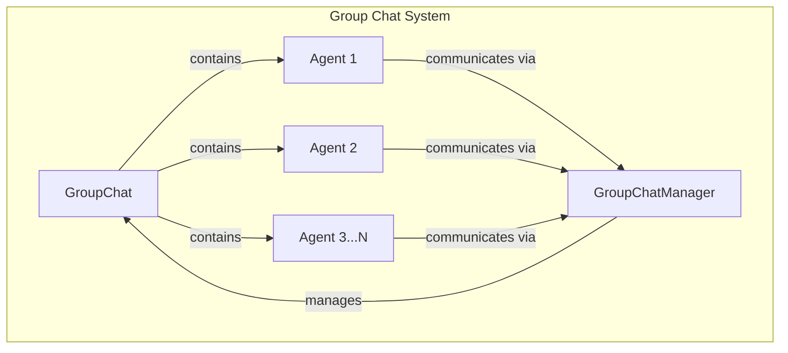
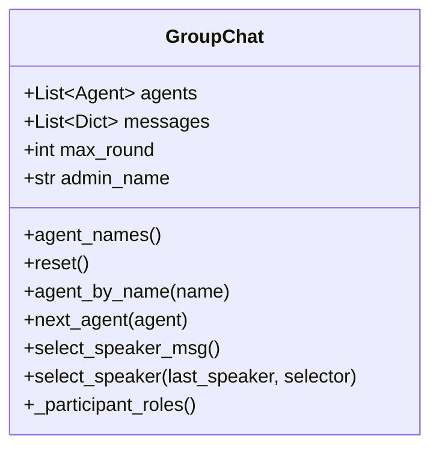
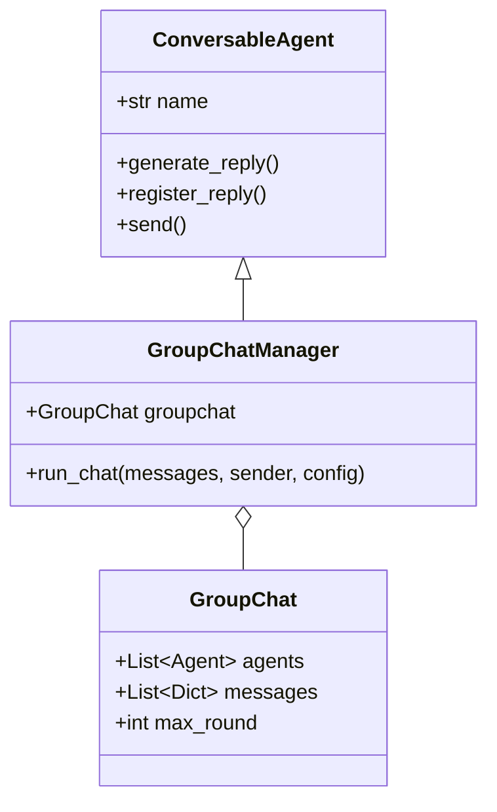
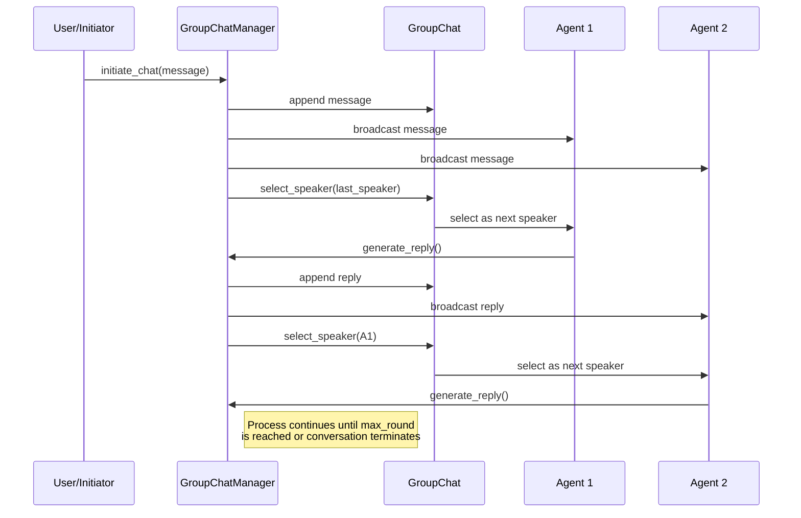
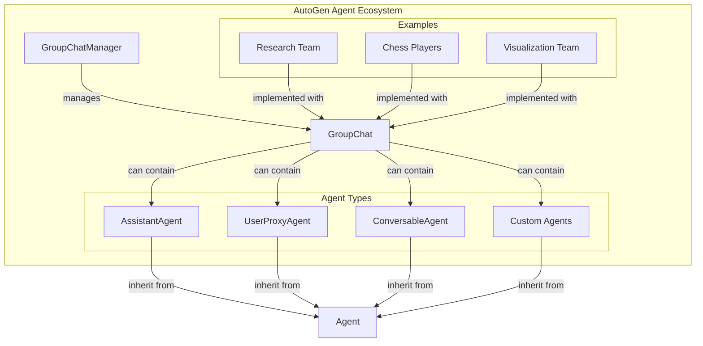

<!-- source: DeepWiki mcp.deepwiki.com · repo microsoft/FLAML · page 6.3 Multi-Agent Conversations · fetched 2026-10-26 -->

# Group Chat

<details>
<summary>Relevant source files</summary>

The following files were used as context for generating this wiki page:

- [test/autogen/test_function_call.py](test/autogen/test_function_call.py)

</details>


This document provides technical documentation on the Group Chat functionality within FLAML's AutoGen framework. Group Chat enables orchestrated conversations between multiple agents, allowing them to collectively solve tasks through structured interactions. For information about one-on-one agent conversations, see [Agent Chat](#4.1).

## Purpose and Overview

Group Chat provides a framework for multi-agent collaboration in AutoGen, enabling complex problem-solving through conversations among different AI and human-in-the-loop agents. The system facilitates:

- Multi-agent conversations with structured turn-taking
- Dynamic speaker selection based on context
- Seamless message broadcasting between participating agents
- Conversation management with configurable termination conditions



Sources: [flaml/autogen/agentchat/groupchat.py:9-34](), [flaml/autogen/agentchat/groupchat.py:67-134]()

## Core Components

The Group Chat functionality is built around two main classes: `GroupChat` and `GroupChatManager`.

### GroupChat Class

The `GroupChat` class represents a multi-agent conversation. It maintains the list of participating agents, conversation history, and governs the maximum number of conversation rounds.



Key components:
- `agents`: List of `Agent` objects participating in the chat
- `messages`: List of conversation messages (as dictionaries)
- `max_round`: Maximum number of conversation rounds (default: 10)
- `admin_name`: Name of the admin agent (default: "Admin")

Principal methods:
- `reset()`: Clears all messages in the conversation
- `agent_by_name(name)`: Finds an agent by its name
- `next_agent(agent)`: Returns the next agent in the list after the given agent
- `select_speaker(last_speaker, selector)`: Determines the next speaker in the conversation

Sources: [flaml/autogen/agentchat/groupchat.py:9-34](), [flaml/autogen/agentchat/groupchat.py:18-64]()

### GroupChatManager Class

The `GroupChatManager` class inherits from `ConversableAgent` and orchestrates the group chat conversation. It manages the flow of messages between agents and coordinates speaker transitions.



Key aspects:
- Inherits from `ConversableAgent`, providing it with agent capabilities
- Registers the `run_chat` method as a reply handler for messages from any `Agent`
- Controls conversation flow, speaker selection, and message broadcasting

Sources: [flaml/autogen/agentchat/groupchat.py:67-134](), [flaml/autogen/agentchat/__init__.py:1-14]()

## Message Flow and Conversation Management

The following diagram illustrates how messages flow through a Group Chat conversation:



Key aspects of message handling:
1. When an agent sends a message to the manager, it's added to the group chat history
2. The message is broadcast to all agents except the sender
3. The manager selects the next speaker using the `select_speaker` method
4. The selected agent generates a reply, which is sent to the manager
5. This cycle continues until maximum rounds are reached or conversation terminates

Sources: [flaml/autogen/agentchat/groupchat.py:91-134]()

## Speaker Selection

The GroupChat implementation supports two methods for speaker selection:

1. **Default sequential selection**: Cycles through agents in order (`next_agent` method)
2. **Context-aware selection**: Uses an LLM to determine the most appropriate next speaker based on conversation context (`select_speaker` method)

The `select_speaker` method uses prompt engineering to help the LLM determine which agent should speak next based on roles and conversation history.

Sources: [flaml/autogen/agentchat/groupchat.py:31-61]()

## Usage Examples

### Basic Group Chat Setup

```python
# Create the agents
user_proxy = autogen.UserProxyAgent(
   name="Admin",
   system_message="A human admin.",
   code_execution_config=False
)

assistant1 = autogen.AssistantAgent(
    name="Assistant1",
    llm_config={"model": "gpt-4"}
)

assistant2 = autogen.AssistantAgent(
    name="Assistant2",
    llm_config={"model": "gpt-4"}
)

# Create the group chat and manager
groupchat = autogen.GroupChat(
    agents=[user_proxy, assistant1, assistant2], 
    messages=[], 
    max_round=10
)
manager = autogen.GroupChatManager(groupchat=groupchat, llm_config={"model": "gpt-4"})

# Start the conversation
user_proxy.initiate_chat(manager, message="Let's discuss...")
```

### Advanced Group Chat with Specialized Agents

For complex tasks, you can create specialized agents with different roles:

```python
# Create specialized agents
user_proxy = autogen.UserProxyAgent(name="Admin", ...)
coder = autogen.AssistantAgent(name="Coder", ...)
critic = autogen.AssistantAgent(name="Critic", ...)
planner = autogen.AssistantAgent(name="Planner", ...)
executor = autogen.UserProxyAgent(name="Executor", ...)

# Create group chat with all agents
groupchat = autogen.GroupChat(
    agents=[user_proxy, coder, critic, planner, executor],
    messages=[],
    max_round=20
)
manager = autogen.GroupChatManager(groupchat=groupchat, ...)

# Start the task
user_proxy.initiate_chat(manager, message="Task description...")
```

Sources: [notebook/autogen_agentchat_groupchat_research.ipynb:115-159](), [notebook/autogen_agentchat_groupchat_vis.ipynb:127-157]()

## Integration with Agent Ecosystem

Group Chat is designed to work seamlessly with various agent types in the AutoGen framework:



Sources: [flaml/autogen/agentchat/__init__.py:1-14](), [notebook/autogen_agentchat_chess.ipynb:204-304](), [notebook/autogen_agentchat_groupchat_research.ipynb:115-159](), [notebook/autogen_agentchat_groupchat_vis.ipynb:127-157]()

## Plugin Architecture

The Group Chat system allows extending other agent classes with group chat management capabilities through a plugin architecture:

```python
# Create a standard agent
custom_manager = autogen.ConversableAgent(name="custom_manager", llm_config=False)

# Register group chat management capability
custom_manager.register_reply(
    autogen.Agent,
    reply_func=autogen.GroupChatManager.run_chat,
    config=groupchat,
    reset_config=autogen.GroupChat.reset
)

# Now this agent can manage group chats
agent1.initiate_chat(custom_manager, message="hello")
```

This flexibility enables extending existing agents with group chat management capabilities without modifying their core implementation.

Sources: [test/autogen/agentchat/test_groupchat.py:34-63]()

## Practical Applications

Group Chat is particularly useful for tasks that benefit from multiple perspectives and expertise:

1. **Collaborative problem-solving**: Multiple agents with different specializations (planner, coder, critic) working together to solve complex problems
   
2. **Research tasks**: Agents for literature review, data analysis, interpretation, and critique working together

3. **Interactive applications**: Turn-based interactions like games (e.g., chess) implemented with multiple agents

4. **Code generation with review**: One agent generates code while another reviews it for correctness and quality

Sources: [notebook/autogen_agentchat_groupchat_research.ipynb:1-458](), [notebook/autogen_agentchat_chess.ipynb:1-457](), [notebook/autogen_agentchat_groupchat_vis.ipynb:1-507]()

## Advanced Customization

The Group Chat system can be customized in various ways:

1. **Custom speaker selection**: Override the `select_speaker` method to implement domain-specific speaker selection logic

2. **Dynamic agent participation**: Add or remove agents from the group chat during conversation

3. **Custom termination criteria**: Implement specialized termination detection based on conversation content or agent outputs

4. **Extended context management**: Modify how context is preserved and accessed during the conversation

Sources: [flaml/autogen/agentchat/groupchat.py:35-61](), [test/autogen/agentchat/test_groupchat.py:34-63]()

---

