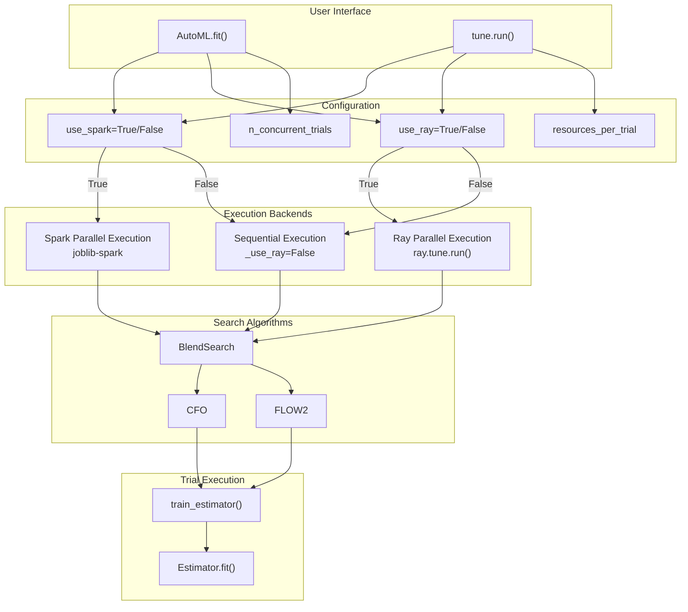
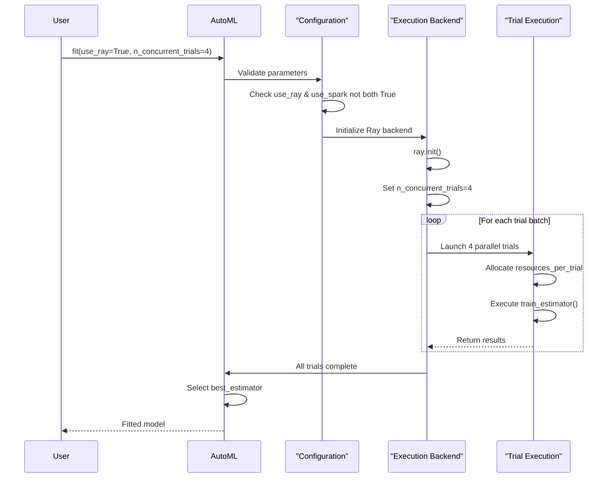

<!-- source: DeepWiki mcp.deepwiki.com · repo microsoft/FLAML · page 7 Distributed Execution · fetched 2026-10-26 -->

# Distributed Execution

<details>
<summary>Relevant source files</summary>

The following files were used as context for generating this wiki page:

- [flaml/automl/automl.py](flaml/automl/automl.py)
- [flaml/default/portfolio.py](flaml/default/portfolio.py)
- [flaml/tune/__init__.py](flaml/tune/__init__.py)
- [flaml/tune/space.py](flaml/tune/space.py)
- [flaml/tune/tune.py](flaml/tune/tune.py)
- [flaml/tune/utils.py](flaml/tune/utils.py)
- [test/automl/test_multiclass.py](test/automl/test_multiclass.py)
- [test/tune/test_searcher.py](test/tune/test_searcher.py)
- [test/tune/test_tune.py](test/tune/test_tune.py)
- [website/docs/Use-Cases/Task-Oriented-AutoML.md](website/docs/Use-Cases/Task-Oriented-AutoML.md)

</details>


## Overview

FLAML supports distributed and parallel execution to accelerate hyperparameter optimization across multiple compute resources. This page provides an overview of FLAML's distributed execution capabilities and when to use each backend.

**Note:** For detailed information on specific backends, see:
- Ray integration: [Ray Integration](#7.1)
- Spark integration: [Spark Integration](#7.2)

FLAML offers three execution modes:

1. **Sequential (Local)**: Single-threaded execution on local machine (default)
2. **Ray**: Distributed execution using Ray for parallel trial execution
3. **Spark**: Distributed execution using Apache Spark clusters

Both AutoML and tune.run support distributed execution through the `use_ray` and `use_spark` parameters. These parameters are mutually exclusive—only one distributed backend can be used at a time.

**Sources:** [flaml/automl/automl.py:290-305](), [flaml/tune/tune.py:421-422](), [flaml/tune/tune.py:258-259]()

## Execution Backend Architecture



**Execution Backend Selection Logic**

The backend selection follows this precedence:
1. If `use_ray=True`: Use Ray backend (requires `ray` package)
2. Else if `use_spark=True`: Use Spark backend (requires `pyspark` package)
3. Else: Use sequential local execution (default)

The mutual exclusivity is enforced at [flaml/automl/automl.py:413-414]() and [flaml/tune/tune.py:498-499]():

```python
if settings["use_ray"] is not False and settings["use_spark"] is not False:
    raise ValueError("use_ray and use_spark cannot be both True.")
```

**Sources:** [flaml/automl/automl.py:411-415](), [flaml/tune/tune.py:498-501]()

## Configuration Parameters

### Common Parameters

| Parameter | Type | Default | Description | Applicable To |
|-----------|------|---------|-------------|---------------|
| `n_concurrent_trials` | int | 1 | Number of concurrent trials to run in parallel | AutoML, tune.run |
| `use_ray` | bool or dict | False | Whether to use Ray for distributed execution | AutoML, tune.run |
| `use_spark` | bool | False | Whether to use Spark for distributed execution | AutoML, tune.run |
| `n_jobs` | int | -1 | Number of CPU cores for each training job | AutoML |

**Sources:** [flaml/automl/automl.py:265-304](), [flaml/tune/tune.py:254-270]()

### Parallel vs Sequential Trade-offs

**When to use parallel execution:**
- You have more compute resources than a single training job needs
- Wall-clock time is critical
- The overhead of parallelization is justified by resource availability

**When to use sequential execution:**
- Single training jobs already use all available resources (via `n_jobs=-1`)
- Overhead of distributed frameworks outweighs benefits
- Deterministic, reproducible results are required
- Simpler debugging and monitoring

The wall-clock time for $N$ trials can be estimated as:

$$\text{Wall-clock time} = \frac{N}{k} \times (\text{SingleTrialTime} + \text{Overhead})$$

where $k$ is the parallelism scale:
- Sequential: $k=1$, negligible overhead
- Parallel: $k>1$, larger overhead from distributed framework

**Sources:** [website/docs/Use-Cases/Task-Oriented-AutoML.md:586-607]()

## Resource Management Flow



**Sources:** [flaml/automl/automl.py:403-415](), [flaml/tune/tune.py:480-508]()

## Backend Comparison

| Feature | Sequential | Ray | Spark |
|---------|-----------|-----|-------|
| Installation | Built-in | `pip install flaml[ray]` | `pip install flaml[spark]` |
| Overhead | Minimal | Medium | Medium-High |
| Cluster Support | No | Yes | Yes |
| GPU Support | Yes | Yes | Limited |
| Trial Isolation | Process-level | Process-level | Executor-level |
| Best For | Small jobs, debugging | General parallel tuning | Large Spark clusters |
| Max Concurrency | 1 | User-defined | Num executors |

**Sources:** [website/docs/Use-Cases/Task-Oriented-AutoML.md:538-584]()

## Installation Requirements

### Ray Backend
```bash
# Install FLAML with Ray support
pip install flaml[ray,blendsearch]
```

### Spark Backend
```bash
# Install FLAML with Spark support
pip install flaml[spark,blendsearch]>=1.1.0
```

**Note:** The `blendsearch` extra is required for advanced parallel search algorithms. For more details on search algorithms, see [Search Algorithms](#4.2).

**Sources:** [website/docs/Use-Cases/Task-Oriented-AutoML.md:546-577]()

## Example Usage Patterns

### Basic Sequential Execution
```python
from flaml import AutoML

automl = AutoML()
automl.fit(
    X_train, y_train,
    task="classification",
    time_budget=60,
    n_jobs=-1  # Use all CPU cores for single training job
)
```

### Ray Parallel Execution
```python
import ray
from flaml import AutoML

# Initialize Ray with specific resources
ray.init(num_cpus=16)

automl = AutoML()
automl.fit(
    X_train, y_train,
    task="classification",
    time_budget=60,
    use_ray=True,
    n_concurrent_trials=4,  # 4 trials in parallel
    n_jobs=4  # Each trial uses 4 CPUs
)
# Total: 4 trials × 4 CPUs = 16 CPUs
```

### Spark Parallel Execution
```python
from flaml import AutoML

automl = AutoML()
automl.fit(
    X_train, y_train,
    task="classification",
    time_budget=60,
    use_spark=True,
    n_concurrent_trials=4  # Launch 4 trials across Spark executors
)
```

**Sources:** [website/docs/Use-Cases/Task-Oriented-AutoML.md:552-584](), [test/automl/test_multiclass.py:155-163]()

## Randomness Considerations

Parallel tuning introduces non-determinism due to:

1. **Trial completion order**: Trials may finish in different orders across runs, affecting the search algorithm's trajectory
2. **Concurrent updates**: Multiple trials updating the search state simultaneously
3. **Distributed training**: Some models may have non-deterministic behavior in distributed settings

For reproducible results, use sequential execution with fixed `seed` parameter.

**Sources:** [website/docs/Use-Cases/Task-Oriented-AutoML.md:600-607]()

## Environment Variables

### Spark-Specific Configuration

- **`FLAML_MAX_CONCURRENT`**: Override the detected number of Spark executors
  - Use case: Launch more trials than executors in local mode
  - Default: Auto-detected from Spark context
  - Final concurrency: `min(n_concurrent_trials, num_executors)`

Example:
```bash
export FLAML_MAX_CONCURRENT=8
python your_script.py  # Will use up to 8 concurrent trials
```

**Sources:** [website/docs/Use-Cases/Task-Oriented-AutoML.md:584](), [flaml/automl/automl.py:300-304]()

## Implementation Details

### Ray Backend Check
The Ray backend availability is checked at module import time:

[flaml/automl/automl.py:69-75]()

The global `_use_ray` flag controls backend selection in tune.run:

[flaml/tune/tune.py:44](), [flaml/tune/tune.py:481-501]()

### Search Algorithm Compatibility
Both Ray and Spark backends use the BlendSearch algorithm for parallel tuning, which combines:
- **Global search** (Thread 0): OptunaSearch for exploration
- **Local search** (Threads 1-N): FLOW2 for exploitation

For more details on search algorithms, see [Search Algorithms](#4.2).

**Sources:** [flaml/tune/tune.py:564]()

## Monitoring and Logging

### Verbosity Levels
The `verbose` parameter controls logging detail for both sequential and distributed execution:

- `verbose=0`: Silent (CRITICAL level)
- `verbose=1`: Errors only (ERROR level)
- `verbose=2`: Status and brief results (INFO level, default)
- `verbose=3`: Detailed trial results (DEBUG level)

Example:
```python
automl.fit(
    X_train, y_train,
    use_ray=True,
    verbose=3,  # Detailed logging
    log_file_name="tuning.log"
)
```

**Sources:** [flaml/tune/tune.py:400-403](), [flaml/automl/automl.py:206-213]()

### Log File Management
Log files are created based on the `log_file_name` and `local_dir` parameters:

```python
# Explicit log file
tune.run(eval_fn, log_file_name="logs/experiment.log")

# Auto-generated in local_dir
tune.run(eval_fn, local_dir="logs/", verbose=2)
# Creates: logs/tune_YYYY-MM-DD HH-MM-SS.log
```

**Sources:** [flaml/tune/tune.py:491-497]()

## Best Practices

1. **Start Sequential**: Begin with sequential execution to validate your setup and establish baseline performance
2. **Resource Planning**: Calculate total resources needed: `n_concurrent_trials × n_jobs`
3. **Overhead Assessment**: Use parallel execution only when trial time >> framework overhead
4. **Backend Selection**:
   - **Ray**: General-purpose parallel tuning, GPU support, flexible resource allocation
   - **Spark**: Existing Spark infrastructure, large datasets with Spark estimators
5. **Gradual Scaling**: Increase `n_concurrent_trials` gradually to find optimal parallelism
6. **Monitor Memory**: Parallel trials increase memory usage proportionally

**Sources:** [website/docs/Use-Cases/Task-Oriented-AutoML.md:586-607]()

---

