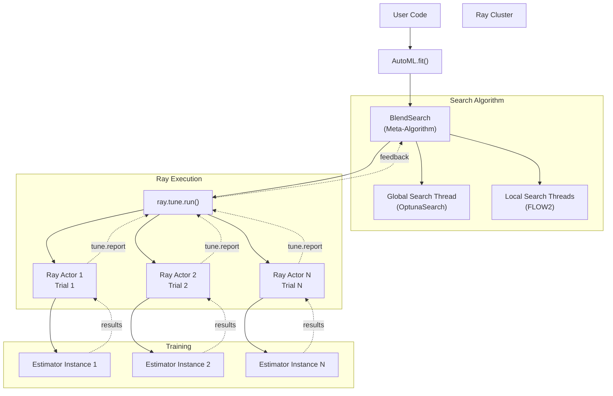
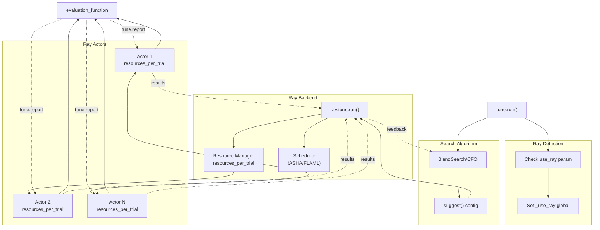
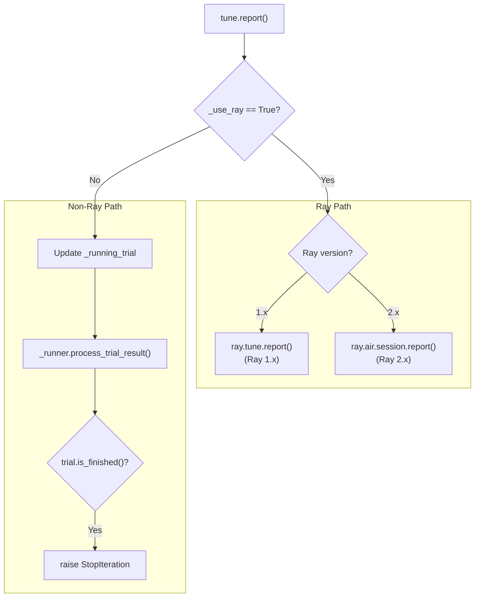
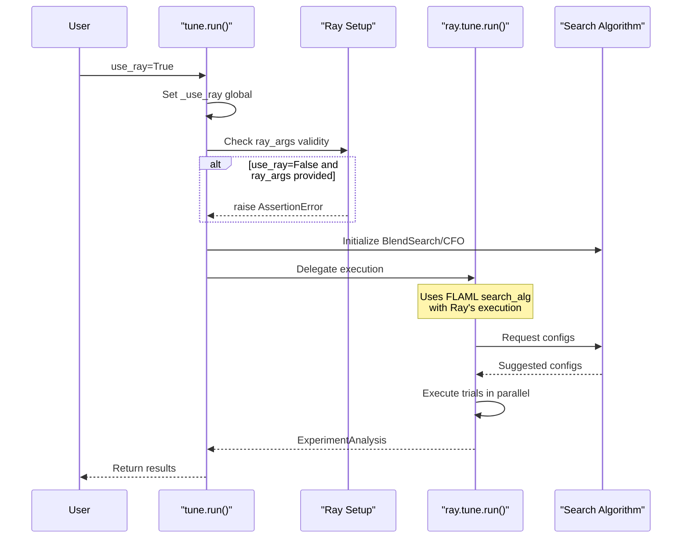

<!-- source: DeepWiki mcp.deepwiki.com · repo microsoft/FLAML · page 7.1 Ray Integration · fetched 2026-10-26 -->

# Ray Integration

<details>
<summary>Relevant source files</summary>

The following files were used as context for generating this wiki page:

- [flaml/automl/automl.py](flaml/automl/automl.py)
- [flaml/default/portfolio.py](flaml/default/portfolio.py)
- [flaml/tune/__init__.py](flaml/tune/__init__.py)
- [flaml/tune/space.py](flaml/tune/space.py)
- [flaml/tune/tune.py](flaml/tune/tune.py)
- [flaml/tune/utils.py](flaml/tune/utils.py)
- [test/automl/test_multiclass.py](test/automl/test_multiclass.py)
- [test/tune/test_searcher.py](test/tune/test_searcher.py)
- [test/tune/test_tune.py](test/tune/test_tune.py)
- [website/docs/Use-Cases/Task-Oriented-AutoML.md](website/docs/Use-Cases/Task-Oriented-AutoML.md)

</details>


## Purpose and Scope

This page documents FLAML's integration with Ray for distributed hyperparameter optimization. Ray enables parallel execution of trials across multiple CPU cores or compute nodes, accelerating the search process for both AutoML and Tune workflows. For information about distributed execution using Spark instead of Ray, see [Spark Integration](#7.2).

**Sources:** [flaml/automl/automl.py:69-75](), [website/docs/Use-Cases/Task-Oriented-AutoML.md:544-564]()

---

## Overview

Ray integration in FLAML provides:

- **Parallel trial execution**: Run multiple hyperparameter configurations simultaneously
- **Resource management**: Allocate specific CPU/GPU resources per trial via `resources_per_trial`
- **Trial isolation**: Each trial runs in a separate Ray actor process, preventing memory leaks and OOM errors
- **Unified API**: Same interface for both AutoML and Tune with the `use_ray` parameter
- **BlendSearch algorithm**: Automatic use of FLAML's BlendSearch for parallel HPO

When `use_ray=True`, FLAML delegates trial scheduling and execution to Ray Tune, while still using FLAML's search algorithms (BlendSearch or CFO) for hyperparameter suggestion.

**Sources:** [flaml/automl/automl.py:290-304](), [flaml/tune/tune.py:421](), [website/docs/Use-Cases/Task-Oriented-AutoML.md:564]()

---

## Installation and Setup

### Installation

To use Ray with FLAML, install the `ray` and `blendsearch` extras:

```bash
pip install flaml[ray,blendsearch]
```

The `ray` extra installs Ray (version >= 1.10.0 required), and `blendsearch` installs Optuna for the BlendSearch algorithm used in parallel tuning.

**Sources:** [website/docs/Use-Cases/Task-Oriented-AutoML.md:546-550](), [flaml/automl/automl.py:69-75]()

### Ray Version Compatibility

FLAML supports Ray versions >= 1.10.0 and adapts to API differences between Ray 1.x and Ray 2.x:

- **Ray 1.x**: Uses `ray.tune.report()` for reporting results
- **Ray 2.x**: Uses `ray.air.session.report()` for reporting results

The version detection and adaptation happens automatically at import time.

**Sources:** [flaml/automl/automl.py:69-75](), [flaml/tune/tune.py:14-23](), [flaml/tune/tune.py:196-210]()

### Ray Initialization

Before running FLAML with Ray, initialize Ray with the desired resources:

```python
import ray

# Initialize Ray with 16 CPU cores
ray.init(num_cpus=16)

# Or connect to an existing Ray cluster
# ray.init(address='auto')
```

**Sources:** [website/docs/Use-Cases/Task-Oriented-AutoML.md:552-556](), [test/tune/test_tune.py:135]()

---

## AutoML with Ray

### Basic Usage

Enable Ray in AutoML using the `use_ray` parameter:

```python
from flaml import AutoML

automl = AutoML()
automl.fit(
    X_train, 
    y_train,
    task="classification",
    time_budget=60,
    use_ray=True,
    n_concurrent_trials=4,
    n_jobs=4
)
```

In this configuration:
- `use_ray=True`: Enables Ray backend
- `n_concurrent_trials=4`: Runs 4 trials in parallel
- `n_jobs=4`: Each trial uses 4 CPU cores

**Sources:** [website/docs/Use-Cases/Task-Oriented-AutoML.md:554-563](), [test/automl/test_multiclass.py:161]()

### System Architecture with Ray



**Diagram: AutoML Ray Execution Flow**

When `use_ray=True`, AutoML delegates execution to Ray while maintaining control over the search strategy through BlendSearch. Each trial runs in an isolated Ray actor process.

**Sources:** [flaml/automl/automl.py:290-304](), [website/docs/Use-Cases/Task-Oriented-AutoML.md:564]()

### Parameter Configuration

#### `use_ray`

- **Type**: `bool` or `dict`
- **Default**: `False`
- **Purpose**: Enable Ray backend for parallel execution

When set to `True`, uses default Ray configuration. When set to a dict, the dict contains keyword arguments passed to `ray.tune.run()`:

```python
automl.fit(
    X_train, 
    y_train,
    use_ray={
        'local_dir': './ray_results',
        'raise_on_failed_trial': False,
        # Other ray.tune.run() arguments
    }
)
```

**Sources:** [flaml/automl/automl.py:290-299](), [flaml/automl/automl.py:411]()

#### `n_concurrent_trials`

- **Type**: `int`
- **Default**: `1`
- **Purpose**: Number of trials to run in parallel

Determines the degree of parallelism. When `n_concurrent_trials > 1`, parallel tuning is triggered.

**Example:**
```python
# Run 4 trials in parallel, each using 2 CPU cores
automl.fit(
    X_train, y_train,
    n_concurrent_trials=4,
    n_jobs=2,
    use_ray=True
)
```

**Sources:** [flaml/automl/automl.py:265-271](), [website/docs/Use-Cases/Task-Oriented-AutoML.md:561-563]()

#### `n_jobs`

- **Type**: `int`
- **Default**: `-1` (use all cores)
- **Purpose**: Number of CPU cores per trial

Controls intra-trial parallelism for estimators that support multi-threading (e.g., LightGBM, XGBoost).

**Sources:** [flaml/automl/automl.py:167-168](), [website/docs/Use-Cases/Task-Oriented-AutoML.md:540-598]()

### Validation and Constraints

The AutoML constructor validates that `use_ray` and `use_spark` are not both `True`:

```python
if settings["use_ray"] is not False and settings["use_spark"] is not False:
    raise ValueError("use_ray and use_spark cannot be both True.")
```

**Sources:** [flaml/automl/automl.py:413-414]()

### Data Handling with Ray

When using Ray, data can be passed directly or via `ray.put()` for efficiency:

```python
import ray

# Put data in object store to avoid serialization overhead
df = ray.put(df)
settings["dataframe"] = df
settings["use_ray"] = True

automl.fit(**settings)
```

**Sources:** [test/automl/test_multiclass.py:269-276]()

---

## Tune with Ray

### Basic Usage

Enable Ray in `tune.run()` using the `use_ray` parameter:

```python
from flaml import tune

def evaluate_config(config):
    # Your evaluation function
    score = ...
    return {"score": score}

analysis = tune.run(
    evaluate_config,
    config={
        'x': tune.uniform(0, 10),
        'y': tune.randint(1, 100)
    },
    metric='score',
    mode='max',
    num_samples=100,
    use_ray=True,
    resources_per_trial={'cpu': 2},
    n_concurrent_trials=4
)
```

**Sources:** [flaml/tune/tune.py:235-480](), [test/tune/test_tune.py:136-157]()

### Tune Ray Architecture



**Diagram: Tune Ray Execution Architecture**

When `use_ray=True`, `tune.run()` delegates to `ray.tune.run()` while using FLAML's search algorithms.

**Sources:** [flaml/tune/tune.py:481-537](), [flaml/tune/tune.py:196-210]()

### Ray-Specific Parameters

#### `use_ray`

- **Type**: `bool`
- **Default**: `False`
- **Purpose**: Enable Ray backend

When `True`, `tune.run()` uses Ray for parallel execution instead of sequential execution.

```python
analysis = tune.run(
    my_func,
    config=search_space,
    use_ray=True,
    num_samples=100
)
```

**Sources:** [flaml/tune/tune.py:258](), [flaml/tune/tune.py:421](), [flaml/tune/tune.py:498-537]()

#### `resources_per_trial`

- **Type**: `dict`
- **Default**: `None`
- **Purpose**: Hardware resources to allocate per trial

Specifies CPU and GPU allocation for each trial. Only valid when `use_ray=True`.

```python
analysis = tune.run(
    train_fn,
    config=search_space,
    use_ray=True,
    resources_per_trial={
        'cpu': 2,
        'gpu': 0.5  # Share GPU between trials
    },
    n_concurrent_trials=4
)
```

**Sources:** [flaml/tune/tune.py:254](), [flaml/tune/tune.py:407-410](), [test/tune/test_tune.py:152]()

#### `n_concurrent_trials`

In Tune, this parameter works the same as in AutoML when `use_ray=True`:

```python
analysis = tune.run(
    my_func,
    config=search_space,
    use_ray=True,
    n_concurrent_trials=8,
    resources_per_trial={'cpu': 2}
)
# Runs 8 trials in parallel, each using 2 CPUs (16 CPUs total)
```

**Sources:** [flaml/tune/tune.py:264](), [flaml/tune/tune.py:464-470]()

#### `ray_args`

Additional keyword arguments passed to `ray.tune.run()`:

```python
analysis = tune.run(
    my_func,
    config=search_space,
    use_ray=True,
    local_dir='./results',
    raise_on_failed_trial=False,
    # Any other ray.tune.run() arguments
)
```

**Sources:** [flaml/tune/tune.py:270](), [flaml/tune/tune.py:478-479](), [flaml/tune/tune.py:508]()

---

## Ray Backend Implementation

### Trial Isolation

Each trial runs in a separate Ray actor process, providing:

1. **Memory isolation**: Memory leaks in one trial don't affect others
2. **Crash isolation**: A crashed trial doesn't terminate the entire tuning process
3. **Resource allocation**: Each trial gets its guaranteed CPU/GPU allocation
4. **OOM prevention**: Large models can be trained without crashing the main process

**Sources:** [flaml/automl/automl.py:290-299]()

### Global Variables and State Management

The `tune` module uses global variables to track Ray usage:

```python
# Global variables in flaml/tune/tune.py
_use_ray = True  # Default, overridden by use_ray parameter
_runner = None
_verbose = 0
_running_trial = None
_training_iteration = 0
```

These globals are saved and restored to handle nested tuning scenarios.

**Sources:** [flaml/tune/tune.py:44-48](), [flaml/tune/tune.py:481-489]()

### Report Function Adaptation

The `tune.report()` function adapts to Ray vs non-Ray execution:



**Diagram: tune.report() Execution Flow**

The `report()` function detects whether Ray is being used and calls the appropriate API.

**Sources:** [flaml/tune/tune.py:192-233]()

### Initialization Flow



**Diagram: Ray Initialization Sequence**

**Sources:** [flaml/tune/tune.py:481-537](), [flaml/tune/tune.py:508]()

---

## Configuration Reference

### AutoML Ray Parameters Summary

| Parameter | Type | Default | Description |
|-----------|------|---------|-------------|
| `use_ray` | `bool` or `dict` | `False` | Enable Ray backend; dict for ray.tune.run() args |
| `n_concurrent_trials` | `int` | `1` | Number of parallel trials |
| `n_jobs` | `int` | `-1` | CPU cores per trial (-1 = all cores) |

**Sources:** [flaml/automl/automl.py:290-304](), [flaml/automl/automl.py:265-271](), [flaml/automl/automl.py:167-168]()

### Tune Ray Parameters Summary

| Parameter | Type | Default | Description |
|-----------|------|---------|-------------|
| `use_ray` | `bool` | `False` | Enable Ray backend |
| `resources_per_trial` | `dict` | `None` | Resource allocation per trial (e.g., {'cpu': 2, 'gpu': 1}) |
| `n_concurrent_trials` | `int` | `0` | Number of parallel trials (0 = auto) |
| `ray_args` | `dict` | `{}` | Additional arguments for ray.tune.run() |

**Sources:** [flaml/tune/tune.py:254](), [flaml/tune/tune.py:258](), [flaml/tune/tune.py:264](), [flaml/tune/tune.py:270]()

### Validation Rules

1. **Mutual exclusivity**: `use_ray` and `use_spark` cannot both be `True`
2. **ray_args validation**: `ray_args` can only be provided when `use_ray=True`
3. **Resource calculation**: Total resources = `n_concurrent_trials × resources_per_trial['cpu']`
4. **Search algorithm**: BlendSearch is used by default for parallel tuning (requires Optuna)

**Sources:** [flaml/automl/automl.py:413-414](), [flaml/tune/tune.py:508](), [website/docs/Use-Cases/Task-Oriented-AutoML.md:564]()

---

## Example: Complete Ray Workflow

### AutoML Example

```python
import ray
from flaml import AutoML
from sklearn.datasets import load_breast_cancer
from sklearn.model_selection import train_test_split

# Initialize Ray with 16 CPUs
ray.init(num_cpus=16)

# Load data
X, y = load_breast_cancer(return_X_y=True)
X_train, X_test, y_train, y_test = train_test_split(X, y, test_size=0.2)

# Run AutoML with Ray
automl = AutoML()
automl.fit(
    X_train=X_train,
    y_train=y_train,
    task='classification',
    time_budget=60,
    use_ray=True,
    n_concurrent_trials=4,  # 4 parallel trials
    n_jobs=4,               # 4 CPUs per trial
    estimator_list=['lgbm', 'xgboost', 'rf']
)

# Make predictions
predictions = automl.predict(X_test)
print(f"Best estimator: {automl.best_estimator}")
print(f"Best config: {automl.best_config}")
```

**Sources:** [test/tune/test_tune.py:92-113](), [website/docs/Use-Cases/Task-Oriented-AutoML.md:554-563]()

### Tune Example

```python
import ray
from flaml import tune
from sklearn.datasets import load_breast_cancer
from sklearn.model_selection import train_test_split
import xgboost as xgb

# Initialize Ray
ray.init(num_cpus=8)

# Define search space
search_space = {
    'max_depth': tune.randint(1, 9),
    'min_child_weight': tune.choice([1, 2, 3]),
    'subsample': tune.uniform(0.5, 1.0),
    'eta': tune.loguniform(1e-4, 1e-1)
}

# Define training function
def train_xgboost(config):
    data, labels = load_breast_cancer(return_X_y=True)
    train_x, test_x, train_y, test_y = train_test_split(
        data, labels, test_size=0.25
    )
    
    train_set = xgb.DMatrix(train_x, label=train_y)
    test_set = xgb.DMatrix(test_x, label=test_y)
    
    config['eval_metric'] = ['logloss', 'error']
    config['objective'] = 'binary:logistic'
    
    results = {}
    xgb.train(
        config,
        train_set,
        evals=[(test_set, 'eval')],
        verbose_eval=False,
        evals_result=results
    )
    
    tune.report(
        logloss=results['eval']['logloss'][-1],
        error=results['eval']['error'][-1]
    )

# Run tuning with Ray
analysis = tune.run(
    train_xgboost,
    config=search_space,
    metric='logloss',
    mode='min',
    num_samples=100,
    time_budget_s=120,
    use_ray=True,
    resources_per_trial={'cpu': 2},
    local_dir='./ray_results'
)

# Get best trial
best_trial = analysis.best_trial
print(f"Best config: {best_trial.config}")
print(f"Best logloss: {best_trial.last_result['logloss']}")
```

**Sources:** [test/tune/test_tune.py:115-250]()

---

## Troubleshooting

### Common Issues

**Issue**: `AssertionError` when passing `ray_args` with `use_ray=False`

**Solution**: Only pass `ray_args` when `use_ray=True`:

```python
# Wrong
tune.run(my_func, use_ray=False, local_dir='./results')  # Error

# Correct
tune.run(my_func, use_ray=True, local_dir='./results')
```

**Sources:** [flaml/tune/tune.py:508]()

**Issue**: Cannot use both Ray and Spark

**Solution**: Choose one backend:

```python
# Wrong
automl.fit(X, y, use_ray=True, use_spark=True)  # ValueError

# Correct - choose one
automl.fit(X, y, use_ray=True)
# OR
automl.fit(X, y, use_spark=True)
```

**Sources:** [flaml/automl/automl.py:413-414]()

**Issue**: BlendSearch requires Optuna

**Solution**: Install the blendsearch extra:

```bash
pip install flaml[blendsearch]
```

**Sources:** [website/docs/Use-Cases/Task-Oriented-AutoML.md:549]()

---

