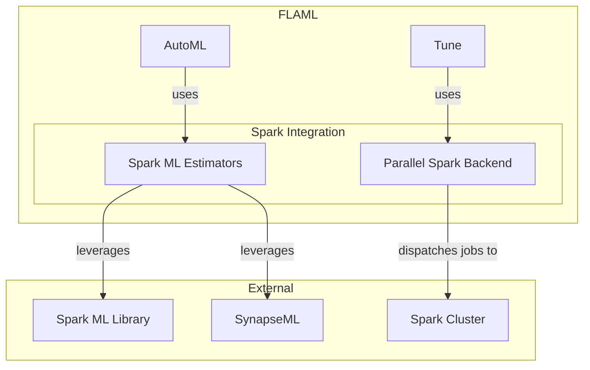
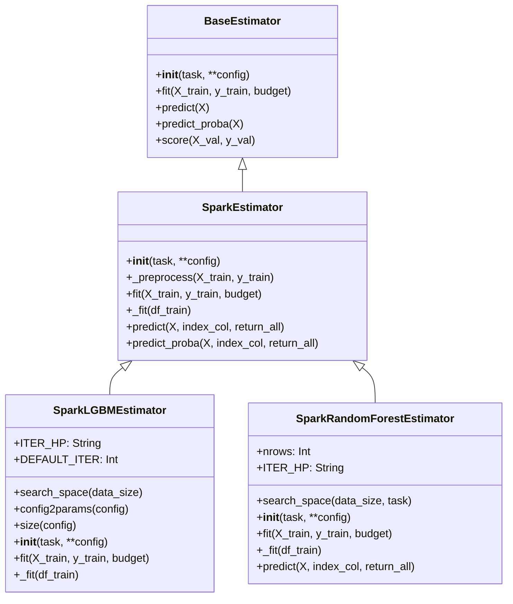
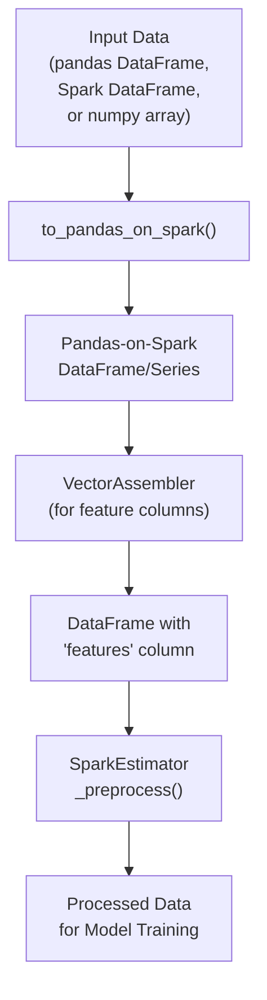
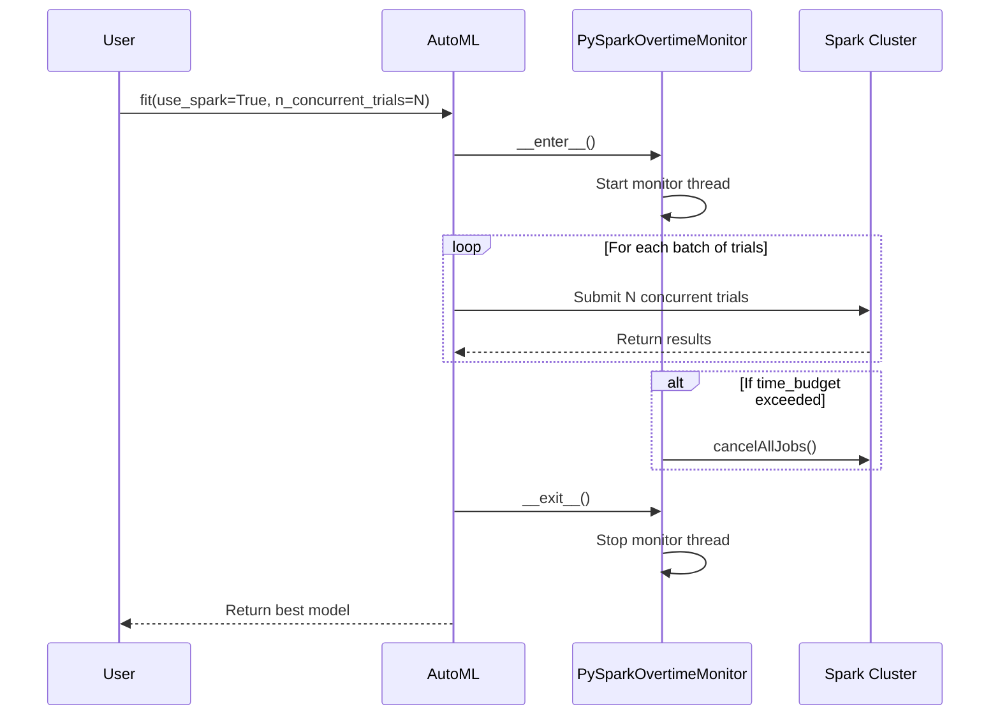
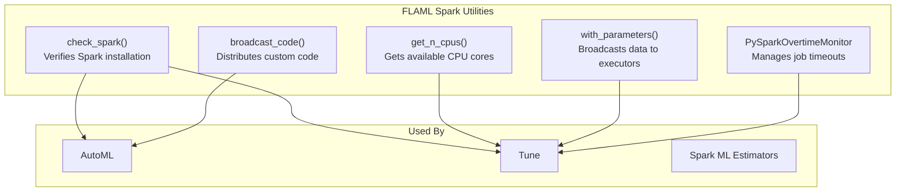
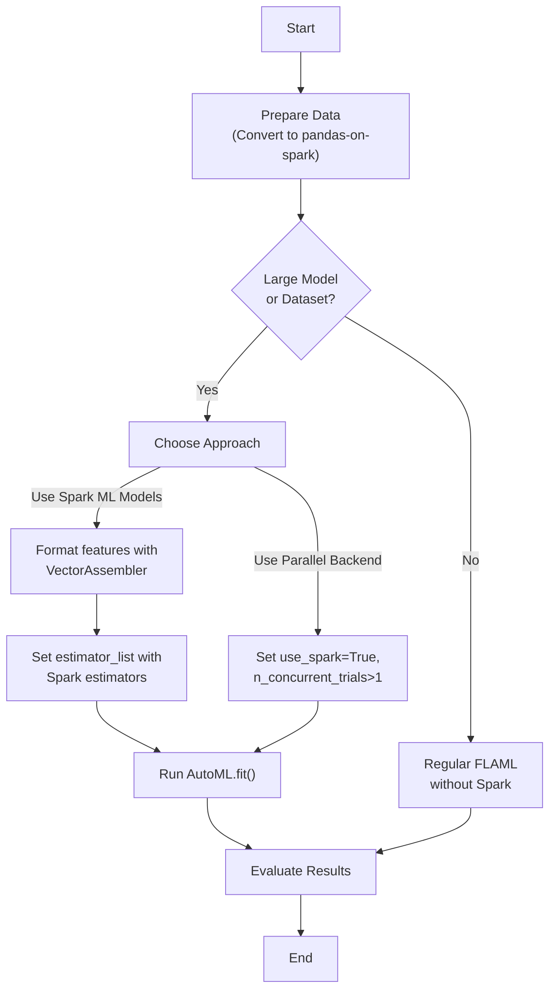

<!-- source: DeepWiki mcp.deepwiki.com · repo microsoft/FLAML · page 7.2 Spark Integration · fetched 2026-10-26 -->

# Spark Integration

<details>
<summary>Relevant source files</summary>

The following files were used as context for generating this wiki page:

- [flaml/automl/model.py](flaml/automl/model.py)
- [flaml/automl/nlp/huggingface/training_args.py](flaml/automl/nlp/huggingface/training_args.py)
- [flaml/automl/nlp/huggingface/utils.py](flaml/automl/nlp/huggingface/utils.py)
- [flaml/automl/task/time_series_task.py](flaml/automl/task/time_series_task.py)
- [flaml/automl/time_series/sklearn.py](flaml/automl/time_series/sklearn.py)
- [flaml/automl/time_series/ts_data.py](flaml/automl/time_series/ts_data.py)
- [test/automl/test_classification.py](test/automl/test_classification.py)
- [test/automl/test_regression.py](test/automl/test_regression.py)
- [test/conftest.py](test/conftest.py)
- [test/spark/test_0sparkml.py](test/spark/test_0sparkml.py)
- [test/spark/test_automl.py](test/spark/test_automl.py)

</details>


This document describes how FLAML integrates with Apache Spark for distributed training and model fitting. FLAML's Spark integration consists of two main components:

1. **Spark ML Estimators**: Integration of Spark-based machine learning models for use within FLAML's AutoML framework
2. **Parallel Spark Jobs**: Using Spark as a distributed backend for parallel execution of training jobs

For general information about FLAML's integration capabilities with other frameworks, see [Integration](#6).

## Overview

FLAML's integration with Apache Spark enables scalable machine learning on big data by leveraging Spark's distributed computing capabilities. This integration is particularly useful when working with large datasets that cannot fit into memory on a single machine or when you want to accelerate the training process through parallelization.



Sources: [flaml/automl/model.py:434-873](), [flaml/tune/spark/utils.py:28-306](), [website/docs/Examples/Integrate - Spark.md:1-129]()

## Spark ML Estimators

FLAML integrates estimators based on Spark ML models. These models are trained in parallel using Spark's distributed computing capabilities, making them suitable for large-scale machine learning tasks.

### Available Estimators

Currently, FLAML supports the following Spark-based estimators:

| Estimator Name | Description | Base Class | Implemented In |
|----------------|-------------|------------|----------------|
| `lgbm_spark` | LightGBM implementation using SynapseML | `SparkLGBMEstimator` | [flaml/automl/model.py:556-741]() |
| `rf_spark` | Random Forest implementation using Spark ML | `SparkRandomForestEstimator` | [flaml/automl/model.py:744-873]() |

Both estimators inherit from the base `SparkEstimator` class, which provides common functionality for Spark-based machine learning models.



Sources: [flaml/automl/model.py:114-143](), [flaml/automl/model.py:434-554](), [flaml/automl/model.py:556-741](), [flaml/automl/model.py:744-873]()

### Data Format Requirements

Spark estimators in FLAML require input data to be in a specific format. The data should be a pandas-on-spark dataframe or series. FLAML provides a utility function `to_pandas_on_spark()` to convert various data formats to the required format.

When using Spark ML models, you also need to format your features using `VectorAssembler` to merge all feature columns into a single vector column named "features", which is a requirement for Spark ML algorithms.



Sources: [flaml/automl/model.py:443-460](), [website/docs/Examples/Integrate - Spark.md:12-56]()

### Usage with AutoML

To use Spark ML estimators with FLAML's AutoML, you simply include the estimator name(s) in the `estimator_list` parameter when calling `AutoML.fit()`. If your input is already in a Spark-compatible format, FLAML will automatically use the Spark-based versions of estimators.

Example code for using Spark ML estimators:

```python
# After preparing your data in pandas-on-spark format
automl = AutoML()
settings = {
    "time_budget": 30,
    "metric": "r2",
    "estimator_list": ["lgbm_spark"],  # Specify Spark estimators
    "task": "regression",
}

automl.fit(
    dataframe=spark_dataframe,
    label="target_column",
    **settings,
)
```

Sources: [test/spark/test_0sparkml.py:64-140](), [website/docs/Examples/Integrate - Spark.md:58-93]()

## Parallel Training with Spark

In addition to using Spark ML estimators, FLAML also supports using Spark as a backend for parallel execution of training jobs. This can be activated by setting the `use_spark` parameter to `True` when using AutoML or hyperparameter tuning.

### Configuration Options

The following parameters control Spark's parallel execution behavior:

| Parameter | Type | Default | Description |
|-----------|------|---------|-------------|
| `use_spark` | boolean | False | Whether to use Spark to run training in parallel Spark jobs |
| `n_concurrent_trials` | int | 1 | Number of concurrent trials for parallel tuning |
| `force_cancel` | boolean | False | Whether to forcibly cancel Spark jobs if they exceed the time budget |

When `use_spark=True`, FLAML uses the `joblib-spark` backend to distribute training jobs across the Spark cluster. By default, FLAML will launch one trial per executor, but you can override this by setting the environment variable `FLAML_MAX_CONCURRENT`.

Sources: [flaml/tune/spark/utils.py:189-306](), [website/docs/Examples/Integrate - Spark.md:95-127]()

### Parallel Execution Flow

The following diagram illustrates the flow of parallel execution with Spark:



Sources: [flaml/tune/spark/utils.py:189-306]()

## Implementation Details

### SparkEstimator Base Class

The `SparkEstimator` class in FLAML serves as the base class for all Spark-based estimators. It extends the `BaseEstimator` class and provides methods for preprocessing Spark data, fitting models, and making predictions.

Key methods in `SparkEstimator`:

- `_preprocess()`: Converts the input data to a Spark DataFrame format suitable for model training
- `fit()`: Trains the model with the given data and parameters
- `_fit()`: Internal method to perform the actual model training
- `predict()`: Makes predictions using the trained model
- `predict_proba()`: Returns class probabilities for classification tasks

Sources: [flaml/automl/model.py:434-554]()

### SparkLGBMEstimator

The `SparkLGBMEstimator` class implements LightGBM models using the SynapseML API. It supports classification, regression, and ranking tasks.

Key features:

- Custom hyperparameter search space optimized for Spark LightGBM
- Conversion between FLAML parameters and SynapseML LightGBM parameters
- Handling of special parameters like `maxBin` through logarithmic transformation
- Support for binary, multiclass, and regression objectives

Sources: [flaml/automl/model.py:556-741]()

### SparkRandomForestEstimator

The `SparkRandomForestEstimator` class implements Random Forest models using the native Spark ML library. It supports classification and regression tasks.

Key features:

- Task-specific hyperparameter search space
- Optimized feature subset strategy based on task type
- Parameter handling for classification vs. regression
- Automatic conversion of parameters to formats expected by Spark ML

Sources: [flaml/automl/model.py:744-873]()

### Spark Utilities

FLAML provides several utilities for working with Spark:

- `check_spark()`: Verifies if Spark is installed and running
- `get_n_cpus()`: Determines the number of CPU cores available for Spark
- `with_parameters()`: Wrapper for trainables to pass large data objects via Spark broadcast variables
- `broadcast_code()`: Utility to broadcast custom code to Spark executors
- `PySparkOvertimeMonitor`: Context manager to monitor and manage Spark job timeouts



Sources: [flaml/tune/spark/utils.py:28-306]()

## Limitations and Considerations

When using FLAML with Spark, consider the following limitations and best practices:

1. **GPU Support**: GPU training is not currently supported when `use_spark=True`

2. **Overhead**: Using Spark can introduce additional overhead, which might slow down training for small datasets or simple models

3. **Mixed Usage**: Do not set `use_spark=True` when already using Spark ML estimators, as these models already run in parallel using Spark

4. **Resource Management**: When launching more trials than available executors, set the `FLAML_MAX_CONCURRENT` environment variable to control concurrency

5. **Job Cancellation**: Use `force_cancel=True` to ensure Spark jobs are properly terminated if they exceed the time budget

6. **Dependencies**: 
   - SynapseML is required for `lgbm_spark` estimator
   - PySpark version must be >= 3.0 to use FLAML with Spark

Sources: [flaml/tune/spark/utils.py:96-121](), [website/docs/Examples/Integrate - Spark.md:95-129]()

## Example Workflow

A typical workflow for using FLAML with Spark involves:

1. Preparing data in the correct format
2. Choosing between Spark ML estimators or parallel Spark backend
3. Configuring the appropriate parameters
4. Running AutoML or tuning



Sources: [website/docs/Examples/Integrate - Spark.md:1-129](), [test/spark/test_0sparkml.py:64-140]()

---

