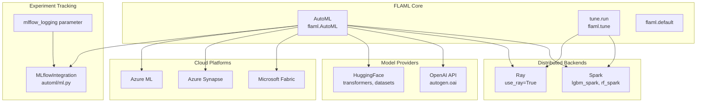
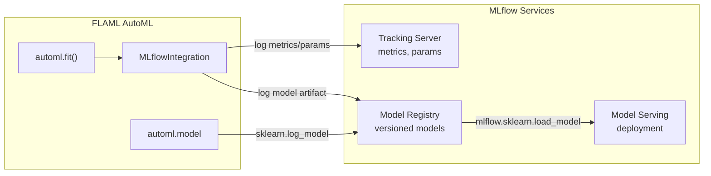
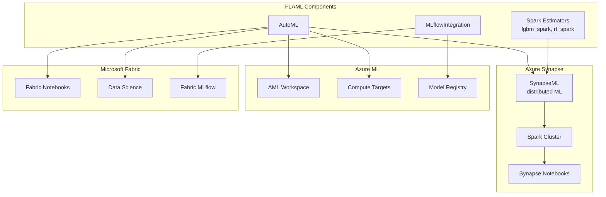
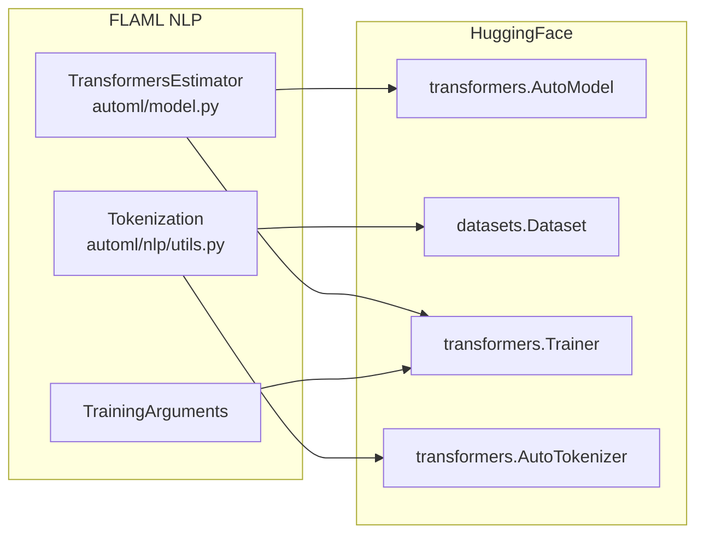
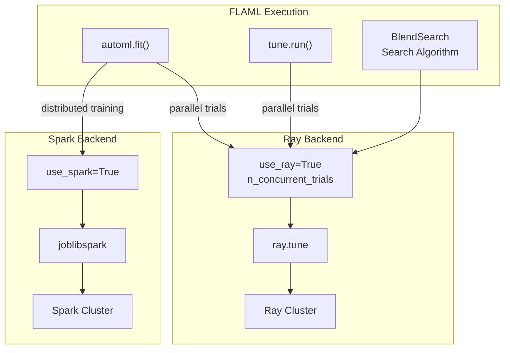
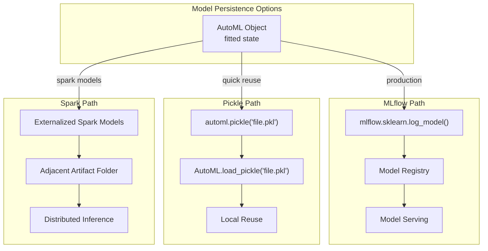
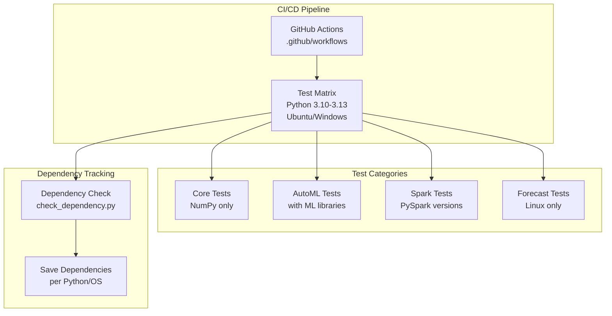

<!-- source: DeepWiki mcp.deepwiki.com · repo microsoft/FLAML · page 8 Integration and Deployment · fetched 2026-10-26 -->

# Integration and Deployment

<details>
<summary>Relevant source files</summary>

The following files were used as context for generating this wiki page:

- [.github/workflows/python-package.yml](.github/workflows/python-package.yml)
- [README.md](README.md)
- [flaml/version.py](flaml/version.py)
- [setup.py](setup.py)
- [website/docs/Best-Practices.md](website/docs/Best-Practices.md)
- [website/docs/Contribute.md](website/docs/Contribute.md)
- [website/docs/FAQ.md](website/docs/FAQ.md)
- [website/docs/Getting-Started.md](website/docs/Getting-Started.md)
- [website/docs/Installation.md](website/docs/Installation.md)
- [website/sidebars.js](website/sidebars.js)

</details>


This page provides an overview of FLAML's integration capabilities with external systems and platforms for production deployment. It covers how FLAML connects to experiment tracking systems, cloud platforms, and external model providers.

For detailed information on specific integrations, see:
- MLflow integration for experiment tracking and model registry: [MLflow Integration](#8.1)
- Azure ML, Synapse, and Microsoft Fabric deployment: [Azure and Cloud Platforms](#8.2)

---

## Integration Architecture

FLAML provides a modular integration architecture that allows connecting to external systems without requiring them as core dependencies. Integrations are enabled through optional installation extras specified in [setup.py:37-154]().



**Integration Architecture Diagram**: FLAML's integration points with external systems and platforms.

Sources: [setup.py:37-154](), [README.md:17-17]()

---

## Installation and Dependency Management

FLAML uses a minimal core installation with optional extras for specific integrations. This modular approach keeps the base installation lightweight while supporting comprehensive ecosystem integration.

| Integration | Install Command | Key Components |
|------------|----------------|----------------|
| Core | `pip install flaml` | NumPy only |
| AutoML | `pip install "flaml[automl]"` | lightgbm, xgboost, scikit-learn |
| MLflow | `pip install "flaml[azureml]"` | azureml-mlflow |
| Spark | `pip install "flaml[spark]"` | pyspark, joblibspark |
| Azure Synapse | `pip install "flaml[synapse]"` | pyspark, optuna, joblibspark |
| HuggingFace | `pip install "flaml[hf]"` | transformers, datasets |
| Ray | `pip install "flaml[ray]"` | ray[tune] |

Sources: [setup.py:17-154](), [README.md:35-50](), [website/docs/Installation.md:1-117]()

---

## MLflow Integration Overview

FLAML provides native integration with MLflow for experiment tracking, model registry, and deployment. The integration is automatic when running inside an MLflow context.



**MLflow Integration Flow**: Automatic logging and model persistence through MLflow.

**Key Features:**
- **Automatic Logging**: Metrics, parameters, and artifacts logged during `AutoML.fit()` when `mlflow_logging=True` (default)
- **Model Persistence**: Trained models saved to MLflow model registry with sklearn flavor
- **Experiment Tracking**: All trials tracked with configurations and results
- **Reproducibility**: Full run context captured for later reproduction

For detailed usage patterns and configuration options, see [MLflow Integration](#8.1).

Sources: [website/docs/Best-Practices.md:98-127](), [website/docs/FAQ.md:291-317](), [setup.py:108-110]()

---

## Cloud Platform Integration Overview

FLAML supports deployment on major cloud platforms with specialized integrations for Azure ecosystem services.



**Cloud Platform Integration Diagram**: FLAML deployment across Azure ecosystem.

**Supported Platforms:**
- **Azure Synapse Analytics**: Spark-based distributed AutoML with SynapseML integration
- **Azure Machine Learning**: Managed ML workspace with compute orchestration
- **Microsoft Fabric Data Science**: Integrated notebook and MLflow experience

For detailed setup instructions and platform-specific configuration, see [Azure and Cloud Platforms](#8.2).

Sources: [README.md:17-17](), [setup.py:108-117](), [setup.py:148-152](), [website/docs/Installation.md:82-97]()

---

## HuggingFace Integration

FLAML integrates with HuggingFace Transformers for NLP tasks, providing automatic hyperparameter tuning for transformer models.



**HuggingFace Integration Components**: Connection between FLAML and HuggingFace ecosystem.

**Installation:**
```bash
pip install "flaml[hf]"
```

This installs `transformers`, `datasets`, `nltk`, `rouge_score`, and `seqeval` dependencies as specified in [setup.py:118-124]().

**Supported Tasks:**
- Sequence classification
- Token classification  
- Summarization
- Multiple choice

The `TransformersEstimator` class provides a unified interface to HuggingFace models with FLAML's optimization capabilities.

Sources: [setup.py:118-124](), [setup.py:125-131]()

---

## Distributed Execution Backends

FLAML supports distributed execution through Ray and Spark backends, enabling parallel hyperparameter search and distributed training.



**Distributed Execution Backends**: Parallel trial execution and distributed training options.

**Ray Backend Installation:**
```bash
pip install "flaml[ray]"
```

Specified in [setup.py:105-107](). Enables parallel hyperparameter search across multiple workers with `use_ray=True` parameter.

**Spark Backend Installation:**
```bash
pip install "flaml[spark]"
```

Specified in [setup.py:48-52](). Enables distributed training with Spark estimators (`lgbm_spark`, `rf_spark`) and parallel trial execution.

For detailed configuration and usage patterns, see [Ray Integration](#7.1) and [Spark Integration](#7.2).

Sources: [setup.py:48-52](), [setup.py:105-107]()

---

## Model Persistence Strategies

FLAML provides multiple strategies for persisting trained models, each suited to different deployment scenarios.

| Strategy | Method | Use Case | Artifacts |
|---------|--------|----------|-----------|
| **MLflow Logging** | `mlflow.sklearn.log_model()` | Production deployment, model governance | Model + metrics + params |
| **Pickle Persistence** | `automl.pickle()` | Local reuse, quick experimentation | Full AutoML object |
| **Spark Model Export** | External Spark ML models | Distributed inference | Spark ML Pipeline |



**Model Persistence Strategies**: Different approaches for saving and loading trained models.

**MLflow Logging (Recommended for Production):**

When running inside an MLflow run context, FLAML automatically logs the trained model to the model registry. This is the recommended approach for production deployment as it provides full experiment tracking and model governance.

Example pattern from [website/docs/Best-Practices.md:102-127]():
- Set up MLflow experiment and run context
- Call `automl.fit()` with `mlflow_logging=True` (default)
- Model automatically logged to registry
- Load later with `mlflow.sklearn.load_model(f"runs:/{run_id}/model")`

**Pickle Persistence (Convenient for Local Use):**

The `automl.pickle()` method saves the entire `AutoML` object, including all state and history. This is useful for:
- Local experimentation and reuse
- Microsoft Fabric scenarios requiring visualization re-plotting
- Scenarios not requiring MLflow dependency

Pattern from [website/docs/FAQ.md:291-317]():
- Call `automl.pickle("automl.pkl")` after training
- Load with `AutoML.load_pickle("automl.pkl")`
- For Spark models, externalized models stored in adjacent folder
- Use `load_spark_models=False` to skip Spark model loading

Sources: [website/docs/Best-Practices.md:98-158](), [website/docs/FAQ.md:291-317]()

---

## Deployment Best Practices

### Model Serving Patterns

**Pattern 1: MLflow Model Serving**
- Train model with `AutoML.fit()` inside MLflow run
- Model automatically logged to registry
- Deploy using MLflow model serving (REST API)
- Supports batch and real-time inference

**Pattern 2: Embedded Deployment**
- Pickle the `AutoML` object
- Load in serving application
- Call `automl.predict()` directly
- Suitable for edge deployment or microservices

**Pattern 3: Distributed Inference**
- Use Spark estimators for training
- Deploy Spark ML Pipeline
- Scale inference across cluster
- Suitable for batch processing large datasets

### Configuration Management

FLAML configurations should be version controlled separately from models:
- Store `automl.best_config` for reproducibility
- Track `automl.best_config_per_estimator` for all tried estimators
- Use `config2params()` to convert FLAML configs to original model parameters
- Document search space overrides via `custom_hp` parameter

### Environment Considerations

**Dependency Isolation:**
- Use virtual environments or containers
- Pin specific extra requirements (e.g., `flaml[automl]==2.5.0`)
- Test with exact dependency versions from training

**Resource Requirements:**
- Plan memory based on model size and batch inference size
- Consider GPU availability for transformer models
- Account for preprocessing overhead (DataTransformer)

**Cloud Platform Specifics:**
- Azure Synapse: Pre-installed Spark, may need FLAML installation
- Microsoft Fabric: MLflow pre-configured
- Azure ML: Use compute targets for scalable training

Sources: [README.md:17-17](), [website/docs/Installation.md:82-97]()

---

## Integration Testing and CI/CD

FLAML's continuous integration pipeline validates integrations across platforms and dependency versions.



**CI/CD Integration Testing**: Automated validation across platforms and dependency versions.

The CI pipeline defined in [.github/workflows/python-package.yml:1-142]() ensures:
- Cross-platform compatibility (Ubuntu, Windows)
- Multiple Python version support (3.10, 3.11, 3.12, 3.13)
- PySpark version compatibility (3.5.1 for Python 3.11, 4.0.1 for 3.12, 4.1.0 for 3.13)
- Dependency tracking and versioning

Key validation steps from [.github/workflows/python-package.yml:61-105]():
- Install base package: `pip install -e .`
- Verify import: `python -c "import flaml"`
- Install test dependencies: `pip install -e .[test]`
- Run dependency check: `python test/check_dependency.py`
- Execute test suite with retries: `pytest test/ --reruns 2`

Sources: [.github/workflows/python-package.yml:1-142]()

---

## Summary

FLAML's integration architecture provides flexible deployment options:

1. **Experiment Tracking**: Native MLflow integration for production model lifecycle management
2. **Cloud Platforms**: Azure Synapse, Azure ML, and Microsoft Fabric support for enterprise deployment
3. **Model Providers**: HuggingFace integration for state-of-the-art NLP models
4. **Distributed Execution**: Ray and Spark backends for scalable training and inference
5. **Persistence**: Multiple strategies for model saving and loading based on deployment needs

The modular design with optional extras allows minimal base installation while supporting comprehensive ecosystem integration when needed.

Sources: [setup.py:17-154](), [README.md:1-127](), [website/docs/Installation.md:1-149]()

---

