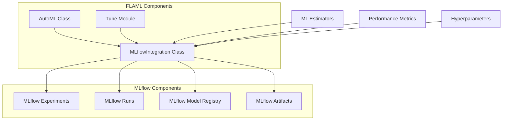
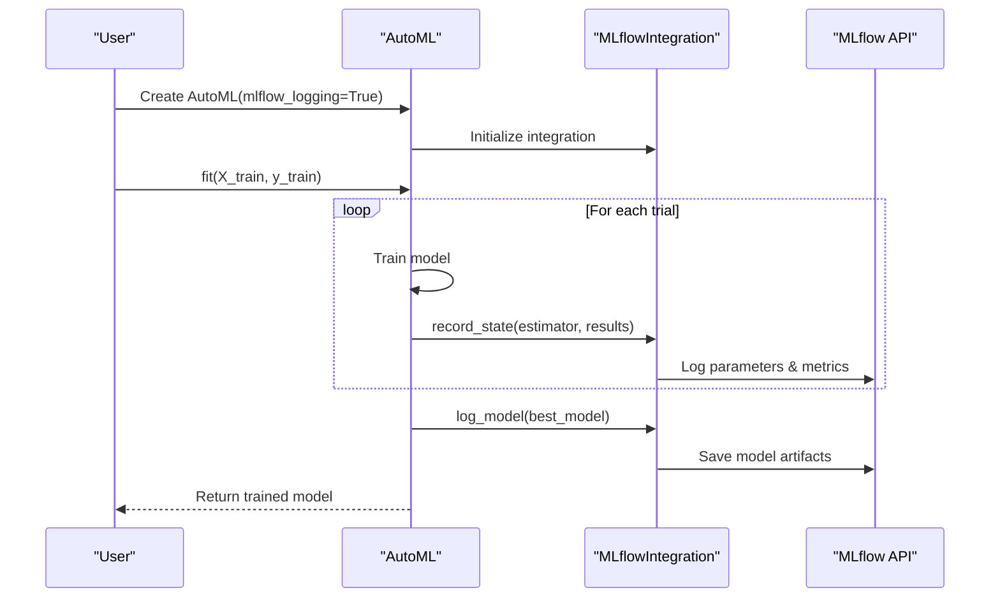
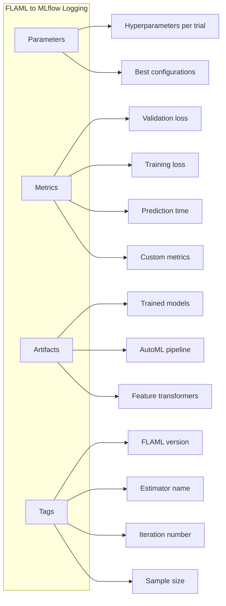

<!-- source: DeepWiki mcp.deepwiki.com · repo microsoft/FLAML · page 8.1 MLflow Integration · fetched 2026-10-26 -->

# MLflow Integration

<details>
<summary>Relevant source files</summary>

The following files were used as context for generating this wiki page:

- [flaml/automl/automl.py](flaml/automl/automl.py)
- [notebook/automl_classification.ipynb](notebook/automl_classification.ipynb)
- [notebook/automl_time_series_forecast.ipynb](notebook/automl_time_series_forecast.ipynb)
- [test/automl/test_forecast.py](test/automl/test_forecast.py)
- [test/automl/test_multiclass.py](test/automl/test_multiclass.py)
- [test/automl/test_notebook_example.py](test/automl/test_notebook_example.py)
- [website/docs/Examples/AutoML-Time series forecast.md](website/docs/Examples/AutoML-Time series forecast.md)
- [website/docs/Use-Cases/Task-Oriented-AutoML.md](website/docs/Use-Cases/Task-Oriented-AutoML.md)

</details>


This page documents how FLAML integrates with MLflow to track experiments, log metrics, save models, and organize AutoML workflows. MLflow is an open-source platform that helps manage the machine learning lifecycle, including experimentation, reproducibility, and deployment.

## Overview of MLflow Integration

FLAML provides seamless integration with MLflow to track experiments during AutoML or hyperparameter tuning processes. This integration is primarily accomplished through the `MLflowIntegration` class that handles logging of training metrics, model artifacts, hyperparameters, and other metadata.



Sources:
- [flaml/fabric/mlflow.py:137-672]()
- [flaml/automl/automl.py:54-58]()
- [flaml/automl/automl.py:336-337]()

## MLflow Integration Control Flow

The following diagram illustrates the flow of control when using MLflow with FLAML's AutoML:



Sources:
- [flaml/fabric/mlflow.py:410-458]()
- [flaml/automl/automl.py:108-117]()

## Enabling and Configuring MLflow Integration

### Basic Configuration

MLflow integration in FLAML is enabled by default. You can explicitly control it through the `mlflow_logging` parameter:

| Method | Description |
|--------|-------------|
| Constructor | `automl = AutoML(mlflow_logging=True)` |
| Fit method | `automl.fit(X_train, y_train, mlflow_logging=True)` |

### MLflow Experiment Management

FLAML automatically manages MLflow experiments:

1. If an active run exists, FLAML will log to that run
2. If no active run exists, FLAML will create one
3. If no active experiment is set, FLAML will use either:
   - The notebook name (if detected)
   - A default experiment name ("flaml_default_experiment")

You can also specify a custom experiment name:

```python
automl = AutoML()
automl.fit(X_train, y_train, mlflow_exp_name="my_custom_experiment")
```

Sources:
- [flaml/automl/automl.py:378]()
- [flaml/fabric/mlflow.py:172-192]()
- [test/automl/test_mlflow.py:12-98]()

## What FLAML Logs to MLflow

FLAML logs comprehensive information to MLflow during the AutoML process:



Sources:
- [flaml/fabric/mlflow.py:428-458]()
- [flaml/fabric/mlflow.py:311-332]()

## Logging Models and Artifacts

FLAML automatically logs the best model and related artifacts to MLflow. The logging strategy depends on the estimator type:

| Estimator Type | MLflow Log Method |
|----------------|-------------------|
| LightGBM | `mlflow.lightgbm.log_model` |
| Spark models | `mlflow.spark.log_model` |
| Transformer models | `mlflow.transformers.log_model` |
| Time series models | `mlflow.statsmodels.log_model` |
| PyTorch models | `mlflow.pytorch.log_model` |
| Prophet models | `mlflow.prophet.log_model` |
| Other models | `mlflow.sklearn.log_model` |

In addition to the model itself, FLAML logs:
1. Feature transformers
2. Label transformers
3. Complete pipelines

Sources:
- [flaml/fabric/mlflow.py:337-357]()
- [flaml/fabric/mlflow.py:384-408]()

## Advanced Features

### 1. Model Signatures

FLAML automatically infers model signatures for correct input/output schema:

```python
signature = infer_signature(X_train, y_train)
```

This signature helps ensure proper model serving by storing input and output schema information.

### 2. Autologging vs. Manual Logging

FLAML supports both autologging (MLflow's built-in feature) and manual logging. The `MLflowIntegration` class intelligently manages these modes:

| Mode | Description |
|------|-------------|
| Autologging | Uses MLflow's autologging API |
| Manual logging | Explicitly calls logging APIs |
| Mixed mode | Disables autologging and replaces with manual for more control |

### 3. Distributed Training Support

For distributed training (using Ray or Spark), FLAML properly configures MLflow for distributed environments:

```python
automl.fit(X_train, y_train, use_ray=True, n_concurrent_trials=4)
# or
automl.fit(X_train, y_train, use_spark=True)
```

Sources:
- [flaml/fabric/mlflow.py:70-69]()
- [flaml/fabric/mlflow.py:197-243]()
- [flaml/automl/automl.py:276-283]()

## Implementation Details

The MLflow integration in FLAML is implemented through several key components:

1. **MLflowIntegration class**: The core class that handles MLflow operations
   - Located in `flaml/fabric/mlflow.py`
   - Manages experiment creation, run logging, and artifact management

2. **AutoML integration points**:
   - Constructor parameter `mlflow_logging`
   - MLflow experiment name configuration
   - State tracking during optimization

3. **Utility functions**:
   - `infer_signature`: Creates model signatures for proper schema tracking
   - `get_mlflow_log_latency`: Tests MLflow logging latency
   - `is_autolog_enabled`: Checks if autologging is active

Sources:
- [flaml/fabric/mlflow.py:41-70]()
- [flaml/automl/automl.py:336-337]()

## Example Usage

Here's a basic example of using FLAML with MLflow:

```python
import mlflow
from flaml import AutoML
from sklearn.datasets import load_iris

# Start an MLflow run
with mlflow.start_run(run_name="flaml_automl_run"):
    # Create AutoML instance (MLflow logging enabled by default)
    automl = AutoML()
    
    # Load data
    X_train, y_train = load_iris(return_X_y=True)
    
    # Configure AutoML settings
    settings = {
        "time_budget": 10,
        "metric": "accuracy",
        "task": "classification",
        "estimator_list": ["lgbm", "rf", "xgboost"]
    }
    
    # Run AutoML with MLflow tracking
    automl.fit(X_train, y_train, **settings)
    
    # All trials, parameters, metrics and models are logged to MLflow
```

Sources:
- [test/automl/test_mlflow.py:12-98]()

---

