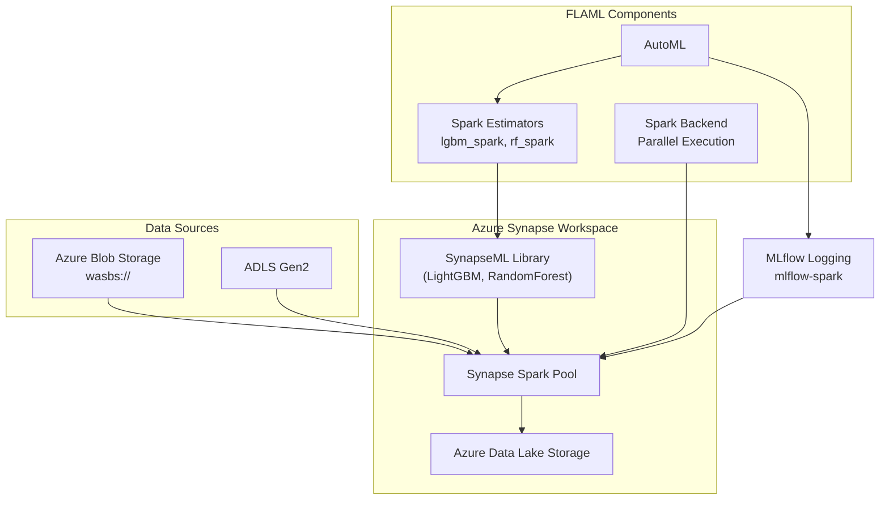
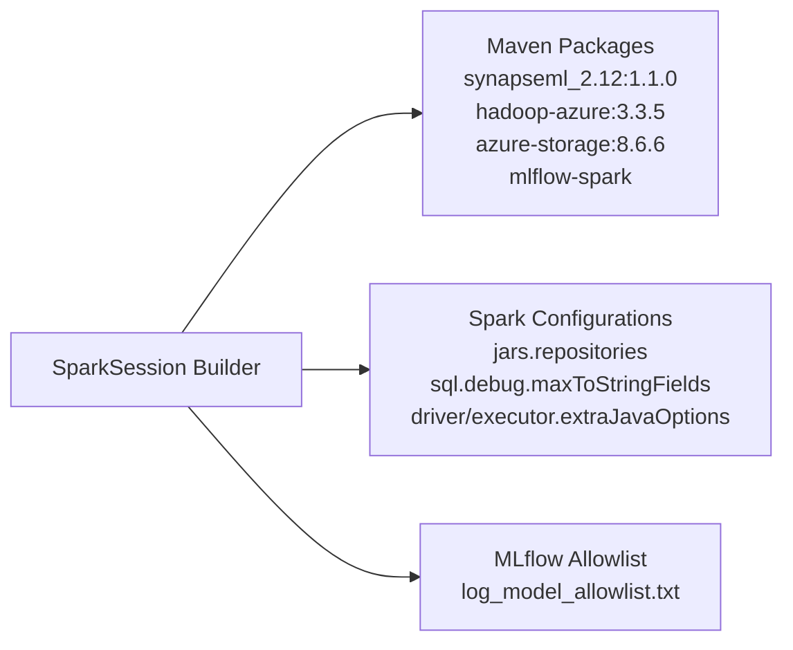
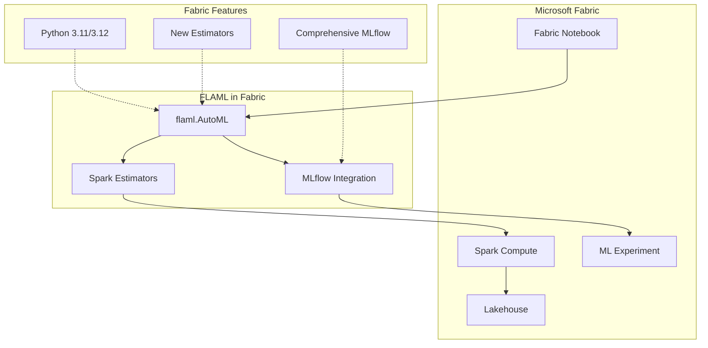
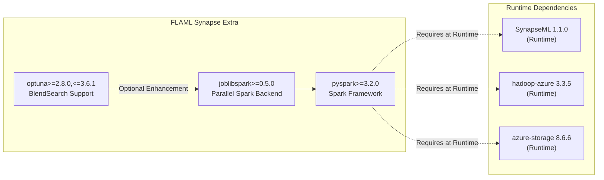
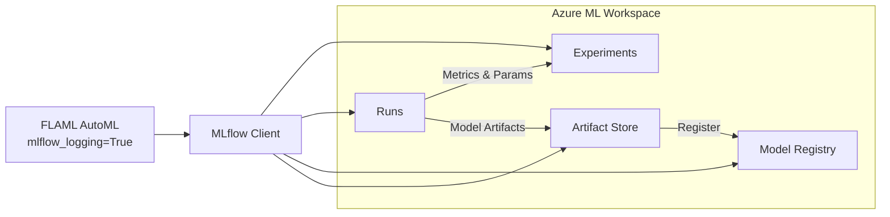

<!-- source: DeepWiki mcp.deepwiki.com · repo microsoft/FLAML · page 8.2 Azure and Cloud Platforms · fetched 2026-10-26 -->

# Azure and Cloud Platforms

<details>
<summary>Relevant source files</summary>

The following files were used as context for generating this wiki page:

- [.github/workflows/python-package.yml](.github/workflows/python-package.yml)
- [README.md](README.md)
- [flaml/automl/nlp/huggingface/training_args.py](flaml/automl/nlp/huggingface/training_args.py)
- [flaml/automl/nlp/huggingface/utils.py](flaml/automl/nlp/huggingface/utils.py)
- [flaml/automl/task/time_series_task.py](flaml/automl/task/time_series_task.py)
- [flaml/automl/time_series/sklearn.py](flaml/automl/time_series/sklearn.py)
- [flaml/automl/time_series/ts_data.py](flaml/automl/time_series/ts_data.py)
- [flaml/version.py](flaml/version.py)
- [setup.py](setup.py)
- [test/spark/test_0sparkml.py](test/spark/test_0sparkml.py)
- [test/spark/test_automl.py](test/spark/test_automl.py)

</details>


## Purpose and Scope

This page documents FLAML's integration with Microsoft Azure cloud services and platforms. It covers Azure ML integration for experiment tracking and model registry, Azure Synapse Analytics support for distributed computing, Microsoft Fabric Data Science capabilities, and Azure storage access patterns.

For general MLflow integration (which underlies Azure ML support), see [MLflow Integration](#8.1). For Spark execution concepts, see [Spark Integration](#7.2). For distributed execution options beyond Azure, see [Distributed Execution](#7) and [Ray Integration](#7.1).

---

## Azure ML Integration

FLAML integrates with Azure Machine Learning through the `azureml-mlflow` package, enabling experiment tracking, model logging, and deployment on Azure ML workspaces.

### Installation

The Azure ML integration is available through the `azureml` extra:

```bash
pip install "flaml[azureml]"
```

Sources: [setup.py:108-110]()

### Azure ML Workspace Configuration

When using FLAML with Azure ML, MLflow automatically connects to your Azure ML workspace for experiment tracking:

```python
from flaml import AutoML

automl = AutoML()
automl.fit(
    X_train, 
    y_train,
    task="classification",
    mlflow_logging=True,  # Logs to Azure ML workspace
    time_budget=300
)
```

The `mlflow_logging` parameter triggers automatic logging to the connected Azure ML workspace, capturing:
- Training configurations
- Model hyperparameters
- Evaluation metrics
- Trained model artifacts

### Azure ML Model Registry

Models trained with FLAML can be registered to Azure ML's model registry through MLflow:

```python
import mlflow

# After training with AutoML
with mlflow.start_run():
    mlflow.sklearn.log_model(
        automl.model,
        "flaml_model",
        registered_model_name="my-flaml-classifier"
    )
```

This enables:
- Model versioning and lineage tracking
- Model deployment to Azure endpoints
- Model lifecycle management

Sources: [README.md:17-18](), [setup.py:108-110]()

---

## Azure Synapse Analytics Support

Azure Synapse Analytics provides a unified analytics platform combining data warehousing and big data analytics. FLAML leverages Synapse for distributed machine learning through Apache Spark and SynapseML.

### Architecture Overview



**Architecture**: FLAML AutoML integrates with Azure Synapse through Spark estimators that leverage SynapseML for distributed training. Data can be loaded from Azure Blob Storage or ADLS Gen2, and MLflow provides experiment tracking.

Sources: [test/spark/test_0sparkml.py:1-62](), [README.md:17]()

### Synapse Spark Configuration

FLAML requires specific Spark configurations to work with Azure Synapse and SynapseML:



**Configuration Components**: Synapse Spark sessions require SynapseML packages, Azure storage connectors, MLflow-Spark integration, and appropriate JVM configurations.

Sources: [test/spark/test_0sparkml.py:28-54]()

### Synapse Spark Session Setup

The following configuration initializes a Spark session for FLAML on Azure Synapse:

```python
from pyspark.sql import SparkSession
import mlflow

spark = (
    SparkSession.builder
    .appName("FLAML-Synapse")
    .config(
        "spark.jars.packages",
        (
            "com.microsoft.azure:synapseml_2.12:1.1.0,"
            "org.apache.hadoop:hadoop-azure:3.3.5,"
            "com.microsoft.azure:azure-storage:8.6.6,"
            f"org.mlflow:mlflow-spark_2.12:{mlflow.__version__}"
        )
    )
    .config("spark.jars.repositories", "https://mmlspark.azureedge.net/maven")
    .config("spark.sql.debug.maxToStringFields", "100")
    .getOrCreate()
)

# Configure MLflow for SynapseML models
spark.sparkContext._conf.set(
    "spark.mlflow.pysparkml.autolog.logModelAllowlistFile",
    "https://mmlspark.blob.core.windows.net/publicwasb/log_model_allowlist.txt"
)
```

Sources: [test/spark/test_0sparkml.py:28-53]()

### Using SynapseML Estimators

FLAML provides Spark-based estimators that leverage SynapseML for distributed training:

| Estimator | SynapseML Component | Supported Tasks |
|-----------|---------------------|-----------------|
| `lgbm_spark` | LightGBMClassifier/Regressor | Classification, Regression, Ranking |
| `rf_spark` | RandomForestClassifier/Regressor | Classification, Regression |

```python
from flaml import AutoML

automl = AutoML()
automl.fit(
    dataframe=spark_df,  # Spark DataFrame or pandas-on-Spark
    label="target",
    task="classification",
    estimator_list=["lgbm_spark", "rf_spark"],
    time_budget=600
)
```

Sources: [test/spark/test_0sparkml.py:71-154]()

### Azure Blob Storage Access

FLAML can load datasets directly from Azure Blob Storage within Synapse:

```python
# Load data from Azure Blob Storage
file_url = "wasbs://publicwasb@mmlspark.blob.core.windows.net/dataset.csv"
sdf = spark.read.format("csv").option("header", True).load(file_url)

# Use with FLAML AutoML
automl = AutoML()
automl.fit(
    dataframe=sdf,
    label="target",
    task="classification"
)
```

The `wasbs://` protocol provides access to Azure Blob Storage containers with appropriate authentication configured in the Synapse workspace.

Sources: [test/spark/test_0sparkml.py:87-92](), [test/spark/test_0sparkml.py:171-173]()

### Ranking with SynapseML

FLAML supports ranking tasks using SynapseML's LightGBMRanker:

```python
# Load ranking dataset from Azure Blob Storage
sdf = spark.read.format("parquet").load(
    "wasbs://publicwasb@mmlspark.blob.core.windows.net/lightGBMRanker_test.parquet"
)

automl = AutoML()
automl.fit(
    dataframe=sdf,
    label="labels",
    task="rank",
    estimator_list=["lgbm_spark"],
    groupCol="query",  # Query grouping column
    evalAt=[1, 3, 5]   # NDCG evaluation points
)
```

Sources: [test/spark/test_0sparkml.py:85-115]()

---

## Microsoft Fabric Data Science

Microsoft Fabric Data Science is an integrated analytics platform that provides AutoML capabilities powered by FLAML.

### Fabric Integration

FLAML is natively integrated into Microsoft Fabric's Data Science experience:



**Fabric Integration**: FLAML in Microsoft Fabric provides enhanced AutoML with Python 3.11/3.12 support, new estimators, and comprehensive MLflow integration for experiment tracking.

Sources: [README.md:17]()

### Feature Enhancements in Fabric

Microsoft Fabric's integration includes several enhancements contributed by the Fabric product team:

1. **Python Version Support**: Python 3.11 and 3.12 support for latest language features
2. **Additional Estimators**: Expanded model library with new algorithms
3. **MLflow Integration**: Comprehensive experiment tracking and model management
4. **Lakehouse Integration**: Native access to Fabric Lakehouse for data storage
5. **Spark Compute**: Seamless distributed training on Fabric Spark pools

Sources: [README.md:17]()

### Using FLAML in Fabric Notebooks

Within a Microsoft Fabric notebook:

```python
from flaml import AutoML
from synapse.ml.train import ComputeModelStatistics

# Load data from Fabric Lakehouse
df = spark.read.table("lakehouse.my_dataset")

# Train with AutoML
automl = AutoML()
automl.fit(
    dataframe=df,
    label="target",
    task="classification",
    time_budget=600,
    estimator_list=["lgbm_spark", "rf_spark"]
)

# Evaluate with SynapseML
predictions = automl.model.estimator.transform(test_data)
metrics = ComputeModelStatistics(
    evaluationMetric="classification",
    labelCol="target",
    scoredLabelsCol="prediction"
).transform(predictions)
```

Sources: [test/spark/test_0sparkml.py:220-234]()

---

## Synapse Extra Installation

For Azure Synapse-specific features, install the `synapse` extra:

```bash
pip install "flaml[synapse]"
```

This installs:
- `joblibspark>=0.5.0`: Parallel execution backend for Spark
- `optuna>=2.8.0,<=3.6.1`: Advanced hyperparameter optimization
- `pyspark>=3.2.0`: Apache Spark framework

Sources: [setup.py:148-152]()

### Synapse Package Dependencies



**Dependency Structure**: The synapse extra provides core Spark capabilities, with runtime dependencies on SynapseML and Azure storage connectors loaded via Maven at Spark session initialization.

Sources: [setup.py:148-152](), [test/spark/test_0sparkml.py:32-40]()

---

## Cloud Deployment Patterns

### Scaling Strategies on Azure

FLAML supports multiple scaling patterns on Azure:

| Pattern | Use Case | Configuration |
|---------|----------|---------------|
| Single Node | Small datasets, quick experiments | Local Spark mode |
| Spark Pool | Large datasets, distributed training | Azure Synapse Spark pool |
| Multiple Trials | Parallel HPO | `n_concurrent_trials` with Spark backend |
| Hybrid | Mix of local and distributed | Selective estimator distribution |

### Resource Configuration

Configure Spark resources for FLAML workloads on Azure:

```python
from flaml import AutoML

automl = AutoML()
automl.fit(
    dataframe=spark_df,
    label="target",
    task="classification",
    estimator_list=["lgbm_spark"],
    n_concurrent_trials=4,  # Parallel trials on Spark
    time_budget=1800,
    # Spark executor settings configured at session level
)
```

Spark executor and driver memory are configured at the Spark session level:

```python
spark = (
    SparkSession.builder
    .config("spark.executor.memory", "16g")
    .config("spark.driver.memory", "16g")
    .config("spark.executor.cores", "4")
    .getOrCreate()
)
```

Sources: [test/spark/test_0sparkml.py:28-49]()

### MLflow Tracking in Azure

FLAML's MLflow integration works seamlessly with Azure ML tracking:



**MLflow Tracking**: FLAML logs experiments, runs, metrics, and models to Azure ML workspace through MLflow, enabling centralized tracking and model management.

Sources: [README.md:17](), [setup.py:108-110]()

---

## Compatibility Matrix

### Azure Platform Support

| Azure Service | FLAML Component | Status | Notes |
|---------------|-----------------|--------|-------|
| Azure ML | MLflow integration | ✓ Supported | Via `azureml-mlflow` |
| Azure Synapse | Spark estimators | ✓ Supported | SynapseML 1.1.0 |
| Microsoft Fabric | AutoML | ✓ Native | Enhanced integration |
| Azure Blob Storage | Data loading | ✓ Supported | Via `wasbs://` protocol |
| Azure Data Lake | Data loading | ✓ Supported | Via ADLS connectors |

### Python and Spark Versions

| Component | Minimum Version | Recommended Version | Notes |
|-----------|----------------|---------------------|-------|
| Python | 3.10 | 3.11, 3.12 | Full model support |
| PySpark | 3.2.0 | 3.5.1, 4.0.1 | Depends on Python version |
| SynapseML | 1.1.0 | 1.1.0 | Maven package |
| MLflow | 2.9.0+ | Latest | For Spark integration |

Sources: [README.md:37](), [setup.py:164](), [.github/workflows/python-package.yml:67-81]()

### Spark Version Compatibility

The test suite validates specific PySpark versions:

- Python 3.11: PySpark 3.5.1
- Python 3.12: PySpark 4.0.1
- Python 3.13: PySpark 4.1.0

Sources: [.github/workflows/python-package.yml:67-81]()

---

## Common Patterns and Examples

### Loading Data from Azure Storage

```python
import pandas as pd
from flaml import AutoML

# From Azure Blob Storage
file_url = "https://mmlspark.blob.core.windows.net/publicwasb/data.csv"
df = pd.read_csv(file_url)

# Or using Spark
sdf = spark.read.format("csv").option("header", True).load(
    "wasbs://container@account.blob.core.windows.net/path/data.csv"
)

# Train with FLAML
automl = AutoML()
automl.fit(dataframe=sdf, label="target", task="classification")
```

Sources: [test/spark/test_0sparkml.py:171-173](), [test/spark/test_0sparkml.py:87-92]()

### Distributed Training on Synapse

```python
from flaml import AutoML
from pyspark.ml.feature import VectorAssembler

# Prepare features
feature_cols = [col for col in df.columns if col != "target"]
assembler = VectorAssembler(inputCols=feature_cols, outputCol="features")
train_data = assembler.transform(df)["target", "features"]

# Distributed AutoML
automl = AutoML()
automl.fit(
    dataframe=train_data,
    label="target",
    task="classification",
    estimator_list=["lgbm_spark", "rf_spark"],
    time_budget=1800,
    n_concurrent_trials=4
)
```

Sources: [test/spark/test_0sparkml.py:175-202]()

### Model Persistence and Deployment

```python
from flaml import AutoML

automl = AutoML()
automl.fit(dataframe=df, label="target", task="classification")

# Pickle for local deployment
automl.pickle("model.pkl")

# Load and predict
automl_loaded = AutoML().load_pickle("model.pkl")
predictions = automl_loaded.predict(test_df)
```

Note: Spark models require the Spark session to be active during prediction.

Sources: [test/spark/test_0sparkml.py:204-215]()

---

## Limitations and Considerations

### SynapseML Version Constraints

**Spark 4.0+ Limitation**: SynapseML 1.1.0 does not fully support Spark 4.0+. When using Spark 4.0 or later, FLAML automatically filters estimators:

```python
# On Spark 4.0+, only rf_spark is available
# lgbm_spark is automatically excluded
```

The test suite handles this:

```python
from flaml.automl.spark.utils import _spark_major_minor_version

if _spark_major_minor_version[0] >= 4:
    estimator_list = ["rf_spark"]  # Skip lgbm_spark
else:
    estimator_list = None  # Use all Spark estimators
```

Sources: [test/spark/test_0sparkml.py:73-77](), [test/spark/test_0sparkml.py:181-194]()

### Platform-Specific Requirements

1. **Spark ANSI Mode**: Must be disabled for compatibility
2. **JVM Memory**: Configure via `spark.driver.extraJavaOptions` and `spark.executor.extraJavaOptions`
3. **Authentication**: Azure storage access requires appropriate credentials configured in Synapse workspace

Sources: [test/spark/test_0sparkml.py:60-61](), [test/spark/test_0sparkml.py:44-45]()

### Data Format Considerations

- Spark DataFrames require feature vectorization for SynapseML estimators
- pandas-on-Spark DataFrames are automatically converted internally
- Index columns should be explicitly managed during conversions

Sources: [test/spark/test_0sparkml.py:115-121](), [test/spark/test_0sparkml.py:195-196]()

---

