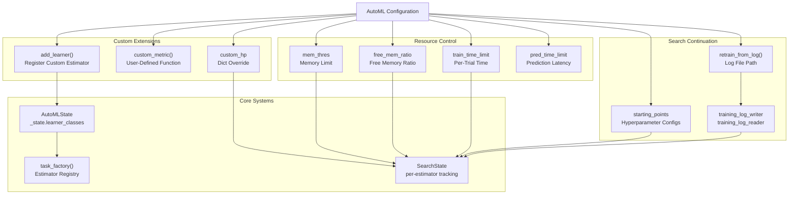

<!-- source: DeepWiki mcp.deepwiki.com · repo microsoft/FLAML · page 9 Advanced Topics · fetched 2026-10-26 -->

# Advanced Topics

<details>
<summary>Relevant source files</summary>

The following files were used as context for generating this wiki page:

- [flaml/automl/automl.py](flaml/automl/automl.py)
- [test/automl/test_multiclass.py](test/automl/test_multiclass.py)
- [website/docs/Best-Practices.md](website/docs/Best-Practices.md)
- [website/docs/Contribute.md](website/docs/Contribute.md)
- [website/docs/FAQ.md](website/docs/FAQ.md)
- [website/docs/Getting-Started.md](website/docs/Getting-Started.md)
- [website/docs/Installation.md](website/docs/Installation.md)
- [website/docs/Use-Cases/Task-Oriented-AutoML.md](website/docs/Use-Cases/Task-Oriented-AutoML.md)
- [website/sidebars.js](website/sidebars.js)

</details>


This page introduces advanced features and customization capabilities in FLAML's AutoML system. While basic usage of `AutoML.fit()` covers most scenarios, these advanced topics enable deeper control over model selection, resource management, and the search process itself.

**Scope of this page:**  
This document provides an overview of advanced AutoML features. For detailed examples and code, see the child pages:
- For adding custom estimators and metrics: [Custom Learners and Metrics](#9.1)
- For memory and time constraints: [Resource Management](#9.2)
- For continuing previous searches: [Warm Starting and Retraining](#9.3)
- For online learning scenarios: [Vowpal Wabbit Integration](#9.4)

For basic AutoML usage, see [AutoML Core](#3.1). For search algorithms and hyperparameter tuning concepts, see [Search Algorithms](#4.2).

---

## Overview of Advanced Capabilities

FLAML's AutoML system exposes several extension points for users who need to go beyond the default configuration. These fall into four main categories:

| Category | Key Features | Primary Use Cases |
|----------|-------------|-------------------|
| **Extensibility** | Custom estimators, custom metrics, custom search spaces | Integrating proprietary models, domain-specific metrics, fine-grained hyperparameter control |
| **Resource Control** | Memory limits, time limits, resource monitoring | Large datasets, constrained environments, production deployments |
| **Search Efficiency** | Warm starting, checkpoint loading, log replay | Iterative development, cost-effective hyperparameter search |
| **Specialized Algorithms** | Vowpal Wabbit integration | Online learning, large-scale problems |

Sources: [flaml/automl/automl.py:109-421]()

---

## Advanced Configuration Architecture

The following diagram shows how advanced configuration options flow through the AutoML system:



**Configuration Flow from User Input to Internal State**

This diagram shows how advanced configuration parameters in `AutoML` map to internal state management systems. User-provided extensions (`add_learner`, `custom_metric`, `custom_hp`) are processed by `AutoMLState` and stored in per-estimator `SearchState` objects. Resource constraints are enforced during trial execution, and warm start configurations are loaded into the search state before optimization begins.

Sources: [flaml/automl/automl.py:109-421](), [flaml/automl/state.py]()

---

## Custom Learner Registration

FLAML allows registration of custom estimators that integrate seamlessly with the search process. The custom estimator must inherit from `BaseEstimator` or one of its derived classes.

### Custom Estimator Interface

```mermaid
graph TB
    BaseEstimator["BaseEstimator<br/>Abstract Base Class"]
    
    subgraph "Required Methods"
        SearchSpace["search_space(cls, data_size, task)<br/>Returns: Dict[str, Domain]"]
        Config2Params["config2params(config)<br/>Translates FLAML to Model Params"]
        FitMethod["fit(X_train, y_train, budget)<br/>Training Logic"]
        PredictMethod["predict(X)<br/>Inference Logic"]
    end
    
    subgraph "Optional Methods"
        SizeMethod["size(cls, config)<br/>Memory Estimation"]
        CostMethod["cost_relative2lgbm(cls)<br/>Training Cost Factor"]
    end
    
    subgraph "Example Custom Estimators"
        RGFEstimator["MyRegularizedGreedyForest<br/>test_multiclass.py:13-67"]
        LargeXGB["MyLargeXGB<br/>test_multiclass.py:69-83"]
        LargeLGBM["MyLargeLGBM<br/>test_multiclass.py:86-100"]
    end
    
    BaseEstimator --> SearchSpace
    BaseEstimator --> Config2Params
    BaseEstimator --> FitMethod
    BaseEstimator --> PredictMethod
    BaseEstimator --> SizeMethod
    BaseEstimator --> CostMethod
    
    BaseEstimator -.->|"inherits"| RGFEstimator
    BaseEstimator -.->|"inherits"| LargeXGB
    BaseEstimator -.->|"inherits"| LargeLGBM
```



**Custom Estimator Contract**

Custom estimators must implement the `search_space()` class method that returns a dictionary mapping hyperparameter names to domain specifications. The `config2params()` method translates FLAML's internal configuration format to the underlying model's parameter format. Optional methods like `size()` and `cost_relative2lgbm()` enable resource-aware search.

Sources: [test/automl/test_multiclass.py:13-67](), [flaml/automl/model.py]()

### Registration and Usage

The `add_learner()` method registers custom estimators into the AutoML's internal learner registry:

```python
automl = AutoML()
automl.add_learner(learner_name="rgf", learner_class=MyRegularizedGreedyForest)
automl.fit(X_train, y_train, estimator_list=["rgf", "lgbm"])
```

Internally, this updates the `_state.learner_classes` dictionary in `AutoMLState`. The learner name becomes available for use in `estimator_list`.

Sources: [flaml/automl/automl.py:369-370](), [test/automl/test_multiclass.py:135-148]()

---

## Custom Metrics

FLAML supports user-defined evaluation metrics with the following signature:

```python
def custom_metric(
    X_val, y_val, estimator, labels,
    X_train, y_train, weight_val=None, weight_train=None,
    config=None, groups_val=None, groups_train=None,
):
    return metric_to_minimize, metrics_to_log
```

The function must return:
1. A float value to minimize (primary optimization objective)
2. A dictionary of additional metrics to log

The custom metric is passed to `AutoML.fit()` via the `metric` parameter. When using metric constraints (see below), the constraint names must match keys in the `metrics_to_log` dictionary.

Sources: [test/automl/test_multiclass.py:103-132](), [flaml/automl/automl.py:112-158](), [website/docs/Use-Cases/Task-Oriented-AutoML.md:108-160]()

---

## Resource Management

### Memory Constraints

FLAML provides two mechanisms for memory control:

| Parameter | Type | Description | Enforcement Point |
|-----------|------|-------------|-------------------|
| `mem_thres` | bytes | Absolute memory limit | Model instantiation |
| `free_mem_ratio` | float [0,1] | Keep this fraction of memory free | Trial execution |

The `mem_thres` parameter (default: `MEM_THRES` constant) is checked before instantiating each model using the estimator's `size()` method:

```python
estimated_size = learner_class.size(config)
if estimated_size > mem_thres:
    # Skip this configuration
```

The `free_mem_ratio` parameter triggers early stopping during training if free memory drops below the threshold.

Sources: [flaml/automl/automl.py:394](), [flaml/automl/automl.py:415](), [flaml/config.py]()

### Time Constraints

| Parameter | Scope | Description |
|-----------|-------|-------------|
| `time_budget` | Global | Total search time in seconds |
| `train_time_limit` | Per-trial | Maximum training time for a single trial |
| `pred_time_limit` | Per-sample | Maximum prediction time per instance |

The `train_time_limit` applies only to sequential search (not parallel trials). The `pred_time_limit` is converted internally to a metric constraint.

Sources: [flaml/automl/automl.py:174](), [flaml/automl/automl.py:202-205](), [flaml/automl/automl.py:396](), [website/docs/Use-Cases/Task-Oriented-AutoML.md:433-441]()

---

## Metric Constraints

Advanced users can specify constraints on any metric returned by a custom metric function. Constraints are specified as a list of 3-tuples:

```python
metric_constraints = [
    ("train_loss", "<=", 0.1),
    ("val_loss", "<=", 0.1),
]
automl.fit(X_train, y_train, metric_constraints=metric_constraints)
```

Each constraint is `(metric_name, inequality_sign, threshold_value)` where:
- `metric_name` must be a key in the `metrics_to_log` dictionary returned by the custom metric
- `inequality_sign` is either `">="` or `"<="`
- `threshold_value` is a numeric threshold

Configurations that violate any constraint are rejected during search.

Sources: [flaml/automl/automl.py:306-319](), [flaml/automl/automl.py:416](), [website/docs/Use-Cases/Task-Oriented-AutoML.md:443-463]()

---

## Warm Starting

### Starting Points Configuration

The `starting_points` parameter allows users to provide initial hyperparameter configurations for each estimator. This enables:
1. Continuing a previous search
2. Transfer learning from similar datasets
3. Incorporating domain knowledge

The format is a dictionary mapping estimator names to configuration dictionaries (or lists of configurations):

```python
starting_points = {
    "lgbm": {"n_estimators": 100, "num_leaves": 31, "learning_rate": 0.1},
    "xgboost": [
        {"n_estimators": 50, "max_leaves": 31},
        {"n_estimators": 100, "max_leaves": 63},
    ]
}
automl.fit(X_train, y_train, starting_points=starting_points)
```

The `best_config_per_estimator` property returns configurations suitable for use as starting points in subsequent runs.

Sources: [flaml/automl/automl.py:239-262](), [flaml/automl/automl.py:602-676](), [test/automl/test_multiclass.py:496-541]()

### Log-Based Retraining

The `retrain_from_log()` method allows reproducing a specific configuration from a training log:

```python
automl = AutoML(task="classification")
duration = automl.retrain_from_log(
    log_file_name="experiment.log",
    X_train=X_train,
    y_train=y_train,
    train_full=True,
    record_id=0,
)
```

This is useful for:
- Reproducing best models from previous experiments
- Retraining with full data after holdout validation
- Debugging specific configurations

The training log format is documented in the `training_log_writer` and `training_log_reader` utilities.

Sources: [flaml/automl/automl.py](), [flaml/automl/training_log.py](), [test/automl/test_multiclass.py:337-346]()

---

## Search Space Override

The `custom_hp` parameter provides a shortcut to override search spaces without defining custom estimators:

```python
custom_hp = {
    "xgboost": {
        "n_estimators": {
            "domain": tune.lograndint(lower=10, upper=1000),
            "low_cost_init_value": 10,
        },
    },
    "rf": {
        "max_leaves": {"domain": None},  # Disable search for this parameter
    },
    "lgbm": {
        "subsample": {
            "domain": tune.uniform(lower=0.1, upper=1.0),
            "init_value": 1.0,
        },
        "subsample_freq": {"domain": 1},  # Fixed value
    },
}
automl.fit(X_train, y_train, custom_hp=custom_hp)
```

The `custom_hp` dictionary is merged with built-in search spaces. Per-hyperparameter dictionaries completely replace the built-in configuration for that hyperparameter.

Sources: [flaml/automl/automl.py:320-344](), [flaml/automl/automl.py:419](), [website/docs/Use-Cases/Task-Oriented-AutoML.md:366-394]()

---

## Training Logs

### Log Format and Structure

FLAML writes structured training logs that record each trial's configuration and results. The log format supports:
- Configuration replay via `retrain_from_log()`
- Warm starting via `starting_points` extraction
- Post-hoc analysis of search trajectories

The `log_type` parameter controls logging verbosity:
- `"better"` (default): Log only improving configurations
- `"all"`: Log all trials

The `log_file_name` parameter specifies the output path. Setting it to `""` disables file logging.

Sources: [flaml/automl/automl.py:169-170](), [flaml/automl/automl.py:192-196](), [flaml/automl/automl.py:387](), [flaml/automl/automl.py:391]()

### Reading Training Logs

The `training_log_reader` context manager provides structured access to log files:

```python
from flaml.automl.training_log import training_log_reader

with training_log_reader(log_file_name) as reader:
    for record in reader.records():
        config = record.config
        learner = record.learner
        loss = record.loss
        # Process record...
```

This is used internally by log-based features and can be used for custom analysis.

Sources: [flaml/automl/training_log.py](), [test/automl/test_multiclass.py:576-586]()

---

## Estimator-Specific Fit Arguments

The `fit_kwargs_by_estimator` parameter allows passing estimator-specific keyword arguments to the underlying model's `fit()` method:

```python
fit_kwargs_by_estimator = {
    "transformer": {
        "output_dir": "output/",
        "fp16": False,
    }
}
automl.fit(X_train, y_train, fit_kwargs_by_estimator=fit_kwargs_by_estimator)
```

This enables control over estimator-specific behaviors without defining custom estimator classes.

Sources: [flaml/automl/automl.py:352-362](), [flaml/automl/automl.py:418]()

---

## Summary of Advanced Parameters

The following table summarizes key advanced parameters in `AutoML.__init__()` and `AutoML.fit()`:

| Parameter | Type | Location | Purpose |
|-----------|------|----------|---------|
| `custom_hp` | dict | Constructor/fit | Override search spaces |
| `fit_kwargs_by_estimator` | dict | Constructor/fit | Pass estimator-specific fit arguments |
| `metric_constraints` | list | Constructor/fit | Constrain metrics beyond primary objective |
| `starting_points` | dict | Constructor/fit | Provide initial configurations |
| `free_mem_ratio` | float | Constructor/fit | Keep free memory above threshold |
| `mem_thres` | bytes | Constructor/fit | Absolute memory limit |
| `train_time_limit` | seconds | Constructor/fit | Per-trial time limit |
| `pred_time_limit` | seconds | Constructor/fit | Per-sample prediction latency |
| `log_type` | str | Constructor/fit | Control logging verbosity ("better" or "all") |
| `model_history` | bool | Constructor/fit | Retain all trained models vs. best only |
| `skip_transform` | bool | Constructor/fit | Disable automatic preprocessing |
| `allow_label_overlap` | bool | Constructor/fit | Control label overlap in holdout splits |

Sources: [flaml/automl/automl.py:109-421]()

---

