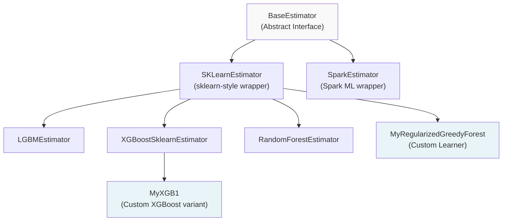
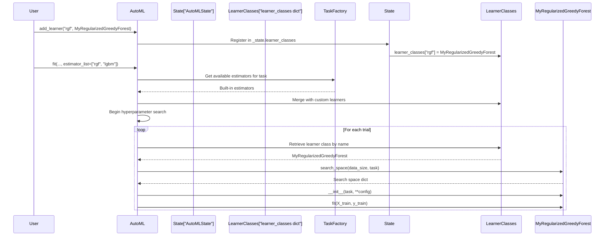
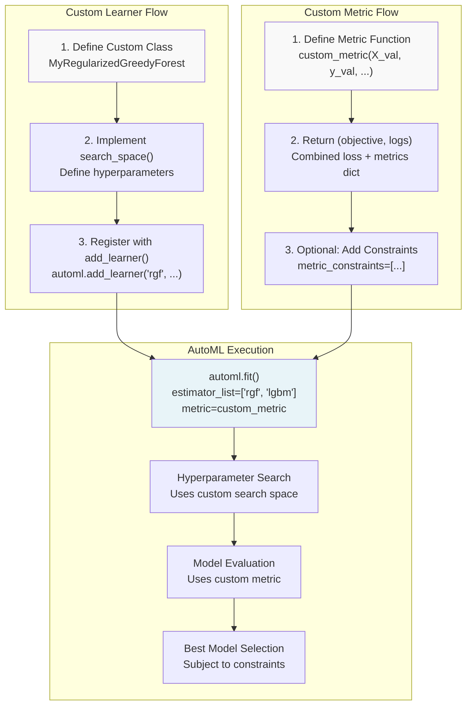

<!-- source: DeepWiki mcp.deepwiki.com · repo microsoft/FLAML · page 9.1 Custom Learners and Metrics · fetched 2026-10-26 -->

# Custom Learners and Metrics

<details>
<summary>Relevant source files</summary>

The following files were used as context for generating this wiki page:

- [flaml/automl/automl.py](flaml/automl/automl.py)
- [flaml/automl/model.py](flaml/automl/model.py)
- [test/automl/test_classification.py](test/automl/test_classification.py)
- [test/automl/test_multiclass.py](test/automl/test_multiclass.py)
- [test/automl/test_regression.py](test/automl/test_regression.py)
- [test/conftest.py](test/conftest.py)
- [website/docs/Use-Cases/Task-Oriented-AutoML.md](website/docs/Use-Cases/Task-Oriented-AutoML.md)

</details>


## Purpose and Scope

This page describes how to extend FLAML AutoML with custom estimators and custom evaluation metrics. Custom learners allow you to tune estimators that are not built-in to FLAML or to customize the search space for built-in estimators. Custom metrics enable specialized evaluation criteria beyond the standard classification and regression metrics.

For information about built-in estimators and their default search spaces, see [Model Abstraction and Estimators](#3.2). For information about using the `custom_hp` parameter to quickly override search spaces without creating custom classes, see [Task-Oriented AutoML documentation](#3.1).

---

## Custom Learners

### BaseEstimator Interface

All learners in FLAML, whether built-in or custom, inherit from the `BaseEstimator` class. This abstract class defines the standard interface that AutoML uses to interact with estimators during hyperparameter optimization.

**Core Architecture:**



**Key Methods in BaseEstimator:**

| Method | Type | Description |
|--------|------|-------------|
| `__init__(task, **config)` | Instance | Constructor; sets up estimator with hyperparameters |
| `fit(X_train, y_train, budget, ...)` | Instance | Trains the model on given data |
| `predict(X, **kwargs)` | Instance | Makes predictions on new data |
| `predict_proba(X, **kwargs)` | Instance | Returns class probabilities (classification only) |
| `search_space(data_size, task, **params)` | Class | Returns hyperparameter search space dictionary |
| `config2params(config)` | Instance | Converts FLAML config to estimator parameters |
| `size(config)` | Class | Returns memory size estimate in bytes |
| `cost_relative2lgbm()` | Class | Returns computational cost relative to LightGBM |

Sources: [flaml/automl/model.py:121-488]()

---

### Creating a Custom Learner

To create a custom learner, inherit from `BaseEstimator` or one of its derived classes (e.g., `SKLearnEstimator`, `XGBoostEstimator`) and implement the required methods.

**Step 1: Define the Custom Learner Class**

For estimators with scikit-learn-style `fit()` and `predict()` methods, inherit from `SKLearnEstimator` and set `self.estimator_class`:

```python
from flaml.automl.model import SKLearnEstimator
from flaml import tune

class MyRegularizedGreedyForest(SKLearnEstimator):
    def __init__(self, task="binary", **config):
        super().__init__(task, **config)
        
        if isinstance(task, str):
            from flaml.automl.task.factory import task_factory
            task = task_factory(task)
        
        if task.is_classification():
            from rgf.sklearn import RGFClassifier
            self.estimator_class = RGFClassifier
        else:
            from rgf.sklearn import RGFRegressor
            self.estimator_class = RGFRegressor
```

Sources: [test/automl/test_multiclass.py:13-30](), [website/docs/Use-Cases/Task-Oriented-AutoML.md:243-267]()

**Step 2: Define the Search Space**

Implement the `search_space()` class method to specify hyperparameters to tune:

```python
@classmethod
def search_space(cls, data_size, task):
    space = {
        "max_leaf": {
            "domain": tune.lograndint(lower=4, upper=data_size[0]),
            "init_value": 4,
        },
        "n_iter": {
            "domain": tune.lograndint(lower=1, upper=data_size[0]),
            "init_value": 1,
        },
        "learning_rate": {
            "domain": tune.loguniform(lower=0.01, upper=20.0)
        },
        "min_samples_leaf": {
            "domain": tune.lograndint(lower=1, upper=20),
            "init_value": 20,
        },
    }
    return space
```

Each hyperparameter dictionary supports:
- `domain` (required): Search space specification using `tune.*` functions
- `init_value` (optional): Initial value to try
- `low_cost_init_value` (optional): Value associated with low computational cost

Sources: [test/automl/test_multiclass.py:31-56](), [website/docs/Use-Cases/Task-Oriented-AutoML.md:315-323]()

**Step 3: Implement Optional Methods**

```python
@classmethod
def size(cls, config):
    """Estimate memory size in bytes"""
    max_leaves = int(round(config.get("max_leaf", 1)))
    n_estimators = int(round(config.get("n_iter", 1)))
    return (max_leaves * 3 + (max_leaves - 1) * 4 + 1.0) * n_estimators * 8

@classmethod
def cost_relative2lgbm(cls):
    """Return computational cost relative to LightGBM"""
    return 1.0
```

Sources: [test/automl/test_multiclass.py:58-66]()

---

### Customizing Built-in Estimators

You can create variants of built-in estimators by inheriting from them and overriding specific methods or parameters.

**Example 1: Custom Objective Function**

```python
from flaml.automl.model import XGBoostEstimator
import numpy as np

def logregobj(preds, dtrain):
    labels = dtrain.get_label()
    preds = 1.0 / (1.0 + np.exp(-preds))
    grad = preds - labels
    hess = preds * (1.0 - preds)
    return grad, hess

class MyXGB1(XGBoostEstimator):
    """XGBoostEstimator with custom objective function"""
    def __init__(self, **config):
        super().__init__(objective=logregobj, **config)
```

Sources: [test/automl/test_regression.py:17-29](), [website/docs/Use-Cases/Task-Oriented-AutoML.md:330-343]()

**Example 2: Restricted Search Space**

```python
from flaml.automl.model import XGBoostSklearnEstimator
from flaml import tune

class XGBoost2D(XGBoostSklearnEstimator):
    @classmethod
    def search_space(cls, data_size, task):
        upper = min(32768, int(data_size))
        return {
            "n_estimators": {
                "domain": tune.lograndint(lower=4, upper=upper),
                "low_cost_init_value": 4,
            },
            "max_leaves": {
                "domain": tune.lograndint(lower=4, upper=upper),
                "low_cost_init_value": 4,
            },
        }
```

This restricts tuning to only two hyperparameters instead of the full default set.

Sources: [website/docs/Use-Cases/Task-Oriented-AutoML.md:348-364]()

---

### Registering and Using Custom Learners

**Custom Learner Registration Flow:**



**Registration Code:**

```python
from flaml import AutoML

# Create AutoML instance
automl = AutoML()

# Register custom learner
automl.add_learner(learner_name="rgf", learner_class=MyRegularizedGreedyForest)

# Use in fit with other estimators
automl.fit(
    X_train=X_train,
    y_train=y_train,
    estimator_list=["rgf", "lgbm", "xgboost"],
    time_budget=10
)
```

The `add_learner()` method registers the custom class in `AutoMLState.learner_classes`, making it available during the search process.

Sources: [flaml/automl/automl.py:1364-1413](), [test/automl/test_multiclass.py:136-148](), [website/docs/Use-Cases/Task-Oriented-AutoML.md:298-312]()

---

### Parameter Translation with config2params()

The `config2params()` method translates FLAML's internal hyperparameter representation to the format expected by the underlying estimator.

**Default Behavior:**

The base implementation simply copies the config dict and removes FLAML-specific keys:

```python
def config2params(self, config: dict) -> dict:
    params = config.copy()
    if "FLAML_sample_size" in params:
        params.pop("FLAML_sample_size")
    return params
```

Sources: [flaml/automl/model.py:475-488]()

**Custom Parameter Translation:**

For estimators that use different parameter names or need transformations:

```python
class SparkLGBMEstimator(SparkEstimator):
    def config2params(self, config: dict) -> dict:
        params = super().config2params(config)
        if "n_jobs" in params:
            params.pop("n_jobs")
        if "log_max_bin" in params:
            # Transform log scale to actual max_bin value
            params["maxBin"] = (1 << params.pop("log_max_bin")) - 1
        return params
```

This example shows:
1. Removing parameters not supported by the underlying estimator (`n_jobs`)
2. Transforming parameters from FLAML's representation to the estimator's expected format (logarithmic `log_max_bin` to linear `maxBin`)

Sources: [flaml/automl/model.py:660-666]()

---

## Search Space Definition

### Domain Specifications

The `domain` field in the search space uses FLAML's `tune` module functions to specify hyperparameter ranges and distributions:

| Function | Description | Example |
|----------|-------------|---------|
| `tune.uniform(lower, upper)` | Continuous uniform distribution | `tune.uniform(0.0, 1.0)` |
| `tune.loguniform(lower, upper)` | Log-uniform distribution | `tune.loguniform(1e-5, 1.0)` |
| `tune.randint(lower, upper)` | Integer uniform distribution | `tune.randint(1, 100)` |
| `tune.lograndint(lower, upper)` | Log-integer distribution | `tune.lograndint(4, 32768)` |
| `tune.choice(categories)` | Categorical choice | `tune.choice(["gini", "entropy"])` |

**Constant Values:**

To fix a hyperparameter to a constant value, set `domain` to the constant directly:

```python
"subsample_freq": {
    "domain": 1,  # Fixed value
}
```

Sources: [website/docs/Use-Cases/Task-Oriented-AutoML.md:315-394]()

### Cost-Related Hyperparameters

FLAML's cost-frugal search algorithms use `low_cost_init_value` to identify configurations that are cheap to evaluate:

```python
"n_estimators": {
    "domain": tune.lograndint(lower=4, upper=32768),
    "init_value": 100,                  # Default starting point
    "low_cost_init_value": 4,           # Cheap configuration for initial trials
}
```

Hyperparameters that significantly affect training time or memory should specify `low_cost_init_value`. This enables efficient search by testing cheap configurations first.

Sources: [test/automl/test_classification.py:18-32](), [test/automl/test_multiclass.py:86-100]()

---

## Custom Metrics

### Metric Function Signature

Custom metric functions must follow a specific signature to integrate with AutoML's evaluation framework:

```python
def custom_metric(
    X_val,              # Validation features
    y_val,              # Validation labels
    estimator,          # Trained estimator
    labels,             # Unique class labels (classification)
    X_train,            # Training features
    y_train,            # Training labels
    weight_val=None,    # Sample weights for validation
    weight_train=None,  # Sample weights for training
    config=None,        # Hyperparameter configuration
    groups_val=None,    # Group labels for validation
    groups_train=None,  # Group labels for training
):
    return metric_to_minimize, metrics_to_log
```

**Return Values:**
1. `metric_to_minimize` (float): The primary optimization objective
2. `metrics_to_log` (dict): Additional metrics to log for monitoring

Sources: [flaml/automl/automl.py:126-158](), [website/docs/Use-Cases/Task-Oriented-AutoML.md:109-160]()

### Custom Metric Example

```python
def custom_metric(
    X_val, y_val, estimator, labels,
    X_train, y_train, weight_val=None, weight_train=None,
    *args,
):
    from sklearn.metrics import log_loss
    import time
    
    # Measure prediction time
    start = time.time()
    y_pred = estimator.predict_proba(X_val)
    pred_time = (time.time() - start) / len(X_val)
    
    # Compute validation loss
    val_loss = log_loss(y_val, y_pred, labels=labels, sample_weight=weight_val)
    
    # Compute training loss
    y_pred_train = estimator.predict_proba(X_train)
    train_loss = log_loss(y_train, y_pred_train, labels=labels, sample_weight=weight_train)
    
    # Combine losses with regularization
    alpha = 0.5
    combined_loss = val_loss * (1 + alpha) - alpha * train_loss
    
    return combined_loss, {
        "val_loss": val_loss,
        "train_loss": train_loss,
        "pred_time": pred_time,
    }
```

This example:
- Measures per-instance prediction time
- Computes both validation and training loss
- Returns a regularized objective that penalizes overfitting
- Logs individual metrics for monitoring

Sources: [test/automl/test_multiclass.py:103-131](), [website/docs/Use-Cases/Task-Oriented-AutoML.md:130-160]()

---

### Using Custom Metrics

**Method 1: Pass to Constructor**

```python
automl = AutoML(metric=custom_metric)
automl.fit(X_train, y_train, task="classification", time_budget=10)
```

**Method 2: Pass to fit()**

```python
automl = AutoML()
automl.fit(
    X_train, y_train,
    task="classification",
    metric=custom_metric,
    time_budget=10
)
```

**Important:** Pass the function itself, not the result of calling it. Do not use `metric=custom_metric(...)`.

Sources: [flaml/automl/automl.py:479-498](), [test/automl/test_multiclass.py:230-279]()

---

### Metric Constraints

When using custom metrics that return additional logged metrics, you can impose constraints on those metrics:

```python
metric_constraints = [
    ("train_loss", "<=", 0.1),
    ("val_loss", "<=", 0.15),
    ("pred_time", "<=", 1e-3),
]

automl.fit(
    X_train, y_train,
    metric=custom_metric,
    metric_constraints=metric_constraints,
    task="classification",
    time_budget=10
)
```

Each constraint is a 3-tuple:
1. Metric name (must match a key in `metrics_to_log`)
2. Inequality operator: `"<="` or `">="`
3. Constraint value (float)

Configurations violating any constraint are discarded during search.

Sources: [flaml/automl/automl.py:306-320](), [website/docs/Use-Cases/Task-Oriented-AutoML.md:443-463]()

---

## Complete Example: Custom Learner and Metric



**Complete Code:**

```python
from flaml import AutoML, tune
from flaml.automl.model import SKLearnEstimator
from sklearn.metrics import log_loss
import time

# Custom Learner
class MyRegularizedGreedyForest(SKLearnEstimator):
    def __init__(self, task="binary", **config):
        super().__init__(task, **config)
        
        if isinstance(task, str):
            from flaml.automl.task.factory import task_factory
            task = task_factory(task)
        
        if task.is_classification():
            from rgf.sklearn import RGFClassifier
            self.estimator_class = RGFClassifier
        else:
            from rgf.sklearn import RGFRegressor
            self.estimator_class = RGFRegressor
    
    @classmethod
    def search_space(cls, data_size, task):
        return {
            "max_leaf": {
                "domain": tune.lograndint(lower=4, upper=data_size[0]),
                "init_value": 4,
            },
            "n_iter": {
                "domain": tune.lograndint(lower=1, upper=data_size[0]),
                "init_value": 1,
                "low_cost_init_value": 1,
            },
            "learning_rate": {
                "domain": tune.loguniform(lower=0.01, upper=20.0)
            },
        }

# Custom Metric
def custom_metric(X_val, y_val, estimator, labels,
                  X_train, y_train, weight_val=None, weight_train=None, *args):
    start = time.time()
    y_pred = estimator.predict_proba(X_val)
    pred_time = (time.time() - start) / len(X_val)
    
    val_loss = log_loss(y_val, y_pred, labels=labels, sample_weight=weight_val)
    y_pred_train = estimator.predict_proba(X_train)
    train_loss = log_loss(y_train, y_pred_train, labels=labels, sample_weight=weight_train)
    
    alpha = 0.5
    combined_loss = val_loss * (1 + alpha) - alpha * train_loss
    
    return combined_loss, {
        "val_loss": val_loss,
        "train_loss": train_loss,
        "pred_time": pred_time,
    }

# Usage
automl = AutoML()
automl.add_learner(learner_name="rgf", learner_class=MyRegularizedGreedyForest)

automl.fit(
    X_train=X_train,
    y_train=y_train,
    task="classification",
    estimator_list=["rgf", "lgbm", "xgboost"],
    metric=custom_metric,
    metric_constraints=[("pred_time", "<=", 1e-3)],
    time_budget=60
)
```

Sources: [test/automl/test_multiclass.py:13-66](), [test/automl/test_multiclass.py:103-148]()

---

