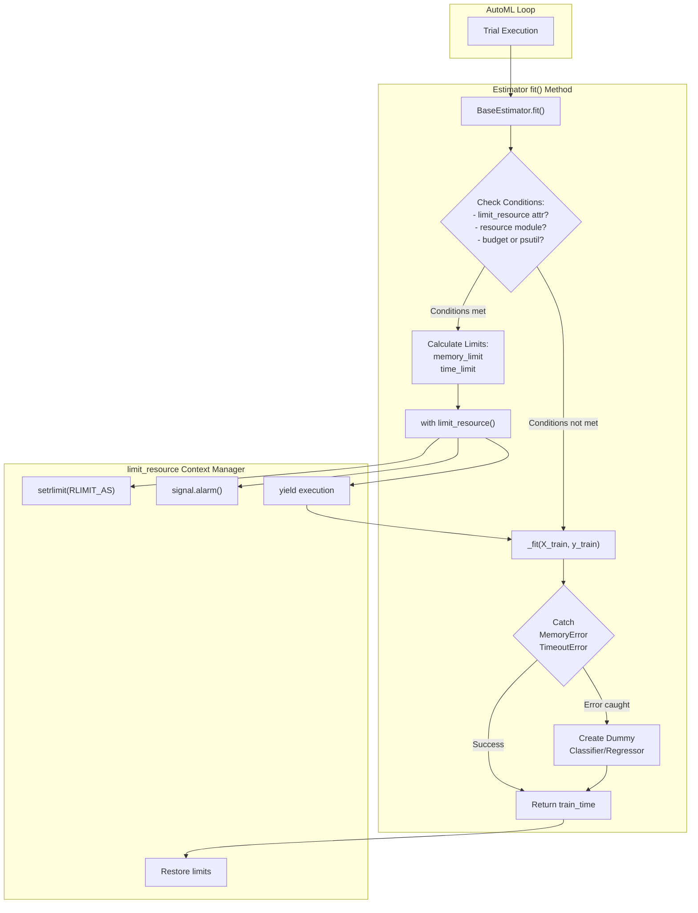
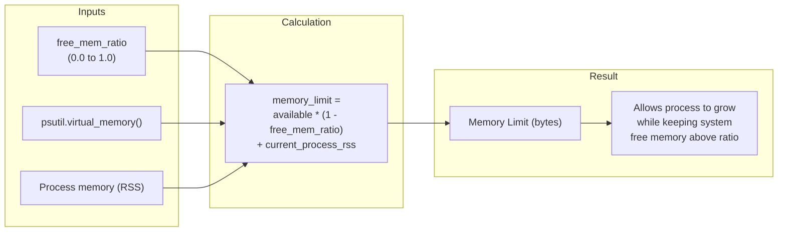
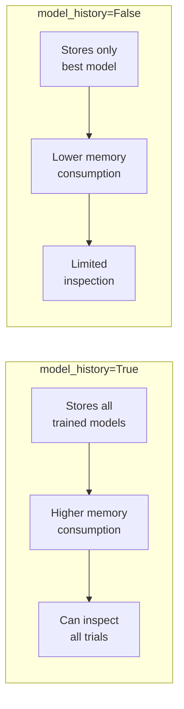
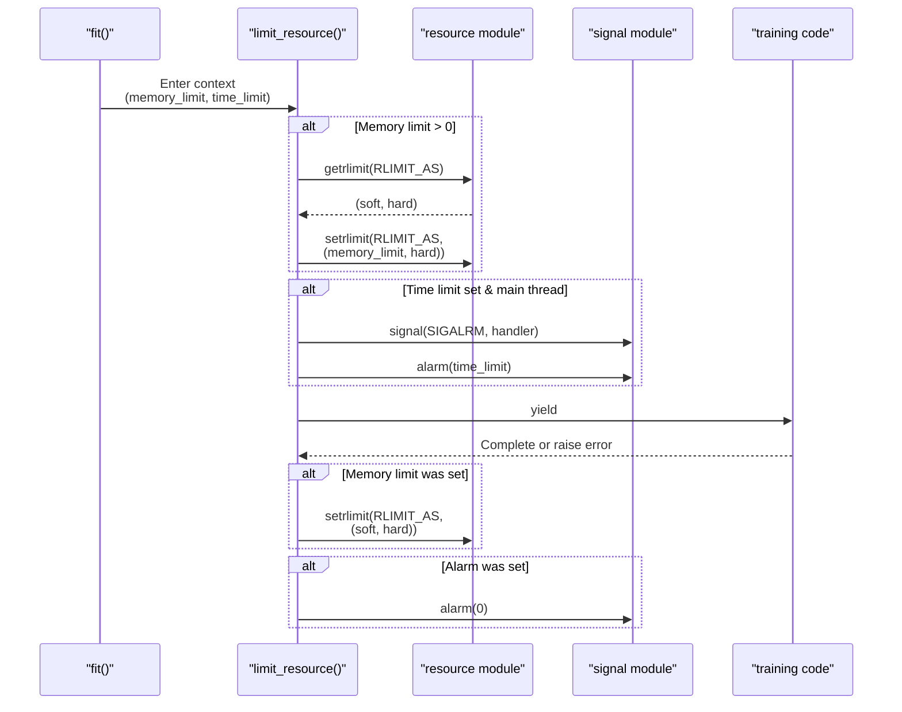
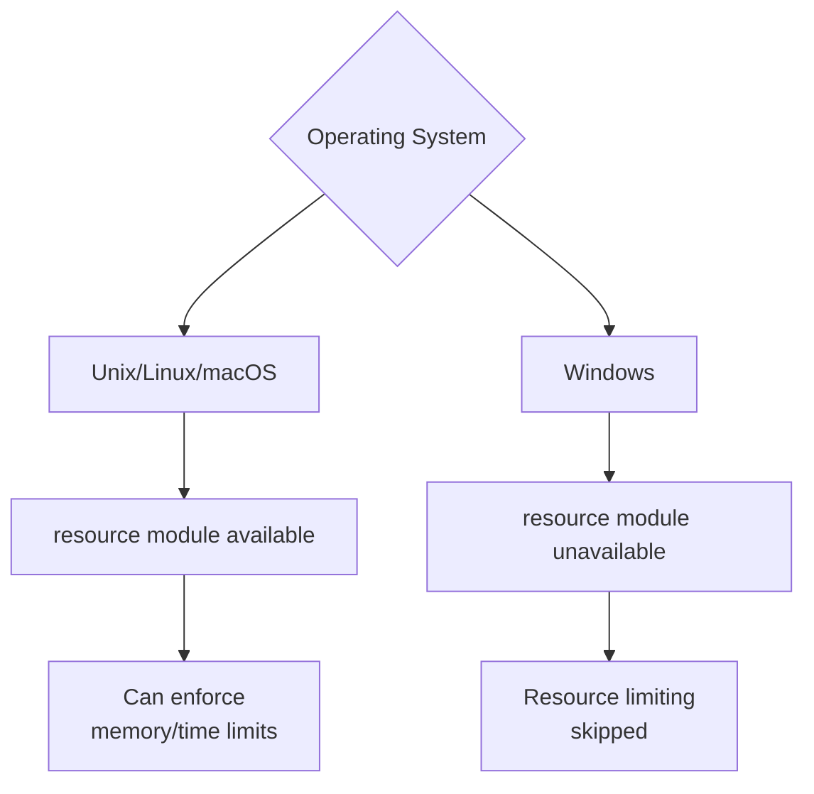
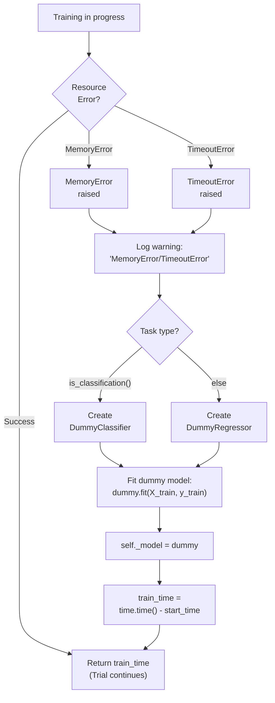

<!-- source: DeepWiki mcp.deepwiki.com · repo microsoft/FLAML · page 9.2 Resource Management · fetched 2026-10-26 -->

# Resource Management

<details>
<summary>Relevant source files</summary>

The following files were used as context for generating this wiki page:

- [flaml/automl/model.py](flaml/automl/model.py)
- [test/automl/test_classification.py](test/automl/test_classification.py)
- [test/automl/test_regression.py](test/automl/test_regression.py)
- [test/conftest.py](test/conftest.py)
- [website/docs/Best-Practices.md](website/docs/Best-Practices.md)
- [website/docs/Contribute.md](website/docs/Contribute.md)
- [website/docs/FAQ.md](website/docs/FAQ.md)
- [website/docs/Getting-Started.md](website/docs/Getting-Started.md)
- [website/docs/Installation.md](website/docs/Installation.md)
- [website/sidebars.js](website/sidebars.js)

</details>


## Purpose and Scope

This page explains FLAML's resource management capabilities for controlling memory consumption and training time during AutoML runs. It covers:

- **Memory limiting**: Using `free_mem_ratio` to prevent out-of-memory (OOM) errors
- **Model storage**: Managing memory usage with `model_history`
- **Resource constraints**: Time and memory limits enforced during training
- **Error recovery**: Fallback strategies when resource limits are exceeded
- **OOM troubleshooting**: Configuration strategies to resolve memory issues

For information about configuring custom estimators and search spaces, see [Custom Learners and Metrics](#9.1). For distributed execution options that can help with resource management, see [Ray Integration](#7.1) and [Spark Integration](#7.2).

---

## Resource Limiting System Architecture

FLAML provides a resource limiting system that can restrict memory and time consumption during model training. This system operates at the estimator level during the `fit()` process.



**Sources:** [flaml/automl/model.py:279-322](), [flaml/automl/model.py:91-119]()

---

## Memory Limit Calculation

When resource limiting is enabled, FLAML calculates memory limits based on available system memory and the `free_mem_ratio` parameter.



**Memory Limit Formula:**

| Component | Description |
|-----------|-------------|
| `available` | System's currently available memory from `psutil.virtual_memory().available` |
| `free_mem_ratio` | Fraction of memory to keep free (e.g., 0.2 = keep 20% free) |
| `current_process_rss` | Current process's resident set size from `psutil.Process().memory_info().rss` |
| **Result** | Maximum memory the training process can consume |

**Example:** If system has 10GB available, `free_mem_ratio=0.2`, and current process uses 1GB:
- Memory limit = 10GB × (1 - 0.2) + 1GB = 9GB
- This keeps 2GB (20%) free for system operations

**Sources:** [flaml/automl/model.py:299-306]()

---

## Core Parameters

### `free_mem_ratio`

**Type:** `float` (default: `0`)  
**Range:** `0.0` to `1.0`  
**Location:** `BaseEstimator.fit(free_mem_ratio=...)`

Controls the minimum fraction of system memory to keep available during training. When set to a non-zero value and `psutil` is installed, FLAML will:

1. Calculate a memory limit before each training trial
2. Enforce this limit using Unix `resource.setrlimit()`
3. Early stop training if the limit is exceeded

**Configuration:**

```python
from flaml import AutoML

automl = AutoML()
automl.fit(
    X_train, 
    y_train,
    task="classification",
    time_budget=60,
    free_mem_ratio=0.2  # Keep 20% memory free
)
```

**When to use:**
- Large datasets that may cause OOM errors
- Shared systems where you need to preserve memory for other processes
- Production environments with strict memory constraints

**Platform support:**
- **Unix/Linux/macOS:** Full support via `resource` module
- **Windows:** Not supported (resource limiting will be skipped)

**Sources:** [flaml/automl/model.py:279-322](), [website/docs/FAQ.md:164-166]()

---

### `model_history`

**Type:** `bool` (default: `True`)  
**Location:** `AutoML.fit(model_history=...)`

Controls whether FLAML stores all trained models during the AutoML run. When `True`, models are kept in memory for later inspection. When `False`, only the best model is retained.

**Memory impact:**



**Configuration:**

```python
from flaml import AutoML

# Memory-efficient configuration
automl = AutoML()
automl.fit(
    X_train, 
    y_train,
    task="classification",
    time_budget=60,
    model_history=False  # Reduce memory usage
)
```

**Trade-offs:**

| Setting | Memory Usage | Available Methods |
|---------|--------------|-------------------|
| `True` (default) | Higher | `best_model_for_estimator()`, full `config_history` |
| `False` | Lower | Only `best_estimator`, `best_config`, `best_loss` |

**Sources:** [website/docs/FAQ.md:166](), [test/automl/test_classification.py:226](), [test/automl/test_regression.py:48]()

---

## Resource Limiting Implementation

### Context Manager: `limit_resource`

The `limit_resource` context manager is the core mechanism for enforcing resource constraints during model training.



**Implementation details:**

| Aspect | Implementation |
|--------|----------------|
| **Memory limiting** | Uses `resource.setrlimit(resource.RLIMIT_AS)` to set address space limit |
| **Time limiting** | Uses `signal.SIGALRM` with timeout handler (main thread only) |
| **Error types** | Raises `MemoryError` (memory exceeded) or `TimeoutError` (time exceeded) |
| **Cleanup** | Always restores original limits in `finally` block |
| **Mac compatibility** | Catches `ValueError` on macOS due to [Python bug #40518](https://bugs.python.org/issue40518) |

**Sources:** [flaml/automl/model.py:91-119](), [flaml/automl/model.py:86-87]()

---

### Conditions for Resource Limiting

Resource limiting is only applied when **all** of the following conditions are met:

```python
if (
    getattr(self, "limit_resource", None)  # (1) Estimator opts in
    and resource is not None               # (2) Unix resource module available
    and (budget is not None or psutil is not None)  # (3) Time or memory tracking possible
):
    # Apply resource limiting
```

**Condition breakdown:**

| # | Condition | Check | Implication |
|---|-----------|-------|-------------|
| 1 | `limit_resource` attribute | Estimator has `limit_resource=True` | Opt-in per estimator type |
| 2 | `resource` module | Unix/Linux/macOS system | Windows not supported |
| 3 | Budget or psutil | `budget` parameter or `psutil` installed | Need ability to set limits |

**Platform compatibility:**



**Sources:** [flaml/automl/model.py:293-296]()

---

## Error Handling and Recovery

When resource limits are exceeded during training, FLAML implements a graceful fallback strategy rather than crashing the entire AutoML run.

### Fallback Mechanism



**Fallback models:**

| Task Type | Fallback Estimator | Behavior |
|-----------|-------------------|----------|
| Classification | `sklearn.dummy.DummyClassifier` | Predicts most frequent class |
| Regression | `sklearn.dummy.DummyRegressor` | Predicts mean target value |

**Example logged warning:**

```
WARNING flaml.automl.model - MemoryError <exception details>
WARNING flaml.automl.model - TimeoutError <exception details>
```

**Why this strategy works:**

1. **Prevents cascading failures**: One bad configuration doesn't crash the entire AutoML run
2. **Poor performance signal**: Dummy estimator will have very poor metrics, signaling to search algorithm to avoid similar configs
3. **Continues optimization**: AutoML can proceed to try other configurations
4. **Time accounting**: Training time is properly recorded even for failed trials

**Sources:** [flaml/automl/model.py:310-319]()

---

## Estimator Memory Estimation

FLAML uses the `size()` class method to estimate memory requirements for different configurations before training. This helps the search algorithm avoid trying configurations that would cause OOM errors.

### Size Estimation Interface

**Base signature:**

```python
@classmethod
def size(cls, config: dict) -> float:
    """Estimate memory size in bytes for the given config."""
    return 1.0  # Default: 1 byte
```

**Usage in search algorithms:** The search algorithm can call `EstimatorClass.size(config)` to estimate whether a configuration will fit in available memory.

### Example: SparkLGBMEstimator

The `SparkLGBMEstimator` provides a concrete implementation that estimates tree-based model memory:

```python
@classmethod
def size(cls, config):
    num_leaves = int(round(config.get("numLeaves") or 1 << config.get("maxDepth", 16)))
    n_estimators = int(round(config["numIterations"]))
    # Tree structure: 3 values per leaf + 4 values per internal node + overhead
    # Each tree: (num_leaves * 3 + (num_leaves - 1) * 4 + 1.0) * 8 bytes
    return (num_leaves * 3 + (num_leaves - 1) * 4 + 1.0) * n_estimators * 8
```

**Memory calculation breakdown:**

| Component | Formula | Unit | Description |
|-----------|---------|------|-------------|
| Leaf nodes | `num_leaves × 3` | values | Prediction, count, cover per leaf |
| Internal nodes | `(num_leaves - 1) × 4` | values | Split feature, threshold, gain, cover |
| Overhead | `+1.0` | values | Model metadata |
| Per tree | `× n_estimators` | trees | Number of boosting iterations |
| Bytes | `× 8` | bytes | 8 bytes per double value |

**Sources:** [flaml/automl/model.py:453-463](), [flaml/automl/model.py:669-672]()

---

## Troubleshooting OOM Errors

When encountering out-of-memory errors during `AutoML.fit()`, FLAML provides multiple strategies to resolve the issue.

### Strategy Matrix

```mermaid
graph TB
    OOM["Out of Memory Error"]
    
    subgraph "Configuration Strategies"
        FreeMem["Set free_mem_ratio"]
        ModelHist["Set model_history=False"]
        SkipTrans["Set skip_transform=True"]
    end
    
    subgraph "Isolation Strategies"
        UseRay["Set use_ray=True"]
        RayNote["Isolates each trial<br/>in separate process"]
    end
    
    subgraph "Search Space Strategies"
        SizeFunc["Provide accurate<br/>size() function"]
        ModifySpace["Modify search space<br/>to avoid large configs"]
        RemoveEst["Remove problematic<br/>estimators"]
    end
    
    subgraph "Ensemble Strategies"
        DisableEns["Disable ensemble"]
        CheaperEns["Use cheaper<br/>ensemble options"]
    end
    
    OOM --> FreeMem
    OOM --> ModelHist
    OOM --> SkipTrans
    OOM --> UseRay
    OOM --> SizeFunc
    OOM --> ModifySpace
    OOM --> RemoveEst
    OOM --> DisableEns
    OOM --> CheaperEns
```



### Strategy 1: Memory Management Parameters

**Reduce memory footprint:**

```python
from flaml import AutoML

automl = AutoML()
automl.fit(
    X_train, y_train,
    task="classification",
    time_budget=60,
    free_mem_ratio=0.2,      # Keep 20% memory free
    model_history=False,     # Don't store all models
    skip_transform=True      # Skip if data already preprocessed
)
```

**When to use:**
- `free_mem_ratio`: Set between 0.1-0.3 for tight memory environments
- `model_history=False`: When you only need the best model
- `skip_transform=True`: When data is already preprocessed (saves memory for DataTransformer)

**Sources:** [website/docs/FAQ.md:163-168]()

---

### Strategy 2: Ray-Based Isolation

**Isolate failures:**

```python
from flaml import AutoML

automl = AutoML()
automl.fit(
    X_train, y_train,
    task="classification",
    time_budget=60,
    use_ray=True,           # Each trial runs in separate Ray worker
    n_concurrent_trials=2   # Parallel trials (optional)
)
```

**How it helps:**

| Aspect | Without Ray | With Ray |
|--------|-------------|----------|
| OOM error | Crashes entire AutoML run | Only fails single trial, AutoML continues |
| Memory isolation | Shared process memory | Each trial in separate worker |
| Overhead | Lower | Higher (Ray scheduling + serialization) |
| Recovery | Manual restart required | Automatic continuation |

**Trade-offs:**
- ✅ **Benefit**: Resilience to individual trial failures
- ❌ **Cost**: Additional overhead per trial (~1-2 seconds)
- ✅ **Best for**: Trials with unpredictable memory usage

**Sources:** [website/docs/FAQ.md:169-170]()

---

### Strategy 3: Search Space Modification

**Option 3a: Provide accurate size estimation**

```python
from flaml import AutoML
from flaml.automl.model import LGBMEstimator

class MyLGBM(LGBMEstimator):
    @classmethod
    def size(cls, config: dict) -> float:
        """More accurate memory estimation"""
        n_estimators = config.get('n_estimators', 100)
        num_leaves = config.get('num_leaves', 31)
        # Your custom formula based on profiling
        return n_estimators * num_leaves * 1024  # bytes
    
automl = AutoML()
automl.add_learner('my_lgbm', MyLGBM)
automl.fit(X_train, y_train, estimator_list=['my_lgbm'], time_budget=60)
```

**Option 3b: Constrain search space**

```python
from flaml import AutoML, tune

automl = AutoML()
automl.fit(
    X_train, y_train,
    task="classification",
    time_budget=60,
    custom_hp={
        "lgbm": {
            "n_estimators": {
                "domain": tune.randint(4, 100),  # Reduce upper bound
            },
            "num_leaves": {
                "domain": tune.randint(4, 64),   # Reduce upper bound
            }
        }
    }
)
```

**Option 3c: Remove problematic estimators**

```python
from flaml import AutoML

automl = AutoML()
automl.fit(
    X_train, y_train,
    task="classification",
    time_budget=60,
    estimator_list=["xgboost", "rf"]  # Exclude lgbm if causing OOM
)
```

**Sources:** [website/docs/FAQ.md:170-172]()

---

### Strategy 4: Ensemble Configuration

**Disable or reduce ensemble:**

```python
from flaml import AutoML

# Option 1: Disable ensemble completely
automl = AutoML()
automl.fit(
    X_train, y_train,
    task="classification",
    time_budget=60,
    ensemble=False  # No ensembling
)

# Option 2: Use cheaper ensemble method
automl = AutoML()
automl.fit(
    X_train, y_train,
    task="classification", 
    time_budget=60,
    ensemble={
        'final_estimator': None,      # Simple voting instead of stacking
        'passthrough': False,          # Don't include original features
    }
)
```

**Memory impact:**

| Ensemble Type | Memory Usage | Description |
|---------------|--------------|-------------|
| Full stacking | Highest | Keeps all models + meta-learner + transformed features |
| Simple voting | Medium | Keeps all models for voting |
| Disabled | Lowest | Single best model only |

**Sources:** [website/docs/FAQ.md:173]()

---

## Best Practices Summary

### Memory-Constrained Environments

**Recommended configuration:**

```python
from flaml import AutoML

automl = AutoML()
automl.fit(
    X_train, y_train,
    task="classification",
    time_budget=60,
    
    # Memory management
    free_mem_ratio=0.2,       # Keep 20% free
    model_history=False,      # Don't store all models
    
    # Reduce search space if needed
    estimator_list=["lgbm", "xgboost"],  # Fewer estimators
    
    # Isolation for robustness
    use_ray=True,             # Isolate trial failures
    
    # Ensemble
    ensemble=False            # Disable if memory-critical
)
```

### Large Dataset Considerations

**Progressive strategy:**

1. **Initial run** with conservative settings
2. **Monitor memory** usage patterns
3. **Adjust** `free_mem_ratio` based on observations
4. **Constrain** search space for memory-heavy estimators
5. **Use Ray** for production robustness

### Platform-Specific Notes

| Platform | Resource Limiting | Recommendations |
|----------|------------------|-----------------|
| **Linux** | Full support | Use `free_mem_ratio` for memory management |
| **macOS** | Supported with caveats | May encounter ValueError on limit setting (handled) |
| **Windows** | Not supported | Rely on `model_history=False` and Ray isolation |
| **Cloud (Azure, AWS)** | Depends on base OS | Linux instances support full resource limiting |

**Sources:** [flaml/automl/model.py:91-119](), [website/docs/FAQ.md:163-173]()

---

## Summary

FLAML provides comprehensive resource management through:

1. **`free_mem_ratio`**: Proactive memory limit enforcement on Unix systems
2. **`model_history`**: Control over model storage in memory
3. **`limit_resource`**: Context manager for memory and time constraints
4. **Error recovery**: Graceful fallback to dummy estimators on resource exhaustion
5. **Size estimation**: Memory prediction to guide search algorithm
6. **Troubleshooting strategies**: Multiple approaches to resolve OOM issues

For production deployments, combine `free_mem_ratio` with `use_ray=True` for robust memory management and fault isolation.

---

