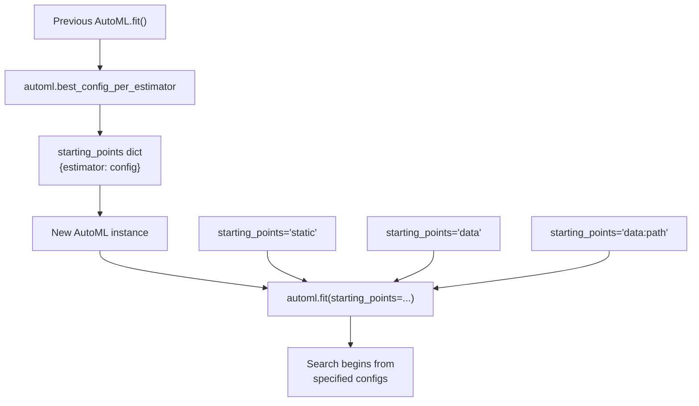
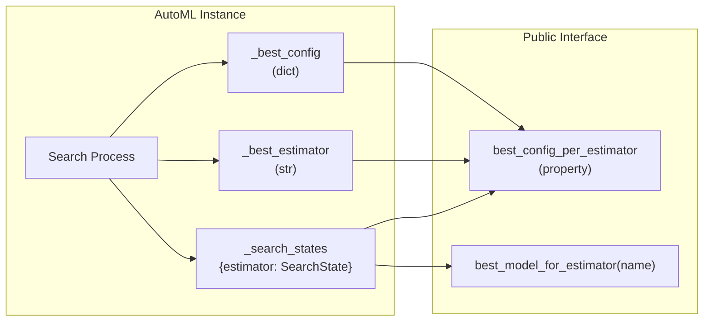
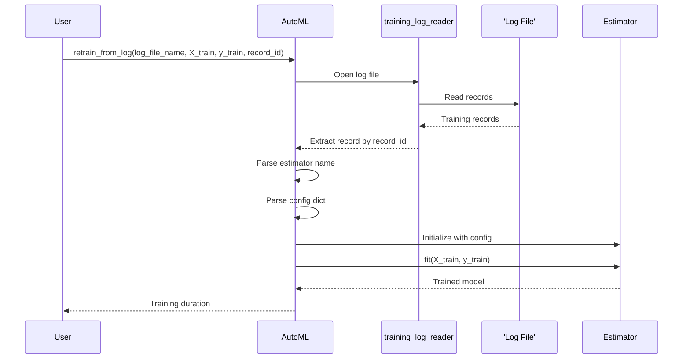
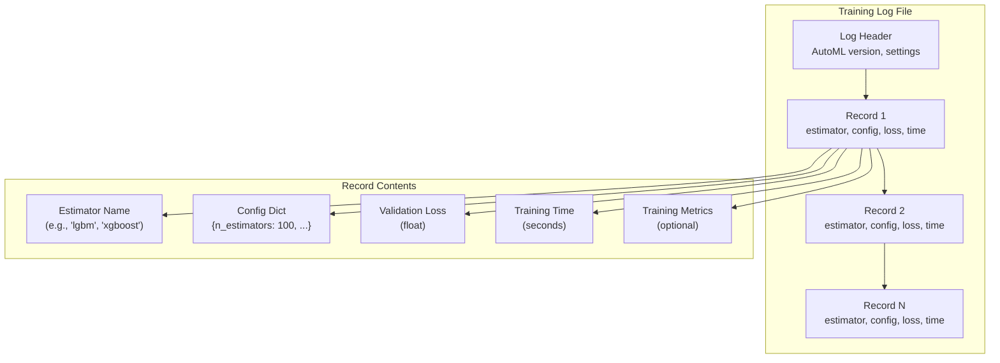
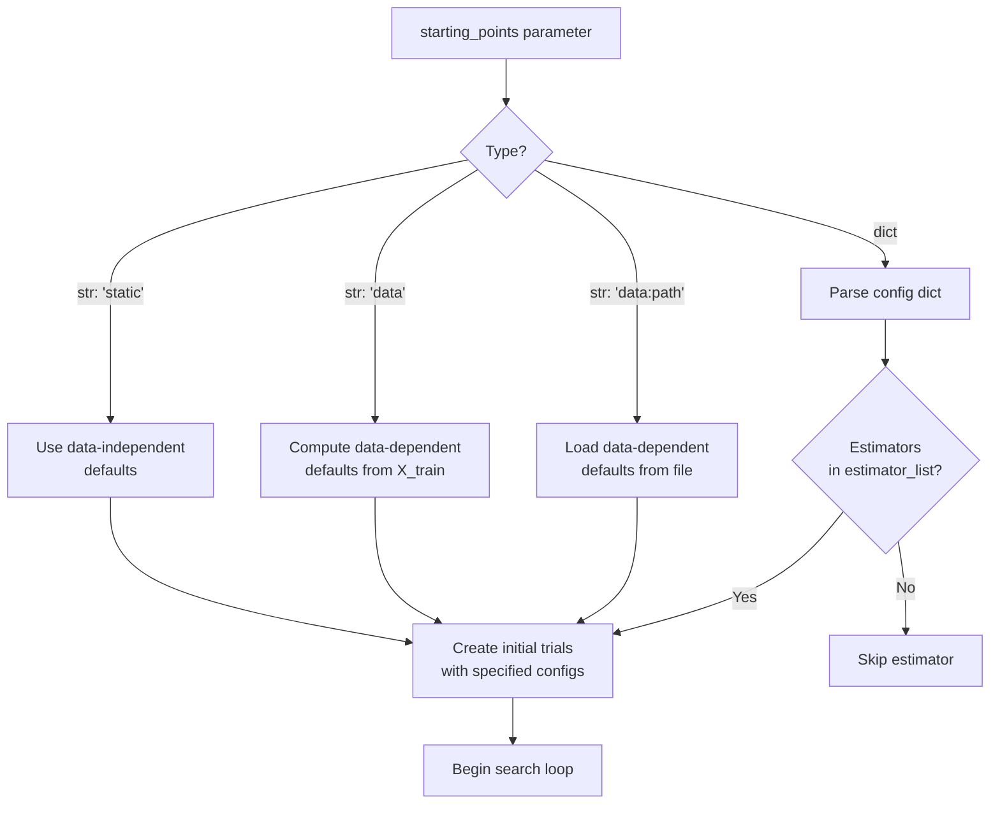

<!-- source: DeepWiki mcp.deepwiki.com · repo microsoft/FLAML · page 9.3 Warm Starting and Retraining · fetched 2026-10-26 -->

# Warm Starting and Retraining

<details>
<summary>Relevant source files</summary>

The following files were used as context for generating this wiki page:

- [.github/workflows/CD.yml](.github/workflows/CD.yml)
- [.github/workflows/deploy-website.yml](.github/workflows/deploy-website.yml)
- [Dockerfile](Dockerfile)
- [flaml/autogen/agentchat/contrib/retrieve_assistant_agent.py](flaml/autogen/agentchat/contrib/retrieve_assistant_agent.py)
- [flaml/autogen/agentchat/contrib/retrieve_user_proxy_agent.py](flaml/autogen/agentchat/contrib/retrieve_user_proxy_agent.py)
- [flaml/automl/automl.py](flaml/automl/automl.py)
- [test/automl/test_multiclass.py](test/automl/test_multiclass.py)
- [test/automl/test_training_log.py](test/automl/test_training_log.py)
- [test/test_autovw.py](test/test_autovw.py)
- [website/docs/Use-Cases/Task-Oriented-AutoML.md](website/docs/Use-Cases/Task-Oriented-AutoML.md)
- [website/package.json](website/package.json)
- [website/yarn.lock](website/yarn.lock)

</details>


This document covers FLAML's capabilities for leveraging previous training runs to accelerate or guide new searches. It explains the `starting_points` parameter for initializing searches with known configurations, the `best_config_per_estimator` property for extracting learned configurations, the `retrain_from_log()` method for reconstructing models from logs, and the training log format.

For information about the model search process itself, see [AutoML Core](#3.1). For information about training log configuration and output options, see [AutoML Core](#3.1) and the `log_file_name`, `log_type`, and `model_history` parameters.

## Overview

FLAML provides two primary mechanisms for reusing knowledge from previous runs:

1. **Warm Starting**: Initialize a new search with specific hyperparameter configurations via the `starting_points` parameter
2. **Retraining from Logs**: Reconstruct and retrain models using configurations saved in training logs via `retrain_from_log()`

These features enable transfer learning across datasets, incremental refinement of models, and efficient experimentation workflows.

## Warm Starting with `starting_points`

### Purpose and Modes

The `starting_points` parameter controls the initial hyperparameter configurations that AutoML evaluates before beginning its search. It accepts three string modes or a dictionary of configurations.

**String Modes:**
- `"static"` (default): Use data-independent default configurations for each estimator
- `"data"`: Use data-dependent defaults computed from training data characteristics
- `"data:path"`: Use data-dependent defaults stored at the specified file path

**Dictionary Mode:**
A dictionary where keys are estimator names and values are either:
- A single hyperparameter configuration dictionary
- A list of hyperparameter configuration dictionaries

Sources: [flaml/automl/automl.py:239-262](), [website/docs/Use-Cases/Task-Oriented-AutoML.md:239-262]()

### Warm Starting Workflow



**Diagram: Warm Starting Configuration Flow**

Sources: [test/automl/test_multiclass.py:496-564](), [test/automl/test_training_log.py:45-78]()

### Example: Transferring Configurations

```python
# Initial training run
automl = AutoML()
automl.fit(X_train, y_train, task="classification", time_budget=60)

# Extract best configurations found
starting_points = automl.best_config_per_estimator
# Returns: {'lgbm': {...}, 'xgboost': {...}, 'rf': {...}}

# Use in new run (e.g., on different data split)
new_automl = AutoML()
new_automl.fit(
    X_train, y_train,
    task="classification",
    starting_points=starting_points,
    time_budget=30  # Faster since starting from good configs
)
```

Sources: [website/docs/Use-Cases/Task-Oriented-AutoML.md:252-262](), [test/automl/test_multiclass.py:258-261]()

### Configuration Dictionary Format

When providing starting points as a dictionary, each estimator's value can specify one or multiple configurations:

```python
# Single configuration per estimator
starting_points = {
    "lgbm": {
        "n_estimators": 100,
        "num_leaves": 31,
        "learning_rate": 0.1
    },
    "xgboost": {
        "n_estimators": 150,
        "max_leaves": 50,
        "learning_rate": 0.05
    }
}

# Multiple configurations per estimator
starting_points = {
    "lgbm": [
        {"n_estimators": 100, "num_leaves": 31},
        {"n_estimators": 200, "num_leaves": 63},
    ]
}

# Empty dict means use default initialization
starting_points = {
    "rf": {}  # Use default initialization for random forest
}
```

Sources: [flaml/automl/automl.py:239-262](), [test/automl/test_training_log.py:69-78]()

## Extracting Configurations with `best_config_per_estimator`

### Property Definition

The `best_config_per_estimator` property returns a dictionary mapping each estimator name to its best hyperparameter configuration found during the search.

```python
automl.fit(X_train, y_train, task="regression", time_budget=120)

# Access best configuration for each estimator
best_configs = automl.best_config_per_estimator
print(best_configs["lgbm"])
# Output: {'n_estimators': 247, 'num_leaves': 42, 'learning_rate': 0.073, ...}
```

This property is particularly useful for:
- Transferring knowledge to new datasets
- Analyzing what worked well for each estimator
- Creating starting points for subsequent runs
- Comparing configurations across different estimators

Sources: [test/automl/test_multiclass.py:258](), [test/automl/test_training_log.py:38-43]()

### Integration with Training State



**Diagram: Configuration Extraction from Search State**

Sources: [flaml/automl/automl.py:518-533](), [test/automl/test_multiclass.py:149-151]()

## Retraining from Logs

### The `retrain_from_log()` Method

The `retrain_from_log()` method reconstructs and retrains a model using configuration and metadata from a training log file.

**Method Signature:**
```python
def retrain_from_log(
    self,
    log_file_name: str,
    X_train,
    y_train,
    train_full: bool = True,
    record_id: int = -1,
    **fit_kwargs
) -> float
```

**Parameters:**
- `log_file_name`: Path to the training log file
- `X_train`, `y_train`: Training data
- `train_full`: If True, train on full dataset; if False, use validation split
- `record_id`: Which log record to use (-1 for best, 0 for first, etc.)
- `**fit_kwargs`: Additional arguments passed to the estimator's fit method

**Returns:**
- `float`: Training duration in seconds

Sources: [test/automl/test_training_log.py:337-344]()

### Retraining Workflow



**Diagram: Retrain from Log Execution Flow**

Sources: [test/automl/test_training_log.py:337-344](), [flaml/automl/training_log.py]() (referenced)

### Example: Retrain on Full Dataset

A common use case is to retrain the best configuration on the full dataset without validation splits:

```python
# Initial search with validation split
automl = AutoML()
automl.fit(
    X_train, y_train,
    task="classification",
    time_budget=60,
    log_file_name="search.log"
)

# Retrain best config on full data
automl_retrain = AutoML(task="classification")
duration = automl_retrain.retrain_from_log(
    log_file_name="search.log",
    X_train=X_train,
    y_train=y_train,
    train_full=True,
    record_id=0  # Use first (best) record
)
print(f"Retrained in {duration:.2f}s")
print(automl_retrain.model)
```

Sources: [test/automl/test_multiclass.py:337-346](), [test/automl/test_training_log.py:337-344]()

### Selecting Specific Records

The `record_id` parameter allows selecting different configurations from the log:

```python
# Retrain using first logged configuration
duration = automl.retrain_from_log(log_file_name="search.log", record_id=0, ...)

# Retrain using best configuration (default)
duration = automl.retrain_from_log(log_file_name="search.log", record_id=-1, ...)

# Retrain using third configuration tried
duration = automl.retrain_from_log(log_file_name="search.log", record_id=2, ...)
```

Sources: [test/automl/test_multiclass.py:342](), [test/automl/test_training_log.py:337-344]()

## Training Log Format

### Reading Training Logs

Training logs can be read using the `training_log_reader` context manager:

```python
from flaml.automl.training_log import training_log_reader

with training_log_reader("mylog.log") as reader:
    for record in reader.records():
        print(record)
```

Each record contains information about a single model trial, including:
- Estimator name
- Hyperparameter configuration
- Validation loss
- Training time
- Additional metrics (if `log_training_metric=True`)

Sources: [test/automl/test_training_log.py:80-85](), [flaml/automl/training_log.py]() (referenced)

### Log Record Structure



**Diagram: Training Log Structure**

Sources: [test/automl/test_training_log.py:80-85](), [flaml/automl/automl.py:387-397]()

### Log Configuration Parameters

| Parameter | Type | Description |
|-----------|------|-------------|
| `log_file_name` | str | Path to the log file. Empty string `""` disables logging. |
| `log_type` | str | `"better"` logs only improvements, `"all"` logs every trial. |
| `log_training_metric` | bool | If True, logs training metrics in addition to validation metrics. |
| `model_history` | bool | If True, saves model objects to disk (memory intensive). |

Sources: [flaml/automl/automl.py:169-198](), [website/docs/Use-Cases/Task-Oriented-AutoML.md]()

### Extracting Models from Logs

The `get_estimator_from_log()` method reconstructs an estimator instance from a log record:

```python
automl = AutoML()
estimator = automl.get_estimator_from_log(
    log_file_name="search.log",
    record_id=0,
    task="classification"
)
# Returns an untrained estimator instance with the logged configuration
print(estimator)
```

Sources: [test/automl/test_multiclass.py:258-259]()

## Advanced Use Cases

### Incremental Search Refinement

Continue a previous search with additional budget:

```python
# Initial search
automl = AutoML()
automl.fit(
    X_train, y_train,
    time_budget=30,
    log_file_name="search.log"
)
best_configs = automl.best_config_per_estimator

# Continue search with more time
automl2 = AutoML()
automl2.fit(
    X_train, y_train,
    time_budget=30,
    starting_points=best_configs,  # Start from previous best
    log_file_name="search_continued.log"
)
```

Sources: [test/automl/test_multiclass.py:496-564]()

### Cross-Validation to Holdout Retraining

Train with cross-validation for robust evaluation, then retrain on holdout:

```python
# Search with CV
automl = AutoML()
automl.fit(
    X_train, y_train,
    eval_method="cv",
    n_splits=5,
    time_budget=120,
    log_file_name="cv_search.log"
)

# Retrain best config on holdout split
automl_holdout = AutoML()
automl_holdout.fit(
    X_train, y_train,
    max_iter=1,
    starting_points={automl.best_estimator: automl.best_config}
)
```

Sources: [test/automl/test_training_log.py:45-78]()

### Comparing Estimators from Same Search

```python
# Run search
automl.fit(X_train, y_train, time_budget=60, log_file_name="search.log")

# Compare configurations
for estimator_name in ["lgbm", "xgboost", "rf"]:
    config = automl.best_config_per_estimator.get(estimator_name)
    if config:
        print(f"{estimator_name}: {config}")
        
        # Get the actual model
        model = automl.best_model_for_estimator(estimator_name)
        if model:
            print(f"  Model params: {model.params}")
```

Sources: [test/automl/test_training_log.py:38-43](), [test/automl/test_multiclass.py:149-151]()

### Transferring Configs Across Datasets

```python
# Train on dataset A
automl_a = AutoML()
automl_a.fit(X_train_a, y_train_a, task="regression", time_budget=60)
configs_a = automl_a.best_config_per_estimator

# Transfer to dataset B
automl_b = AutoML()
automl_b.fit(
    X_train_b, y_train_b,
    task="regression",
    starting_points=configs_a,  # Use configs from dataset A
    time_budget=30
)
```

Sources: [test/automl/test_multiclass.py:496-564]()

## Implementation Details

### Starting Points Processing



**Diagram: Starting Points Processing Logic**

Sources: [flaml/automl/automl.py:239-262](), [flaml/automl/automl.py:402]()

### Configuration Compatibility

When reusing configurations across runs, FLAML handles several compatibility scenarios:

1. **Estimator not in new estimator list**: Configuration is silently ignored
2. **Empty configuration dict**: Uses default initialization for that estimator
3. **Invalid hyperparameter**: Handled by estimator's validation logic
4. **Different data dimensions**: Most estimators adapt automatically

Sources: [test/automl/test_training_log.py:69-78]()

### Training Log I/O

The training log system uses the `training_log_writer` and `training_log_reader` utilities:

**Writing:**
- Logs are written incrementally during search
- Each trial appends a new record
- Logs are flushed immediately for crash recovery

**Reading:**
- Context manager ensures proper file handling
- Records can be iterated sequentially
- Random access by `record_id` is supported

Sources: [flaml/automl/training_log.py]() (referenced), [test/automl/test_training_log.py:80-85]()

## Best Practices

1. **Save logs for important runs**: Always specify `log_file_name` to enable retraining and analysis
2. **Use `best_config_per_estimator` for transfer learning**: Extract configs from one dataset to warm start on similar datasets
3. **Retrain on full data**: After search with validation split, use `retrain_from_log(..., train_full=True)` for final model
4. **Test starting points**: Verify configs work on new data before committing to long searches
5. **Version control configs**: Store `best_config_per_estimator` output for reproducibility

Sources: [website/docs/Use-Cases/Task-Oriented-AutoML.md:239-262](), [test/automl/test_training_log.py]()

---

