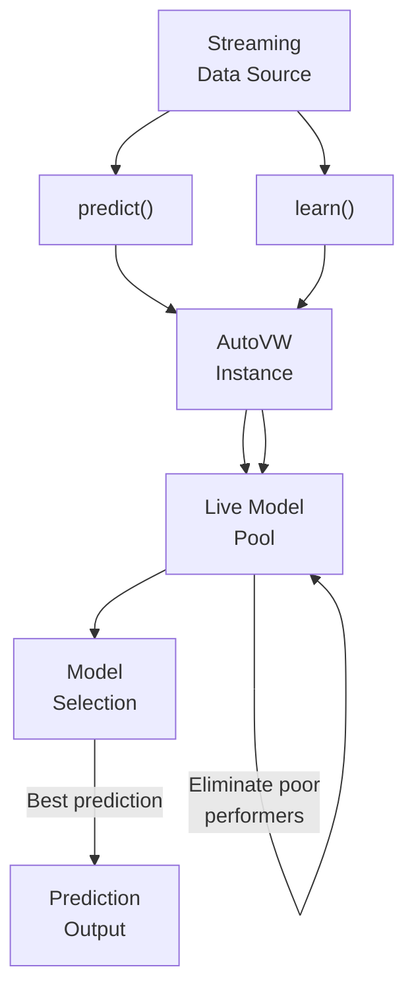
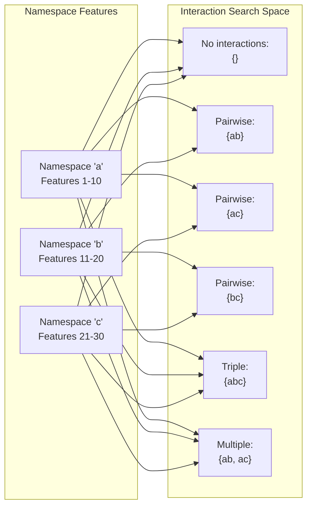
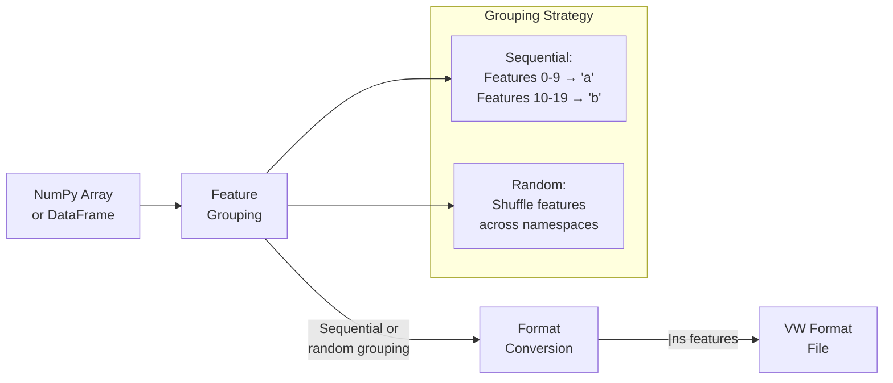
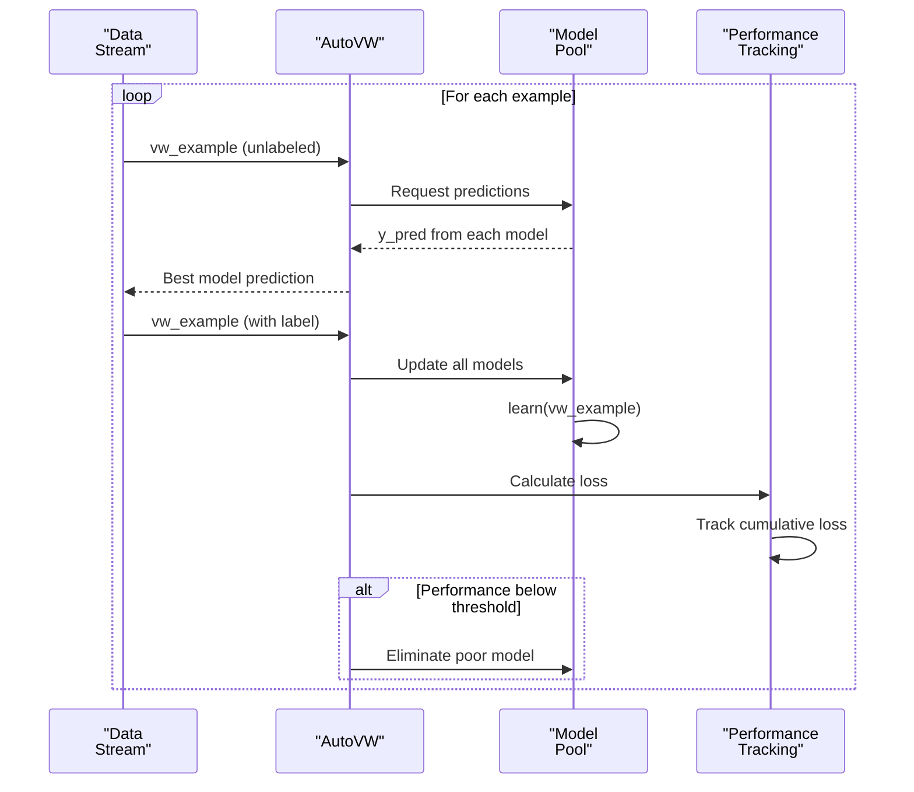
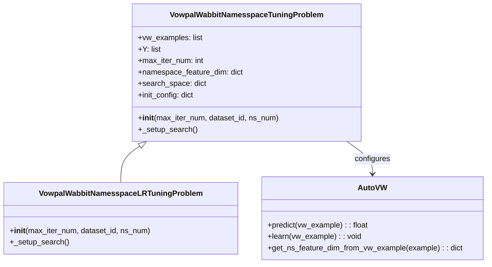
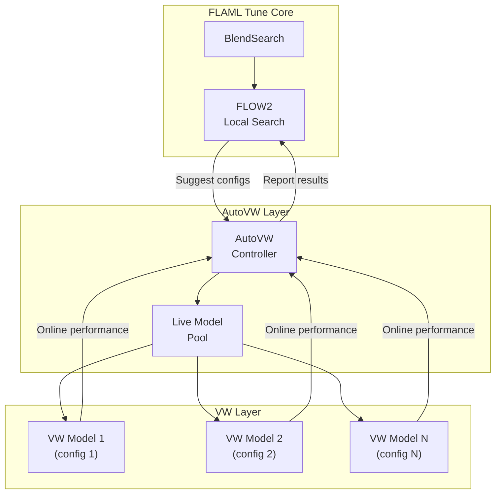

<!-- source: DeepWiki mcp.deepwiki.com · repo microsoft/FLAML · page 9.4 Vowpal Wabbit Integration · fetched 2026-10-26 -->

# Vowpal Wabbit Integration

<details>
<summary>Relevant source files</summary>

The following files were used as context for generating this wiki page:

- [.github/workflows/CD.yml](.github/workflows/CD.yml)
- [.github/workflows/deploy-website.yml](.github/workflows/deploy-website.yml)
- [Dockerfile](Dockerfile)
- [flaml/autogen/agentchat/contrib/retrieve_assistant_agent.py](flaml/autogen/agentchat/contrib/retrieve_assistant_agent.py)
- [flaml/autogen/agentchat/contrib/retrieve_user_proxy_agent.py](flaml/autogen/agentchat/contrib/retrieve_user_proxy_agent.py)
- [test/automl/test_training_log.py](test/automl/test_training_log.py)
- [test/test_autovw.py](test/test_autovw.py)
- [website/package.json](website/package.json)
- [website/yarn.lock](website/yarn.lock)

</details>


This document covers FLAML's integration with Vowpal Wabbit (VW) for automated hyperparameter tuning in online learning scenarios. The integration is provided through the `AutoVW` class, which enables cost-frugal optimization of VW models for streaming data and reinforcement learning tasks.

For general hyperparameter optimization, see [Tune](#4). For traditional batch AutoML, see [AutoML](#3).

---

## Overview

Vowpal Wabbit is a fast online learning system designed for large-scale machine learning with streaming data. FLAML's `AutoVW` class extends VW's capabilities by automatically tuning:

- **Namespace interactions** - Polynomial feature expansions across VW namespaces
- **Learning rates** - Adaptive step sizes for online gradient descent
- **Other hyperparameters** - Loss functions, regularization, and algorithm-specific parameters

The integration is particularly suited for:
- Online learning scenarios with streaming data
- Contextual bandit problems
- Reinforcement learning applications
- Large-scale datasets where batch retraining is infeasible

**Installation**: Install the VW extra via `pip install "flaml[vw]"` to enable this functionality.

Sources: [test/test_autovw.py:1-449]()

---

## AutoVW Class

The `AutoVW` class is the primary interface for automated Vowpal Wabbit tuning. It maintains multiple candidate models simultaneously and selects the best performer using cost-frugal online evaluation.

### Core Parameters

| Parameter | Type | Description |
|-----------|------|-------------|
| `max_live_model_num` | int | Maximum number of concurrent models to evaluate |
| `search_space` | dict | Hyperparameter search space configuration |
| `init_config` | dict | Initial hyperparameter configuration |
| `min_resource_lease` | str or int | Minimum iterations before model elimination (use `"auto"` for automatic) |
| `random_seed` | int | Seed for reproducibility |

### Online Learning Interface

`AutoVW` implements the standard VW prediction-learning loop:

```python
# Prediction step
y_pred = autovw.predict(vw_example)

# Learning step
autovw.learn(vw_example)
```

Unlike batch learning, models are updated incrementally as each example arrives, enabling real-time adaptation.



**Diagram: AutoVW Online Learning Loop**

The `predict()` method returns the prediction from the current best model, while `learn()` updates all live models in the pool and triggers elimination of underperforming configurations.

Sources: [test/test_autovw.py:399-413](), [test/test_autovw.py:425-431]()

---

## Namespace Interaction Tuning

Vowpal Wabbit organizes features into **namespaces** (denoted by letters like `a`, `b`, `c`) and supports polynomial interactions between them. AutoVW automates the search for optimal namespace interaction sets.

### VW Namespace Format

VW examples use a namespace-based format:
```
<label> |<namespace1> <feature1>:<value1> <feature2>:<value2> |<namespace2> <feature3>:<value3>
```

For example:
```
2.5 |a 1:0.123 2:0.456 |b 3:0.789 4:0.321
```

This represents a regression target of 2.5 with features 1-2 in namespace `a` and features 3-4 in namespace `b`.

### Search Space Configuration

The `polynomial_expansion_set` domain defines the space of namespace interactions:

```python
from flaml.tune import polynomial_expansion_set

search_space = {
    "interactions": polynomial_expansion_set(
        init_monomials=set(['a', 'b', 'c', 'd']),
        highest_poly_order=4,  # Maximum interaction order
        allow_self_inter=False  # Disable self-interactions like 'aa'
    )
}
```

This generates a search space over all possible interaction sets like `{}`, `{ab}`, `{ac, bd}`, `{abc}`, etc.



**Diagram: Namespace Interaction Search Space**

Sources: [test/test_autovw.py:250-260](), [test/test_autovw.py:283-300]()

---

## Combined Hyperparameter Tuning

AutoVW supports joint optimization of namespace interactions and traditional hyperparameters like learning rates.

### Example: Namespace + Learning Rate Tuning

```python
from flaml import AutoVW
from flaml.tune import loguniform, polynomial_expansion_set

search_space = {
    "interactions": polynomial_expansion_set(
        init_monomials=set(['a', 'b', 'c']),
        highest_poly_order=3,
        allow_self_inter=False
    ),
    "learning_rate": loguniform(lower=2e-10, upper=1.0)
}

init_config = {
    "interactions": set(),  # Start with no interactions
    "learning_rate": 0.5
}

autovw = AutoVW(
    max_live_model_num=5,
    search_space=search_space,
    init_config=init_config,
    min_resource_lease="auto",
    random_seed=2345
)
```

The `loguniform` domain enables logarithmic sampling of learning rates, which is appropriate for this scale-sensitive parameter.

### Fixed Hyperparameters

Use `fixed_hp_config` to specify VW parameters that should not be tuned:

```python
fixed_hp_config = {
    "alg": "supervised",
    "loss_function": "squared"
}
```

These are passed directly to the underlying VW instance for all candidate models.

Sources: [test/test_autovw.py:276-300](), [test/test_autovw.py:415-439]()

---

## Data Preparation and VW Format

### Converting Tabular Data to VW Format

The test suite demonstrates conversion from NumPy arrays to VW namespace format:



**Diagram: Data Conversion Pipeline**

### Format Conversion Function

The conversion process splits features into namespace groups:

```python
def oml_to_vw_w_grouping(X, y, ds_dir, fname, orginal_dim, group_num, grouping_method="sequential"):
    max_size_per_group = int(np.ceil(orginal_dim / float(group_num)))
    
    # Create namespace groups
    group_indexes = []
    for i in range(group_num):
        indexes = [ind for ind in range(
            i * max_size_per_group,
            min((i + 1) * max_size_per_group, orginal_dim)
        )]
        if len(indexes) > 0:
            group_indexes.append(indexes)
    
    # Write VW format
    with open(os.path.join(ds_dir, fname), "w") as f:
        for i in range(len(X)):
            NS_content = []
            for zz in range(len(group_indexes)):
                ns_features = " ".join(
                    f"{ind}:{X[i][ind]:.6f}" for ind in group_indexes[zz]
                )
                NS_content.append(ns_features)
            ns_line = "{} |{}".format(
                str(y[i]),
                "|".join(f"{NS_LIST[j]} {NS_content[j]}" for j in range(len(group_indexes)))
            )
            f.write(ns_line + "\n")
```

### OpenML Integration

The test suite includes utilities for loading OpenML datasets and converting them to VW format:

| Function | Purpose |
|----------|---------|
| `get_oml_to_vw()` | Fetch OpenML dataset and convert to VW format |
| `save_vw_dataset_w_ns()` | Save converted dataset with namespace structure |
| `load_vw_dataset()` | Load VW format dataset from file |

Sources: [test/test_autovw.py:45-85](), [test/test_autovw.py:87-98](), [test/test_autovw.py:112-148](), [test/test_autovw.py:150-167]()

---

## Online Learning Loop Implementation

### Standard Online Learning Pattern

The typical usage pattern follows an iterative predict-learn cycle:

```python
def online_learning_loop(iter_num, vw_examples, vw_alg, loss_func, method_name=""):
    loss_list = []
    
    for i in range(iter_num):
        vw_x = vw_examples[i]
        y_true = get_y_from_vw_example(vw_x)
        
        # Predict step
        y_pred = vw_alg.predict(vw_x)
        
        # Learn step
        vw_alg.learn(vw_x)
        
        # Calculate loss
        loss = get_loss(y_pred, y_true, loss_func)
        loss_list.append(loss)
    
    return loss_list
```

### Performance Metrics

The online learning loop tracks cumulative loss over time. Common loss functions include:

| Loss Function | Formula | Use Case |
|---------------|---------|----------|
| `squared` | `(y_pred - y_true)²` | Regression (MSE) |
| `absolute` | `\|y_pred - y_true\|` | Robust regression (MAE) |



**Diagram: Online Learning Sequence Flow**

Sources: [test/test_autovw.py:319-348](), [test/test_autovw.py:303-316]()

---

## Problem Configuration

### Tuning Problem Classes

FLAML provides problem classes that encapsulate dataset, search space, and configuration:



**Diagram: Problem Configuration Class Hierarchy**

### Creating a Tuning Problem

```python
# Basic namespace tuning
vw_oml_problem_args = {
    "max_iter_num": 10000,
    "dataset_id": "42183",  # OpenML dataset ID
    "ns_num": 10,  # Number of namespaces
    "fixed_hp_config": {
        "alg": "supervised",
        "loss_function": "squared"
    }
}

# Create problem instance
vw_online_aml_problem = VowpalWabbitNamesspaceTuningProblem(**vw_oml_problem_args)

# Access search space and initial config
search_space = vw_online_aml_problem.search_space
init_config = vw_online_aml_problem.init_config
```

The problem class automatically:
1. Loads and converts the OpenML dataset to VW format
2. Extracts namespace structure from VW examples
3. Constructs appropriate search space for namespace interactions
4. Provides initial configuration for optimization

Sources: [test/test_autovw.py:221-274](), [test/test_autovw.py:276-301](), [test/test_autovw.py:350-372]()

---

## Complete Usage Example

### Namespace Interaction Tuning

```python
from flaml import AutoVW
from flaml.tune import polynomial_expansion_set

# Step 1: Define search space
online_vw_exp_setting = {
    "max_live_model_num": 5,
    "fixed_hp_config": {
        "alg": "supervised",
        "loss_function": "squared"
    },
    "ns_num": 10,
    "max_iter_num": 10000
}

# Step 2: Create problem
vw_oml_problem_args = {
    "max_iter_num": online_vw_exp_setting["max_iter_num"],
    "dataset_id": "42183",
    "ns_num": online_vw_exp_setting["ns_num"],
    "fixed_hp_config": online_vw_exp_setting["fixed_hp_config"]
}

vw_problem = VowpalWabbitNamesspaceTuningProblem(**vw_oml_problem_args)

# Step 3: Initialize AutoVW
autovw = AutoVW(
    max_live_model_num=5,
    search_space=vw_problem.search_space,
    init_config=vw_problem.init_config,
    min_resource_lease="auto",
    random_seed=2345
)

# Step 4: Online learning loop
loss_list = []
for i in range(vw_problem.max_iter_num):
    vw_example = vw_problem.vw_examples[i]
    
    # Predict
    y_pred = autovw.predict(vw_example)
    
    # Learn
    autovw.learn(vw_example)
    
    # Evaluate
    y_true = get_y_from_vw_example(vw_example)
    loss = mean_squared_error([y_pred], [y_true])
    loss_list.append(loss)

# Step 5: Report performance
avg_loss = sum(loss_list) / len(loss_list)
print(f"Average loss: {avg_loss}")
```

### Namespace + Learning Rate Tuning

For combined hyperparameter tuning, use `VowpalWabbitNamesspaceLRTuningProblem`:

```python
from flaml.tune import loguniform

vw_problem_lr = VowpalWabbitNamesspaceLRTuningProblem(**vw_oml_problem_args)

autovw_lr = AutoVW(
    max_live_model_num=5,
    search_space=vw_problem_lr.search_space,  # Includes learning_rate
    init_config=vw_problem_lr.init_config,
    min_resource_lease="auto",
    random_seed=2345
)

# Use same online learning loop as above
```

Sources: [test/test_autovw.py:392-413](), [test/test_autovw.py:415-439]()

---

## Integration with FLAML Tune

AutoVW leverages FLAML's cost-frugal optimization algorithms:



**Diagram: AutoVW Integration with FLAML Tune**

### Key Integration Points

| Component | Role |
|-----------|------|
| `polynomial_expansion_set` | Domain type for namespace interaction search |
| `loguniform` | Domain type for learning rate search |
| `max_live_model_num` | Limits concurrent model evaluation |
| `min_resource_lease` | Minimum iterations before elimination |

The integration enables:
- **Cost-frugal search**: Early stopping of poor configurations
- **Adaptive resource allocation**: More resources to promising configs
- **Multi-fidelity optimization**: Cheap evaluation on small samples first

Sources: [test/test_autovw.py:29](), [test/test_autovw.py:250-260](), [test/test_autovw.py:290]()

---

## Comparison with Vanilla VW

### Performance Benefits

AutoVW automates what would otherwise require manual hyperparameter tuning:

```python
# Vanilla VW - Manual configuration
from vowpalwabbit import pyvw

vanilla_vw = pyvw.vw(
    alg="supervised",
    loss_function="squared"
    # No automatic interaction tuning
    # No automatic learning rate tuning
)

# AutoVW - Automated tuning
autovw = AutoVW(
    max_live_model_num=5,
    search_space={
        "interactions": polynomial_expansion_set(...),
        "learning_rate": loguniform(2e-10, 1.0)
    },
    init_config={...}
)
```

### When to Use Each

| Use Case | Recommendation |
|----------|----------------|
| Known optimal hyperparameters | Use vanilla VW |
| New dataset/problem | Use AutoVW for exploration |
| Online learning with concept drift | Use AutoVW for adaptation |
| Strict computational budget | Consider vanilla VW |
| Namespace interaction unclear | Use AutoVW |

Sources: [test/test_autovw.py:377-390]()

---

## Testing and Validation

### Test Suite Structure

The AutoVW test suite validates:

1. **Basic VW problem setup** - Dataset loading and conversion
2. **Vanilla VW baseline** - Performance without AutoVW
3. **Namespace tuning** - Automated interaction selection
4. **Combined tuning** - Namespace + learning rate optimization
5. **Bandit variants** - Contextual bandit scenarios (placeholders)

### Running Tests

```bash
# Install VW and dependencies
pip install "flaml[vw]"

# Run AutoVW tests
python -m pytest test/test_autovw.py
```

Tests are skipped automatically if VW is not installed:

```python
@pytest.mark.skipif(skip_vw_test, reason="vowpalwabbit not installed")
class TestAutoVW(unittest.TestCase):
    # Test methods...
```

### Test Datasets

Tests use OpenML datasets converted to VW format:
- Dataset ID: `42183` (default)
- 10 namespaces
- 10,000 iterations
- Squared loss for regression

Sources: [test/test_autovw.py:375-449](), [test/test_autovw.py:33-36]()

---

## Advanced Topics

### Namespace Feature Dimension Extraction

AutoVW provides a utility to extract namespace structure from VW examples:

```python
vw_example = "2.5 |a 1:0.1 2:0.2 |b 3:0.3 4:0.4 5:0.5"
ns_dims = AutoVW.get_ns_feature_dim_from_vw_example(vw_example)
# Returns: {'a': 2, 'b': 3}
```

This information is used to constrain the interaction search space to valid namespace combinations.

### Log Transformation for Regression

For datasets with large label ranges, AutoVW applies log transformation:

```python
LOG_TRANSFORMATION_THRESHOLD = 100

if max((max_y - min_y), max_y) >= LOG_TRANSFORMATION_THRESHOLD:
    # Apply log transformation
    log_y = np.log(y + abs(min_y) + 1)  # Shift to ensure positive values
```

This improves numerical stability for squared loss optimization.

### Data Shuffling

Optional shuffling breaks sequential patterns in datasets:

```python
def shuffle_data(X, y, seed):
    n = len(X)
    perm = np.random.RandomState(seed=seed).permutation(n)
    X_shuf = X[perm, :]
    y_shuf = y[perm]
    return X_shuf, y_shuf
```

Sources: [test/test_autovw.py:243](), [test/test_autovw.py:179-218](), [test/test_autovw.py:100-110]()

---

## Limitations and Considerations

### Current Limitations

1. **Bandit support**: Contextual bandit tuning is not fully implemented (test placeholders exist)
2. **Sparse data**: Sparse matrix conversion has limited support
3. **Classification**: Focus is primarily on regression tasks
4. **Dataset format**: Requires conversion to VW namespace format

### Performance Considerations

- **Memory**: `max_live_model_num` controls memory usage (each model maintains state)
- **Computation**: More live models increase per-example computation time
- **Convergence**: `min_resource_lease="auto"` balances exploration vs. exploitation
- **Seed sensitivity**: Results may vary with `random_seed` due to online nature

### Best Practices

1. Start with small `max_live_model_num` (3-5) for initial experiments
2. Use `min_resource_lease="auto"` unless you have domain knowledge
3. Monitor cumulative loss to detect convergence or concept drift
4. Consider log transformation for large-range regression targets
5. Group related features into logical namespaces for interaction tuning

Sources: [test/test_autovw.py:441-445](), [test/test_autovw.py:82-84]()

---

