# Page: Overview

# Overview

<details>
<summary>Relevant source files</summary>

The following files were used as context for generating this wiki page:

- [.github/workflows/python-package.yml](.github/workflows/python-package.yml)
- [README.md](README.md)
- [flaml/version.py](flaml/version.py)
- [setup.py](setup.py)
- [website/docs/Best-Practices.md](website/docs/Best-Practices.md)
- [website/docs/Contribute.md](website/docs/Contribute.md)
- [website/docs/FAQ.md](website/docs/FAQ.md)
- [website/docs/Getting-Started.md](website/docs/Getting-Started.md)
- [website/docs/Installation.md](website/docs/Installation.md)
- [website/sidebars.js](website/sidebars.js)

</details>


## Purpose and Scope

This document provides a high-level introduction to FLAML (Fast Library for Automated Machine Learning & Tuning), describing its core purpose, architecture, and main user-facing interfaces. This overview is intended to help developers understand the overall system structure before diving into specific subsystems.

For detailed installation instructions, see [Installation and Setup](#2). For in-depth documentation on specific subsystems, see [AutoML](#3), [Tune](#4), and [Zero-shot AutoML](#5).

**Sources:** [README.md:1-127](), [website/docs/Getting-Started.md:1-116]()

---

## What is FLAML

FLAML is a lightweight Python library (version `2.5.0` as of [flaml/version.py:1]()) designed for efficient automation of machine learning and AI operations. The library provides economical and fast hyperparameter optimization with minimal computational resources, particularly suited for scenarios with limited time budgets and heterogeneous evaluation costs.

**Core Capabilities:**

| Capability | Description |
|------------|-------------|
| **Task-oriented AutoML** | Automated model selection and hyperparameter tuning for common ML tasks (classification, regression, forecasting, ranking) |
| **Generic HPO** | Hyperparameter optimization for arbitrary user-defined functions with cost-aware search |
| **Zero-shot AutoML** | Drop-in replacements for popular estimators with automatic hyperparameter configuration |
| **Cost-Frugal Search** | Novel search algorithms (BlendSearch, FLOW2) that minimize computational cost while finding quality configurations |
| **Distributed Execution** | Support for Ray and Spark backends for parallel trial execution |

FLAML requires **Python >= 3.10** and installs with minimal dependencies (only NumPy) by default, with extensive optional extras for specific features.

**Sources:** [README.md:21-34](), [setup.py:17-19](), [setup.py:164](), [website/docs/Getting-Started.md:5-12]()

---

## Three Primary User-Facing Interfaces

FLAML provides three distinct entry points that serve different use cases and abstraction levels:

### 1. AutoML Interface (`flaml.AutoML`)

The `AutoML` class in [flaml/automl/automl.py]() provides a scikit-learn-style estimator for task-oriented automated machine learning. Users specify a task type (classification, regression, forecasting, ranking) and FLAML automatically handles model selection, hyperparameter tuning, and data preprocessing.

```python
from flaml import AutoML

automl = AutoML()
automl.fit(X_train, y_train, task="classification", time_budget=60)
predictions = automl.predict(X_test)
```

The AutoML interface routes through a Task Factory pattern (see [flaml/automl/task/factory.py]()) to appropriate task implementations and manages the optimization loop automatically.

### 2. Tune Interface (`flaml.tune.run`)

The `tune.run` function in [flaml/tune/tune.py]() provides generic hyperparameter optimization for arbitrary evaluation functions. This is a lower-level interface that gives users more control over the optimization process.

```python
from flaml import tune

def evaluation_function(config):
    # Train model with config
    # Return metrics
    return {"loss": loss_value}

analysis = tune.run(
    evaluation_function,
    config=search_space,
    time_budget_s=3600,
    metric="loss",
    mode="min"
)
```

This interface directly exposes FLAML's search algorithms (BlendSearch, FLOW2, CFO) and is suitable for optimizing ML models, pipelines, or any function with measurable performance.

### 3. Zero-shot AutoML (`flaml.default`)

The `flaml.default` module (see [flaml/default/]()) provides drop-in replacements for common estimators like `LGBMClassifier` and `XGBoostRegressor` that automatically configure hyperparameters based on the training data.

```python
from flaml.default import LGBMClassifier

# Same API as lightgbm.LGBMClassifier, but with automatic hyperparameter selection
estimator = LGBMClassifier()
estimator.fit(X_train, y_train)
```

This interface requires no search budget and uses pre-computed, data-dependent configurations stored in JSON files under [flaml/default/]().

**Sources:** [README.md:54-90](), [website/docs/Getting-Started.md:22-104]()

---

## System Architecture

The following diagram shows FLAML's high-level architecture and how the three user interfaces connect to the underlying components:

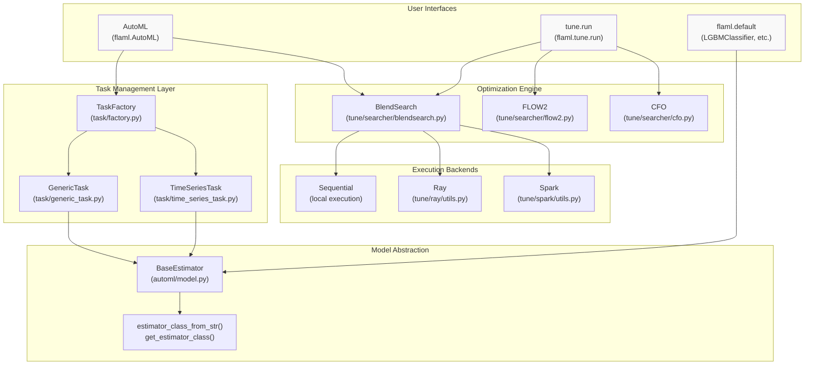

**Architecture Explanation:**

1. **User Interfaces** (top layer): The three entry points each serve different abstraction levels
2. **Task Management Layer**: Routes AutoML requests to task-specific implementations that handle data validation and preparation
3. **Optimization Engine**: Core search algorithms that suggest configurations to evaluate
4. **Model Abstraction**: Unified interface for diverse model types (sklearn, Spark, Transformers, time series)
5. **Execution Backends**: Support for sequential, Ray-parallel, or Spark-distributed trial execution

**Sources:** [flaml/automl/automl.py](), [flaml/tune/tune.py](), [flaml/automl/task/factory.py](), [flaml/automl/model.py](), [setup.py:22-154]()

---

## Core Components

### Optimization Engines

FLAML implements three main search algorithms located in [flaml/tune/searcher/]():

| Algorithm | Class | Purpose |
|-----------|-------|---------|
| **BlendSearch** | `BlendSearch` | Meta-algorithm that blends global search (Optuna) with local search (FLOW2) using multiple threads |
| **FLOW2** | `FLOW2` | Cost-frugal local search using random directions on unit sphere with adaptive step sizes |
| **CFO** | `CFO` | Cost-frugal optimization with constraints support |

BlendSearch orchestrates multiple `SearchThread` instances: thread 0 runs global search while additional threads run local FLOW2 searches starting from promising configurations. This hybrid approach balances exploration and exploitation while respecting cost-related hyperparameters.

**Sources:** [flaml/tune/searcher/blendsearch.py](), [flaml/tune/searcher/flow2.py](), [flaml/tune/searcher/cfo.py]()

### Model Abstraction Layer

All estimators in FLAML inherit from `BaseEstimator` defined in [flaml/automl/model.py](). This abstract class provides a unified interface:

```python
# Key methods all estimators must implement:
- fit(X_train, y_train, budget, **kwargs)
- predict(X_test)
- score(X_val, y_val, metric, **kwargs)
- search_space(data_size, task)  # class method
- config2params(config)          # static method
```

The model abstraction supports:

- **Traditional ML**: `LGBMEstimator`, `XGBoostEstimator`, `RandomForestEstimator`, `CatBoostEstimator` (see [flaml/automl/model.py]())
- **Distributed Spark**: `SparkLGBMEstimator`, `SparkRFEstimator` (see [flaml/automl/spark/]())
- **Deep Learning NLP**: `TransformersEstimator` with task variants (see [flaml/automl/nlp/]())
- **Time Series**: Statistical models (ARIMA, Prophet) and deep learning (TFT) (see [flaml/automl/time_series/]())

Each estimator defines its search space in FLAML's format and implements `config2params()` to translate FLAML configurations to the original model's parameters.

**Sources:** [flaml/automl/model.py](), [flaml/automl/spark/](), [flaml/automl/nlp/](), [flaml/automl/time_series/]()

### Task System

The `TaskFactory` in [flaml/automl/task/factory.py]() creates task-specific implementations:

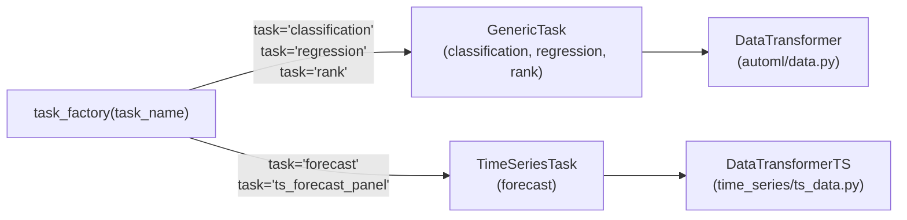

Tasks handle:
- Data validation and type checking
- Train/validation splitting (stratified, time-aware, grouped)
- Data preprocessing (missing value imputation, encoding)
- Task-specific metrics and evaluation

**Sources:** [flaml/automl/task/factory.py](), [flaml/automl/task/generic_task.py](), [flaml/automl/task/time_series_task.py](), [flaml/automl/data.py](), [flaml/automl/time_series/ts_data.py]()

### Execution Backends

FLAML supports three execution modes:

1. **Sequential** (default): Trials run one at a time on the local machine
2. **Ray** (`use_ray=True`): Parallel trial execution on Ray clusters (requires `pip install "flaml[ray]"`)
3. **Spark** (automatic for Spark estimators): Distributed execution on Spark clusters (requires `pip install "flaml[spark]"`)

The execution backend is transparent to users and determined automatically based on configuration and available resources.

**Sources:** [flaml/tune/ray/utils.py](), [flaml/tune/spark/utils.py](), [setup.py:105-117]()

---

## Modular Package Structure

FLAML employs a highly modular design with minimal core dependencies and extensive optional extras:

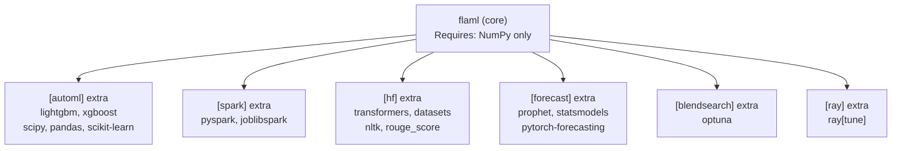

**Installation Examples:**

| Use Case | Command | Enables |
|----------|---------|---------|
| Core only | `pip install flaml` | Basic tune functionality |
| AutoML | `pip install "flaml[automl]"` | Classification, regression with tree-based models |
| Spark support | `pip install "flaml[spark]"` | Distributed estimators (lgbm_spark, rf_spark) |
| NLP tasks | `pip install "flaml[hf]"` | HuggingFace Transformers integration |
| Time series | `pip install "flaml[forecast]"` | Prophet, ARIMA, deep learning forecasters |
| Advanced search | `pip install "flaml[blendsearch]"` | BlendSearch with Optuna backend |
| Parallel execution | `pip install "flaml[ray]"` | Ray-based distributed tuning |

This modular structure allows users to install only the dependencies they need, keeping the base installation lightweight while supporting a comprehensive ML ecosystem.

**Sources:** [setup.py:17-165](), [README.md:35-50](), [website/docs/Installation.md:1-149]()

---

## Data Flow Through FLAML

The following diagram illustrates how data flows through the system from user input to trained models:

```mermaid
graph LR
    Input["User Data<br/>(X, y)"]
    
    subgraph "Data Processing"
        Validate["Task.validate_data()"]
        Transform["DataTransformer.fit_transform()"]
        Split["prepare_data()<br/>(train/val split)"]
    end
    
    subgraph "Optimization Loop"
        Suggest["SearchAlgo.suggest()"]
        Instantiate["Estimator.__init__(config)"]
        Train["Estimator.fit()"]
        Evaluate["Estimator.score()"]
        Update["SearchAlgo.on_trial_complete()"]
    end
    
    Output["Best Model<br/>(automl.model)"]
    
    Input --> Validate
    Validate --> Transform
    Transform --> Split
    Split --> Suggest
    Suggest --> Instantiate
    Instantiate --> Train
    Train --> Evaluate
    Evaluate --> Update
    Update -->|"time budget<br/>not exhausted"| Suggest
    Update -->|"time budget<br/>exhausted"| Output
```

**Key Flow Steps:**

1. **Data Validation**: Task-specific validation ensures data types and shapes are correct
2. **Transformation**: Missing values imputed (median for numerical, "__NAN__" for categorical), categorical encoding applied
3. **Splitting**: Data split into train/validation sets using appropriate strategy (stratified, time-aware, grouped)
4. **Optimization Loop**: Search algorithm suggests configs → Estimators trained → Metrics evaluated → Search state updated
5. **Selection**: Best performing configuration selected based on validation metric

**Sources:** [flaml/automl/automl.py](), [flaml/automl/task/generic_task.py](), [flaml/automl/data.py](), [website/docs/FAQ.md:18-117]()

---

## External Integrations

FLAML integrates with several external systems and platforms:

| Integration | Purpose | Configuration |
|-------------|---------|---------------|
| **MLflow** | Experiment tracking, model registry | `mlflow_logging=True` in `AutoML.fit()` |
| **HuggingFace** | Pre-trained transformers, datasets | Install `flaml[hf]` extra |
| **Azure ML & Synapse** | Cloud deployment, managed Spark | Install `flaml[azureml]` or `flaml[synapse]` extra |
| **OpenML** | Public dataset repository | Used in examples and tests |
| **Ray** | Distributed trial execution | `use_ray=True` in `AutoML.fit()` or `tune.run()` |
| **Spark/SynapseML** | Distributed model training | Automatic for Spark estimators |

These integrations are generally optional and activated through configuration parameters or by installing specific extras.

**Sources:** [setup.py:108-153](), [flaml/automl/spark/](), [website/docs/Best-Practices.md:96-159]()

---

## Relationship Between Components

The three user interfaces serve complementary purposes:

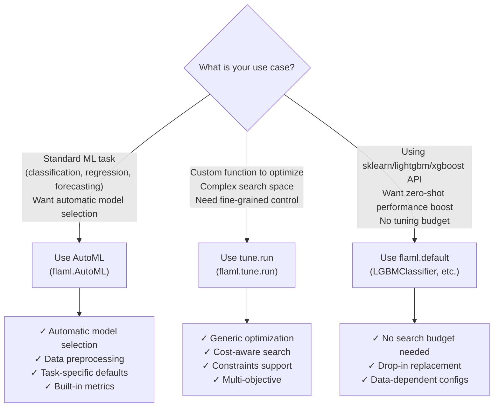

**Decision Guidelines:**

- **Use AutoML** when you have a standard ML task and want end-to-end automation (data preprocessing → model selection → hyperparameter tuning)
- **Use tune.run** when you need to optimize a custom function (e.g., neural network training, pipeline tuning, or non-ML optimization)
- **Use flaml.default** when you want a quick performance boost without any tuning budget by using pre-computed configurations

Internally, AutoML uses the same search algorithms as tune.run but wraps them with task-specific logic and data processing.

**Sources:** [README.md:54-90](), [website/docs/Getting-Started.md:22-108]()

---

## Version and Development Status

FLAML is actively maintained at version `2.5.0` (see [flaml/version.py:1]()). The project is hosted at https://github.com/microsoft/FLAML with continuous integration via GitHub Actions (see [.github/workflows/python-package.yml]()), supporting Python 3.10, 3.11, 3.12, and 3.13 on Ubuntu and Windows platforms.

The library is published to PyPI as `FLAML` and conda-forge as `flaml`. Testing coverage is maintained via pytest with automated coverage reporting (see [.github/workflows/python-package.yml:105-122]()).

**Note:** AutoGen, which was previously part of FLAML, has moved to a dedicated repository at https://github.com/microsoft/autogen. FLAML no longer includes the `autogen` module.

**Sources:** [flaml/version.py:1](), [README.md:19](), [.github/workflows/python-package.yml:1-142](), [setup.py:22-165]()

---

# Page: Installation and Setup

# Installation and Setup

<details>
<summary>Relevant source files</summary>

The following files were used as context for generating this wiki page:

- [.github/workflows/python-package.yml](.github/workflows/python-package.yml)
- [README.md](README.md)
- [flaml/version.py](flaml/version.py)
- [setup.py](setup.py)
- [website/docs/Best-Practices.md](website/docs/Best-Practices.md)
- [website/docs/Contribute.md](website/docs/Contribute.md)
- [website/docs/FAQ.md](website/docs/FAQ.md)
- [website/docs/Getting-Started.md](website/docs/Getting-Started.md)
- [website/docs/Installation.md](website/docs/Installation.md)
- [website/sidebars.js](website/sidebars.js)

</details>


This document covers the installation of FLAML, including Python version requirements, optional dependency extras, platform-specific considerations, and development setup. For usage guidance after installation, see [Overview](#1) and [Getting Started](Getting-Started). For deployment in production environments, see [Integration and Deployment](#8).

---

## Python Requirements

FLAML requires **Python >= 3.10 and < 3.14**. While other versions may work for core components, full model support is only guaranteed within this range.

The minimal installation depends only on NumPy:

```bash
pip install flaml
```

**Sources:** [README.md:37](), [setup.py:17-19](), [setup.py:164](), [flaml/version.py:1]()

---

## Installation Methods

### Via pip (Recommended)

```bash
# Minimal installation (NumPy only)
pip install flaml

# With AutoML support
pip install "flaml[automl]"

# Multiple extras
pip install "flaml[automl,spark,hf]"
```

### Via conda

```bash
conda install flaml -c conda-forge
```

**Note:** On Windows with certain shells, escape brackets: `pip install flaml\[automl\]`

**Sources:** [README.md:40-46](), [website/docs/Installation.md:7-15]()

---

## Package Architecture and Optional Extras

FLAML uses a modular architecture where the base package is minimal and feature-specific dependencies are installed via extras.

### Dependency Architecture

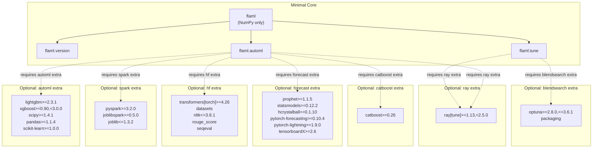

**Sources:** [setup.py:22-31](), [setup.py:36-154]()

---

## Optional Extras Reference

The following table maps extras to their purposes and key dependencies:

| Extra | Purpose | Key Dependencies | Installation Command |
|-------|---------|------------------|---------------------|
| `automl` | Core AutoML functionality | lightgbm, xgboost, scipy, pandas, scikit-learn | `pip install "flaml[automl]"` |
| `spark` | Distributed Spark execution | pyspark>=3.2.0, joblibspark>=0.5.0 | `pip install "flaml[spark]"` |
| `hf` (or `nlp`) | HuggingFace NLP models | transformers[torch]>=4.26, datasets, nltk, rouge_score, seqeval | `pip install "flaml[hf]"` |
| `forecast` | Time series forecasting | prophet>=1.1.5, statsmodels>=0.12.2, hcrystalball>=0.1.10, pytorch-forecasting>=0.10.4 | `pip install "flaml[forecast]"` |
| `ts_forecast` | Time series (statistical only) | prophet>=1.1.5, statsmodels>=0.12.2, hcrystalball>=0.1.10 | `pip install "flaml[ts_forecast]"` |
| `blendsearch` | Advanced search with Optuna | optuna>=2.8.0,<=3.6.1, packaging | `pip install "flaml[blendsearch]"` |
| `ray` | Ray distributed execution | ray[tune]>=1.13,<2.5.0 | `pip install "flaml[ray]"` |
| `catboost` | CatBoost estimator | catboost>=0.26 | `pip install "flaml[catboost]"` |
| `vw` | Vowpal Wabbit support | vowpalwabbit>=8.10.0,<9.0.0, scikit-learn | `pip install "flaml[vw]"` |
| `azureml` | Azure ML integration | azureml-mlflow | `pip install "flaml[azureml]"` |
| `synapse` | Azure Synapse support | joblibspark>=0.5.0, optuna, pyspark>=3.2.0 | `pip install "flaml[synapse]"` |
| `nni` | NNI integration | nni | `pip install "flaml[nni]"` |
| `notebook` | Jupyter notebook support | jupyter | `pip install "flaml[notebook]"` |
| `test` | Testing framework | pytest, coverage, all model dependencies | `pip install "flaml[test]"` |

**Note:** The `nlp` extra is an alias for `hf` maintained for backward compatibility.

**Sources:** [setup.py:37-154](), [README.md:43-49](), [website/docs/Installation.md:19-117]()

---

## Platform Support and Testing Matrix

FLAML is tested across multiple platforms and Python versions via GitHub Actions CI/CD:

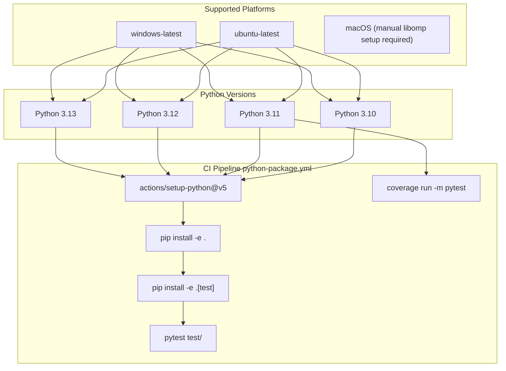

**Platform-Specific Notes:**

- **macOS:** Requires manual `libomp` installation via Homebrew for lightgbm/xgboost compatibility: [.github/workflows/python-package.yml:50-60]()
- **Windows:** All extras supported; use escaped brackets in PowerShell: `pip install flaml\[automl\]`
- **Linux (Ubuntu):** Prophet and forecast extras tested on Ubuntu only: [.github/workflows/python-package.yml:87-90]()

**Python Version Specifics:**

- **Python 3.11:** pyspark==3.5.1 tested
- **Python 3.12:** pyspark==4.0.1 tested
- **Python 3.13:** pyspark==4.1.0 tested; NumPy>=2.0 supported

**Sources:** [.github/workflows/python-package.yml:36-141](), [setup.py:54-62]()

---

## Spark Setup

For distributed Spark execution, additional setup is required:

### Cloud Platforms

Spark clusters are pre-configured on:
- **Azure Synapse Analytics:** Use `pip install "flaml[synapse]"`
- **Microsoft Fabric Data Science:** Spark available by default
- **Databricks:** Requires `pip install "flaml[spark]"`

### Standalone Spark Installation

For Ubuntu systems, install Spark 3.3.0 standalone:

```bash
# Install Java dependencies
sudo apt-get update && sudo apt-get install -y \
    ca-certificates-java ca-certificates openjdk-17-jdk-headless

# Download and extract Spark
wget --progress=dot:giga \
    "https://www.apache.org/dyn/closer.lua/spark/spark-3.3.0/spark-3.3.0-bin-hadoop2.tgz?action=download" \
    -O - | tar -xzC /tmp
sudo mv /tmp/spark-3.3.0-bin-hadoop2 /spark

# Set environment variables
export SPARK_HOME=/spark
export PYTHONPATH=/spark/python/lib/py4j-0.10.9.5-src.zip:/spark/python
export PATH=$PATH:$SPARK_HOME/bin
```

**Sources:** [website/docs/Installation.md:82-97]()

---

## Development Setup

### Clone and Install for Development

```bash
# Clone repository
git clone https://github.com/microsoft/FLAML.git
cd FLAML

# Install in editable mode with notebook dependencies
pip install -e ".[notebook]"
```

On Windows, escape brackets: `pip install -e .\[notebook\]`

### Docker Development Environment

```bash
# Build Docker image
docker build https://github.com/microsoft/FLAML.git#main -t flaml-dev

# Run container
docker run -it flaml-dev
```

### VS Code Remote Container

FLAML provides a `.devcontainer` configuration for VS Code:

1. Open FLAML folder in VS Code
2. Select "Reopen in Container" when prompted
3. Container includes all development dependencies pre-installed

**Sources:** [website/docs/Contribute.md:61-83](), [Dockerfile]()

---

## Pre-commit Hooks and Testing

### Pre-commit Setup

```bash
# Install pre-commit hooks
pre-commit install

# Run manually before committing
pre-commit run

# Uninstall if needed (Windows without WSL)
pre-commit uninstall
```

### Running Tests

```bash
# Install test dependencies
pip install -e ".[test]"

# Run all tests
pytest test/ --ignore=test/autogen

# Run with retries (CI configuration)
pytest test/ --ignore=test/autogen --reruns 2 --reruns-delay 10

# Generate coverage report
coverage run -m pytest test --ignore=test/autogen
coverage report -m
coverage html
```

### Test Organization

Tests are organized by component:

- **flaml/automl:** AutoML tests
- **flaml/tune:** Hyperparameter tuning tests
- **flaml/default:** Zero-shot AutoML tests
- **test/spark:** Spark integration tests
- **test/nlp:** NLP/transformers tests
- **test/forecast:** Time series forecasting tests

**Sources:** [website/docs/Contribute.md:84-100](), [.github/workflows/python-package.yml:105-116]()

---

## Verification After Installation

After installation, verify FLAML is working:

```python
# Check version
import flaml
print(flaml.__version__)  # Should print current version (e.g., "2.5.0")

# Test minimal import
from flaml import AutoML, tune
print("FLAML core imported successfully")

# Test automl extra (if installed)
try:
    from flaml.automl.model import LGBMEstimator
    print("AutoML extra available")
except ImportError:
    print("AutoML extra not installed")

# List available estimators for a task
from flaml.automl.task.factory import task_factory
print("Classification estimators:", 
      sorted(task_factory("classification").estimators.keys()))
```

### Checking Dependencies

The repository includes a dependency checker:

```bash
# Check first-tier dependencies
python test/check_dependency.py
```

**Sources:** [.github/workflows/python-package.yml:99-101](), [README.md:65](), [flaml/version.py:1]()

---

## .NET Support

FLAML has a .NET implementation in **ML.NET**, an open-source machine learning framework for .NET.

### Installation Options

**Low-Code:**

1. **Model Builder** (Visual Studio extension):
   - Visual tool for training ML models using FLAML
   - Install via: Extensions → Manage Extensions → Search "ML.NET Model Builder"

2. **ML.NET CLI** (Command-line tool):
   ```bash
   # Install as global tool
   dotnet tool install -g mlnet
   
   # Use for AutoML
   mlnet auto-train --task classification --dataset data.csv
   ```

**Code-First:**

3. **Microsoft.ML.AutoML NuGet Package:**
   ```bash
   # Install via dotnet CLI
   dotnet add package Microsoft.ML.AutoML
   
   # Or via NuGet Package Manager in Visual Studio
   Install-Package Microsoft.ML.AutoML
   ```

### Getting Started with ML.NET

Refer to the [csharp-notebooks](https://github.com/dotnet/csharp-notebooks#machine-learning) repository for ML.NET API and AutoML examples.

**Sources:** [website/docs/Installation.md:133-148](), [README.md:33]()

---

## Next Steps

After installation, proceed to:

- **[Getting Started](Getting-Started):** Quick start guide with basic examples
- **[AutoML](#3):** Task-oriented automated machine learning
- **[Tune](#4):** Generic hyperparameter optimization
- **[Zero-shot AutoML](#5):** Drop-in replacements with automatic configuration

For troubleshooting installation issues, see [FAQ](FAQ).

**Sources:** [website/docs/Getting-Started.md:1-116](), [README.md:52-91]()

---

# Page: AutoML

# AutoML

<details>
<summary>Relevant source files</summary>

The following files were used as context for generating this wiki page:

- [flaml/automl/automl.py](flaml/automl/automl.py)
- [flaml/ml.py](flaml/ml.py)
- [test/automl/test_multiclass.py](test/automl/test_multiclass.py)
- [website/docs/Best-Practices.md](website/docs/Best-Practices.md)
- [website/docs/Contribute.md](website/docs/Contribute.md)
- [website/docs/FAQ.md](website/docs/FAQ.md)
- [website/docs/Getting-Started.md](website/docs/Getting-Started.md)
- [website/docs/Installation.md](website/docs/Installation.md)
- [website/docs/Use-Cases/Task-Oriented-AutoML.md](website/docs/Use-Cases/Task-Oriented-AutoML.md)
- [website/sidebars.js](website/sidebars.js)

</details>


AutoML in FLAML is a task-oriented automated machine learning system that provides a scikit-learn-style interface for training ML models. It automatically handles model selection and hyperparameter tuning within user-specified resource constraints (time budget, computational resources). AutoML is designed to find high-quality models quickly while minimizing computational cost.

## When to Use AutoML

Use `flaml.AutoML` when you have:
- A standard ML task (classification, regression, time series forecasting, ranking, or NLP)
- Training data and want to find the best model automatically
- Limited time or computational resources
- Need for a scikit-learn-compatible interface

For generic hyperparameter optimization of custom functions, see page [Tune](4). For zero-configuration model training, see page [Zero-shot AutoML](5).

Sources: [flaml/automl/automl.py:88-105](), [website/docs/Getting-Started.md:22-45]()

## Architecture Overview

AutoML orchestrates several subsystems to automate machine learning:

**High-Level Architecture**

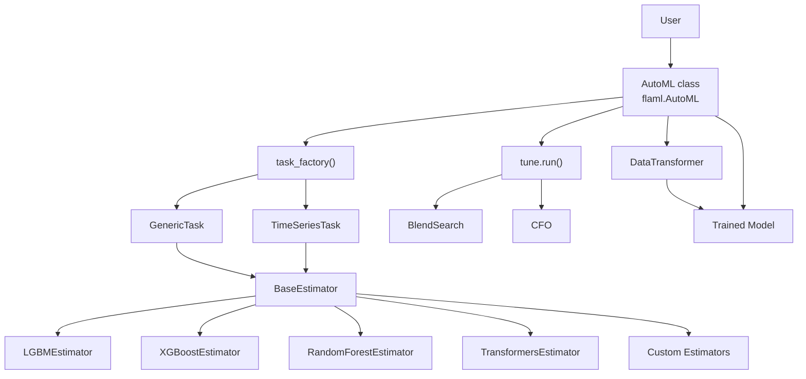

Sources: [flaml/automl/automl.py:88-424](), [flaml/automl/task/factory.py:1-50]()

## Basic Workflow

The typical AutoML workflow consists of initialization, fitting, and prediction:

**AutoML Execution Flow**

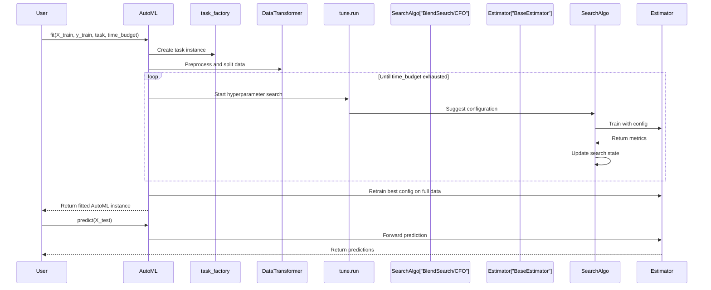

Sources: [flaml/automl/automl.py:785-1650]()

## Supported Tasks and Estimators

AutoML supports a wide range of machine learning tasks. The available estimators depend on the task type and installed optional dependencies.

**Supported Task Types**

| Task String | Description | Example Use Case |
|-------------|-------------|------------------|
| `"classification"` | Binary or multiclass classification | Spam detection, image classification |
| `"regression"` | Numeric prediction | House price prediction, sales forecasting |
| `"ts_forecast"` | Time series forecasting | Stock price prediction, demand forecasting |
| `"ts_forecast_panel"` | Panel time series forecasting | Multi-store sales forecasting |
| `"rank"` | Learning to rank | Search result ranking |
| `"seq-classification"` | Sequence classification (NLP) | Sentiment analysis, topic classification |
| `"seq-regression"` | Sequence regression (NLP) | Text quality scoring |
| `"summarization"` | Text summarization | Document summarization |
| `"token-classification"` | Token-level classification | Named entity recognition |

Sources: [website/docs/Use-Cases/Task-Oriented-AutoML.md:10-21](), [flaml/automl/automl.py:376-423]()

**Built-in Estimators by Task**

AutoML includes multiple estimator types. Common estimators include:

- **Tree-based**: `lgbm`, `xgboost`, `xgb_limitdepth`, `rf`, `extra_tree`, `catboost`
- **Linear**: `lrl1`, `lrl2` (Logistic Regression with L1/L2 regularization)
- **Time Series**: `prophet`, `arima`, `sarimax`, `holt-winters`
- **Deep Learning**: `transformer` (HuggingFace), `tft` (Temporal Fusion Transformer)
- **Spark Distributed**: `lgbm_spark`, `rf_spark`, `gbt_spark`

To list available estimators for your environment:

```python
from flaml.automl.task.factory import task_factory

print("Classification:", sorted(task_factory("classification").estimators.keys()))
print("Regression:", sorted(task_factory("regression").estimators.keys()))
print("Forecast:", sorted(task_factory("forecast").estimators.keys()))
```

Sources: [website/docs/Use-Cases/Task-Oriented-AutoML.md:178-234](), [website/docs/FAQ.md:319-331]()

## Key Capabilities

### AutoML Configuration Options

AutoML provides extensive configuration through the `fit()` method. Key parameters include:

**Resource Constraints**

| Parameter | Type | Description |
|-----------|------|-------------|
| `time_budget` | float | Total search time in seconds (default: -1, no limit) |
| `max_iter` | int | Maximum number of trials |
| `train_time_limit` | float | Maximum training time per trial in seconds |
| `pred_time_limit` | float | Maximum prediction time per instance |
| `mem_thres` | float | Memory size constraint in bytes |
| `free_mem_ratio` | float | Keep free memory above this ratio (0-1) |

**Search Configuration**

| Parameter | Type | Description |
|-----------|------|-------------|
| `metric` | str or callable | Optimization metric (e.g., 'accuracy', 'r2', custom function) |
| `estimator_list` | list or 'auto' | List of estimators to try |
| `eval_method` | str | Evaluation method: 'auto', 'cv', 'holdout' |
| `split_ratio` | float | Validation data ratio for holdout (default: 0.1) |
| `n_splits` | int | Number of CV folds (default: 5) |
| `hpo_method` | str | HPO algorithm: 'auto', 'cfo', 'bs', 'random' |

**Advanced Options**

| Parameter | Type | Description |
|-----------|------|-------------|
| `n_concurrent_trials` | int | Number of parallel trials (requires Ray or Spark) |
| `use_ray` | bool or dict | Use Ray for parallel execution |
| `use_spark` | bool | Use Spark for parallel execution |
| `ensemble` | bool or dict | Enable stacking ensemble |
| `custom_hp` | dict | Override hyperparameter search spaces |
| `starting_points` | dict | Warm start with initial configurations |

Sources: [flaml/automl/automl.py:109-421](), [website/docs/Use-Cases/Task-Oriented-AutoML.md:47-363]()

### Optimization Metrics

AutoML supports built-in metrics for different tasks. By default, `metric='auto'` selects an appropriate metric based on the task type.

**Common Metrics**

- **Classification**: `'accuracy'`, `'roc_auc'`, `'log_loss'`, `'f1'`, `'micro_f1'`, `'macro_f1'`
- **Regression**: `'r2'`, `'rmse'`, `'mae'`, `'mse'`, `'mape'`
- **Ranking**: `'ndcg'`, `'ndcg@k'`
- **HuggingFace NLP**: `'accuracy'`, `'bleu'`, `'rouge'`, `'f1'`, etc.

Custom metrics can be provided as functions with the signature:

```python
def custom_metric(X_val, y_val, estimator, labels, X_train, y_train, 
                  weight_val=None, weight_train=None, *args):
    # Compute metric
    return metric_to_minimize, metrics_to_log
```

Sources: [website/docs/Use-Cases/Task-Oriented-AutoML.md:49-171](), [test/automl/test_multiclass.py:103-131]()

## Basic Usage

**Minimal Example**

```python
from flaml import AutoML

automl = AutoML()
automl.fit(X_train, y_train, task="classification", time_budget=60)

# Access results
print(f"Best estimator: {automl.best_estimator}")
print(f"Best config: {automl.best_config}")
print(f"Best loss: {automl.best_loss}")

# Make predictions
predictions = automl.predict(X_test)
```

Sources: [website/docs/Getting-Started.md:26-31](), [website/docs/Use-Cases/Task-Oriented-AutoML.md:25-40]()

**Configuration Example**

```python
from flaml import AutoML

automl = AutoML()
automl_settings = {
    "time_budget": 120,              # 2 minutes
    "metric": "roc_auc",             # Optimization metric
    "task": "classification",        # Task type
    "estimator_list": ["lgbm", "xgboost", "rf"],
    "log_file_name": "automl.log",   # Log file
    "eval_method": "cv",             # Cross-validation
    "n_splits": 5,                   # 5-fold CV
    "n_jobs": -1,                    # Use all CPU cores
}

automl.fit(X_train, y_train, **automl_settings)

# Model is stored in automl.model
trained_model = automl.model
```

Sources: [test/automl/test_multiclass.py:309-346](), [flaml/automl/automl.py:512-538]()

**Accessing Results**

The `AutoML` class provides properties to access training results:

| Property | Description |
|----------|-------------|
| `best_estimator` | Name of the best estimator found |
| `best_config` | Best hyperparameter configuration |
| `best_config_per_estimator` | Best config for each estimator tried |
| `best_loss` | Best validation loss achieved |
| `best_loss_per_estimator` | Best loss for each estimator |
| `model` | Trained model instance (supports `predict()`, `predict_proba()`) |
| `config_history` | Dictionary of iteration -> (estimator, config, time) |
| `best_iteration` | Iteration number where best config was found |
| `time_to_find_best_model` | Time taken to find best model in seconds |

Sources: [flaml/automl/automl.py:503-774]()

## Integration Points

AutoML integrates with various components in FLAML and external tools:

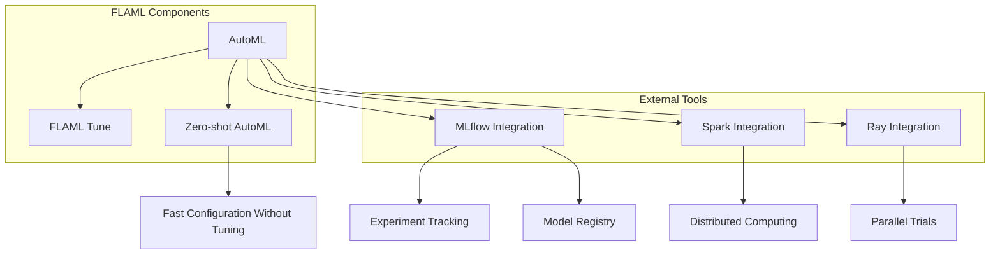

Sources: [flaml/automl/automl.py:55-74](flaml/automl/automl.py:55-74), [website/docs/Use-Cases/Task-Oriented-AutoML.md:523-535](website/docs/Use-Cases/Task-Oriented-AutoML.md:523-535)

## Summary

FLAML's AutoML is a fast, lightweight, and economical automated machine learning system that:

1. Supports various ML tasks: classification, regression, time series forecasting, ranking, and NLP
2. Provides a scikit-learn compatible API for easy integration
3. Automatically selects and tunes ML models within resource constraints
4. Offers extensive customization options for estimators, search space, metrics, and constraints
5. Integrates with MLflow, Spark, and Ray for enhanced capabilities
6. Optimizes for both model performance and resource efficiency

AutoML is designed to be a practical solution for everyday ML tasks, finding good models quickly while minimizing computational resources.

---

# Page: AutoML Core

# AutoML Core

<details>
<summary>Relevant source files</summary>

The following files were used as context for generating this wiki page:

- [flaml/automl/automl.py](flaml/automl/automl.py)
- [notebook/automl_classification.ipynb](notebook/automl_classification.ipynb)
- [notebook/automl_time_series_forecast.ipynb](notebook/automl_time_series_forecast.ipynb)
- [test/automl/test_forecast.py](test/automl/test_forecast.py)
- [test/automl/test_multiclass.py](test/automl/test_multiclass.py)
- [test/automl/test_notebook_example.py](test/automl/test_notebook_example.py)
- [website/docs/Examples/AutoML-Time series forecast.md](website/docs/Examples/AutoML-Time series forecast.md)
- [website/docs/Use-Cases/Task-Oriented-AutoML.md](website/docs/Use-Cases/Task-Oriented-AutoML.md)

</details>


This document provides a deep dive into the `AutoML` class, the primary interface for automated machine learning in FLAML. The `AutoML` class orchestrates the entire AutoML workflow, from data preprocessing to model selection, hyperparameter optimization, training, and evaluation.

## Overview

The `AutoML` class (defined in [flaml/automl/automl.py:90]()) is a scikit-learn compatible estimator that automates the machine learning pipeline. It handles:

- **Data validation and preprocessing**: Through task-specific data transformers
- **Model selection**: Selecting and evaluating multiple estimator types
- **Hyperparameter optimization**: Using efficient search algorithms (via FLAML's Tune system)
- **Model training and evaluation**: With configurable evaluation methods (holdout, cross-validation)
- **Result tracking**: Maintaining state of best models and configurations

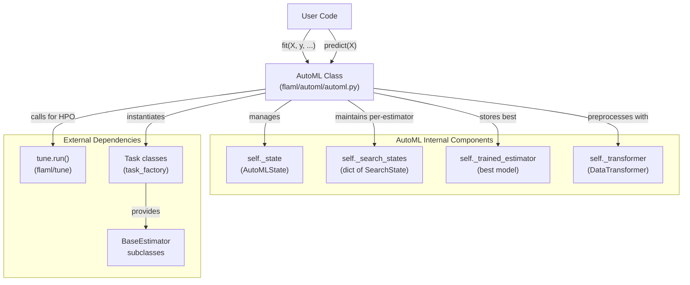

Sources: [flaml/automl/automl.py:90-424](), [flaml/automl/state.py:1-50]()

## AutoML Class Structure

### Initialization

The `AutoML` class inherits from `sklearn.base.BaseEstimator` [flaml/automl/automl.py:90](), making it compatible with scikit-learn pipelines and utilities.

Constructor signature:
```python
AutoML(**settings)
```

The constructor [flaml/automl/automl.py:109-424]() accepts various settings as keyword arguments:

| Parameter | Default | Description |
|-----------|---------|-------------|
| `task` | `"classification"` | Task type: classification, regression, ts_forecast, etc. |
| `time_budget` | `-1` | Total time budget in seconds (-1 means no limit) |
| `max_iter` | `None` | Maximum number of iterations |
| `metric` | `"auto"` | Optimization metric (string or custom function) |
| `estimator_list` | `"auto"` | List of estimator names to try |
| `n_jobs` | `-1` | Number of parallel threads for training |
| `eval_method` | `"auto"` | Evaluation method: auto, holdout, cv |
| `split_ratio` | `0.1` | Validation data fraction for holdout |
| `n_splits` | `5` | Number of folds for cross-validation |
| `sample` | `True` | Whether to sample training data during search |
| `ensemble` | `False` | Whether to build ensemble after search |
| `model_history` | `False` | Whether to keep best model per estimator |
| `log_training_metric` | `False` | Whether to log training metrics |
| `verbose` | `3` | Logging verbosity level |
| `retrain_full` | `True` | Whether to retrain on full data after search |

During initialization, the constructor:
1. Creates an `AutoMLState` instance in `self._state` [flaml/automl/automl.py:369]()
2. Stores settings in `self._settings` [flaml/automl/automl.py:371]()
3. Validates metric parameter [flaml/automl/automl.py:385]()
4. Sets estimator type (`"classifier"` or `"regressor"`) [flaml/automl/automl.py:423]()

### Key Properties

The `AutoML` class exposes several properties to access results after `fit()`:

| Property | Description | Implementation |
|----------|-------------|----------------|
| `model` | Best trained model object | [flaml/automl/automl.py:512-516]() |
| `best_estimator` | Name of best estimator (e.g., "lgbm") | [flaml/automl/automl.py:536-538]() |
| `best_config` | Best hyperparameter configuration dict | [flaml/automl/automl.py:547-600]() |
| `best_config_per_estimator` | Best config for each estimator | [flaml/automl/automl.py:603-676]() |
| `best_loss` | Best validation loss achieved | [flaml/automl/automl.py:684-686]() |
| `best_iteration` | Iteration where best config was found | [flaml/automl/automl.py:541-544]() |
| `config_history` | Dictionary of iteration→(estimator, config, time) | [flaml/automl/automl.py:504-509]() |
| `best_result` | Full result dictionary for best config | [flaml/automl/automl.py:689-692]() |
| `best_config_train_time` | Training time for best config | [flaml/automl/automl.py:703-705]() |
| `time_to_find_best_model` | Time taken to find best model | [flaml/automl/automl.py:771-773]() |
| `classes_` | Class labels (classification only) | [flaml/automl/automl.py:742-750]() |
| `feature_names_in_` | Feature names from training data | [flaml/automl/automl.py:757-762]() |
| `feature_importances_` | Feature importances from best model | [flaml/automl/automl.py:765-768]() |

**Important Notes on `best_config`:**

The `best_config` property [flaml/automl/automl.py:547-600]() returns FLAML's search space parameters, which may differ from the original model's parameters. For example:
- FLAML uses `log_max_bin` for LightGBM instead of `max_bin`
- To convert to original parameters, use the estimator's `config2params()` method
- See the docstring examples for how to use configs with FLAML estimators vs. original model libraries

Sources: [flaml/automl/automl.py:109-424](), [flaml/automl/automl.py:500-773]()

## The fit() Workflow

The `fit()` method [flaml/automl/automl.py:789-1559]() is the core of the AutoML process. It orchestrates data preparation, model search, and final model training.

### High-Level fit() Workflow

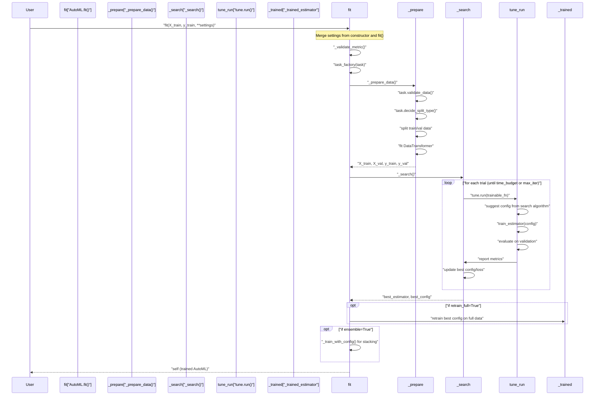

### Detailed Workflow Steps

**1. Setup and Validation** [flaml/automl/automl.py:789-911]()
   - Merge settings from constructor and `fit()` call
   - Validate `metric` parameter [flaml/automl/automl.py:479-498]()
   - Create task instance via `task_factory()` [flaml/automl/task/factory.py:9-20]()
   - Initialize state: `self._state`, `self._search_states` [flaml/automl/automl.py:913-927]()

**2. Data Preparation** [flaml/automl/automl.py:929-1113]()
   - Call `task.validate_data()` to check data format and labels
   - Determine split type (stratified, uniform, time, group) via `task.decide_split_type()`
   - Split data into train/validation sets based on `eval_method`
   - Fit `DataTransformer` on training data (if `skip_transform=False`)
   - Transform training and validation data
   - Handle missing labels in validation set (classification tasks)

**3. Model Search** [flaml/automl/automl.py:1115-1459]()
   - Determine estimator list from `estimator_list` parameter
   - For each estimator type:
     - Get search space via `estimator_class.search_space()`
     - Define `trainable` function that wraps `train_estimator()` [flaml/automl/ml.py:283-447]()
     - Call `tune.run()` with search algorithm (CFO or BlendSearch)
     - Track best config per estimator in `self._search_states[estimator_name]`
   - Update global best: `self._best_estimator`, `self._best_iteration`

**4. Final Model Training** [flaml/automl/automl.py:1461-1543]()
   - If `retrain_full=True` or `retrain_full="budget"`:
     - Retrain best config on full training data
     - Store in `self._trained_estimator`
   - If `ensemble=True`:
     - Build `StackingEstimator` or `VotingEstimator`
     - Use top models from search as base estimators
     - Store ensemble in `self._trained_estimator`

**5. Cleanup** [flaml/automl/automl.py:1545-1559]()
   - Delete search state if `keep_search_state=False`
   - Save training log
   - Return `self`

Sources: [flaml/automl/automl.py:789-1559](), [flaml/automl/ml.py:283-447](), [flaml/automl/task/factory.py:9-20]()

## Hyperparameter Optimization Loop

The hyperparameter optimization (HPO) loop is executed within the `_search()` method [flaml/automl/automl.py:1115-1459]() via `tune.run()`.

### HPO Loop Structure

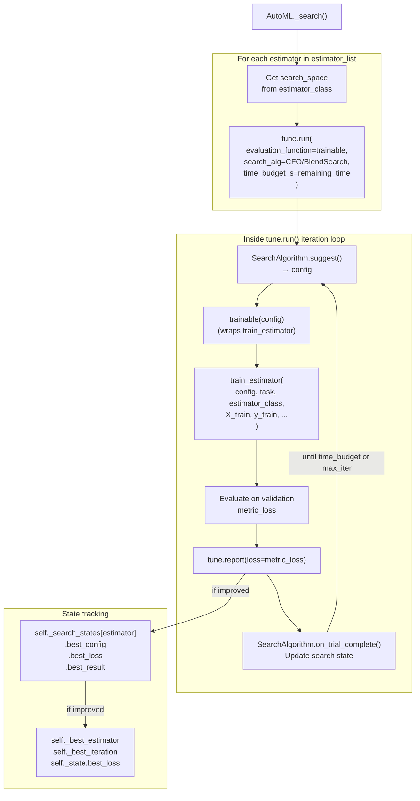

### Key Components of the HPO Loop

**1. Search Algorithm Selection** [flaml/automl/automl.py:1252-1280]()

The search algorithm is determined by:
- `hpo_method="auto"` (default): Uses CFO for sequential search, BlendSearch for parallel
- `hpo_method="bs"`: Forces BlendSearch
- `hpo_method="random"`: Uses random search

**2. Trial Execution via `trainable()` function** [flaml/automl/automl.py:1164-1244]()

For each trial, the `trainable` function:
1. Receives a config dictionary from the search algorithm
2. Calls `train_estimator(config, ...)` [flaml/automl/ml.py:283-447]()
3. Within `train_estimator()`:
   - Instantiates estimator: `estimator_class(**config)`
   - Trains: `estimator.fit(X_train, y_train, budget=time_budget)`
   - Evaluates: `estimator.score(X_val, y_val, metric)`
   - Returns metrics dictionary
4. Reports loss to Tune: `tune.report(loss=metric_loss, ...)`

**3. State Updates** [flaml/automl/automl.py:1428-1458]()

After each trial:
- If loss improved for current estimator: update `self._search_states[estimator_name].best_config`
- If loss improved globally: update `self._best_estimator`, `self._best_iteration`
- Optionally save trained model if `model_history=True`

**4. Resource Management**

During HPO, FLAML manages resources via:
- `time_budget_s` parameter to `tune.run()` [flaml/automl/automl.py:1397]()
- `train_time_limit` per trial [flaml/automl/automl.py:1174]()
- `mem_thres` for memory constraints [flaml/automl/automl.py:1180]()
- Early stopping if `early_stop=True` [flaml/automl/automl.py:1451]()

Sources: [flaml/automl/automl.py:1115-1459](), [flaml/automl/ml.py:283-447](), [flaml/tune/__init__.py:1-50]()

## Configuration Management

The AutoML class manages configurations at multiple levels:

### Configuration Levels

**1. Constructor Settings** [flaml/automl/automl.py:371-422]()
   - Stored in `self._settings` dictionary
   - Contains defaults for all parameters
   - Can be overridden by `fit()` arguments

**2. fit() Settings** [flaml/automl/automl.py:789-911]()
   - Merged with constructor settings
   - Takes precedence over constructor settings
   - Validated before use

**3. Estimator Configurations** [flaml/automl/automl.py:1164-1244]()
   - Search space defined by `estimator_class.search_space()`
   - Config sampled by search algorithm
   - Converted to estimator params via `config2params()`

### Configuration Flow

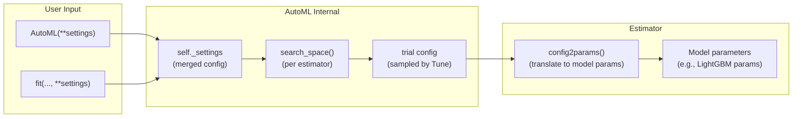

### Best Configuration Storage

After search completes, best configurations are stored:

- **Per estimator**: `self._search_states[estimator_name].best_config`
- **Global best**: Accessible via `self.best_config` property
- **All estimators**: Accessible via `self.best_config_per_estimator` property

The `best_config` contains FLAML's search space parameters, which may differ from the underlying model's parameters. Use the estimator's `config2params()` method to convert if needed.

Sources: [flaml/automl/automl.py:371-422](), [flaml/automl/automl.py:547-676](), [flaml/automl/model.py:380-432]()

## Model Selection Process

The AutoML class selects the best model through an iterative search process that evaluates multiple estimator types and their hyperparameter configurations.

### Estimator Selection

**1. Determining Estimator List** [flaml/automl/automl.py:1283-1330]()

The list of estimators to try is determined by:
- `estimator_list` parameter (default `"auto"`)
- If `"auto"`: uses `task.default_estimator_list()` based on task type
- Custom estimators can be registered via `add_learner()` [flaml/automl/automl.py:2710-2768]()

Example estimator lists by task:
- Classification: `['lgbm', 'xgboost', 'xgb_limitdepth', 'catboost', 'rf', 'extra_tree', 'lrl1']`
- Regression: `['lgbm', 'xgboost', 'xgb_limitdepth', 'catboost', 'rf', 'extra_tree']`
- Time series: `['lgbm', 'rf', 'xgboost', 'extra_tree', 'xgb_limitdepth', 'prophet', 'arima', 'sarimax']`

**2. Search Space per Estimator** [flaml/automl/automl.py:1164-1180]()

Each estimator class defines its search space via the `search_space()` class method:
```python
@classmethod
def search_space(cls, data_size, task):
    return {
        "n_estimators": {
            "domain": tune.lograndint(lower=4, upper=32768),
            "init_value": 4,
            "low_cost_init_value": 4,
        },
        # ... other hyperparameters
    }
```

The search space includes:
- `domain`: The range and distribution of values (via `tune` primitives)
- `init_value`: Starting value for the search
- `low_cost_init_value`: Value associated with low computational cost

**3. Learner Selector** [flaml/automl/automl.py:1332-1342]()

The `learner_selector` parameter controls which estimator to try next:
- `"sample"` (default): Weighted sampling based on estimated improvement
- `"roundrobin"`: Cycle through estimators in order

### Selection Criteria

The best model is selected based on:

**Primary Criterion: Validation Loss** [flaml/automl/automl.py:1428-1441]()
- The model with lowest validation loss across all trials
- Loss computed using the specified `metric`
- Tracked in `self._state.best_loss`

**Secondary Criteria** (when applicable):
- Training time: via `pred_time_limit` and `train_time_limit`
- Memory usage: via `mem_thres`
- Metric constraints: via `metric_constraints` parameter

### Model Comparison

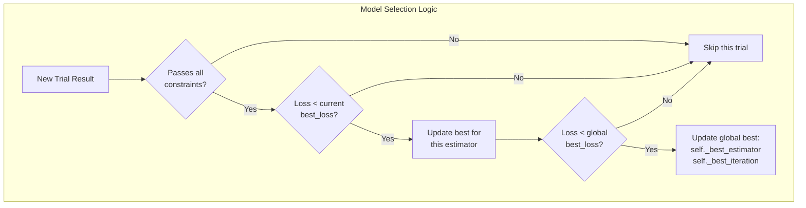

Sources: [flaml/automl/automl.py:1283-1458](), [flaml/automl/automl.py:2710-2768](), [flaml/automl/model.py:264-295]()

## Prediction Methods

After training, the AutoML instance can be used for prediction via several methods:

### predict()

```python
predict(X, **kwargs)
```

Generate predictions using the best trained model [flaml/automl/automl.py:1784-1830]().

**Process:**
1. Check if a model is trained (`self._trained_estimator` exists)
2. Preprocess input: `X = self._state.task.preprocess(X, self._transformer)`
3. Call underlying model: `self._trained_estimator.predict(X)`
4. For classification with label transformation, inverse transform predictions

### predict_proba()

```python
predict_proba(X, **kwargs)
```

Generate class probability predictions for classification tasks [flaml/automl/automl.py:1832-1869]().

**Process:**
1. Preprocess input data
2. Call `self._trained_estimator.predict_proba(X)`
3. Return probability array of shape (n_samples, n_classes)

### score()

```python
score(X, y, **kwargs)
```

Evaluate model performance on test data [flaml/automl/automl.py:775-788]().

**Process:**
1. Preprocess input data
2. Generate predictions
3. Compute metric using the task's default metric
4. Return score (higher is better by default)

### Usage Example

```python
from flaml import AutoML
from sklearn.datasets import load_iris

X, y = load_iris(return_X_y=True)

# Train AutoML
automl = AutoML()
automl.fit(X[:120], y[:120], task="classification", time_budget=30)

# Make predictions
predictions = automl.predict(X[120:])
probabilities = automl.predict_proba(X[120:])
test_score = automl.score(X[120:], y[120:])

# Access best model
print(f"Best estimator: {automl.best_estimator}")
print(f"Best config: {automl.best_config}")
print(f"Best loss: {automl.best_loss}")
```

Sources: [flaml/automl/automl.py:775-788](), [flaml/automl/automl.py:1784-1869](), [test/automl/test_multiclass.py:309-346]()

## Using the AutoML Core

To use the AutoML Core, users typically:

1. Create an instance of the `AutoML` class
2. Configure settings like time budget, task type, metric, etc.
3. Call the `fit()` method with training data
4. Use the trained model for predictions

Example usage pattern:

```python
from flaml import AutoML

# Create and configure AutoML
automl = AutoML()
settings = {
    "time_budget": 60,  # seconds
    "metric": "accuracy",
    "task": "classification",
    "n_jobs": 4,
    "estimator_list": ["lgbm", "rf", "xgboost"],
}

# Train AutoML
automl.fit(X_train, y_train, **settings)

# Make predictions
predictions = automl.predict(X_test)
```

Sources: [flaml/automl/automl.py:93-101](). [test/automl/test_classification.py:93-107](). [test/automl/test_regression.py:41-52]().

## Extensibility

The AutoML Core is designed to be extensible in several ways:

1. **Custom Estimators**: Users can add custom ML algorithms via the `add_learner()` method
2. **Custom Metrics**: Custom evaluation metrics can be provided to the `fit()` method
3. **Custom Data Preprocessing**: Users can skip the built-in preprocessing by setting `skip_transform=True`
4. **Custom Hyperparameter Spaces**: The search space can be customized via the `custom_hp` parameter

This extensibility allows the AutoML Core to be adapted to specific domains and use cases beyond its built-in capabilities.

Sources: [flaml/automl/automl.py:635-642](). [test/automl/test_regression.py:183-207]().

---

# Page: Model Abstraction and Estimators

# Model Abstraction and Estimators

<details>
<summary>Relevant source files</summary>

The following files were used as context for generating this wiki page:

- [flaml/automl/automl.py](flaml/automl/automl.py)
- [flaml/automl/model.py](flaml/automl/model.py)
- [test/automl/test_classification.py](test/automl/test_classification.py)
- [test/automl/test_multiclass.py](test/automl/test_multiclass.py)
- [test/automl/test_regression.py](test/automl/test_regression.py)
- [test/conftest.py](test/conftest.py)
- [website/docs/Use-Cases/Task-Oriented-AutoML.md](website/docs/Use-Cases/Task-Oriented-AutoML.md)

</details>


This page documents the model abstraction layer in FLAML, which provides a unified interface for diverse machine learning models. It covers the `BaseEstimator` hierarchy, search space definition, configuration translation, and the estimator registration system that enables AutoML to work seamlessly with traditional ML, distributed computing, deep learning, and time series models.

For information about how estimators are used within the AutoML optimization loop, see [AutoML Core](#3.1). For task-specific considerations, see [Tasks and Data Preparation](#3.3).

---

## Purpose and Design

The model abstraction layer serves three critical functions:

1. **Unified Interface**: Provides consistent `fit()`, `predict()`, and `search_space()` methods across all model types
2. **Search Space Specification**: Enables each estimator to define its own hyperparameter search space in a standardized format
3. **Configuration Translation**: Translates FLAML's internal search space format to model-specific parameters via `config2params()`

This abstraction allows AutoML to optimize hyperparameters across heterogeneous model types without knowing implementation details of each underlying library (scikit-learn, XGBoost, LightGBM, Spark, HuggingFace, etc.).

---

## BaseEstimator: The Abstract Interface

### Class Hierarchy

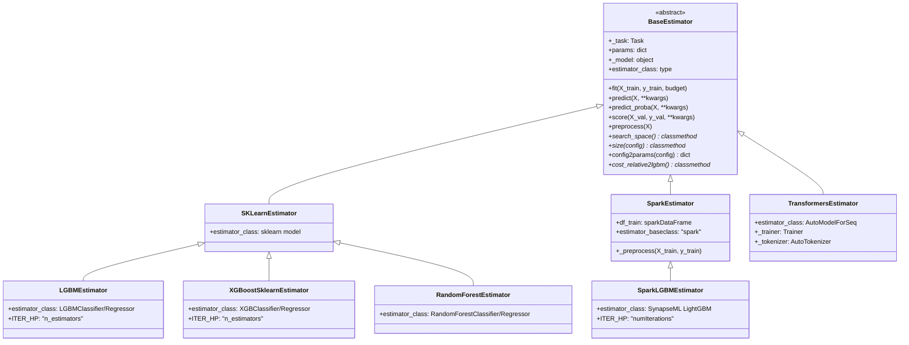

Sources: [flaml/automl/model.py:121-488]()

### Core Methods and Properties

The `BaseEstimator` class defines the contract that all estimators must follow:

| Method/Property | Type | Description |
|-----------------|------|-------------|
| `fit(X_train, y_train, budget)` | instance | Trains the model with optional time/memory budget constraints |
| `predict(X, **kwargs)` | instance | Generates predictions from features |
| `predict_proba(X, **kwargs)` | instance | Returns class probabilities (classification only) |
| `score(X_val, y_val, **kwargs)` | instance | Evaluates the model on validation data |
| `preprocess(X)` | instance | Applies estimator-level preprocessing transformations |
| `search_space(data_size, task)` | classmethod | Returns the hyperparameter search space definition |
| `config2params(config)` | instance | Translates search space config to model constructor params |
| `size(config)` | classmethod | Estimates memory size in bytes for a configuration |
| `cost_relative2lgbm()` | classmethod | Returns relative computational cost compared to LightGBM |
| `model` / `estimator` | property | Returns the trained underlying model after `fit()` |
| `classes_` | property | Returns class labels (classification) |
| `feature_names_in_` | property | Returns feature names used during training |
| `feature_importances_` | property | Returns feature importance scores |

Sources: [flaml/automl/model.py:121-488]()

### Abstract Methods Requirements

Every estimator must implement the `search_space()` classmethod. This method returns a dictionary where:
- Keys are hyperparameter names
- Values are dictionaries with `domain`, `init_value`, and optionally `low_cost_init_value`

```python
@classmethod
def search_space(cls, data_size, task, **params):
    return {
        "n_estimators": {
            "domain": tune.lograndint(lower=4, upper=32768),
            "init_value": 4,
            "low_cost_init_value": 4,
        },
        "learning_rate": {
            "domain": tune.loguniform(lower=1/1024, upper=1.0),
            "init_value": 0.1,
        },
    }
```

The `config2params()` method translates FLAML's internal search configuration to parameters accepted by the underlying model's constructor. By default, it simply removes internal FLAML keys like `FLAML_sample_size`.

Sources: [flaml/automl/model.py:435-488](), [website/docs/Use-Cases/Task-Oriented-AutoML.md:316-323]()

---

## Estimator Hierarchy and Types

### Traditional Machine Learning Estimators

FLAML includes scikit-learn compatible estimators that wrap gradient boosting, tree-based, and linear models:

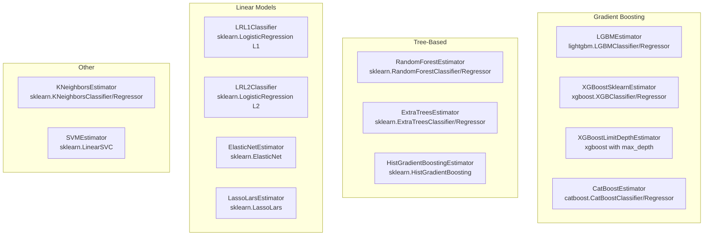

All these estimators inherit from `SKLearnEstimator`, which sets `self.estimator_class` to the appropriate scikit-learn compatible class. The base `fit()` method instantiates `self.estimator_class(**self.params)` and calls its `fit()` method.

Sources: [flaml/automl/model.py:672-2350](), [website/docs/Use-Cases/Task-Oriented-AutoML.md:179-191]()

### Spark Distributed Estimators

The `SparkEstimator` base class supports distributed training on Spark clusters using pyspark.ml and SynapseML APIs:

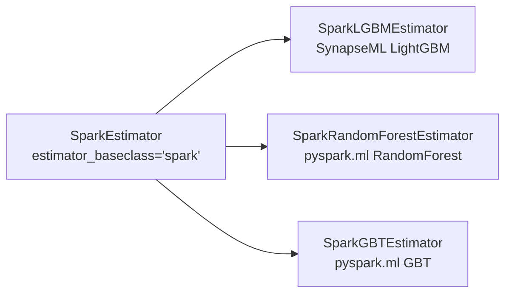

Key differences from sklearn estimators:
- `_preprocess()` converts pandas-on-Spark DataFrames to Spark DataFrames
- `fit()` expects pyspark.pandas DataFrames as input
- `predict()` returns pyspark.pandas Series with predictions
- Parameters use Spark/SynapseML naming conventions (e.g., `numIterations` instead of `n_estimators`)

Sources: [flaml/automl/model.py:490-818]()

### Deep Learning Estimators

#### Transformers for NLP

The `TransformersEstimator` family wraps HuggingFace Transformers models:

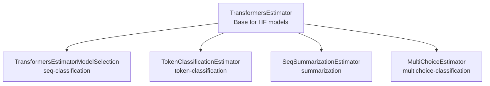

These estimators handle tokenization, training arguments, and HuggingFace `Trainer` initialization internally. They expose hyperparameters like `learning_rate`, `num_train_epochs`, `per_device_train_batch_size` in their search space.

Sources: [website/docs/Use-Cases/Task-Oriented-AutoML.md:196](), Diagram 4 from high-level architecture

#### Time Series Deep Learning

Time series forecasting includes deep learning models:
- `TemporalFusionTransformerEstimator` (TFT): Multi-horizon attention-based forecasting
- `TCNEstimator`: Temporal Convolutional Networks

These require optional dependencies (PyTorch, pytorch-forecasting) and are only available when installed.

Sources: [website/docs/Use-Cases/Task-Oriented-AutoML.md:197-198](), Diagram 4 from high-level architecture

---

## Search Space Definition

### Domain Specification

The search space for each estimator is defined using `flaml.tune` domain functions:

| Domain Function | Description | Example |
|----------------|-------------|---------|
| `tune.uniform(lower, upper)` | Continuous uniform distribution | `tune.uniform(0.0, 1.0)` |
| `tune.loguniform(lower, upper)` | Continuous log-uniform distribution | `tune.loguniform(1e-5, 1e-1)` |
| `tune.randint(lower, upper)` | Discrete uniform integer | `tune.randint(1, 100)` |
| `tune.lograndint(lower, upper)` | Discrete log-uniform integer | `tune.lograndint(4, 32768)` |
| `tune.choice([...])` | Categorical choice | `tune.choice(['gini', 'entropy'])` |
| constant value | Fixed hyperparameter | `"subsample_freq": {"domain": 1}` |

### Search Space Structure

Each hyperparameter in the search space dictionary has the following fields:

```python
{
    "hyperparameter_name": {
        "domain": tune.lograndint(lower=4, upper=1000),  # Required: sampling domain
        "init_value": 100,                               # Optional: initial value to try
        "low_cost_init_value": 4,                        # Optional: computationally cheap starting point
    }
}
```

The `low_cost_init_value` is crucial for cost-frugal optimization. It represents a configuration known to train quickly, allowing FLAML to explore the search space efficiently even under tight time budgets.

Sources: [website/docs/Use-Cases/Task-Oriented-AutoML.md:316-323]()

### Example: LightGBM Search Space

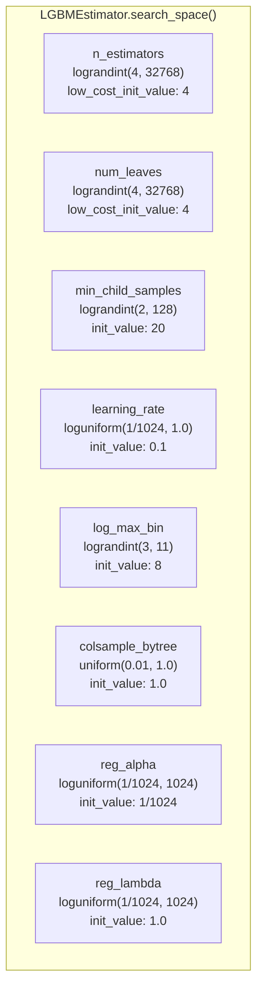

Note that `log_max_bin` is a FLAML-specific parameter. The actual LightGBM parameter `max_bin` is derived via `config2params()`: `max_bin = (1 << log_max_bin) - 1`. This log transformation enables more efficient search over exponentially-scaled hyperparameters.

Sources: [flaml/automl/model.py:705-781]()

---

## Configuration Translation: config2params()

### Purpose and Workflow

```mermaid
sequenceDiagram
    participant SearchAlgo as "Search Algorithm"
    participant AutoML as "AutoML"
    participant Estimator as "BaseEstimator"
    participant Model as "Underlying Model"
    
    SearchAlgo->>AutoML: suggest config
    Note over AutoML: config = {"learner": "lgbm",<br/>"n_estimators": 100,<br/>"log_max_bin": 8,<br/>"FLAML_sample_size": 1000}
    
    AutoML->>Estimator: __init__(config)
    Estimator->>Estimator: config2params(config)
    Note over Estimator: params = {"n_estimators": 100,<br/>"max_bin": 255}
    
    Estimator->>Model: LGBMRegressor(**params)
    Model-->>Estimator: model instance
    
    Estimator->>Model: model.fit(X_train, y_train)
```

The `config2params()` method performs three key transformations:

1. **Remove FLAML-specific keys**: Keys like `FLAML_sample_size`, `learner`, `_choice_` are internal to FLAML and not passed to the model
2. **Transform hyperparameter names**: Convert FLAML search space parameter names to model-specific names (e.g., `log_max_bin` → `max_bin`)
3. **Apply transformations**: Apply mathematical transformations (e.g., `max_bin = (1 << log_max_bin) - 1`)

Sources: [flaml/automl/model.py:475-487](), [flaml/automl/model.py:782-797]()

### Example Implementations

**LightGBM:**
```python
def config2params(self, config: dict) -> dict:
    params = super().config2params(config)
    if "log_max_bin" in params:
        params["max_bin"] = (1 << params.pop("log_max_bin")) - 1
    return params
```

**XGBoost:**
```python
def config2params(self, config: dict) -> dict:
    params = super().config2params(config)
    # max_depth must be int
    max_depth = params.get("max_depth")
    if max_depth is not None:
        params["max_depth"] = 0 if max_depth == 0 else max(1, int(max_depth))
    return params
```

**Spark LightGBM:**
```python
def config2params(self, config: dict) -> dict:
    params = super().config2params(config)
    if "n_jobs" in params:
        params.pop("n_jobs")  # Not applicable in Spark context
    if "log_max_bin" in params:
        params["maxBin"] = (1 << params.pop("log_max_bin")) - 1
    return params
```

Sources: [flaml/automl/model.py:782-797](), [flaml/automl/model.py:660-666]()

---

## Estimator Registration System

### Built-in Estimator Registry

FLAML maintains a registry of estimators in `AutoML._state.learner_classes`:

```mermaid
graph LR
    subgraph "AutoML Initialization"
        TaskFactory["task_factory(task)"]
        Task["Task.estimators dict"]
        LearnerClasses["AutoML._state.learner_classes"]
    end
    
    TaskFactory --> Task
    Task --> LearnerClasses
    
    subgraph "Available Estimators by Task"
        GenericTask["GenericTask.estimators:<br/>lgbm, xgboost, rf, catboost,<br/>extra_tree, lrl1, lrl2, kneighbor,<br/>transformer, lgbm_spark, etc."]
        
        TSTask["TimeSeriesTask.estimators:<br/>arima, prophet, sarimax,<br/>lgbm, xgboost, rf,<br/>tft, tcn, orbit, etc."]
    end
```

The available estimators depend on:
1. The task type (classification, regression, forecasting, etc.)
2. Installed optional dependencies (e.g., prophet, catboost, ray)
3. Execution environment (e.g., Spark estimators only available in Spark contexts)

To list available estimators for a task:
```python
from flaml.automl.task.factory import task_factory

print("classification:", sorted(task_factory("classification").estimators.keys()))
print("regression:", sorted(task_factory("regression").estimators.keys()))
print("forecast:", sorted(task_factory("forecast").estimators.keys()))
```

Sources: [website/docs/Use-Cases/Task-Oriented-AutoML.md:212-234](), [flaml/automl/automl.py:369-371]()

### Adding Custom Estimators

Custom estimators are registered using `AutoML.add_learner()`:

```mermaid
sequenceDiagram
    participant User
    participant AutoML
    participant State as "AutoML._state"
    participant Task
    
    User->>AutoML: add_learner("my_model", MyEstimator)
    AutoML->>State: learner_classes["my_model"] = MyEstimator
    AutoML->>Task: task.estimators["my_model"] = MyEstimator
    
    Note over User,Task: Estimator now available in estimator_list
    
    User->>AutoML: fit(..., estimator_list=["my_model", "lgbm"])
    AutoML->>State: Use registered learner_classes
```

The registration process:
1. Validates that the custom class inherits from `BaseEstimator`
2. Adds it to `_state.learner_classes` dictionary
3. Makes it available for selection in `estimator_list`

Sources: [flaml/automl/automl.py:1288-1320]()

---

## Creating Custom Estimators

### Basic Structure

To create a custom estimator:

1. **Inherit from BaseEstimator or a subclass** (e.g., `SKLearnEstimator`)
2. **Set `self.estimator_class`** in the constructor to the underlying model class
3. **Define `search_space()` classmethod** to specify hyperparameter ranges
4. **(Optional) Override `config2params()`** for parameter transformations
5. **(Optional) Override `size()` and `cost_relative2lgbm()`** for resource estimation

### Example: Regularized Greedy Forest

```python
from flaml.automl.model import SKLearnEstimator
from flaml import tune

class MyRegularizedGreedyForest(SKLearnEstimator):
    def __init__(self, task="binary", **config):
        super().__init__(task, **config)
        
        if isinstance(task, str):
            from flaml.automl.task.factory import task_factory
            task = task_factory(task)
        
        if task.is_classification():
            from rgf.sklearn import RGFClassifier
            self.estimator_class = RGFClassifier
        else:
            from rgf.sklearn import RGFRegressor
            self.estimator_class = RGFRegressor
    
    @classmethod
    def search_space(cls, data_size, task):
        return {
            "max_leaf": {
                "domain": tune.lograndint(lower=4, upper=data_size[0]),
                "init_value": 4,
            },
            "n_iter": {
                "domain": tune.lograndint(lower=1, upper=data_size[0]),
                "init_value": 1,
            },
            "learning_rate": {
                "domain": tune.loguniform(lower=0.01, upper=20.0)
            },
        }
    
    @classmethod
    def size(cls, config):
        max_leaves = int(round(config.get("max_leaf", 1)))
        n_estimators = int(round(config.get("n_iter", 1)))
        return (max_leaves * 3 + (max_leaves - 1) * 4 + 1.0) * n_estimators * 8
```

Sources: [test/automl/test_multiclass.py:13-67](), [website/docs/Use-Cases/Task-Oriented-AutoML.md:236-294]()

### Registration and Usage

```python
from flaml import AutoML

automl = AutoML()
automl.add_learner(learner_name="rgf", learner_class=MyRegularizedGreedyForest)

automl.fit(
    X_train, y_train,
    task="classification",
    time_budget=60,
    estimator_list=["rgf", "lgbm", "xgboost"],  # Mix custom with built-in
)
```

Sources: [website/docs/Use-Cases/Task-Oriented-AutoML.md:298-312]()

### Customizing Built-in Estimators

To customize search space or constructor arguments of a built-in estimator, inherit from it:

```python
from flaml.automl.model import XGBoostSklearnEstimator

class MyXGBoost(XGBoostSklearnEstimator):
    """XGBoost with custom objective function"""
    
    def __init__(self, **config):
        super().__init__(objective=my_custom_objective, **config)
```

Or override the search space:

```python
class XGBoost2D(XGBoostSklearnEstimator):
    """XGBoost tuning only 2 hyperparameters"""
    
    @classmethod
    def search_space(cls, data_size, task):
        upper = min(32768, int(data_size))
        return {
            "n_estimators": {
                "domain": tune.lograndint(lower=4, upper=upper),
                "low_cost_init_value": 4,
            },
            "max_leaves": {
                "domain": tune.lograndint(lower=4, upper=upper),
                "low_cost_init_value": 4,
            },
        }
```

Sources: [website/docs/Use-Cases/Task-Oriented-AutoML.md:324-364](), [test/automl/test_regression.py:25-37]()

### Shortcut: custom_hp Argument

For quick search space modifications without creating a new class, use the `custom_hp` argument in `fit()`:

```python
custom_hp = {
    "xgboost": {
        "n_estimators": {
            "domain": tune.lograndint(lower=10, upper=1000),
            "low_cost_init_value": 10,
        },
    },
    "rf": {
        "max_leaves": {
            "domain": None,  # Disable this hyperparameter
        },
    },
    "lgbm": {
        "subsample": {
            "domain": tune.uniform(lower=0.1, upper=1.0),
            "init_value": 1.0,
        },
        "subsample_freq": {
            "domain": 1,  # Fixed value (must be > 0 to enable subsample)
        },
    },
}

automl.fit(X_train, y_train, custom_hp=custom_hp, task="classification")
```

Sources: [website/docs/Use-Cases/Task-Oriented-AutoML.md:366-393](), [flaml/automl/automl.py:419]()

---

## Built-in Estimator Reference

### Gradient Boosting Models

| Estimator Key | Class | Underlying Library | Key Hyperparameters |
|--------------|-------|-------------------|---------------------|
| `lgbm` | `LGBMEstimator` | LightGBM | n_estimators, num_leaves, min_child_samples, learning_rate, log_max_bin, colsample_bytree, reg_alpha, reg_lambda |
| `xgboost` | `XGBoostSklearnEstimator` | XGBoost | n_estimators, max_leaves, min_child_weight, learning_rate, subsample, colsample_bylevel, colsample_bytree, reg_alpha, reg_lambda |
| `xgb_limitdepth` | `XGBoostLimitDepthEstimator` | XGBoost | n_estimators, max_depth, min_child_weight, learning_rate, subsample, colsample_bylevel, colsample_bytree, reg_alpha, reg_lambda |
| `catboost` | `CatBoostEstimator` | CatBoost | early_stopping_rounds, learning_rate, n_estimators |
| `histgb` | `HistGradientBoostingEstimator` | scikit-learn | n_estimators, max_leaves, min_samples_leaf, learning_rate, log_max_bin, l2_regularization |

Sources: [website/docs/Use-Cases/Task-Oriented-AutoML.md:179-190]()

### Tree-Based Models

| Estimator Key | Class | Underlying Library | Key Hyperparameters |
|--------------|-------|-------------------|---------------------|
| `rf` | `RandomForestEstimator` | scikit-learn | n_estimators, max_features, max_leaves, criterion |
| `extra_tree` | `ExtraTreesEstimator` | scikit-learn | n_estimators, max_features, max_leaves, criterion |

Sources: [website/docs/Use-Cases/Task-Oriented-AutoML.md:183-186]()

### Linear Models

| Estimator Key | Class | Underlying Library | Key Hyperparameters |
|--------------|-------|-------------------|---------------------|
| `lrl1` | `LRL1Classifier` | scikit-learn LogisticRegression | C (L1 regularization) |
| `lrl2` | `LRL2Classifier` | scikit-learn LogisticRegression | C (L2 regularization) |
| `enet` | `ElasticNetEstimator` | scikit-learn ElasticNet | alpha, l1_ratio |
| `lassolars` | `LassoLarsEstimator` | scikit-learn LassoLars | alpha |

Sources: [website/docs/Use-Cases/Task-Oriented-AutoML.md:188-189]()

### Distributed Spark Models

| Estimator Key | Class | Underlying Library | Notes |
|--------------|-------|-------------------|-------|
| `lgbm_spark` | `SparkLGBMEstimator` | SynapseML | Requires Spark environment, uses Spark parameter naming |
| `rf_spark` | `SparkRandomForestEstimator` | pyspark.ml | MLlib RandomForest for Spark |
| `gbt_spark` | `SparkGBTEstimator` | pyspark.ml | MLlib Gradient-Boosted Trees |
| `lr_spark` | `SparkLinearRegression` | pyspark.ml | MLlib Linear Regression |

Sources: [website/docs/Use-Cases/Task-Oriented-AutoML.md:199-207]()

### Deep Learning Models

| Estimator Key | Class | Underlying Library | Tasks |
|--------------|-------|-------------------|-------|
| `transformer` | `TransformersEstimatorModelSelection` | HuggingFace Transformers | seq-classification, seq-regression, token-classification, summarization, multichoice-classification |
| `tft` | `TemporalFusionTransformerEstimator` | pytorch-forecasting | ts_forecast_panel |
| `tcn` | `TCNEstimator` | PyTorch | ts_forecast |

Sources: [website/docs/Use-Cases/Task-Oriented-AutoML.md:196-198]()

### Time Series Models

| Estimator Key | Class | Underlying Library | Key Hyperparameters |
|--------------|-------|-------------------|---------------------|
| `prophet` | `Prophet` | Prophet | changepoint_prior_scale, seasonality_prior_scale, holidays_prior_scale, seasonality_mode |
| `arima` | `ARIMA` | statsmodels | p, d, q |
| `sarimax` | `SARIMAX` | statsmodels | p, d, q, P, D, Q, s |
| `holt-winters` | `HoltWinters` | statsmodels | seasonal_periods, seasonal, use_boxcox, trend, damped_trend |

Sources: [website/docs/Use-Cases/Task-Oriented-AutoML.md:192-195]()

---

## Integration with AutoML Workflow

### Estimator Lifecycle in AutoML

```mermaid
sequenceDiagram
    participant AutoML
    participant Search as "Search Algorithm"
    participant State as "AutoML._state"
    participant Estimator as "BaseEstimator"
    participant Model as "Underlying Model"
    
    AutoML->>State: Initialize learner_classes from Task
    
    loop Optimization Loop
        AutoML->>Search: Request next config
        Search-->>AutoML: {learner: "lgbm", ...params}
        
        AutoML->>State: Get learner_classes["lgbm"]
        State-->>AutoML: LGBMEstimator class
        
        AutoML->>Estimator: LGBMEstimator(task, **config)
        Estimator->>Estimator: config2params(config)
        Estimator->>Estimator: params = transformed config
        
        AutoML->>Estimator: fit(X_train, y_train, budget)
        Estimator->>Model: self.estimator_class = LGBMRegressor
        Estimator->>Model: model = LGBMRegressor(**params)
        Estimator->>Model: model.fit(X_train, y_train)
        Model-->>Estimator: trained model
        Estimator-->>AutoML: train_time
        
        AutoML->>Estimator: score(X_val, y_val, metric)
        Estimator->>Model: model.predict(X_val)
        Model-->>Estimator: predictions
        Estimator-->>AutoML: validation_loss
        
        AutoML->>Search: on_trial_complete(loss, config)
    end
    
    AutoML->>AutoML: Select best config/estimator
```

Sources: [flaml/automl/automl.py:1630-1850](), Diagram 2 from high-level architecture

### Memory and Resource Management

Estimators participate in resource management through two classmethods:

**`size(config)`**: Returns estimated memory usage in bytes for a configuration
```python
@classmethod
def size(cls, config):
    num_leaves = int(round(config.get("num_leaves", 1)))
    n_estimators = int(round(config["n_estimators"]))
    return (num_leaves * 3 + (num_leaves - 1) * 4 + 1.0) * n_estimators * 8
```

**`cost_relative2lgbm()`**: Returns relative computational cost compared to LightGBM
```python
@classmethod
def cost_relative2lgbm(cls):
    return 1.6  # e.g., XGBoost is ~60% slower than LightGBM
```

These are used by AutoML to:
1. Respect memory constraints (`mem_thres` parameter)
2. Estimate trial durations for time budget allocation
3. Prioritize faster models early in search

Sources: [flaml/automl/model.py:453-468](), [flaml/automl/automl.py:78-88]()

### Resource Limiting During Training

When `free_mem_ratio` or `budget` are specified, estimators with `limit_resource=True` train under resource constraints:

```python
def fit(self, X_train, y_train, budget=None, free_mem_ratio=0, **kwargs):
    if getattr(self, "limit_resource", None) and resource is not None:
        with limit_resource(memory_limit, time_limit):
            train_time = self._fit(X_train, y_train, **kwargs)
```

The `limit_resource` context manager:
- Sets memory limits using `resource.setrlimit(resource.RLIMIT_AS, ...)`
- Sets time limits using `signal.alarm()`
- Catches `MemoryError` and `TimeoutError`, falling back to a dummy model

Sources: [flaml/automl/model.py:279-322](), [flaml/automl/model.py:86-119]()

---

## Best Practices

### 1. Search Space Design
- Use `low_cost_init_value` for parameters that significantly affect training time (e.g., `n_estimators`, `num_leaves`)
- Use log-scale domains (`loguniform`, `lograndint`) for parameters that span orders of magnitude
- Provide sensible `init_value` based on domain knowledge or data-dependent defaults

### 2. Parameter Transformation
- Keep FLAML search space parameters intuitive (e.g., `log_max_bin` instead of `max_bin`)
- Handle all necessary transformations in `config2params()`
- Remove inapplicable parameters (e.g., `n_jobs` for Spark estimators)

### 3. Resource Estimation
- Implement `size()` accurately to help AutoML respect memory constraints
- Set `cost_relative2lgbm()` to reflect actual training time relative to LightGBM
- Consider data-dependent resource usage in the implementation

### 4. Custom Estimators
- Inherit from the most specific base class (e.g., `SKLearnEstimator` for sklearn-compatible models)
- Handle task-specific logic (classification vs regression) in `__init__`
- Test with both `eval_method="holdout"` and `eval_method="cv"`

### 5. Constructor Signature
- Always include task-specific parameters (like `task` or `n_jobs`) in the `__init__` signature explicitly, not in `**config`
- This prevents them from being passed to the underlying model, which may not accept them

Sources: [website/docs/Use-Cases/Task-Oriented-AutoML.md:296]()

---

# Page: Tasks and Data Preparation

# Tasks and Data Preparation

<details>
<summary>Relevant source files</summary>

The following files were used as context for generating this wiki page:

- [flaml/automl/automl.py](flaml/automl/automl.py)
- [flaml/automl/task/__init__.py](flaml/automl/task/__init__.py)
- [flaml/automl/task/factory.py](flaml/automl/task/factory.py)
- [flaml/automl/task/generic_task.py](flaml/automl/task/generic_task.py)
- [flaml/automl/task/task.py](flaml/automl/task/task.py)
- [test/automl/test_multiclass.py](test/automl/test_multiclass.py)
- [test/automl/test_no_overlap.py](test/automl/test_no_overlap.py)
- [test/automl/test_score.py](test/automl/test_score.py)
- [test/automl/test_split.py](test/automl/test_split.py)
- [website/docs/Use-Cases/Task-Oriented-AutoML.md](website/docs/Use-Cases/Task-Oriented-AutoML.md)

</details>


## Purpose and Scope

This document describes FLAML's Task abstraction layer and data preparation pipeline, which handle data validation, preprocessing, and splitting before model training. The Task system provides a unified interface for different machine learning problems while accommodating task-specific requirements.

For estimator-specific details, see [Model Abstraction and Estimators](#3.2). For time series-specific features, see [Time Series Forecasting](#3.4). For NLP-specific preprocessing, see [NLP and Transformers](#3.5).

---

## Task Abstraction Layer

### Task Class Hierarchy

FLAML uses an abstract `Task` class to encapsulate task-specific behavior. Each task type implements methods for data validation, preparation, and model evaluation.

**Diagram 1: Task Type System**

```mermaid
graph TB
    subgraph "Task Factory"
        Factory["task_factory()<br/>flaml.automl.task.factory"]
    end
    
    subgraph "Abstract Base"
        Task["Task (ABC)<br/>flaml.automl.task.task"]
    end
    
    subgraph "Concrete Implementations"
        GenericTask["GenericTask<br/>flaml.automl.task.generic_task"]
        TimeSeriesTask["TimeSeriesTask<br/>flaml.automl.task.time_series_task"]
    end
    
    subgraph "Task Categories"
        Classification["CLASSIFICATION<br/>binary, multiclass<br/>seq-classification<br/>token-classification"]
        Regression["REGRESSION<br/>regression<br/>seq-regression"]
        TSForecast["TS_FORECAST<br/>ts_forecast<br/>ts_forecast_panel"]
        Ranking["RANK<br/>rank"]
    end
    
    Factory -->|"task_name in TS_FORECAST"| TimeSeriesTask
    Factory -->|"other tasks"| GenericTask
    
    Task -->|"inherits"| GenericTask
    Task -->|"inherits"| TimeSeriesTask
    
    GenericTask --> Classification
    GenericTask --> Regression
    GenericTask --> Ranking
    TimeSeriesTask --> TSForecast
```

Sources: [flaml/automl/task/task.py:1-350](), [flaml/automl/task/factory.py:1-21](), [flaml/automl/task/generic_task.py:1-102]()

### Task Factory

The `task_factory()` function instantiates the appropriate task implementation based on the task name:

| Task Name(s) | Task Class | Description |
|--------------|-----------|-------------|
| `"classification"`, `"binary"`, `"multiclass"` | GenericTask | Binary/multi-class classification |
| `"regression"` | GenericTask | Regression problems |
| `"seq-classification"`, `"seq-regression"` | GenericTask | NLP sequence tasks |
| `"token-classification"`, `"summarization"` | GenericTask | NLP token/generation tasks |
| `"rank"` | GenericTask | Learning to rank |
| `"ts_forecast"`, `"ts_forecast_panel"` | TimeSeriesTask | Time series forecasting |

**Example Task Instantiation:**

```python
from flaml.automl.task.factory import task_factory

# Create a classification task
task = task_factory("classification", X_train, y_train)

# Create a time series task
ts_task = task_factory("ts_forecast", X_train, y_train)
```

Sources: [flaml/automl/task/factory.py:9-20](), [flaml/automl/task/task.py:12-50]()

### Task Abstract Methods

The `Task` abstract base class defines the interface that all concrete implementations must provide:

| Method | Purpose |
|--------|---------|
| `validate_data()` | Validates input data format and constraints |
| `prepare_data()` | Splits data into train/validation sets |
| `evaluate_model_CV()` | Evaluates model using cross-validation |
| `decide_split_type()` | Determines appropriate data split strategy |
| `preprocess()` | Applies task-specific preprocessing |
| `default_estimator_list()` | Returns valid estimators for the task |
| `default_metric()` | Returns default evaluation metric |

Sources: [flaml/automl/task/task.py:60-350]()

---

## Data Validation

### Validation Pipeline

The `validate_data()` method performs comprehensive input validation before model training begins. It is called by `AutoML.fit()` early in the workflow.

**Diagram 2: Data Validation Flow**

```mermaid
graph TB
    Start["AutoML.fit()"] --> ValidateData["task.validate_data()"]
    
    ValidateData --> CheckInput["Check Input Format<br/>np.ndarray, pd.DataFrame,<br/>psDataFrame, scipy.sparse"]
    
    CheckInput --> CheckDims["Check Dimensions<br/>X.shape[0] == y.shape[0]"]
    
    CheckDims --> CheckTask{"Task Type?"}
    
    CheckTask -->|"NLP"| ValidateNLP["Validate NLP Inputs<br/>str or list[int] columns<br/>token-classification:<br/>list[str]"]
    
    CheckTask -->|"Time Series"| ValidateTS["Validate TS Structure<br/>_validate_ts_data()<br/>timestamp columns"]
    
    CheckTask -->|"Other"| ContinueVal["Continue Validation"]
    
    ValidateNLP --> TransformData["Apply Transformation?"]
    ValidateTS --> TransformData
    ContinueVal --> TransformData
    
    TransformData -->|"skip_transform=False"| UseTransformer["DataTransformer<br/>fit_transform()"]
    TransformData -->|"skip_transform=True"| SkipTransformer["No transformation<br/>Use data as-is"]
    
    UseTransformer --> ValidateVal["Validate X_val, y_val<br/>if provided"]
    SkipTransformer --> ValidateVal
    
    ValidateVal --> ValidateGroups["Validate groups<br/>if provided"]
    ValidateGroups --> Done["Set automl attributes:<br/>_X_train_all, _y_train_all<br/>_transformer, _label_transformer"]
```

Sources: [flaml/automl/task/generic_task.py:103-263](), [flaml/automl/automl.py:1290-1300]()

### Input Format Requirements

**Supported Data Types:**

| Data Type | X_train | y_train | Notes |
|-----------|---------|---------|-------|
| NumPy arrays | `np.ndarray` | `np.ndarray` | Most efficient for dense numeric data |
| Pandas DataFrames | `pd.DataFrame` | `pd.Series` | Supports mixed types, categorical |
| Scipy sparse | `scipy.sparse` matrices | `np.ndarray` | For high-dimensional sparse data |
| Spark DataFrames | `pyspark.pandas.DataFrame` | `pyspark.pandas.Series` | For distributed data processing |

**Key Validation Checks:**

```python
# From generic_task.py:116-129
assert isinstance(X_train_all, (np.ndarray, pd.DataFrame, psDataFrame)) or issparse(X_train_all)
assert isinstance(y_train_all, (np.ndarray, pd.Series, psSeries))
assert X_train_all.size != 0 and y_train_all.size != 0
assert X_train_all.shape[0] == y_train_all.shape[0]
```

Sources: [flaml/automl/task/generic_task.py:116-138]()

### NLP Task Validation

For NLP tasks (`seq-classification`, `token-classification`, `summarization`, etc.), additional validation ensures text data is properly formatted:

**Token Classification Requirements:**
- Each cell must be a **list of strings** (not a single string)
- Example: `['EU', 'rejects', 'German', 'call', 'to', 'boycott', 'British', 'lamb', '.']`

**Other NLP Tasks:**
- Each cell must be either:
  - A **string** (untokenized text), or
  - A **list of integers** (tokenized IDs)
- All columns must use the same format (all strings OR all lists)

```python
# From generic_task.py:161-192
if self.is_nlp():
    for column in X.columns:
        assert X[column].dtype.name in ("object", "string")
        for _, each_cell in X[column].items():
            if self.is_token_classification():
                # Must be list of strings
                assert is_list_of_str(each_cell)
            else:
                # Must be str or list[int]
                assert is_str or is_list_of_int
```

Sources: [flaml/automl/task/generic_task.py:161-192](), [test/automl/test_multiclass.py:176-180]()

### Spark DataFrame Handling

When using Spark DataFrames (`pyspark.pandas`), FLAML caches the data for performance and automatically skips certain transformations:

```python
# From generic_task.py:130-133
if isinstance(X_train_all, psDataFrame):
    X_train_all = X_train_all.spark.cache()  # Cache for performance
    y_train_all = y_train_all.to_frame().spark.cache()[y_train_all.name]
    
# From generic_task.py:193-196
if isinstance(X, psDataFrame):
    # Spark DataFrames skip DataTransformer
    automl._skip_transform = True
```

Sources: [flaml/automl/task/generic_task.py:130-196]()

---

## Data Preprocessing

### DataTransformer Pipeline

When `skip_transform=False` (default), FLAML applies a `DataTransformer` to handle common preprocessing tasks:

**Diagram 3: DataTransformer Pipeline**

```mermaid
graph LR
    RawData["Raw Data<br/>X, y"] --> Transformer["DataTransformer<br/>flaml.automl.data"]
    
    Transformer --> HandleMissing["Handle Missing<br/>Values"]
    HandleMissing --> EncodeCat["Encode<br/>Categorical"]
    EncodeCat --> TransformLabel["Label<br/>Transformation"]
    
    TransformLabel --> ProcessedX["Processed X"]
    TransformLabel --> ProcessedY["Processed y"]
    
    ProcessedX --> Store["Store in<br/>automl._X_train_all"]
    ProcessedY --> Store2["Store in<br/>automl._y_train_all"]
```

**DataTransformer Operations:**

| Operation | Applied To | Purpose |
|-----------|-----------|---------|
| Missing value imputation | X (features) | Fills NaN values |
| Categorical encoding | X (features) | Converts categories to numeric |
| Label encoding | y (targets) | Encodes string labels to integers |
| Type conversion | X, y | Ensures compatible data types |

**When Transformation is Skipped:**

1. `skip_transform=True` is set explicitly
2. `X_train_all` is a scipy sparse matrix
3. `X_train_all` is a Spark DataFrame (pandas_on_spark)

```python
# From generic_task.py:196-208
if automl._skip_transform or issparse(X_train_all):
    automl._transformer = automl._label_transformer = False
    automl._X_train_all, automl._y_train_all = X, y
else:
    automl._transformer = DataTransformer()
    automl._X_train_all, automl._y_train_all = automl._transformer.fit_transform(X, y, self)
    automl._label_transformer = automl._transformer.label_transformer
```

Sources: [flaml/automl/task/generic_task.py:196-220](), [flaml/automl/data.py]() (referenced but not in files list)

### Label Transformation

For classification tasks with non-integer labels, FLAML automatically encodes them:

```python
# Example: String labels -> integer codes
y_train = pd.Series(['cat', 'dog', 'cat', 'bird', 'dog'])
# After transformation:
y_train_transformed = np.array([0, 1, 0, 2, 1])

# Access label classes
automl.classes_  # Returns: array(['cat', 'dog', 'bird'])
```

The label transformer is stored in `automl._label_transformer` and automatically applied during prediction to convert back to original labels.

Sources: [flaml/automl/task/generic_task.py:204-220](), [test/automl/test_score.py:211-268]()

---

## Data Splitting Strategies

### Split Type Decision Tree

FLAML automatically selects an appropriate split type based on the task, or you can specify one explicitly.

**Diagram 4: Split Type Selection Logic**

```mermaid
graph TB
    Start["decide_split_type()"] --> CheckAuto{"split_type == 'auto'?"}
    
    CheckAuto -->|"Yes"| CheckTask{"Task Type?"}
    CheckAuto -->|"No"| ValidateSplit["Validate split_type<br/>is appropriate"]
    
    CheckTask -->|"Classification"| UseStratified["split_type = 'stratified'"]
    CheckTask -->|"Regression"| UseUniform["split_type = 'uniform'"]
    CheckTask -->|"TS Forecast"| UseTime["split_type = 'time'"]
    CheckTask -->|"Ranking"| UseGroup["split_type = 'group'"]
    
    ValidateSplit --> CheckValid{"Valid for task?"}
    CheckValid -->|"Yes"| Return["Return split_type"]
    CheckValid -->|"No"| Error["AssertionError"]
    
    UseStratified --> Return
    UseUniform --> Return
    UseTime --> Return
    UseGroup --> Return
```

Sources: [flaml/automl/task/generic_task.py:1090-1145]()

### Available Split Types

| Split Type | Description | Suitable For | Shuffles Data |
|------------|-------------|--------------|---------------|
| `stratified` | Preserves class distribution | Classification | Yes |
| `uniform` | Random split | Regression, general | Yes |
| `time` | Sequential split (no shuffle) | Time series | No |
| `group` | Keeps groups together | Grouped data, ranking | No |
| Custom splitter | User-defined KFold object | Any (CV only) | Depends on splitter |

**Example Usage:**

```python
# Automatic selection (default)
automl.fit(X_train, y_train, task="classification")  # Uses 'stratified'

# Explicit split type
automl.fit(X_train, y_train, task="classification", split_type="uniform")

# Time-based split
automl.fit(X_train, y_train, task="regression", split_type="time")

# Group-based split with group labels
automl.fit(X_train, y_train, task="rank", 
           split_type="group", groups=group_labels)
```

Sources: [flaml/automl/task/generic_task.py:1090-1145](), [test/automl/test_split.py:12-51]()

### Custom Data Splitters

For cross-validation, you can provide a custom splitter object:

**Requirements:**
- Must inherit from sklearn's `KFold` (or compatible)
- Must implement `split(X)` and `get_n_splits()` methods
- Must set `eval_method="cv"` in `AutoML.fit()`

**Example Custom Splitter:**

```python
from sklearn.model_selection import KFold
import numpy as np

class TestKFold(KFold):
    def __init__(self, n_splits):
        self.n_splits = int(n_splits)
    
    def split(self, X):
        rng = np.random.default_rng()
        train_num = int(len(X) * 0.8)
        for _ in range(self.n_splits):
            permu_idx = rng.permutation(len(X))
            yield permu_idx[:train_num], permu_idx[train_num:]
    
    def get_n_splits(self, X=None, y=None, groups=None):
        return self.n_splits

# Use custom splitter
automl.fit(X_train, y_train, 
           eval_method="cv", 
           split_type=TestKFold(5))
```

Sources: [test/automl/test_split.py:228-270](), [flaml/automl/task/generic_task.py:1090-1145]()

### Group-Based Splitting

When data has natural groupings (e.g., multiple samples from the same user/entity), use group splits to prevent data leakage:

**Specifying Groups:**

Groups can be provided in two formats:

1. **Group labels** (same length as data):
   ```python
   groups = np.array([0, 0, 1, 1, 1, 2, 2, 3, 3])  # One label per sample
   ```

2. **Group counts** (sum equals data length):
   ```python
   groups = [2, 3, 2, 2]  # Group sizes: 2+3+2+2=9 samples
   ```

**Example with GroupKFold:**

```python
from sklearn.model_selection import GroupKFold

# Define groups
groups = np.random.randint(0, 10, size=len(y_train))

# Cross-validation with groups
automl.fit(X_train, y_train, 
           eval_method="cv",
           split_type="group",
           groups=groups)

# Holdout split with groups
automl.fit(X_train, y_train,
           eval_method="holdout",
           split_type="group", 
           groups=groups)

# Custom group splitter
automl.fit(X_train, y_train,
           eval_method="cv",
           split_type=GroupKFold(n_splits=3),
           groups=groups)
```

Sources: [test/automl/test_split.py:53-89](), [test/automl/test_split.py:91-118](), [flaml/automl/task/generic_task.py:252-261]()

### Groups with Sample Weights

Groups can be combined with sample weights without issues:

```python
# Create sample weights
sample_weight = np.random.rand(len(y_train))

# Use both groups and sample weights
automl.fit(X_train, y_train,
           eval_method="cv",
           split_type="group",
           groups=groups_train,
           sample_weight=sample_weight_train)
```

Sources: [test/automl/test_split.py:120-155]()

---

## Holdout vs Cross-Validation

### Evaluation Method Selection

FLAML supports two evaluation strategies:

**Diagram 5: Evaluation Method Decision**

```mermaid
graph TB
    Start["prepare_data()"] --> CheckEvalMethod{"eval_method?"}
    
    CheckEvalMethod -->|"'auto'"| CheckSize{"data_size and<br/>time_budget?"}
    CheckEvalMethod -->|"'holdout'"| DoHoldout["Holdout Split"]
    CheckEvalMethod -->|"'cv'"| DoCV["Cross-Validation"]
    
    CheckSize -->|"Small data or<br/>large budget"| UseCV["eval_method = 'cv'"]
    CheckSize -->|"Large data or<br/>small budget"| UseHoldout["eval_method = 'holdout'"]
    
    UseCV --> DoCV
    UseHoldout --> DoHoldout
    
    DoHoldout --> SplitData["Split into<br/>train/validation<br/>using split_type"]
    
    DoCV --> CreateFolds["Create k-fold<br/>splits using<br/>split_type"]
    
    SplitData --> HandleMissing["Handle missing labels<br/>if classification"]
    CreateFolds --> Done["Folds ready<br/>for CV evaluation"]
    
    HandleMissing --> Done2["Train/val sets ready"]
```

Sources: [flaml/automl/task/generic_task.py:655-1045](), [flaml/config.py:24-25]() (CV_HOLDOUT_THRESHOLD)

### Holdout Split Parameters

| Parameter | Default | Description |
|-----------|---------|-------------|
| `eval_method` | `"auto"` | Use `"holdout"` to force holdout split |
| `split_ratio` | `0.1` | Fraction of data for validation (10%) |
| `split_type` | `"auto"` | Split strategy (stratified/uniform/time/group) |
| `X_val`, `y_val` | `None` | Provide explicit validation set |
| `retrain_full` | `True` | Retrain on full data after search |

**Example Holdout Usage:**

```python
# Default holdout (10% validation)
automl.fit(X_train, y_train, 
           eval_method="holdout")

# Custom split ratio (20% validation)
automl.fit(X_train, y_train,
           eval_method="holdout",
           split_ratio=0.2)

# Explicit validation set
automl.fit(X_train, y_train,
           X_val=X_val, y_val=y_val)

# Disable retraining on full data
automl.fit(X_train, y_train,
           eval_method="holdout",
           retrain_full=False)
```

Sources: [flaml/automl/task/generic_task.py:655-890](), [website/docs/Use-Cases/Task-Oriented-AutoML.md:506-516]()

### Cross-Validation Parameters

| Parameter | Default | Description |
|-----------|---------|-------------|
| `eval_method` | `"auto"` | Use `"cv"` to force cross-validation |
| `n_splits` | `5` | Number of folds |
| `split_type` | `"auto"` | Split strategy or custom splitter |
| `cv_score_agg_func` | `None` | Custom aggregation function for CV scores |

**Example CV Usage:**

```python
# Default 5-fold CV
automl.fit(X_train, y_train,
           eval_method="cv")

# 10-fold CV
automl.fit(X_train, y_train,
           eval_method="cv",
           n_splits=10)

# CV with custom splitter
from sklearn.model_selection import StratifiedKFold
automl.fit(X_train, y_train,
           eval_method="cv",
           split_type=StratifiedKFold(n_splits=5, shuffle=True))
```

Sources: [flaml/automl/task/generic_task.py:891-1045](), [website/docs/Use-Cases/Task-Oriented-AutoML.md:506-537](), [flaml/config.py:25]()

---

## Missing Label Handling

### The Problem

When splitting classification data using stratified or uniform splits, some classes may be underrepresented, leading to:
- **Missing labels in training set**: Model cannot learn those classes
- **Missing labels in validation set**: Cannot evaluate performance on those classes

This is especially problematic with:
- Imbalanced datasets
- Small datasets
- Classes with very few instances

### Two Handling Modes

FLAML provides two strategies controlled by the `allow_label_overlap` parameter:

| Mode | `allow_label_overlap` | Speed | Overlap | Use Case |
|------|----------------------|-------|---------|----------|
| Fast | `True` (default) | Fast | May occur | Large datasets, balanced classes |
| Precise | `False` | Slower | Minimized | Small datasets, imbalanced classes |

**Diagram 6: Missing Label Handling Strategy**

```mermaid
graph TB
    Start["After initial split"] --> CheckLabels["Check for<br/>missing labels"]
    
    CheckLabels --> AllPresent{"All labels<br/>present in both?"}
    
    AllPresent -->|"Yes"| NoAction["No action needed<br/>Return splits"]
    
    AllPresent -->|"No"| CheckMode{"allow_label_overlap?"}
    
    CheckMode -->|"True<br/>(Fast Mode)"| FastMode["_handle_missing_labels_fast()"]
    CheckMode -->|"False<br/>(Precise Mode)"| PreciseMode["_handle_missing_labels_precise()"]
    
    FastMode --> AddFirst["Add first instance<br/>of missing label<br/>to deficient set"]
    
    PreciseMode --> Iterative["Iteratively swap instances<br/>to minimize overlap<br/>while ensuring coverage"]
    
    AddFirst --> Return["Return splits<br/>(may have overlap)"]
    Iterative --> Return2["Return splits<br/>(minimal overlap)"]
```

Sources: [flaml/automl/task/generic_task.py:368-670]()

### Fast Mode (Default)

**Algorithm:**
1. Identify labels missing from train set
2. Add **first instance** of each missing label to train
3. Identify labels missing from val set
4. Add **first instance** of each missing label to val

**Characteristics:**
- ✅ Very fast (single pass)
- ✅ Ensures all labels present
- ⚠️ May create overlap (same instance in both sets)
- ⚠️ Overlap only for rare classes

**Implementation:**

```python
# From generic_task.py:368-451
def _handle_missing_labels_fast(self, state, X_train, X_val, y_train, y_val, ...):
    # Find unique labels and first occurrence of each
    label_set_all, first = unique_value_first_index(y_train_all)
    label_set_train = np.unique(y_train)
    label_set_val = np.unique(y_val)
    
    # Find missing labels
    missing_in_train = np.setdiff1d(label_set_all, label_set_train)
    missing_in_val = np.setdiff1d(label_set_all, label_set_val)
    
    # Add first instance of missing labels to train
    if len(missing_in_train) > 0:
        for label in missing_in_train:
            idx = first[label_matches[0]]
            X_train = concat(X_train_all[idx], X_train)
            y_train = concat(y_train_all[idx], y_train)
    
    # Add first instance of missing labels to val
    if len(missing_in_val) > 0:
        # Similar logic...
```

**Example:**

```python
# Use fast mode (default)
automl.fit(X_train, y_train,
           task="classification",
           eval_method="holdout",
           allow_label_overlap=True)  # Default

# After split with fast mode:
# Input:  150 samples, 3 classes
# Train:  135 samples, 3 classes
# Val:    15 samples, 3 classes
# Total:  150 samples (no overlap if classes well-represented)
#     or  151 samples (1 overlap if rare class added to both)
```

Sources: [flaml/automl/task/generic_task.py:368-451](), [test/automl/test_no_overlap.py:9-57]()

### Precise Mode

**Algorithm:**
1. Check if all labels present in both sets
2. If not, find **movable instances** (not sole representative of class)
3. Move instances between sets to achieve coverage
4. Only duplicate if no other option (very rare classes)

**Characteristics:**
- ✅ Minimizes overlap intelligently
- ✅ Preserves split ratio as much as possible
- ✅ Better for imbalanced datasets
- ⚠️ Slower (iterative swapping)

**Implementation:**

```python
# From generic_task.py:453-670
def _handle_missing_labels_precise(self, state, X_train, X_val, y_train, y_val, ...):
    # Identify classes that need adjustment
    label_set_train = set(np.unique(y_train))
    label_set_val = set(np.unique(y_val))
    label_set_all = set(np.unique(y_train_all))
    
    missing_in_train = label_set_all - label_set_train
    missing_in_val = label_set_all - label_set_val
    
    # Iteratively swap instances to achieve coverage
    while missing_in_train or missing_in_val:
        # Find instances that can be moved without breaking coverage
        # Move from val to train for missing_in_train labels
        # Move from train to val for missing_in_val labels
        # Only duplicate if instance is sole representative
```

**Example:**

```python
# Use precise mode
automl.fit(X_train, y_train,
           task="classification",
           eval_method="holdout",
           allow_label_overlap=False)

# After split with precise mode:
# Input:  150 samples, 3 classes (50 each)
# Train:  135 samples, 3 classes (45 each)
# Val:    15 samples, 3 classes (5 each)
# Total:  150 samples (no overlap achieved through intelligent swapping)

# With single-instance class:
# Input:  50 samples, 3 classes [40, 9, 1]
# Train:  46 samples, 3 classes [36, 9, 1]  # Class 2 duplicated
# Val:    5 samples, 3 classes [4, 0, 1]     # Class 2 duplicated
# Total:  51 samples (1 overlap for single-instance class)
```

Sources: [flaml/automl/task/generic_task.py:453-670](), [test/automl/test_no_overlap.py:60-110]()

### Performance Comparison

**Benchmark (150 samples, 3 balanced classes):**

| Mode | Time | Train Size | Val Size | Total | Overlap |
|------|------|------------|----------|-------|---------|
| Fast | ~0.01s | 135 | 15 | 150 | 0 |
| Precise | ~0.02s | 135 | 15 | 150 | 0 |

**Benchmark (50 samples, 3 imbalanced classes [40, 9, 1]):**

| Mode | Time | Train Size | Val Size | Total | Overlap |
|------|------|------------|----------|-------|---------|
| Fast | ~0.01s | 46 | 5 | 51 | 1 |
| Precise | ~0.03s | 46 | 5 | 51 | 1 |

**Recommendation:**
- Use **Fast mode** (default) for large, reasonably balanced datasets
- Use **Precise mode** for small or highly imbalanced datasets

Sources: [test/automl/test_no_overlap.py:1-273]()

### Sample Weight Handling

Both modes properly handle sample weights when instances are moved or duplicated:

```python
# Weights are preserved and adjusted
if "sample_weight" in state.fit_kwargs:
    # Get weight of moved/duplicated instance
    missing_weights = sample_weight_all[missing_indices]
    # Add to appropriate set
    state.fit_kwargs["sample_weight"] = concat(missing_weights, weights_train)
    state.weight_val = concat(missing_weights, weights_val)
```

**Example with Weights:**

```python
# Create sample weights
sample_weight = np.random.uniform(0.5, 2.0, size=len(y_train))

# Use with precise mode
automl.fit(X_train, y_train,
           task="classification",
           eval_method="holdout",
           split_type="stratified",
           allow_label_overlap=False,  # Precise mode
           sample_weight=sample_weight)

# Weights are correctly propagated to moved instances
```

Sources: [flaml/automl/task/generic_task.py:439-451](), [flaml/automl/task/generic_task.py:547-562](), [test/automl/test_no_overlap.py:154-224]()

---

## Complete Data Preparation Workflow

**Diagram 7: End-to-End Data Preparation**

```mermaid
graph TB
    FitStart["AutoML.fit()"] --> CreateTask["task = task_factory(task_name)"]
    
    CreateTask --> Validate["task.validate_data()<br/>Check formats, dimensions<br/>Apply DataTransformer"]
    
    Validate --> StoreData["Store transformed data:<br/>automl._X_train_all<br/>automl._y_train_all"]
    
    StoreData --> PrepareData["task.prepare_data()"]
    
    PrepareData --> DecideSplit["task.decide_split_type()<br/>stratified/uniform/time/group"]
    
    DecideSplit --> CheckEval{"eval_method?"}
    
    CheckEval -->|"holdout"| DoHoldout["Holdout split<br/>train_test_split()"]
    CheckEval -->|"cv"| CreateKFold["Create k-fold<br/>splitter object"]
    
    DoHoldout --> CheckClassif{"Classification<br/>task?"}
    
    CheckClassif -->|"Yes"| HandleLabels["Handle missing labels<br/>fast or precise mode"]
    CheckClassif -->|"No"| StoreSplits["Store X_train, X_val<br/>y_train, y_val"]
    
    HandleLabels --> StoreSplits
    CreateKFold --> StoreKF["Store kf object<br/>for CV evaluation"]
    
    StoreSplits --> Ready["Data ready for<br/>model training"]
    StoreKF --> Ready
```

Sources: [flaml/automl/automl.py:1270-1400](), [flaml/automl/task/generic_task.py:103-1045]()

### Configuration Examples

**Basic Classification (Stratified Split):**

```python
automl = AutoML()
automl.fit(
    X_train, y_train,
    task="classification",
    time_budget=60
)
# Uses: eval_method="auto" -> holdout
#       split_type="auto" -> stratified
#       allow_label_overlap=True (fast mode)
```

**Time Series (Temporal Split):**

```python
automl = AutoML()
automl.fit(
    X_train, y_train,
    task="ts_forecast",
    time_budget=60
)
# Uses: eval_method="auto" -> holdout
#       split_type="auto" -> time (no shuffle)
```

**Ranking with Groups:**

```python
automl = AutoML()
automl.fit(
    X_train, y_train,
    task="rank",
    time_budget=60,
    groups=group_labels
)
# Uses: eval_method="auto" -> cv or holdout
#       split_type="auto" -> group
```

**Custom Configuration:**

```python
from sklearn.model_selection import StratifiedGroupKFold

automl = AutoML()
automl.fit(
    X_train, y_train,
    task="classification",
    time_budget=60,
    eval_method="cv",
    split_type=StratifiedGroupKFold(n_splits=5),
    groups=groups,
    allow_label_overlap=False,  # Precise mode
    skip_transform=False,  # Use DataTransformer
    sample_weight=weights
)
```

Sources: [website/docs/Use-Cases/Task-Oriented-AutoML.md:506-537](), [test/automl/test_split.py:157-188]()

---

## Summary

### Key Classes and Methods

| Class/Function | File | Purpose |
|----------------|------|---------|
| `Task` | flaml/automl/task/task.py | Abstract base class for task types |
| `GenericTask` | flaml/automl/task/generic_task.py | Classification, regression, NLP, ranking |
| `TimeSeriesTask` | flaml/automl/task/time_series_task.py | Time series forecasting |
| `task_factory()` | flaml/automl/task/factory.py | Creates appropriate task instance |
| `validate_data()` | flaml/automl/task/generic_task.py:103 | Validates input format and constraints |
| `prepare_data()` | flaml/automl/task/generic_task.py:655 | Splits data for training/validation |
| `decide_split_type()` | flaml/automl/task/generic_task.py:1090 | Determines split strategy |
| `_handle_missing_labels_fast()` | flaml/automl/task/generic_task.py:368 | Fast label handling with possible overlap |
| `_handle_missing_labels_precise()` | flaml/automl/task/generic_task.py:453 | Precise label handling minimizing overlap |

### Data Flow Summary

1. **User calls `AutoML.fit()`** with data and task type
2. **Task instantiation** via `task_factory()`
3. **Data validation** via `task.validate_data()`
   - Format checking
   - Dimension validation  
   - Task-specific validation (NLP, time series, etc.)
4. **Data transformation** via `DataTransformer` (unless skipped)
   - Missing value handling
   - Categorical encoding
   - Label encoding
5. **Data preparation** via `task.prepare_data()`
   - Split type selection
   - Train/validation split (holdout or CV)
   - Missing label handling (classification only)
   - Sample weight propagation
6. **Ready for model training** with properly prepared data

Sources: [flaml/automl/automl.py:1270-1400](), [flaml/automl/task/generic_task.py:103-1045](), [flaml/automl/task/factory.py:9-20]()

---

# Page: Time Series Forecasting

# Time Series Forecasting

<details>
<summary>Relevant source files</summary>

The following files were used as context for generating this wiki page:

- [flaml/automl/nlp/huggingface/training_args.py](flaml/automl/nlp/huggingface/training_args.py)
- [flaml/automl/nlp/huggingface/utils.py](flaml/automl/nlp/huggingface/utils.py)
- [flaml/automl/task/time_series_task.py](flaml/automl/task/time_series_task.py)
- [flaml/automl/time_series/sklearn.py](flaml/automl/time_series/sklearn.py)
- [flaml/automl/time_series/ts_data.py](flaml/automl/time_series/ts_data.py)
- [notebook/automl_classification.ipynb](notebook/automl_classification.ipynb)
- [notebook/automl_time_series_forecast.ipynb](notebook/automl_time_series_forecast.ipynb)
- [test/automl/test_forecast.py](test/automl/test_forecast.py)
- [test/automl/test_notebook_example.py](test/automl/test_notebook_example.py)
- [test/spark/test_0sparkml.py](test/spark/test_0sparkml.py)
- [test/spark/test_automl.py](test/spark/test_automl.py)
- [website/docs/Examples/AutoML-Time series forecast.md](website/docs/Examples/AutoML-Time series forecast.md)

</details>


This page documents the time series forecasting capabilities within FLAML's AutoML system. It explains how to use FLAML for various time series forecasting tasks, the supported algorithms, and configuration options. For general information about FLAML's AutoML system, see [AutoML](#2).

## Overview

Time series forecasting in FLAML enables automated model selection and hyperparameter tuning for predicting future values of time-dependent data. FLAML provides specialized data structures and automatic feature engineering capabilities that distinguish it from standard AutoML tasks.

**Key Components:**
- `TimeSeriesDataset`: Core data structure for managing time series data with train/test splits and metadata
- `DataTransformerTS`: Handles preprocessing and transformations specific to temporal data
- `SklearnWrapper`: Enables sklearn-based models (lgbm, rf, xgboost, etc.) for forecasting via automatic lag feature generation
- Native time series models: ARIMA, SARIMAX, Prophet, Holt-Winters, TFT (Temporal Fusion Transformer)

**Automatic Feature Engineering:**
FLAML automatically creates lagged features for sklearn-based models, transforming time series forecasting into supervised learning. Users do not need to manually create lag features - this is handled internally by the `make_lag_features` function in [flaml/automl/time_series/sklearn.py:19-60]().

Diagram: Time Series Forecasting Architecture

```mermaid
graph TB
    subgraph "Data Layer"
        UserData["User Data<br/>(DataFrame or arrays)"]
        TSD["TimeSeriesDataset"]
        DTT["DataTransformerTS"]
    end
    
    subgraph "Task Layer"
        TSTask["TimeSeriesTask"]
        TS_FORECAST["TS_FORECAST"]
        TS_FORECASTPANEL["TS_FORECASTPANEL"]
        TS_CLASSIFICATION["ts_forecast_classification"]
    end
    
    subgraph "Model Layer"
        SklearnWrapper["SklearnWrapper<br/>(LGBM_TS, RF_TS, XGBoost_TS)"]
        NativeModels["Native Models<br/>(ARIMA, SARIMAX, Prophet, HoltWinters)"]
        DeepModels["Deep Learning<br/>(TemporalFusionTransformerEstimator, TCNEstimator)"]
    end
    
    subgraph "Feature Engineering"
        MakeLagFeatures["make_lag_features()"]
        EnrichDataframe["enrich_dataframe()"]
    end
    
    UserData --> TSD
    TSD --> DTT
    DTT --> TSTask
    
    TSTask --> TS_FORECAST
    TSTask --> TS_FORECASTPANEL
    TSTask --> TS_CLASSIFICATION
    
    TS_FORECAST --> SklearnWrapper
    TS_FORECAST --> NativeModels
    TS_FORECASTPANEL --> DeepModels
    
    SklearnWrapper --> MakeLagFeatures
    DTT --> EnrichDataframe
```

Sources: [flaml/automl/time_series/ts_data.py:33-93](), [flaml/automl/task/time_series_task.py:29-93](), [flaml/automl/time_series/sklearn.py:19-60](), [flaml/automl/time_series/sklearn.py:63-183]()

## Supported Task Types

FLAML supports three main types of time series forecasting tasks:

1. **Standard Time Series Forecasting** (`ts_forecast`): Predicts continuous values in future time periods
2. **Time Series Classification Forecasting** (`ts_forecast_classification`): Predicts categorical or binary values in future time periods
3. **Panel Time Series Forecasting** (`ts_forecast_panel`): Forecasts for multiple related time series with shared characteristics

```mermaid
graph TB
    subgraph "Time Series Forecasting Tasks"
        TS["TimeSeriesTask"]
        Univariate["Univariate Forecasting"]
        Multivariate["Multivariate Forecasting"]
        Classification["Classification Forecasting"]
        Panel["Panel Data Forecasting"]
    end

    TS --> Univariate
    TS --> Multivariate
    TS --> Classification
    TS --> Panel

    subgraph "Input Examples"
        CO2["CO2 Data<br>(Timestamps + Values)"]
        Energy["Energy Demand<br>(Timestamps + Demand + Temperature)"]
        Sales["Sales Classification<br>(Timestamps + Binary Outcome)"]
        Stallion["Stallion Data<br>(Multiple Time Series)"]
    end

    Univariate -.- CO2
    Multivariate -.- Energy
    Classification -.- Sales
    Panel -.- Stallion

    subgraph "Estimator Selection"
        ProphetBest["Prophet (Best for Seasonality)"]
        ARIMABest["ARIMA (Best for Trends)"]
        SARIMAXBest["SARIMAX (Best for Seasonality + Exogenous)"]
        TFTBest["TFT (Best for Panel Data)"]
    end
```

Sources: [test/automl/test_forecast.py:13-97](test/automl/test_forecast.py:13-97), [test/automl/test_forecast.py:198-403](test/automl/test_forecast.py:198-403), [test/automl/test_forecast.py:406-474](test/automl/test_forecast.py:406-474), [test/automl/test_forecast.py:506-615](test/automl/test_forecast.py:506-615)

## Supported Estimators

FLAML includes multiple time series estimators defined in `TimeSeriesTask.estimators` property. The estimators are categorized into three groups:

**1. Sklearn-based Models (via SklearnWrapper):**
- `LGBM_TS`, `RF_TS`, `XGBoost_TS`, `XGBoostLimitDepth_TS`, `ExtraTrees_TS`, `CatBoost_TS`, `LassoLars_TS`
- These use `SklearnWrapper` to automatically create lagged features via `make_lag_features()`
- Best for: Fast training, handling exogenous variables, multivariate forecasting

**2. Native Statistical Models:**
- `ARIMA`, `SARIMAX`, `HoltWinters`
- Built-in time series forecasting capabilities
- Best for: Capturing trends and seasonality without manual feature engineering

**3. Deep Learning Models:**
- `TemporalFusionTransformerEstimator` (TFT), `TCNEstimator` (Temporal Convolutional Network)
- Best for: Panel data, complex patterns, high-dimensional features

**4. Baseline Models:**
- `Naive`, `SeasonalNaive`, `Average`, `SeasonalAverage`
- Simple baseline models for comparison

**5. Optional External Models:**
- `Prophet` (requires `prophet` package)
- `Orbit` (requires `orbit` package)

| Estimator Class | Code Name | Multivariate | Seasonal | Exogenous | Implementation |
|----------------|-----------|--------------|----------|-----------|----------------|
| `LGBM_TS` | lgbm | ✓ | Via lags | ✓ | SklearnWrapper |
| `Prophet` | prophet | ✓ | Strong | ✓ | Native |
| `ARIMA` | arima | ✗ | Limited | ✗ | Native |
| `SARIMAX` | sarimax | ✓ | Strong | ✓ | Native |
| `HoltWinters` | holt-winters | ✗ | Strong | ✗ | Native |
| `TemporalFusionTransformerEstimator` | tft | ✓ | Strong | ✓ | Deep Learning |
| `TCNEstimator` | tcn | ✓ | Strong | ✓ | Deep Learning |

Diagram: Estimator Initialization Flow

```mermaid
graph TB
    TSTask["TimeSeriesTask.__init__()"]
    EstimatorsProp["TimeSeriesTask.estimators property"]
    
    TSTask --> EstimatorsProp
    
    EstimatorsProp --> LGBM["LGBM_TS"]
    EstimatorsProp --> RF["RF_TS"]
    EstimatorsProp --> XGB["XGBoost_TS"]
    EstimatorsProp --> ARIMA["ARIMA"]
    EstimatorsProp --> SARIMAX["SARIMAX"]
    EstimatorsProp --> HW["HoltWinters"]
    EstimatorsProp --> TFT["TemporalFusionTransformerEstimator"]
    EstimatorsProp --> TCN["TCNEstimator"]
    
    OptionalCheck{"Optional packages<br/>installed?"}
    EstimatorsProp --> OptionalCheck
    OptionalCheck -->|prophet installed| Prophet["Prophet"]
    OptionalCheck -->|orbit installed| Orbit["Orbit"]
    OptionalCheck -->|pytorch_lightning missing| TCNSkip["TCN skipped"]
```

Sources: [flaml/automl/task/time_series_task.py:29-93](), [test/automl/test_forecast.py:98-124]()

## Basic Usage

Diagram: Time Series Forecasting Workflow

```mermaid
sequenceDiagram
    participant User
    participant AutoML
    participant TimeSeriesTask
    participant TSD["TimeSeriesDataset"]
    participant DTT["DataTransformerTS"]
    participant Estimators
    participant SklearnWrapper

    User->>AutoML: "AutoML()"
    User->>AutoML: "fit(X_train, y_train, task='ts_forecast', period=12)"
    
    AutoML->>TimeSeriesTask: "validate_data()"
    TimeSeriesTask->>TSD: "TimeSeriesDataset(train_data, time_col, target_names)"
    TSD-->>TimeSeriesTask: dataset
    
    TimeSeriesTask->>DTT: "DataTransformerTS.fit_transform()"
    DTT-->>TimeSeriesTask: transformed data
    
    TimeSeriesTask->>TSD: "move_validation_boundary(-val_len)"
    TSD-->>AutoML: "state.X_train, state.X_val"
    
    loop HPO Loop
        AutoML->>Estimators: "fit(X_train, y_train)"
        
        alt Sklearn-based models
            Estimators->>SklearnWrapper: "fit()"
            SklearnWrapper->>SklearnWrapper: "make_lag_features(X, y, lags)"
            SklearnWrapper-->>Estimators: trained model
        else Native models
            Estimators-->>Estimators: train directly
        end
        
        AutoML->>Estimators: "predict(X_val)"
        Estimators-->>AutoML: predictions
        AutoML->>AutoML: evaluate metric
    end
    
    AutoML-->>User: best_model
    User->>AutoML: "predict(X_test)"
    AutoML->>Estimators: "predict(X_test)"
    Estimators-->>User: forecasts
```

**Step-by-step Process:**

1. **Data Preparation**: Convert user data into `TimeSeriesDataset` via [flaml/automl/task/time_series_task.py:96-176]()
2. **Transformation**: Apply `DataTransformerTS` for preprocessing [flaml/automl/task/time_series_task.py:178]()
3. **Validation Split**: Set up train/val split using `move_validation_boundary()` [flaml/automl/time_series/ts_data.py:195-207]()
4. **Model Training**: For sklearn-based models, `SklearnWrapper.fit()` calls `make_lag_features()` [flaml/automl/time_series/sklearn.py:95-122]()
5. **Prediction**: Models generate forecasts via their `predict()` methods

Sources: [flaml/automl/task/time_series_task.py:96-221](), [flaml/automl/time_series/ts_data.py:33-262](), [flaml/automl/time_series/sklearn.py:63-183]()

## TimeSeriesDataset

The `TimeSeriesDataset` class (defined in [flaml/automl/time_series/ts_data.py:33-262]()) is the core data structure for time series forecasting in FLAML. It manages temporal data with proper train/test boundaries and metadata.

**Key Properties:**
- `train_data`, `test_data`: Train and validation DataFrames
- `time_col`: Name of the timestamp column
- `target_names`: List of target column names
- `frequency`: Inferred frequency of time series (e.g., 'D', 'MS')
- `time_varying_known_reals`, `time_varying_known_categoricals`: Exogenous variables

**Key Methods:**
- `move_validation_boundary(steps)`: Shift train/val split by given steps [flaml/automl/time_series/ts_data.py:195-207]()
- `cv_train_val_sets(n_splits, val_length, step_size)`: Generate CV folds [flaml/automl/time_series/ts_data.py:209-218]()
- `to_dataframe(X, y, target_names, time_col)`: Static method to create dataset from arrays [flaml/automl/time_series/ts_data.py:80-85]()

**Data Properties:**
- `X_train`, `y_train`: Training features and target
- `X_val`, `y_val`: Validation features and target
- `X_all`, `y_all`: Combined train and validation data

Diagram: TimeSeriesDataset Structure

```mermaid
classDiagram
    class TimeSeriesDataset {
        +DataFrame train_data
        +DataFrame test_data
        +str time_col
        +str time_idx
        +List~str~ target_names
        +str frequency
        +List~str~ time_varying_known_reals
        +List~str~ time_varying_known_categoricals
        
        +move_validation_boundary(steps) TimeSeriesDataset
        +cv_train_val_sets(n_splits, val_length, step_size) Generator
        +to_dataframe(X, y, target_names, time_col) DataFrame
        +add_test_data(X) TimeSeriesDataset
        +prettify_prediction(y_pred) DataFrame
        
        +X_train DataFrame
        +y_train Series
        +X_val DataFrame
        +y_val Series
        +all_data DataFrame
        +regressors List
    }
    
    class DataTransformerTS {
        +str time_col
        +str label
        +fit_transform(X, y)
        +transform(X, y)
    }
    
    class TimeSeriesTask {
        +validate_data()
        +prepare_data()
        +estimators dict
    }
    
    TimeSeriesTask --> TimeSeriesDataset: creates
    TimeSeriesTask --> DataTransformerTS: uses
    DataTransformerTS --> TimeSeriesDataset: transforms
```

**Example Usage:**
```python
# TimeSeriesDataset is created internally by TimeSeriesTask.validate_data()
# Users typically don't instantiate it directly, but it's available as state.X_train

# After fitting:
# automl._state.X_train is a TimeSeriesDataset
# automl._state.X_train.train_data  # Training DataFrame
# automl._state.X_train.frequency   # e.g., 'MS' for month start
```

Sources: [flaml/automl/time_series/ts_data.py:33-262](), [flaml/automl/task/time_series_task.py:96-221]()

## Automatic Lag Feature Generation

For sklearn-based models (lgbm, rf, xgboost, extra_tree, catboost), FLAML automatically converts time series forecasting into a supervised learning problem using the `make_lag_features()` function.

**How It Works:**

The `SklearnWrapper` class [flaml/automl/time_series/sklearn.py:63-183]() wraps sklearn models and:
1. During `fit()`: Calls `make_lag_features(X, y, lags)` to create lagged versions of features [flaml/automl/time_series/sklearn.py:102]()
2. Creates separate models for each step in the forecast horizon [flaml/automl/time_series/sklearn.py:89]()
3. During `predict()`: Generates features from recent history and predicts iteratively [flaml/automl/time_series/sklearn.py:124-163]()

**The `make_lag_features()` Function:**

Located in [flaml/automl/time_series/sklearn.py:19-60](), this function:
- Takes time series data (X, y) and number of lags
- Creates `lags` shifted versions of all features including the target (shifted by 1 to prevent leakage)
- Returns a DataFrame with columns like `feature_lag_0`, `feature_lag_1`, etc.

Diagram: Lag Feature Generation Process

```mermaid
graph TB
    subgraph "Original Time Series"
        T0["t=0: X[0], y[0]"]
        T1["t=1: X[1], y[1]"]
        T2["t=2: X[2], y[2]"]
        T3["t=3: X[3], y[3]"]
        T4["t=4: X[4], y[4]"]
    end
    
    MakeLag["make_lag_features(X, y, lags=3)"]
    
    T0 --> MakeLag
    T1 --> MakeLag
    T2 --> MakeLag
    T3 --> MakeLag
    T4 --> MakeLag
    
    subgraph "Transformed Features"
        Row1["Row 3: [X[3]_lag_0, X[2]_lag_1, X[1]_lag_2, y[2]_lag_0, y[1]_lag_1, y[0]_lag_2] → y[3]"]
        Row2["Row 4: [X[4]_lag_0, X[3]_lag_1, X[2]_lag_2, y[3]_lag_0, y[2]_lag_1, y[1]_lag_2] → y[4]"]
    end
    
    MakeLag --> Row1
    MakeLag --> Row2
    
    subgraph "Supervised Learning"
        LGBMTrain["LGBM Model 1<br/>(horizon step 1)"]
        LGBMTrain2["LGBM Model 2<br/>(horizon step 2)"]
        Row1 --> LGBMTrain
        Row2 --> LGBMTrain
        Row1 --> LGBMTrain2
        Row2 --> LGBMTrain2
    end
```

**Important Notes:**
- Users do **NOT** need to manually create lag features
- The target variable is automatically shifted by 1 to prevent data leakage: `X["lag_" + y.name] = y.shift(1)` [flaml/automl/time_series/sklearn.py:49]()
- The function drops rows with NaN values created by shifting: `X_out = X_lags.dropna()` [flaml/automl/time_series/sklearn.py:58]()
- Result: `len(X_out) + lags == len(X)` [flaml/automl/time_series/sklearn.py:59]()

**Example of Internal Process:**
```python
# This happens internally when you fit lgbm, rf, xgboost, etc.
# User code:
automl.fit(X_train=X, y_train=y, task='ts_forecast', period=12)

# Internal FLAML code (automatic):
# 1. SklearnWrapper is instantiated with horizon=12, lags determined by search
# 2. During fit():
X_feat = make_lag_features(X, y, lags=10)  # Creates lag features
# 3. Train separate models for each horizon step
for i, model in enumerate(self.models):  # 12 models for horizon=12
    offset = i + self.lags
    model.fit(X_feat[:len(X)-offset], y[offset:])
```

Sources: [flaml/automl/time_series/sklearn.py:19-60](), [flaml/automl/time_series/sklearn.py:63-183]()

## The period Parameter (Forecast Horizon)

The `period` parameter specifies the **forecast horizon** - the number of future time steps to predict. It is a required parameter for time series forecasting tasks.

**Key Points:**
- `period` determines how far into the future to forecast (e.g., `period=12` means 12 time steps)
- During training, this is used to create the validation split [flaml/automl/task/time_series_task.py:250]()
- For sklearn-based models, determines the number of separate models to train (one per horizon step) [flaml/automl/time_series/sklearn.py:89]()
- During prediction, you can generate forecasts for any length by providing corresponding timestamps in `X_test`

**Usage Examples:**
```python
# Basic usage
automl.fit(
    dataframe=df,
    label="y",
    period=12,  # Forecast 12 steps ahead
    task='ts_forecast'
)

# The period affects validation split in holdout mode
# If eval_method='holdout' and no test_data provided:
# - Last `period` samples become validation set
# - See: flaml/automl/task/time_series_task.py:248-299

# For panel data
automl.fit(
    X_train=X,
    y_train=y,
    period=6,
    task='ts_forecast_panel',
    group_ids=['agency', 'sku']
)
# Creates validation split: training_cutoff = max_time_idx - period
```

**Prediction Length vs. Training Period:**
- The `period` parameter is used during training to set up validation
- During prediction, the output length equals `len(X_test)`, not necessarily `period`
- Example: Train with `period=12`, but can predict any number of steps by providing appropriate timestamps

Sources: [website/docs/Examples/AutoML-Time series forecast.md:11-18](), [flaml/automl/task/time_series_task.py:248-299]()

## Advanced Features

### Multivariate Forecasting

FLAML supports multivariate time series forecasting with exogenous variables (both numerical and categorical). The `TimeSeriesDataset` automatically identifies and categorizes features:

- `time_varying_known_reals`: Numerical features (float columns) [flaml/automl/time_series/ts_data.py:64]()
- `time_varying_known_categoricals`: Categorical features [flaml/automl/time_series/ts_data.py:66-68]()

**Example:**
```python
# Multivariate forecasting with numerical covariates
automl.fit(
    dataframe=train_df,  # contains timestamp, target, temp, precip
    label="demand",
    period=time_horizon,
    **settings
)

# Prediction requires exogenous variables for forecast period
predictions = automl.predict(X_test)  # X_test must include temp, precip
```

Sources: [test/automl/test_forecast.py:198-265](), [flaml/automl/time_series/ts_data.py:63-68]()

### Categorical Features

FLAML also handles categorical features in time series forecasting:

```python
# Forecasting with categorical features
automl.fit(
    dataframe=train_df,  # contains timestamp, target, numerical and categorical features
    label="demand",
    period=time_horizon,
    **settings
)
```

The categorical features are automatically detected and appropriately encoded by the underlying models.

Sources: [test/automl/test_forecast.py:278-403](test/automl/test_forecast.py:278-403)

### Panel Data Forecasting

Panel data forecasting allows you to work with multiple related time series simultaneously:

```python
automl.fit(
    X_train=X_train,  # contains timestamp and features
    y_train=y_train,  # target values
    period=time_horizon,
    task="ts_forecast_panel",
    group_ids=["agency", "sku"],  # identifiers for each time series
    **settings
)
```

This is useful for forecasting across multiple products, stores, regions, etc. simultaneously.

Sources: [test/automl/test_forecast.py:506-615](test/automl/test_forecast.py:506-615)

### Classification Forecasting

Time series classification forecasting predicts categorical outcomes rather than continuous values:

```python
automl.fit(
    X_train=X_train,  # contains timestamp and features
    y_train=y_train,  # binary or categorical target
    period=time_horizon,
    task="ts_forecast_classification",
    metric="accuracy",  # classification metric
    **settings
)
```

This is useful for predicting binary events or categorical states in the future.

Sources: [test/automl/test_forecast.py:406-474](test/automl/test_forecast.py:406-474)

### Cross-Validation for Time Series

FLAML provides time-aware cross-validation via `TimeSeriesDataset.cv_train_val_sets()` [flaml/automl/time_series/ts_data.py:209-218]() and `TimeSeriesTask.prepare_data()` [flaml/automl/task/time_series_task.py:301-323]().

**Cross-Validation Setup:**
- Uses `TimeSeriesSplit` from sklearn for standard tasks [flaml/automl/task/time_series_task.py:315]()
- Uses `GroupKFold` for panel data tasks [flaml/automl/task/time_series_task.py:320]()
- Respects temporal ordering to prevent data leakage

**Parameters:**
- `eval_method="cv"`: Enable cross-validation
- `n_splits`: Number of CV folds
- `cv_step_size`: Step size between validation folds (controls overlap)

```python
# Time series cross-validation
automl = AutoML(
    time_budget=60,
    metric="mae",
    task="ts_forecast",
    eval_method="cv",
)

automl.fit(
    dataframe=train_df,
    label=target_column,
    period=horizon,
    time_col=time_column,
    n_splits=5,  # 5-fold CV
    cv_step_size=5  # Move forward 5 steps between folds
)
```

**How It Works:**
1. `TimeSeriesTask.prepare_data()` checks if `eval_method != "holdout"`
2. For panel data: Sets up `state.kf = GroupKFold(n_splits)` [flaml/automl/task/time_series_task.py:320]()
3. For univariate: Creates CV generator via `cv_train_val_sets()` [flaml/automl/time_series/ts_data.py:209-218]()
4. Each fold maintains temporal order with validation set after training set

Sources: [test/automl/test_forecast.py:626-664](), [flaml/automl/task/time_series_task.py:301-323](), [flaml/automl/time_series/ts_data.py:209-218]()

## Data Input Formats

FLAML's time series forecasting supports multiple data input formats:

1. **DataFrame format**:
   ```python
   automl.fit(dataframe=df, label="target_column", period=horizon)
   ```

2. **X_train, y_train format**:
   ```python
   automl.fit(X_train=X, y_train=y, period=horizon)
   ```

3. **NumPy arrays**:
   ```python
   automl.fit(X_train=X_array, y_train=y_array, period=horizon)
   ```

The timestamp column can be datetime, date, or other time-related types. If not specified, FLAML will attempt to identify the timestamp column automatically.

Sources: [test/automl/test_forecast.py:126-176](test/automl/test_forecast.py:126-176)

## Prediction Methods

When making predictions, you have several options:

1. **Provide future timestamps**:
   ```python
   predictions = automl.predict(future_dates)
   ```

2. **Specify number of periods** (for some models):
   ```python
   predictions = automl.predict(12)  # Predict 12 periods ahead
   ```

3. **Provide features for future periods** (for multivariate forecasting):
   ```python
   predictions = automl.predict(X_test)  # X_test contains timestamps and feature values
   ```

Sources: [test/automl/test_forecast.py:58-67](test/automl/test_forecast.py:58-67), [test/automl/test_forecast.py:151-153](test/automl/test_forecast.py:151-153)

## Key Implementation Details

Diagram: Time Series Forecasting Class Hierarchy

```mermaid
classDiagram
    class Task {
        <<abstract>>
        +validate_data()
        +prepare_data()
        +estimators
    }
    
    class TimeSeriesTask {
        +str name
        +str time_col
        +List~str~ target_names
        +validate_data()
        +prepare_data()
        +estimators property
    }
    
    class BaseEstimator {
        <<abstract>>
        +fit(X, y)
        +predict(X)
        +search_space()
    }
    
    class SklearnWrapper {
        +int horizon
        +int lags
        +List~Model~ models
        +fit_params dict
        +fit(X, y)
        +predict(X, X_train, y_train)
    }
    
    class LGBM_TS {
        +search_space()
        +__init__()
    }
    
    class ARIMA {
        +search_space()
        +fit(X, y)
        +predict(X)
    }
    
    class Prophet {
        +search_space()
        +fit(X, y)
        +predict(X)
    }
    
    class TemporalFusionTransformerEstimator {
        +search_space()
        +fit(X, y)
        +predict(X)
    }
    
    Task <|-- TimeSeriesTask
    BaseEstimator <|-- LGBM_TS
    BaseEstimator <|-- ARIMA
    BaseEstimator <|-- Prophet
    BaseEstimator <|-- TemporalFusionTransformerEstimator
    
    SklearnWrapper --o LGBM_TS: uses internally
    SklearnWrapper --> "make_lag_features()": calls
    
    TimeSeriesTask --> LGBM_TS: creates
    TimeSeriesTask --> ARIMA: creates
    TimeSeriesTask --> Prophet: creates
    TimeSeriesTask --> TemporalFusionTransformerEstimator: creates
    
    class TimeSeriesDataset {
        +DataFrame train_data
        +DataFrame test_data
        +str time_col
        +List~str~ target_names
    }
    
    class DataTransformerTS {
        +str time_col
        +fit_transform(X, y)
    }
    
    TimeSeriesTask --> TimeSeriesDataset: creates
    TimeSeriesTask --> DataTransformerTS: uses
```

**Core Components:**

1. **TimeSeriesTask** [flaml/automl/task/time_series_task.py:29-389]()
   - Extends `Task` base class
   - Implements `validate_data()` to create `TimeSeriesDataset`
   - Implements `prepare_data()` for train/val splits
   - Property `estimators` returns dict of available time series models

2. **TimeSeriesDataset** [flaml/automl/time_series/ts_data.py:33-262]()
   - Core data structure for temporal data
   - Manages train/test boundaries
   - Provides properties like `X_train`, `y_train`, `X_val`, `y_val`

3. **SklearnWrapper** [flaml/automl/time_series/sklearn.py:63-183]()
   - Wraps sklearn-based models (lgbm, rf, xgboost, etc.)
   - Creates multiple models (one per horizon step)
   - Automatically generates lag features via `make_lag_features()`

4. **Native Time Series Models**
   - ARIMA, SARIMAX, HoltWinters, Prophet, Orbit
   - Have built-in time series forecasting capabilities
   - Don't require lag feature generation

5. **Deep Learning Models**
   - TemporalFusionTransformerEstimator, TCNEstimator
   - Designed for panel data and complex patterns

Sources: [flaml/automl/task/time_series_task.py:29-389](), [flaml/automl/time_series/ts_data.py:33-262](), [flaml/automl/time_series/sklearn.py:63-183]()

## Performance Considerations

- **Time Budget**: The time budget parameter is crucial as some time series models (especially with cross-validation) can be computationally expensive.
- **Estimator Selection**: If you know your data characteristics, you can limit the estimators to save computational time:
  ```python
  automl.fit(
      dataframe=df,
      estimator_list=["arima", "sarimax"],  # Only use specified models
      **settings
  )
  ```
- **Data Size**: For large datasets, especially with many time series in panel data, consider sampling or using more efficient models (like ARIMA or Holt-Winters instead of Prophet).

Sources: [test/automl/test_forecast.py:142-150](test/automl/test_forecast.py:142-150)

---

# Page: NLP and Transformers

# NLP and Transformers

<details>
<summary>Relevant source files</summary>

The following files were used as context for generating this wiki page:

- [flaml/automl/nlp/huggingface/training_args.py](flaml/automl/nlp/huggingface/training_args.py)
- [flaml/automl/nlp/huggingface/utils.py](flaml/automl/nlp/huggingface/utils.py)
- [flaml/automl/task/time_series_task.py](flaml/automl/task/time_series_task.py)
- [flaml/automl/time_series/sklearn.py](flaml/automl/time_series/sklearn.py)
- [flaml/automl/time_series/ts_data.py](flaml/automl/time_series/ts_data.py)
- [test/nlp/test_autohf.py](test/nlp/test_autohf.py)
- [test/nlp/test_autohf_classificationhead.py](test/nlp/test_autohf_classificationhead.py)
- [test/nlp/test_autohf_custom_metric.py](test/nlp/test_autohf_custom_metric.py)
- [test/nlp/test_autohf_cv.py](test/nlp/test_autohf_cv.py)
- [test/nlp/test_autohf_multichoice_classification.py](test/nlp/test_autohf_multichoice_classification.py)
- [test/nlp/test_autohf_regression.py](test/nlp/test_autohf_regression.py)
- [test/nlp/test_autohf_summarization.py](test/nlp/test_autohf_summarization.py)
- [test/nlp/test_autohf_tokenclassification.py](test/nlp/test_autohf_tokenclassification.py)
- [test/spark/test_0sparkml.py](test/spark/test_0sparkml.py)
- [test/spark/test_automl.py](test/spark/test_automl.py)

</details>


## Purpose and Scope

This page documents FLAML's integration with HuggingFace Transformers for Natural Language Processing (NLP) tasks. FLAML provides automated hyperparameter optimization for transformer-based models across multiple NLP task types through the `TransformersEstimator` within the AutoML framework.

For general AutoML concepts and workflows, see [AutoML Core](#3.1). For information about the model abstraction system that underlies all estimators including transformers, see [Model Abstraction and Estimators](#3.2). For task-specific data handling, see [Tasks and Data Preparation](#3.3).

**Coverage:**
- Supported NLP task types and their configurations
- Tokenization utilities and data preprocessing
- Training arguments and model configuration
- Task-specific implementation details
- Custom metrics and evaluation
- Integration patterns with AutoML

---

## Supported NLP Tasks

FLAML supports five primary NLP task types through HuggingFace Transformers. Each task has specialized tokenization, model loading, and postprocessing logic.

### Task Types Overview

| Task Type | Task Identifier | Model Type | Primary Use Case |
|-----------|----------------|------------|------------------|
| Sequence Classification | `seq-classification` | `AutoModelForSequenceClassification` | Text classification, sentiment analysis |
| Sequence Regression | `seq-regression` | `AutoModelForSequenceClassification` | Semantic similarity scoring |
| Token Classification | `token-classification` | `AutoModelForTokenClassification` | Named Entity Recognition (NER), POS tagging |
| Summarization | `summarization` | `AutoModelForSeq2SeqLM` | Text summarization, generation |
| Multiple Choice | `multichoice-classification` | `AutoModelForMultipleChoice` | Question answering with choices |

**Sources:** [flaml/automl/nlp/huggingface/utils.py:6-13](), [flaml/automl/nlp/huggingface/utils.py:375-427]()

### Task Selection in AutoML

```python
from flaml import AutoML

automl = AutoML()
automl_settings = {
    "task": "seq-classification",  # Specify NLP task type
    "metric": "accuracy",
    "time_budget": 60,
    "estimator_list": ["transformer"],
}

automl.fit(X_train=X_train, y_train=y_train, X_val=X_val, y_val=y_val, **automl_settings)
```

**Sources:** [test/nlp/test_autohf.py:14-26]()

---

## Tokenization Architecture

FLAML implements a unified tokenization pipeline that dispatches to task-specific tokenizers based on the task type. The tokenization layer transforms raw text data into model-ready tensors.

### Tokenization Flow

```mermaid
graph TD
    Input["Raw Input Data<br/>(X, Y)"]
    Dispatcher["tokenize_text()<br/>Task-based dispatcher"]
    SeqTask["tokenize_onedataframe()<br/>Sequence tasks"]
    TokTask["tokenize_text_tokclassification()<br/>Token-level tasks"]
    Seq2SeqTask["tokenize_seq2seq()<br/>Generation tasks"]
    MultiChoiceTask["tokenize_text_multiplechoice()<br/>Multiple choice"]
    
    Output["Tokenized DataFrames<br/>(X_tokenized, Y_tokenized)"]
    
    Input --> Dispatcher
    Dispatcher -->|SEQCLASSIFICATION<br/>SEQREGRESSION| SeqTask
    Dispatcher -->|TOKENCLASSIFICATION| TokTask
    Dispatcher -->|SUMMARIZATION<br/>NLG_TASKS| Seq2SeqTask
    Dispatcher -->|MULTICHOICECLASSIFICATION| MultiChoiceTask
    
    SeqTask --> Output
    TokTask --> Output
    Seq2SeqTask --> Output
    MultiChoiceTask --> Output
```

**Sources:** [flaml/automl/nlp/huggingface/utils.py:26-51]()

### Core Tokenization Functions

#### Main Dispatcher: `tokenize_text()`

Dispatches tokenization based on task type and returns DataFrames with tokenized features.

[flaml/automl/nlp/huggingface/utils.py:26-51]()

**Parameters:**
- `X`: Input text data (DataFrame or Series)
- `Y`: Target labels (optional)
- `task`: Task identifier (e.g., `SEQCLASSIFICATION`)
- `hf_args`: HuggingFace training arguments
- `tokenizer`: HuggingFace tokenizer instance

**Returns:**
- `X_tokenized`: DataFrame with columns `input_ids`, `attention_mask`, etc.
- `Y_tokenized`: DataFrame with label column (`label` or `labels`)

#### Sequence Tasks: `tokenize_onedataframe()`

Tokenizes text for classification and regression tasks using standard transformer tokenization.

[flaml/automl/nlp/huggingface/utils.py:207-235]()

**Key features:**
- Handles single or multiple text columns
- Supports optional prefix strings (e.g., "summarize: " for T5 models)
- Configurable padding and truncation via `hf_args`

#### Token Classification: `tokenize_text_tokclassification()`

Specialized tokenization for token-level tasks where labels must align with subword tokens.

[flaml/automl/nlp/huggingface/utils.py:130-204]()

**Label alignment logic:**
```
Original:    ["John", "Smith", "works", "at", "Microsoft"]
Labels:      ["B-PER", "I-PER", "O", "O", "B-ORG"]

After tokenization with subwords:
Tokens:      ["John", "Smith", "works", "at", "Micro", "##soft"]
Labels:      ["B-PER", "I-PER", "O", "O", "B-ORG", "I-ORG"]  # if label_all_tokens=True
             ["B-PER", "I-PER", "O", "O", "B-ORG", -100]      # if label_all_tokens=False
```

The `-100` label is used to ignore additional subtokens during loss calculation.

**Sources:** [flaml/automl/nlp/huggingface/utils.py:79-127](), [flaml/automl/nlp/huggingface/utils.py:130-204]()

#### Seq2Seq Tasks: `tokenize_seq2seq()`

Tokenizes both inputs and outputs for generation tasks.

[flaml/automl/nlp/huggingface/utils.py:54-76]()

**Special handling:**
- Prepends prefix strings (e.g., "summarize: ") for T5-style models
- Creates `decoder_input_ids` from input sequences
- Replaces padding tokens with `-100` in labels to exclude from loss

#### Multiple Choice: `tokenize_text_multiplechoice()`

Tokenizes question-answer pairs for multiple choice tasks (e.g., SWAG dataset).

[flaml/automl/nlp/huggingface/utils.py:266-283]()

**Structure:**
- Input: `sent1` (context), `sent2` (question stem), `ending0-3` (choices)
- Creates pairs: `(sent1, sent2 + ending_i)` for each choice
- Flattens to 4 tokenized sequences per example

**Sources:** [flaml/automl/nlp/huggingface/utils.py:286-309]()

---

## Training Arguments Configuration

FLAML provides custom training argument classes that extend HuggingFace's `TrainingArguments` with AutoML-specific features.

### TrainingArgumentsForAuto

The base training arguments class for all NLP tasks.

```mermaid
graph TB
    HFBase["transformers.Seq2SeqTrainingArguments<br/>(HuggingFace base class)"]
    FLAMLBase["TrainingArgumentsForAuto<br/>FLAML extension"]
    FLAMLSeq2Seq["Seq2SeqTrainingArgumentsForAuto<br/>Generation-specific"]
    
    HFBase --> FLAMLBase
    FLAMLBase --> FLAMLSeq2Seq
    
    FLAMLBase -.->|"Used for"| SeqClass["seq-classification<br/>seq-regression<br/>token-classification<br/>multichoice-classification"]
    FLAMLSeq2Seq -.->|"Used for"| GenTasks["summarization<br/>Other NLG_TASKS"]
```

**Sources:** [flaml/automl/nlp/huggingface/training_args.py:1-138]()

### Key Configuration Parameters

| Parameter | Type | Default | Description |
|-----------|------|---------|-------------|
| `task` | str | `"seq-classification"` | NLP task type identifier |
| `output_dir` | str | `"data/output/"` | Output directory for logs and checkpoints |
| `model_path` | str | `"facebook/muppet-roberta-base"` | HuggingFace model identifier or local path |
| `fp16` | bool | `True` | Enable mixed precision training |
| `max_seq_length` | int | `128` | Maximum sequence length for tokenization |
| `pad_to_max_length` | bool | `False` | Pad all sequences to max length (vs. dynamic padding) |
| `label_all_tokens` | bool | `False` | For NER: label all subtokens or only first |
| `label_list` | List[str] | `None` | Label names for token classification (e.g., `["B-PER", "I-PER", "O"]`) |
| `per_device_eval_batch_size` | int | `1` | Evaluation batch size per device |

**Sources:** [flaml/automl/nlp/huggingface/training_args.py:14-72]()

### Configuration via AutoML

Training arguments can be specified through AutoML's `fit_kwargs_by_estimator` parameter:

```python
automl_settings = {
    "task": "token-classification",
    "fit_kwargs_by_estimator": {
        "transformer": {
            "model_path": "bert-base-uncased",
            "max_seq_length": 256,
            "label_list": ["O", "B-PER", "I-PER", "B-ORG", "I-ORG", "B-LOC", "I-LOC"],
            "label_all_tokens": True,
        }
    }
}
```

**Sources:** [test/nlp/test_autohf_tokenclassification.py:18-38]()

### Seq2Seq-Specific Arguments

For generation tasks, use `Seq2SeqTrainingArgumentsForAuto`:

| Parameter | Type | Default | Description |
|-----------|------|---------|-------------|
| `model_path` | str | `"t5-small"` | Default model for generation (auto-set for NLG tasks) |
| `predict_with_generate` | bool | `True` | Use generation for evaluation metrics |
| `generation_max_length` | int | `None` | Max length for generation (defaults to model config) |
| `generation_num_beams` | int | `None` | Beam search width for generation |
| `sortish_sampler` | bool | `False` | Use sortish sampler for efficiency |

**Sources:** [flaml/automl/nlp/huggingface/training_args.py:108-138]()

---

## Prediction Postprocessing

FLAML implements task-specific postprocessing to convert raw model outputs into user-friendly predictions.

### Postprocessing Pipeline

```mermaid
graph LR
    RawOutput["Raw Model Output<br/>(logits, tensors)"]
    Postprocess["postprocess_prediction_and_true()"]
    
    SeqClass["Sequence Classification<br/>argmax(logits) → class_id"]
    SeqReg["Sequence Regression<br/>squeeze(logits) → float"]
    TokClass["Token Classification<br/>argmax + filter padding<br/>→ label strings"]
    Summ["Summarization<br/>decode tokens<br/>→ text"]
    MultiChoice["Multiple Choice<br/>argmax(logits) → choice_id"]
    
    RawOutput --> Postprocess
    Postprocess -->|SEQCLASSIFICATION| SeqClass
    Postprocess -->|SEQREGRESSION| SeqReg
    Postprocess -->|TOKENCLASSIFICATION| TokClass
    Postprocess -->|SUMMARIZATION| Summ
    Postprocess -->|MULTICHOICECLASSIFICATION| MultiChoice
```

**Sources:** [flaml/automl/nlp/huggingface/utils.py:312-373]()

### Task-Specific Postprocessing

#### Sequence Classification

[flaml/automl/nlp/huggingface/utils.py:316-317]()

Returns class indices from logits: `np.argmax(y_pred, axis=1)`

#### Sequence Regression

[flaml/automl/nlp/huggingface/utils.py:318-319]()

Returns squeezed predictions: `np.squeeze(y_pred)`

#### Token Classification

[flaml/automl/nlp/huggingface/utils.py:320-350]()

Complex postprocessing to handle subword tokenization:
1. Get predicted labels: `np.argmax(y_pred, axis=2)`
2. Filter out `-100` padding labels
3. Convert label IDs to label strings using `label_list`
4. Return aligned label sequences

**Example:**
```python
# Input predictions (token IDs after argmax)
[[1, 2, 0, 0, 3, -100], [0, 0, 1, 2, 0, -100]]

# After filtering and converting with label_list=["O", "B-PER", "I-PER", "B-ORG"]
[["B-PER", "I-PER", "O", "O", "B-ORG"], ["O", "O", "B-PER", "I-PER", "O"]]
```

#### Summarization

[flaml/automl/nlp/huggingface/utils.py:351-370]()

1. Decode token IDs to text: `tokenizer.batch_decode(y_pred, skip_special_tokens=True)`
2. Strip whitespace
3. Format with sentence tokenization using NLTK: `nltk.sent_tokenize()`

**Note:** NLTK's `punkt` tokenizer is automatically downloaded on first use.

#### Multiple Choice

[flaml/automl/nlp/huggingface/utils.py:371-372]()

Returns choice index from logits: `np.argmax(y_pred, axis=1)`

**Sources:** [flaml/automl/nlp/huggingface/utils.py:312-373]()

---

## Model Loading and Configuration

FLAML provides a unified model loading interface that selects the appropriate HuggingFace model class based on task type.

### Model Loading Function

The `load_model()` function instantiates task-specific model architectures:

```mermaid
graph TD
    LoadModel["load_model()<br/>(checkpoint_path, task, num_labels)"]
    
    Config["AutoConfig.from_pretrained()<br/>Load model config"]
    
    SeqClassModel["AutoModelForSequenceClassification<br/>SEQCLASSIFICATION, SEQREGRESSION"]
    TokClassModel["AutoModelForTokenClassification<br/>TOKENCLASSIFICATION"]
    Seq2SeqModel["AutoModelForSeq2SeqLM<br/>NLG_TASKS (SUMMARIZATION)"]
    MultiChoiceModel["AutoModelForMultipleChoice<br/>MULTICHOICECLASSIFICATION"]
    
    ResizeEmbed["Resize token embeddings<br/>to match tokenizer"]
    
    LoadModel --> Config
    Config --> SeqClassModel
    Config --> TokClassModel
    Config --> Seq2SeqModel
    Config --> MultiChoiceModel
    
    SeqClassModel --> ResizeEmbed
    TokClassModel --> ResizeEmbed
    Seq2SeqModel --> ResizeEmbed
    MultiChoiceModel --> ResizeEmbed
```

**Sources:** [flaml/automl/nlp/huggingface/utils.py:375-427]()

### Model Architecture Selection

[flaml/automl/nlp/huggingface/utils.py:388-405]()

**Task-to-Model mapping:**
- `SEQCLASSIFICATION` / `SEQREGRESSION` → `AutoModelForSequenceClassification`
  - Sets `num_labels` in config
  - Used for both classification (multiple classes) and regression (num_labels=1)
  - Parameter: `ignore_mismatched_sizes=True` allows loading models with different head sizes
  
- `TOKENCLASSIFICATION` → `AutoModelForTokenClassification`
  - Sets `num_labels` to number of entity types
  
- `NLG_TASKS` (includes `SUMMARIZATION`) → `AutoModelForSeq2SeqLM`
  - No num_labels configuration
  
- `MULTICHOICECLASSIFICATION` → `AutoModelForMultipleChoice`
  - Specialized architecture for choice-based QA

### Classification Head Switching

FLAML supports loading pre-trained models and switching classification heads. This is particularly useful when:
- Fine-tuning on a task with different number of classes than pre-training
- Adapting models between regression and classification
- Using models pre-trained on different label sets

**Example:** A model pre-trained for binary sentiment (2 classes) can be adapted for 3-class classification.

**Sources:** [test/nlp/test_autohf_classificationhead.py:19-28](), [test/nlp/test_autohf_classificationhead.py:81-109]()

---

## Custom Metrics

FLAML supports custom evaluation metrics for transformer models through the standard AutoML metric interface.

### Custom Metric Signature

```python
def custom_metric(
    X_test,
    y_test,
    estimator,
    labels,
    X_train,
    y_train,
    weight_test=None,
    weight_train=None,
    config=None,
    groups_test=None,
    groups_train=None,
):
    """
    Custom metric function for transformers.
    
    Returns:
        loss (float): Primary metric value (to minimize)
        metrics (dict): Additional metrics for logging
    """
    # Access trainer from estimator
    trainer = estimator._trainer or estimator._init_model_for_predict()
    
    # Tokenize test data
    X_test, y_test = estimator._tokenize_text(X_test)
    
    # Create HuggingFace Dataset
    from datasets import Dataset
    eval_dataset = Dataset.from_pandas(X_test.join(y_test))
    
    # Evaluate
    metrics = trainer.evaluate(eval_dataset)
    
    return metrics.pop("eval_automl_metric"), metrics
```

**Sources:** [test/nlp/test_autohf_custom_metric.py:9-41]()

### Metric Configuration

Custom metrics are specified via the `metric` parameter in AutoML settings:

```python
automl_settings = {
    "task": "seq-classification",
    "metric": custom_metric,  # Pass function reference
    "use_ray": {"local_dir": "data/output/"},
}

automl.fit(X_train=X_train, y_train=y_train, X_val=X_val, y_val=y_val, **automl_settings)
```

**Sources:** [test/nlp/test_autohf_custom_metric.py:61-66]()

### Built-in Metrics

For standard metrics, FLAML uses metric strings:

| Task | Common Metrics |
|------|---------------|
| Sequence Classification | `accuracy`, `f1`, `roc_auc` |
| Sequence Regression | `pearsonr`, `spearmanr`, `rmse` |
| Token Classification | `seqeval:overall_f1`, `seqeval:overall_precision`, `seqeval:overall_recall` |
| Summarization | `rouge1`, `rouge2`, `rougeL`, `bleu` |
| Multiple Choice | `accuracy` |

**Note:** Token classification metrics use the `seqeval` library to compute entity-level scores (rather than token-level).

**Sources:** [test/nlp/test_autohf_tokenclassification.py:26](), [test/nlp/test_autohf_summarization.py:24]()

---

## Data Format Requirements

### Sequence Classification / Regression

**Input format:**
- `X_train`: DataFrame or list of strings
  - Single column for single-sentence tasks
  - Multiple columns for sentence-pair tasks (e.g., MNLI, QQP)
- `y_train`: Series or array of labels/scores

**Example:**
```python
import pandas as pd

# Single sentence
X_train = pd.DataFrame({
    "text": ["This movie is great", "Terrible film", ...]
})
y_train = [1, 0, ...]  # Binary labels

# Sentence pair
X_train = pd.DataFrame({
    "premise": ["A person is walking", ...],
    "hypothesis": ["Someone is moving", ...]
})
y_train = [0, 1, 2, ...]  # Entailment labels
```

**Sources:** [test/nlp/test_autohf.py:17-18]()

### Token Classification

**Two supported label formats:**

1. **Token labels** (string labels directly):
```python
X_train = pd.DataFrame({
    "tokens": [
        ["John", "Smith", "works", "at", "Microsoft"],
        ["Mary", "lives", "in", "Seattle"],
    ]
})
y_train = [
    ["B-PER", "I-PER", "O", "O", "B-ORG"],
    ["B-PER", "O", "O", "B-LOC"],
]
```

2. **ID labels** (integer indices):
```python
# Requires label_list in fit_kwargs
X_train = pd.DataFrame({
    "tokens": [["John", "Smith", ...]]
})
y_train = [[1, 2, 0, 0, 3]]  # Maps to label_list

fit_kwargs_by_estimator = {
    "transformer": {
        "label_list": ["O", "B-PER", "I-PER", "B-ORG", "I-ORG", ...]
    }
}
```

**Sources:** [test/nlp/test_autohf_tokenclassification.py:7-11](), [test/nlp/test_autohf_tokenclassification.py:27-37]()

### Summarization

**Input format:**
- `X_train`: DataFrame or Series of source texts
- `y_train`: Series of target summaries

**Example:**
```python
X_train = pd.DataFrame({
    "document": ["Long article text...", "Another document...", ...]
})
y_train = ["Short summary", "Brief summary", ...]
```

**Sources:** [test/nlp/test_autohf_summarization.py:18]()

### Multiple Choice

**Input format:**
- `X_train`: DataFrame with columns:
  - `sent1`: Context or first sentence
  - `sent2`: Question stem
  - `ending0`, `ending1`, `ending2`, `ending3`: Four answer choices
- `y_train`: Series of correct choice indices (0-3)

**Example (SWAG format):**
```python
X_train = pd.DataFrame({
    "sent1": ["A person is chopping vegetables"],
    "sent2": ["He"],
    "ending0": ["puts them in a bowl"],
    "ending1": ["throws them away"],
    "ending2": ["starts dancing"],
    "ending3": ["walks outside"],
})
y_train = [0]  # First choice is correct
```

**Sources:** [test/nlp/test_autohf_multichoice_classification.py:6](), [flaml/automl/nlp/huggingface/utils.py:267]()

---

## Integration with AutoML

### Basic Usage Pattern

```python
from flaml import AutoML

# Initialize AutoML
automl = AutoML()

# Configure for NLP
automl_settings = {
    "task": "seq-classification",
    "metric": "accuracy",
    "time_budget": 60,
    "estimator_list": ["transformer"],
    "log_file_name": "nlp_experiment.log",
}

# Fit on data
automl.fit(
    X_train=X_train,
    y_train=y_train,
    X_val=X_val,
    y_val=y_val,
    **automl_settings
)

# Make predictions
predictions = automl.predict(X_test)
probabilities = automl.predict_proba(X_test)  # For classification
```

**Sources:** [test/nlp/test_autohf.py:14-27]()

### Cross-Validation

FLAML supports cross-validation for NLP tasks:

```python
automl_settings = {
    "task": "seq-classification",
    "metric": "accuracy",
    "n_splits": 3,  # Enable CV with 3 folds
    "time_budget": 120,
}

automl.fit(X_train=X_train, y_train=y_train, **automl_settings)
```

**Note:** Cross-validation with transformers can be memory-intensive due to model checkpointing.

**Sources:** [test/nlp/test_autohf_cv.py:22-36]()

### Distributed Training with Ray

For faster hyperparameter search, use Ray for parallel trials:

```python
automl_settings = {
    "task": "seq-classification",
    "use_ray": {
        "local_dir": "data/output/",
    },
    "n_concurrent_trials": 4,  # Run 4 trials in parallel
}

import ray
if not ray.is_initialized():
    ray.init()

automl.fit(X_train=X_train, y_train=y_train, **automl_settings)
```

**Sources:** [test/nlp/test_autohf_custom_metric.py:54-64]()

### Model Persistence

FLAML supports pickling trained transformer models:

```python
# Save model
automl.pickle("automl_nlp.pkl")

# Load model
from flaml import AutoML
automl_loaded = AutoML()
automl_loaded = automl_loaded.load_pickle("automl_nlp.pkl")

# Use loaded model
predictions = automl_loaded.predict(X_test)
```

**Note:** The pickle includes the full model state, tokenizer, and training configuration.

**Sources:** [test/nlp/test_autohf.py:27]()

### Checkpoint Management

Control checkpoint preservation:

```python
automl_settings = {
    "preserve_checkpoint": False,  # Delete checkpoints after training
}
```

Setting `preserve_checkpoint=False` saves disk space by removing intermediate checkpoints after selecting the best model.

**Sources:** [test/nlp/test_autohf.py:22]()

### Retrain from Log

Retrain the best configuration from a previous run:

```python
automl.retrain_from_log(
    X_train=X_train,
    y_train=y_train,
    train_full=True,  # Train on full dataset (train + val)
    record_id=0,  # Use best trial from log
    **automl_settings
)
```

**Sources:** [test/nlp/test_autohf.py:52]()

---

## Advanced Configuration

### Starting Points

Provide initial hyperparameter configurations to guide the search:

```python
automl_settings = {
    "starting_points": {
        "transformer": {
            "num_train_epochs": 3,
            "learning_rate": 2e-5,
            "per_device_train_batch_size": 16,
        }
    }
}
```

**Sources:** [test/nlp/test_autohf_regression.py:27]()

### Model Path Configuration

Specify different pre-trained models:

```python
automl_settings = {
    "fit_kwargs_by_estimator": {
        "transformer": {
            "model_path": "bert-base-uncased",  # HuggingFace model
            # or
            "model_path": "/path/to/local/model",  # Local checkpoint
        }
    }
}
```

Common model paths:
- `"bert-base-uncased"` - BERT base
- `"roberta-base"` - RoBERTa base
- `"facebook/muppet-roberta-base"` - MUPPET (default for classification)
- `"t5-small"` - T5 small (default for generation)
- `"google/flan-t5-small"` - FLAN-T5 small
- `"distilbert-base-uncased"` - DistilBERT

**Sources:** [test/nlp/test_autohf_classificationhead.py:90](), [test/nlp/test_autohf_summarization.py:26]()

### Batch Size Configuration

Control inference batch size for predictions:

```python
# During prediction
predictions = automl.predict(X_test, per_device_eval_batch_size=8)
```

**Sources:** [test/nlp/test_autohf.py:53]()

### Input Validation

FLAML handles various input formats:

```python
# List of strings
predictions = automl.predict(["Sample text 1", "Sample text 2"])

# Single string
predictions = automl.predict(["Single text"])

# DataFrame
predictions = automl.predict(X_test_df)

# Nested lists (for sentence pairs)
predictions = automl.predict([
    ["premise 1", "hypothesis 1"],
    ["premise 2", "hypothesis 2"],
])
```

**Sources:** [test/nlp/test_autohf.py:54-63]()

---

## Implementation Details

### File Structure

```
flaml/automl/nlp/huggingface/
├── utils.py              # Tokenization and postprocessing utilities
├── training_args.py      # Custom training arguments
└── (estimator implementation in parent module)
```

### Key Code Entities

| Component | Location | Purpose |
|-----------|----------|---------|
| `tokenize_text()` | [flaml/automl/nlp/huggingface/utils.py:26]() | Main tokenization dispatcher |
| `tokenize_onedataframe()` | [flaml/automl/nlp/huggingface/utils.py:207]() | Tokenizes DataFrames for seq tasks |
| `tokenize_text_tokclassification()` | [flaml/automl/nlp/huggingface/utils.py:130]() | Token-level tokenization with label alignment |
| `tokenize_seq2seq()` | [flaml/automl/nlp/huggingface/utils.py:54]() | Seq2seq tokenization for generation |
| `tokenize_and_align_labels()` | [flaml/automl/nlp/huggingface/utils.py:79]() | Aligns labels with subword tokens |
| `postprocess_prediction_and_true()` | [flaml/automl/nlp/huggingface/utils.py:312]() | Converts model outputs to predictions |
| `load_model()` | [flaml/automl/nlp/huggingface/utils.py:375]() | Loads task-specific model architectures |
| `TrainingArgumentsForAuto` | [flaml/automl/nlp/huggingface/training_args.py:14]() | Base training arguments class |
| `Seq2SeqTrainingArgumentsForAuto` | [flaml/automl/nlp/huggingface/training_args.py:108]() | Generation-specific arguments |

**Sources:** [flaml/automl/nlp/huggingface/utils.py:1-427](), [flaml/automl/nlp/huggingface/training_args.py:1-138]()

### Dependencies

Required packages for NLP support (install with `pip install "flaml[hf]"`):
- `transformers` - HuggingFace Transformers library
- `datasets` - HuggingFace Datasets library
- `nltk` - Natural Language Toolkit (for summarization post-processing)
- `rouge_score` - ROUGE metric computation

Optional for specific tasks:
- `seqeval` - Entity-level metrics for token classification

**Sources:** Installation documentation in section [2](#2)

---

# Page: Tune

# Tune

<details>
<summary>Relevant source files</summary>

The following files were used as context for generating this wiki page:

- [flaml/default/portfolio.py](flaml/default/portfolio.py)
- [flaml/tune/__init__.py](flaml/tune/__init__.py)
- [flaml/tune/result.py](flaml/tune/result.py)
- [flaml/tune/searcher/blendsearch.py](flaml/tune/searcher/blendsearch.py)
- [flaml/tune/searcher/flow2.py](flaml/tune/searcher/flow2.py)
- [flaml/tune/searcher/search_thread.py](flaml/tune/searcher/search_thread.py)
- [flaml/tune/space.py](flaml/tune/space.py)
- [flaml/tune/tune.py](flaml/tune/tune.py)
- [flaml/tune/utils.py](flaml/tune/utils.py)
- [notebook/tune_lexicographic.ipynb](notebook/tune_lexicographic.ipynb)
- [test/tune/test_lexiflow.py](test/tune/test_lexiflow.py)
- [test/tune/test_search_thread.py](test/tune/test_search_thread.py)
- [test/tune/test_searcher.py](test/tune/test_searcher.py)
- [test/tune/test_tune.py](test/tune/test_tune.py)
- [website/docs/Best-Practices.md](website/docs/Best-Practices.md)
- [website/docs/Contribute.md](website/docs/Contribute.md)
- [website/docs/Examples/Tune-Lexicographic-objectives.md](website/docs/Examples/Tune-Lexicographic-objectives.md)
- [website/docs/FAQ.md](website/docs/FAQ.md)
- [website/docs/Getting-Started.md](website/docs/Getting-Started.md)
- [website/docs/Installation.md](website/docs/Installation.md)
- [website/docs/Use-Cases/Tune-User-Defined-Function.md](website/docs/Use-Cases/Tune-User-Defined-Function.md)
- [website/sidebars.js](website/sidebars.js)

</details>


## Overview

FLAML's Tune is a standalone module for economical hyperparameter optimization of user-defined functions. It provides the `tune.run()` function as the primary interface for generic hyperparameter tuning. While AutoML uses Tune internally for its optimization, Tune can be used independently when:

1. Your task is not a standard ML task (classification, regression, forecasting)
2. Your input format differs from `X_train` + `y_train` (e.g., requires custom data loaders)
3. You need to optimize for custom metrics beyond standard ML metrics
4. You want to tune non-ML functions (e.g., simulation parameters, system configurations)

**Tune vs AutoML**: Use AutoML for standard ML tasks with tabular/time-series data. Use Tune directly when you need more control over the evaluation function or have non-standard optimization requirements. See [AutoML](#3) for the task-oriented interface.

Sources:
- [website/docs/Use-Cases/Tune-User-Defined-Function.md:1-9]()
- [flaml/tune/tune.py:235-273]()

## High-Level Architecture

**High-Level Component Diagram**

```mermaid
graph TB
    User["User Code"]
    
    subgraph tune_module["flaml.tune module"]
        tune_run["tune.run()
        [flaml/tune/tune.py:235]"]
        
        report["tune.report()
        [flaml/tune/tune.py:153]"]
        
        space_funcs["Search Space Functions
        tune.uniform, tune.randint, etc.
        [flaml/tune/__init__.py]"]
    end
    
    subgraph search_algorithms["Search Algorithms"]
        BlendSearch["BlendSearch
        [flaml/tune/searcher/blendsearch.py:38]"]
        
        CFO["CFO
        [flaml/tune/searcher/blendsearch.py]"]
        
        FLOW2["FLOW2
        [flaml/tune/searcher/flow2.py:38]"]
    end
    
    subgraph backends["Execution Backends"]
        Sequential["Sequential
        [flaml/tune/trial_runner.py]"]
        
        Ray["Ray
        [ray.tune]"]
        
        Spark["Spark
        [flaml/tune/trial_runner.py:SparkTrialRunner]"]
    end
    
    subgraph results["Results"]
        ExperimentAnalysis["ExperimentAnalysis
        [flaml/tune/tune.py:53]"]
        
        Trial["Trial
        [flaml/tune/trial.py]"]
    end
    
    User -->|"calls"| tune_run
    User -->|"defines evaluation_function"| report
    User -->|"defines config"| space_funcs
    
    tune_run -->|"uses"| BlendSearch
    tune_run -->|"or uses"| CFO
    
    BlendSearch -->|"spawns local search threads"| FLOW2
    
    tune_run -->|"executes via"| Sequential
    tune_run -->|"or via"| Ray
    tune_run -->|"or via"| Spark
    
    tune_run -->|"returns"| ExperimentAnalysis
    ExperimentAnalysis -->|"contains"| Trial
```

**Key Components**:

1. **`tune.run()`** [flaml/tune/tune.py:235](): Main entry point that orchestrates the optimization process
2. **Search Algorithms**: `BlendSearch`, `CFO`, `FLOW2` implement different optimization strategies (detailed in [Search Algorithms](#4-2))
3. **Search Space**: Defined using functions like `tune.uniform()`, `tune.randint()` (detailed in [Search Space Definition](#4-3))
4. **Execution Backends**: Sequential, Ray, or Spark for trial execution
5. **`ExperimentAnalysis`** [flaml/tune/tune.py:53](): Result object providing access to best trial, config, and all trials

Sources:
- [flaml/tune/tune.py:44-86]()
- [flaml/tune/tune.py:235-483]()
- [flaml/tune/searcher/blendsearch.py:38-152]()
- [flaml/tune/searcher/flow2.py:38-106]()

## Basic Usage Pattern

**Execution Flow**

```mermaid
sequenceDiagram
    participant User
    participant tune_run["tune.run()"]
    participant SearchAlg["Search Algorithm
    (BlendSearch/CFO)"]
    participant eval_func["evaluation_function"]
    participant Analysis["ExperimentAnalysis"]
    
    User->>tune_run: "Call with config, metric, mode, time_budget_s"
    
    loop "until time_budget_s exhausted"
        tune_run->>SearchAlg: "suggest(trial_id)"
        SearchAlg-->>tune_run: "config dict"
        
        tune_run->>eval_func: "Call with config"
        
        opt "Intermediate reporting"
            eval_func->>tune_run: "tune.report(metric=value)"
        end
        
        eval_func-->>tune_run: "return result dict"
        tune_run->>SearchAlg: "on_trial_complete(trial_id, result)"
    end
    
    tune_run->>Analysis: "Create ExperimentAnalysis"
    tune_run-->>User: "Return analysis"
```

**Minimal Example**:

```python
from flaml import tune

# Step 1: Define evaluation function
def evaluate_config(config):
    # Your evaluation logic
    score = (config["x"] - 85000) ** 2 - config["x"] / config["y"]
    return {"score": score}

# Step 2: Define search space
config = {
    "x": tune.lograndint(lower=1, upper=100000),
    "y": tune.randint(lower=1, upper=100000),
}

# Step 3: Run optimization
analysis = tune.run(
    evaluate_config,      # evaluation function
    config=config,        # search space
    metric="score",       # metric to optimize
    mode="min",          # minimize or maximize
    time_budget_s=60,    # time budget in seconds
)

# Access results
print(analysis.best_config)
print(analysis.best_trial.last_result)
```

For details on the evaluation function and reporting mechanism, see [Core Concepts](#4-1). For search space definition details, see [Search Space Definition](#4-3).

Sources:
- [website/docs/Use-Cases/Tune-User-Defined-Function.md:34-92]()
- [website/docs/Getting-Started.md:47-93]()
- [flaml/tune/tune.py:235-480]()

## Key Features

### Cost-Frugal Search

FLAML's search algorithms (`BlendSearch`, `CFO`, `FLOW2`) are designed to find good hyperparameters quickly with limited computational budget. Key capabilities:

- **Low-cost initialization**: Start search from known low-cost configurations via `low_cost_partial_config` [flaml/tune/tune.py:238]()
- **Cost-aware exploration**: `cat_hp_cost` parameter specifies relative costs of categorical choices [flaml/tune/tune.py:239]()
- **Adaptive resource allocation**: Automatically balance exploration vs exploitation based on time remaining

**Example**:
```python
analysis = tune.run(
    evaluate_config,
    config=config,
    low_cost_partial_config={"n_estimators": 4, "max_leaves": 4},
    cat_hp_cost={"tree_method": [1, 1, 2]},  # relative costs
    time_budget_s=60,
)
```

See [Search Algorithms](#4-2) for details on how `BlendSearch`, `CFO`, and `FLOW2` implement cost-frugal search.

Sources:
- [website/docs/Use-Cases/Tune-User-Defined-Function.md:340-351]()
- [website/docs/FAQ.md:9-16]()
- [flaml/tune/tune.py:238-240]()

### Constraints

**Configuration Constraints**: Skip invalid configurations before evaluation using `config_constraints` [flaml/tune/tune.py:255]():

```python
def memory_requirement(config):
    return config["batch_size"] * config["model_size"]

analysis = tune.run(
    evaluate_config,
    config=config,
    config_constraints=[(memory_requirement, "<=", 16000)],
)
```

**Metric Constraints**: Require metrics to satisfy conditions using `metric_constraints` [flaml/tune/tune.py:256]():

```python
analysis = tune.run(
    evaluate_config,
    config=config,
    metric_constraints=[("training_time", "<=", 60)],
)
```

See [Constraints and Multi-Objective Optimization](#4-4) for complete details.

Sources:
- [website/docs/Use-Cases/Tune-User-Defined-Function.md:411-443]()
- [flaml/tune/tune.py:255-257]()

### Multi-Objective Optimization

Tune supports lexicographic multi-objective optimization via `lexico_objectives` [flaml/tune/tune.py:262](), where objectives are prioritized in order with optional tolerances:

```python
lexico_objectives = {
    "metrics": ["error_rate", "flops"],
    "modes": ["min", "min"],
    "tolerances": {"error_rate": 0.02, "flops": 0.0},
    "targets": {"error_rate": 0.0, "flops": 0.0},
}

analysis = tune.run(
    evaluate_function,
    config=search_space,
    lexico_objectives=lexico_objectives,
)
```

This optimizes `error_rate` first, then optimizes `flops` among configurations within the tolerance of the best `error_rate`. See [Constraints and Multi-Objective Optimization](#4-4) for implementation details.

Sources:
- [website/docs/Use-Cases/Tune-User-Defined-Function.md:428-458]()
- [website/docs/Examples/Tune-Lexicographic-objectives.md:1-170]()
- [flaml/tune/tune.py:262]()
- [test/tune/test_lexiflow.py:40-226]()

### Parallel Execution

Tune supports parallel trial execution via Ray [flaml/tune/tune.py:258]() or Spark [flaml/tune/tune.py:259]() backends:

**Ray Backend**:
```python
analysis = tune.run(
    evaluate_config,
    config=config,
    use_ray=True,
    resources_per_trial={"cpu": 2},
)
```

**Spark Backend**:
```python
analysis = tune.run(
    evaluate_config,
    config=config,
    use_spark=True,
    n_concurrent_trials=4,
)
```

Note: Parallel execution introduces overhead per trial. Use sequential execution when each trial can utilize full compute resources. See [Ray Integration](#7-1) and [Spark Integration](#7-2) for deployment details.

Sources:
- [website/docs/Use-Cases/Tune-User-Defined-Function.md:445-490]()
- [flaml/tune/tune.py:258-259]()
- [flaml/tune/tune.py:672-829]()

## Relationship to Child Pages

This page provides an overview of the Tune system. For detailed information:

- **[Core Concepts](#4-1)**: Detailed explanation of `tune.run()` parameters, evaluation functions, `tune.report()` mechanism, trial lifecycle, and `ExperimentAnalysis` methods
- **[Search Algorithms](#4-2)**: Deep dive into `BlendSearch`, `FLOW2`, `CFO`, `SearchThread` management, and lexicographic optimization implementation
- **[Search Space Definition](#4-3)**: Complete reference for search space primitives (`tune.uniform`, `tune.randint`, etc.), hierarchical spaces, normalization, and cost-related parameters
- **[Constraints and Multi-Objective Optimization](#4-4)**: Detailed guide on `config_constraints`, `metric_constraints`, lexicographic objectives with tolerances and targets

Sources:
- [website/docs/Use-Cases/Tune-User-Defined-Function.md]()

## Common Parameters

The `tune.run()` function [flaml/tune/tune.py:235]() accepts many parameters. Key ones include:

| Parameter | Type | Description |
|-----------|------|-------------|
| `evaluation_function` | Callable | User-defined function to evaluate configurations |
| `config` | Dict | Search space definition (see [Search Space Definition](#4-3)) |
| `metric` | str | Metric name to optimize |
| `mode` | str | "min" or "max" |
| `time_budget_s` | float | Time budget in seconds |
| `num_samples` | int | Number of trials (-1 for unlimited) |
| `low_cost_partial_config` | Dict | Initial low-cost configuration values |
| `cat_hp_cost` | Dict | Relative costs for categorical choices |
| `config_constraints` | List | Configuration constraints |
| `metric_constraints` | List | Metric constraints |
| `lexico_objectives` | Dict | Multi-objective specification |
| `use_ray` | bool | Use Ray backend for parallel execution |
| `use_spark` | bool | Use Spark backend for parallel execution |
| `search_alg` | Searcher | Custom search algorithm instance |

See [Core Concepts](#4-1) for detailed parameter descriptions and usage patterns.

Sources:
- [flaml/tune/tune.py:235-480]()
- [website/docs/Use-Cases/Tune-User-Defined-Function.md:20-63]()

## Result Analysis

The `tune.run()` function returns an `ExperimentAnalysis` object [flaml/tune/tune.py:53]() that provides access to tuning results:

**ExperimentAnalysis Properties**:
- `analysis.best_config` [flaml/tune/tune.py:75-79](): Best configuration found
- `analysis.best_trial` [flaml/tune/tune.py:68-72](): `Trial` object with best result
- `analysis.best_result` [flaml/tune/tune.py:136-140](): Dictionary of best metrics
- `analysis.trials`: List of all `Trial` objects [flaml/tune/trial.py]()

**Example**:
```python
analysis = tune.run(evaluate_config, config=config, metric="loss", mode="min")

print(f"Best config: {analysis.best_config}")
print(f"Best loss: {analysis.best_result['loss']}")
print(f"Total trials: {len(analysis.trials)}")
```

For lexicographic optimization, `best_trial` is determined using the `lexico_best()` method [flaml/tune/tune.py:81-120]() which respects objective priorities and tolerances. See [Core Concepts](#4-1) for detailed result analysis methods.

Sources:
- [flaml/tune/tune.py:53-151]()
- [website/docs/Use-Cases/Tune-User-Defined-Function.md:393-410]()

## Integration Points

### Execution Backends

Tune supports three execution backends:

1. **Sequential** (default): Trials run one at a time in the main process
2. **Ray** [flaml/tune/tune.py:672-701](): Distributed execution using Ray, set `use_ray=True`
3. **Spark** [flaml/tune/tune.py:703-829](): Distributed execution using Spark, set `use_spark=True`

See [Distributed Execution](#7) for detailed backend configuration.

### MLflow Logging

When running inside an MLflow context, Tune can automatically log trials [flaml/tune/tune.py:531-536]():

```python
import mlflow

with mlflow.start_run():
    analysis = tune.run(
        evaluate_config,
        config=config,
        mlflow_exp_name="my_experiment",
    )
```

See [MLflow Integration](#8-1) for logging configuration details.

Sources:
- [flaml/tune/tune.py:421-422]()
- [flaml/tune/tune.py:458-483]()
- [flaml/tune/tune.py:531-536]()
- [flaml/tune/tune.py:672-829]()

## Advanced Use Cases

### Warm-Start Tuning

You can provide previously evaluated configurations to warm-start the tuning process:

```python
points_to_evaluate = [
    {"x": 10, "y": 20},
    {"x": 15, "y": 30},
]
evaluated_rewards = [0.5, 0.7]  # Known results for these points

analysis = tune.run(
    evaluate_config,
    config=search_space,
    metric="score",
    mode="max",
    points_to_evaluate=points_to_evaluate,
    evaluated_rewards=evaluated_rewards,
)
```

### Cost-Aware Tuning

For heterogeneous cost spaces, you can provide low-cost partial configurations to guide the search:

```python
low_cost_partial_config = {
    "n_estimators": 4,
    "max_depth": 3,
}

cat_hp_cost = {
    "tree_method": [1, 1, 2],  # Relative costs for each choice
}

analysis = tune.run(
    evaluate_config,
    config=search_space,
    metric="score",
    mode="min",
    low_cost_partial_config=low_cost_partial_config,
    cat_hp_cost=cat_hp_cost,
)
```

Sources:
- [website/docs/Use-Cases/Tune-User-Defined-Function.md:497-536]()
- [website/docs/Use-Cases/Tune-User-Defined-Function.md:184-195]()
- [flaml/tune/tune.py:44-86]()

## Summary

FLAML's Tune is a versatile hyperparameter tuning module that offers:

1. Efficient search algorithms like BlendSearch and CFO
2. Flexible search space definition
3. Resource-aware tuning with time and computational constraints
4. Multi-objective optimization with lexicographic preferences
5. Trial scheduling and early stopping mechanisms
6. Integration with Ray, Spark, and MLflow
7. Support for warm starting and cost-aware tuning

These features make Tune suitable for a wide range of optimization problems beyond traditional machine learning, while maintaining efficiency with limited computational resources.

---

# Page: Core Concepts

# Core Concepts

<details>
<summary>Relevant source files</summary>

The following files were used as context for generating this wiki page:

- [flaml/default/portfolio.py](flaml/default/portfolio.py)
- [flaml/tune/__init__.py](flaml/tune/__init__.py)
- [flaml/tune/result.py](flaml/tune/result.py)
- [flaml/tune/searcher/blendsearch.py](flaml/tune/searcher/blendsearch.py)
- [flaml/tune/searcher/flow2.py](flaml/tune/searcher/flow2.py)
- [flaml/tune/searcher/search_thread.py](flaml/tune/searcher/search_thread.py)
- [flaml/tune/space.py](flaml/tune/space.py)
- [flaml/tune/tune.py](flaml/tune/tune.py)
- [flaml/tune/utils.py](flaml/tune/utils.py)
- [notebook/tune_lexicographic.ipynb](notebook/tune_lexicographic.ipynb)
- [test/tune/test_lexiflow.py](test/tune/test_lexiflow.py)
- [test/tune/test_search_thread.py](test/tune/test_search_thread.py)
- [test/tune/test_searcher.py](test/tune/test_searcher.py)
- [test/tune/test_tune.py](test/tune/test_tune.py)
- [website/docs/Examples/Tune-Lexicographic-objectives.md](website/docs/Examples/Tune-Lexicographic-objectives.md)
- [website/docs/Use-Cases/Tune-User-Defined-Function.md](website/docs/Use-Cases/Tune-User-Defined-Function.md)

</details>


This page covers the fundamental concepts for using `flaml.tune` to perform hyperparameter optimization. The `tune.run()` function provides a flexible interface for optimizing user-defined functions with respect to hyperparameter configurations. 

For information about the specific search algorithms used (BlendSearch, FLOW2, CFO), see [Search Algorithms](#4.2). For details on defining search spaces with `tune.uniform()`, `tune.randint()`, etc., see [Search Space Definition](#4.3). For advanced features like constraints and multi-objective optimization, see [Constraints and Multi-Objective Optimization](#4.4).

## The tune.run Function

The `tune.run()` function is the primary entry point for hyperparameter tuning. It orchestrates the search process by repeatedly suggesting configurations, evaluating them, and using the results to guide future suggestions.

**Function Signature:**

```python
tune.run(
    evaluation_function,
    config=None,
    metric=None,
    mode=None,
    time_budget_s=None,
    num_samples=1,
    # ... other parameters
)
```

**Key Parameters:**

| Parameter | Type | Description |
|-----------|------|-------------|
| `evaluation_function` | Callable | User-defined function that takes a config dict and returns results |
| `config` | dict | Search space specification using `tune.uniform()`, `tune.randint()`, etc. |
| `metric` | str | Name of the metric to optimize (must match key in result dict) |
| `mode` | str | Either `"min"` or `"max"` to minimize or maximize the metric |
| `time_budget_s` | float | Time budget in seconds for the entire tuning process |
| `num_samples` | int | Maximum number of trials to run (-1 for unlimited) |
| `low_cost_partial_config` | dict | Initial low-cost values for cost-related hyperparameters |
| `cat_hp_cost` | dict | Relative costs of categorical hyperparameter choices |
| `search_alg` | Searcher/str | Search algorithm instance or name ("BlendSearch", "CFO", etc.) |
| `scheduler` | Scheduler/str | Trial scheduler for early stopping ("asha", "flaml", etc.) |
| `config_constraints` | list | List of (function, op, threshold) tuples for config constraints |
| `metric_constraints` | list | List of (metric_name, op, threshold) tuples for metric constraints |
| `lexico_objectives` | dict | Specification for lexicographic multi-objective optimization |
| `use_ray` | bool | Whether to use Ray for parallel execution |
| `use_spark` | bool | Whether to use Spark for parallel execution |
| `verbose` | int | Verbosity level (0=silent, 1=status, 2=brief results, 3=detailed) |

Sources: [flaml/tune/tune.py:235-480]()

### Basic Usage Example

```python
from flaml import tune

def evaluate_config(config):
    # Your evaluation logic here
    score = some_model.train_and_eval(
        learning_rate=config["lr"],
        batch_size=config["batch_size"]
    )
    return {"accuracy": score}

analysis = tune.run(
    evaluate_config,
    config={
        "lr": tune.loguniform(1e-5, 1e-1),
        "batch_size": tune.choice([32, 64, 128])
    },
    metric="accuracy",
    mode="max",
    time_budget_s=3600
)
```

Sources: [website/docs/Use-Cases/Tune-User-Defined-Function.md:34-55](), [website/docs/Use-Cases/Tune-User-Defined-Function.md:376-390]()

## Evaluation Function

The evaluation function is the core component that users provide to `tune.run()`. It defines how to evaluate a given hyperparameter configuration.

### Function Contract

- **Input**: A dictionary (`config`) containing hyperparameter values
- **Output**: Either a scalar value or a dictionary containing metric names and values
- **Side effects**: Can call `tune.report()` to report intermediate or final results

### Return Value Options

**Option 1: Return a scalar**
```python
def evaluate_config(config):
    score = train_model(config)
    return score  # Single metric value
```

**Option 2: Return a dictionary**
```python
def evaluate_config(config):
    accuracy, time = train_model(config)
    return {
        "accuracy": accuracy,
        "train_time": time
    }
```

**Option 3: Use tune.report() (no return)**
```python
def evaluate_config(config):
    for epoch in range(config["epochs"]):
        loss = train_epoch(config)
        tune.report(loss=loss, epoch=epoch)
```

Sources: [flaml/tune/tune.py:305-311](), [website/docs/Use-Cases/Tune-User-Defined-Function.md:34-55]()

### Evaluation Function Execution

When a trial runs, the evaluation function:
1. Receives a configuration suggested by the search algorithm
2. Performs training/evaluation with those hyperparameters
3. Reports results back to the search algorithm
4. May be interrupted if a scheduler decides to stop the trial early

Sources: [flaml/tune/tune.py:153-233]()

## Trial Lifecycle

A trial represents a single evaluation of a hyperparameter configuration. The following diagram shows the complete lifecycle of a trial in the tune system:

```mermaid
stateDiagram-v2
    [*] --> Suggested: search_alg.suggest(trial_id)
    Suggested --> Running: evaluation_function(config)
    Running --> Reporting: tune.report(**metrics)
    Reporting --> Running: Continue execution
    Reporting --> Complete: Execution finished
    Running --> Error: Exception raised
    Complete --> ProcessResult: search_alg.on_trial_complete()
    Error --> ProcessResult: search_alg.on_trial_complete(error=True)
    ProcessResult --> [*]
```

### Trial States

**Suggested**: Search algorithm proposes a new configuration
- The search algorithm's `suggest()` method generates a config
- A trial ID is assigned
- Configuration is logged

**Running**: Evaluation function executes with the config
- User's evaluation function is called with `config` parameter
- Function can call `tune.report()` multiple times
- Resource usage is tracked

**Reporting**: Intermediate or final results are reported
- `tune.report()` is called from within the evaluation function
- Results are stored in the trial object
- Search algorithm may receive intermediate updates via `on_trial_result()`

**Complete**: Trial finishes successfully
- Evaluation function returns or final `tune.report()` called
- Final results are recorded
- Search algorithm's `on_trial_complete()` is called with results

**Error**: Trial encounters an error
- Exception is caught and logged
- Search algorithm's `on_trial_complete()` is called with `error=True`
- Trial is marked as failed

Sources: [flaml/tune/tune.py:153-233](), [flaml/tune/searcher/search_thread.py:127-163]()

### Trial Flow in Sequential Execution

```mermaid
sequenceDiagram
    participant User
    participant tune.run
    participant SearchAlg as "Search Algorithm"
    participant Runner as "Trial Runner"
    participant EvalFunc as "evaluation_function"
    
    User->>tune.run: run(evaluation_function, config, ...)
    tune.run->>SearchAlg: initialize(space, metric, mode)
    
    loop Until budget exhausted
        tune.run->>SearchAlg: suggest(trial_id)
        SearchAlg-->>tune.run: config
        tune.run->>Runner: run_trial(config)
        Runner->>EvalFunc: call with config
        
        alt Multiple reports
            EvalFunc->>tune.report: report(metric=value)
            tune.report->>Runner: intermediate result
            Runner->>SearchAlg: on_trial_result(trial_id, result)
        end
        
        EvalFunc-->>Runner: final result
        Runner->>SearchAlg: on_trial_complete(trial_id, result)
        SearchAlg->>SearchAlg: update search state
    end
    
    tune.run-->>User: ExperimentAnalysis
```

Sources: [flaml/tune/tune.py:235-480](), [flaml/tune/searcher/blendsearch.py:452-533]()

## Reporting Results with tune.report

The `tune.report()` function allows the evaluation function to report metrics back to the tuning system. It can be called multiple times for intermediate results or once for final results.

### Function Signature

```python
tune.report(_metric=None, **kwargs)
```

**Parameters:**
- `_metric`: Optional anonymous metric value (for compatibility with Ray Tune)
- `**kwargs`: Named metric values as keyword arguments

### Usage Patterns

**Pattern 1: Single metric report**
```python
def evaluate_config(config):
    model = train_model(config)
    accuracy = evaluate_model(model)
    tune.report(accuracy=accuracy)
```

**Pattern 2: Multiple metrics**
```python
def evaluate_config(config):
    model = train_model(config)
    tune.report(
        accuracy=0.95,
        loss=0.05,
        train_time=120.5
    )
```

**Pattern 3: Iterative reporting**
```python
def evaluate_config(config):
    for epoch in range(config["epochs"]):
        loss = train_epoch(config)
        tune.report(epoch=epoch, loss=loss)
        # Scheduler may stop trial early
```

### Report Behavior

When `tune.report()` is called:

1. **Result Collection**: The reported metrics are collected into a result dictionary
2. **Training Iteration**: An auto-incremented `training_iteration` counter is added
3. **Config Echo**: The current `config` is included in the result
4. **Trial Processing**: The runner's `process_trial_result()` is called
5. **Early Stopping Check**: If the trial is marked as finished (by scheduler), a `StopIteration` exception is raised

Sources: [flaml/tune/tune.py:153-233]()

### Automatic Fields Added to Results

```mermaid
graph LR
    UserReport["User calls<br/>tune.report(loss=0.5)"]
    Enrich["Add automatic fields"]
    Result["Final result dict"]
    
    UserReport --> Enrich
    Enrich --> Result
    
    style UserReport fill:#f9f9f9
    style Enrich fill:#f9f9f9
    style Result fill:#f9f9f9
```

**Fields automatically added:**
- `training_iteration`: Incremented counter for each report within a trial
- `config`: The hyperparameter configuration being evaluated
- `config/*`: Flattened config values with "config/" prefix

Sources: [flaml/tune/tune.py:214-228]()

## ExperimentAnalysis

The `ExperimentAnalysis` class provides methods to analyze and retrieve results after `tune.run()` completes. It contains all trials and their results, with utilities to find the best performing configurations.

### Basic Properties

```python
analysis = tune.run(...)

# Access all trials
all_trials = analysis.trials

# Get best trial based on specified metric/mode
best_trial = analysis.best_trial

# Get best configuration
best_config = analysis.best_config

# Get best result dictionary
best_result = analysis.best_result
```

Sources: [flaml/tune/tune.py:53-151]()

### Key Methods

| Method | Description |
|--------|-------------|
| `best_trial` | Returns the Trial object with the best metric value |
| `best_config` | Returns the configuration dict of the best trial |
| `best_result` | Returns the result dict of the best trial |
| `get_best_trial(metric, mode, scope)` | Get best trial with custom metric/mode |
| `get_best_config(metric, mode, scope)` | Get best config with custom metric/mode |

Sources: [flaml/tune/tune.py:68-133]()

### Accessing Trial Information

```mermaid
graph TD
    Analysis["ExperimentAnalysis"]
    Trials["analysis.trials<br/>(list of Trial objects)"]
    BestTrial["analysis.best_trial<br/>(single Trial)"]
    TrialInfo["Trial Object"]
    Config["trial.config<br/>(dict)"]
    Result["trial.last_result<br/>(dict)"]
    Metrics["trial.metric_analysis<br/>(dict of metrics)"]
    
    Analysis --> Trials
    Analysis --> BestTrial
    Trials --> TrialInfo
    BestTrial --> TrialInfo
    TrialInfo --> Config
    TrialInfo --> Result
    TrialInfo --> Metrics
    
    style Analysis fill:#f9f9f9
    style TrialInfo fill:#f9f9f9
```

Sources: [flaml/tune/tune.py:53-151]()

### Example: Analyzing Results

```python
analysis = tune.run(
    evaluate_config,
    config=search_space,
    metric="accuracy",
    mode="max",
    num_samples=100
)

# Print best configuration found
print("Best config:", analysis.best_config)

# Access best trial's full results
best_trial = analysis.best_trial
print("Best accuracy:", best_trial.last_result["accuracy"])
print("Best trial config:", best_trial.config)

# Iterate through all trials
for trial in analysis.trials:
    print(f"Trial {trial.trial_id}: {trial.last_result}")
```

Sources: [website/docs/Use-Cases/Tune-User-Defined-Function.md:392-409]()

### Lexicographic Multi-Objective Best Selection

When `lexico_objectives` is specified, the `best_trial` and `best_config` properties use a lexicographic comparison to determine the best trial:

1. Sort trials by the first objective within tolerance
2. Among those, sort by the second objective within tolerance
3. Continue for all objectives in priority order

```mermaid
graph TD
    AllTrials["All Trials"]
    Obj1Filter["Filter by Objective 1<br/>within tolerance + target"]
    Obj2Filter["Filter by Objective 2<br/>within tolerance + target"]
    BestTrial["Best Trial"]
    
    AllTrials --> Obj1Filter
    Obj1Filter --> Obj2Filter
    Obj2Filter --> BestTrial
    
    style AllTrials fill:#f9f9f9
    style BestTrial fill:#f9f9f9
```

Sources: [flaml/tune/tune.py:81-120]()

### Special Case: Lexicographic Objectives

When `lexico_objectives` is provided to `tune.run()`, the analysis computes the best trial using lexicographic preferences:

```python
lexico_objectives = {
    "metrics": ["error_rate", "inference_time"],
    "modes": ["min", "min"],
    "tolerances": {"error_rate": 0.01, "inference_time": 0.0},
    "targets": {"error_rate": 0.0, "inference_time": 0.0}
}

analysis = tune.run(
    evaluate_config,
    config=search_space,
    lexico_objectives=lexico_objectives,
    num_samples=100
)

# best_trial now uses lexicographic comparison
best = analysis.best_trial
```

The lexicographic selection prioritizes objectives in order:
1. First minimize `error_rate` to within tolerance of the best seen
2. Among those, minimize `inference_time`

Sources: [flaml/tune/tune.py:81-120](), [test/tune/test_lexiflow.py:58-199]()

## Global State and Backend Selection

The tune module maintains global state to support both Ray and non-Ray backends:

**Global Variables:**
- `_use_ray`: Boolean flag indicating whether Ray backend is active
- `_runner`: The current trial runner instance
- `_running_trial`: The currently executing trial
- `_training_iteration`: Counter for reports within the current trial
- `_verbose`: Global verbosity level

Sources: [flaml/tune/tune.py:44-49]()

### Backend Selection

```mermaid
graph TD
    RunCall["tune.run(use_ray=?, use_spark=?)"]
    CheckRay{"use_ray<br/>==True?"}
    CheckSpark{"use_spark<br/>==True?"}
    RayBackend["Ray Backend<br/>Parallel Execution"]
    SparkBackend["Spark Backend<br/>Parallel Execution"]
    SeqBackend["Sequential Backend<br/>Local Execution"]
    
    RunCall --> CheckRay
    CheckRay -->|Yes| RayBackend
    CheckRay -->|No| CheckSpark
    CheckSpark -->|Yes| SparkBackend
    CheckSpark -->|No| SeqBackend
    
    style RunCall fill:#f9f9f9
    style RayBackend fill:#f9f9f9
    style SparkBackend fill:#f9f9f9
    style SeqBackend fill:#f9f9f9
```

**Sequential Backend** (default):
- Trials run one at a time
- Minimal overhead
- Direct execution in main process

**Ray Backend** (`use_ray=True`):
- Trials can run in parallel
- Requires `resources_per_trial` to limit resources per trial
- See [Ray Integration](#7.1) for details

**Spark Backend** (`use_spark=True`):
- Trials run in parallel on Spark cluster
- Uses `n_concurrent_trials` to control parallelism
- See [Spark Integration](#7.2) for details

Sources: [flaml/tune/tune.py:498-701]()

---

# Page: Search Algorithms

# Search Algorithms

<details>
<summary>Relevant source files</summary>

The following files were used as context for generating this wiki page:

- [flaml/default/portfolio.py](flaml/default/portfolio.py)
- [flaml/tune/__init__.py](flaml/tune/__init__.py)
- [flaml/tune/result.py](flaml/tune/result.py)
- [flaml/tune/searcher/blendsearch.py](flaml/tune/searcher/blendsearch.py)
- [flaml/tune/searcher/flow2.py](flaml/tune/searcher/flow2.py)
- [flaml/tune/searcher/search_thread.py](flaml/tune/searcher/search_thread.py)
- [flaml/tune/space.py](flaml/tune/space.py)
- [flaml/tune/tune.py](flaml/tune/tune.py)
- [flaml/tune/utils.py](flaml/tune/utils.py)
- [notebook/tune_lexicographic.ipynb](notebook/tune_lexicographic.ipynb)
- [test/tune/test_lexiflow.py](test/tune/test_lexiflow.py)
- [test/tune/test_search_thread.py](test/tune/test_search_thread.py)
- [test/tune/test_searcher.py](test/tune/test_searcher.py)
- [test/tune/test_tune.py](test/tune/test_tune.py)
- [website/docs/Examples/Tune-Lexicographic-objectives.md](website/docs/Examples/Tune-Lexicographic-objectives.md)
- [website/docs/Use-Cases/Tune-User-Defined-Function.md](website/docs/Use-Cases/Tune-User-Defined-Function.md)

</details>


This page documents the search algorithms available in FLAML Tune for hyperparameter optimization. These algorithms determine which configurations to evaluate next during the tuning process. For information about defining search spaces, see [Search Space Definition](#4.3). For constraints and multi-objective optimization features, see [Constraints and Multi-Objective Optimization](#4.4).

## Overview

FLAML Tune provides several search algorithms that can be specified via the `search_alg` parameter in `tune.run()`. The algorithms are designed to be cost-efficient, particularly when evaluation costs vary across the search space (heterogeneous cost scenarios).

**Available Algorithms:**

| Algorithm | Class | Description |
|-----------|-------|-------------|
| BlendSearch | `BlendSearch` | Meta-algorithm combining global (Optuna) and local (FLOW2) search |
| CFO | `CFO` | Cost-Frugal Optimization - BlendSearch without global search |
| RandomSearch | `RandomSearch` | Random sampling baseline |
| External | Via `search_alg` | Optuna, Ray Tune algorithms (ASHA, BOHB, etc.) |

Sources: [flaml/tune/searcher/blendsearch.py:38-43](), [flaml/tune/tune.py:548-593]()

## Algorithm Selection

When `search_alg` is not specified or set to `"BlendSearch"`, FLAML automatically selects the appropriate algorithm:

```python
# Automatic selection
analysis = tune.run(
    evaluation_function,
    config=search_space,
    metric="loss",
    mode="min",
    time_budget_s=60,
    # search_alg defaults to BlendSearch if optuna is installed, CFO otherwise
)
```

Explicit algorithm specification:

```python
from flaml import BlendSearch, CFO

# Using BlendSearch explicitly
search_alg = BlendSearch(
    metric="loss",
    mode="min",
    space=search_space,
    low_cost_partial_config={"n_estimators": 4},
)

analysis = tune.run(
    evaluation_function,
    search_alg=search_alg,
    time_budget_s=60,
)
```

Sources: [flaml/tune/tune.py:538-614](), [website/docs/Use-Cases/Tune-User-Defined-Function.md:413-456]()

## BlendSearch: Hierarchical Meta-Algorithm

BlendSearch is the flagship search algorithm in FLAML, combining global exploration with local exploitation through a hierarchical thread-based architecture.

### Architecture Overview

```mermaid
graph TB
    BlendSearch["BlendSearch<br/>Meta-Algorithm Orchestrator"]
    
    subgraph "Thread 0: Global Search"
        Thread0["SearchThread(mode, GlobalSearch)"]
        OptunaSearch["OptunaSearch<br/>(Bayesian Optimization)"]
        Thread0 --> OptunaSearch
    end
    
    subgraph "Thread 1+: Local Search"
        Thread1["SearchThread(mode, FLOW2_1)"]
        FLOW2_1["FLOW2 Instance 1<br/>(from promising point)"]
        Thread1 --> FLOW2_1
        
        ThreadN["SearchThread(mode, FLOW2_N)"]
        FLOW2_N["FLOW2 Instance N<br/>(from promising point)"]
        ThreadN --> FLOW2_N
    end
    
    BlendSearch --> Thread0
    BlendSearch --> Thread1
    BlendSearch --> ThreadN
    
    TrialComplete["on_trial_complete()"]
    CreateCondition["_create_condition()"]
    ThreadPriority["update_priority()"]
    
    TrialComplete --> CreateCondition
    CreateCondition -->|"metric improved significantly"| Thread1
    ThreadPriority --> BlendSearch
```

**BlendSearch Thread Management**

BlendSearch maintains a pool of `SearchThread` instances indexed by thread ID. Thread 0 always runs global search (OptunaSearch by default), while additional threads run local FLOW2 searches spawned dynamically from promising configurations.

Sources: [flaml/tune/searcher/blendsearch.py:38-304](), [flaml/tune/searcher/search_thread.py:53-103]()

### Thread Creation Logic

New local search threads are created when a configuration satisfies the creation condition:

```mermaid
graph TD
    TrialComplete["on_trial_complete(trial_id, result)"]
    CheckError{"error?"}
    CheckMetric{"metric_constraint<br/>satisfied?"}
    CheckCreate{"_create_condition(result)?"}
    CreateThread["_create_thread(config, result, space)"]
    NewFLOW2["new FLOW2 instance<br/>initialized at config"]
    NewSearchThread["new SearchThread<br/>added to pool"]
    UpdateBounds["update admissible region<br/>_ls_bound_min/max"]
    
    TrialComplete --> CheckError
    CheckError -->|"no"| CheckMetric
    CheckError -->|"yes"| End["clean up"]
    CheckMetric -->|"yes"| CheckCreate
    CheckMetric -->|"no"| End
    CheckCreate -->|"yes"| CreateThread
    CheckCreate -->|"no"| End
    CreateThread --> NewFLOW2
    NewFLOW2 --> NewSearchThread
    NewSearchThread --> UpdateBounds
    UpdateBounds --> End
```

**Creation Condition**

The `_create_condition()` method determines whether to spawn a new local search thread. Key factors:
- Improvement over current best
- Sufficient distance from existing search threads
- Resource budget remaining

Sources: [flaml/tune/searcher/blendsearch.py:452-558](), [flaml/tune/searcher/blendsearch.py:600-672]()

### Configuration Suggestion Flow

```mermaid
sequenceDiagram
    participant Tuner as tune.run()
    participant BS as BlendSearch
    participant ST as SearchThread
    participant LS as FLOW2/OptunaSearch
    
    Tuner->>BS: suggest(trial_id)
    BS->>BS: select thread with<br/>highest priority
    BS->>ST: suggest(trial_id)
    ST->>LS: suggest(trial_id)
    LS-->>ST: config
    ST->>ST: running += 1
    ST-->>BS: config
    BS->>BS: _trial_proposed_by[trial_id] = thread_id
    BS-->>Tuner: config
    
    Note over Tuner: evaluate config
    
    Tuner->>BS: on_trial_complete(trial_id, result)
    BS->>BS: update _result cache
    BS->>BS: check _create_condition()
    alt should create thread
        BS->>BS: _create_thread()
        BS->>BS: _thread_count += 1
    end
    BS->>ST: on_trial_complete(trial_id, result)
    ST->>ST: update statistics<br/>(cost, obj, speed)
    ST->>LS: on_trial_complete()
```

Sources: [flaml/tune/searcher/blendsearch.py:673-921](), [flaml/tune/searcher/search_thread.py:85-163]()

### Cost-Aware Configuration Selection

BlendSearch uses cost information to prioritize search threads:

**Priority Calculation:**
```
priority = eci * speed - obj_best1
```

Where:
- `eci` = estimated cost for improvement
- `speed` = (obj_best2 - obj_best1) / cost_total
- `obj_best1` = current best objective

**Algorithm:**
1. Each thread maintains statistics: `obj_best1`, `obj_best2`, `cost_total`, `speed`
2. Threads update their priority based on expected improvement rate
3. BlendSearch selects the thread with highest priority to suggest next config

Sources: [flaml/tune/searcher/search_thread.py:104-126](), [flaml/tune/searcher/blendsearch.py:923-1017]()

## FLOW2: Local Search Algorithm

FLOW2 (Flow-based Optimization, version 2) is the local search algorithm used within BlendSearch. It performs cost-frugal exploration around a promising incumbent configuration.

### Core Concept

FLOW2 maintains an incumbent configuration and explores its neighborhood by:
1. Generating random directions on the unit sphere
2. Moving along those directions with adaptive step size
3. Accepting moves that improve the objective
4. Adjusting step size based on success/failure

```mermaid
graph LR
    Incumbent["Incumbent Config<br/>(normalized to [0,1])"]
    Direction["Random Direction<br/>on Unit Sphere"]
    StepSize["Step Size<br/>(adaptive)"]
    NewPoint["New Config<br/>(normalized)"]
    Denormalize["Denormalize<br/>to original space"]
    FinalConfig["Final Config"]
    
    Incumbent --> Direction
    Direction --> StepSize
    StepSize --> NewPoint
    NewPoint --> Denormalize
    Denormalize --> FinalConfig
    
    Evaluate["Evaluate Config"]
    Compare{"Better than<br/>incumbent?"}
    UpdateIncumbent["Update Incumbent<br/>Increase Step Size"]
    DecreaseStep["Decrease Step Size"]
    
    FinalConfig --> Evaluate
    Evaluate --> Compare
    Compare -->|"yes"| UpdateIncumbent
    Compare -->|"no"| DecreaseStep
    UpdateIncumbent --> Incumbent
    DecreaseStep --> Incumbent
```

Sources: [flaml/tune/searcher/flow2.py:38-246]()

### Initialization and Normalization

FLOW2 operates in a normalized [0,1] space for all dimensions:

**Key Properties:**
- `incumbent`: Current best configuration in normalized space
- `best_config`: Current best configuration in original space
- `step`: Current step size (starts at `STEPSIZE * sqrt(dim)`)
- `step_ub`: Upper bound for step size = `sqrt(dim)`
- `step_lb`: Lower bound based on quantization and domain ranges

**Normalization:**
- Continuous dimensions: linear or log scale mapping to [0,1]
- Integer dimensions: mapped to discrete points in [0,1]
- Categorical dimensions: mapped to indices [0, n-1] then normalized

Sources: [flaml/tune/searcher/flow2.py:146-245](), [flaml/tune/space.py:272-418]()

### Random Direction Generation

```python
# From flow2.py, approximately lines 514-620
# Generate random direction on unit sphere
def complete_config(self, partial_config: Dict) -> Tuple[Dict, Dict]:
    # For each tunable dimension
    for key in self._tunable_keys:
        # Generate random value from unit sphere
        move = self.rand_vector_gaussian(1)[0]
        # Scale by step size and add to incumbent
        value = self.incumbent[key] + move * self.step
        # Project back to [0,1]
        value = max(0.0, min(1.0, value))
        # Store in config
```

**Direction Properties:**
- Generated from Gaussian distribution (mean=0, std=1)
- Normalized to unit length for all dimensions
- Scaled by current `step` size
- Projected back to [0,1] bounds

Sources: [flaml/tune/searcher/flow2.py:261-263](), [flaml/tune/searcher/flow2.py:514-820]()

### Adaptive Step Size

The step size adapts based on search progress:

```mermaid
stateDiagram-v2
    [*] --> InitPhase: start
    InitPhase --> NormalPhase: found improvement
    NormalPhase --> NormalPhase: continue search
    
    state NormalPhase {
        [*] --> Exploring
        Exploring --> Improvement: better config found
        Exploring --> NoImprovement: no improvement
        Improvement --> [*]: step *= sqrt(K/oldK)
        NoImprovement --> CheckCount: _num_complete4incumbent >= 2*dim
        CheckCount --> [*]: step unchanged
        CheckCount --> IncreaseAllowed: _num_allowed4incumbent = 0
        IncreaseAllowed --> [*]: _num_allowed4incumbent += 2
    }
    
    note right of InitPhase
        _init_phase = True
        step = STEPSIZE * step_ub
    end note
    
    note right of NormalPhase
        _init_phase = False
        step adapts based on success
    end note
```

**Step Size Bounds:**
- Upper bound: `step_ub = sqrt(dim)`
- Lower bound: `step_lb` = function of quantization requirements and domain ranges
- Initial step: `STEPSIZE * step_ub` where `STEPSIZE = 0.1`

**Adaptation Rules:**
- On improvement: `step *= sqrt(K / oldK)` where `K` tracks iteration count
- On repeated failures: gradually reduce step
- Minimum step: `STEP_LOWER_BOUND = 0.0001`

Sources: [flaml/tune/searcher/flow2.py:41-42](), [flaml/tune/searcher/flow2.py:196-245](), [flaml/tune/searcher/flow2.py:412-473]()

### Convergence Criteria

FLOW2 is considered converged when:
1. Step size falls below the lower bound: `step < step_lower_bound`
2. For resource-aware search: reached maximum resource

```python
@property
def converged(self) -> bool:
    return self._search_alg.converged
```

Sources: [flaml/tune/searcher/flow2.py:821-831](), [flaml/tune/searcher/search_thread.py:181-183]()

## CFO: Cost-Frugal Optimization

CFO is a simplified version of BlendSearch that uses only local FLOW2 search without the global search component.

### Differences from BlendSearch

| Aspect | BlendSearch | CFO |
|--------|-------------|-----|
| Global Search | OptunaSearch (Thread 0) | None |
| Local Search | FLOW2 (Thread 1+) | FLOW2 only |
| Thread Creation | Dynamic based on conditions | Starts immediately with init_config |
| Use Case | General HPO with exploration | Fast, cost-efficient local search |

**When to Use CFO:**
- Search space has known good starting points (via `low_cost_partial_config` or `points_to_evaluate`)
- Primarily interested in local refinement
- Want faster convergence with less exploration
- Working with lexicographic objectives (currently only CFO supports this)

Sources: [flaml/tune/searcher/blendsearch.py:38-304](), [test/tune/test_tune.py:240-250]()

### CFO Instantiation

```python
from flaml import CFO, tune

search_alg = CFO(
    space=search_space,
    metric="loss",
    mode="min",
    low_cost_partial_config={"n_estimators": 4, "max_leaves": 4},
    points_to_evaluate=[{"n_estimators": 10, "max_leaves": 10}],
)

analysis = tune.run(
    evaluation_function,
    search_alg=search_alg,
    num_samples=100,
)
```

Sources: [test/tune/test_tune.py:171-192](), [flaml/tune/tune.py:570-576]()

## SearchThread: Thread Management

`SearchThread` wraps individual search algorithm instances (FLOW2 or OptunaSearch) and maintains statistics for thread prioritization.

### SearchThread Properties

```mermaid
classDiagram
    class SearchThread {
        +Searcher _search_alg
        +str _mode
        +float _metric_op
        +float cost_best
        +float cost_last
        +float cost_total
        +float obj_best1
        +float obj_best2
        +float eci
        +float priority
        +float speed
        +int running
        +Dict space
        +suggest(trial_id) Dict
        +on_trial_complete(trial_id, result)
        +update_priority(eci)
        +update_eci(metric_target, max_speed)
        +bool converged
        +bool can_suggest
    }
    
    class FLOW2 {
        +suggest(trial_id) Dict
        +on_trial_complete(trial_id, result)
        +bool converged
    }
    
    class OptunaSearch {
        +suggest(trial_id) Dict
        +on_trial_complete(trial_id, result)
    }
    
    SearchThread --> FLOW2 : wraps
    SearchThread --> OptunaSearch : wraps
```

**Statistics Tracked:**
- `cost_best`, `cost_best1`, `cost_best2`: Costs at best points
- `obj_best1`, `obj_best2`: Best and second-best objectives
- `cost_total`, `cost_last`: Cumulative and most recent costs
- `speed`: Rate of improvement = (obj_best2 - obj_best1) / cost_total
- `eci`: Estimated cost for improvement
- `priority`: Thread priority = eci * speed - obj_best1
- `running`: Number of currently running trials from this thread

Sources: [flaml/tune/searcher/search_thread.py:53-163]()

### Thread Statistics Update

```mermaid
sequenceDiagram
    participant BS as BlendSearch
    participant ST as SearchThread
    participant Algo as FLOW2/OptunaSearch
    
    BS->>ST: on_trial_complete(trial_id, result)
    
    alt result is not None
        ST->>ST: cost_last = result[cost_attr]
        ST->>ST: cost_total += cost_last
        
        alt has metric and better than obj_best1
            ST->>ST: obj_best2 = obj_best1
            ST->>ST: obj_best1 = new_obj
            ST->>ST: cost_best2 = cost_best1
            ST->>ST: cost_best1 = cost_total
            ST->>ST: cost_best = cost_last
            ST->>ST: best_result = result
        end
        
        ST->>ST: _update_speed()
        Note over ST: speed = (obj_best2 - obj_best1) /<br/>cost_total
    end
    
    ST->>Algo: on_trial_complete(trial_id, result, error)
    ST->>ST: running -= 1
```

Sources: [flaml/tune/searcher/search_thread.py:127-163]()

### Nested Dictionary Handling

For hierarchical search spaces (e.g., XGBoost with nested `params` dict), SearchThread uses recursive dictionary updates:

```python
def _recursive_dict_update(target: Dict, source: Dict) -> None:
    """Recursively merge source into target, preserving nested structures."""
    for key, value in source.items():
        if isinstance(value, dict) and key in target and isinstance(target[key], dict):
            _recursive_dict_update(target[key], value)
        else:
            target[key] = value
```

This ensures that constant configuration values (from `_const`) are properly merged with sampled values without overwriting entire nested dictionaries.

Sources: [flaml/tune/searcher/search_thread.py:28-51](), [test/tune/test_search_thread.py:24-63]()

## RandomSearch

`RandomSearch` is a baseline algorithm that samples configurations randomly from the search space.

**Implementation:**
- Evaluates `points_to_evaluate` first (if provided)
- Then samples randomly using the space definition
- No adaptation or learning from previous results
- Useful as a baseline for comparison

```python
from flaml.tune.searcher.blendsearch import RandomSearch

search_alg = RandomSearch(
    space=search_space,
    points_to_evaluate=[{"x": 1, "y": 2}],
)
```

Sources: [flaml/tune/searcher/blendsearch.py:1399-1479](), [test/tune/test_searcher.py:289-308]()

## Lexicographic Multi-Objective Optimization

CFO and FLOW2 support lexicographic preferences across multiple objectives, where objectives are prioritized in order with tolerance levels.

### Lexicographic Objective Specification

```python
lexico_objectives = {
    "metrics": ["error_rate", "flops"],  # Priority order
    "modes": ["min", "min"],  # Optimization direction per metric
    "tolerances": {"error_rate": 0.02, "flops": 0.0},  # Absolute tolerance
    "targets": {"error_rate": 0.0, "flops": 0.0},  # Target values
}

analysis = tune.run(
    evaluation_function,
    config=search_space,
    lexico_objectives=lexico_objectives,
    num_samples=100,
)
```

**Tolerance Types:**
- Absolute: `{"error_rate": 0.02}` means ±0.02 tolerance
- Percentage: `{"error_rate": "5%"}` means ±5% tolerance

Sources: [flaml/tune/tune.py:428-458](), [website/docs/Examples/Tune-Lexicographic-objectives.md:145-168]()

### Lexicographic Comparison Logic

```mermaid
graph TD
    Start["New Result"]
    InitCheck{"First result?"}
    UpdateHistory["Add result to _histories"]
    UpdateFBest["update_fbest()"]
    
    Start --> InitCheck
    InitCheck -->|"yes"| UpdateHistory
    InitCheck -->|"no"| UpdateHistory
    UpdateHistory --> UpdateFBest
    
    UpdateFBest --> LoopMetrics["For each metric in priority order"]
    LoopMetrics --> CheckTolerance{"Within tolerance<br/>of f_best?"}
    CheckTolerance -->|"both yes"| NextMetric["Check next metric"]
    CheckTolerance -->|"new < f_best"| Accept["Accept (True)"]
    CheckTolerance -->|"new > f_best"| Reject["Reject (False)"]
    NextMetric --> LoopMetrics
    
    LoopMetrics -->|"all checked"| TieBreak["Tie-break: compare all metrics"]
    TieBreak --> Decision["Accept/Reject"]
```

**Algorithm (from `lexico_compare()`):**

1. Add new result to history
2. Update `f_best` for each metric (feasible minimum within tolerance)
3. For each metric in priority order:
   - If both new and current within tolerance bound: continue to next metric
   - If new result better: accept
   - If new result worse: reject
4. If all metrics checked, use exact comparison as tie-breaker

Sources: [flaml/tune/searcher/flow2.py:339-411](), [test/tune/test_lexiflow.py:58-199]()

### Feasible Region Updates

```python
def update_fbest(self):
    """Update f_best values for each objective within feasible region."""
    obj_initial = self.lexico_objectives["metrics"][0]
    feasible_index = np.array([*range(len(self._histories[obj_initial]))])
    
    for k_metric, k_mode in zip(metrics, modes):
        k_values = np.array(self._histories[k_metric])
        feasible_value = k_values.take(feasible_index)
        self._f_best[k_metric] = np.min(feasible_value)
        
        # Calculate tolerance bound
        tolerance_bound = f_best + tolerance  # or f_best * (1 + tolerance%)
        
        # Filter to points within tolerance and target
        feasible_index_filter = np.where(
            feasible_value <= max(tolerance_bound, target)
        )[0]
        feasible_index = feasible_index.take(feasible_index_filter)
```

This progressively narrows the feasible region as metrics are considered in priority order.

Sources: [flaml/tune/searcher/flow2.py:339-365]()

## Integration with External Search Algorithms

FLAML Tune can use external search algorithms from Ray Tune or other libraries:

**Supported External Algorithms:**
- OptunaSearch (default for global search in BlendSearch)
- SkOptSearch
- HyperOptSearch
- AxSearch
- NevergradSearch
- DragonflySearch
- ZOOptSearch

**Usage:**

```python
from ray.tune.search.optuna import OptunaSearch

search_alg = OptunaSearch(
    space=search_space,
    metric="loss",
    mode="min",
)

analysis = tune.run(
    evaluation_function,
    search_alg=search_alg,
    use_ray=True,  # Required for Ray Tune algorithms
    num_samples=100,
)
```

Sources: [test/tune/test_tune.py:159-235](), [flaml/tune/searcher/suggestion.py]()

## Best Practices

**Choosing a Search Algorithm:**

1. **Use BlendSearch when:**
   - You want both exploration and exploitation
   - Search space is large and unfamiliar
   - Optuna is installed (`pip install flaml[blendsearch]`)

2. **Use CFO when:**
   - You have good starting points (low_cost_partial_config)
   - Primarily need local refinement
   - Using lexicographic objectives
   - Want faster convergence

3. **Specify low_cost_partial_config:**
   - Provides a good starting point for local search
   - Particularly important for cost-related hyperparameters
   - Example: `{"n_estimators": 4, "max_leaves": 4}` for tree models

4. **Use cat_hp_cost for categorical choices:**
   - Inform the algorithm about relative costs of categorical choices
   - Example: `{"tree_method": [1, 1, 2]}` if "hist" is 2x slower

5. **For multi-objective optimization:**
   - Use lexicographic objectives if you have clear priority ordering
   - Set appropriate tolerances to allow trade-offs
   - Use percentage tolerances for scale-invariant comparisons

Sources: [flaml/tune/searcher/blendsearch.py:44-150](), [website/docs/Use-Cases/Tune-User-Defined-Function.md:340-350]()

---

# Page: Search Space Definition

# Search Space

<details>
<summary>Relevant source files</summary>

The following files were used as context for generating this wiki page:

- [flaml/default/portfolio.py](flaml/default/portfolio.py)
- [flaml/tune/__init__.py](flaml/tune/__init__.py)
- [flaml/tune/result.py](flaml/tune/result.py)
- [flaml/tune/searcher/blendsearch.py](flaml/tune/searcher/blendsearch.py)
- [flaml/tune/searcher/flow2.py](flaml/tune/searcher/flow2.py)
- [flaml/tune/searcher/search_thread.py](flaml/tune/searcher/search_thread.py)
- [flaml/tune/space.py](flaml/tune/space.py)
- [flaml/tune/tune.py](flaml/tune/tune.py)
- [flaml/tune/utils.py](flaml/tune/utils.py)
- [notebook/tune_lexicographic.ipynb](notebook/tune_lexicographic.ipynb)
- [test/tune/test_lexiflow.py](test/tune/test_lexiflow.py)
- [test/tune/test_search_thread.py](test/tune/test_search_thread.py)
- [test/tune/test_searcher.py](test/tune/test_searcher.py)
- [test/tune/test_tune.py](test/tune/test_tune.py)
- [website/docs/Examples/Tune-Lexicographic-objectives.md](website/docs/Examples/Tune-Lexicographic-objectives.md)
- [website/docs/Use-Cases/Tune-User-Defined-Function.md](website/docs/Use-Cases/Tune-User-Defined-Function.md)

</details>


This document explains how search spaces are defined and manipulated for hyperparameter optimization in FLAML. Search spaces are a fundamental concept in FLAML's Tune system, determining the parameters that can be tuned and their possible values during optimization. For information about the search algorithms that operate on these spaces, see [Search Algorithms](#3.1).

## Overview of Search Spaces in FLAML

A search space in FLAML represents the domain of possible configurations to explore during hyperparameter optimization. Search spaces are typically defined as dictionaries where keys are parameter names and values define the possible ranges or choices for those parameters.

```mermaid
graph TD
    subgraph "Search Space Components"
        SS["Search Space<br>Dictionary"] --> CD["Continuous Domains"]
        SS --> ID["Integer Domains"]
        SS --> CAT["Categorical Domains"]
        SS --> NEST["Nested/Hierarchical Spaces"]
        SS --> CONST["Constant Values"]
    end

    subgraph "Domain Types"
        CD --> UNI["uniform()"]
        CD --> LOGUNI["loguniform()"]
        CD --> NORM["randn()"]
        ID --> RAND["randint()"]
        ID --> LOGRAND["lograndint()"]
        CAT --> CHOICE["choice()"]
        NEST --> NESTEDCAT["Nested Categorical Choices"]
    end

    subgraph "Sampling Strategies"
        UNI --> QUNI["Quantized<br>quniform()"]
        LOGUNI --> QLOGUNI["Quantized<br>qloguniform()"]
        RAND --> QRAND["Quantized<br>qrandint()"]
        LOGRAND --> QLOGRAND["Quantized<br>qlograndint()"]
    end
```

Sources: [flaml/tune/__init__.py:1-36](flaml/tune/__init__.py:1-36), [flaml/tune/utils.py:1-27](flaml/tune/utils.py:1-27)

## Defining Search Spaces

Search spaces are defined as Python dictionaries where each key is a parameter name and each value specifies the domain of possible values for that parameter.

### Basic Domain Types

FLAML provides several functions to define parameter domains:

| Domain Type | Function | Description |
|-------------|----------|-------------|
| Continuous (Uniform) | `uniform(lower, upper)` | Uniform distribution between lower and upper |
| Continuous (Log-Uniform) | `loguniform(lower, upper)` | Log-uniform distribution between lower and upper |
| Continuous (Normal) | `randn(mean, sd)` | Normal distribution with mean and standard deviation |
| Integer (Uniform) | `randint(lower, upper)` | Uniform integer distribution between lower and upper |
| Integer (Log-Uniform) | `lograndint(lower, upper)` | Log-uniform integer distribution between lower and upper |
| Categorical | `choice(categories)` | Categorical distribution over specified categories |

Sources: [flaml/tune/__init__.py:5-35](flaml/tune/__init__.py:5-35), [flaml/tune/utils.py:15-27](flaml/tune/utils.py:15-27)

### Quantized Domains

For cases where parameters must be discretized, FLAML provides quantized versions of continuous and integer domains:

| Quantized Domain | Function | Description |
|------------------|----------|-------------|
| Quantized Uniform | `quniform(lower, upper, q)` | Uniform distribution discretized by q |
| Quantized Log-Uniform | `qloguniform(lower, upper, q)` | Log-uniform distribution discretized by q |
| Quantized Integer | `qrandint(lower, upper, q)` | Integer distribution discretized by q |
| Quantized Log-Integer | `qlograndint(lower, upper, q)` | Log-uniform integer distribution discretized by q |
| Quantized Normal | `qrandn(mean, sd, q)` | Normal distribution discretized by q |

Sources: [flaml/tune/__init__.py:5-35](flaml/tune/__init__.py:5-35), [flaml/tune/space.py:70-110](flaml/tune/space.py:70-110)

### Example Search Space Definition

```python
search_space = {
    "learning_rate": loguniform(1e-4, 1e-1),
    "num_leaves": randint(10, 100),
    "max_depth": randint(3, 10),
    "min_child_samples": randint(1, 20),
    "subsample": uniform(0.5, 1.0),
    "model_type": choice(["lgbm", "xgboost", "rf"])
}
```

## Hierarchical Search Spaces

FLAML supports hierarchical search spaces where some parameters only apply when specific categorical choices are made. This is implemented using nested dictionaries within categorical domains.

```mermaid
graph TD
    subgraph "Hierarchical Search Space Example"
        ROOT["Search Space"] --> ALG["algorithm: choice(['lgbm', 'xgboost', 'rf'])"]
        ALG -->|"algorithm = lgbm"| LGBM["LGBM Parameters<br>num_leaves<br>max_bin<br>etc."]
        ALG -->|"algorithm = xgboost"| XGB["XGBoost Parameters<br>max_depth<br>subsample<br>etc."]
        ALG -->|"algorithm = rf"| RF["RF Parameters<br>max_features<br>min_samples_split<br>etc."]
    end
```

Example of a hierarchical search space:

```python
search_space = {
    "algorithm": choice(["lgbm", "xgboost", "rf"]),
    "lgbm": {
        "num_leaves": randint(10, 100),
        "min_child_samples": randint(1, 20)
    },
    "xgboost": {
        "max_depth": randint(3, 10),
        "subsample": uniform(0.5, 1.0)
    },
    "rf": {
        "max_features": uniform(0.1, 1.0),
        "min_samples_split": randint(2, 20)
    }
}
```

For hierarchical search spaces, FLAML automatically handles the conditional parameters based on the selected categorical choice.

Sources: [flaml/tune/space.py:158-190](flaml/tune/space.py:158-190), [flaml/tune/space.py:425-452](flaml/tune/space.py:425-452)

## Manipulating Search Spaces

FLAML provides several functions for manipulating search spaces and configurations:

### Normalization and Denormalization

FLAML normalizes parameter values to a [0, 1] range for internal use by search algorithms, and denormalizes them back to their original ranges when needed:

- `normalize`: Transforms parameter values to a standardized [0, 1] range
- `denormalize`: Transforms normalized values back to their original ranges

```mermaid
graph LR
    subgraph "Search Space Normalization Flow"
        Original["Original Config<br>learning_rate: 0.01<br>num_leaves: 31<br>choice: 'lgbm'"] -->|"normalize()"| Normalized["Normalized Config<br>learning_rate: 0.5<br>num_leaves: 0.21<br>choice: 0.33"]
        Normalized -->|"denormalize()"| Original
    end
```

Sources: [flaml/tune/space.py:272-422](flaml/tune/space.py:272-422)

### Cost-Aware Space Manipulation

FLAML supports cost-aware optimization by allowing users to specify low-cost points and choice costs in search spaces:

- `add_cost_to_space`: Adds cost information to the search space, helping algorithms prioritize less expensive configurations initially

Sources: [flaml/tune/space.py:193-269](flaml/tune/space.py:193-269)

### Variant Generation

FLAML can generate concrete configurations from a search space:

- `generate_variants_compatible`: Generates specific configurations from a search space definition, sampling values from the defined domains

Sources: [flaml/tune/space.py:22-28](flaml/tune/space.py:22-28)

### Completion of Partial Configurations

- `complete_config`: Completes a partial configuration by sampling missing values according to the search space definition
- Useful for suggesting full configurations when only some parameters have been specified

Sources: [flaml/tune/space.py:455-548](flaml/tune/space.py:455-548)

## Advanced Features

### Ordered vs. Unordered Categorical Parameters

Categorical parameters can be marked as ordered or unordered:

- Ordered categorical parameters establish a relationship between the categorical values (e.g., sizes like 'small', 'medium', 'large')
- Unordered categorical parameters have no intrinsic ordering (e.g., algorithm choices)

```python
# Unordered categorical parameter (the default for string categories)
model_type = choice(["lgbm", "xgboost", "rf"])

# Ordered categorical parameter (the default for numeric categories)
batch_size = choice([16, 32, 64, 128])

# Explicitly specify order for string categories
size = choice(["small", "medium", "large"], order=True)
```

FLAML automatically determines whether categories are ordered based on their types (numerical values are ordered by default, strings are unordered by default). This behavior can be overridden by explicitly specifying the `order` parameter.

Sources: [flaml/tune/utils.py:15-27](flaml/tune/utils.py:15-27), [flaml/tune/space.py:241-254](flaml/tune/space.py:241-254)

### Integration with Search Algorithms

The search space definition interfaces with FLAML's search algorithms, particularly BlendSearch and CFO (Cost-Frugal Optimization), which use the space information to efficiently explore the parameter space.

```mermaid
graph TD
    subgraph "Search Space Integration"
        SS["Search Space Dictionary"] -->|"interpreted by"| AG["Search Algorithms"]
        AG -->|"BlendSearch"| BS["BlendSearch<br>global + local search"]
        AG -->|"CFO"| CFO["CFO<br>cost-aware optimization"]
        SS -->|"normalized by"| NORM["Space Normalization"]
        NORM -->|"used by"| BS
        NORM -->|"used by"| CFO
        SS -->|"provides costs via"| COST["Cost Information"]
        COST -->|"utilized by"| CFO
    end
```

Sources: [flaml/tune/space.py:193-269](flaml/tune/space.py:193-269), [flaml/tune/space.py:272-422](flaml/tune/space.py:272-422)

## Integration with FLAML Tune

The search space functionality is a core component of FLAML's Tune system. When using `tune.run()`, you provide a search space and an evaluation function, and FLAML handles the exploration of the space efficiently.

```python
import flaml
from flaml import tune

def evaluation_function(config):
    # Evaluate model with the given config
    accuracy = train_and_evaluate_model(config)
    return {"accuracy": accuracy}

search_space = {
    "learning_rate": tune.loguniform(1e-4, 1e-1),
    "num_leaves": tune.randint(10, 100),
    "model_type": tune.choice(["lgbm", "xgboost", "rf"])
}

analysis = tune.run(
    evaluation_function,
    config=search_space,
    metric="accuracy",
    mode="max",
    num_samples=50
)
```

For more information on running hyperparameter optimization with FLAML's Tune system, see [Experiment Analysis](#3.3).

Sources: [flaml/tune/__init__.py:1-40](flaml/tune/__init__.py:1-40)

---

# Page: Constraints and Multi-Objective Optimization

# Constraints and Multi-Objective Optimization

<details>
<summary>Relevant source files</summary>

The following files were used as context for generating this wiki page:

- [flaml/default/portfolio.py](flaml/default/portfolio.py)
- [flaml/tune/__init__.py](flaml/tune/__init__.py)
- [flaml/tune/result.py](flaml/tune/result.py)
- [flaml/tune/searcher/blendsearch.py](flaml/tune/searcher/blendsearch.py)
- [flaml/tune/searcher/flow2.py](flaml/tune/searcher/flow2.py)
- [flaml/tune/searcher/search_thread.py](flaml/tune/searcher/search_thread.py)
- [flaml/tune/space.py](flaml/tune/space.py)
- [flaml/tune/tune.py](flaml/tune/tune.py)
- [flaml/tune/utils.py](flaml/tune/utils.py)
- [notebook/tune_lexicographic.ipynb](notebook/tune_lexicographic.ipynb)
- [test/tune/test_lexiflow.py](test/tune/test_lexiflow.py)
- [test/tune/test_search_thread.py](test/tune/test_search_thread.py)
- [test/tune/test_searcher.py](test/tune/test_searcher.py)
- [test/tune/test_tune.py](test/tune/test_tune.py)
- [website/docs/Examples/Tune-Lexicographic-objectives.md](website/docs/Examples/Tune-Lexicographic-objectives.md)
- [website/docs/Use-Cases/Tune-User-Defined-Function.md](website/docs/Use-Cases/Tune-User-Defined-Function.md)

</details>


FLAML's tune system supports advanced optimization scenarios including constraint satisfaction and multi-objective optimization with lexicographic preferences. These features enable users to optimize hyperparameters while respecting resource limits, performance requirements, or multiple competing objectives.

For information about search algorithms that implement these features, see [Search Algorithms](4.2). For details on defining search spaces, see [Search Space Definition](4.3).

## 1. Overview

FLAML provides three mechanisms for constrained and multi-objective optimization:

**Configuration Constraints (`config_constraints`)**: Filter out configurations before evaluation based on properties of the configuration itself (e.g., memory requirements, model size).

**Metric Constraints (`metric_constraints`)**: Enforce constraints on metric values after evaluation (e.g., precision >= 0.9, training time <= 60 seconds).

**Lexicographic Objectives (`lexico_objectives`)**: Optimize multiple objectives in priority order, where higher-priority objectives are optimized first, subject to tolerance bounds.

```mermaid
graph TB
    subgraph "Constraint Types"
        CC["config_constraints<br/>Pre-evaluation filtering"]
        MC["metric_constraints<br/>Post-evaluation penalties"]
        LO["lexico_objectives<br/>Multi-objective priorities"]
    end
    
    subgraph "Evaluation Flow"
        Config["Configuration<br/>Suggested"] --> CheckCC{Check<br/>config_constraints}
        CheckCC -->|"Satisfied"| Eval["Evaluate"]
        CheckCC -->|"Violated"| Skip["Skip Trial"]
        Eval --> Result["Result"]
        Result --> CheckMC{Check<br/>metric_constraints}
        CheckMC -->|"Satisfied"| Update["Update Search"]
        CheckMC -->|"Violated"| Penalty["Apply Lagrange<br/>Penalty"]
        Penalty --> Update
    end
    
    subgraph "Multi-Objective Selection"
        LO --> Filter1["Filter by<br/>Primary Objective"]
        Filter1 --> Tolerance1["Apply Tolerance"]
        Tolerance1 --> Filter2["Filter by<br/>Secondary Objective"]
        Filter2 --> Best["Select Best"]
    end
```

Sources: [flaml/tune/tune.py:255-257](), [flaml/tune/tune.py:411-439](), [flaml/tune/tune.py:428-460](), [flaml/tune/searcher/blendsearch.py:60-62](), [flaml/tune/searcher/blendsearch.py:106-112]()

## 2. Configuration Constraints

Configuration constraints (`config_constraints`) filter out invalid configurations before evaluation, preventing wasteful trials that would fail due to resource limits or other hard requirements.

### 2.1 Definition and Usage

Configuration constraints are specified as a list of tuples, where each tuple contains:
1. A function that takes a configuration dict and returns a numeric value
2. A comparison operator: `"<="`, `">="`, `"<"`, or `">"`
3. A threshold value

```python
def memory_required(config):
    """Estimate memory needed for this configuration."""
    return config["batch_size"] * config["hidden_size"] * config["num_layers"] * 4  # bytes

def model_size(config):
    """Estimate model parameter count."""
    return config["n_estimators"] * config["max_leaves"]

config_constraints = [
    (memory_required, "<=", 8 * 1024**3),  # Max 8GB memory
    (model_size, "<=", 1000),               # Max 1000 total leaves
]

analysis = tune.run(
    evaluation_function,
    config=search_space,
    config_constraints=config_constraints,
    metric="accuracy",
    mode="max"
)
```

Sources: [flaml/tune/tune.py:411-417](), [website/docs/Use-Cases/Tune-User-Defined-Function.md:417-431]()

### 2.2 Implementation

Configuration constraints are checked before trial evaluation in the search algorithm. Configurations that violate constraints are never evaluated, saving computation time.

```mermaid
sequenceDiagram
    participant SA as "Search Algorithm"
    participant BS as "BlendSearch"
    participant Eval as "Evaluation Function"
    
    SA->>BS: suggest(trial_id)
    BS->>BS: Generate candidate config
    BS->>BS: Check config_constraints
    alt Constraints satisfied
        BS->>Eval: Evaluate config
        Eval->>BS: Return result
        BS->>SA: Return result
    else Constraints violated
        BS->>BS: Reject config
        BS->>SA: suggest() again
    end
```

The constraint checking logic is implemented in [flaml/tune/searcher/blendsearch.py:195-198]() where `config_constraints` are stored and applied during configuration suggestion.

Sources: [flaml/tune/searcher/blendsearch.py:106-111](), [flaml/tune/searcher/blendsearch.py:195-198]()

### 2.3 When to Use Config Constraints

Use configuration constraints when:
- Constraints can be evaluated from the configuration alone (no trial needed)
- You want to prevent evaluation of infeasible configurations
- Resource requirements (memory, disk space) are calculable from hyperparameters
- Model architecture constraints exist (e.g., layer sizes must satisfy certain relationships)

Sources: [website/docs/Use-Cases/Tune-User-Defined-Function.md:440-443]()

## 3. Metric Constraints

Metric constraints (`metric_constraints`) enforce requirements on evaluation metrics. Unlike config constraints, these are checked after evaluation completes. When violated, the search algorithm applies penalties to guide the search toward feasible regions.

### 3.1 Definition and Usage

Metric constraints are specified as a list of tuples containing:
1. A metric name (string) that must exist in the evaluation result
2. A comparison operator: `"<="` or `">="`
3. A threshold value

```python
def evaluate_model(config):
    # Train and evaluate
    accuracy = train_and_test(config)
    training_time = get_training_time()
    precision = compute_precision()
    
    return {
        "accuracy": accuracy,
        "training_time": training_time,
        "precision": precision
    }

metric_constraints = [
    ("precision", ">=", 0.9),      # Precision must be at least 90%
    ("training_time", "<=", 60),    # Training must complete within 60 seconds
]

analysis = tune.run(
    evaluate_model,
    config=search_space,
    metric="accuracy",
    mode="max",
    metric_constraints=metric_constraints
)
```

Sources: [flaml/tune/tune.py:417-419](), [website/docs/Use-Cases/Tune-User-Defined-Function.md:432-439]()

### 3.2 Implementation with Lagrange Multipliers

Metric constraints are enforced using Lagrange multipliers. When a constraint is violated, a penalty is added to the objective metric, steering the search algorithm away from infeasible regions.

```mermaid
graph TB
    Trial["Trial Completes"] --> Check{Check metric<br/>constraints}
    Check -->|"All satisfied"| Accept["Use original<br/>metric value"]
    Check -->|"Some violated"| Compute["Compute penalty<br/>per constraint"]
    
    Compute --> Penalty["penalty = λ × violation"]
    Penalty --> Update["metric' = metric + Σ penalties"]
    Update --> Increase["Increase λ for<br/>violated constraints"]
    
    Accept --> SearchAlg["Update Search Algorithm"]
    Increase --> SearchAlg
    
    Note1["λ: Lagrange multiplier<br/>violation: amount over threshold"]
    Note2["Penalties guide search<br/>toward feasible region"]
```

The penalty calculation occurs in [flaml/tune/searcher/blendsearch.py:452-474]():

1. For each metric constraint, compute violation amount
2. Apply penalty proportional to violation: `penalty = λ × violation × metric_op`
3. Increase λ for violated constraints to emphasize them in future trials
4. Store modified metric as `metric + lagrange` suffix

```python
# Simplified penalty logic from BlendSearch.on_trial_complete
for i, constraint in enumerate(metric_constraints):
    metric_name, sign, threshold = constraint
    value = result.get(metric_name)
    if value:
        sign_op = 1 if sign == "<=" else -1
        violation = (value - threshold) * sign_op
        if violation > 0:
            # Add penalty term
            objective += penalty_weight[i] * violation * metric_op
            if penalty_weight[i] < MAX_PENALTY:
                penalty_weight[i] += violation
```

Sources: [flaml/tune/searcher/blendsearch.py:452-474](), [flaml/tune/searcher/blendsearch.py:197-200]()

### 3.3 Differences from Config Constraints

| Aspect | Config Constraints | Metric Constraints |
|--------|-------------------|-------------------|
| **Evaluation** | Before trial execution | After trial completion |
| **Input** | Configuration dict only | Evaluation result metrics |
| **Violation handling** | Skip trial entirely | Apply penalty to objective |
| **Use case** | Hard requirements (memory, feasibility) | Soft requirements (performance thresholds) |
| **Computation cost** | Near-zero | Requires full trial evaluation |

Sources: [website/docs/Use-Cases/Tune-User-Defined-Function.md:440-443]()

## 4. Lexicographic Multi-Objective Optimization

Lexicographic optimization handles multiple objectives by prioritizing them in order. The search optimizes the primary objective first, then optimizes secondary objectives among solutions within tolerance of the primary objective's optimum.

### 4.1 Lexicographic Objectives Structure

The `lexico_objectives` parameter is a dictionary with the following fields:

| Field | Type | Required | Description |
|-------|------|----------|-------------|
| `metrics` | list[str] | Yes | Objective names in priority order |
| `modes` | list[str] | No | Optimization mode per objective ("min" or "max"). Default: "min" for all |
| `targets` | dict | No | Target values per objective. Default: -∞ for "min", +∞ for "max" |
| `tolerances` | dict | No | Tolerance per objective (absolute or percentage string). Default: 0 |

```python
lexico_objectives = {
    "metrics": ["error_rate", "flops", "model_size"],
    "modes": ["min", "min", "min"],
    "targets": {
        "error_rate": 0.0,
        "flops": 0.0,
        "model_size": 0.0
    },
    "tolerances": {
        "error_rate": 0.01,      # Absolute tolerance
        "flops": "5%",            # Percentage tolerance
        "model_size": 0.0         # No tolerance
    }
}
```

Sources: [flaml/tune/tune.py:428-460](), [flaml/tune/searcher/blendsearch.py:120-149]()

### 4.2 Selection Algorithm

The lexicographic best selection algorithm works as follows:

```mermaid
graph TB
    Start["All completed trials"] --> Sort1["Sort by<br/>primary metric"]
    Sort1 --> Best1["Find best value<br/>f_best[metric₁]"]
    Best1 --> Compute1["Compute tolerance bound:<br/>f_best + tolerance"]
    Compute1 --> Filter1["Filter trials where<br/>f ≤ max(bound, target)"]
    
    Filter1 --> Check{More<br/>objectives?}
    Check -->|Yes| Sort2["Sort remaining by<br/>next metric"]
    Sort2 --> Best2["Find best in<br/>remaining set"]
    Best2 --> Compute2["Compute tolerance<br/>bound"]
    Compute2 --> Filter2["Filter again"]
    Filter2 --> Check
    
    Check -->|No| Select["Select last<br/>remaining trial"]
    
    Note1["Percentage tolerance:<br/>bound = f_best × (1 + tol%)"]
    Note2["Absolute tolerance:<br/>bound = f_best + tol"]
```

Implementation in [flaml/tune/tune.py:81-120]():

```python
def lexico_best(self, trials):
    results = {index: trial.last_result for index, trial in enumerate(trials) 
               if trial.last_result}
    metrics = self.lexico_objectives["metrics"]
    modes = self.lexico_objectives["modes"]
    
    # Track best values and build histories
    f_best = {}
    histories = defaultdict(list)
    for time_index in range(len(results)):
        for objective, mode in zip(metrics, modes):
            value = results[keys[time_index]][objective]
            histories[objective].append(value if mode == "min" else -value)
    
    # Filter by each objective in priority order
    feasible_index = np.array([*range(len(histories[metrics[0]]))])
    for k_metric, k_mode in zip(metrics, modes):
        k_values = np.array(histories[k_metric])
        k_target = (tolerances["targets"][k_metric] 
                   if k_mode == "min" else -tolerances["targets"][k_metric])
        
        feasible_value = k_values.take(feasible_index)
        f_best[k_metric] = np.min(feasible_value)
        
        # Apply tolerance (absolute or percentage)
        if isinstance(tolerances[k_metric], str):
            # Percentage tolerance
            tolerance_bound = f_best[k_metric] * (
                1 + 0.01 * float(tolerances[k_metric].replace("%", ""))
            )
        else:
            # Absolute tolerance
            tolerance_bound = f_best[k_metric] + tolerances[k_metric]
        
        # Keep only trials within tolerance
        feasible_index_filter = np.where(
            feasible_value <= max(tolerance_bound, k_target)
        )[0]
        feasible_index = feasible_index.take(feasible_index_filter)
    
    best_trial = trials[feasible_index[-1]]
    return best_trial
```

Sources: [flaml/tune/tune.py:81-120](), [flaml/tune/searcher/flow2.py:339-410]()

### 4.3 Tolerance Types

**Absolute Tolerance**: Numeric value representing acceptable deviation.
```python
"tolerances": {"error_rate": 0.01}  # Accept up to 1% higher error
```

**Percentage Tolerance**: String with "%" suffix.
```python
"tolerances": {"flops": "5%"}  # Accept up to 5% more FLOPs
```

The percentage tolerance computes: `bound = f_best × (1 + tolerance/100)`

Sources: [flaml/tune/tune.py:107-114](), [flaml/tune/searcher/flow2.py:348-391]()

### 4.4 Search Algorithm Support

Lexicographic optimization is currently supported by **CFO** (Constrained Frugal Optimizer). When `lexico_objectives` is provided, `tune.run()` automatically uses CFO as the search algorithm:

```python
# CFO is automatically selected for lexicographic optimization
analysis = tune.run(
    evaluation_function,
    config=search_space,
    lexico_objectives=lexico_objectives,
    # search_alg parameter is overridden to use CFO
)
```

The search algorithm uses the lexicographic comparison in [flaml/tune/searcher/flow2.py:366-410]() to determine whether a new trial improves upon the incumbent.

Sources: [flaml/tune/tune.py:570-576](), [flaml/tune/searcher/flow2.py:128-135](), [flaml/tune/searcher/flow2.py:366-410]()

## 5. Best Practices

### 5.1 Choosing Between Constraint Types

**Use config_constraints when:**
- Constraints depend only on hyperparameter values
- Violations would cause trial failures (OOM, invalid configs)
- You want to prevent expensive evaluations of infeasible configs

**Use metric_constraints when:**
- Constraints depend on evaluation results
- You want soft requirements with gradual enforcement
- The constraint metric is cheap to compute during evaluation

**Use lexico_objectives when:**
- You have multiple competing objectives (accuracy vs. speed vs. size)
- One objective is clearly more important than others
- You can accept small degradation in primary objective for large gains in secondary objectives

Sources: [website/docs/Use-Cases/Tune-User-Defined-Function.md:440-443]()

### 5.2 Setting Tolerances for Lexicographic Optimization

Tolerances control the trade-off between objectives:

**Tight tolerance (small value)**: Optimizes primary objective aggressively, minimal room for secondary objective improvement.

**Loose tolerance (larger value)**: Allows more trade-off, potentially finding solutions with better secondary objectives at small cost to primary.

```python
# Conservative: Prioritize error rate heavily
lexico_objectives = {
    "metrics": ["error_rate", "inference_time"],
    "tolerances": {"error_rate": 0.001, "inference_time": 0.0}  # Tight
}

# Balanced: Allow more trade-off
lexico_objectives = {
    "metrics": ["error_rate", "inference_time"],
    "tolerances": {"error_rate": "5%", "inference_time": "0%"}  # Loose
}
```

Start with tight tolerances and gradually relax if the secondary objectives are not improving enough.

Sources: [test/tune/test_lexiflow.py:169-199](), [website/docs/Examples/Tune-Lexicographic-objectives.md:146-168]()

### 5.3 Combining Constraints and Multi-Objective Optimization

You can combine both constraint types with lexicographic objectives:

```python
def memory_size(config):
    return config["batch_size"] * config["model_size"]

analysis = tune.run(
    evaluation_function,
    config=search_space,
    # Config constraint: Hard memory limit
    config_constraints=[(memory_size, "<=", 1024**3)],
    # Metric constraint: Minimum precision
    metric_constraints=[("precision", ">=", 0.9)],
    # Multi-objective: Optimize error rate, then speed
    lexico_objectives={
        "metrics": ["error_rate", "inference_time"],
        "modes": ["min", "min"],
        "tolerances": {"error_rate": 0.01, "inference_time": 0.0}
    }
)
```

This ensures:
1. All evaluated configs fit in memory (config_constraints)
2. Solutions meet minimum precision (metric_constraints via penalties)
3. Among feasible solutions, error rate is optimized first, then speed (lexico_objectives)

Sources: [test/tune/test_tune.py:252-341]()

## 6. Practical Examples

### Example 1: Configuration Constraints for Memory Limits

```python
from flaml import tune

def estimate_memory(config):
    """Estimate memory requirement in bytes."""
    # Rough estimate: batch_size × sequence_length × hidden_size × 4 bytes
    return config["batch_size"] * config["seq_length"] * config["hidden_size"] * 4

def evaluate_model(config):
    # Training code here
    model = train_transformer(config)
    return {"accuracy": model.evaluate(), "training_time": model.time_elapsed}

search_space = {
    "batch_size": tune.choice([16, 32, 64, 128]),
    "seq_length": tune.randint(128, 512),
    "hidden_size": tune.choice([256, 512, 768, 1024]),
    "learning_rate": tune.loguniform(1e-5, 1e-3)
}

analysis = tune.run(
    evaluate_model,
    config=search_space,
    config_constraints=[
        (estimate_memory, "<=", 8 * 1024**3)  # Max 8GB
    ],
    metric="accuracy",
    mode="max",
    num_samples=50
)

print(f"Best config: {analysis.best_config}")
print(f"Best accuracy: {analysis.best_result['accuracy']}")
```

Sources: [website/docs/Use-Cases/Tune-User-Defined-Function.md:420-431](), [test/tune/test_tune.py:256-290]()

### Example 2: Metric Constraints for SLA Requirements

```python
from flaml import tune

def train_and_evaluate(config):
    import time
    start = time.time()
    
    # Train model
    model = train_model(config)
    training_time = time.time() - start
    
    # Evaluate
    accuracy = test_model(model)
    precision = compute_precision(model)
    
    return {
        "accuracy": accuracy,
        "precision": precision,
        "training_time": training_time
    }

analysis = tune.run(
    train_and_evaluate,
    config={
        "n_estimators": tune.randint(10, 1000),
        "max_depth": tune.randint(3, 15),
        "learning_rate": tune.loguniform(0.001, 0.3)
    },
    metric="accuracy",
    mode="max",
    metric_constraints=[
        ("precision", ">=", 0.9),        # SLA: precision must be ≥ 90%
        ("training_time", "<=", 300)     # SLA: training must complete in 5 minutes
    ],
    num_samples=100
)

best_result = analysis.best_result
print(f"Accuracy: {best_result['accuracy']:.3f}")
print(f"Precision: {best_result['precision']:.3f}")
print(f"Training time: {best_result['training_time']:.1f}s")
```

Sources: [website/docs/Use-Cases/Tune-User-Defined-Function.md:432-439](), [test/tune/test_tune.py:252-341]()

### Example 3: Lexicographic Objectives for Neural Architecture Search

```python
from flaml import tune
import torch
import torch.nn as nn

def count_flops(model, input_size=(1, 28, 28)):
    """Count model FLOPs using thop library."""
    import thop
    input_tensor = torch.randn(1, *input_size)
    flops, params = thop.profile(model, inputs=(input_tensor,), verbose=False)
    return flops, params

def evaluate_neural_net(config):
    # Build model from config
    model = build_model(config)
    
    # Train model
    train_model(model, config["n_epoch"])
    
    # Evaluate
    error_rate = 1.0 - compute_accuracy(model)
    flops, params = count_flops(model)
    
    return {
        "error_rate": error_rate,
        "flops": flops,
        "params": params
    }

search_space = {
    "n_layers": tune.randint(1, 5),
    "hidden_size": tune.randint(32, 512),
    "dropout": tune.uniform(0.1, 0.5),
    "learning_rate": tune.loguniform(1e-5, 1e-2),
    "n_epoch": tune.randint(5, 50)
}

# Optimize: 1st priority = low error, 2nd priority = few FLOPs
lexico_objectives = {
    "metrics": ["error_rate", "flops"],
    "modes": ["min", "min"],
    "tolerances": {
        "error_rate": 0.02,  # Accept up to 2% higher error
        "flops": "0%"        # Then minimize FLOPs exactly
    },
    "targets": {
        "error_rate": 0.0,
        "flops": 0.0
    }
}

analysis = tune.run(
    evaluate_neural_net,
    config=search_space,
    lexico_objectives=lexico_objectives,
    low_cost_partial_config={
        "n_layers": 1,
        "hidden_size": 32,
        "n_epoch": 5
    },
    time_budget_s=3600,
    num_samples=-1
)

best_trial = analysis.best_trial
print(f"Best config: {best_trial.config}")
print(f"Error rate: {best_trial.last_result['error_rate']:.4f}")
print(f"FLOPs: {best_trial.last_result['flops']:.2e}")
print(f"Parameters: {best_trial.last_result['params']:.2e}")
```

Sources: [test/tune/test_lexiflow.py:58-199](), [website/docs/Examples/Tune-Lexicographic-objectives.md:106-162]()

### Example 4: Combined Constraints and Multi-Objective Optimization

```python
from flaml import tune

def model_memory_requirement(config):
    """Estimate memory needed for model."""
    return config["n_estimators"] * config["max_leaves"] * 1024  # KB estimate

def evaluate_classifier(config):
    model = train_classifier(config)
    
    return {
        "accuracy": model.test_accuracy,
        "precision": model.precision,
        "inference_time_ms": model.avg_inference_time * 1000,
        "model_size_mb": model.size_in_bytes / (1024**2)
    }

search_space = {
    "n_estimators": tune.lograndint(4, 1000),
    "max_leaves": tune.lograndint(4, 1000),
    "learning_rate": tune.loguniform(0.001, 1.0),
    "min_child_weight": tune.uniform(0.5, 10)
}

analysis = tune.run(
    evaluate_classifier,
    config=search_space,
    # Hard memory limit (config constraint)
    config_constraints=[
        (model_memory_requirement, "<=", 500 * 1024)  # Max 500MB
    ],
    # Minimum precision requirement (metric constraint)
    metric_constraints=[
        ("precision", ">=", 0.85)
    ],
    # Multi-objective: accuracy first, then inference speed
    lexico_objectives={
        "metrics": ["accuracy", "inference_time_ms"],
        "modes": ["max", "min"],
        "tolerances": {
            "accuracy": "2%",           # Accept up to 2% lower accuracy
            "inference_time_ms": "0%"   # Then minimize latency
        }
    },
    low_cost_partial_config={
        "n_estimators": 4,
        "max_leaves": 4
    },
    time_budget_s=1800
)

best_result = analysis.best_result
print(f"Accuracy: {best_result['accuracy']:.3f}")
print(f"Precision: {best_result['precision']:.3f}")
print(f"Inference time: {best_result['inference_time_ms']:.2f} ms")
print(f"Model size: {best_result['model_size_mb']:.1f} MB")
```

Sources: [test/tune/test_tune.py:252-341](), [test/tune/test_lexiflow.py:202-226]()

## Summary

The Experiment Analysis component of FLAML provides powerful tools for analyzing the results of hyperparameter tuning experiments. Key capabilities include:

1. Accessing the best trial, configuration, and result based on specified metrics
2. Support for lexicographic optimization with multiple objectives
3. Integration with experiment tracking tools like MLflow
4. Flexible filtering and analysis options for trial results

This functionality makes it straightforward to interpret tuning results and extract the optimal configurations for your machine learning models.

---

# Page: Zero-shot AutoML

# Zero-shot AutoML

<details>
<summary>Relevant source files</summary>

The following files were used as context for generating this wiki page:

- [.github/workflows/python-package.yml](.github/workflows/python-package.yml)
- [README.md](README.md)
- [flaml/version.py](flaml/version.py)
- [setup.py](setup.py)
- [website/docs/Best-Practices.md](website/docs/Best-Practices.md)
- [website/docs/Contribute.md](website/docs/Contribute.md)
- [website/docs/FAQ.md](website/docs/FAQ.md)
- [website/docs/Getting-Started.md](website/docs/Getting-Started.md)
- [website/docs/Installation.md](website/docs/Installation.md)
- [website/sidebars.js](website/sidebars.js)

</details>


## Purpose and Scope

Zero-shot AutoML is a lightweight approach for automated machine learning that delivers improved model configurations instantly, without the computational overhead of traditional hyperparameter tuning. This page explains how FLAML's Zero-shot AutoML works, how to use it in your projects, and how to customize it for your specific needs. For information about traditional AutoML with hyperparameter tuning, see [AutoML](#2).

Zero-shot AutoML leverages pre-built knowledge about good configurations for different datasets, allowing you to benefit from AutoML optimization with just the computational cost of training a single model.

## Overview

Zero-shot AutoML in FLAML provides drop-in replacements for standard ML estimators that automatically select data-dependent hyperparameters without requiring a tuning loop. The `flaml.default` module contains flamlized versions of common estimators (e.g., `LGBMClassifier`, `XGBRegressor`, `RandomForestClassifier`) that look up pre-computed optimal configurations based on dataset characteristics.

```mermaid
flowchart LR
    subgraph "flaml.default Module"
        direction LR
        meta_feature["meta_feature()"]
        suggest_config["suggest_config()"]
        PortfolioFiles["Portfolio JSON Files<br>flaml/default/{estimator}/{task}.json"]
    end
    
    Dataset["X_train, y_train"] --> meta_feature
    meta_feature --> suggest_config
    PortfolioFiles --> suggest_config
    suggest_config --> OptimalConfig["Hyperparameter Dict"]
    OptimalConfig --> BaseEstimator["Underlying ML Model<br>(lgbm.LGBMClassifier, etc.)"]
    
```

Sources: [flaml/default/suggest.py:23-109](), [setup.py:153]()

The approach enables instant configuration decisions by:
</thinking>

1. Extracting meta-features from your training dataset via `meta_feature()` [flaml/default/suggest.py:23-48]()
2. Using these meta-features to select the best configuration from a pre-built portfolio via `suggest_config()` [flaml/default/suggest.py:67-109]()
</old_str>

<old_str>
## Architecture

Zero-shot AutoML sits within the FLAML ecosystem as a lightweight alternative to full AutoML:

```mermaid
flowchart TD
    subgraph "FLAML Library"
        direction LR
        AutoML["flaml.AutoML<br>(Hyperparameter Tuning)"]
        ZeroShot["flaml.default<br>(Zero-shot AutoML)"]
        Tune["flaml.tune<br>(Custom Function Tuning)"]
    end

    subgraph "Zero-shot Components"
        direction TB
        MetaFeatureExtraction["meta_feature()"]
        ConfigSuggestion["suggest_config()"]
        HyperparamSuggestion["suggest_hyperparams()"]
        FlamlizedEstimators["Flamlized Estimators<br>LGBMRegressor, XGBClassifier, etc."]
    end

    ZeroShot --> MetaFeatureExtraction
    ZeroShot --> ConfigSuggestion
    ZeroShot --> HyperparamSuggestion
    ZeroShot --> FlamlizedEstimators
    
    AutoML -.optional integration.-> ZeroShot
    
    User["User Code"] --> FlamlizedEstimators
    
    style MetaFeatureExtraction fill:white,stroke:black
    style ConfigSuggestion fill:white,stroke:black
    style HyperparamSuggestion fill:white,stroke:black
    style FlamlizedEstimators fill:white,stroke:black
```

Sources: [flaml/default/suggest.py:1-176](), [README.md:117-126]()

### Key Components
</str>
<new_str>
## Architecture

The `flaml.default` module provides the zero-shot AutoML implementation as a lightweight alternative to `flaml.AutoML`:

```mermaid
flowchart TB
    subgraph "flaml.default Module Structure"
        direction TB
        suggest_py["flaml/default/suggest.py"]
        portfolio_py["flaml/default/portfolio.py"]
        PortfolioData["flaml/default/{estimator}/{task}.json<br>Pre-built configurations"]
    end
    
    subgraph "Core Functions"
        meta_feature["meta_feature(X, y, task)"]
        suggest_config["suggest_config(task, X, y, estimator)"]
        suggest_hyperparams["suggest_hyperparams(task, X, y, estimator)"]
        preprocess_and_suggest["preprocess_and_suggest_hyperparams()"]
        flamlize_estimator["flamlize_estimator(super_class, name, task)"]
    end
    
    subgraph "Flamlized Estimator Classes"
        LGBMClassifier["LGBMClassifier"]
        LGBMRegressor["LGBMRegressor"]
        XGBClassifier["XGBClassifier"]
        XGBRegressor["XGBRegressor"]
        RFClassifier["RandomForestClassifier"]
        RFRegressor["RandomForestRegressor"]
        ETClassifier["ExtraTreesClassifier"]
        ETRegressor["ExtraTreesRegressor"]
    end

    suggest_py --> meta_feature
    suggest_py --> suggest_config
    suggest_py --> suggest_hyperparams
    suggest_py --> preprocess_and_suggest
    suggest_py --> flamlize_estimator
    
    portfolio_py --> PortfolioData
    
    suggest_config --> PortfolioData
    flamlize_estimator --> LGBMClassifier
    flamlize_estimator --> LGBMRegressor
    flamlize_estimator --> XGBClassifier
    flamlize_estimator --> XGBRegressor
    flamlize_estimator --> RFClassifier
    flamlize_estimator --> RFRegressor
    flamlize_estimator --> ETClassifier
    flamlize_estimator --> ETRegressor
    
    UserCode["from flaml.default import LGBMClassifier"] --> LGBMClassifier
```

Sources: [flaml/default/suggest.py:1-263](), [flaml/default/portfolio.py:1-225](), [setup.py:153]()

### Module Components

1. Extracting meta-features from your training dataset
2. Using these meta-features to select the best configuration from a pre-built portfolio
3. Training a single model with the recommended configuration

This approach provides several advantages:

- **Instant decisions**: No hyperparameter tuning time required
- **Lower computation costs**: Only trains one model
- **Seamless integration**: Works as a drop-in replacement for standard ML libraries
- **Full data utilization**: Uses all training data for model training, not validation
- **Customizable knowledge**: Can be tailored to specific domains or historical data

## Architecture

Zero-shot AutoML sits within the FLAML ecosystem as a lightweight alternative to full AutoML:

```mermaid
flowchart TD
    subgraph "FLAML Library"
        direction LR
        AutoML["flaml.AutoML<br>(Hyperparameter Tuning)"]
        ZeroShot["flaml.default<br>(Zero-shot AutoML)"]
        Tune["flaml.tune<br>(Custom Function Tuning)"]
    end

    subgraph "Zero-shot Components"
        direction TB
        MetaFeatureExtraction["meta_feature()"]
        ConfigSuggestion["suggest_config()"]
        HyperparamSuggestion["suggest_hyperparams()"]
        FlamlizedEstimators["Flamlized Estimators<br>LGBMRegressor, XGBClassifier, etc."]
    end

    ZeroShot --> MetaFeatureExtraction
    ZeroShot --> ConfigSuggestion
    ZeroShot --> HyperparamSuggestion
    ZeroShot --> FlamlizedEstimators
    
    AutoML -.optional integration.-> ZeroShot
    
    User["User Code"] --> FlamlizedEstimators
    
    style MetaFeatureExtraction fill:white,stroke:black
    style ConfigSuggestion fill:white,stroke:black
    style HyperparamSuggestion fill:white,stroke:black
    style FlamlizedEstimators fill:white,stroke:black
```

Sources: [flaml/default/suggest.py:1-176](), [README.md:117-126]()

### Key Components

1. **Meta-feature Extraction**:
   - Computes dataset characteristics like number of instances/features/classes
   - Implemented in `meta_feature()` function in [flaml/default/suggest.py:23-48]()

2. **Configuration Portfolio**:
   - Pre-built collection of effective hyperparameter configurations
   - Stored in JSON files for different estimators and tasks
   - Located at `flaml/default/{estimator_name}/{task}.json`

3. **Configuration Prediction**:
   - Uses nearest neighbor matching to find similar datasets
   - Selects configurations that performed well on similar datasets
   - Implemented in `suggest_config()` function in [flaml/default/suggest.py:67-109]()

4. **Flamlized Estimators**:
   - Drop-in replacements for standard ML libraries
   - Automatically choose good configurations based on training data
   - Examples: `LGBMRegressor`, `XGBClassifier`, `RandomForestRegressor`, etc.

## Using Zero-shot AutoML

### Basic Usage with Flamlized Estimators

The simplest way to use Zero-shot AutoML is to import the "flamlized" versions of standard ML estimators:

```python
# Instead of:
# from lightgbm import LGBMRegressor

# Use:
from flaml.default import LGBMRegressor

# Then use normally:
model = LGBMRegressor()
model.fit(X_train, y_train)
predictions = model.predict(X_test)
```

This code behaves exactly like the original LightGBM API, but with automatic configuration selection behind the scenes.

Sources: [website/docs/Use-Cases/Zero-Shot-AutoML.md:14-33](), [README.md:117-126]()

### Currently Supported Estimators

Zero-shot AutoML supports the following estimators as drop-in replacements:

| Original Library | Flamlized Estimators |
|------------------|----------------------|
| LightGBM | `LGBMClassifier`, `LGBMRegressor` |
| XGBoost | `XGBClassifier`, `XGBRegressor` |
| scikit-learn | `RandomForestClassifier`, `RandomForestRegressor` |
| scikit-learn | `ExtraTreesClassifier`, `ExtraTreesRegressor` |

Sources: [website/docs/Use-Cases/Zero-Shot-AutoML.md:34-40]()

### Advanced Usage with Direct API Calls

For more control, you can use the underlying API functions directly:

```python
from flaml.default import suggest_hyperparams

# Get recommended hyperparameters and estimator class
hyperparams, estimator_class = suggest_hyperparams(
    task="regression", 
    X=X_train, 
    y=y_train, 
    estimator_or_predictor="lgbm"
)

# Create and train the model with the suggested configuration
model = estimator_class(**hyperparams)
model.fit(X_train, y_train)
```

For preprocessing support:

```python
from flaml.default import preprocess_and_suggest_hyperparams

# Get hyperparameters along with preprocessing transformers
hyperparams, estimator_class, X_transformed, y_transformed, \
feature_transformer, label_transformer = preprocess_and_suggest_hyperparams(
    task="classification", 
    X=X_train, 
    y=y_train, 
    estimator_or_predictor="xgb_limitdepth"
)

# Train the model with preprocessed data
model = estimator_class(**hyperparams)
model.fit(X_transformed, y_transformed)

# Apply the same preprocessing to test data
X_test_transformed = feature_transformer.transform(X_test)
predictions = model.predict(X_test_transformed)
```

Sources: [flaml/default/suggest.py:123-173](), [flaml/default/suggest.py:185-263](), [website/docs/Use-Cases/Zero-Shot-AutoML.md:47-88]()

### Combining with Hyperparameter Tuning

The `flaml.AutoML` class can leverage zero-shot configurations as warm-start initializations:

```python
from flaml import AutoML

automl = AutoML()
automl_settings = {
    "task": "classification",
    "starting_points": "data",  # Calls suggest_config() for initial config
    "estimator_list": ["lgbm"],
    "time_budget": 600,
}
automl.fit(X_train, y_train, **automl_settings)
```

When `starting_points="data"`:
1. `AutoML` extracts meta-features from `X_train`, `y_train`
2. Calls `suggest_config()` for each estimator in `estimator_list`
3. Uses the returned configuration as the first trial
4. Continues with cost-frugal search (BlendSearch/FLOW2) from that starting point

Custom portfolio locations can be specified:
```python
automl_settings = {
    "starting_points": "data:path/to/custom/portfolio",  # Custom location
    ...
}
```

This approach combines the instant benefit of zero-shot selection with iterative refinement, typically converging faster than random initialization.

Sources: [website/docs/Use-Cases/Zero-Shot-AutoML.md:90-108](), [flaml/automl/automl.py]()

## Behind the Scenes

### Flamlized Estimator Initialization Flow

```mermaid
sequenceDiagram
    participant User as "User Code"
    participant FlamlizedEst as "flaml.default.LGBMRegressor"
    participant suggest_hyperparams as "suggest_hyperparams()"
    participant suggest_config as "suggest_config()"
    participant meta_feature as "meta_feature()"
    participant PortfolioJSON as "lgbm/regression.json"
    participant LGBMEstimator as "flaml.automl.model.LGBMEstimator"
    participant NativeLGBM as "lightgbm.LGBMRegressor"
    
    User->>FlamlizedEst: model = LGBMRegressor()
    User->>FlamlizedEst: fit(X_train, y_train)
    FlamlizedEst->>suggest_hyperparams: task='regression', X=X_train, y=y_train
    suggest_hyperparams->>suggest_config: Get optimal config
    suggest_config->>meta_feature: Extract features
    meta_feature-->>suggest_config: [n_instances, n_features, ...]
    suggest_config->>PortfolioJSON: Load portfolio
    PortfolioJSON-->>suggest_config: {metafeatures, configs, performance}
    suggest_config->>suggest_config: Nearest neighbor search
    suggest_config-->>suggest_hyperparams: FLAML config dict
    suggest_hyperparams->>LGBMEstimator: config2params(config)
    LGBMEstimator-->>suggest_hyperparams: Native hyperparams
    suggest_hyperparams-->>FlamlizedEst: (hyperparams, estimator_class)
    FlamlizedEst->>NativeLGBM: Initialize with hyperparams
    FlamlizedEst->>NativeLGBM: fit(X_train, y_train)
    NativeLGBM-->>User: Trained model
```

Sources: [flaml/default/suggest.py:67-173](), [flaml/automl/model.py]()

The initialization process involves:

1. **User instantiation**: `model = LGBMRegressor()` triggers `flaml.default.LGBMRegressor.__init__()`
2. **Hyperparameter suggestion**: Calls `suggest_hyperparams()` with `task`, `X`, `y` from first `fit()` call
3. **Meta-feature extraction**: `meta_feature()` computes dataset fingerprint
4. **Portfolio lookup**: `suggest_config()` loads `flaml/default/lgbm/regression.json`
5. **Nearest-neighbor search**: Finds most similar dataset in portfolio based on Euclidean distance
6. **Config translation**: `LGBMEstimator.config2params()` converts FLAML config to native lightgbm parameters
7. **Native estimator creation**: Underlying `lightgbm.LGBMRegressor` is instantiated with selected hyperparameters
8. **Training**: Standard `fit()` call proceeds on the native estimator

The meta-features extracted by `meta_feature()` [flaml/default/suggest.py:23-48]() are:
- `NumberOfInstances`: `X.shape[0]`
- `NumberOfFeatures`: `X.shape[1]`
- `NumberOfClasses`: `len(np.unique(y))` for classification
- `PercentageOfNumericFeatures`: Ratio of numeric to total columns

### Meta-feature Extraction

The `meta_feature()` function extracts the following features from the training dataset:

```python
# Meta-features extracted from datasets
meta_features = [
    "NumberOfInstances",    # Number of rows in the dataset
    "NumberOfFeatures",     # Number of columns (predictors)
    "NumberOfClasses",      # Number of unique classes (for classification)
    "PercentageOfNumericFeatures"  # Proportion of numeric vs. categorical features
]
```

These features provide a simple but effective fingerprint of the dataset that can be used to find similar datasets in the portfolio.

Sources: [flaml/default/suggest.py:23-48]()

### Portfolio File Structure

Portfolio files follow this JSON schema:

```json
{
  "metafeatures": [
    [1000, 20, 0, 1.0],  // [n_instances, n_features, n_classes, pct_numeric]
    [5000, 50, 0, 0.8],
    ...
  ],
  "configurations": [
    {"n_estimators": 100, "num_leaves": 31, "learning_rate": 0.1, ...},
    {"n_estimators": 200, "num_leaves": 63, "learning_rate": 0.05, ...},
    ...
  ],
  "performance": [
    [0.95, 0.93, ...],  // Performance of each config on each dataset
    [0.94, 0.96, ...],
    ...
  ]
}
```

The `suggest_config()` algorithm [flaml/default/suggest.py:67-109]():
1. Normalizes query meta-features
2. Computes Euclidean distance to each portfolio dataset
3. Identifies nearest neighbor (minimum distance)
4. Returns the configuration that performed best on that dataset
5. Optionally returns top-k configurations ranked by performance

Portfolio files are generated offline using `flaml/default/portfolio.py` [flaml/default/portfolio.py:1-225]() which:
- Aggregates results from multiple AutoML runs across diverse datasets
- Computes meta-features for each dataset
- Evaluates each discovered configuration on each dataset (cross-evaluation)
- Stores the optimal configuration mappings in JSON format

Sources: [flaml/default/suggest.py:67-109](), [flaml/default/portfolio.py:1-225]()

## Customizing Zero-shot AutoML

### Using Custom Meta-learned Defaults

To use your own meta-learned defaults, specify the location of your portfolio files:

```python
from flaml.default import LGBMRegressor

# Use custom portfolio location
model = LGBMRegressor(default_location="path/to/portfolio")
model.fit(X_train, y_train)
```

Or with the direct API:

```python
from flaml.default import preprocess_and_suggest_hyperparams

# Use custom portfolio location
configs = preprocess_and_suggest_hyperparams(
    "classification", 
    X_train, 
    y_train, 
    "lgbm", 
    location="path/to/portfolio"
)
```

When using AutoML with zero-shot starting points:

```python
# Use custom portfolio location
automl_settings = {
    "task": "classification",
    "starting_points": "data:path/to/portfolio",
    "estimator_list": ["lgbm", "xgb_limitdepth", "rf"]
}
```

Sources: [website/docs/Use-Cases/Zero-Shot-AutoML.md:110-146]()

### Building Custom Portfolios

Creating your own meta-learned defaults involves three steps:

```mermaid
flowchart TD
    subgraph "Portfolio Creation Process"
        direction TB
        PrepareData["1. Prepare Training Tasks<br>Collect datasets & extract meta-features"]
        ExtractConfigs["2. Extract Best Configurations<br>Run AutoML on each dataset"]
        EvaluateConfigs["3. Evaluate Configurations<br>Test each config on each dataset"]
        BuildPortfolio["4. Build Portfolio<br>Meta-learn data-dependent defaults"]
    end

    PrepareData --> ExtractConfigs
    ExtractConfigs --> EvaluateConfigs
    EvaluateConfigs --> BuildPortfolio
    
    MetafeatureFile["metafeatures.csv"] --- PrepareData
    ConfigFiles["config_*.json Files"] --- ExtractConfigs
    ResultsFile["results.csv"] --- EvaluateConfigs
    PortfolioCommand["portfolio.py Script"] --- BuildPortfolio
    
    BuildPortfolio --> FinalPortfolio["Task-specific Portfolio Files<br>{estimator}/{task}.json"]
    
    style PrepareData fill:white,stroke:black
    style ExtractConfigs fill:white,stroke:black
    style EvaluateConfigs fill:white,stroke:black
    style BuildPortfolio fill:white,stroke:black
```

Sources: [website/docs/Use-Cases/Zero-Shot-AutoML.md:147-267](), [flaml/default/portfolio.py:1-225]()

#### Step 1: Prepare Training Tasks

Collect a diverse set of training tasks and extract meta-features for each task. Save the meta-features in a CSV file:

```csv
Dataset,NumberOfInstances,NumberOfFeatures,NumberOfClasses,PercentageOfNumericFeatures
dataset1,10000,20,0,1.0
dataset2,5000,15,2,0.8
dataset3,20000,100,5,0.3
```

#### Step 2: Extract Best Configurations

For each dataset, run AutoML with a sufficiently large budget and save the best configuration:

```python
automl.fit(X_train, y_train, estimator_list=["lgbm"], **settings)
automl.save_best_config("path/to/portfolio/lgbm/dataset1.json")
```

#### Step 3: Evaluate Configurations

Evaluate each saved configuration on each dataset and record the results in a CSV file:

```csv
task,fold,type,result,params
dataset1,0,regression,0.95,{'_modeljson': 'lgbm/dataset1.json'}
dataset1,0,regression,0.91,{'_modeljson': 'lgbm/dataset2.json'}
dataset2,0,binary,0.93,{'_modeljson': 'lgbm/dataset1.json'}
dataset2,0,binary,0.94,{'_modeljson': 'lgbm/dataset2.json'}
```

#### Step 4: Learn Data-dependent Defaults

Use the `portfolio.py` script to build the portfolio:

```bash
python portfolio.py --output path/to/output \
                    --input path/to/input \
                    --metafeatures path/to/metafeatures.csv \
                    --task binary \
                    --estimator lgbm xgboost rf
```

This generates:
- `{estimator}/{task}.json` for each estimator
- `all/{task}.json` for all estimators together

### Extending to Custom Estimators

The `flamlize_estimator()` function [flaml/default/suggest.py:265-end]() creates drop-in replacements for arbitrary estimator classes:

```python
import sklearn.ensemble as ensemble
from flaml.default import flamlize_estimator

# Create a flamlized version of ExtraTreesClassifier
ExtraTreesClassifier = flamlize_estimator(
    super_class=ensemble.ExtraTreesClassifier, 
    name="extra_tree",  # Must match a portfolio directory name
    task="classification"
)

# Use it like the original, but with automatic configuration
model = ExtraTreesClassifier()
model.fit(X_train, y_train)
```

**Requirements for custom estimators:**
1. Portfolio files must exist at `flaml/default/{name}/{task}.json`
2. The `name` parameter must match an estimator registered in `flaml.automl` (or provide custom config translation)
3. The base estimator must follow sklearn's `fit()`, `predict()` interface

**How `flamlize_estimator()` works:**
1. Creates a new class that inherits from `super_class`
2. Overrides `__init__()` to intercept initialization
3. If no hyperparameters are provided, calls `suggest_hyperparams(task, X, y, name)`
4. Passes the suggested hyperparameters to the original `super_class.__init__()`
5. All other methods delegate to the parent class

This pattern allows extending zero-shot AutoML to any sklearn-compatible estimator without modifying FLAML's core codebase.

Sources: [website/docs/Use-Cases/Zero-Shot-AutoML.md:251-267](), [flaml/default/suggest.py:265-end]()

## Relationship to FLAML AutoML System

Zero-shot AutoML integrates with FLAML's broader architecture:

```mermaid
flowchart TB
    subgraph "flaml.default (Zero-shot)"
        suggest_config_fn["suggest_config()"]
        FlamlizedClasses["LGBMClassifier, XGBRegressor, etc."]
    end
    
    subgraph "flaml.AutoML (Full AutoML)"
        AutoML_class["AutoML.fit()"]
        SearchAlgo["BlendSearch / FLOW2"]
        starting_points["starting_points parameter"]
    end
    
    subgraph "flaml.automl.model (Estimator Layer)"
        BaseEstimator["BaseEstimator"]
        LGBMEstimator["LGBMEstimator"]
        XGBEstimator["XGBoostSklearnEstimator"]
        config2params["config2params()"]
    end
    
    subgraph "Native Libraries"
        lightgbm["lightgbm.LGBMClassifier"]
        xgboost["xgboost.XGBClassifier"]
    end
    
    FlamlizedClasses --> suggest_config_fn
    suggest_config_fn --> LGBMEstimator
    LGBMEstimator --> config2params
    config2params --> lightgbm
    
    starting_points --> suggest_config_fn
    AutoML_class --> starting_points
    AutoML_class --> SearchAlgo
    SearchAlgo --> LGBMEstimator
    
    BaseEstimator --> LGBMEstimator
    BaseEstimator --> XGBEstimator
    
    LGBMEstimator --> lightgbm
    XGBEstimator --> xgboost
```

**Key integration points:**

1. **Shared estimator classes**: Both `flaml.default` and `flaml.AutoML` use the same `BaseEstimator` subclasses (e.g., `LGBMEstimator`) [flaml/automl/model.py]()
   - These classes define `search_space()` and `config2params()` methods
   - Zero-shot uses `config2params()` to translate portfolio configs to native hyperparameters
   - AutoML uses `search_space()` for HPO and `config2params()` for final model training

2. **AutoML warm-start**: Setting `starting_points="data"` in `AutoML.fit()` internally calls `suggest_config()` [flaml/automl/automl.py]()

3. **Complementary use cases**:
   - Use `flaml.default` when: single model training, instant decision, no tuning budget
   - Use `flaml.AutoML` when: willing to spend compute for iterative improvement, need model selection across estimator types
   - Use both when: want good starting point for AutoML search

Sources: [flaml/default/suggest.py:123-173](), [flaml/automl/model.py](), [flaml/automl/automl.py]()

### Integration with AutoML

Set `starting_points="data"` in AutoML settings to use Zero-shot AutoML configurations as starting points:

```python
from flaml import AutoML

automl = AutoML()
automl_settings = {
    "task": "classification",
    "starting_points": "data",
    "time_budget": 600,
}
automl.fit(X_train, y_train, **automl_settings)
```

You can also combine Zero-shot AutoML with non-tuning mode in AutoML by setting:
- `max_iter=0` (to prevent tuning)
- `time_budget=None` (to eliminate time constraints)

### Spark Integration

Flamlized estimators work with pandas-on-Spark DataFrames for distributed data processing:

```python
from flaml.default import LGBMRegressor
from flaml.automl.spark.utils import to_pandas_on_spark

# Convert to pandas-on-spark dataframe
psdf = to_pandas_on_spark(dataframe)

# Zero-shot config selection happens on driver
# Meta-features are extracted from the pandas-on-Spark DataFrame
model = LGBMRegressor()
model.fit(psdf, y)  # Training occurs distributed on Spark cluster
```

**Note**: Meta-feature extraction calls `to_pandas()` on the input DataFrame to compute statistics, which may involve collecting data to the driver. For very large datasets, consider sampling before using zero-shot AutoML, or use `flaml.AutoML` with Spark estimators directly (e.g., `lgbm_spark`).

Sources: [website/docs/Examples/Integrate - Spark.md:1-130](), [test/spark/test_0sparkml.py:1-312]()

## Summary

Zero-shot AutoML provides an efficient way to get the benefits of AutoML without the computational overhead of hyperparameter tuning. By leveraging pre-built knowledge of effective configurations for different datasets, it delivers instant decisions that work well across a wide range of tasks.

Key benefits include:
- Single model training (no tuning iterations)
- Instant configuration decisions
- Seamless integration with existing code
- Full utilization of training data
- Ability to leverage historical tuning data

Whether used standalone or as a starting point for further tuning, Zero-shot AutoML offers a practical balance between performance and efficiency for machine learning projects.

---

# Page: AutoGen

# AutoGen

<details>
<summary>Relevant source files</summary>

The following files were used as context for generating this wiki page:

- [flaml/autogen/oai/completion.py](flaml/autogen/oai/completion.py)
- [test/autogen/test_function_call.py](test/autogen/test_function_call.py)

</details>


AutoGen is a framework within FLAML for building LLM-powered applications using conversational agents. It provides infrastructure for creating multi-agent systems where specialized agents collaborate to solve complex tasks through conversation. AutoGen integrates OpenAI API wrappers, agent abstractions, conversation management, and code execution capabilities.

This page provides an overview of AutoGen's architecture and use cases. For detailed documentation on specific components, see:
- [Completion API](#6.1) - OpenAI API wrapper with caching, cost tracking, and hyperparameter tuning
- [Agent System](#6.2) - Agent abstractions, function calling, and code execution
- [Multi-Agent Conversations](#6.3) - Group chat and conversation patterns

## Architecture Overview

AutoGen consists of three main layers that work together to enable LLM-powered agent applications:

### High-Level Architecture

```mermaid
graph TB
    subgraph "Application Layer"
        UserApp["User Application"]
    end
    
    subgraph "Agent Layer"
        AssistantAgent["AssistantAgent<br/>LLM-powered responses"]
        UserProxyAgent["UserProxyAgent<br/>Code execution, function calls"]
        GroupChatManager["GroupChatManager<br/>Multi-agent orchestration"]
    end
    
    subgraph "API Layer - flaml.autogen.oai"
        Completion["Completion<br/>flaml/autogen/oai/completion.py"]
        ChatCompletion["ChatCompletion<br/>flaml/autogen/oai/completion.py"]
    end
    
    subgraph "External Services"
        OpenAI["OpenAI API"]
        LocalCache["diskcache<br/>Response Cache"]
    end
    
    UserApp -->|"creates and manages"| AssistantAgent
    UserApp -->|"creates and manages"| UserProxyAgent
    UserApp -->|"creates and manages"| GroupChatManager
    
    AssistantAgent -->|"calls"| ChatCompletion
    UserProxyAgent -->|"can call"| Completion
    GroupChatManager -->|"calls"| ChatCompletion
    
    Completion -->|"API requests"| OpenAI
    ChatCompletion -->|"API requests"| OpenAI
    Completion -->|"reads/writes"| LocalCache
    ChatCompletion -->|"reads/writes"| LocalCache
```

Sources:
- [flaml/autogen/oai/completion.py:42-46]()
- [flaml/autogen/oai/completion.py:1108-1113]()
- [flaml/autogen/oai/completion.py:109-134]()
- [test/autogen/test_function_call.py:66-67]()
- [test/autogen/test_function_call.py:81-82]()

## Core Components

AutoGen provides three main types of components:

### 1. Completion API Layer

The `Completion` and `ChatCompletion` classes in [flaml/autogen/oai/completion.py]() provide enhanced wrappers around OpenAI's API with:

| Feature | Description | Key Methods/Attributes |
|---------|-------------|------------------------|
| **Response Caching** | Disk-based cache using `diskcache` to avoid redundant API calls | `set_cache()`, `clear_cache()`, `cache_path` |
| **Cost Tracking** | Automatic cost calculation and budget management | `cost()`, `_total_cost`, `optimization_budget`, `inference_budget` |
| **Hyperparameter Tuning** | Use FLAML's `tune.run` to optimize prompt templates and model parameters | `tune()`, `default_search_space` |
| **Error Handling** | Automatic retry logic for rate limits and timeouts | `retry_time`, `retry_timeout`, `_get_response()` |
| **History Logging** | Track API calls and responses in compact or full format | `start_logging()`, `stop_logging()`, `logged_history` |

The API layer supports both completion models (`text-davinci-003`) and chat models (`gpt-3.5-turbo`, `gpt-4`), with automatic model detection based on the model name.

Sources:
- [flaml/autogen/oai/completion.py:42-117]()
- [flaml/autogen/oai/completion.py:123-151]()
- [flaml/autogen/oai/completion.py:497-682]()
- [flaml/autogen/oai/completion.py:684-804]()
- [flaml/autogen/oai/completion.py:1052-1106]()

### 2. Agent System

AutoGen provides agent abstractions for different roles in a conversation:

- **AssistantAgent**: LLM-powered agent that generates responses based on prompts
- **UserProxyAgent**: Represents the user, can execute code and call functions
- **GroupChatManager**: Orchestrates multi-agent conversations

These agents communicate through message passing and can be configured with different LLM backends, system messages, and execution capabilities. See [Agent System](#6.2) for details.

Sources:
- [test/autogen/test_function_call.py:66-67]()
- [test/autogen/test_function_call.py:81-82]()

### 3. Multi-Agent Orchestration

The `GroupChat` and `GroupChatManager` classes enable complex workflows where multiple specialized agents collaborate on tasks. Agents can be assigned different roles (planner, critic, executor, etc.) and the manager handles turn-taking and conversation flow. See [Multi-Agent Conversations](#6.3) for details.

Sources:
- [test/autogen/test_function_call.py:10-11]()

## Key Features

### Response Caching

AutoGen uses `diskcache` to cache OpenAI API responses, preventing redundant API calls and reducing costs. The cache key is computed from the request parameters, and cached responses are retrieved when the same request is made again.

```mermaid
graph LR
    Request["API Request"] -->|"compute key"| GetKey["get_key()"]
    GetKey --> CheckCache{"Cache Hit?"}
    CheckCache -->|"Yes"| ReturnCached["Return Cached<br/>Response"]
    CheckCache -->|"No"| CallAPI["Call OpenAI API"]
    CallAPI --> StoreCache["Store in Cache"]
    StoreCache --> Return["Return Response"]
```

Sources:
- [flaml/autogen/oai/completion.py:109-134]()
- [flaml/autogen/oai/completion.py:184-261]()

### Cost Tracking and Budget Management

AutoGen automatically tracks API costs using token counts and model pricing. It supports:

- **Per-call cost calculation**: Based on input/output tokens and model-specific pricing
- **Optimization budget**: Limit total cost during hyperparameter tuning
- **Inference budget**: Target cost per instance during evaluation

The `price1K` dictionary defines the cost per 1000 tokens for each model, with separate pricing for input and output tokens for chat models.

Sources:
- [flaml/autogen/oai/completion.py:64-85]()
- [flaml/autogen/oai/completion.py:991-1010]()
- [flaml/autogen/oai/completion.py:343-360]()

### Hyperparameter Tuning for LLMs

AutoGen integrates with FLAML's `tune.run` to optimize:

- **Model selection**: Choose between GPT-3.5, GPT-4, etc.
- **Prompt templates**: Test different prompt formulations
- **Sampling parameters**: `temperature`, `top_p`, `max_tokens`, `n` (number of completions)

The `tune()` method uses `BlendSearch` to efficiently explore the hyperparameter space while respecting budget constraints.

Sources:
- [flaml/autogen/oai/completion.py:87-106]()
- [flaml/autogen/oai/completion.py:497-682]()
- [flaml/autogen/oai/completion.py:636-658]()

## Main Use Cases

### 1. Enhanced OpenAI API Wrapper

Use `Completion.create()` or `ChatCompletion.create()` as drop-in replacements for OpenAI's API with automatic caching and cost tracking:

```python
# Basic usage with caching
response = ChatCompletion.create(
    model="gpt-3.5-turbo",
    messages=[{"role": "user", "content": "Hello!"}],
    use_cache=True  # Default
)

# With config_list for fallback models
response = Completion.create(
    config_list=[
        {"model": "gpt-4", "api_key": "..."},
        {"model": "gpt-3.5-turbo", "api_key": "..."}
    ],
    prompt="Explain quantum computing"
)
```

Sources:
- [flaml/autogen/oai/completion.py:684-804]()
- [flaml/autogen/oai/completion.py:762-793]()

### 2. Prompt and Model Optimization

Use `tune()` to find optimal prompts and hyperparameters for your task:

```python
# Define evaluation function
def eval_func(responses, **data):
    # Evaluate response quality
    return {"accuracy": ..., "cost": ...}

# Tune hyperparameters
best_config, analysis = Completion.tune(
    data=training_data,
    metric="accuracy",
    mode="max",
    eval_func=eval_func,
    inference_budget=0.05,  # $0.05 per instance
    optimization_budget=5.0,  # $5 total budget
    num_samples=100
)
```

Sources:
- [flaml/autogen/oai/completion.py:497-682]()
- [flaml/autogen/oai/completion.py:515-560]()

### 3. Multi-Agent Task Solving

Create specialized agents that collaborate on complex tasks:

- **Research automation**: Agents for planning, searching, analyzing, and presenting
- **Code generation and execution**: Engineer agent writes code, executor runs it
- **Iterative refinement**: Critic agents provide feedback on generated content
- **Domain expertise**: Specialized agents for different aspects of a problem

See [Multi-Agent Conversations](#6.3) for implementation details.

Sources:
- [test/autogen/test_function_call.py:40-62]()

### 4. Function Calling and Tool Use

Agents can invoke external functions and tools through the `function_map`:

```python
# Define function
def search_papers(query, max_results=10):
    # Search implementation
    return results

# Create agent with function
user_proxy = UserProxyAgent(
    name="user",
    function_map={"search_papers": search_papers}
)

# Agent can now call this function based on LLM's function_call
```

Sources:
- [test/autogen/test_function_call.py:80-130]()
- [test/autogen/test_function_call.py:19-62]()

## Completion API Methods

The `Completion` and `ChatCompletion` classes provide several key methods:

### API Methods Reference

| Method | Purpose | Key Parameters |
|--------|---------|----------------|
| `create()` | Make a completion request with optional caching and config fallback | `context`, `use_cache`, `config_list`, `raise_on_ratelimit_or_timeout` |
| `tune()` | Optimize hyperparameters using FLAML's search algorithms | `data`, `metric`, `mode`, `eval_func`, `inference_budget`, `optimization_budget` |
| `test()` | Evaluate a configuration on test data with aggregation | `data`, `eval_func`, `use_cache`, `agg_method` |
| `cost()` | Calculate the cost of an API response | `response` |
| `extract_text()` | Extract text content from completion response | `response` |
| `extract_text_or_function_call()` | Extract text or function call from chat response | `response` |
| `set_cache()` | Configure cache location and seed | `seed`, `cache_path_root` |
| `clear_cache()` | Clear cached responses | `seed`, `cache_path_root` |
| `start_logging()` | Begin tracking API calls and responses | `history_dict`, `compact`, `reset_counter` |
| `stop_logging()` | End tracking | - |

Sources:
- [flaml/autogen/oai/completion.py:684-804]()
- [flaml/autogen/oai/completion.py:497-682]()
- [flaml/autogen/oai/completion.py:858-988]()
- [flaml/autogen/oai/completion.py:991-1010]()
- [flaml/autogen/oai/completion.py:1013-1043]()
- [flaml/autogen/oai/completion.py:123-151]()
- [flaml/autogen/oai/completion.py:1052-1106]()

## Configuration and Templates

### Template Support

AutoGen supports template-based prompts and messages that are instantiated with context data:

- **String templates**: Use Python format strings: `"Complete: {prefix}"`
- **Callable templates**: Functions that take context dict and return strings
- **Message templates**: For chat models, each message's `content` can be a template

The `instantiate()` method handles template expansion with optional format string support.

Sources:
- [flaml/autogen/oai/completion.py:807-817]()
- [flaml/autogen/oai/completion.py:820-855]()
- [flaml/autogen/oai/completion.py:694-751]()

### Config List for Fallback

The `config_list` parameter allows specifying multiple API configurations with automatic fallback:

```python
config_list = [
    {
        "model": "gpt-4",
        "api_key": os.environ["AZURE_OPENAI_API_KEY"],
        "api_type": "azure",
        "api_base": os.environ["AZURE_OPENAI_API_BASE"],
        "api_version": "2023-03-15-preview"
    },
    {
        "model": "gpt-3.5-turbo",
        "api_key": os.environ["OPENAI_API_KEY"],
        "api_type": "open_ai"
    }
]
```

If the first config fails (authentication, rate limit, etc.), AutoGen automatically tries the next config in the list.

Sources:
- [flaml/autogen/oai/completion.py:607-611]()
- [flaml/autogen/oai/completion.py:706-734]()
- [flaml/autogen/oai/completion.py:762-793]()

## 7. Integration with FLAML

AutoGen is integrated with other FLAML components as one of the four main subsystems of the library. It particularly connects with:

1. **Tune**: AutoGen can leverage the hyperparameter optimization capabilities of Tune for LLM tuning
2. **EcoOptiGen**: Used for efficient LLM tuning within AutoGen
3. **NLP Models**: Can utilize transformer models also used by the AutoML system

```mermaid
graph TD
    subgraph "FLAML Library"
        AutoML["AutoML<br>(Task-Oriented ML)"]
        Tune["Tune<br>(Hyperparameter Optimization)"]
        AutoGen["AutoGen<br>(LLM Agents)"]
        ZeroShot["Zero-shot AutoML"]
    end
    
    Tune -->|powers| EcoOptiGen["EcoOptiGen<br>(LLM Tuning)"]
    AutoGen -->|uses for LLM tuning| EcoOptiGen
    
    AutoML -->|can use| NLPModels["NLP Models<br>(Transformers)"]
    AutoGen -->|can call| NLPModels
```

Sources:
- [website/docs/Use-Cases/Autogen.md:1-3]()
- [website/docs/Examples/AutoGen-AgentChat.md:1-3]()

## Summary

AutoGen provides a flexible framework for building LLM-powered multi-agent systems that can collaborate on complex tasks. By offering different agent types, conversation management, and code execution capabilities, it enables the development of sophisticated applications that leverage the strengths of large language models within a structured agent-based architecture.

---

# Page: Completion API

# Completion API

<details>
<summary>Relevant source files</summary>

The following files were used as context for generating this wiki page:

- [flaml/autogen/oai/completion.py](flaml/autogen/oai/completion.py)

</details>


This page documents the Completion API in FLAML's AutoGen framework, which provides a wrapper around OpenAI's API with enhanced capabilities including response caching, cost tracking, error handling with retries, and hyperparameter tuning for prompts.

## Overview

The `Completion` class extends OpenAI's API with the following features:

- **Universal Support**: Works with both standard completion models and chat models
- **Response Caching**: Uses `diskcache` to avoid redundant API calls and control randomness
- **Cost Tracking**: Monitors and reports costs at request and optimization levels
- **Robust Error Handling**: Automatic retries for transient errors (rate limits, timeouts, API errors)
- **Hyperparameter Tuning**: Uses BlendSearch to optimize prompt configurations
- **Budget Management**: Controls costs through `inference_budget` and `optimization_budget`

Sources: [flaml/autogen/oai/completion.py:42-46](), [flaml/autogen/oai/completion.py:123-134](), [flaml/autogen/oai/completion.py:496-509]()

## Architecture

**Completion API Request Flow**

```mermaid
graph TB
    User["User Code"]
    
    subgraph "Completion Class Methods"
        Create["Completion.create()"]
        Tune["Completion.tune()"]
        Test["Completion.test()"]
    end
    
    subgraph "Internal Processing"
        ConstructParams["_construct_params()"]
        GetResponse["_get_response()"]
        BookKeeping["_book_keeping()"]
        Eval["_eval()"]
    end
    
    subgraph "Caching Layer"
        SetCache["set_cache()"]
        Cache["diskcache.Cache"]
        ClearCache["clear_cache()"]
    end
    
    subgraph "OpenAI API"
        OpenAICompletion["openai.Completion"]
        OpenAIChatCompletion["openai.ChatCompletion"]
    end
    
    subgraph "Error Handling"
        Retry["Retry Logic"]
        RateLimitError["RateLimitError"]
        Timeout["Timeout"]
        APIError["APIError"]
    end
    
    User --> Create
    User --> Tune
    User --> Test
    
    Create --> ConstructParams
    ConstructParams --> GetResponse
    
    Tune --> Eval
    Eval --> Create
    
    Test --> Create
    
    GetResponse --> Cache
    Cache -.->|hit| BookKeeping
    Cache -.->|miss| OpenAICompletion
    Cache -.->|miss| OpenAIChatCompletion
    
    OpenAICompletion --> RateLimitError
    OpenAICompletion --> Timeout
    OpenAICompletion --> APIError
    
    RateLimitError --> Retry
    Timeout --> Retry
    APIError --> Retry
    Retry --> OpenAICompletion
    
    OpenAICompletion --> Cache
    OpenAIChatCompletion --> Cache
    Cache --> BookKeeping
    BookKeeping --> User
    
    SetCache --> Cache
    ClearCache --> Cache
```

Sources: [flaml/autogen/oai/completion.py:684-804](), [flaml/autogen/oai/completion.py:184-261](), [flaml/autogen/oai/completion.py:496-682]()

## Core Components

### Completion Class

The `Completion` class [flaml/autogen/oai/completion.py:42-1106]() inherits from `openai.Completion` and provides enhanced functionality.

**Key Class Attributes**

| Attribute | Type | Description |
|-----------|------|-------------|
| `chat_models` | set | Models that support chat completion API |
| `price1K` | dict | Price per 1K tokens for each model |
| `default_search_space` | dict | Default hyperparameter search space for tuning |
| `seed` | int | Seed for cache path (default: 41) |
| `cache_path` | str | Path for response cache (default: `.cache/{seed}`) |
| `retry_time` | int | Seconds to wait before retry (default: 10) |
| `retry_timeout` | int | Maximum retry duration (default: 120) |
| `request_timeout` | int | Timeout for OpenAI request (default: 60) |

Sources: [flaml/autogen/oai/completion.py:48-115]()

**Supported Chat Models**

The following models are automatically routed to the ChatCompletion API:

```python
chat_models = {
    "gpt-3.5-turbo", "gpt-3.5-turbo-0301", "gpt-3.5-turbo-0613",
    "gpt-3.5-turbo-16k", "gpt-3.5-turbo-16k-0613", "gpt-35-turbo",
    "gpt-4", "gpt-4-32k", "gpt-4-32k-0314", "gpt-4-0314",
    "gpt-4-0613", "gpt-4-32k-0613",
}
```

Sources: [flaml/autogen/oai/completion.py:48-62]()

### ChatCompletion Class

The `ChatCompletion` class [flaml/autogen/oai/completion.py:1108-1114]() extends `Completion` with a modified default search space optimized for chat models:

```python
default_search_space = {
    "model": tune.choice(["gpt-3.5-turbo", "gpt-4"]),
    # ... other parameters from parent class
}
```

Sources: [flaml/autogen/oai/completion.py:1108-1113]()

### Class Methods Overview

**Completion Class Methods**

```mermaid
graph TB
    subgraph "Public Methods"
        Create["create(context, config_list, filter_func, **config)"]
        Tune["tune(data, metric, mode, eval_func, **config)"]
        Test["test(data, eval_func, agg_method, **config)"]
        SetCache["set_cache(seed, cache_path_root)"]
        ClearCache["clear_cache(seed, cache_path_root)"]
        Cost["cost(response)"]
        ExtractText["extract_text(response)"]
        ExtractTextOrFunc["extract_text_or_function_call(response)"]
        StartLogging["start_logging(history_dict, compact)"]
        StopLogging["stop_logging()"]
    end
    
    subgraph "Internal Methods"
        GetResponse["_get_response(config, raise_on_ratelimit_or_timeout, use_cache)"]
        ConstructParams["_construct_params(context, config, prompt, messages)"]
        Eval["_eval(config, prune, eval_only)"]
        BookKeeping["_book_keeping(config, response)"]
        GetParamsForCreate["_get_params_for_create(config)"]
        PopSubspace["_pop_subspace(config)"]
    end
    
    Create --> ConstructParams
    Create --> GetResponse
    
    Tune --> Eval
    Eval --> GetParamsForCreate
    Eval --> Create
    
    Test --> Create
    
    GetResponse --> BookKeeping
```

Sources: [flaml/autogen/oai/completion.py:123-1105]()

## Response Caching

The Completion API uses `diskcache` to cache responses, avoiding redundant API calls and enabling reproducible results.

**Cache Management Methods**

```python
# Set cache with a specific seed
Completion.set_cache(seed=42, cache_path_root=".cache")
# Cache path will be: .cache/42

# Clear specific cache
Completion.clear_cache(seed=42, cache_path_root=".cache")

# Clear all caches
Completion.clear_cache(cache_path_root=".cache")
```

Sources: [flaml/autogen/oai/completion.py:123-150]()

**Cache Key Generation**

The cache key is generated from the request configuration using the `get_key()` function, which creates a hash of:
- Model name
- Prompt or messages
- All other API parameters (temperature, max_tokens, etc.)

Sources: [flaml/autogen/oai/completion.py:191]()

**Caching Workflow**

```mermaid
graph TB
    CreateCall["Completion.create() call"]
    ConfigKey["Generate cache key from config"]
    CheckCache["Check diskcache.Cache"]
    CacheHit["Cache hit"]
    CacheMiss["Cache miss"]
    APICall["Call OpenAI API"]
    StoreCache["Store response in cache"]
    BookKeeping["_book_keeping()"]
    Return["Return response"]
    
    CreateCall --> ConfigKey
    ConfigKey --> CheckCache
    
    CheckCache -->|found| CacheHit
    CheckCache -->|not found| CacheMiss
    
    CacheHit --> BookKeeping
    
    CacheMiss --> APICall
    APICall --> StoreCache
    StoreCache --> BookKeeping
    
    BookKeeping --> Return
```

Sources: [flaml/autogen/oai/completion.py:184-261]()

## Making API Calls

### The create() Method

The `create()` method [flaml/autogen/oai/completion.py:684-804]() is the primary interface for making completion requests.

**Basic Usage**

```python
response = Completion.create(
    context={"prefix": "Today I feel"},
    prompt="Complete the following sentence: {prefix}",
    model="gpt-3.5-turbo",
    temperature=0.7,
    max_tokens=100
)
```

**Method Signature**

```python
@classmethod
def create(
    cls,
    context: Optional[Dict] = None,
    use_cache: Optional[bool] = True,
    config_list: Optional[List[Dict]] = None,
    filter_func: Optional[Callable[[Dict, Dict, Dict], bool]] = None,
    raise_on_ratelimit_or_timeout: Optional[bool] = True,
    allow_format_str_template: Optional[bool] = False,
    **config,
)
```

Sources: [flaml/autogen/oai/completion.py:684-694]()

**Parameters**

| Parameter | Type | Description |
|-----------|------|-------------|
| `context` | Dict | Context for template instantiation |
| `use_cache` | bool | Whether to use cached responses (default: True) |
| `config_list` | List[Dict] | List of configurations to try in order |
| `filter_func` | Callable | Function to filter valid responses |
| `raise_on_ratelimit_or_timeout` | bool | Whether to raise errors on rate limits (default: True) |
| `allow_format_str_template` | bool | Allow format string templates (default: False) |
| `**config` | - | OpenAI API parameters (model, temperature, etc.) |

Sources: [flaml/autogen/oai/completion.py:697-751]()

### Template Instantiation

The `instantiate()` method [flaml/autogen/oai/completion.py:806-817]() supports both string templates and callable templates:

```python
# String template (when allow_format_str_template=True)
prompt = "Hello {name}, how are you?"
instantiated = Completion.instantiate(prompt, {"name": "Alice"}, allow_format_str_template=True)
# Result: "Hello Alice, how are you?"

# Callable template
prompt = lambda context: f"Hello {context['name']}, how are you?"
instantiated = Completion.instantiate(prompt, {"name": "Bob"})
# Result: "Hello Bob, how are you?"
```

Sources: [flaml/autogen/oai/completion.py:806-817]()

### config_list Support

The `config_list` parameter allows trying multiple configurations in order until one succeeds:

```python
response = Completion.create(
    config_list=[
        {
            "model": "gpt-4",
            "api_key": os.environ.get("AZURE_OPENAI_API_KEY"),
            "api_type": "azure",
            "api_base": os.environ.get("AZURE_OPENAI_API_BASE"),
        },
        {
            "model": "gpt-3.5-turbo",
            "api_key": os.environ.get("OPENAI_API_KEY"),
        },
    ],
    prompt="Hi",
)
```

The response includes:
- `config_id`: Index of the successful configuration
- `pass_filter`: Whether the response passed the filter function (if provided)
- `cost`: Total cost across all attempted configurations

Sources: [flaml/autogen/oai/completion.py:762-793]()

### Response Format

Responses include additional fields beyond the standard OpenAI response:

```python
{
    "choices": [...],  # Standard OpenAI response
    "usage": {...},
    "cost": 0.002,     # Computed cost in USD
    "config_id": 0,    # Which config was used (when config_list provided)
    "pass_filter": True,  # Filter result (when filter_func provided)
}
```

Sources: [flaml/autogen/oai/completion.py:753-758](), [flaml/autogen/oai/completion.py:155-156]()

## Cost Tracking

The Completion API tracks costs at multiple levels to maintain budget awareness.

### Price Dictionary

The `price1K` dictionary [flaml/autogen/oai/completion.py:64-85]() stores pricing per 1000 tokens:

```python
price1K = {
    "text-davinci-003": 0.02,
    "gpt-3.5-turbo": (0.0015, 0.002),  # (input, output) prices
    "gpt-4": (0.03, 0.06),
    "gpt-4-32k": (0.06, 0.12),
    # ... other models
}
```

For chat models, prices are tuples of (input_price, output_price).

Sources: [flaml/autogen/oai/completion.py:64-85]()

### Cost Computation

The `cost()` method [flaml/autogen/oai/completion.py:990-1010]() computes the cost of a response:

```python
@classmethod
def cost(cls, response: dict):
    """Compute the cost of an API call.
    
    Returns:
        The cost in USD. 0 if the model is not supported.
    """
    model = response["model"]
    usage = response["usage"]
    n_input_tokens = usage["prompt_tokens"]
    n_output_tokens = usage.get("completion_tokens", 0)
    price1K = cls.price1K[model]
    
    if isinstance(price1K, tuple):
        return (price1K[0] * n_input_tokens + price1K[1] * n_output_tokens) / 1000
    return price1K * (n_input_tokens + n_output_tokens) / 1000
```

Sources: [flaml/autogen/oai/completion.py:990-1010]()

### Total Cost Tracking

The `_total_cost` class variable tracks cumulative costs during optimization:

```python
_total_cost = 0  # Initialized at class level

# Updated during _eval()
cls._total_cost += query_cost

# Checked against optimization_budget
if cls.optimization_budget and cls._total_cost >= cls.optimization_budget:
    return {
        metric: 0,
        "total_cost": cls._total_cost,
        "cost": cost,
    }
```

Sources: [flaml/autogen/oai/completion.py:118](), [flaml/autogen/oai/completion.py:409-417]()

## Error Handling and Retries

The Completion API implements robust error handling with automatic retries for transient errors.

**Error Handling Flow**

```mermaid
graph TB
    APICall["OpenAI API Call"]
    Success["Success"]
    ReturnResponse["Return Response"]
    
    subgraph "Transient Errors"
        ServiceUnavailable["ServiceUnavailableError"]
        APIConnection["APIConnectionError"]
        APIError["APIError (non-content_filter)"]
        RateLimit["RateLimitError"]
        Timeout["Timeout"]
    end
    
    subgraph "Permanent Errors"
        ContentFilter["APIError (content_filter)"]
        InvalidRequest["InvalidRequestError"]
        Authentication["AuthenticationError"]
    end
    
    RetryLogic["Retry Logic"]
    Sleep["sleep(retry_time)"]
    CheckTimeout["Check retry_timeout"]
    IncrementTimeout["Increment request_timeout"]
    Return1["Return -1"]
    Raise["Raise Exception"]
    
    APICall -->|success| Success
    Success --> ReturnResponse
    
    APICall --> ServiceUnavailable
    APICall --> APIConnection
    APICall --> APIError
    APICall --> RateLimit
    APICall --> Timeout
    APICall --> ContentFilter
    APICall --> InvalidRequest
    
    ServiceUnavailable --> Sleep
    APIConnection --> Sleep
    APIError --> Sleep
    
    RateLimit --> CheckTimeout
    Timeout --> CheckTimeout
    
    CheckTimeout -->|time left| IncrementTimeout
    CheckTimeout -->|time exceeded| Return1
    
    IncrementTimeout --> Sleep
    Sleep --> APICall
    
    ContentFilter --> Raise
    Authentication --> Raise
    
    InvalidRequest -->|Azure API| AzureConversion["Convert model to engine"]
    AzureConversion --> APICall
    InvalidRequest -->|Other| Raise
```

Sources: [flaml/autogen/oai/completion.py:212-256]()

**Supported Error Types**

| Error Type | Retry Behavior |
|------------|----------------|
| `ServiceUnavailableError` | Retry after `retry_time` seconds |
| `APIConnectionError` | Retry after `retry_time` seconds |
| `APIError` (non-content_filter) | Retry after `retry_time` seconds |
| `RateLimitError` | Retry until `retry_timeout` exceeded |
| `Timeout` | Retry with increased timeout until `retry_timeout` exceeded |
| `InvalidRequestError` (Azure) | Convert model to engine and retry |
| `AuthenticationError` | Raise immediately |
| `APIError` (content_filter) | Raise immediately |

Sources: [flaml/autogen/oai/completion.py:212-256]()

**Configuration Parameters**

```python
# Class-level defaults
Completion.retry_time = 10        # Wait 10 seconds before retry
Completion.retry_timeout = 120    # Give up after 120 seconds
Completion.request_timeout = 60   # Request timeout

# Can be overridden per request
response = Completion.create(
    prompt="Hello",
    retry_timeout=60,  # Custom retry timeout for this request
    request_timeout=30,  # Custom request timeout
)
```

Sources: [flaml/autogen/oai/completion.py:110-115](), [flaml/autogen/oai/completion.py:205]()

## Hyperparameter Tuning

The `tune()` method [flaml/autogen/oai/completion.py:496-682]() uses BlendSearch to find optimal hyperparameters for LLM requests.

**Tuning Workflow**

```mermaid
graph TB
    TuneCall["Completion.tune()"]
    
    subgraph "Inputs"
        Data["data: List[Dict]"]
        Metric["metric: str"]
        Mode["mode: 'min' or 'max'"]
        EvalFunc["eval_func: Callable"]
        SearchSpace["Search space (config)"]
        Budgets["Budgets"]
    end
    
    subgraph "Search Space Construction"
        ParsePrompts["Parse prompts/messages"]
        ParseStops["Parse stop sequences"]
        HierarchicalSpace["Create hierarchical space"]
    end
    
    subgraph "Optimization Loop"
        BlendSearch["BlendSearch"]
        SuggestConfig["Suggest configuration"]
        EvalMethod["_eval(config)"]
        DataLoop["Loop over data instances"]
        PruneCheck["Check pruning conditions"]
        UpdateValid["Update valid_n"]
        UpdateInvalid["Update invalid_n"]
        ReportResult["Report result to BlendSearch"]
    end
    
    BestConfig["Best configuration"]
    Analysis["ExperimentAnalysis"]
    
    TuneCall --> Data
    TuneCall --> Metric
    TuneCall --> Mode
    TuneCall --> EvalFunc
    TuneCall --> SearchSpace
    TuneCall --> Budgets
    
    SearchSpace --> ParsePrompts
    SearchSpace --> ParseStops
    ParsePrompts --> HierarchicalSpace
    
    TuneCall --> BlendSearch
    BlendSearch --> SuggestConfig
    SuggestConfig --> EvalMethod
    
    EvalMethod --> DataLoop
    DataLoop --> PruneCheck
    PruneCheck -->|invalid| UpdateInvalid
    PruneCheck -->|valid| UpdateValid
    PruneCheck -->|continue| DataLoop
    
    UpdateInvalid --> ReportResult
    UpdateValid --> ReportResult
    DataLoop --> ReportResult
    
    ReportResult --> BlendSearch
    BlendSearch -->|budget exhausted| BestConfig
    BlendSearch -->|continue| SuggestConfig
    
    BestConfig --> Analysis
```

Sources: [flaml/autogen/oai/completion.py:496-682]()

### Method Signature

```python
@classmethod
def tune(
    cls,
    data: List[Dict],
    metric: str,
    mode: str,
    eval_func: Callable,
    log_file_name: Optional[str] = None,
    inference_budget: Optional[float] = None,
    optimization_budget: Optional[float] = None,
    num_samples: Optional[int] = 1,
    logging_level: Optional[int] = logging.WARNING,
    **config,
)
```

Sources: [flaml/autogen/oai/completion.py:496-509]()

**Parameters**

| Parameter | Type | Description |
|-----------|------|-------------|
| `data` | List[Dict] | List of data instances for evaluation |
| `metric` | str | Metric to optimize (e.g., "success", "accuracy") |
| `mode` | str | "min" or "max" optimization |
| `eval_func` | Callable | Function to evaluate responses |
| `inference_budget` | float | Target average cost per instance (USD) |
| `optimization_budget` | float | Total budget for tuning (USD) |
| `num_samples` | int | Number of trials (-1 for unlimited) |
| `logging_level` | int | Logging level (default: WARNING) |
| `**config` | - | Search space configuration |

Sources: [flaml/autogen/oai/completion.py:515-545]()

### Default Search Space

```python
default_search_space = {
    "model": tune.choice([
        "text-ada-001",
        "text-babbage-001",
        "text-davinci-003",
        "gpt-3.5-turbo",
        "gpt-4",
    ]),
    "temperature_or_top_p": tune.choice([
        {"temperature": tune.uniform(0, 2)},
        {"top_p": tune.uniform(0, 1)},
    ]),
    "max_tokens": tune.lograndint(50, 1000),
    "n": tune.randint(1, 100),
    "prompt": "{prompt}",
}
```

Sources: [flaml/autogen/oai/completion.py:87-106]()

### Evaluation Function

The `eval_func` should take a list of responses and a data instance, returning a dictionary of metrics:

```python
def eval_func(responses, **data):
    """Evaluate a list of responses.
    
    Args:
        responses: List of response texts or function calls
        **data: Data instance fields (solution, test_cases, etc.)
    
    Returns:
        Dict of metrics (must include the metric being optimized)
    """
    solution = data["solution"]
    success_list = []
    n = len(responses)
    
    for response in responses:
        succeed = check_correctness(response, solution)
        success_list.append(succeed)
    
    return {
        "expected_success": 1 - pow(1 - sum(success_list) / n, n),
        "success": any(success_list),
    }
```

Sources: [flaml/autogen/oai/completion.py:519-536]()

### Pruning Mechanism

The `_eval()` method [flaml/autogen/oai/completion.py:325-494]() implements early pruning to save costs:

1. **Region-based Tracking**: Tracks valid/invalid configurations per (model, prompt, stop) region
2. **Token-based Bounds**: Uses `max_valid_n` and `min_invalid_n` to avoid exploring known invalid regions
3. **Progressive Evaluation**: Uses exponential search (n=1, 2, 4, 8, ...) to find optimal `n` value
4. **Hoeffding-Serfling Bound**: Statistical bound to decide when to prune based on partial data

Sources: [flaml/autogen/oai/completion.py:325-494]()

### Example Usage

```python
# Define evaluation function
def eval_func(responses, **data):
    correct = sum(1 for r in responses if check_answer(r, data["answer"]))
    return {"accuracy": correct / len(responses)}

# Tune hyperparameters
config, analysis = Completion.tune(
    data=[
        {"question": "What is 2+2?", "answer": "4"},
        {"question": "What is the capital of France?", "answer": "Paris"},
    ],
    metric="accuracy",
    mode="max",
    eval_func=eval_func,
    inference_budget=0.01,  # $0.01 per instance
    optimization_budget=0.5,  # $0.50 total
    prompt=["Q: {question}\nA:", "Question: {question}\nAnswer:"],
    model=["gpt-3.5-turbo", "gpt-4"],
)

# Use best configuration
response = Completion.create(
    context={"question": "What is 3+3?"},
    **config
)
```

Sources: [flaml/autogen/oai/completion.py:496-682]()

## Testing and Evaluation

The `test()` method [flaml/autogen/oai/completion.py:857-988]() evaluates a configuration on test data.

### Method Signature

```python
@classmethod
def test(
    cls,
    data,
    eval_func=None,
    use_cache=True,
    agg_method="avg",
    return_responses_and_per_instance_result=False,
    logging_level=logging.WARNING,
    **config,
)
```

Sources: [flaml/autogen/oai/completion.py:857-866]()

**Parameters**

| Parameter | Type | Description |
|-----------|------|-------------|
| `data` | List[Dict] | Test data instances |
| `eval_func` | Callable | Evaluation function (uses `_eval_func` from `tune()` if None) |
| `use_cache` | bool | Whether to use cached responses |
| `agg_method` | str/Callable/dict | Aggregation method across instances |
| `return_responses_and_per_instance_result` | bool | Return detailed results |
| `**config` | - | Configuration to test |

Sources: [flaml/autogen/oai/completion.py:871-917]()

### Aggregation Methods

**String Methods**

```python
# Average
result = Completion.test(data, eval_func, agg_method="avg")

# Median
result = Completion.test(data, eval_func, agg_method="median")
```

**Callable Method**

```python
import numpy as np

result = Completion.test(data, eval_func, agg_method=np.median)
```

**Dictionary of Callables**

```python
result = Completion.test(
    data,
    eval_func,
    agg_method={
        "median_success": np.median,
        "avg_success": np.mean,
        "max_success": np.max,
    }
)
```

Sources: [flaml/autogen/oai/completion.py:894-978]()

### Example Usage

```python
# Test a configuration
result = Completion.test(
    data=test_data,
    eval_func=eval_func,
    prompt="Q: {question}\nA:",
    model="gpt-3.5-turbo",
    temperature=0.7,
)

# Result: {"accuracy": 0.85, "cost": 0.05, "inference_cost": 0.01}

# Get detailed results
result_agg, result_list, responses_list = Completion.test(
    data=test_data,
    eval_func=eval_func,
    return_responses_and_per_instance_result=True,
    **config
)
```

Sources: [flaml/autogen/oai/completion.py:857-988]()

## Advanced Features

### Response Caching

AutoGen implements a caching mechanism to avoid redundant API calls:

```python
# Set the cache with a specific seed for reproducibility
autogen.Completion.set_cache(seed=41)

# Clear the cache
autogen.Completion.clear_cache()
```

The cache is stored in `.cache/{seed}` by default, with different seeds stored separately.

Sources: [flaml/autogen/oai/completion.py:123-150]()

### Error Handling and Retries

AutoGen provides robust error handling for various API errors:

- Rate limit errors: Retry after delay
- Timeout errors: Retry with increased timeout
- Connection errors: Retry after delay
- API errors: Handle according to the error type

This ensures resilience when working with external API services.

Sources: [flaml/autogen/oai/completion.py:183-261]()

### Cost Tracking

AutoGen tracks the cost of LLM requests, including:

- Cost per request
- Total cost for tuning
- Inference cost per instance

This helps maintain cost awareness and ensures that budgets are respected.

Sources: [flaml/autogen/oai/completion.py:64-85](), [flaml/autogen/oai/completion.py:411-418]()

## Integration with AutoGen Agents

The LLM integration serves as a foundation for AutoGen's agent capabilities, enabling agents to:

- Generate code and execute it
- Solve complex problems through reasoning
- Respond intelligently to user queries
- Participate in multi-agent conversations

```mermaid
graph TD
    subgraph "User Applications"
        CodeGen["Code Generation"]
        MathSolving["Math Problem Solving"]
        Conversation["Conversation"]
    end
    
    subgraph "AutoGen Agents"
        AssistantAgent["AssistantAgent"]
        UserProxyAgent["UserProxyAgent"]
        GroupChat["GroupChatManager"]
    end
    
    subgraph "LLM Integration\nflaml.autogen.oai"
        Completion["Completion"]
        ChatCompletion["ChatCompletion"]
        OpenAIUtils["openai_utils"]
    end
    
    subgraph "Utility Modules"
        CodeUtils["code_utils"]
        MathUtils["math_utils"]
    end
    
    CodeGen --> AssistantAgent
    MathSolving --> AssistantAgent
    Conversation --> GroupChat
    
    AssistantAgent --> ChatCompletion
    UserProxyAgent --> CodeUtils
    GroupChat --> ChatCompletion
    
    CodeUtils --> Completion
    MathUtils --> Completion
```

Sources: [flaml/autogen/code_utils.py:1-28](), [flaml/autogen/math_utils.py:1-11]()

## Conclusion

AutoGen's LLM integration provides a comprehensive set of tools for interacting with large language models, with features like hyperparameter tuning, caching, error handling, and specialized utilities for code and math. This enables a wide range of applications, from code generation to mathematical problem solving, while optimizing for both performance and cost-effectiveness.

For more information on related topics, see:
- [AutoGen](#4): Overview of the AutoGen framework
- [Agent Chat](#4.1): Details about agent-based interactions
- [Group Chat](#4.2): Multi-agent conversation capabilities

---

# Page: Agent System

# Agent System

<details>
<summary>Relevant source files</summary>

The following files were used as context for generating this wiki page:

- [.github/workflows/CD.yml](.github/workflows/CD.yml)
- [.github/workflows/deploy-website.yml](.github/workflows/deploy-website.yml)
- [Dockerfile](Dockerfile)
- [flaml/autogen/agentchat/contrib/retrieve_assistant_agent.py](flaml/autogen/agentchat/contrib/retrieve_assistant_agent.py)
- [flaml/autogen/agentchat/contrib/retrieve_user_proxy_agent.py](flaml/autogen/agentchat/contrib/retrieve_user_proxy_agent.py)
- [test/autogen/test_function_call.py](test/autogen/test_function_call.py)
- [test/automl/test_training_log.py](test/automl/test_training_log.py)
- [test/test_autovw.py](test/test_autovw.py)
- [website/package.json](website/package.json)
- [website/yarn.lock](website/yarn.lock)

</details>


## Purpose and Scope

This document explains the agent architecture in FLAML's AutoGen framework, focusing on the core agent types (`AssistantAgent` and `UserProxyAgent`), their capabilities, and specialized features. The agent system provides a flexible foundation for building LLM-powered applications with support for function calling, code execution, and retrieve-augmented generation (RAG).

Key topics covered:
- Agent architecture and base classes
- `AssistantAgent` and `UserProxyAgent` implementations
- Function calling capabilities for tool integration
- Code execution mechanisms
- Retrieve-augmented generation with ChromaDB

For information about the broader AutoGen framework, see page 6. For multi-agent conversations and group chat, see page 6.3.

## Agent Architecture

The agent system in AutoGen is built on a hierarchy of agent classes. The core architecture separates concerns between conversation management, LLM interaction, and code execution.

### Agent Class Hierarchy

```mermaid
classDiagram
    direction TB
    class Agent {
        <<Abstract Base Class>>
        +name: str
        +generate_reply(messages, sender, config)
        +send(message, recipient, request_reply)
        +receive(message, sender, request_reply)
        +register_reply(trigger, reply_func, position)
    }
    
    class ConversableAgent {
        +system_message: str
        +human_input_mode: str
        +llm_config: Dict
        +function_map: Dict
        +_oai_messages: Dict
        +register_reply()
        +generate_oai_reply()
        +generate_code_execution_reply()
        +generate_function_call_reply()
        +execute_function()
        +execute_code_blocks()
    }
    
    class AssistantAgent {
        +llm_config: Dict
        +system_message: str
        +_generate_oai_reply()
    }
    
    class UserProxyAgent {
        +code_execution_config: Dict
        +function_map: Dict
        +max_consecutive_auto_reply: int
        +get_human_input()
        +execute_code_blocks()
        +execute_function()
        +_format_json_str()
    }
    
    class RetrieveUserProxyAgent {
        +retrieve_config: Dict
        +_client: chromadb.Client
        +_collection_name: str
        +retrieve_docs()
        +generate_init_message()
        +_generate_retrieve_user_reply()
    }
    
    class RetrieveAssistantAgent {
        +_generate_retrieve_assistant_reply()
    }
    
    Agent <|-- ConversableAgent
    ConversableAgent <|-- AssistantAgent
    ConversableAgent <|-- UserProxyAgent
    UserProxyAgent <|-- RetrieveUserProxyAgent
    AssistantAgent <|-- RetrieveAssistantAgent
```

Sources: [flaml/autogen/agentchat/user_proxy_agent.py:1-84](), [flaml/autogen/agentchat/contrib/retrieve_user_proxy_agent.py:1-307](), [flaml/autogen/agentchat/contrib/retrieve_assistant_agent.py:1-45]()

### Agent Base Class

The `Agent` class defines the fundamental interface for all agents:

| Method | Purpose |
|--------|---------|
| `generate_reply()` | Generate a reply based on received messages |
| `send()` | Send a message to another agent |
| `receive()` | Receive and process a message from another agent |
| `register_reply()` | Register custom reply functions for specific triggers |

### ConversableAgent

`ConversableAgent` extends `Agent` with conversation management capabilities:

**Key Attributes:**
- `system_message`: Defines the agent's role and behavior
- `human_input_mode`: Controls when human input is requested (`ALWAYS`, `TERMINATE`, `NEVER`)
- `llm_config`: Configuration for LLM API calls
- `function_map`: Maps function names to callable functions
- `_oai_messages`: Stores conversation history per sender

**Key Methods:**
- `generate_oai_reply()`: Generate LLM-based replies
- `generate_code_execution_reply()`: Execute code blocks
- `generate_function_call_reply()`: Handle function calls
- `execute_function()`: Execute a function from the function map

Sources: [flaml/autogen/agentchat/user_proxy_agent.py:6-83](), [test/autogen/test_function_call.py:80-130]()

### AssistantAgent

`AssistantAgent` is designed for automated LLM-powered responses:

**Characteristics:**
- Primary focus on generating LLM replies
- Does not execute code by default
- Configured with `llm_config` for OpenAI API
- System message typically describes task-solving capabilities

**Typical Use Cases:**
- Task reasoning and planning
- Code generation (without execution)
- Question answering
- Content creation

Sources: [flaml/autogen/agentchat/contrib/retrieve_assistant_agent.py:7-20]()

### UserProxyAgent

`UserProxyAgent` serves as an interface between humans and automated agents:

**Characteristics:**
- Executes code blocks by default
- Can prompt for human input based on `human_input_mode`
- Supports function execution via `function_map`
- Handles code execution results

**Configuration:**
```python
code_execution_config = {
    "work_dir": "coding",        # Working directory for code execution
    "use_docker": False,         # Whether to use Docker for isolation
    "timeout": 60,               # Execution timeout in seconds
    "last_n_messages": 3         # Number of messages to consider for code blocks
}
```

**Key Methods:**
- `get_human_input()`: Prompt user for input
- `execute_code_blocks()`: Extract and execute code from messages
- `execute_function()`: Execute functions with JSON argument parsing
- `_format_json_str()`: Format JSON strings for proper parsing

Sources: [flaml/autogen/agentchat/user_proxy_agent.py:1-84](), [test/autogen/test_function_call.py:80-130]()

## Function Calling Capabilities

AutoGen agents support function calling, allowing LLMs to invoke external tools and APIs. This feature enables agents to extend their capabilities beyond text generation.

### Function Registration

Functions are registered via the `function_map` parameter during agent initialization:

```python
def add_num(num_to_be_added):
    given_num = 10
    return num_to_be_added + given_num

user_proxy = UserProxyAgent(
    name="user",
    function_map={"add_num": add_num}
)
```

The agent can then execute functions when requested by the LLM through function calls.

Sources: [test/autogen/test_function_call.py:80-92]()

### Function Call Execution Flow

```mermaid
sequenceDiagram
    participant LLM as "LLM (GPT-4)"
    participant Assistant as "AssistantAgent"
    participant UserProxy as "UserProxyAgent"
    participant Function as "Registered Function"
    
    LLM->>Assistant: Response with function_call
    Assistant->>UserProxy: send(message with function_call)
    UserProxy->>UserProxy: execute_function(func_call)
    UserProxy->>UserProxy: _format_json_str(arguments)
    UserProxy->>Function: call with parsed arguments
    Function-->>UserProxy: return result
    UserProxy->>Assistant: send(execution result)
    Assistant->>LLM: Request completion with result
    LLM->>Assistant: Final response
```

Sources: [test/autogen/test_function_call.py:80-130]()

### Function Schema Definition

Functions are defined using OpenAI's function calling schema:

```python
functions = [
    {
        "name": "eval_math_responses",
        "description": "Select a response for a math problem using voting",
        "parameters": {
            "type": "object",
            "properties": {
                "responses": {
                    "type": "array",
                    "items": {"type": "string"},
                    "description": "The responses in a list"
                },
                "solution": {
                    "type": "string",
                    "description": "The canonical solution"
                }
            },
            "required": ["responses"]
        }
    }
]
```

Sources: [test/autogen/test_function_call.py:19-39]()

### Function Execution Error Handling

The `execute_function()` method in `UserProxyAgent` handles various error cases:

| Error Type | Detection | Response |
|------------|-----------|----------|
| Function not found | Function name not in `function_map` | "Error: Function {name} not found." |
| Invalid JSON | JSON parsing fails | "You argument should follow json format." |
| Execution error | Function raises exception | "Error: {exception message}" |

The `_format_json_str()` method preprocesses JSON strings to handle common formatting issues before parsing.

Sources: [test/autogen/test_function_call.py:94-107](), [test/autogen/test_function_call.py:65-78]()

### Executing Class Methods

Function maps can also contain class methods, maintaining state across calls:

```python
class AddNum:
    def __init__(self, given_num):
        self.given_num = given_num
    
    def add(self, num_to_be_added):
        self.given_num = num_to_be_added + self.given_num
        return self.given_num

user = UserProxyAgent(
    name="user",
    function_map={"add_num": AddNum(given_num=10).add}
)
```

Sources: [test/autogen/test_function_call.py:109-122]()

## Code Execution

`UserProxyAgent` provides code execution capabilities, allowing agents to run Python code and shell commands in response to LLM-generated code blocks.

### Code Execution Configuration

Code execution is configured via the `code_execution_config` dictionary:

```python
code_execution_config = {
    "work_dir": "coding",           # Working directory
    "use_docker": False,            # Docker isolation (recommended for production)
    "timeout": 60,                  # Execution timeout (seconds)
    "last_n_messages": 3            # Number of messages to scan for code
}

user_proxy = UserProxyAgent(
    name="user",
    code_execution_config=code_execution_config
)
```

**Configuration Parameters:**

| Parameter | Type | Description | Default |
|-----------|------|-------------|---------|
| `work_dir` | str | Directory for code execution | Current directory |
| `use_docker` | bool | Execute code in Docker container | `True` |
| `timeout` | int | Maximum execution time (seconds) | 60 |
| `last_n_messages` | int | Number of recent messages to check for code | 1 |

Sources: [flaml/autogen/agentchat/user_proxy_agent.py:6-83]()

### Code Extraction and Execution Flow

```mermaid
flowchart TD
    A["AssistantAgent generates reply with code"] --> B["UserProxyAgent.receive()"]
    B --> C["generate_code_execution_reply()"]
    C --> D["extract_code(message)"]
    D --> E{"Code blocks found?"}
    E -->|Yes| F["execute_code_blocks()"]
    E -->|No| G["Return None"]
    F --> H["run_code(code, lang)"]
    H --> I{"Execution successful?"}
    I -->|Yes| J["Return exitcode=0, logs"]
    I -->|No| K["Return exitcode≠0, error"]
    J --> L["Send result to AssistantAgent"]
    K --> L
```

Sources: [flaml/autogen/agentchat/user_proxy_agent.py:6-83]()

### Supported Languages

The code execution system supports multiple programming languages:

- **Python**: Direct execution via `exec()` or subprocess
- **Shell**: Bash/sh commands via subprocess
- **Others**: Extensible through custom execution handlers

### Code Block Format

Code blocks are extracted from markdown code fences:

````python
# Python code block
```python
x = 10
print(x * 2)
```

# Shell command
```bash
ls -la
```
````

Sources: [flaml/autogen/agentchat/user_proxy_agent.py:6-83]()

### Execution Safety

**Docker Isolation:**
When `use_docker=True`, code executes in an isolated Docker container, providing:
- Filesystem isolation
- Network isolation
- Resource limits
- Clean environment per execution

**Timeout Protection:**
The `timeout` parameter prevents infinite loops and long-running processes.

**Working Directory:**
The `work_dir` parameter isolates file operations to a specific directory.

## Retrieve-Augmented Generation (RAG)

AutoGen provides specialized agents for retrieve-augmented generation, integrating ChromaDB for document retrieval to enhance LLM responses with relevant context.

### RAG Agent Architecture

```mermaid
classDiagram
    class RetrieveUserProxyAgent {
        +retrieve_config: Dict
        +_client: chromadb.Client
        +_collection_name: str
        +_docs_path: str
        +_chunk_token_size: int
        +_embedding_model: str
        +retrieve_docs(problem, n_results)
        +generate_init_message(problem)
        +_get_context(results)
        +_generate_retrieve_user_reply()
    }
    
    class RetrieveAssistantAgent {
        +_generate_retrieve_assistant_reply()
    }
    
    class ChromaDB {
        <<External>>
        +Client
        +Collection
    }
    
    class VectorDB {
        +create_vector_db_from_dir()
        +query_vector_db()
    }
    
    RetrieveUserProxyAgent --> ChromaDB
    RetrieveUserProxyAgent --> VectorDB
    RetrieveAssistantAgent ..> RetrieveUserProxyAgent
```

Sources: [flaml/autogen/agentchat/contrib/retrieve_user_proxy_agent.py:1-307](), [flaml/autogen/agentchat/contrib/retrieve_assistant_agent.py:1-45]()

### RetrieveUserProxyAgent

`RetrieveUserProxyAgent` extends `UserProxyAgent` to add document retrieval capabilities:

**Key Attributes:**
```python
retrieve_config = {
    "task": "qa",                           # Task type: "code", "qa", or "default"
    "client": chromadb.Client(),            # ChromaDB client
    "docs_path": "./docs",                  # Path to documents
    "collection_name": "flaml-docs",        # Collection name
    "model": "gpt-4",                       # LLM model
    "chunk_token_size": 2000,               # Chunk size for documents
    "context_max_tokens": 4000,             # Max context tokens
    "chunk_mode": "multi_lines",            # Chunking strategy
    "embedding_model": "all-MiniLM-L6-v2",  # Embedding model
    "customized_prompt": None               # Custom prompt template
}
```

Sources: [flaml/autogen/agentchat/contrib/retrieve_user_proxy_agent.py:86-146]()

### RAG Workflow

```mermaid
sequenceDiagram
    participant User
    participant RetrieveUserProxy as "RetrieveUserProxyAgent"
    participant ChromaDB
    participant RetrieveAssistant as "RetrieveAssistantAgent"
    
    User->>RetrieveUserProxy: generate_init_message(problem)
    RetrieveUserProxy->>RetrieveUserProxy: retrieve_docs(problem, n_results)
    RetrieveUserProxy->>ChromaDB: create_vector_db_from_dir()
    ChromaDB-->>RetrieveUserProxy: collection created
    RetrieveUserProxy->>ChromaDB: query_vector_db(problem)
    ChromaDB-->>RetrieveUserProxy: relevant documents
    RetrieveUserProxy->>RetrieveUserProxy: _get_context(results)
    RetrieveUserProxy->>RetrieveUserProxy: _generate_message(doc_contents)
    RetrieveUserProxy->>RetrieveAssistant: send(message with context)
    RetrieveAssistant->>RetrieveAssistant: generate_reply()
    alt Response contains "UPDATE CONTEXT"
        RetrieveAssistant->>RetrieveUserProxy: "UPDATE CONTEXT"
        RetrieveUserProxy->>RetrieveUserProxy: _get_context(next docs)
        RetrieveUserProxy->>RetrieveAssistant: send(updated context)
    else Response successful
        RetrieveAssistant->>User: final answer
    end
```

Sources: [flaml/autogen/agentchat/contrib/retrieve_user_proxy_agent.py:229-269](), [flaml/autogen/agentchat/contrib/retrieve_assistant_agent.py:22-44]()

### Document Retrieval Process

**Step 1: Document Indexing**

Documents are chunked and embedded when `retrieve_docs()` is first called:

```python
def retrieve_docs(self, problem: str, n_results: int = 20):
    if not self._collection:
        create_vector_db_from_dir(
            dir_path=self._docs_path,
            max_tokens=self._chunk_token_size,
            client=self._client,
            collection_name=self._collection_name,
            chunk_mode=self._chunk_mode,
            embedding_model=self._embedding_model
        )
        self._collection = True
```

Sources: [flaml/autogen/agentchat/contrib/retrieve_user_proxy_agent.py:229-240]()

**Step 2: Query and Retrieval**

The agent queries the vector database with the problem statement:

```python
results = query_vector_db(
    query_texts=[problem],
    n_results=n_results,
    client=self._client,
    collection_name=self._collection_name,
    embedding_model=self._embedding_model
)
```

Sources: [flaml/autogen/agentchat/contrib/retrieve_user_proxy_agent.py:242-249]()

**Step 3: Context Assembly**

The `_get_context()` method assembles relevant document chunks, respecting token limits:

```python
def _get_context(self, results):
    doc_contents = ""
    current_tokens = 0
    for idx, doc in enumerate(results["documents"][0]):
        _doc_tokens = num_tokens_from_text(doc)
        if current_tokens + _doc_tokens > self._context_max_tokens:
            break
        doc_contents += doc + "\n"
        self._doc_idx = idx
    return doc_contents
```

Sources: [flaml/autogen/agentchat/contrib/retrieve_user_proxy_agent.py:169-189]()

### Context Update Mechanism

When the assistant determines that current context is insufficient, it can request updated context by responding with `"UPDATE CONTEXT"`. The `RetrieveUserProxyAgent` detects this and provides additional document chunks:

```python
def _generate_retrieve_user_reply(self, messages, sender, config):
    message = messages[-1]
    if "UPDATE CONTEXT" in message.get("content", ""):
        self.clear_history()
        sender.clear_history()
        doc_contents = self._get_context(self._results)
        return True, self._generate_message(doc_contents, task=self._task)
    return False, None
```

Sources: [flaml/autogen/agentchat/contrib/retrieve_user_proxy_agent.py:207-227]()

### Task-Specific Prompts

The RAG system provides different prompt templates based on the task type:

| Task Type | Use Case | Prompt Template |
|-----------|----------|-----------------|
| `"code"` | Code generation with docs | `PROMPT_CODE` |
| `"qa"` | Question answering | `PROMPT_QA` |
| `"default"` | Mixed code and QA | `PROMPT_DEFAULT` |

Each template structures the context and instructions appropriately for the task.

Sources: [flaml/autogen/agentchat/contrib/retrieve_user_proxy_agent.py:19-62](), [flaml/autogen/agentchat/contrib/retrieve_user_proxy_agent.py:191-205]()

### Embedding Models

The system uses Sentence Transformers for document embedding. Default model is `"all-MiniLM-L6-v2"` (fast), but higher-performance models like `"all-mpnet-base-v2"` can be configured.

Sources: [flaml/autogen/agentchat/contrib/retrieve_user_proxy_agent.py:122-124]()

## Example Usage

### Basic Group Chat

The following example demonstrates creating a simple group chat with a user proxy, a coder, and a product manager:

```python
# Configure agents
user_proxy = autogen.UserProxyAgent(
   name="User_proxy",
   system_message="A human admin.",
   code_execution_config={"last_n_messages": 2, "work_dir": "groupchat"},
   human_input_mode="TERMINATE"
)

coder = autogen.AssistantAgent(
    name="Coder",
    llm_config=llm_config,
)

pm = autogen.AssistantAgent(
    name="Product_manager",
    system_message="Creative in software product ideas.",
    llm_config=llm_config,
)

# Create group chat
groupchat = autogen.GroupChat(agents=[user_proxy, coder, pm], messages=[], max_round=12)
manager = autogen.GroupChatManager(groupchat=groupchat, llm_config=llm_config)

# Initiate the chat
user_proxy.initiate_chat(manager, message="Find a latest paper about gpt-4 on arxiv and find its potential applications in software.")
```

Sources: [notebook/autogen_agentchat_groupchat.ipynb:128-146](), [notebook/autogen_agentchat_groupchat.ipynb:157-266]()

### Chess Game Implementation

A more complex example shows implementing a chess game with specialized agents:

```python
# Create chess board and agents
board = chess.Board()
board_agent = BoardAgent(board=board)

player_black = ChessPlayerAgent(
    color="black",
    board_agent=board_agent,
    max_turns=max_turn,
    llm_config={...}
)

player_white = ChessPlayerAgent(
    color="white",
    board_agent=board_agent,
    max_turns=max_turn,
    llm_config={...}
)

# Game starts with black player initiating
player_black.initiate_chat(player_white, message="Your turn.")
```

Sources: [notebook/autogen_agentchat_chess.ipynb:288-304](), [notebook/autogen_agentchat_chess.ipynb:314-330]()

## Conclusion

The Agent Chat system in AutoGen provides a flexible framework for creating multi-agent conversations with various capabilities. By combining different agent types and configuring their interactions, developers can create complex workflows where agents collaborate to accomplish tasks. The system's modularity allows for both general-purpose applications and specialized implementations like chess games or mathematical problem-solving.

---

# Page: Multi-Agent Conversations

# Group Chat

<details>
<summary>Relevant source files</summary>

The following files were used as context for generating this wiki page:

- [test/autogen/test_function_call.py](test/autogen/test_function_call.py)

</details>


This document provides technical documentation on the Group Chat functionality within FLAML's AutoGen framework. Group Chat enables orchestrated conversations between multiple agents, allowing them to collectively solve tasks through structured interactions. For information about one-on-one agent conversations, see [Agent Chat](#4.1).

## Purpose and Overview

Group Chat provides a framework for multi-agent collaboration in AutoGen, enabling complex problem-solving through conversations among different AI and human-in-the-loop agents. The system facilitates:

- Multi-agent conversations with structured turn-taking
- Dynamic speaker selection based on context
- Seamless message broadcasting between participating agents
- Conversation management with configurable termination conditions

```mermaid
graph TD
    subgraph "Group Chat System"
        direction LR
        GC["GroupChat"]
        GCM["GroupChatManager"]
        A1["Agent 1"]
        A2["Agent 2"]
        A3["Agent 3...N"]
    end
    
    GCM -->|"manages"| GC
    GC -->|"contains"| A1
    GC -->|"contains"| A2
    GC -->|"contains"| A3
    A1 -->|"communicates via"| GCM
    A2 -->|"communicates via"| GCM
    A3 -->|"communicates via"| GCM
```

Sources: [flaml/autogen/agentchat/groupchat.py:9-34](), [flaml/autogen/agentchat/groupchat.py:67-134]()

## Core Components

The Group Chat functionality is built around two main classes: `GroupChat` and `GroupChatManager`.

### GroupChat Class

The `GroupChat` class represents a multi-agent conversation. It maintains the list of participating agents, conversation history, and governs the maximum number of conversation rounds.

```mermaid
classDiagram
    class GroupChat {
        +List~Agent~ agents
        +List~Dict~ messages
        +int max_round
        +str admin_name
        +agent_names()
        +reset()
        +agent_by_name(name)
        +next_agent(agent)
        +select_speaker_msg()
        +select_speaker(last_speaker, selector)
        +_participant_roles()
    }
```

Key components:
- `agents`: List of `Agent` objects participating in the chat
- `messages`: List of conversation messages (as dictionaries)
- `max_round`: Maximum number of conversation rounds (default: 10)
- `admin_name`: Name of the admin agent (default: "Admin")

Principal methods:
- `reset()`: Clears all messages in the conversation
- `agent_by_name(name)`: Finds an agent by its name
- `next_agent(agent)`: Returns the next agent in the list after the given agent
- `select_speaker(last_speaker, selector)`: Determines the next speaker in the conversation

Sources: [flaml/autogen/agentchat/groupchat.py:9-34](), [flaml/autogen/agentchat/groupchat.py:18-64]()

### GroupChatManager Class

The `GroupChatManager` class inherits from `ConversableAgent` and orchestrates the group chat conversation. It manages the flow of messages between agents and coordinates speaker transitions.

```mermaid
classDiagram
    ConversableAgent <|-- GroupChatManager
    GroupChatManager o-- GroupChat
    
    class ConversableAgent {
        +str name
        +generate_reply()
        +register_reply()
        +send()
    }
    
    class GroupChatManager {
        +GroupChat groupchat
        +run_chat(messages, sender, config)
    }
    
    class GroupChat {
        +List~Agent~ agents
        +List~Dict~ messages
        +int max_round
    }
```

Key aspects:
- Inherits from `ConversableAgent`, providing it with agent capabilities
- Registers the `run_chat` method as a reply handler for messages from any `Agent`
- Controls conversation flow, speaker selection, and message broadcasting

Sources: [flaml/autogen/agentchat/groupchat.py:67-134](), [flaml/autogen/agentchat/__init__.py:1-14]()

## Message Flow and Conversation Management

The following diagram illustrates how messages flow through a Group Chat conversation:

```mermaid
sequenceDiagram
    participant User as User/Initiator
    participant GCM as GroupChatManager
    participant GC as GroupChat
    participant A1 as Agent 1
    participant A2 as Agent 2
    
    User->>GCM: initiate_chat(message)
    GCM->>GC: append message
    GCM->>A1: broadcast message
    GCM->>A2: broadcast message
    GCM->>GC: select_speaker(last_speaker)
    GC->>A1: select as next speaker
    A1->>GCM: generate_reply()
    GCM->>GC: append reply
    GCM->>A2: broadcast reply
    GCM->>GC: select_speaker(A1)
    GC->>A2: select as next speaker
    A2->>GCM: generate_reply()
    Note right of GCM: Process continues until max_round<br/>is reached or conversation terminates
```

Key aspects of message handling:
1. When an agent sends a message to the manager, it's added to the group chat history
2. The message is broadcast to all agents except the sender
3. The manager selects the next speaker using the `select_speaker` method
4. The selected agent generates a reply, which is sent to the manager
5. This cycle continues until maximum rounds are reached or conversation terminates

Sources: [flaml/autogen/agentchat/groupchat.py:91-134]()

## Speaker Selection

The GroupChat implementation supports two methods for speaker selection:

1. **Default sequential selection**: Cycles through agents in order (`next_agent` method)
2. **Context-aware selection**: Uses an LLM to determine the most appropriate next speaker based on conversation context (`select_speaker` method)

The `select_speaker` method uses prompt engineering to help the LLM determine which agent should speak next based on roles and conversation history.

Sources: [flaml/autogen/agentchat/groupchat.py:31-61]()

## Usage Examples

### Basic Group Chat Setup

```python
# Create the agents
user_proxy = autogen.UserProxyAgent(
   name="Admin",
   system_message="A human admin.",
   code_execution_config=False
)

assistant1 = autogen.AssistantAgent(
    name="Assistant1",
    llm_config={"model": "gpt-4"}
)

assistant2 = autogen.AssistantAgent(
    name="Assistant2",
    llm_config={"model": "gpt-4"}
)

# Create the group chat and manager
groupchat = autogen.GroupChat(
    agents=[user_proxy, assistant1, assistant2], 
    messages=[], 
    max_round=10
)
manager = autogen.GroupChatManager(groupchat=groupchat, llm_config={"model": "gpt-4"})

# Start the conversation
user_proxy.initiate_chat(manager, message="Let's discuss...")
```

### Advanced Group Chat with Specialized Agents

For complex tasks, you can create specialized agents with different roles:

```python
# Create specialized agents
user_proxy = autogen.UserProxyAgent(name="Admin", ...)
coder = autogen.AssistantAgent(name="Coder", ...)
critic = autogen.AssistantAgent(name="Critic", ...)
planner = autogen.AssistantAgent(name="Planner", ...)
executor = autogen.UserProxyAgent(name="Executor", ...)

# Create group chat with all agents
groupchat = autogen.GroupChat(
    agents=[user_proxy, coder, critic, planner, executor],
    messages=[],
    max_round=20
)
manager = autogen.GroupChatManager(groupchat=groupchat, ...)

# Start the task
user_proxy.initiate_chat(manager, message="Task description...")
```

Sources: [notebook/autogen_agentchat_groupchat_research.ipynb:115-159](), [notebook/autogen_agentchat_groupchat_vis.ipynb:127-157]()

## Integration with Agent Ecosystem

Group Chat is designed to work seamlessly with various agent types in the AutoGen framework:

```mermaid
graph TD
    subgraph "AutoGen Agent Ecosystem"
        direction LR
        GC["GroupChat"]
        GCM["GroupChatManager"]
        
        subgraph "Agent Types"
            AA["AssistantAgent"]
            UPA["UserProxyAgent"]
            CA["ConversableAgent"]
            Custom["Custom Agents"]
        end
        
        subgraph "Examples"
            Research["Research Team"]
            Chess["Chess Players"]
            Vis["Visualization Team"]
        end
    end
    
    GCM -->|"manages"| GC
    GC -->|"can contain"| AA
    GC -->|"can contain"| UPA
    GC -->|"can contain"| CA
    GC -->|"can contain"| Custom
    
    AA & UPA & CA & Custom -->|"inherit from"| Agent
    
    Research -->|"implemented with"| GC
    Chess -->|"implemented with"| GC
    Vis -->|"implemented with"| GC
```

Sources: [flaml/autogen/agentchat/__init__.py:1-14](), [notebook/autogen_agentchat_chess.ipynb:204-304](), [notebook/autogen_agentchat_groupchat_research.ipynb:115-159](), [notebook/autogen_agentchat_groupchat_vis.ipynb:127-157]()

## Plugin Architecture

The Group Chat system allows extending other agent classes with group chat management capabilities through a plugin architecture:

```python
# Create a standard agent
custom_manager = autogen.ConversableAgent(name="custom_manager", llm_config=False)

# Register group chat management capability
custom_manager.register_reply(
    autogen.Agent,
    reply_func=autogen.GroupChatManager.run_chat,
    config=groupchat,
    reset_config=autogen.GroupChat.reset
)

# Now this agent can manage group chats
agent1.initiate_chat(custom_manager, message="hello")
```

This flexibility enables extending existing agents with group chat management capabilities without modifying their core implementation.

Sources: [test/autogen/agentchat/test_groupchat.py:34-63]()

## Practical Applications

Group Chat is particularly useful for tasks that benefit from multiple perspectives and expertise:

1. **Collaborative problem-solving**: Multiple agents with different specializations (planner, coder, critic) working together to solve complex problems
   
2. **Research tasks**: Agents for literature review, data analysis, interpretation, and critique working together

3. **Interactive applications**: Turn-based interactions like games (e.g., chess) implemented with multiple agents

4. **Code generation with review**: One agent generates code while another reviews it for correctness and quality

Sources: [notebook/autogen_agentchat_groupchat_research.ipynb:1-458](), [notebook/autogen_agentchat_chess.ipynb:1-457](), [notebook/autogen_agentchat_groupchat_vis.ipynb:1-507]()

## Advanced Customization

The Group Chat system can be customized in various ways:

1. **Custom speaker selection**: Override the `select_speaker` method to implement domain-specific speaker selection logic

2. **Dynamic agent participation**: Add or remove agents from the group chat during conversation

3. **Custom termination criteria**: Implement specialized termination detection based on conversation content or agent outputs

4. **Extended context management**: Modify how context is preserved and accessed during the conversation

Sources: [flaml/autogen/agentchat/groupchat.py:35-61](), [test/autogen/agentchat/test_groupchat.py:34-63]()

---

# Page: Distributed Execution

# Distributed Execution

<details>
<summary>Relevant source files</summary>

The following files were used as context for generating this wiki page:

- [flaml/automl/automl.py](flaml/automl/automl.py)
- [flaml/default/portfolio.py](flaml/default/portfolio.py)
- [flaml/tune/__init__.py](flaml/tune/__init__.py)
- [flaml/tune/space.py](flaml/tune/space.py)
- [flaml/tune/tune.py](flaml/tune/tune.py)
- [flaml/tune/utils.py](flaml/tune/utils.py)
- [test/automl/test_multiclass.py](test/automl/test_multiclass.py)
- [test/tune/test_searcher.py](test/tune/test_searcher.py)
- [test/tune/test_tune.py](test/tune/test_tune.py)
- [website/docs/Use-Cases/Task-Oriented-AutoML.md](website/docs/Use-Cases/Task-Oriented-AutoML.md)

</details>


## Overview

FLAML supports distributed and parallel execution to accelerate hyperparameter optimization across multiple compute resources. This page provides an overview of FLAML's distributed execution capabilities and when to use each backend.

**Note:** For detailed information on specific backends, see:
- Ray integration: [Ray Integration](#7.1)
- Spark integration: [Spark Integration](#7.2)

FLAML offers three execution modes:

1. **Sequential (Local)**: Single-threaded execution on local machine (default)
2. **Ray**: Distributed execution using Ray for parallel trial execution
3. **Spark**: Distributed execution using Apache Spark clusters

Both AutoML and tune.run support distributed execution through the `use_ray` and `use_spark` parameters. These parameters are mutually exclusive—only one distributed backend can be used at a time.

**Sources:** [flaml/automl/automl.py:290-305](), [flaml/tune/tune.py:421-422](), [flaml/tune/tune.py:258-259]()

## Execution Backend Architecture

```mermaid
graph TB
    subgraph "User Interface"
        AutoML["AutoML.fit()"]
        TuneRun["tune.run()"]
    end
    
    subgraph "Configuration"
        UseSpark["use_spark=True/False"]
        UseRay["use_ray=True/False"]
        NConcurrent["n_concurrent_trials"]
        ResourcesPerTrial["resources_per_trial"]
    end
    
    subgraph "Execution Backends"
        Sequential["Sequential Execution<br/>_use_ray=False"]
        RayBackend["Ray Parallel Execution<br/>ray.tune.run()"]
        SparkBackend["Spark Parallel Execution<br/>joblib-spark"]
    end
    
    subgraph "Search Algorithms"
        BlendSearch["BlendSearch"]
        CFO["CFO"]
        FLOW2["FLOW2"]
    end
    
    subgraph "Trial Execution"
        TrainEstimator["train_estimator()"]
        EstimatorFit["Estimator.fit()"]
    end
    
    AutoML --> UseSpark
    AutoML --> UseRay
    AutoML --> NConcurrent
    TuneRun --> UseSpark
    TuneRun --> UseRay
    TuneRun --> ResourcesPerTrial
    
    UseSpark -->|True| SparkBackend
    UseRay -->|True| RayBackend
    UseSpark -->|False| Sequential
    UseRay -->|False| Sequential
    
    Sequential --> BlendSearch
    RayBackend --> BlendSearch
    SparkBackend --> BlendSearch
    
    BlendSearch --> CFO
    BlendSearch --> FLOW2
    
    CFO --> TrainEstimator
    FLOW2 --> TrainEstimator
    TrainEstimator --> EstimatorFit
```

**Execution Backend Selection Logic**

The backend selection follows this precedence:
1. If `use_ray=True`: Use Ray backend (requires `ray` package)
2. Else if `use_spark=True`: Use Spark backend (requires `pyspark` package)
3. Else: Use sequential local execution (default)

The mutual exclusivity is enforced at [flaml/automl/automl.py:413-414]() and [flaml/tune/tune.py:498-499]():

```python
if settings["use_ray"] is not False and settings["use_spark"] is not False:
    raise ValueError("use_ray and use_spark cannot be both True.")
```

**Sources:** [flaml/automl/automl.py:411-415](), [flaml/tune/tune.py:498-501]()

## Configuration Parameters

### Common Parameters

| Parameter | Type | Default | Description | Applicable To |
|-----------|------|---------|-------------|---------------|
| `n_concurrent_trials` | int | 1 | Number of concurrent trials to run in parallel | AutoML, tune.run |
| `use_ray` | bool or dict | False | Whether to use Ray for distributed execution | AutoML, tune.run |
| `use_spark` | bool | False | Whether to use Spark for distributed execution | AutoML, tune.run |
| `n_jobs` | int | -1 | Number of CPU cores for each training job | AutoML |

**Sources:** [flaml/automl/automl.py:265-304](), [flaml/tune/tune.py:254-270]()

### Parallel vs Sequential Trade-offs

**When to use parallel execution:**
- You have more compute resources than a single training job needs
- Wall-clock time is critical
- The overhead of parallelization is justified by resource availability

**When to use sequential execution:**
- Single training jobs already use all available resources (via `n_jobs=-1`)
- Overhead of distributed frameworks outweighs benefits
- Deterministic, reproducible results are required
- Simpler debugging and monitoring

The wall-clock time for $N$ trials can be estimated as:

$$\text{Wall-clock time} = \frac{N}{k} \times (\text{SingleTrialTime} + \text{Overhead})$$

where $k$ is the parallelism scale:
- Sequential: $k=1$, negligible overhead
- Parallel: $k>1$, larger overhead from distributed framework

**Sources:** [website/docs/Use-Cases/Task-Oriented-AutoML.md:586-607]()

## Resource Management Flow

```mermaid
sequenceDiagram
    participant User
    participant AutoML
    participant Config as "Configuration"
    participant Backend as "Execution Backend"
    participant Trial as "Trial Execution"
    
    User->>AutoML: fit(use_ray=True, n_concurrent_trials=4)
    AutoML->>Config: Validate parameters
    Config->>Config: Check use_ray & use_spark not both True
    Config->>Backend: Initialize Ray backend
    Backend->>Backend: ray.init()
    Backend->>Backend: Set n_concurrent_trials=4
    
    loop For each trial batch
        Backend->>Trial: Launch 4 parallel trials
        Trial->>Trial: Allocate resources_per_trial
        Trial->>Trial: Execute train_estimator()
        Trial-->>Backend: Return results
    end
    
    Backend->>AutoML: All trials complete
    AutoML->>AutoML: Select best_estimator
    AutoML-->>User: Fitted model
```

**Sources:** [flaml/automl/automl.py:403-415](), [flaml/tune/tune.py:480-508]()

## Backend Comparison

| Feature | Sequential | Ray | Spark |
|---------|-----------|-----|-------|
| Installation | Built-in | `pip install flaml[ray]` | `pip install flaml[spark]` |
| Overhead | Minimal | Medium | Medium-High |
| Cluster Support | No | Yes | Yes |
| GPU Support | Yes | Yes | Limited |
| Trial Isolation | Process-level | Process-level | Executor-level |
| Best For | Small jobs, debugging | General parallel tuning | Large Spark clusters |
| Max Concurrency | 1 | User-defined | Num executors |

**Sources:** [website/docs/Use-Cases/Task-Oriented-AutoML.md:538-584]()

## Installation Requirements

### Ray Backend
```bash
# Install FLAML with Ray support
pip install flaml[ray,blendsearch]
```

### Spark Backend
```bash
# Install FLAML with Spark support
pip install flaml[spark,blendsearch]>=1.1.0
```

**Note:** The `blendsearch` extra is required for advanced parallel search algorithms. For more details on search algorithms, see [Search Algorithms](#4.2).

**Sources:** [website/docs/Use-Cases/Task-Oriented-AutoML.md:546-577]()

## Example Usage Patterns

### Basic Sequential Execution
```python
from flaml import AutoML

automl = AutoML()
automl.fit(
    X_train, y_train,
    task="classification",
    time_budget=60,
    n_jobs=-1  # Use all CPU cores for single training job
)
```

### Ray Parallel Execution
```python
import ray
from flaml import AutoML

# Initialize Ray with specific resources
ray.init(num_cpus=16)

automl = AutoML()
automl.fit(
    X_train, y_train,
    task="classification",
    time_budget=60,
    use_ray=True,
    n_concurrent_trials=4,  # 4 trials in parallel
    n_jobs=4  # Each trial uses 4 CPUs
)
# Total: 4 trials × 4 CPUs = 16 CPUs
```

### Spark Parallel Execution
```python
from flaml import AutoML

automl = AutoML()
automl.fit(
    X_train, y_train,
    task="classification",
    time_budget=60,
    use_spark=True,
    n_concurrent_trials=4  # Launch 4 trials across Spark executors
)
```

**Sources:** [website/docs/Use-Cases/Task-Oriented-AutoML.md:552-584](), [test/automl/test_multiclass.py:155-163]()

## Randomness Considerations

Parallel tuning introduces non-determinism due to:

1. **Trial completion order**: Trials may finish in different orders across runs, affecting the search algorithm's trajectory
2. **Concurrent updates**: Multiple trials updating the search state simultaneously
3. **Distributed training**: Some models may have non-deterministic behavior in distributed settings

For reproducible results, use sequential execution with fixed `seed` parameter.

**Sources:** [website/docs/Use-Cases/Task-Oriented-AutoML.md:600-607]()

## Environment Variables

### Spark-Specific Configuration

- **`FLAML_MAX_CONCURRENT`**: Override the detected number of Spark executors
  - Use case: Launch more trials than executors in local mode
  - Default: Auto-detected from Spark context
  - Final concurrency: `min(n_concurrent_trials, num_executors)`

Example:
```bash
export FLAML_MAX_CONCURRENT=8
python your_script.py  # Will use up to 8 concurrent trials
```

**Sources:** [website/docs/Use-Cases/Task-Oriented-AutoML.md:584](), [flaml/automl/automl.py:300-304]()

## Implementation Details

### Ray Backend Check
The Ray backend availability is checked at module import time:

[flaml/automl/automl.py:69-75]()

The global `_use_ray` flag controls backend selection in tune.run:

[flaml/tune/tune.py:44](), [flaml/tune/tune.py:481-501]()

### Search Algorithm Compatibility
Both Ray and Spark backends use the BlendSearch algorithm for parallel tuning, which combines:
- **Global search** (Thread 0): OptunaSearch for exploration
- **Local search** (Threads 1-N): FLOW2 for exploitation

For more details on search algorithms, see [Search Algorithms](#4.2).

**Sources:** [flaml/tune/tune.py:564]()

## Monitoring and Logging

### Verbosity Levels
The `verbose` parameter controls logging detail for both sequential and distributed execution:

- `verbose=0`: Silent (CRITICAL level)
- `verbose=1`: Errors only (ERROR level)
- `verbose=2`: Status and brief results (INFO level, default)
- `verbose=3`: Detailed trial results (DEBUG level)

Example:
```python
automl.fit(
    X_train, y_train,
    use_ray=True,
    verbose=3,  # Detailed logging
    log_file_name="tuning.log"
)
```

**Sources:** [flaml/tune/tune.py:400-403](), [flaml/automl/automl.py:206-213]()

### Log File Management
Log files are created based on the `log_file_name` and `local_dir` parameters:

```python
# Explicit log file
tune.run(eval_fn, log_file_name="logs/experiment.log")

# Auto-generated in local_dir
tune.run(eval_fn, local_dir="logs/", verbose=2)
# Creates: logs/tune_YYYY-MM-DD HH-MM-SS.log
```

**Sources:** [flaml/tune/tune.py:491-497]()

## Best Practices

1. **Start Sequential**: Begin with sequential execution to validate your setup and establish baseline performance
2. **Resource Planning**: Calculate total resources needed: `n_concurrent_trials × n_jobs`
3. **Overhead Assessment**: Use parallel execution only when trial time >> framework overhead
4. **Backend Selection**:
   - **Ray**: General-purpose parallel tuning, GPU support, flexible resource allocation
   - **Spark**: Existing Spark infrastructure, large datasets with Spark estimators
5. **Gradual Scaling**: Increase `n_concurrent_trials` gradually to find optimal parallelism
6. **Monitor Memory**: Parallel trials increase memory usage proportionally

**Sources:** [website/docs/Use-Cases/Task-Oriented-AutoML.md:586-607]()

---

# Page: Ray Integration

# Ray Integration

<details>
<summary>Relevant source files</summary>

The following files were used as context for generating this wiki page:

- [flaml/automl/automl.py](flaml/automl/automl.py)
- [flaml/default/portfolio.py](flaml/default/portfolio.py)
- [flaml/tune/__init__.py](flaml/tune/__init__.py)
- [flaml/tune/space.py](flaml/tune/space.py)
- [flaml/tune/tune.py](flaml/tune/tune.py)
- [flaml/tune/utils.py](flaml/tune/utils.py)
- [test/automl/test_multiclass.py](test/automl/test_multiclass.py)
- [test/tune/test_searcher.py](test/tune/test_searcher.py)
- [test/tune/test_tune.py](test/tune/test_tune.py)
- [website/docs/Use-Cases/Task-Oriented-AutoML.md](website/docs/Use-Cases/Task-Oriented-AutoML.md)

</details>


## Purpose and Scope

This page documents FLAML's integration with Ray for distributed hyperparameter optimization. Ray enables parallel execution of trials across multiple CPU cores or compute nodes, accelerating the search process for both AutoML and Tune workflows. For information about distributed execution using Spark instead of Ray, see [Spark Integration](#7.2).

**Sources:** [flaml/automl/automl.py:69-75](), [website/docs/Use-Cases/Task-Oriented-AutoML.md:544-564]()

---

## Overview

Ray integration in FLAML provides:

- **Parallel trial execution**: Run multiple hyperparameter configurations simultaneously
- **Resource management**: Allocate specific CPU/GPU resources per trial via `resources_per_trial`
- **Trial isolation**: Each trial runs in a separate Ray actor process, preventing memory leaks and OOM errors
- **Unified API**: Same interface for both AutoML and Tune with the `use_ray` parameter
- **BlendSearch algorithm**: Automatic use of FLAML's BlendSearch for parallel HPO

When `use_ray=True`, FLAML delegates trial scheduling and execution to Ray Tune, while still using FLAML's search algorithms (BlendSearch or CFO) for hyperparameter suggestion.

**Sources:** [flaml/automl/automl.py:290-304](), [flaml/tune/tune.py:421](), [website/docs/Use-Cases/Task-Oriented-AutoML.md:564]()

---

## Installation and Setup

### Installation

To use Ray with FLAML, install the `ray` and `blendsearch` extras:

```bash
pip install flaml[ray,blendsearch]
```

The `ray` extra installs Ray (version >= 1.10.0 required), and `blendsearch` installs Optuna for the BlendSearch algorithm used in parallel tuning.

**Sources:** [website/docs/Use-Cases/Task-Oriented-AutoML.md:546-550](), [flaml/automl/automl.py:69-75]()

### Ray Version Compatibility

FLAML supports Ray versions >= 1.10.0 and adapts to API differences between Ray 1.x and Ray 2.x:

- **Ray 1.x**: Uses `ray.tune.report()` for reporting results
- **Ray 2.x**: Uses `ray.air.session.report()` for reporting results

The version detection and adaptation happens automatically at import time.

**Sources:** [flaml/automl/automl.py:69-75](), [flaml/tune/tune.py:14-23](), [flaml/tune/tune.py:196-210]()

### Ray Initialization

Before running FLAML with Ray, initialize Ray with the desired resources:

```python
import ray

# Initialize Ray with 16 CPU cores
ray.init(num_cpus=16)

# Or connect to an existing Ray cluster
# ray.init(address='auto')
```

**Sources:** [website/docs/Use-Cases/Task-Oriented-AutoML.md:552-556](), [test/tune/test_tune.py:135]()

---

## AutoML with Ray

### Basic Usage

Enable Ray in AutoML using the `use_ray` parameter:

```python
from flaml import AutoML

automl = AutoML()
automl.fit(
    X_train, 
    y_train,
    task="classification",
    time_budget=60,
    use_ray=True,
    n_concurrent_trials=4,
    n_jobs=4
)
```

In this configuration:
- `use_ray=True`: Enables Ray backend
- `n_concurrent_trials=4`: Runs 4 trials in parallel
- `n_jobs=4`: Each trial uses 4 CPU cores

**Sources:** [website/docs/Use-Cases/Task-Oriented-AutoML.md:554-563](), [test/automl/test_multiclass.py:161]()

### System Architecture with Ray

```mermaid
graph TB
    User["User Code"]
    AutoML["AutoML.fit()"]
    Ray["Ray Cluster"]
    
    subgraph "Search Algorithm"
        BlendSearch["BlendSearch<br/>(Meta-Algorithm)"]
        GlobalThread["Global Search Thread<br/>(OptunaSearch)"]
        LocalThreads["Local Search Threads<br/>(FLOW2)"]
    end
    
    subgraph "Ray Execution"
        RayTune["ray.tune.run()"]
        Actor1["Ray Actor 1<br/>Trial 1"]
        Actor2["Ray Actor 2<br/>Trial 2"]
        ActorN["Ray Actor N<br/>Trial N"]
    end
    
    subgraph "Training"
        Estimator1["Estimator Instance 1"]
        Estimator2["Estimator Instance 2"]
        EstimatorN["Estimator Instance N"]
    end
    
    User --> AutoML
    AutoML --> BlendSearch
    BlendSearch --> GlobalThread
    BlendSearch --> LocalThreads
    BlendSearch --> RayTune
    
    RayTune --> Actor1
    RayTune --> Actor2
    RayTune --> ActorN
    
    Actor1 --> Estimator1
    Actor2 --> Estimator2
    ActorN --> EstimatorN
    
    Estimator1 -.->|results| Actor1
    Estimator2 -.->|results| Actor2
    EstimatorN -.->|results| ActorN
    
    Actor1 -.->|tune.report| RayTune
    Actor2 -.->|tune.report| RayTune
    ActorN -.->|tune.report| RayTune
    
    RayTune -.->|feedback| BlendSearch
```

**Diagram: AutoML Ray Execution Flow**

When `use_ray=True`, AutoML delegates execution to Ray while maintaining control over the search strategy through BlendSearch. Each trial runs in an isolated Ray actor process.

**Sources:** [flaml/automl/automl.py:290-304](), [website/docs/Use-Cases/Task-Oriented-AutoML.md:564]()

### Parameter Configuration

#### `use_ray`

- **Type**: `bool` or `dict`
- **Default**: `False`
- **Purpose**: Enable Ray backend for parallel execution

When set to `True`, uses default Ray configuration. When set to a dict, the dict contains keyword arguments passed to `ray.tune.run()`:

```python
automl.fit(
    X_train, 
    y_train,
    use_ray={
        'local_dir': './ray_results',
        'raise_on_failed_trial': False,
        # Other ray.tune.run() arguments
    }
)
```

**Sources:** [flaml/automl/automl.py:290-299](), [flaml/automl/automl.py:411]()

#### `n_concurrent_trials`

- **Type**: `int`
- **Default**: `1`
- **Purpose**: Number of trials to run in parallel

Determines the degree of parallelism. When `n_concurrent_trials > 1`, parallel tuning is triggered.

**Example:**
```python
# Run 4 trials in parallel, each using 2 CPU cores
automl.fit(
    X_train, y_train,
    n_concurrent_trials=4,
    n_jobs=2,
    use_ray=True
)
```

**Sources:** [flaml/automl/automl.py:265-271](), [website/docs/Use-Cases/Task-Oriented-AutoML.md:561-563]()

#### `n_jobs`

- **Type**: `int`
- **Default**: `-1` (use all cores)
- **Purpose**: Number of CPU cores per trial

Controls intra-trial parallelism for estimators that support multi-threading (e.g., LightGBM, XGBoost).

**Sources:** [flaml/automl/automl.py:167-168](), [website/docs/Use-Cases/Task-Oriented-AutoML.md:540-598]()

### Validation and Constraints

The AutoML constructor validates that `use_ray` and `use_spark` are not both `True`:

```python
if settings["use_ray"] is not False and settings["use_spark"] is not False:
    raise ValueError("use_ray and use_spark cannot be both True.")
```

**Sources:** [flaml/automl/automl.py:413-414]()

### Data Handling with Ray

When using Ray, data can be passed directly or via `ray.put()` for efficiency:

```python
import ray

# Put data in object store to avoid serialization overhead
df = ray.put(df)
settings["dataframe"] = df
settings["use_ray"] = True

automl.fit(**settings)
```

**Sources:** [test/automl/test_multiclass.py:269-276]()

---

## Tune with Ray

### Basic Usage

Enable Ray in `tune.run()` using the `use_ray` parameter:

```python
from flaml import tune

def evaluate_config(config):
    # Your evaluation function
    score = ...
    return {"score": score}

analysis = tune.run(
    evaluate_config,
    config={
        'x': tune.uniform(0, 10),
        'y': tune.randint(1, 100)
    },
    metric='score',
    mode='max',
    num_samples=100,
    use_ray=True,
    resources_per_trial={'cpu': 2},
    n_concurrent_trials=4
)
```

**Sources:** [flaml/tune/tune.py:235-480](), [test/tune/test_tune.py:136-157]()

### Tune Ray Architecture

```mermaid
graph TB
    UserFunc["evaluation_function"]
    TuneRun["tune.run()"]
    
    subgraph "Ray Detection"
        CheckRay["Check use_ray param"]
        SetGlobal["Set _use_ray global"]
    end
    
    subgraph "Search Algorithm"
        SearchAlg["BlendSearch/CFO"]
        SuggestConfig["suggest() config"]
    end
    
    subgraph "Ray Backend"
        RayTuneRun["ray.tune.run()"]
        ResourceMgr["Resource Manager<br/>resources_per_trial"]
        Scheduler["Scheduler<br/>(ASHA/FLAML)"]
    end
    
    subgraph "Ray Actors"
        Actor1["Actor 1<br/>resources_per_trial"]
        Actor2["Actor 2<br/>resources_per_trial"]
        ActorN["Actor N<br/>resources_per_trial"]
    end
    
    TuneRun --> CheckRay
    CheckRay --> SetGlobal
    TuneRun --> SearchAlg
    
    SearchAlg --> SuggestConfig
    SuggestConfig --> RayTuneRun
    
    RayTuneRun --> ResourceMgr
    RayTuneRun --> Scheduler
    
    ResourceMgr --> Actor1
    ResourceMgr --> Actor2
    ResourceMgr --> ActorN
    
    Actor1 --> UserFunc
    Actor2 --> UserFunc
    ActorN --> UserFunc
    
    UserFunc -.->|tune.report| Actor1
    UserFunc -.->|tune.report| Actor2
    UserFunc -.->|tune.report| ActorN
    
    Actor1 -.->|results| RayTuneRun
    Actor2 -.->|results| RayTuneRun
    ActorN -.->|results| RayTuneRun
    
    RayTuneRun -.->|feedback| SearchAlg
```

**Diagram: Tune Ray Execution Architecture**

When `use_ray=True`, `tune.run()` delegates to `ray.tune.run()` while using FLAML's search algorithms.

**Sources:** [flaml/tune/tune.py:481-537](), [flaml/tune/tune.py:196-210]()

### Ray-Specific Parameters

#### `use_ray`

- **Type**: `bool`
- **Default**: `False`
- **Purpose**: Enable Ray backend

When `True`, `tune.run()` uses Ray for parallel execution instead of sequential execution.

```python
analysis = tune.run(
    my_func,
    config=search_space,
    use_ray=True,
    num_samples=100
)
```

**Sources:** [flaml/tune/tune.py:258](), [flaml/tune/tune.py:421](), [flaml/tune/tune.py:498-537]()

#### `resources_per_trial`

- **Type**: `dict`
- **Default**: `None`
- **Purpose**: Hardware resources to allocate per trial

Specifies CPU and GPU allocation for each trial. Only valid when `use_ray=True`.

```python
analysis = tune.run(
    train_fn,
    config=search_space,
    use_ray=True,
    resources_per_trial={
        'cpu': 2,
        'gpu': 0.5  # Share GPU between trials
    },
    n_concurrent_trials=4
)
```

**Sources:** [flaml/tune/tune.py:254](), [flaml/tune/tune.py:407-410](), [test/tune/test_tune.py:152]()

#### `n_concurrent_trials`

In Tune, this parameter works the same as in AutoML when `use_ray=True`:

```python
analysis = tune.run(
    my_func,
    config=search_space,
    use_ray=True,
    n_concurrent_trials=8,
    resources_per_trial={'cpu': 2}
)
# Runs 8 trials in parallel, each using 2 CPUs (16 CPUs total)
```

**Sources:** [flaml/tune/tune.py:264](), [flaml/tune/tune.py:464-470]()

#### `ray_args`

Additional keyword arguments passed to `ray.tune.run()`:

```python
analysis = tune.run(
    my_func,
    config=search_space,
    use_ray=True,
    local_dir='./results',
    raise_on_failed_trial=False,
    # Any other ray.tune.run() arguments
)
```

**Sources:** [flaml/tune/tune.py:270](), [flaml/tune/tune.py:478-479](), [flaml/tune/tune.py:508]()

---

## Ray Backend Implementation

### Trial Isolation

Each trial runs in a separate Ray actor process, providing:

1. **Memory isolation**: Memory leaks in one trial don't affect others
2. **Crash isolation**: A crashed trial doesn't terminate the entire tuning process
3. **Resource allocation**: Each trial gets its guaranteed CPU/GPU allocation
4. **OOM prevention**: Large models can be trained without crashing the main process

**Sources:** [flaml/automl/automl.py:290-299]()

### Global Variables and State Management

The `tune` module uses global variables to track Ray usage:

```python
# Global variables in flaml/tune/tune.py
_use_ray = True  # Default, overridden by use_ray parameter
_runner = None
_verbose = 0
_running_trial = None
_training_iteration = 0
```

These globals are saved and restored to handle nested tuning scenarios.

**Sources:** [flaml/tune/tune.py:44-48](), [flaml/tune/tune.py:481-489]()

### Report Function Adaptation

The `tune.report()` function adapts to Ray vs non-Ray execution:

```mermaid
graph TD
    Report["tune.report()"]
    CheckRay{"_use_ray == True?"}
    
    subgraph "Ray Path"
        CheckVersion{"Ray version?"}
        Ray1["ray.tune.report()<br/>(Ray 1.x)"]
        Ray2["ray.air.session.report()<br/>(Ray 2.x)"]
    end
    
    subgraph "Non-Ray Path"
        UpdateTrial["Update _running_trial"]
        ProcessResult["_runner.process_trial_result()"]
        CheckFinished{"trial.is_finished()?"}
        RaiseStop["raise StopIteration"]
    end
    
    Report --> CheckRay
    
    CheckRay -->|Yes| CheckVersion
    CheckVersion -->|"1.x"| Ray1
    CheckVersion -->|"2.x"| Ray2
    
    CheckRay -->|No| UpdateTrial
    UpdateTrial --> ProcessResult
    ProcessResult --> CheckFinished
    CheckFinished -->|Yes| RaiseStop
```

**Diagram: tune.report() Execution Flow**

The `report()` function detects whether Ray is being used and calls the appropriate API.

**Sources:** [flaml/tune/tune.py:192-233]()

### Initialization Flow

```mermaid
sequenceDiagram
    participant User
    participant tune_run as "tune.run()"
    participant SetupRay as "Ray Setup"
    participant RayTune as "ray.tune.run()"
    participant SearchAlg as "Search Algorithm"
    
    User->>tune_run: use_ray=True
    tune_run->>tune_run: Set _use_ray global
    tune_run->>SetupRay: Check ray_args validity
    
    alt use_ray=False and ray_args provided
        SetupRay-->>tune_run: raise AssertionError
    end
    
    tune_run->>SearchAlg: Initialize BlendSearch/CFO
    tune_run->>RayTune: Delegate execution
    
    Note over RayTune: Uses FLAML search_alg<br/>with Ray's execution
    
    RayTune->>SearchAlg: Request configs
    SearchAlg-->>RayTune: Suggested configs
    RayTune->>RayTune: Execute trials in parallel
    RayTune-->>tune_run: ExperimentAnalysis
    tune_run-->>User: Return results
```

**Diagram: Ray Initialization Sequence**

**Sources:** [flaml/tune/tune.py:481-537](), [flaml/tune/tune.py:508]()

---

## Configuration Reference

### AutoML Ray Parameters Summary

| Parameter | Type | Default | Description |
|-----------|------|---------|-------------|
| `use_ray` | `bool` or `dict` | `False` | Enable Ray backend; dict for ray.tune.run() args |
| `n_concurrent_trials` | `int` | `1` | Number of parallel trials |
| `n_jobs` | `int` | `-1` | CPU cores per trial (-1 = all cores) |

**Sources:** [flaml/automl/automl.py:290-304](), [flaml/automl/automl.py:265-271](), [flaml/automl/automl.py:167-168]()

### Tune Ray Parameters Summary

| Parameter | Type | Default | Description |
|-----------|------|---------|-------------|
| `use_ray` | `bool` | `False` | Enable Ray backend |
| `resources_per_trial` | `dict` | `None` | Resource allocation per trial (e.g., {'cpu': 2, 'gpu': 1}) |
| `n_concurrent_trials` | `int` | `0` | Number of parallel trials (0 = auto) |
| `ray_args` | `dict` | `{}` | Additional arguments for ray.tune.run() |

**Sources:** [flaml/tune/tune.py:254](), [flaml/tune/tune.py:258](), [flaml/tune/tune.py:264](), [flaml/tune/tune.py:270]()

### Validation Rules

1. **Mutual exclusivity**: `use_ray` and `use_spark` cannot both be `True`
2. **ray_args validation**: `ray_args` can only be provided when `use_ray=True`
3. **Resource calculation**: Total resources = `n_concurrent_trials × resources_per_trial['cpu']`
4. **Search algorithm**: BlendSearch is used by default for parallel tuning (requires Optuna)

**Sources:** [flaml/automl/automl.py:413-414](), [flaml/tune/tune.py:508](), [website/docs/Use-Cases/Task-Oriented-AutoML.md:564]()

---

## Example: Complete Ray Workflow

### AutoML Example

```python
import ray
from flaml import AutoML
from sklearn.datasets import load_breast_cancer
from sklearn.model_selection import train_test_split

# Initialize Ray with 16 CPUs
ray.init(num_cpus=16)

# Load data
X, y = load_breast_cancer(return_X_y=True)
X_train, X_test, y_train, y_test = train_test_split(X, y, test_size=0.2)

# Run AutoML with Ray
automl = AutoML()
automl.fit(
    X_train=X_train,
    y_train=y_train,
    task='classification',
    time_budget=60,
    use_ray=True,
    n_concurrent_trials=4,  # 4 parallel trials
    n_jobs=4,               # 4 CPUs per trial
    estimator_list=['lgbm', 'xgboost', 'rf']
)

# Make predictions
predictions = automl.predict(X_test)
print(f"Best estimator: {automl.best_estimator}")
print(f"Best config: {automl.best_config}")
```

**Sources:** [test/tune/test_tune.py:92-113](), [website/docs/Use-Cases/Task-Oriented-AutoML.md:554-563]()

### Tune Example

```python
import ray
from flaml import tune
from sklearn.datasets import load_breast_cancer
from sklearn.model_selection import train_test_split
import xgboost as xgb

# Initialize Ray
ray.init(num_cpus=8)

# Define search space
search_space = {
    'max_depth': tune.randint(1, 9),
    'min_child_weight': tune.choice([1, 2, 3]),
    'subsample': tune.uniform(0.5, 1.0),
    'eta': tune.loguniform(1e-4, 1e-1)
}

# Define training function
def train_xgboost(config):
    data, labels = load_breast_cancer(return_X_y=True)
    train_x, test_x, train_y, test_y = train_test_split(
        data, labels, test_size=0.25
    )
    
    train_set = xgb.DMatrix(train_x, label=train_y)
    test_set = xgb.DMatrix(test_x, label=test_y)
    
    config['eval_metric'] = ['logloss', 'error']
    config['objective'] = 'binary:logistic'
    
    results = {}
    xgb.train(
        config,
        train_set,
        evals=[(test_set, 'eval')],
        verbose_eval=False,
        evals_result=results
    )
    
    tune.report(
        logloss=results['eval']['logloss'][-1],
        error=results['eval']['error'][-1]
    )

# Run tuning with Ray
analysis = tune.run(
    train_xgboost,
    config=search_space,
    metric='logloss',
    mode='min',
    num_samples=100,
    time_budget_s=120,
    use_ray=True,
    resources_per_trial={'cpu': 2},
    local_dir='./ray_results'
)

# Get best trial
best_trial = analysis.best_trial
print(f"Best config: {best_trial.config}")
print(f"Best logloss: {best_trial.last_result['logloss']}")
```

**Sources:** [test/tune/test_tune.py:115-250]()

---

## Troubleshooting

### Common Issues

**Issue**: `AssertionError` when passing `ray_args` with `use_ray=False`

**Solution**: Only pass `ray_args` when `use_ray=True`:

```python
# Wrong
tune.run(my_func, use_ray=False, local_dir='./results')  # Error

# Correct
tune.run(my_func, use_ray=True, local_dir='./results')
```

**Sources:** [flaml/tune/tune.py:508]()

**Issue**: Cannot use both Ray and Spark

**Solution**: Choose one backend:

```python
# Wrong
automl.fit(X, y, use_ray=True, use_spark=True)  # ValueError

# Correct - choose one
automl.fit(X, y, use_ray=True)
# OR
automl.fit(X, y, use_spark=True)
```

**Sources:** [flaml/automl/automl.py:413-414]()

**Issue**: BlendSearch requires Optuna

**Solution**: Install the blendsearch extra:

```bash
pip install flaml[blendsearch]
```

**Sources:** [website/docs/Use-Cases/Task-Oriented-AutoML.md:549]()

---

# Page: Spark Integration

# Spark Integration

<details>
<summary>Relevant source files</summary>

The following files were used as context for generating this wiki page:

- [flaml/automl/model.py](flaml/automl/model.py)
- [flaml/automl/nlp/huggingface/training_args.py](flaml/automl/nlp/huggingface/training_args.py)
- [flaml/automl/nlp/huggingface/utils.py](flaml/automl/nlp/huggingface/utils.py)
- [flaml/automl/task/time_series_task.py](flaml/automl/task/time_series_task.py)
- [flaml/automl/time_series/sklearn.py](flaml/automl/time_series/sklearn.py)
- [flaml/automl/time_series/ts_data.py](flaml/automl/time_series/ts_data.py)
- [test/automl/test_classification.py](test/automl/test_classification.py)
- [test/automl/test_regression.py](test/automl/test_regression.py)
- [test/conftest.py](test/conftest.py)
- [test/spark/test_0sparkml.py](test/spark/test_0sparkml.py)
- [test/spark/test_automl.py](test/spark/test_automl.py)

</details>


This document describes how FLAML integrates with Apache Spark for distributed training and model fitting. FLAML's Spark integration consists of two main components:

1. **Spark ML Estimators**: Integration of Spark-based machine learning models for use within FLAML's AutoML framework
2. **Parallel Spark Jobs**: Using Spark as a distributed backend for parallel execution of training jobs

For general information about FLAML's integration capabilities with other frameworks, see [Integration](#6).

## Overview

FLAML's integration with Apache Spark enables scalable machine learning on big data by leveraging Spark's distributed computing capabilities. This integration is particularly useful when working with large datasets that cannot fit into memory on a single machine or when you want to accelerate the training process through parallelization.

```mermaid
graph TD
    subgraph "FLAML"
        AutoML["AutoML"]
        Tune["Tune"]
        
        subgraph "Spark Integration"
            SparkEstimators["Spark ML Estimators"]
            ParallelBackend["Parallel Spark Backend"]
        end
        
        AutoML -->|"uses"| SparkEstimators
        Tune -->|"uses"| ParallelBackend
    end
    
    subgraph "External"
        SparkML["Spark ML Library"]
        SynapseML["SynapseML"]
        SparkCluster["Spark Cluster"]
    end
    
    SparkEstimators -->|"leverages"| SparkML
    SparkEstimators -->|"leverages"| SynapseML
    ParallelBackend -->|"dispatches jobs to"| SparkCluster
```

Sources: [flaml/automl/model.py:434-873](), [flaml/tune/spark/utils.py:28-306](), [website/docs/Examples/Integrate - Spark.md:1-129]()

## Spark ML Estimators

FLAML integrates estimators based on Spark ML models. These models are trained in parallel using Spark's distributed computing capabilities, making them suitable for large-scale machine learning tasks.

### Available Estimators

Currently, FLAML supports the following Spark-based estimators:

| Estimator Name | Description | Base Class | Implemented In |
|----------------|-------------|------------|----------------|
| `lgbm_spark` | LightGBM implementation using SynapseML | `SparkLGBMEstimator` | [flaml/automl/model.py:556-741]() |
| `rf_spark` | Random Forest implementation using Spark ML | `SparkRandomForestEstimator` | [flaml/automl/model.py:744-873]() |

Both estimators inherit from the base `SparkEstimator` class, which provides common functionality for Spark-based machine learning models.

```mermaid
classDiagram
    BaseEstimator <|-- SparkEstimator
    SparkEstimator <|-- SparkLGBMEstimator
    SparkEstimator <|-- SparkRandomForestEstimator
    
    class BaseEstimator {
        +__init__(task, **config)
        +fit(X_train, y_train, budget)
        +predict(X)
        +predict_proba(X)
        +score(X_val, y_val)
    }
    
    class SparkEstimator {
        +__init__(task, **config)
        +_preprocess(X_train, y_train)
        +fit(X_train, y_train, budget)
        +_fit(df_train)
        +predict(X, index_col, return_all)
        +predict_proba(X, index_col, return_all)
    }
    
    class SparkLGBMEstimator {
        +ITER_HP: String
        +DEFAULT_ITER: Int
        +search_space(data_size)
        +config2params(config)
        +size(config)
        +__init__(task, **config)
        +fit(X_train, y_train, budget)
        +_fit(df_train)
    }
    
    class SparkRandomForestEstimator {
        +nrows: Int
        +ITER_HP: String
        +search_space(data_size, task)
        +__init__(task, **config)
        +fit(X_train, y_train, budget)
        +_fit(df_train)
        +predict(X, index_col, return_all)
    }
```

Sources: [flaml/automl/model.py:114-143](), [flaml/automl/model.py:434-554](), [flaml/automl/model.py:556-741](), [flaml/automl/model.py:744-873]()

### Data Format Requirements

Spark estimators in FLAML require input data to be in a specific format. The data should be a pandas-on-spark dataframe or series. FLAML provides a utility function `to_pandas_on_spark()` to convert various data formats to the required format.

When using Spark ML models, you also need to format your features using `VectorAssembler` to merge all feature columns into a single vector column named "features", which is a requirement for Spark ML algorithms.

```mermaid
flowchart TD
    A["Input Data<br>(pandas DataFrame,<br>Spark DataFrame,<br>or numpy array)"] --> B["to_pandas_on_spark()"]
    B --> C["Pandas-on-Spark<br>DataFrame/Series"]
    C --> D["VectorAssembler<br>(for feature columns)"]
    D --> E["DataFrame with<br>'features' column"]
    E --> F["SparkEstimator<br>_preprocess()"]
    F --> G["Processed Data<br>for Model Training"]
```

Sources: [flaml/automl/model.py:443-460](), [website/docs/Examples/Integrate - Spark.md:12-56]()

### Usage with AutoML

To use Spark ML estimators with FLAML's AutoML, you simply include the estimator name(s) in the `estimator_list` parameter when calling `AutoML.fit()`. If your input is already in a Spark-compatible format, FLAML will automatically use the Spark-based versions of estimators.

Example code for using Spark ML estimators:

```python
# After preparing your data in pandas-on-spark format
automl = AutoML()
settings = {
    "time_budget": 30,
    "metric": "r2",
    "estimator_list": ["lgbm_spark"],  # Specify Spark estimators
    "task": "regression",
}

automl.fit(
    dataframe=spark_dataframe,
    label="target_column",
    **settings,
)
```

Sources: [test/spark/test_0sparkml.py:64-140](), [website/docs/Examples/Integrate - Spark.md:58-93]()

## Parallel Training with Spark

In addition to using Spark ML estimators, FLAML also supports using Spark as a backend for parallel execution of training jobs. This can be activated by setting the `use_spark` parameter to `True` when using AutoML or hyperparameter tuning.

### Configuration Options

The following parameters control Spark's parallel execution behavior:

| Parameter | Type | Default | Description |
|-----------|------|---------|-------------|
| `use_spark` | boolean | False | Whether to use Spark to run training in parallel Spark jobs |
| `n_concurrent_trials` | int | 1 | Number of concurrent trials for parallel tuning |
| `force_cancel` | boolean | False | Whether to forcibly cancel Spark jobs if they exceed the time budget |

When `use_spark=True`, FLAML uses the `joblib-spark` backend to distribute training jobs across the Spark cluster. By default, FLAML will launch one trial per executor, but you can override this by setting the environment variable `FLAML_MAX_CONCURRENT`.

Sources: [flaml/tune/spark/utils.py:189-306](), [website/docs/Examples/Integrate - Spark.md:95-127]()

### Parallel Execution Flow

The following diagram illustrates the flow of parallel execution with Spark:

```mermaid
sequenceDiagram
    participant User
    participant AutoML
    participant PySparkOvertimeMonitor
    participant Spark as Spark Cluster
    
    User->>AutoML: fit(use_spark=True, n_concurrent_trials=N)
    AutoML->>PySparkOvertimeMonitor: __enter__()
    PySparkOvertimeMonitor->>PySparkOvertimeMonitor: Start monitor thread
    
    loop For each batch of trials
        AutoML->>Spark: Submit N concurrent trials
        Spark-->>AutoML: Return results
    end
    
    alt If time_budget exceeded
        PySparkOvertimeMonitor->>Spark: cancelAllJobs()
    end
    
    AutoML->>PySparkOvertimeMonitor: __exit__()
    PySparkOvertimeMonitor->>PySparkOvertimeMonitor: Stop monitor thread
    AutoML-->>User: Return best model
```

Sources: [flaml/tune/spark/utils.py:189-306]()

## Implementation Details

### SparkEstimator Base Class

The `SparkEstimator` class in FLAML serves as the base class for all Spark-based estimators. It extends the `BaseEstimator` class and provides methods for preprocessing Spark data, fitting models, and making predictions.

Key methods in `SparkEstimator`:

- `_preprocess()`: Converts the input data to a Spark DataFrame format suitable for model training
- `fit()`: Trains the model with the given data and parameters
- `_fit()`: Internal method to perform the actual model training
- `predict()`: Makes predictions using the trained model
- `predict_proba()`: Returns class probabilities for classification tasks

Sources: [flaml/automl/model.py:434-554]()

### SparkLGBMEstimator

The `SparkLGBMEstimator` class implements LightGBM models using the SynapseML API. It supports classification, regression, and ranking tasks.

Key features:

- Custom hyperparameter search space optimized for Spark LightGBM
- Conversion between FLAML parameters and SynapseML LightGBM parameters
- Handling of special parameters like `maxBin` through logarithmic transformation
- Support for binary, multiclass, and regression objectives

Sources: [flaml/automl/model.py:556-741]()

### SparkRandomForestEstimator

The `SparkRandomForestEstimator` class implements Random Forest models using the native Spark ML library. It supports classification and regression tasks.

Key features:

- Task-specific hyperparameter search space
- Optimized feature subset strategy based on task type
- Parameter handling for classification vs. regression
- Automatic conversion of parameters to formats expected by Spark ML

Sources: [flaml/automl/model.py:744-873]()

### Spark Utilities

FLAML provides several utilities for working with Spark:

- `check_spark()`: Verifies if Spark is installed and running
- `get_n_cpus()`: Determines the number of CPU cores available for Spark
- `with_parameters()`: Wrapper for trainables to pass large data objects via Spark broadcast variables
- `broadcast_code()`: Utility to broadcast custom code to Spark executors
- `PySparkOvertimeMonitor`: Context manager to monitor and manage Spark job timeouts

```mermaid
graph TD
    subgraph "FLAML Spark Utilities"
        check_spark["check_spark()<br>Verifies Spark installation"]
        get_n_cpus["get_n_cpus()<br>Gets available CPU cores"]
        with_parameters["with_parameters()<br>Broadcasts data to executors"]
        broadcast_code["broadcast_code()<br>Distributes custom code"]
        PySparkOvertimeMonitor["PySparkOvertimeMonitor<br>Manages job timeouts"]
    end
    
    subgraph "Used By"
        AutoML["AutoML"]
        Tune["Tune"]
        SparkEstimators["Spark ML Estimators"]
    end
    
    check_spark --> AutoML
    check_spark --> Tune
    get_n_cpus --> Tune
    with_parameters --> Tune
    broadcast_code --> AutoML
    PySparkOvertimeMonitor --> Tune
```

Sources: [flaml/tune/spark/utils.py:28-306]()

## Limitations and Considerations

When using FLAML with Spark, consider the following limitations and best practices:

1. **GPU Support**: GPU training is not currently supported when `use_spark=True`

2. **Overhead**: Using Spark can introduce additional overhead, which might slow down training for small datasets or simple models

3. **Mixed Usage**: Do not set `use_spark=True` when already using Spark ML estimators, as these models already run in parallel using Spark

4. **Resource Management**: When launching more trials than available executors, set the `FLAML_MAX_CONCURRENT` environment variable to control concurrency

5. **Job Cancellation**: Use `force_cancel=True` to ensure Spark jobs are properly terminated if they exceed the time budget

6. **Dependencies**: 
   - SynapseML is required for `lgbm_spark` estimator
   - PySpark version must be >= 3.0 to use FLAML with Spark

Sources: [flaml/tune/spark/utils.py:96-121](), [website/docs/Examples/Integrate - Spark.md:95-129]()

## Example Workflow

A typical workflow for using FLAML with Spark involves:

1. Preparing data in the correct format
2. Choosing between Spark ML estimators or parallel Spark backend
3. Configuring the appropriate parameters
4. Running AutoML or tuning

```mermaid
flowchart TD
    A["Start"] --> B["Prepare Data<br>(Convert to pandas-on-spark)"]
    B --> C{"Large Model<br>or Dataset?"}
    
    C -->|"Yes"| D["Choose Approach"]
    C -->|"No"| E["Regular FLAML<br>without Spark"]
    
    D -->|"Use Spark ML Models"| F["Format features with<br>VectorAssembler"]
    D -->|"Use Parallel Backend"| G["Set use_spark=True,<br>n_concurrent_trials>1"]
    
    F --> H["Set estimator_list with<br>Spark estimators"]
    
    H --> I["Run AutoML.fit()"]
    G --> I
    
    I --> J["Evaluate Results"]
    E --> J
    J --> K["End"]
```

Sources: [website/docs/Examples/Integrate - Spark.md:1-129](), [test/spark/test_0sparkml.py:64-140]()

---

# Page: Integration and Deployment

# Integration and Deployment

<details>
<summary>Relevant source files</summary>

The following files were used as context for generating this wiki page:

- [.github/workflows/python-package.yml](.github/workflows/python-package.yml)
- [README.md](README.md)
- [flaml/version.py](flaml/version.py)
- [setup.py](setup.py)
- [website/docs/Best-Practices.md](website/docs/Best-Practices.md)
- [website/docs/Contribute.md](website/docs/Contribute.md)
- [website/docs/FAQ.md](website/docs/FAQ.md)
- [website/docs/Getting-Started.md](website/docs/Getting-Started.md)
- [website/docs/Installation.md](website/docs/Installation.md)
- [website/sidebars.js](website/sidebars.js)

</details>


This page provides an overview of FLAML's integration capabilities with external systems and platforms for production deployment. It covers how FLAML connects to experiment tracking systems, cloud platforms, and external model providers.

For detailed information on specific integrations, see:
- MLflow integration for experiment tracking and model registry: [MLflow Integration](#8.1)
- Azure ML, Synapse, and Microsoft Fabric deployment: [Azure and Cloud Platforms](#8.2)

---

## Integration Architecture

FLAML provides a modular integration architecture that allows connecting to external systems without requiring them as core dependencies. Integrations are enabled through optional installation extras specified in [setup.py:37-154]().

```mermaid
graph TB
    subgraph "FLAML Core"
        AutoML["AutoML<br/>flaml.AutoML"]
        Tune["tune.run<br/>flaml.tune"]
        Default["flaml.default"]
    end
    
    subgraph "Experiment Tracking"
        MLflowInt["MLflowIntegration<br/>automl/ml.py"]
        MLflowLogging["mlflow_logging parameter"]
    end
    
    subgraph "Cloud Platforms"
        AzureML["Azure ML"]
        Synapse["Azure Synapse"]
        Fabric["Microsoft Fabric"]
    end
    
    subgraph "Model Providers"
        HF["HuggingFace<br/>transformers, datasets"]
        OpenAI["OpenAI API<br/>autogen.oai"]
    end
    
    subgraph "Distributed Backends"
        Ray["Ray<br/>use_ray=True"]
        Spark["Spark<br/>lgbm_spark, rf_spark"]
    end
    
    AutoML --> MLflowInt
    MLflowLogging --> MLflowInt
    
    AutoML --> AzureML
    AutoML --> Synapse
    AutoML --> Fabric
    
    AutoML --> HF
    AutoML --> OpenAI
    
    AutoML --> Ray
    AutoML --> Spark
    Tune --> Ray
    Tune --> Spark
```

**Integration Architecture Diagram**: FLAML's integration points with external systems and platforms.

Sources: [setup.py:37-154](), [README.md:17-17]()

---

## Installation and Dependency Management

FLAML uses a minimal core installation with optional extras for specific integrations. This modular approach keeps the base installation lightweight while supporting comprehensive ecosystem integration.

| Integration | Install Command | Key Components |
|------------|----------------|----------------|
| Core | `pip install flaml` | NumPy only |
| AutoML | `pip install "flaml[automl]"` | lightgbm, xgboost, scikit-learn |
| MLflow | `pip install "flaml[azureml]"` | azureml-mlflow |
| Spark | `pip install "flaml[spark]"` | pyspark, joblibspark |
| Azure Synapse | `pip install "flaml[synapse]"` | pyspark, optuna, joblibspark |
| HuggingFace | `pip install "flaml[hf]"` | transformers, datasets |
| Ray | `pip install "flaml[ray]"` | ray[tune] |

Sources: [setup.py:17-154](), [README.md:35-50](), [website/docs/Installation.md:1-117]()

---

## MLflow Integration Overview

FLAML provides native integration with MLflow for experiment tracking, model registry, and deployment. The integration is automatic when running inside an MLflow context.

```mermaid
graph LR
    subgraph "FLAML AutoML"
        Fit["automl.fit()"]
        MLInt["MLflowIntegration"]
        Model["automl.model"]
    end
    
    subgraph "MLflow Services"
        Tracking["Tracking Server<br/>metrics, params"]
        Registry["Model Registry<br/>versioned models"]
        Serving["Model Serving<br/>deployment"]
    end
    
    Fit --> MLInt
    MLInt -->|"log metrics/params"| Tracking
    MLInt -->|"log model artifact"| Registry
    Model -->|"sklearn.log_model"| Registry
    Registry -->|"mlflow.sklearn.load_model"| Serving
```

**MLflow Integration Flow**: Automatic logging and model persistence through MLflow.

**Key Features:**
- **Automatic Logging**: Metrics, parameters, and artifacts logged during `AutoML.fit()` when `mlflow_logging=True` (default)
- **Model Persistence**: Trained models saved to MLflow model registry with sklearn flavor
- **Experiment Tracking**: All trials tracked with configurations and results
- **Reproducibility**: Full run context captured for later reproduction

For detailed usage patterns and configuration options, see [MLflow Integration](#8.1).

Sources: [website/docs/Best-Practices.md:98-127](), [website/docs/FAQ.md:291-317](), [setup.py:108-110]()

---

## Cloud Platform Integration Overview

FLAML supports deployment on major cloud platforms with specialized integrations for Azure ecosystem services.

```mermaid
graph TB
    subgraph "FLAML Components"
        AutoMLCore["AutoML"]
        SparkEstimators["Spark Estimators<br/>lgbm_spark, rf_spark"]
        MLflowInt["MLflowIntegration"]
    end
    
    subgraph "Azure Synapse"
        SynapseML["SynapseML<br/>distributed ML"]
        SparkCluster["Spark Cluster"]
        Notebooks["Synapse Notebooks"]
    end
    
    subgraph "Azure ML"
        AMLWorkspace["AML Workspace"]
        AMLCompute["Compute Targets"]
        AMLRegistry["Model Registry"]
    end
    
    subgraph "Microsoft Fabric"
        FabricNotebooks["Fabric Notebooks"]
        FabricData["Data Science"]
        FabricMLflow["Fabric MLflow"]
    end
    
    AutoMLCore --> SynapseML
    SparkEstimators --> SynapseML
    SynapseML --> SparkCluster
    SparkCluster --> Notebooks
    
    AutoMLCore --> AMLWorkspace
    MLflowInt --> AMLRegistry
    AutoMLCore --> AMLCompute
    
    AutoMLCore --> FabricNotebooks
    AutoMLCore --> FabricData
    MLflowInt --> FabricMLflow
```

**Cloud Platform Integration Diagram**: FLAML deployment across Azure ecosystem.

**Supported Platforms:**
- **Azure Synapse Analytics**: Spark-based distributed AutoML with SynapseML integration
- **Azure Machine Learning**: Managed ML workspace with compute orchestration
- **Microsoft Fabric Data Science**: Integrated notebook and MLflow experience

For detailed setup instructions and platform-specific configuration, see [Azure and Cloud Platforms](#8.2).

Sources: [README.md:17-17](), [setup.py:108-117](), [setup.py:148-152](), [website/docs/Installation.md:82-97]()

---

## HuggingFace Integration

FLAML integrates with HuggingFace Transformers for NLP tasks, providing automatic hyperparameter tuning for transformer models.

```mermaid
graph LR
    subgraph "FLAML NLP"
        TransformersEst["TransformersEstimator<br/>automl/model.py"]
        TokenUtils["Tokenization<br/>automl/nlp/utils.py"]
        TrainingArgs["TrainingArguments"]
    end
    
    subgraph "HuggingFace"
        Models["transformers.AutoModel"]
        Datasets["datasets.Dataset"]
        Trainer["transformers.Trainer"]
        Tokenizer["transformers.AutoTokenizer"]
    end
    
    TransformersEst --> Models
    TransformersEst --> Trainer
    TokenUtils --> Tokenizer
    TokenUtils --> Datasets
    TrainingArgs --> Trainer
```

**HuggingFace Integration Components**: Connection between FLAML and HuggingFace ecosystem.

**Installation:**
```bash
pip install "flaml[hf]"
```

This installs `transformers`, `datasets`, `nltk`, `rouge_score`, and `seqeval` dependencies as specified in [setup.py:118-124]().

**Supported Tasks:**
- Sequence classification
- Token classification  
- Summarization
- Multiple choice

The `TransformersEstimator` class provides a unified interface to HuggingFace models with FLAML's optimization capabilities.

Sources: [setup.py:118-124](), [setup.py:125-131]()

---

## Distributed Execution Backends

FLAML supports distributed execution through Ray and Spark backends, enabling parallel hyperparameter search and distributed training.

```mermaid
graph TB
    subgraph "FLAML Execution"
        AutoMLFit["automl.fit()"]
        TuneRun["tune.run()"]
        SearchAlgo["BlendSearch<br/>Search Algorithm"]
    end
    
    subgraph "Ray Backend"
        RayParam["use_ray=True<br/>n_concurrent_trials"]
        RayTune["ray.tune"]
        RayCluster["Ray Cluster"]
    end
    
    subgraph "Spark Backend"
        SparkParam["use_spark=True"]
        JobLibSpark["joblibspark"]
        SparkCluster["Spark Cluster"]
    end
    
    AutoMLFit -->|"parallel trials"| RayParam
    TuneRun -->|"parallel trials"| RayParam
    SearchAlgo --> RayParam
    RayParam --> RayTune
    RayTune --> RayCluster
    
    AutoMLFit -->|"distributed training"| SparkParam
    SparkParam --> JobLibSpark
    JobLibSpark --> SparkCluster
```

**Distributed Execution Backends**: Parallel trial execution and distributed training options.

**Ray Backend Installation:**
```bash
pip install "flaml[ray]"
```

Specified in [setup.py:105-107](). Enables parallel hyperparameter search across multiple workers with `use_ray=True` parameter.

**Spark Backend Installation:**
```bash
pip install "flaml[spark]"
```

Specified in [setup.py:48-52](). Enables distributed training with Spark estimators (`lgbm_spark`, `rf_spark`) and parallel trial execution.

For detailed configuration and usage patterns, see [Ray Integration](#7.1) and [Spark Integration](#7.2).

Sources: [setup.py:48-52](), [setup.py:105-107]()

---

## Model Persistence Strategies

FLAML provides multiple strategies for persisting trained models, each suited to different deployment scenarios.

| Strategy | Method | Use Case | Artifacts |
|---------|--------|----------|-----------|
| **MLflow Logging** | `mlflow.sklearn.log_model()` | Production deployment, model governance | Model + metrics + params |
| **Pickle Persistence** | `automl.pickle()` | Local reuse, quick experimentation | Full AutoML object |
| **Spark Model Export** | External Spark ML models | Distributed inference | Spark ML Pipeline |

```mermaid
graph TB
    subgraph "Model Persistence Options"
        AutoMLObj["AutoML Object<br/>fitted state"]
    end
    
    subgraph "MLflow Path"
        MLflowLog["mlflow.sklearn.log_model()"]
        MLflowRegistry["Model Registry"]
        MLflowServe["Model Serving"]
    end
    
    subgraph "Pickle Path"
        PickleSave["automl.pickle('file.pkl')"]
        PickleLoad["AutoML.load_pickle('file.pkl')"]
        LocalReuse["Local Reuse"]
    end
    
    subgraph "Spark Path"
        SparkSave["Externalized Spark Models"]
        SparkFolder["Adjacent Artifact Folder"]
        SparkInference["Distributed Inference"]
    end
    
    AutoMLObj -->|"production"| MLflowLog
    MLflowLog --> MLflowRegistry
    MLflowRegistry --> MLflowServe
    
    AutoMLObj -->|"quick reuse"| PickleSave
    PickleSave --> PickleLoad
    PickleLoad --> LocalReuse
    
    AutoMLObj -->|"spark models"| SparkSave
    SparkSave --> SparkFolder
    SparkFolder --> SparkInference
```

**Model Persistence Strategies**: Different approaches for saving and loading trained models.

**MLflow Logging (Recommended for Production):**

When running inside an MLflow run context, FLAML automatically logs the trained model to the model registry. This is the recommended approach for production deployment as it provides full experiment tracking and model governance.

Example pattern from [website/docs/Best-Practices.md:102-127]():
- Set up MLflow experiment and run context
- Call `automl.fit()` with `mlflow_logging=True` (default)
- Model automatically logged to registry
- Load later with `mlflow.sklearn.load_model(f"runs:/{run_id}/model")`

**Pickle Persistence (Convenient for Local Use):**

The `automl.pickle()` method saves the entire `AutoML` object, including all state and history. This is useful for:
- Local experimentation and reuse
- Microsoft Fabric scenarios requiring visualization re-plotting
- Scenarios not requiring MLflow dependency

Pattern from [website/docs/FAQ.md:291-317]():
- Call `automl.pickle("automl.pkl")` after training
- Load with `AutoML.load_pickle("automl.pkl")`
- For Spark models, externalized models stored in adjacent folder
- Use `load_spark_models=False` to skip Spark model loading

Sources: [website/docs/Best-Practices.md:98-158](), [website/docs/FAQ.md:291-317]()

---

## Deployment Best Practices

### Model Serving Patterns

**Pattern 1: MLflow Model Serving**
- Train model with `AutoML.fit()` inside MLflow run
- Model automatically logged to registry
- Deploy using MLflow model serving (REST API)
- Supports batch and real-time inference

**Pattern 2: Embedded Deployment**
- Pickle the `AutoML` object
- Load in serving application
- Call `automl.predict()` directly
- Suitable for edge deployment or microservices

**Pattern 3: Distributed Inference**
- Use Spark estimators for training
- Deploy Spark ML Pipeline
- Scale inference across cluster
- Suitable for batch processing large datasets

### Configuration Management

FLAML configurations should be version controlled separately from models:
- Store `automl.best_config` for reproducibility
- Track `automl.best_config_per_estimator` for all tried estimators
- Use `config2params()` to convert FLAML configs to original model parameters
- Document search space overrides via `custom_hp` parameter

### Environment Considerations

**Dependency Isolation:**
- Use virtual environments or containers
- Pin specific extra requirements (e.g., `flaml[automl]==2.5.0`)
- Test with exact dependency versions from training

**Resource Requirements:**
- Plan memory based on model size and batch inference size
- Consider GPU availability for transformer models
- Account for preprocessing overhead (DataTransformer)

**Cloud Platform Specifics:**
- Azure Synapse: Pre-installed Spark, may need FLAML installation
- Microsoft Fabric: MLflow pre-configured
- Azure ML: Use compute targets for scalable training

Sources: [README.md:17-17](), [website/docs/Installation.md:82-97]()

---

## Integration Testing and CI/CD

FLAML's continuous integration pipeline validates integrations across platforms and dependency versions.

```mermaid
graph TB
    subgraph "CI/CD Pipeline"
        GitHubActions["GitHub Actions<br/>.github/workflows"]
        TestMatrix["Test Matrix<br/>Python 3.10-3.13<br/>Ubuntu/Windows"]
    end
    
    subgraph "Test Categories"
        CoreTests["Core Tests<br/>NumPy only"]
        AutoMLTests["AutoML Tests<br/>with ML libraries"]
        SparkTests["Spark Tests<br/>PySpark versions"]
        ForecastTests["Forecast Tests<br/>Linux only"]
    end
    
    subgraph "Dependency Tracking"
        DepCheck["Dependency Check<br/>check_dependency.py"]
        DepSave["Save Dependencies<br/>per Python/OS"]
    end
    
    GitHubActions --> TestMatrix
    TestMatrix --> CoreTests
    TestMatrix --> AutoMLTests
    TestMatrix --> SparkTests
    TestMatrix --> ForecastTests
    
    TestMatrix --> DepCheck
    DepCheck --> DepSave
```

**CI/CD Integration Testing**: Automated validation across platforms and dependency versions.

The CI pipeline defined in [.github/workflows/python-package.yml:1-142]() ensures:
- Cross-platform compatibility (Ubuntu, Windows)
- Multiple Python version support (3.10, 3.11, 3.12, 3.13)
- PySpark version compatibility (3.5.1 for Python 3.11, 4.0.1 for 3.12, 4.1.0 for 3.13)
- Dependency tracking and versioning

Key validation steps from [.github/workflows/python-package.yml:61-105]():
- Install base package: `pip install -e .`
- Verify import: `python -c "import flaml"`
- Install test dependencies: `pip install -e .[test]`
- Run dependency check: `python test/check_dependency.py`
- Execute test suite with retries: `pytest test/ --reruns 2`

Sources: [.github/workflows/python-package.yml:1-142]()

---

## Summary

FLAML's integration architecture provides flexible deployment options:

1. **Experiment Tracking**: Native MLflow integration for production model lifecycle management
2. **Cloud Platforms**: Azure Synapse, Azure ML, and Microsoft Fabric support for enterprise deployment
3. **Model Providers**: HuggingFace integration for state-of-the-art NLP models
4. **Distributed Execution**: Ray and Spark backends for scalable training and inference
5. **Persistence**: Multiple strategies for model saving and loading based on deployment needs

The modular design with optional extras allows minimal base installation while supporting comprehensive ecosystem integration when needed.

Sources: [setup.py:17-154](), [README.md:1-127](), [website/docs/Installation.md:1-149]()

---

# Page: MLflow Integration

# MLflow Integration

<details>
<summary>Relevant source files</summary>

The following files were used as context for generating this wiki page:

- [flaml/automl/automl.py](flaml/automl/automl.py)
- [notebook/automl_classification.ipynb](notebook/automl_classification.ipynb)
- [notebook/automl_time_series_forecast.ipynb](notebook/automl_time_series_forecast.ipynb)
- [test/automl/test_forecast.py](test/automl/test_forecast.py)
- [test/automl/test_multiclass.py](test/automl/test_multiclass.py)
- [test/automl/test_notebook_example.py](test/automl/test_notebook_example.py)
- [website/docs/Examples/AutoML-Time series forecast.md](website/docs/Examples/AutoML-Time series forecast.md)
- [website/docs/Use-Cases/Task-Oriented-AutoML.md](website/docs/Use-Cases/Task-Oriented-AutoML.md)

</details>


This page documents how FLAML integrates with MLflow to track experiments, log metrics, save models, and organize AutoML workflows. MLflow is an open-source platform that helps manage the machine learning lifecycle, including experimentation, reproducibility, and deployment.

## Overview of MLflow Integration

FLAML provides seamless integration with MLflow to track experiments during AutoML or hyperparameter tuning processes. This integration is primarily accomplished through the `MLflowIntegration` class that handles logging of training metrics, model artifacts, hyperparameters, and other metadata.

```mermaid
graph TD
    subgraph "FLAML Components"
        AutoML["AutoML Class"] --> MLflowIntegration["MLflowIntegration Class"]
        Tune["Tune Module"] --> MLflowIntegration
    end
    
    subgraph "MLflow Components"
        Experiments["MLflow Experiments"]
        Runs["MLflow Runs"]
        ModelRegistry["MLflow Model Registry"]
        Artifacts["MLflow Artifacts"]
    end
    
    MLflowIntegration --> Experiments
    MLflowIntegration --> Runs
    MLflowIntegration --> ModelRegistry
    MLflowIntegration --> Artifacts
    
    Estimators["ML Estimators"] --> MLflowIntegration
    Metrics["Performance Metrics"] --> MLflowIntegration
    HyperParams["Hyperparameters"] --> MLflowIntegration
```

Sources:
- [flaml/fabric/mlflow.py:137-672]()
- [flaml/automl/automl.py:54-58]()
- [flaml/automl/automl.py:336-337]()

## MLflow Integration Control Flow

The following diagram illustrates the flow of control when using MLflow with FLAML's AutoML:

```mermaid
sequenceDiagram
    participant User as "User"
    participant AutoML as "AutoML"
    participant MLflowIntg as "MLflowIntegration"
    participant MLflowAPI as "MLflow API"
    
    User->>AutoML: Create AutoML(mlflow_logging=True)
    AutoML->>MLflowIntg: Initialize integration
    User->>AutoML: fit(X_train, y_train)
    
    loop For each trial
        AutoML->>AutoML: Train model
        AutoML->>MLflowIntg: record_state(estimator, results)
        MLflowIntg->>MLflowAPI: Log parameters & metrics
    end
    
    AutoML->>MLflowIntg: log_model(best_model)
    MLflowIntg->>MLflowAPI: Save model artifacts
    AutoML-->>User: Return trained model
```

Sources:
- [flaml/fabric/mlflow.py:410-458]()
- [flaml/automl/automl.py:108-117]()

## Enabling and Configuring MLflow Integration

### Basic Configuration

MLflow integration in FLAML is enabled by default. You can explicitly control it through the `mlflow_logging` parameter:

| Method | Description |
|--------|-------------|
| Constructor | `automl = AutoML(mlflow_logging=True)` |
| Fit method | `automl.fit(X_train, y_train, mlflow_logging=True)` |

### MLflow Experiment Management

FLAML automatically manages MLflow experiments:

1. If an active run exists, FLAML will log to that run
2. If no active run exists, FLAML will create one
3. If no active experiment is set, FLAML will use either:
   - The notebook name (if detected)
   - A default experiment name ("flaml_default_experiment")

You can also specify a custom experiment name:

```python
automl = AutoML()
automl.fit(X_train, y_train, mlflow_exp_name="my_custom_experiment")
```

Sources:
- [flaml/automl/automl.py:378]()
- [flaml/fabric/mlflow.py:172-192]()
- [test/automl/test_mlflow.py:12-98]()

## What FLAML Logs to MLflow

FLAML logs comprehensive information to MLflow during the AutoML process:

```mermaid
graph LR
    subgraph "FLAML to MLflow Logging"
        direction TB
        Parameters["Parameters"] 
        Metrics["Metrics"]
        Artifacts["Artifacts"]
        Tags["Tags"]
    end
    
    Parameters --> HP["Hyperparameters per trial"]
    Parameters --> Configs["Best configurations"]
    
    Metrics --> ValLoss["Validation loss"]
    Metrics --> TrainLoss["Training loss"]
    Metrics --> PredTime["Prediction time"]
    Metrics --> CustomMetrics["Custom metrics"]
    
    Artifacts --> Models["Trained models"]
    Artifacts --> Pipeline["AutoML pipeline"]
    Artifacts --> Transformers["Feature transformers"]
    
    Tags --> Version["FLAML version"]
    Tags --> Estimator["Estimator name"]
    Tags --> IterNumber["Iteration number"]
    Tags --> SampleSize["Sample size"]
```

Sources:
- [flaml/fabric/mlflow.py:428-458]()
- [flaml/fabric/mlflow.py:311-332]()

## Logging Models and Artifacts

FLAML automatically logs the best model and related artifacts to MLflow. The logging strategy depends on the estimator type:

| Estimator Type | MLflow Log Method |
|----------------|-------------------|
| LightGBM | `mlflow.lightgbm.log_model` |
| Spark models | `mlflow.spark.log_model` |
| Transformer models | `mlflow.transformers.log_model` |
| Time series models | `mlflow.statsmodels.log_model` |
| PyTorch models | `mlflow.pytorch.log_model` |
| Prophet models | `mlflow.prophet.log_model` |
| Other models | `mlflow.sklearn.log_model` |

In addition to the model itself, FLAML logs:
1. Feature transformers
2. Label transformers
3. Complete pipelines

Sources:
- [flaml/fabric/mlflow.py:337-357]()
- [flaml/fabric/mlflow.py:384-408]()

## Advanced Features

### 1. Model Signatures

FLAML automatically infers model signatures for correct input/output schema:

```python
signature = infer_signature(X_train, y_train)
```

This signature helps ensure proper model serving by storing input and output schema information.

### 2. Autologging vs. Manual Logging

FLAML supports both autologging (MLflow's built-in feature) and manual logging. The `MLflowIntegration` class intelligently manages these modes:

| Mode | Description |
|------|-------------|
| Autologging | Uses MLflow's autologging API |
| Manual logging | Explicitly calls logging APIs |
| Mixed mode | Disables autologging and replaces with manual for more control |

### 3. Distributed Training Support

For distributed training (using Ray or Spark), FLAML properly configures MLflow for distributed environments:

```python
automl.fit(X_train, y_train, use_ray=True, n_concurrent_trials=4)
# or
automl.fit(X_train, y_train, use_spark=True)
```

Sources:
- [flaml/fabric/mlflow.py:70-69]()
- [flaml/fabric/mlflow.py:197-243]()
- [flaml/automl/automl.py:276-283]()

## Implementation Details

The MLflow integration in FLAML is implemented through several key components:

1. **MLflowIntegration class**: The core class that handles MLflow operations
   - Located in `flaml/fabric/mlflow.py`
   - Manages experiment creation, run logging, and artifact management

2. **AutoML integration points**:
   - Constructor parameter `mlflow_logging`
   - MLflow experiment name configuration
   - State tracking during optimization

3. **Utility functions**:
   - `infer_signature`: Creates model signatures for proper schema tracking
   - `get_mlflow_log_latency`: Tests MLflow logging latency
   - `is_autolog_enabled`: Checks if autologging is active

Sources:
- [flaml/fabric/mlflow.py:41-70]()
- [flaml/automl/automl.py:336-337]()

## Example Usage

Here's a basic example of using FLAML with MLflow:

```python
import mlflow
from flaml import AutoML
from sklearn.datasets import load_iris

# Start an MLflow run
with mlflow.start_run(run_name="flaml_automl_run"):
    # Create AutoML instance (MLflow logging enabled by default)
    automl = AutoML()
    
    # Load data
    X_train, y_train = load_iris(return_X_y=True)
    
    # Configure AutoML settings
    settings = {
        "time_budget": 10,
        "metric": "accuracy",
        "task": "classification",
        "estimator_list": ["lgbm", "rf", "xgboost"]
    }
    
    # Run AutoML with MLflow tracking
    automl.fit(X_train, y_train, **settings)
    
    # All trials, parameters, metrics and models are logged to MLflow
```

Sources:
- [test/automl/test_mlflow.py:12-98]()

---

# Page: Azure and Cloud Platforms

# Azure and Cloud Platforms

<details>
<summary>Relevant source files</summary>

The following files were used as context for generating this wiki page:

- [.github/workflows/python-package.yml](.github/workflows/python-package.yml)
- [README.md](README.md)
- [flaml/automl/nlp/huggingface/training_args.py](flaml/automl/nlp/huggingface/training_args.py)
- [flaml/automl/nlp/huggingface/utils.py](flaml/automl/nlp/huggingface/utils.py)
- [flaml/automl/task/time_series_task.py](flaml/automl/task/time_series_task.py)
- [flaml/automl/time_series/sklearn.py](flaml/automl/time_series/sklearn.py)
- [flaml/automl/time_series/ts_data.py](flaml/automl/time_series/ts_data.py)
- [flaml/version.py](flaml/version.py)
- [setup.py](setup.py)
- [test/spark/test_0sparkml.py](test/spark/test_0sparkml.py)
- [test/spark/test_automl.py](test/spark/test_automl.py)

</details>


## Purpose and Scope

This page documents FLAML's integration with Microsoft Azure cloud services and platforms. It covers Azure ML integration for experiment tracking and model registry, Azure Synapse Analytics support for distributed computing, Microsoft Fabric Data Science capabilities, and Azure storage access patterns.

For general MLflow integration (which underlies Azure ML support), see [MLflow Integration](#8.1). For Spark execution concepts, see [Spark Integration](#7.2). For distributed execution options beyond Azure, see [Distributed Execution](#7) and [Ray Integration](#7.1).

---

## Azure ML Integration

FLAML integrates with Azure Machine Learning through the `azureml-mlflow` package, enabling experiment tracking, model logging, and deployment on Azure ML workspaces.

### Installation

The Azure ML integration is available through the `azureml` extra:

```bash
pip install "flaml[azureml]"
```

Sources: [setup.py:108-110]()

### Azure ML Workspace Configuration

When using FLAML with Azure ML, MLflow automatically connects to your Azure ML workspace for experiment tracking:

```python
from flaml import AutoML

automl = AutoML()
automl.fit(
    X_train, 
    y_train,
    task="classification",
    mlflow_logging=True,  # Logs to Azure ML workspace
    time_budget=300
)
```

The `mlflow_logging` parameter triggers automatic logging to the connected Azure ML workspace, capturing:
- Training configurations
- Model hyperparameters
- Evaluation metrics
- Trained model artifacts

### Azure ML Model Registry

Models trained with FLAML can be registered to Azure ML's model registry through MLflow:

```python
import mlflow

# After training with AutoML
with mlflow.start_run():
    mlflow.sklearn.log_model(
        automl.model,
        "flaml_model",
        registered_model_name="my-flaml-classifier"
    )
```

This enables:
- Model versioning and lineage tracking
- Model deployment to Azure endpoints
- Model lifecycle management

Sources: [README.md:17-18](), [setup.py:108-110]()

---

## Azure Synapse Analytics Support

Azure Synapse Analytics provides a unified analytics platform combining data warehousing and big data analytics. FLAML leverages Synapse for distributed machine learning through Apache Spark and SynapseML.

### Architecture Overview

```mermaid
graph TB
    subgraph "Azure Synapse Workspace"
        SparkPool["Synapse Spark Pool"]
        Storage["Azure Data Lake Storage"]
        SynapseML["SynapseML Library<br/>(LightGBM, RandomForest)"]
    end
    
    subgraph "FLAML Components"
        AutoML["AutoML"]
        SparkEstimators["Spark Estimators<br/>lgbm_spark, rf_spark"]
        SparkBackend["Spark Backend<br/>Parallel Execution"]
    end
    
    subgraph "Data Sources"
        BlobStorage["Azure Blob Storage<br/>wasbs://"]
        ADLS["ADLS Gen2"]
    end
    
    AutoML --> SparkEstimators
    SparkEstimators --> SynapseML
    SynapseML --> SparkPool
    SparkPool --> Storage
    
    BlobStorage --> SparkPool
    ADLS --> SparkPool
    
    SparkBackend --> SparkPool
    
    MLflowLog["MLflow Logging<br/>mlflow-spark"]
    AutoML --> MLflowLog
    MLflowLog --> SparkPool
```

**Architecture**: FLAML AutoML integrates with Azure Synapse through Spark estimators that leverage SynapseML for distributed training. Data can be loaded from Azure Blob Storage or ADLS Gen2, and MLflow provides experiment tracking.

Sources: [test/spark/test_0sparkml.py:1-62](), [README.md:17]()

### Synapse Spark Configuration

FLAML requires specific Spark configurations to work with Azure Synapse and SynapseML:

```mermaid
graph LR
    SparkSession["SparkSession Builder"]
    
    Packages["Maven Packages<br/>synapseml_2.12:1.1.0<br/>hadoop-azure:3.3.5<br/>azure-storage:8.6.6<br/>mlflow-spark"]
    
    Configs["Spark Configurations<br/>jars.repositories<br/>sql.debug.maxToStringFields<br/>driver/executor.extraJavaOptions"]
    
    AllowList["MLflow Allowlist<br/>log_model_allowlist.txt"]
    
    SparkSession --> Packages
    SparkSession --> Configs
    SparkSession --> AllowList
```

**Configuration Components**: Synapse Spark sessions require SynapseML packages, Azure storage connectors, MLflow-Spark integration, and appropriate JVM configurations.

Sources: [test/spark/test_0sparkml.py:28-54]()

### Synapse Spark Session Setup

The following configuration initializes a Spark session for FLAML on Azure Synapse:

```python
from pyspark.sql import SparkSession
import mlflow

spark = (
    SparkSession.builder
    .appName("FLAML-Synapse")
    .config(
        "spark.jars.packages",
        (
            "com.microsoft.azure:synapseml_2.12:1.1.0,"
            "org.apache.hadoop:hadoop-azure:3.3.5,"
            "com.microsoft.azure:azure-storage:8.6.6,"
            f"org.mlflow:mlflow-spark_2.12:{mlflow.__version__}"
        )
    )
    .config("spark.jars.repositories", "https://mmlspark.azureedge.net/maven")
    .config("spark.sql.debug.maxToStringFields", "100")
    .getOrCreate()
)

# Configure MLflow for SynapseML models
spark.sparkContext._conf.set(
    "spark.mlflow.pysparkml.autolog.logModelAllowlistFile",
    "https://mmlspark.blob.core.windows.net/publicwasb/log_model_allowlist.txt"
)
```

Sources: [test/spark/test_0sparkml.py:28-53]()

### Using SynapseML Estimators

FLAML provides Spark-based estimators that leverage SynapseML for distributed training:

| Estimator | SynapseML Component | Supported Tasks |
|-----------|---------------------|-----------------|
| `lgbm_spark` | LightGBMClassifier/Regressor | Classification, Regression, Ranking |
| `rf_spark` | RandomForestClassifier/Regressor | Classification, Regression |

```python
from flaml import AutoML

automl = AutoML()
automl.fit(
    dataframe=spark_df,  # Spark DataFrame or pandas-on-Spark
    label="target",
    task="classification",
    estimator_list=["lgbm_spark", "rf_spark"],
    time_budget=600
)
```

Sources: [test/spark/test_0sparkml.py:71-154]()

### Azure Blob Storage Access

FLAML can load datasets directly from Azure Blob Storage within Synapse:

```python
# Load data from Azure Blob Storage
file_url = "wasbs://publicwasb@mmlspark.blob.core.windows.net/dataset.csv"
sdf = spark.read.format("csv").option("header", True).load(file_url)

# Use with FLAML AutoML
automl = AutoML()
automl.fit(
    dataframe=sdf,
    label="target",
    task="classification"
)
```

The `wasbs://` protocol provides access to Azure Blob Storage containers with appropriate authentication configured in the Synapse workspace.

Sources: [test/spark/test_0sparkml.py:87-92](), [test/spark/test_0sparkml.py:171-173]()

### Ranking with SynapseML

FLAML supports ranking tasks using SynapseML's LightGBMRanker:

```python
# Load ranking dataset from Azure Blob Storage
sdf = spark.read.format("parquet").load(
    "wasbs://publicwasb@mmlspark.blob.core.windows.net/lightGBMRanker_test.parquet"
)

automl = AutoML()
automl.fit(
    dataframe=sdf,
    label="labels",
    task="rank",
    estimator_list=["lgbm_spark"],
    groupCol="query",  # Query grouping column
    evalAt=[1, 3, 5]   # NDCG evaluation points
)
```

Sources: [test/spark/test_0sparkml.py:85-115]()

---

## Microsoft Fabric Data Science

Microsoft Fabric Data Science is an integrated analytics platform that provides AutoML capabilities powered by FLAML.

### Fabric Integration

FLAML is natively integrated into Microsoft Fabric's Data Science experience:

```mermaid
graph TB
    subgraph "Microsoft Fabric"
        Notebook["Fabric Notebook"]
        Lakehouse["Lakehouse"]
        MLExp["ML Experiment"]
        SparkCompute["Spark Compute"]
    end
    
    subgraph "FLAML in Fabric"
        AutoML["flaml.AutoML"]
        SparkEst["Spark Estimators"]
        MLflowInt["MLflow Integration"]
    end
    
    subgraph "Fabric Features"
        Python311["Python 3.11/3.12"]
        NewEst["New Estimators"]
        MLflowComp["Comprehensive MLflow"]
    end
    
    Notebook --> AutoML
    AutoML --> SparkEst
    SparkEst --> SparkCompute
    SparkCompute --> Lakehouse
    
    AutoML --> MLflowInt
    MLflowInt --> MLExp
    
    Python311 -.-> AutoML
    NewEst -.-> AutoML
    MLflowComp -.-> MLflowInt
```

**Fabric Integration**: FLAML in Microsoft Fabric provides enhanced AutoML with Python 3.11/3.12 support, new estimators, and comprehensive MLflow integration for experiment tracking.

Sources: [README.md:17]()

### Feature Enhancements in Fabric

Microsoft Fabric's integration includes several enhancements contributed by the Fabric product team:

1. **Python Version Support**: Python 3.11 and 3.12 support for latest language features
2. **Additional Estimators**: Expanded model library with new algorithms
3. **MLflow Integration**: Comprehensive experiment tracking and model management
4. **Lakehouse Integration**: Native access to Fabric Lakehouse for data storage
5. **Spark Compute**: Seamless distributed training on Fabric Spark pools

Sources: [README.md:17]()

### Using FLAML in Fabric Notebooks

Within a Microsoft Fabric notebook:

```python
from flaml import AutoML
from synapse.ml.train import ComputeModelStatistics

# Load data from Fabric Lakehouse
df = spark.read.table("lakehouse.my_dataset")

# Train with AutoML
automl = AutoML()
automl.fit(
    dataframe=df,
    label="target",
    task="classification",
    time_budget=600,
    estimator_list=["lgbm_spark", "rf_spark"]
)

# Evaluate with SynapseML
predictions = automl.model.estimator.transform(test_data)
metrics = ComputeModelStatistics(
    evaluationMetric="classification",
    labelCol="target",
    scoredLabelsCol="prediction"
).transform(predictions)
```

Sources: [test/spark/test_0sparkml.py:220-234]()

---

## Synapse Extra Installation

For Azure Synapse-specific features, install the `synapse` extra:

```bash
pip install "flaml[synapse]"
```

This installs:
- `joblibspark>=0.5.0`: Parallel execution backend for Spark
- `optuna>=2.8.0,<=3.6.1`: Advanced hyperparameter optimization
- `pyspark>=3.2.0`: Apache Spark framework

Sources: [setup.py:148-152]()

### Synapse Package Dependencies

```mermaid
graph LR
    subgraph "FLAML Synapse Extra"
        JoblibSpark["joblibspark>=0.5.0<br/>Parallel Spark Backend"]
        Optuna["optuna>=2.8.0,<=3.6.1<br/>BlendSearch Support"]
        PySpark["pyspark>=3.2.0<br/>Spark Framework"]
    end
    
    subgraph "Runtime Dependencies"
        SynapseML["SynapseML 1.1.0<br/>(Runtime)"]
        HadoopAzure["hadoop-azure 3.3.5<br/>(Runtime)"]
        AzureStorage["azure-storage 8.6.6<br/>(Runtime)"]
    end
    
    JoblibSpark --> PySpark
    Optuna -.-> |"Optional Enhancement"| JoblibSpark
    
    PySpark -.-> |"Requires at Runtime"| SynapseML
    PySpark -.-> |"Requires at Runtime"| HadoopAzure
    PySpark -.-> |"Requires at Runtime"| AzureStorage
```

**Dependency Structure**: The synapse extra provides core Spark capabilities, with runtime dependencies on SynapseML and Azure storage connectors loaded via Maven at Spark session initialization.

Sources: [setup.py:148-152](), [test/spark/test_0sparkml.py:32-40]()

---

## Cloud Deployment Patterns

### Scaling Strategies on Azure

FLAML supports multiple scaling patterns on Azure:

| Pattern | Use Case | Configuration |
|---------|----------|---------------|
| Single Node | Small datasets, quick experiments | Local Spark mode |
| Spark Pool | Large datasets, distributed training | Azure Synapse Spark pool |
| Multiple Trials | Parallel HPO | `n_concurrent_trials` with Spark backend |
| Hybrid | Mix of local and distributed | Selective estimator distribution |

### Resource Configuration

Configure Spark resources for FLAML workloads on Azure:

```python
from flaml import AutoML

automl = AutoML()
automl.fit(
    dataframe=spark_df,
    label="target",
    task="classification",
    estimator_list=["lgbm_spark"],
    n_concurrent_trials=4,  # Parallel trials on Spark
    time_budget=1800,
    # Spark executor settings configured at session level
)
```

Spark executor and driver memory are configured at the Spark session level:

```python
spark = (
    SparkSession.builder
    .config("spark.executor.memory", "16g")
    .config("spark.driver.memory", "16g")
    .config("spark.executor.cores", "4")
    .getOrCreate()
)
```

Sources: [test/spark/test_0sparkml.py:28-49]()

### MLflow Tracking in Azure

FLAML's MLflow integration works seamlessly with Azure ML tracking:

```mermaid
graph LR
    FLAML["FLAML AutoML<br/>mlflow_logging=True"]
    
    MLflowClient["MLflow Client"]
    
    subgraph "Azure ML Workspace"
        Experiments["Experiments"]
        Runs["Runs"]
        Models["Model Registry"]
        Artifacts["Artifact Store"]
    end
    
    FLAML --> MLflowClient
    MLflowClient --> Experiments
    MLflowClient --> Runs
    MLflowClient --> Models
    MLflowClient --> Artifacts
    
    Runs --> |"Metrics & Params"| Experiments
    Runs --> |"Model Artifacts"| Artifacts
    Artifacts --> |"Register"| Models
```

**MLflow Tracking**: FLAML logs experiments, runs, metrics, and models to Azure ML workspace through MLflow, enabling centralized tracking and model management.

Sources: [README.md:17](), [setup.py:108-110]()

---

## Compatibility Matrix

### Azure Platform Support

| Azure Service | FLAML Component | Status | Notes |
|---------------|-----------------|--------|-------|
| Azure ML | MLflow integration | ✓ Supported | Via `azureml-mlflow` |
| Azure Synapse | Spark estimators | ✓ Supported | SynapseML 1.1.0 |
| Microsoft Fabric | AutoML | ✓ Native | Enhanced integration |
| Azure Blob Storage | Data loading | ✓ Supported | Via `wasbs://` protocol |
| Azure Data Lake | Data loading | ✓ Supported | Via ADLS connectors |

### Python and Spark Versions

| Component | Minimum Version | Recommended Version | Notes |
|-----------|----------------|---------------------|-------|
| Python | 3.10 | 3.11, 3.12 | Full model support |
| PySpark | 3.2.0 | 3.5.1, 4.0.1 | Depends on Python version |
| SynapseML | 1.1.0 | 1.1.0 | Maven package |
| MLflow | 2.9.0+ | Latest | For Spark integration |

Sources: [README.md:37](), [setup.py:164](), [.github/workflows/python-package.yml:67-81]()

### Spark Version Compatibility

The test suite validates specific PySpark versions:

- Python 3.11: PySpark 3.5.1
- Python 3.12: PySpark 4.0.1
- Python 3.13: PySpark 4.1.0

Sources: [.github/workflows/python-package.yml:67-81]()

---

## Common Patterns and Examples

### Loading Data from Azure Storage

```python
import pandas as pd
from flaml import AutoML

# From Azure Blob Storage
file_url = "https://mmlspark.blob.core.windows.net/publicwasb/data.csv"
df = pd.read_csv(file_url)

# Or using Spark
sdf = spark.read.format("csv").option("header", True).load(
    "wasbs://container@account.blob.core.windows.net/path/data.csv"
)

# Train with FLAML
automl = AutoML()
automl.fit(dataframe=sdf, label="target", task="classification")
```

Sources: [test/spark/test_0sparkml.py:171-173](), [test/spark/test_0sparkml.py:87-92]()

### Distributed Training on Synapse

```python
from flaml import AutoML
from pyspark.ml.feature import VectorAssembler

# Prepare features
feature_cols = [col for col in df.columns if col != "target"]
assembler = VectorAssembler(inputCols=feature_cols, outputCol="features")
train_data = assembler.transform(df)["target", "features"]

# Distributed AutoML
automl = AutoML()
automl.fit(
    dataframe=train_data,
    label="target",
    task="classification",
    estimator_list=["lgbm_spark", "rf_spark"],
    time_budget=1800,
    n_concurrent_trials=4
)
```

Sources: [test/spark/test_0sparkml.py:175-202]()

### Model Persistence and Deployment

```python
from flaml import AutoML

automl = AutoML()
automl.fit(dataframe=df, label="target", task="classification")

# Pickle for local deployment
automl.pickle("model.pkl")

# Load and predict
automl_loaded = AutoML().load_pickle("model.pkl")
predictions = automl_loaded.predict(test_df)
```

Note: Spark models require the Spark session to be active during prediction.

Sources: [test/spark/test_0sparkml.py:204-215]()

---

## Limitations and Considerations

### SynapseML Version Constraints

**Spark 4.0+ Limitation**: SynapseML 1.1.0 does not fully support Spark 4.0+. When using Spark 4.0 or later, FLAML automatically filters estimators:

```python
# On Spark 4.0+, only rf_spark is available
# lgbm_spark is automatically excluded
```

The test suite handles this:

```python
from flaml.automl.spark.utils import _spark_major_minor_version

if _spark_major_minor_version[0] >= 4:
    estimator_list = ["rf_spark"]  # Skip lgbm_spark
else:
    estimator_list = None  # Use all Spark estimators
```

Sources: [test/spark/test_0sparkml.py:73-77](), [test/spark/test_0sparkml.py:181-194]()

### Platform-Specific Requirements

1. **Spark ANSI Mode**: Must be disabled for compatibility
2. **JVM Memory**: Configure via `spark.driver.extraJavaOptions` and `spark.executor.extraJavaOptions`
3. **Authentication**: Azure storage access requires appropriate credentials configured in Synapse workspace

Sources: [test/spark/test_0sparkml.py:60-61](), [test/spark/test_0sparkml.py:44-45]()

### Data Format Considerations

- Spark DataFrames require feature vectorization for SynapseML estimators
- pandas-on-Spark DataFrames are automatically converted internally
- Index columns should be explicitly managed during conversions

Sources: [test/spark/test_0sparkml.py:115-121](), [test/spark/test_0sparkml.py:195-196]()

---

# Page: Advanced Topics

# Advanced Topics

<details>
<summary>Relevant source files</summary>

The following files were used as context for generating this wiki page:

- [flaml/automl/automl.py](flaml/automl/automl.py)
- [test/automl/test_multiclass.py](test/automl/test_multiclass.py)
- [website/docs/Best-Practices.md](website/docs/Best-Practices.md)
- [website/docs/Contribute.md](website/docs/Contribute.md)
- [website/docs/FAQ.md](website/docs/FAQ.md)
- [website/docs/Getting-Started.md](website/docs/Getting-Started.md)
- [website/docs/Installation.md](website/docs/Installation.md)
- [website/docs/Use-Cases/Task-Oriented-AutoML.md](website/docs/Use-Cases/Task-Oriented-AutoML.md)
- [website/sidebars.js](website/sidebars.js)

</details>


This page introduces advanced features and customization capabilities in FLAML's AutoML system. While basic usage of `AutoML.fit()` covers most scenarios, these advanced topics enable deeper control over model selection, resource management, and the search process itself.

**Scope of this page:**  
This document provides an overview of advanced AutoML features. For detailed examples and code, see the child pages:
- For adding custom estimators and metrics: [Custom Learners and Metrics](#9.1)
- For memory and time constraints: [Resource Management](#9.2)
- For continuing previous searches: [Warm Starting and Retraining](#9.3)
- For online learning scenarios: [Vowpal Wabbit Integration](#9.4)

For basic AutoML usage, see [AutoML Core](#3.1). For search algorithms and hyperparameter tuning concepts, see [Search Algorithms](#4.2).

---

## Overview of Advanced Capabilities

FLAML's AutoML system exposes several extension points for users who need to go beyond the default configuration. These fall into four main categories:

| Category | Key Features | Primary Use Cases |
|----------|-------------|-------------------|
| **Extensibility** | Custom estimators, custom metrics, custom search spaces | Integrating proprietary models, domain-specific metrics, fine-grained hyperparameter control |
| **Resource Control** | Memory limits, time limits, resource monitoring | Large datasets, constrained environments, production deployments |
| **Search Efficiency** | Warm starting, checkpoint loading, log replay | Iterative development, cost-effective hyperparameter search |
| **Specialized Algorithms** | Vowpal Wabbit integration | Online learning, large-scale problems |

Sources: [flaml/automl/automl.py:109-421]()

---

## Advanced Configuration Architecture

The following diagram shows how advanced configuration options flow through the AutoML system:

```mermaid
graph TB
    UserConfig["AutoML Configuration"]
    
    subgraph "Custom Extensions"
        AddLearner["add_learner()<br/>Register Custom Estimator"]
        CustomMetric["custom_metric()<br/>User-Defined Function"]
        CustomHP["custom_hp<br/>Dict Override"]
    end
    
    subgraph "Resource Control"
        MemThres["mem_thres<br/>Memory Limit"]
        FreeMem["free_mem_ratio<br/>Free Memory Ratio"]
        TrainTime["train_time_limit<br/>Per-Trial Time"]
        PredTime["pred_time_limit<br/>Prediction Latency"]
    end
    
    subgraph "Search Continuation"
        StartPoints["starting_points<br/>Hyperparameter Configs"]
        RetrainLog["retrain_from_log()<br/>Log File Path"]
        TrainingLog["training_log_writer<br/>training_log_reader"]
    end
    
    subgraph "Core Systems"
        StateManager["AutoMLState<br/>_state.learner_classes"]
        SearchStates["SearchState<br/>per-estimator tracking"]
        TaskFactory["task_factory()<br/>Estimator Registry"]
    end
    
    UserConfig --> AddLearner
    UserConfig --> CustomMetric
    UserConfig --> CustomHP
    UserConfig --> MemThres
    UserConfig --> FreeMem
    UserConfig --> TrainTime
    UserConfig --> PredTime
    UserConfig --> StartPoints
    UserConfig --> RetrainLog
    
    AddLearner --> StateManager
    CustomHP --> SearchStates
    StartPoints --> SearchStates
    RetrainLog --> TrainingLog
    
    StateManager --> TaskFactory
    
    MemThres --> SearchStates
    FreeMem --> SearchStates
    TrainTime --> SearchStates
    
    TrainingLog --> SearchStates
```

**Configuration Flow from User Input to Internal State**

This diagram shows how advanced configuration parameters in `AutoML` map to internal state management systems. User-provided extensions (`add_learner`, `custom_metric`, `custom_hp`) are processed by `AutoMLState` and stored in per-estimator `SearchState` objects. Resource constraints are enforced during trial execution, and warm start configurations are loaded into the search state before optimization begins.

Sources: [flaml/automl/automl.py:109-421](), [flaml/automl/state.py]()

---

## Custom Learner Registration

FLAML allows registration of custom estimators that integrate seamlessly with the search process. The custom estimator must inherit from `BaseEstimator` or one of its derived classes.

### Custom Estimator Interface

```mermaid
graph TB
    BaseEstimator["BaseEstimator<br/>Abstract Base Class"]
    
    subgraph "Required Methods"
        SearchSpace["search_space(cls, data_size, task)<br/>Returns: Dict[str, Domain]"]
        Config2Params["config2params(config)<br/>Translates FLAML to Model Params"]
        FitMethod["fit(X_train, y_train, budget)<br/>Training Logic"]
        PredictMethod["predict(X)<br/>Inference Logic"]
    end
    
    subgraph "Optional Methods"
        SizeMethod["size(cls, config)<br/>Memory Estimation"]
        CostMethod["cost_relative2lgbm(cls)<br/>Training Cost Factor"]
    end
    
    subgraph "Example Custom Estimators"
        RGFEstimator["MyRegularizedGreedyForest<br/>test_multiclass.py:13-67"]
        LargeXGB["MyLargeXGB<br/>test_multiclass.py:69-83"]
        LargeLGBM["MyLargeLGBM<br/>test_multiclass.py:86-100"]
    end
    
    BaseEstimator --> SearchSpace
    BaseEstimator --> Config2Params
    BaseEstimator --> FitMethod
    BaseEstimator --> PredictMethod
    BaseEstimator --> SizeMethod
    BaseEstimator --> CostMethod
    
    BaseEstimator -.->|"inherits"| RGFEstimator
    BaseEstimator -.->|"inherits"| LargeXGB
    BaseEstimator -.->|"inherits"| LargeLGBM
```

**Custom Estimator Contract**

Custom estimators must implement the `search_space()` class method that returns a dictionary mapping hyperparameter names to domain specifications. The `config2params()` method translates FLAML's internal configuration format to the underlying model's parameter format. Optional methods like `size()` and `cost_relative2lgbm()` enable resource-aware search.

Sources: [test/automl/test_multiclass.py:13-67](), [flaml/automl/model.py]()

### Registration and Usage

The `add_learner()` method registers custom estimators into the AutoML's internal learner registry:

```python
automl = AutoML()
automl.add_learner(learner_name="rgf", learner_class=MyRegularizedGreedyForest)
automl.fit(X_train, y_train, estimator_list=["rgf", "lgbm"])
```

Internally, this updates the `_state.learner_classes` dictionary in `AutoMLState`. The learner name becomes available for use in `estimator_list`.

Sources: [flaml/automl/automl.py:369-370](), [test/automl/test_multiclass.py:135-148]()

---

## Custom Metrics

FLAML supports user-defined evaluation metrics with the following signature:

```python
def custom_metric(
    X_val, y_val, estimator, labels,
    X_train, y_train, weight_val=None, weight_train=None,
    config=None, groups_val=None, groups_train=None,
):
    return metric_to_minimize, metrics_to_log
```

The function must return:
1. A float value to minimize (primary optimization objective)
2. A dictionary of additional metrics to log

The custom metric is passed to `AutoML.fit()` via the `metric` parameter. When using metric constraints (see below), the constraint names must match keys in the `metrics_to_log` dictionary.

Sources: [test/automl/test_multiclass.py:103-132](), [flaml/automl/automl.py:112-158](), [website/docs/Use-Cases/Task-Oriented-AutoML.md:108-160]()

---

## Resource Management

### Memory Constraints

FLAML provides two mechanisms for memory control:

| Parameter | Type | Description | Enforcement Point |
|-----------|------|-------------|-------------------|
| `mem_thres` | bytes | Absolute memory limit | Model instantiation |
| `free_mem_ratio` | float [0,1] | Keep this fraction of memory free | Trial execution |

The `mem_thres` parameter (default: `MEM_THRES` constant) is checked before instantiating each model using the estimator's `size()` method:

```python
estimated_size = learner_class.size(config)
if estimated_size > mem_thres:
    # Skip this configuration
```

The `free_mem_ratio` parameter triggers early stopping during training if free memory drops below the threshold.

Sources: [flaml/automl/automl.py:394](), [flaml/automl/automl.py:415](), [flaml/config.py]()

### Time Constraints

| Parameter | Scope | Description |
|-----------|-------|-------------|
| `time_budget` | Global | Total search time in seconds |
| `train_time_limit` | Per-trial | Maximum training time for a single trial |
| `pred_time_limit` | Per-sample | Maximum prediction time per instance |

The `train_time_limit` applies only to sequential search (not parallel trials). The `pred_time_limit` is converted internally to a metric constraint.

Sources: [flaml/automl/automl.py:174](), [flaml/automl/automl.py:202-205](), [flaml/automl/automl.py:396](), [website/docs/Use-Cases/Task-Oriented-AutoML.md:433-441]()

---

## Metric Constraints

Advanced users can specify constraints on any metric returned by a custom metric function. Constraints are specified as a list of 3-tuples:

```python
metric_constraints = [
    ("train_loss", "<=", 0.1),
    ("val_loss", "<=", 0.1),
]
automl.fit(X_train, y_train, metric_constraints=metric_constraints)
```

Each constraint is `(metric_name, inequality_sign, threshold_value)` where:
- `metric_name` must be a key in the `metrics_to_log` dictionary returned by the custom metric
- `inequality_sign` is either `">="` or `"<="`
- `threshold_value` is a numeric threshold

Configurations that violate any constraint are rejected during search.

Sources: [flaml/automl/automl.py:306-319](), [flaml/automl/automl.py:416](), [website/docs/Use-Cases/Task-Oriented-AutoML.md:443-463]()

---

## Warm Starting

### Starting Points Configuration

The `starting_points` parameter allows users to provide initial hyperparameter configurations for each estimator. This enables:
1. Continuing a previous search
2. Transfer learning from similar datasets
3. Incorporating domain knowledge

The format is a dictionary mapping estimator names to configuration dictionaries (or lists of configurations):

```python
starting_points = {
    "lgbm": {"n_estimators": 100, "num_leaves": 31, "learning_rate": 0.1},
    "xgboost": [
        {"n_estimators": 50, "max_leaves": 31},
        {"n_estimators": 100, "max_leaves": 63},
    ]
}
automl.fit(X_train, y_train, starting_points=starting_points)
```

The `best_config_per_estimator` property returns configurations suitable for use as starting points in subsequent runs.

Sources: [flaml/automl/automl.py:239-262](), [flaml/automl/automl.py:602-676](), [test/automl/test_multiclass.py:496-541]()

### Log-Based Retraining

The `retrain_from_log()` method allows reproducing a specific configuration from a training log:

```python
automl = AutoML(task="classification")
duration = automl.retrain_from_log(
    log_file_name="experiment.log",
    X_train=X_train,
    y_train=y_train,
    train_full=True,
    record_id=0,
)
```

This is useful for:
- Reproducing best models from previous experiments
- Retraining with full data after holdout validation
- Debugging specific configurations

The training log format is documented in the `training_log_writer` and `training_log_reader` utilities.

Sources: [flaml/automl/automl.py](), [flaml/automl/training_log.py](), [test/automl/test_multiclass.py:337-346]()

---

## Search Space Override

The `custom_hp` parameter provides a shortcut to override search spaces without defining custom estimators:

```python
custom_hp = {
    "xgboost": {
        "n_estimators": {
            "domain": tune.lograndint(lower=10, upper=1000),
            "low_cost_init_value": 10,
        },
    },
    "rf": {
        "max_leaves": {"domain": None},  # Disable search for this parameter
    },
    "lgbm": {
        "subsample": {
            "domain": tune.uniform(lower=0.1, upper=1.0),
            "init_value": 1.0,
        },
        "subsample_freq": {"domain": 1},  # Fixed value
    },
}
automl.fit(X_train, y_train, custom_hp=custom_hp)
```

The `custom_hp` dictionary is merged with built-in search spaces. Per-hyperparameter dictionaries completely replace the built-in configuration for that hyperparameter.

Sources: [flaml/automl/automl.py:320-344](), [flaml/automl/automl.py:419](), [website/docs/Use-Cases/Task-Oriented-AutoML.md:366-394]()

---

## Training Logs

### Log Format and Structure

FLAML writes structured training logs that record each trial's configuration and results. The log format supports:
- Configuration replay via `retrain_from_log()`
- Warm starting via `starting_points` extraction
- Post-hoc analysis of search trajectories

The `log_type` parameter controls logging verbosity:
- `"better"` (default): Log only improving configurations
- `"all"`: Log all trials

The `log_file_name` parameter specifies the output path. Setting it to `""` disables file logging.

Sources: [flaml/automl/automl.py:169-170](), [flaml/automl/automl.py:192-196](), [flaml/automl/automl.py:387](), [flaml/automl/automl.py:391]()

### Reading Training Logs

The `training_log_reader` context manager provides structured access to log files:

```python
from flaml.automl.training_log import training_log_reader

with training_log_reader(log_file_name) as reader:
    for record in reader.records():
        config = record.config
        learner = record.learner
        loss = record.loss
        # Process record...
```

This is used internally by log-based features and can be used for custom analysis.

Sources: [flaml/automl/training_log.py](), [test/automl/test_multiclass.py:576-586]()

---

## Estimator-Specific Fit Arguments

The `fit_kwargs_by_estimator` parameter allows passing estimator-specific keyword arguments to the underlying model's `fit()` method:

```python
fit_kwargs_by_estimator = {
    "transformer": {
        "output_dir": "output/",
        "fp16": False,
    }
}
automl.fit(X_train, y_train, fit_kwargs_by_estimator=fit_kwargs_by_estimator)
```

This enables control over estimator-specific behaviors without defining custom estimator classes.

Sources: [flaml/automl/automl.py:352-362](), [flaml/automl/automl.py:418]()

---

## Summary of Advanced Parameters

The following table summarizes key advanced parameters in `AutoML.__init__()` and `AutoML.fit()`:

| Parameter | Type | Location | Purpose |
|-----------|------|----------|---------|
| `custom_hp` | dict | Constructor/fit | Override search spaces |
| `fit_kwargs_by_estimator` | dict | Constructor/fit | Pass estimator-specific fit arguments |
| `metric_constraints` | list | Constructor/fit | Constrain metrics beyond primary objective |
| `starting_points` | dict | Constructor/fit | Provide initial configurations |
| `free_mem_ratio` | float | Constructor/fit | Keep free memory above threshold |
| `mem_thres` | bytes | Constructor/fit | Absolute memory limit |
| `train_time_limit` | seconds | Constructor/fit | Per-trial time limit |
| `pred_time_limit` | seconds | Constructor/fit | Per-sample prediction latency |
| `log_type` | str | Constructor/fit | Control logging verbosity ("better" or "all") |
| `model_history` | bool | Constructor/fit | Retain all trained models vs. best only |
| `skip_transform` | bool | Constructor/fit | Disable automatic preprocessing |
| `allow_label_overlap` | bool | Constructor/fit | Control label overlap in holdout splits |

Sources: [flaml/automl/automl.py:109-421]()

---

# Page: Custom Learners and Metrics

# Custom Learners and Metrics

<details>
<summary>Relevant source files</summary>

The following files were used as context for generating this wiki page:

- [flaml/automl/automl.py](flaml/automl/automl.py)
- [flaml/automl/model.py](flaml/automl/model.py)
- [test/automl/test_classification.py](test/automl/test_classification.py)
- [test/automl/test_multiclass.py](test/automl/test_multiclass.py)
- [test/automl/test_regression.py](test/automl/test_regression.py)
- [test/conftest.py](test/conftest.py)
- [website/docs/Use-Cases/Task-Oriented-AutoML.md](website/docs/Use-Cases/Task-Oriented-AutoML.md)

</details>


## Purpose and Scope

This page describes how to extend FLAML AutoML with custom estimators and custom evaluation metrics. Custom learners allow you to tune estimators that are not built-in to FLAML or to customize the search space for built-in estimators. Custom metrics enable specialized evaluation criteria beyond the standard classification and regression metrics.

For information about built-in estimators and their default search spaces, see [Model Abstraction and Estimators](#3.2). For information about using the `custom_hp` parameter to quickly override search spaces without creating custom classes, see [Task-Oriented AutoML documentation](#3.1).

---

## Custom Learners

### BaseEstimator Interface

All learners in FLAML, whether built-in or custom, inherit from the `BaseEstimator` class. This abstract class defines the standard interface that AutoML uses to interact with estimators during hyperparameter optimization.

**Core Architecture:**

```mermaid
graph TB
    BaseEstimator["BaseEstimator<br/>(Abstract Interface)"]
    SKLearnEstimator["SKLearnEstimator<br/>(sklearn-style wrapper)"]
    SparkEstimator["SparkEstimator<br/>(Spark ML wrapper)"]
    
    LGBMEstimator["LGBMEstimator"]
    XGBoostEstimator["XGBoostSklearnEstimator"]
    RandomForestEstimator["RandomForestEstimator"]
    
    CustomRGF["MyRegularizedGreedyForest<br/>(Custom Learner)"]
    CustomXGB["MyXGB1<br/>(Custom XGBoost variant)"]
    
    BaseEstimator --> SKLearnEstimator
    BaseEstimator --> SparkEstimator
    
    SKLearnEstimator --> LGBMEstimator
    SKLearnEstimator --> XGBoostEstimator
    SKLearnEstimator --> RandomForestEstimator
    SKLearnEstimator --> CustomRGF
    
    XGBoostEstimator --> CustomXGB
    
    style BaseEstimator fill:#f9f9f9
    style CustomRGF fill:#e8f4f8
    style CustomXGB fill:#e8f4f8
```

**Key Methods in BaseEstimator:**

| Method | Type | Description |
|--------|------|-------------|
| `__init__(task, **config)` | Instance | Constructor; sets up estimator with hyperparameters |
| `fit(X_train, y_train, budget, ...)` | Instance | Trains the model on given data |
| `predict(X, **kwargs)` | Instance | Makes predictions on new data |
| `predict_proba(X, **kwargs)` | Instance | Returns class probabilities (classification only) |
| `search_space(data_size, task, **params)` | Class | Returns hyperparameter search space dictionary |
| `config2params(config)` | Instance | Converts FLAML config to estimator parameters |
| `size(config)` | Class | Returns memory size estimate in bytes |
| `cost_relative2lgbm()` | Class | Returns computational cost relative to LightGBM |

Sources: [flaml/automl/model.py:121-488]()

---

### Creating a Custom Learner

To create a custom learner, inherit from `BaseEstimator` or one of its derived classes (e.g., `SKLearnEstimator`, `XGBoostEstimator`) and implement the required methods.

**Step 1: Define the Custom Learner Class**

For estimators with scikit-learn-style `fit()` and `predict()` methods, inherit from `SKLearnEstimator` and set `self.estimator_class`:

```python
from flaml.automl.model import SKLearnEstimator
from flaml import tune

class MyRegularizedGreedyForest(SKLearnEstimator):
    def __init__(self, task="binary", **config):
        super().__init__(task, **config)
        
        if isinstance(task, str):
            from flaml.automl.task.factory import task_factory
            task = task_factory(task)
        
        if task.is_classification():
            from rgf.sklearn import RGFClassifier
            self.estimator_class = RGFClassifier
        else:
            from rgf.sklearn import RGFRegressor
            self.estimator_class = RGFRegressor
```

Sources: [test/automl/test_multiclass.py:13-30](), [website/docs/Use-Cases/Task-Oriented-AutoML.md:243-267]()

**Step 2: Define the Search Space**

Implement the `search_space()` class method to specify hyperparameters to tune:

```python
@classmethod
def search_space(cls, data_size, task):
    space = {
        "max_leaf": {
            "domain": tune.lograndint(lower=4, upper=data_size[0]),
            "init_value": 4,
        },
        "n_iter": {
            "domain": tune.lograndint(lower=1, upper=data_size[0]),
            "init_value": 1,
        },
        "learning_rate": {
            "domain": tune.loguniform(lower=0.01, upper=20.0)
        },
        "min_samples_leaf": {
            "domain": tune.lograndint(lower=1, upper=20),
            "init_value": 20,
        },
    }
    return space
```

Each hyperparameter dictionary supports:
- `domain` (required): Search space specification using `tune.*` functions
- `init_value` (optional): Initial value to try
- `low_cost_init_value` (optional): Value associated with low computational cost

Sources: [test/automl/test_multiclass.py:31-56](), [website/docs/Use-Cases/Task-Oriented-AutoML.md:315-323]()

**Step 3: Implement Optional Methods**

```python
@classmethod
def size(cls, config):
    """Estimate memory size in bytes"""
    max_leaves = int(round(config.get("max_leaf", 1)))
    n_estimators = int(round(config.get("n_iter", 1)))
    return (max_leaves * 3 + (max_leaves - 1) * 4 + 1.0) * n_estimators * 8

@classmethod
def cost_relative2lgbm(cls):
    """Return computational cost relative to LightGBM"""
    return 1.0
```

Sources: [test/automl/test_multiclass.py:58-66]()

---

### Customizing Built-in Estimators

You can create variants of built-in estimators by inheriting from them and overriding specific methods or parameters.

**Example 1: Custom Objective Function**

```python
from flaml.automl.model import XGBoostEstimator
import numpy as np

def logregobj(preds, dtrain):
    labels = dtrain.get_label()
    preds = 1.0 / (1.0 + np.exp(-preds))
    grad = preds - labels
    hess = preds * (1.0 - preds)
    return grad, hess

class MyXGB1(XGBoostEstimator):
    """XGBoostEstimator with custom objective function"""
    def __init__(self, **config):
        super().__init__(objective=logregobj, **config)
```

Sources: [test/automl/test_regression.py:17-29](), [website/docs/Use-Cases/Task-Oriented-AutoML.md:330-343]()

**Example 2: Restricted Search Space**

```python
from flaml.automl.model import XGBoostSklearnEstimator
from flaml import tune

class XGBoost2D(XGBoostSklearnEstimator):
    @classmethod
    def search_space(cls, data_size, task):
        upper = min(32768, int(data_size))
        return {
            "n_estimators": {
                "domain": tune.lograndint(lower=4, upper=upper),
                "low_cost_init_value": 4,
            },
            "max_leaves": {
                "domain": tune.lograndint(lower=4, upper=upper),
                "low_cost_init_value": 4,
            },
        }
```

This restricts tuning to only two hyperparameters instead of the full default set.

Sources: [website/docs/Use-Cases/Task-Oriented-AutoML.md:348-364]()

---

### Registering and Using Custom Learners

**Custom Learner Registration Flow:**

```mermaid
sequenceDiagram
    participant User
    participant AutoML
    participant State["AutoMLState"]
    participant LearnerClasses["learner_classes dict"]
    participant TaskFactory
    
    User->>AutoML: add_learner("rgf", MyRegularizedGreedyForest)
    AutoML->>State: Register in _state.learner_classes
    State->>LearnerClasses: learner_classes["rgf"] = MyRegularizedGreedyForest
    
    User->>AutoML: fit(..., estimator_list=["rgf", "lgbm"])
    AutoML->>TaskFactory: Get available estimators for task
    TaskFactory-->>AutoML: Built-in estimators
    AutoML->>LearnerClasses: Merge with custom learners
    AutoML->>AutoML: Begin hyperparameter search
    
    loop For each trial
        AutoML->>LearnerClasses: Retrieve learner class by name
        LearnerClasses-->>AutoML: MyRegularizedGreedyForest
        AutoML->>MyRegularizedGreedyForest: search_space(data_size, task)
        MyRegularizedGreedyForest-->>AutoML: Search space dict
        AutoML->>MyRegularizedGreedyForest: __init__(task, **config)
        AutoML->>MyRegularizedGreedyForest: fit(X_train, y_train)
    end
```

**Registration Code:**

```python
from flaml import AutoML

# Create AutoML instance
automl = AutoML()

# Register custom learner
automl.add_learner(learner_name="rgf", learner_class=MyRegularizedGreedyForest)

# Use in fit with other estimators
automl.fit(
    X_train=X_train,
    y_train=y_train,
    estimator_list=["rgf", "lgbm", "xgboost"],
    time_budget=10
)
```

The `add_learner()` method registers the custom class in `AutoMLState.learner_classes`, making it available during the search process.

Sources: [flaml/automl/automl.py:1364-1413](), [test/automl/test_multiclass.py:136-148](), [website/docs/Use-Cases/Task-Oriented-AutoML.md:298-312]()

---

### Parameter Translation with config2params()

The `config2params()` method translates FLAML's internal hyperparameter representation to the format expected by the underlying estimator.

**Default Behavior:**

The base implementation simply copies the config dict and removes FLAML-specific keys:

```python
def config2params(self, config: dict) -> dict:
    params = config.copy()
    if "FLAML_sample_size" in params:
        params.pop("FLAML_sample_size")
    return params
```

Sources: [flaml/automl/model.py:475-488]()

**Custom Parameter Translation:**

For estimators that use different parameter names or need transformations:

```python
class SparkLGBMEstimator(SparkEstimator):
    def config2params(self, config: dict) -> dict:
        params = super().config2params(config)
        if "n_jobs" in params:
            params.pop("n_jobs")
        if "log_max_bin" in params:
            # Transform log scale to actual max_bin value
            params["maxBin"] = (1 << params.pop("log_max_bin")) - 1
        return params
```

This example shows:
1. Removing parameters not supported by the underlying estimator (`n_jobs`)
2. Transforming parameters from FLAML's representation to the estimator's expected format (logarithmic `log_max_bin` to linear `maxBin`)

Sources: [flaml/automl/model.py:660-666]()

---

## Search Space Definition

### Domain Specifications

The `domain` field in the search space uses FLAML's `tune` module functions to specify hyperparameter ranges and distributions:

| Function | Description | Example |
|----------|-------------|---------|
| `tune.uniform(lower, upper)` | Continuous uniform distribution | `tune.uniform(0.0, 1.0)` |
| `tune.loguniform(lower, upper)` | Log-uniform distribution | `tune.loguniform(1e-5, 1.0)` |
| `tune.randint(lower, upper)` | Integer uniform distribution | `tune.randint(1, 100)` |
| `tune.lograndint(lower, upper)` | Log-integer distribution | `tune.lograndint(4, 32768)` |
| `tune.choice(categories)` | Categorical choice | `tune.choice(["gini", "entropy"])` |

**Constant Values:**

To fix a hyperparameter to a constant value, set `domain` to the constant directly:

```python
"subsample_freq": {
    "domain": 1,  # Fixed value
}
```

Sources: [website/docs/Use-Cases/Task-Oriented-AutoML.md:315-394]()

### Cost-Related Hyperparameters

FLAML's cost-frugal search algorithms use `low_cost_init_value` to identify configurations that are cheap to evaluate:

```python
"n_estimators": {
    "domain": tune.lograndint(lower=4, upper=32768),
    "init_value": 100,                  # Default starting point
    "low_cost_init_value": 4,           # Cheap configuration for initial trials
}
```

Hyperparameters that significantly affect training time or memory should specify `low_cost_init_value`. This enables efficient search by testing cheap configurations first.

Sources: [test/automl/test_classification.py:18-32](), [test/automl/test_multiclass.py:86-100]()

---

## Custom Metrics

### Metric Function Signature

Custom metric functions must follow a specific signature to integrate with AutoML's evaluation framework:

```python
def custom_metric(
    X_val,              # Validation features
    y_val,              # Validation labels
    estimator,          # Trained estimator
    labels,             # Unique class labels (classification)
    X_train,            # Training features
    y_train,            # Training labels
    weight_val=None,    # Sample weights for validation
    weight_train=None,  # Sample weights for training
    config=None,        # Hyperparameter configuration
    groups_val=None,    # Group labels for validation
    groups_train=None,  # Group labels for training
):
    return metric_to_minimize, metrics_to_log
```

**Return Values:**
1. `metric_to_minimize` (float): The primary optimization objective
2. `metrics_to_log` (dict): Additional metrics to log for monitoring

Sources: [flaml/automl/automl.py:126-158](), [website/docs/Use-Cases/Task-Oriented-AutoML.md:109-160]()

### Custom Metric Example

```python
def custom_metric(
    X_val, y_val, estimator, labels,
    X_train, y_train, weight_val=None, weight_train=None,
    *args,
):
    from sklearn.metrics import log_loss
    import time
    
    # Measure prediction time
    start = time.time()
    y_pred = estimator.predict_proba(X_val)
    pred_time = (time.time() - start) / len(X_val)
    
    # Compute validation loss
    val_loss = log_loss(y_val, y_pred, labels=labels, sample_weight=weight_val)
    
    # Compute training loss
    y_pred_train = estimator.predict_proba(X_train)
    train_loss = log_loss(y_train, y_pred_train, labels=labels, sample_weight=weight_train)
    
    # Combine losses with regularization
    alpha = 0.5
    combined_loss = val_loss * (1 + alpha) - alpha * train_loss
    
    return combined_loss, {
        "val_loss": val_loss,
        "train_loss": train_loss,
        "pred_time": pred_time,
    }
```

This example:
- Measures per-instance prediction time
- Computes both validation and training loss
- Returns a regularized objective that penalizes overfitting
- Logs individual metrics for monitoring

Sources: [test/automl/test_multiclass.py:103-131](), [website/docs/Use-Cases/Task-Oriented-AutoML.md:130-160]()

---

### Using Custom Metrics

**Method 1: Pass to Constructor**

```python
automl = AutoML(metric=custom_metric)
automl.fit(X_train, y_train, task="classification", time_budget=10)
```

**Method 2: Pass to fit()**

```python
automl = AutoML()
automl.fit(
    X_train, y_train,
    task="classification",
    metric=custom_metric,
    time_budget=10
)
```

**Important:** Pass the function itself, not the result of calling it. Do not use `metric=custom_metric(...)`.

Sources: [flaml/automl/automl.py:479-498](), [test/automl/test_multiclass.py:230-279]()

---

### Metric Constraints

When using custom metrics that return additional logged metrics, you can impose constraints on those metrics:

```python
metric_constraints = [
    ("train_loss", "<=", 0.1),
    ("val_loss", "<=", 0.15),
    ("pred_time", "<=", 1e-3),
]

automl.fit(
    X_train, y_train,
    metric=custom_metric,
    metric_constraints=metric_constraints,
    task="classification",
    time_budget=10
)
```

Each constraint is a 3-tuple:
1. Metric name (must match a key in `metrics_to_log`)
2. Inequality operator: `"<="` or `">="`
3. Constraint value (float)

Configurations violating any constraint are discarded during search.

Sources: [flaml/automl/automl.py:306-320](), [website/docs/Use-Cases/Task-Oriented-AutoML.md:443-463]()

---

## Complete Example: Custom Learner and Metric

```mermaid
graph TB
    subgraph "Custom Learner Flow"
        Define["1. Define Custom Class<br/>MyRegularizedGreedyForest"]
        SearchSpace["2. Implement search_space()<br/>Define hyperparameters"]
        Register["3. Register with add_learner()<br/>automl.add_learner('rgf', ...)"]
    end
    
    subgraph "Custom Metric Flow"
        MetricDef["1. Define Metric Function<br/>custom_metric(X_val, y_val, ...)"]
        MetricReturn["2. Return (objective, logs)<br/>Combined loss + metrics dict"]
        MetricConstraints["3. Optional: Add Constraints<br/>metric_constraints=[...]"]
    end
    
    subgraph "AutoML Execution"
        Fit["automl.fit()<br/>estimator_list=['rgf', 'lgbm']<br/>metric=custom_metric"]
        Search["Hyperparameter Search<br/>Uses custom search space"]
        Evaluate["Model Evaluation<br/>Uses custom metric"]
        Select["Best Model Selection<br/>Subject to constraints"]
    end
    
    Define --> SearchSpace
    SearchSpace --> Register
    Register --> Fit
    
    MetricDef --> MetricReturn
    MetricReturn --> MetricConstraints
    MetricConstraints --> Fit
    
    Fit --> Search
    Search --> Evaluate
    Evaluate --> Select
    
    style Define fill:#f9f9f9
    style MetricDef fill:#f9f9f9
    style Fit fill:#e8f4f8
```

**Complete Code:**

```python
from flaml import AutoML, tune
from flaml.automl.model import SKLearnEstimator
from sklearn.metrics import log_loss
import time

# Custom Learner
class MyRegularizedGreedyForest(SKLearnEstimator):
    def __init__(self, task="binary", **config):
        super().__init__(task, **config)
        
        if isinstance(task, str):
            from flaml.automl.task.factory import task_factory
            task = task_factory(task)
        
        if task.is_classification():
            from rgf.sklearn import RGFClassifier
            self.estimator_class = RGFClassifier
        else:
            from rgf.sklearn import RGFRegressor
            self.estimator_class = RGFRegressor
    
    @classmethod
    def search_space(cls, data_size, task):
        return {
            "max_leaf": {
                "domain": tune.lograndint(lower=4, upper=data_size[0]),
                "init_value": 4,
            },
            "n_iter": {
                "domain": tune.lograndint(lower=1, upper=data_size[0]),
                "init_value": 1,
                "low_cost_init_value": 1,
            },
            "learning_rate": {
                "domain": tune.loguniform(lower=0.01, upper=20.0)
            },
        }

# Custom Metric
def custom_metric(X_val, y_val, estimator, labels,
                  X_train, y_train, weight_val=None, weight_train=None, *args):
    start = time.time()
    y_pred = estimator.predict_proba(X_val)
    pred_time = (time.time() - start) / len(X_val)
    
    val_loss = log_loss(y_val, y_pred, labels=labels, sample_weight=weight_val)
    y_pred_train = estimator.predict_proba(X_train)
    train_loss = log_loss(y_train, y_pred_train, labels=labels, sample_weight=weight_train)
    
    alpha = 0.5
    combined_loss = val_loss * (1 + alpha) - alpha * train_loss
    
    return combined_loss, {
        "val_loss": val_loss,
        "train_loss": train_loss,
        "pred_time": pred_time,
    }

# Usage
automl = AutoML()
automl.add_learner(learner_name="rgf", learner_class=MyRegularizedGreedyForest)

automl.fit(
    X_train=X_train,
    y_train=y_train,
    task="classification",
    estimator_list=["rgf", "lgbm", "xgboost"],
    metric=custom_metric,
    metric_constraints=[("pred_time", "<=", 1e-3)],
    time_budget=60
)
```

Sources: [test/automl/test_multiclass.py:13-66](), [test/automl/test_multiclass.py:103-148]()

---

# Page: Resource Management

# Resource Management

<details>
<summary>Relevant source files</summary>

The following files were used as context for generating this wiki page:

- [flaml/automl/model.py](flaml/automl/model.py)
- [test/automl/test_classification.py](test/automl/test_classification.py)
- [test/automl/test_regression.py](test/automl/test_regression.py)
- [test/conftest.py](test/conftest.py)
- [website/docs/Best-Practices.md](website/docs/Best-Practices.md)
- [website/docs/Contribute.md](website/docs/Contribute.md)
- [website/docs/FAQ.md](website/docs/FAQ.md)
- [website/docs/Getting-Started.md](website/docs/Getting-Started.md)
- [website/docs/Installation.md](website/docs/Installation.md)
- [website/sidebars.js](website/sidebars.js)

</details>


## Purpose and Scope

This page explains FLAML's resource management capabilities for controlling memory consumption and training time during AutoML runs. It covers:

- **Memory limiting**: Using `free_mem_ratio` to prevent out-of-memory (OOM) errors
- **Model storage**: Managing memory usage with `model_history`
- **Resource constraints**: Time and memory limits enforced during training
- **Error recovery**: Fallback strategies when resource limits are exceeded
- **OOM troubleshooting**: Configuration strategies to resolve memory issues

For information about configuring custom estimators and search spaces, see [Custom Learners and Metrics](#9.1). For distributed execution options that can help with resource management, see [Ray Integration](#7.1) and [Spark Integration](#7.2).

---

## Resource Limiting System Architecture

FLAML provides a resource limiting system that can restrict memory and time consumption during model training. This system operates at the estimator level during the `fit()` process.

```mermaid
graph TB
    subgraph "AutoML Loop"
        Trial["Trial Execution"]
    end
    
    subgraph "Estimator fit() Method"
        FitEntry["BaseEstimator.fit()"]
        CheckConditions{"Check Conditions:<br/>- limit_resource attr?<br/>- resource module?<br/>- budget or psutil?"}
        CalcLimits["Calculate Limits:<br/>memory_limit<br/>time_limit"]
        WithContext["with limit_resource()"]
        ActualFit["_fit(X_train, y_train)"]
        CatchErrors{"Catch<br/>MemoryError<br/>TimeoutError"}
        Fallback["Create Dummy<br/>Classifier/Regressor"]
        Success["Return train_time"]
    end
    
    subgraph "limit_resource Context Manager"
        SetMemLimit["setrlimit(RLIMIT_AS)"]
        SetTimeLimit["signal.alarm()"]
        YieldControl["yield execution"]
        RestoreLimits["Restore limits"]
    end
    
    Trial --> FitEntry
    FitEntry --> CheckConditions
    CheckConditions -->|"Conditions met"| CalcLimits
    CheckConditions -->|"Conditions not met"| ActualFit
    CalcLimits --> WithContext
    WithContext --> SetMemLimit
    WithContext --> SetTimeLimit
    WithContext --> YieldControl
    YieldControl --> ActualFit
    ActualFit --> CatchErrors
    CatchErrors -->|"Error caught"| Fallback
    CatchErrors -->|"Success"| Success
    Fallback --> Success
    Success --> RestoreLimits
```

**Sources:** [flaml/automl/model.py:279-322](), [flaml/automl/model.py:91-119]()

---

## Memory Limit Calculation

When resource limiting is enabled, FLAML calculates memory limits based on available system memory and the `free_mem_ratio` parameter.

```mermaid
graph LR
    subgraph "Inputs"
        FreeMemRatio["free_mem_ratio<br/>(0.0 to 1.0)"]
        PsutilAvail["psutil.virtual_memory()"]
        CurrentProc["Process memory (RSS)"]
    end
    
    subgraph "Calculation"
        Formula["memory_limit =<br/>available * (1 - free_mem_ratio)<br/>+ current_process_rss"]
    end
    
    subgraph "Result"
        MemLimit["Memory Limit (bytes)"]
        Interpretation["Allows process to grow<br/>while keeping system<br/>free memory above ratio"]
    end
    
    FreeMemRatio --> Formula
    PsutilAvail --> Formula
    CurrentProc --> Formula
    Formula --> MemLimit
    MemLimit --> Interpretation
```

**Memory Limit Formula:**

| Component | Description |
|-----------|-------------|
| `available` | System's currently available memory from `psutil.virtual_memory().available` |
| `free_mem_ratio` | Fraction of memory to keep free (e.g., 0.2 = keep 20% free) |
| `current_process_rss` | Current process's resident set size from `psutil.Process().memory_info().rss` |
| **Result** | Maximum memory the training process can consume |

**Example:** If system has 10GB available, `free_mem_ratio=0.2`, and current process uses 1GB:
- Memory limit = 10GB × (1 - 0.2) + 1GB = 9GB
- This keeps 2GB (20%) free for system operations

**Sources:** [flaml/automl/model.py:299-306]()

---

## Core Parameters

### `free_mem_ratio`

**Type:** `float` (default: `0`)  
**Range:** `0.0` to `1.0`  
**Location:** `BaseEstimator.fit(free_mem_ratio=...)`

Controls the minimum fraction of system memory to keep available during training. When set to a non-zero value and `psutil` is installed, FLAML will:

1. Calculate a memory limit before each training trial
2. Enforce this limit using Unix `resource.setrlimit()`
3. Early stop training if the limit is exceeded

**Configuration:**

```python
from flaml import AutoML

automl = AutoML()
automl.fit(
    X_train, 
    y_train,
    task="classification",
    time_budget=60,
    free_mem_ratio=0.2  # Keep 20% memory free
)
```

**When to use:**
- Large datasets that may cause OOM errors
- Shared systems where you need to preserve memory for other processes
- Production environments with strict memory constraints

**Platform support:**
- **Unix/Linux/macOS:** Full support via `resource` module
- **Windows:** Not supported (resource limiting will be skipped)

**Sources:** [flaml/automl/model.py:279-322](), [website/docs/FAQ.md:164-166]()

---

### `model_history`

**Type:** `bool` (default: `True`)  
**Location:** `AutoML.fit(model_history=...)`

Controls whether FLAML stores all trained models during the AutoML run. When `True`, models are kept in memory for later inspection. When `False`, only the best model is retained.

**Memory impact:**

```mermaid
graph LR
    subgraph "model_history=True"
        AllModels["Stores all<br/>trained models"]
        HighMem["Higher memory<br/>consumption"]
        CanInspect["Can inspect<br/>all trials"]
    end
    
    subgraph "model_history=False"
        BestOnly["Stores only<br/>best model"]
        LowMem["Lower memory<br/>consumption"]
        LimitedInspect["Limited<br/>inspection"]
    end
    
    AllModels --> HighMem
    HighMem --> CanInspect
    BestOnly --> LowMem
    LowMem --> LimitedInspect
```

**Configuration:**

```python
from flaml import AutoML

# Memory-efficient configuration
automl = AutoML()
automl.fit(
    X_train, 
    y_train,
    task="classification",
    time_budget=60,
    model_history=False  # Reduce memory usage
)
```

**Trade-offs:**

| Setting | Memory Usage | Available Methods |
|---------|--------------|-------------------|
| `True` (default) | Higher | `best_model_for_estimator()`, full `config_history` |
| `False` | Lower | Only `best_estimator`, `best_config`, `best_loss` |

**Sources:** [website/docs/FAQ.md:166](), [test/automl/test_classification.py:226](), [test/automl/test_regression.py:48]()

---

## Resource Limiting Implementation

### Context Manager: `limit_resource`

The `limit_resource` context manager is the core mechanism for enforcing resource constraints during model training.

```mermaid
sequenceDiagram
    participant Fit as "fit()"
    participant Context as "limit_resource()"
    participant Resource as "resource module"
    participant Signal as "signal module"
    participant Train as "training code"
    
    Fit->>Context: Enter context<br/>(memory_limit, time_limit)
    
    alt Memory limit > 0
        Context->>Resource: getrlimit(RLIMIT_AS)
        Resource-->>Context: (soft, hard)
        Context->>Resource: setrlimit(RLIMIT_AS,<br/>(memory_limit, hard))
    end
    
    alt Time limit set & main thread
        Context->>Signal: signal(SIGALRM, handler)
        Context->>Signal: alarm(time_limit)
    end
    
    Context->>Train: yield
    Train-->>Context: Complete or raise error
    
    alt Memory limit was set
        Context->>Resource: setrlimit(RLIMIT_AS,<br/>(soft, hard))
    end
    
    alt Alarm was set
        Context->>Signal: alarm(0)
    end
```

**Implementation details:**

| Aspect | Implementation |
|--------|----------------|
| **Memory limiting** | Uses `resource.setrlimit(resource.RLIMIT_AS)` to set address space limit |
| **Time limiting** | Uses `signal.SIGALRM` with timeout handler (main thread only) |
| **Error types** | Raises `MemoryError` (memory exceeded) or `TimeoutError` (time exceeded) |
| **Cleanup** | Always restores original limits in `finally` block |
| **Mac compatibility** | Catches `ValueError` on macOS due to [Python bug #40518](https://bugs.python.org/issue40518) |

**Sources:** [flaml/automl/model.py:91-119](), [flaml/automl/model.py:86-87]()

---

### Conditions for Resource Limiting

Resource limiting is only applied when **all** of the following conditions are met:

```python
if (
    getattr(self, "limit_resource", None)  # (1) Estimator opts in
    and resource is not None               # (2) Unix resource module available
    and (budget is not None or psutil is not None)  # (3) Time or memory tracking possible
):
    # Apply resource limiting
```

**Condition breakdown:**

| # | Condition | Check | Implication |
|---|-----------|-------|-------------|
| 1 | `limit_resource` attribute | Estimator has `limit_resource=True` | Opt-in per estimator type |
| 2 | `resource` module | Unix/Linux/macOS system | Windows not supported |
| 3 | Budget or psutil | `budget` parameter or `psutil` installed | Need ability to set limits |

**Platform compatibility:**

```mermaid
graph TB
    Platform{"Operating System"}
    Unix["Unix/Linux/macOS"]
    Windows["Windows"]
    
    Unix --> ResourceMod["resource module available"]
    Windows --> NoResource["resource module unavailable"]
    
    ResourceMod --> CanLimit["Can enforce<br/>memory/time limits"]
    NoResource --> SkipLimit["Resource limiting<br/>skipped"]
    
    Platform --> Unix
    Platform --> Windows
```

**Sources:** [flaml/automl/model.py:293-296]()

---

## Error Handling and Recovery

When resource limits are exceeded during training, FLAML implements a graceful fallback strategy rather than crashing the entire AutoML run.

### Fallback Mechanism

```mermaid
graph TB
    Train["Training in progress"]
    Error{"Resource<br/>Error?"}
    MemError["MemoryError<br/>raised"]
    TimeError["TimeoutError<br/>raised"]
    
    LogWarn["Log warning:<br/>'MemoryError/TimeoutError'"]
    CreateDummy{"Task type?"}
    
    Classifier["Create<br/>DummyClassifier"]
    Regressor["Create<br/>DummyRegressor"]
    
    FitDummy["Fit dummy model:<br/>dummy.fit(X_train, y_train)"]
    SetModel["self._model = dummy"]
    RecordTime["train_time =<br/>time.time() - start_time"]
    ReturnSuccess["Return train_time<br/>(Trial continues)"]
    
    Train --> Error
    Error -->|"MemoryError"| MemError
    Error -->|"TimeoutError"| TimeError
    Error -->|"Success"| ReturnSuccess
    
    MemError --> LogWarn
    TimeError --> LogWarn
    LogWarn --> CreateDummy
    
    CreateDummy -->|"is_classification()"| Classifier
    CreateDummy -->|"else"| Regressor
    
    Classifier --> FitDummy
    Regressor --> FitDummy
    FitDummy --> SetModel
    SetModel --> RecordTime
    RecordTime --> ReturnSuccess
```

**Fallback models:**

| Task Type | Fallback Estimator | Behavior |
|-----------|-------------------|----------|
| Classification | `sklearn.dummy.DummyClassifier` | Predicts most frequent class |
| Regression | `sklearn.dummy.DummyRegressor` | Predicts mean target value |

**Example logged warning:**

```
WARNING flaml.automl.model - MemoryError <exception details>
WARNING flaml.automl.model - TimeoutError <exception details>
```

**Why this strategy works:**

1. **Prevents cascading failures**: One bad configuration doesn't crash the entire AutoML run
2. **Poor performance signal**: Dummy estimator will have very poor metrics, signaling to search algorithm to avoid similar configs
3. **Continues optimization**: AutoML can proceed to try other configurations
4. **Time accounting**: Training time is properly recorded even for failed trials

**Sources:** [flaml/automl/model.py:310-319]()

---

## Estimator Memory Estimation

FLAML uses the `size()` class method to estimate memory requirements for different configurations before training. This helps the search algorithm avoid trying configurations that would cause OOM errors.

### Size Estimation Interface

**Base signature:**

```python
@classmethod
def size(cls, config: dict) -> float:
    """Estimate memory size in bytes for the given config."""
    return 1.0  # Default: 1 byte
```

**Usage in search algorithms:** The search algorithm can call `EstimatorClass.size(config)` to estimate whether a configuration will fit in available memory.

### Example: SparkLGBMEstimator

The `SparkLGBMEstimator` provides a concrete implementation that estimates tree-based model memory:

```python
@classmethod
def size(cls, config):
    num_leaves = int(round(config.get("numLeaves") or 1 << config.get("maxDepth", 16)))
    n_estimators = int(round(config["numIterations"]))
    # Tree structure: 3 values per leaf + 4 values per internal node + overhead
    # Each tree: (num_leaves * 3 + (num_leaves - 1) * 4 + 1.0) * 8 bytes
    return (num_leaves * 3 + (num_leaves - 1) * 4 + 1.0) * n_estimators * 8
```

**Memory calculation breakdown:**

| Component | Formula | Unit | Description |
|-----------|---------|------|-------------|
| Leaf nodes | `num_leaves × 3` | values | Prediction, count, cover per leaf |
| Internal nodes | `(num_leaves - 1) × 4` | values | Split feature, threshold, gain, cover |
| Overhead | `+1.0` | values | Model metadata |
| Per tree | `× n_estimators` | trees | Number of boosting iterations |
| Bytes | `× 8` | bytes | 8 bytes per double value |

**Sources:** [flaml/automl/model.py:453-463](), [flaml/automl/model.py:669-672]()

---

## Troubleshooting OOM Errors

When encountering out-of-memory errors during `AutoML.fit()`, FLAML provides multiple strategies to resolve the issue.

### Strategy Matrix

```mermaid
graph TB
    OOM["Out of Memory Error"]
    
    subgraph "Configuration Strategies"
        FreeMem["Set free_mem_ratio"]
        ModelHist["Set model_history=False"]
        SkipTrans["Set skip_transform=True"]
    end
    
    subgraph "Isolation Strategies"
        UseRay["Set use_ray=True"]
        RayNote["Isolates each trial<br/>in separate process"]
    end
    
    subgraph "Search Space Strategies"
        SizeFunc["Provide accurate<br/>size() function"]
        ModifySpace["Modify search space<br/>to avoid large configs"]
        RemoveEst["Remove problematic<br/>estimators"]
    end
    
    subgraph "Ensemble Strategies"
        DisableEns["Disable ensemble"]
        CheaperEns["Use cheaper<br/>ensemble options"]
    end
    
    OOM --> FreeMem
    OOM --> ModelHist
    OOM --> SkipTrans
    OOM --> UseRay
    OOM --> SizeFunc
    OOM --> ModifySpace
    OOM --> RemoveEst
    OOM --> DisableEns
    OOM --> CheaperEns
```

### Strategy 1: Memory Management Parameters

**Reduce memory footprint:**

```python
from flaml import AutoML

automl = AutoML()
automl.fit(
    X_train, y_train,
    task="classification",
    time_budget=60,
    free_mem_ratio=0.2,      # Keep 20% memory free
    model_history=False,     # Don't store all models
    skip_transform=True      # Skip if data already preprocessed
)
```

**When to use:**
- `free_mem_ratio`: Set between 0.1-0.3 for tight memory environments
- `model_history=False`: When you only need the best model
- `skip_transform=True`: When data is already preprocessed (saves memory for DataTransformer)

**Sources:** [website/docs/FAQ.md:163-168]()

---

### Strategy 2: Ray-Based Isolation

**Isolate failures:**

```python
from flaml import AutoML

automl = AutoML()
automl.fit(
    X_train, y_train,
    task="classification",
    time_budget=60,
    use_ray=True,           # Each trial runs in separate Ray worker
    n_concurrent_trials=2   # Parallel trials (optional)
)
```

**How it helps:**

| Aspect | Without Ray | With Ray |
|--------|-------------|----------|
| OOM error | Crashes entire AutoML run | Only fails single trial, AutoML continues |
| Memory isolation | Shared process memory | Each trial in separate worker |
| Overhead | Lower | Higher (Ray scheduling + serialization) |
| Recovery | Manual restart required | Automatic continuation |

**Trade-offs:**
- ✅ **Benefit**: Resilience to individual trial failures
- ❌ **Cost**: Additional overhead per trial (~1-2 seconds)
- ✅ **Best for**: Trials with unpredictable memory usage

**Sources:** [website/docs/FAQ.md:169-170]()

---

### Strategy 3: Search Space Modification

**Option 3a: Provide accurate size estimation**

```python
from flaml import AutoML
from flaml.automl.model import LGBMEstimator

class MyLGBM(LGBMEstimator):
    @classmethod
    def size(cls, config: dict) -> float:
        """More accurate memory estimation"""
        n_estimators = config.get('n_estimators', 100)
        num_leaves = config.get('num_leaves', 31)
        # Your custom formula based on profiling
        return n_estimators * num_leaves * 1024  # bytes
    
automl = AutoML()
automl.add_learner('my_lgbm', MyLGBM)
automl.fit(X_train, y_train, estimator_list=['my_lgbm'], time_budget=60)
```

**Option 3b: Constrain search space**

```python
from flaml import AutoML, tune

automl = AutoML()
automl.fit(
    X_train, y_train,
    task="classification",
    time_budget=60,
    custom_hp={
        "lgbm": {
            "n_estimators": {
                "domain": tune.randint(4, 100),  # Reduce upper bound
            },
            "num_leaves": {
                "domain": tune.randint(4, 64),   # Reduce upper bound
            }
        }
    }
)
```

**Option 3c: Remove problematic estimators**

```python
from flaml import AutoML

automl = AutoML()
automl.fit(
    X_train, y_train,
    task="classification",
    time_budget=60,
    estimator_list=["xgboost", "rf"]  # Exclude lgbm if causing OOM
)
```

**Sources:** [website/docs/FAQ.md:170-172]()

---

### Strategy 4: Ensemble Configuration

**Disable or reduce ensemble:**

```python
from flaml import AutoML

# Option 1: Disable ensemble completely
automl = AutoML()
automl.fit(
    X_train, y_train,
    task="classification",
    time_budget=60,
    ensemble=False  # No ensembling
)

# Option 2: Use cheaper ensemble method
automl = AutoML()
automl.fit(
    X_train, y_train,
    task="classification", 
    time_budget=60,
    ensemble={
        'final_estimator': None,      # Simple voting instead of stacking
        'passthrough': False,          # Don't include original features
    }
)
```

**Memory impact:**

| Ensemble Type | Memory Usage | Description |
|---------------|--------------|-------------|
| Full stacking | Highest | Keeps all models + meta-learner + transformed features |
| Simple voting | Medium | Keeps all models for voting |
| Disabled | Lowest | Single best model only |

**Sources:** [website/docs/FAQ.md:173]()

---

## Best Practices Summary

### Memory-Constrained Environments

**Recommended configuration:**

```python
from flaml import AutoML

automl = AutoML()
automl.fit(
    X_train, y_train,
    task="classification",
    time_budget=60,
    
    # Memory management
    free_mem_ratio=0.2,       # Keep 20% free
    model_history=False,      # Don't store all models
    
    # Reduce search space if needed
    estimator_list=["lgbm", "xgboost"],  # Fewer estimators
    
    # Isolation for robustness
    use_ray=True,             # Isolate trial failures
    
    # Ensemble
    ensemble=False            # Disable if memory-critical
)
```

### Large Dataset Considerations

**Progressive strategy:**

1. **Initial run** with conservative settings
2. **Monitor memory** usage patterns
3. **Adjust** `free_mem_ratio` based on observations
4. **Constrain** search space for memory-heavy estimators
5. **Use Ray** for production robustness

### Platform-Specific Notes

| Platform | Resource Limiting | Recommendations |
|----------|------------------|-----------------|
| **Linux** | Full support | Use `free_mem_ratio` for memory management |
| **macOS** | Supported with caveats | May encounter ValueError on limit setting (handled) |
| **Windows** | Not supported | Rely on `model_history=False` and Ray isolation |
| **Cloud (Azure, AWS)** | Depends on base OS | Linux instances support full resource limiting |

**Sources:** [flaml/automl/model.py:91-119](), [website/docs/FAQ.md:163-173]()

---

## Summary

FLAML provides comprehensive resource management through:

1. **`free_mem_ratio`**: Proactive memory limit enforcement on Unix systems
2. **`model_history`**: Control over model storage in memory
3. **`limit_resource`**: Context manager for memory and time constraints
4. **Error recovery**: Graceful fallback to dummy estimators on resource exhaustion
5. **Size estimation**: Memory prediction to guide search algorithm
6. **Troubleshooting strategies**: Multiple approaches to resolve OOM issues

For production deployments, combine `free_mem_ratio` with `use_ray=True` for robust memory management and fault isolation.

---

# Page: Warm Starting and Retraining

# Warm Starting and Retraining

<details>
<summary>Relevant source files</summary>

The following files were used as context for generating this wiki page:

- [.github/workflows/CD.yml](.github/workflows/CD.yml)
- [.github/workflows/deploy-website.yml](.github/workflows/deploy-website.yml)
- [Dockerfile](Dockerfile)
- [flaml/autogen/agentchat/contrib/retrieve_assistant_agent.py](flaml/autogen/agentchat/contrib/retrieve_assistant_agent.py)
- [flaml/autogen/agentchat/contrib/retrieve_user_proxy_agent.py](flaml/autogen/agentchat/contrib/retrieve_user_proxy_agent.py)
- [flaml/automl/automl.py](flaml/automl/automl.py)
- [test/automl/test_multiclass.py](test/automl/test_multiclass.py)
- [test/automl/test_training_log.py](test/automl/test_training_log.py)
- [test/test_autovw.py](test/test_autovw.py)
- [website/docs/Use-Cases/Task-Oriented-AutoML.md](website/docs/Use-Cases/Task-Oriented-AutoML.md)
- [website/package.json](website/package.json)
- [website/yarn.lock](website/yarn.lock)

</details>


This document covers FLAML's capabilities for leveraging previous training runs to accelerate or guide new searches. It explains the `starting_points` parameter for initializing searches with known configurations, the `best_config_per_estimator` property for extracting learned configurations, the `retrain_from_log()` method for reconstructing models from logs, and the training log format.

For information about the model search process itself, see [AutoML Core](#3.1). For information about training log configuration and output options, see [AutoML Core](#3.1) and the `log_file_name`, `log_type`, and `model_history` parameters.

## Overview

FLAML provides two primary mechanisms for reusing knowledge from previous runs:

1. **Warm Starting**: Initialize a new search with specific hyperparameter configurations via the `starting_points` parameter
2. **Retraining from Logs**: Reconstruct and retrain models using configurations saved in training logs via `retrain_from_log()`

These features enable transfer learning across datasets, incremental refinement of models, and efficient experimentation workflows.

## Warm Starting with `starting_points`

### Purpose and Modes

The `starting_points` parameter controls the initial hyperparameter configurations that AutoML evaluates before beginning its search. It accepts three string modes or a dictionary of configurations.

**String Modes:**
- `"static"` (default): Use data-independent default configurations for each estimator
- `"data"`: Use data-dependent defaults computed from training data characteristics
- `"data:path"`: Use data-dependent defaults stored at the specified file path

**Dictionary Mode:**
A dictionary where keys are estimator names and values are either:
- A single hyperparameter configuration dictionary
- A list of hyperparameter configuration dictionaries

Sources: [flaml/automl/automl.py:239-262](), [website/docs/Use-Cases/Task-Oriented-AutoML.md:239-262]()

### Warm Starting Workflow

```mermaid
graph TB
    PrevRun["Previous AutoML.fit()"]
    ExtractConfigs["automl.best_config_per_estimator"]
    ConfigDict["starting_points dict<br/>{estimator: config}"]
    NewAutoML["New AutoML instance"]
    NewFit["automl.fit(starting_points=...)"]
    Search["Search begins from<br/>specified configs"]
    
    PrevRun --> ExtractConfigs
    ExtractConfigs --> ConfigDict
    ConfigDict --> NewAutoML
    NewAutoML --> NewFit
    NewFit --> Search
    
    StaticMode["starting_points='static'"]
    DataMode["starting_points='data'"]
    DataPath["starting_points='data:path'"]
    
    StaticMode --> NewFit
    DataMode --> NewFit
    DataPath --> NewFit
```

**Diagram: Warm Starting Configuration Flow**

Sources: [test/automl/test_multiclass.py:496-564](), [test/automl/test_training_log.py:45-78]()

### Example: Transferring Configurations

```python
# Initial training run
automl = AutoML()
automl.fit(X_train, y_train, task="classification", time_budget=60)

# Extract best configurations found
starting_points = automl.best_config_per_estimator
# Returns: {'lgbm': {...}, 'xgboost': {...}, 'rf': {...}}

# Use in new run (e.g., on different data split)
new_automl = AutoML()
new_automl.fit(
    X_train, y_train,
    task="classification",
    starting_points=starting_points,
    time_budget=30  # Faster since starting from good configs
)
```

Sources: [website/docs/Use-Cases/Task-Oriented-AutoML.md:252-262](), [test/automl/test_multiclass.py:258-261]()

### Configuration Dictionary Format

When providing starting points as a dictionary, each estimator's value can specify one or multiple configurations:

```python
# Single configuration per estimator
starting_points = {
    "lgbm": {
        "n_estimators": 100,
        "num_leaves": 31,
        "learning_rate": 0.1
    },
    "xgboost": {
        "n_estimators": 150,
        "max_leaves": 50,
        "learning_rate": 0.05
    }
}

# Multiple configurations per estimator
starting_points = {
    "lgbm": [
        {"n_estimators": 100, "num_leaves": 31},
        {"n_estimators": 200, "num_leaves": 63},
    ]
}

# Empty dict means use default initialization
starting_points = {
    "rf": {}  # Use default initialization for random forest
}
```

Sources: [flaml/automl/automl.py:239-262](), [test/automl/test_training_log.py:69-78]()

## Extracting Configurations with `best_config_per_estimator`

### Property Definition

The `best_config_per_estimator` property returns a dictionary mapping each estimator name to its best hyperparameter configuration found during the search.

```python
automl.fit(X_train, y_train, task="regression", time_budget=120)

# Access best configuration for each estimator
best_configs = automl.best_config_per_estimator
print(best_configs["lgbm"])
# Output: {'n_estimators': 247, 'num_leaves': 42, 'learning_rate': 0.073, ...}
```

This property is particularly useful for:
- Transferring knowledge to new datasets
- Analyzing what worked well for each estimator
- Creating starting points for subsequent runs
- Comparing configurations across different estimators

Sources: [test/automl/test_multiclass.py:258](), [test/automl/test_training_log.py:38-43]()

### Integration with Training State

```mermaid
graph LR
    subgraph "AutoML Instance"
        SearchProcess["Search Process"]
        SearchStates["_search_states<br/>{estimator: SearchState}"]
        BestEstimator["_best_estimator<br/>(str)"]
        BestConfig["_best_config<br/>(dict)"]
    end
    
    subgraph "Public Interface"
        BestConfigProp["best_config_per_estimator<br/>(property)"]
        BestModel["best_model_for_estimator(name)"]
    end
    
    SearchProcess --> SearchStates
    SearchProcess --> BestEstimator
    SearchProcess --> BestConfig
    
    SearchStates --> BestConfigProp
    BestEstimator --> BestConfigProp
    BestConfig --> BestConfigProp
    
    SearchStates --> BestModel
```

**Diagram: Configuration Extraction from Search State**

Sources: [flaml/automl/automl.py:518-533](), [test/automl/test_multiclass.py:149-151]()

## Retraining from Logs

### The `retrain_from_log()` Method

The `retrain_from_log()` method reconstructs and retrains a model using configuration and metadata from a training log file.

**Method Signature:**
```python
def retrain_from_log(
    self,
    log_file_name: str,
    X_train,
    y_train,
    train_full: bool = True,
    record_id: int = -1,
    **fit_kwargs
) -> float
```

**Parameters:**
- `log_file_name`: Path to the training log file
- `X_train`, `y_train`: Training data
- `train_full`: If True, train on full dataset; if False, use validation split
- `record_id`: Which log record to use (-1 for best, 0 for first, etc.)
- `**fit_kwargs`: Additional arguments passed to the estimator's fit method

**Returns:**
- `float`: Training duration in seconds

Sources: [test/automl/test_training_log.py:337-344]()

### Retraining Workflow

```mermaid
sequenceDiagram
    participant User
    participant AutoML
    participant LogReader as training_log_reader
    participant LogFile as "Log File"
    participant Estimator
    
    User->>AutoML: retrain_from_log(log_file_name, X_train, y_train, record_id)
    AutoML->>LogReader: Open log file
    LogReader->>LogFile: Read records
    LogFile-->>LogReader: Training records
    LogReader-->>AutoML: Extract record by record_id
    
    AutoML->>AutoML: Parse estimator name
    AutoML->>AutoML: Parse config dict
    AutoML->>Estimator: Initialize with config
    AutoML->>Estimator: fit(X_train, y_train)
    Estimator-->>AutoML: Trained model
    AutoML-->>User: Training duration
```

**Diagram: Retrain from Log Execution Flow**

Sources: [test/automl/test_training_log.py:337-344](), [flaml/automl/training_log.py]() (referenced)

### Example: Retrain on Full Dataset

A common use case is to retrain the best configuration on the full dataset without validation splits:

```python
# Initial search with validation split
automl = AutoML()
automl.fit(
    X_train, y_train,
    task="classification",
    time_budget=60,
    log_file_name="search.log"
)

# Retrain best config on full data
automl_retrain = AutoML(task="classification")
duration = automl_retrain.retrain_from_log(
    log_file_name="search.log",
    X_train=X_train,
    y_train=y_train,
    train_full=True,
    record_id=0  # Use first (best) record
)
print(f"Retrained in {duration:.2f}s")
print(automl_retrain.model)
```

Sources: [test/automl/test_multiclass.py:337-346](), [test/automl/test_training_log.py:337-344]()

### Selecting Specific Records

The `record_id` parameter allows selecting different configurations from the log:

```python
# Retrain using first logged configuration
duration = automl.retrain_from_log(log_file_name="search.log", record_id=0, ...)

# Retrain using best configuration (default)
duration = automl.retrain_from_log(log_file_name="search.log", record_id=-1, ...)

# Retrain using third configuration tried
duration = automl.retrain_from_log(log_file_name="search.log", record_id=2, ...)
```

Sources: [test/automl/test_multiclass.py:342](), [test/automl/test_training_log.py:337-344]()

## Training Log Format

### Reading Training Logs

Training logs can be read using the `training_log_reader` context manager:

```python
from flaml.automl.training_log import training_log_reader

with training_log_reader("mylog.log") as reader:
    for record in reader.records():
        print(record)
```

Each record contains information about a single model trial, including:
- Estimator name
- Hyperparameter configuration
- Validation loss
- Training time
- Additional metrics (if `log_training_metric=True`)

Sources: [test/automl/test_training_log.py:80-85](), [flaml/automl/training_log.py]() (referenced)

### Log Record Structure

```mermaid
graph TB
    subgraph "Training Log File"
        Header["Log Header<br/>AutoML version, settings"]
        Record1["Record 1<br/>estimator, config, loss, time"]
        Record2["Record 2<br/>estimator, config, loss, time"]
        RecordN["Record N<br/>estimator, config, loss, time"]
    end
    
    subgraph "Record Contents"
        EstName["Estimator Name<br/>(e.g., 'lgbm', 'xgboost')"]
        Config["Config Dict<br/>{n_estimators: 100, ...}"]
        ValLoss["Validation Loss<br/>(float)"]
        TrainTime["Training Time<br/>(seconds)"]
        TrainMetrics["Training Metrics<br/>(optional)"]
    end
    
    Record1 --> EstName
    Record1 --> Config
    Record1 --> ValLoss
    Record1 --> TrainTime
    Record1 --> TrainMetrics
    
    Header --> Record1
    Record1 --> Record2
    Record2 --> RecordN
```

**Diagram: Training Log Structure**

Sources: [test/automl/test_training_log.py:80-85](), [flaml/automl/automl.py:387-397]()

### Log Configuration Parameters

| Parameter | Type | Description |
|-----------|------|-------------|
| `log_file_name` | str | Path to the log file. Empty string `""` disables logging. |
| `log_type` | str | `"better"` logs only improvements, `"all"` logs every trial. |
| `log_training_metric` | bool | If True, logs training metrics in addition to validation metrics. |
| `model_history` | bool | If True, saves model objects to disk (memory intensive). |

Sources: [flaml/automl/automl.py:169-198](), [website/docs/Use-Cases/Task-Oriented-AutoML.md]()

### Extracting Models from Logs

The `get_estimator_from_log()` method reconstructs an estimator instance from a log record:

```python
automl = AutoML()
estimator = automl.get_estimator_from_log(
    log_file_name="search.log",
    record_id=0,
    task="classification"
)
# Returns an untrained estimator instance with the logged configuration
print(estimator)
```

Sources: [test/automl/test_multiclass.py:258-259]()

## Advanced Use Cases

### Incremental Search Refinement

Continue a previous search with additional budget:

```python
# Initial search
automl = AutoML()
automl.fit(
    X_train, y_train,
    time_budget=30,
    log_file_name="search.log"
)
best_configs = automl.best_config_per_estimator

# Continue search with more time
automl2 = AutoML()
automl2.fit(
    X_train, y_train,
    time_budget=30,
    starting_points=best_configs,  # Start from previous best
    log_file_name="search_continued.log"
)
```

Sources: [test/automl/test_multiclass.py:496-564]()

### Cross-Validation to Holdout Retraining

Train with cross-validation for robust evaluation, then retrain on holdout:

```python
# Search with CV
automl = AutoML()
automl.fit(
    X_train, y_train,
    eval_method="cv",
    n_splits=5,
    time_budget=120,
    log_file_name="cv_search.log"
)

# Retrain best config on holdout split
automl_holdout = AutoML()
automl_holdout.fit(
    X_train, y_train,
    max_iter=1,
    starting_points={automl.best_estimator: automl.best_config}
)
```

Sources: [test/automl/test_training_log.py:45-78]()

### Comparing Estimators from Same Search

```python
# Run search
automl.fit(X_train, y_train, time_budget=60, log_file_name="search.log")

# Compare configurations
for estimator_name in ["lgbm", "xgboost", "rf"]:
    config = automl.best_config_per_estimator.get(estimator_name)
    if config:
        print(f"{estimator_name}: {config}")
        
        # Get the actual model
        model = automl.best_model_for_estimator(estimator_name)
        if model:
            print(f"  Model params: {model.params}")
```

Sources: [test/automl/test_training_log.py:38-43](), [test/automl/test_multiclass.py:149-151]()

### Transferring Configs Across Datasets

```python
# Train on dataset A
automl_a = AutoML()
automl_a.fit(X_train_a, y_train_a, task="regression", time_budget=60)
configs_a = automl_a.best_config_per_estimator

# Transfer to dataset B
automl_b = AutoML()
automl_b.fit(
    X_train_b, y_train_b,
    task="regression",
    starting_points=configs_a,  # Use configs from dataset A
    time_budget=30
)
```

Sources: [test/automl/test_multiclass.py:496-564]()

## Implementation Details

### Starting Points Processing

```mermaid
graph TB
    Input["starting_points parameter"]
    CheckType{Type?}
    
    Input --> CheckType
    
    CheckType -->|"str: 'static'"| StaticDefaults["Use data-independent<br/>defaults"]
    CheckType -->|"str: 'data'"| DataDefaults["Compute data-dependent<br/>defaults from X_train"]
    CheckType -->|"str: 'data:path'"| PathDefaults["Load data-dependent<br/>defaults from file"]
    CheckType -->|dict| ParseDict["Parse config dict"]
    
    ParseDict --> ValidateEstimators{Estimators<br/>in estimator_list?}
    ValidateEstimators -->|Yes| InitTrials["Create initial trials<br/>with specified configs"]
    ValidateEstimators -->|No| SkipEstimator["Skip estimator"]
    
    StaticDefaults --> InitTrials
    DataDefaults --> InitTrials
    PathDefaults --> InitTrials
    
    InitTrials --> SearchLoop["Begin search loop"]
```

**Diagram: Starting Points Processing Logic**

Sources: [flaml/automl/automl.py:239-262](), [flaml/automl/automl.py:402]()

### Configuration Compatibility

When reusing configurations across runs, FLAML handles several compatibility scenarios:

1. **Estimator not in new estimator list**: Configuration is silently ignored
2. **Empty configuration dict**: Uses default initialization for that estimator
3. **Invalid hyperparameter**: Handled by estimator's validation logic
4. **Different data dimensions**: Most estimators adapt automatically

Sources: [test/automl/test_training_log.py:69-78]()

### Training Log I/O

The training log system uses the `training_log_writer` and `training_log_reader` utilities:

**Writing:**
- Logs are written incrementally during search
- Each trial appends a new record
- Logs are flushed immediately for crash recovery

**Reading:**
- Context manager ensures proper file handling
- Records can be iterated sequentially
- Random access by `record_id` is supported

Sources: [flaml/automl/training_log.py]() (referenced), [test/automl/test_training_log.py:80-85]()

## Best Practices

1. **Save logs for important runs**: Always specify `log_file_name` to enable retraining and analysis
2. **Use `best_config_per_estimator` for transfer learning**: Extract configs from one dataset to warm start on similar datasets
3. **Retrain on full data**: After search with validation split, use `retrain_from_log(..., train_full=True)` for final model
4. **Test starting points**: Verify configs work on new data before committing to long searches
5. **Version control configs**: Store `best_config_per_estimator` output for reproducibility

Sources: [website/docs/Use-Cases/Task-Oriented-AutoML.md:239-262](), [test/automl/test_training_log.py]()

---

# Page: Vowpal Wabbit Integration

# Vowpal Wabbit Integration

<details>
<summary>Relevant source files</summary>

The following files were used as context for generating this wiki page:

- [.github/workflows/CD.yml](.github/workflows/CD.yml)
- [.github/workflows/deploy-website.yml](.github/workflows/deploy-website.yml)
- [Dockerfile](Dockerfile)
- [flaml/autogen/agentchat/contrib/retrieve_assistant_agent.py](flaml/autogen/agentchat/contrib/retrieve_assistant_agent.py)
- [flaml/autogen/agentchat/contrib/retrieve_user_proxy_agent.py](flaml/autogen/agentchat/contrib/retrieve_user_proxy_agent.py)
- [test/automl/test_training_log.py](test/automl/test_training_log.py)
- [test/test_autovw.py](test/test_autovw.py)
- [website/package.json](website/package.json)
- [website/yarn.lock](website/yarn.lock)

</details>


This document covers FLAML's integration with Vowpal Wabbit (VW) for automated hyperparameter tuning in online learning scenarios. The integration is provided through the `AutoVW` class, which enables cost-frugal optimization of VW models for streaming data and reinforcement learning tasks.

For general hyperparameter optimization, see [Tune](#4). For traditional batch AutoML, see [AutoML](#3).

---

## Overview

Vowpal Wabbit is a fast online learning system designed for large-scale machine learning with streaming data. FLAML's `AutoVW` class extends VW's capabilities by automatically tuning:

- **Namespace interactions** - Polynomial feature expansions across VW namespaces
- **Learning rates** - Adaptive step sizes for online gradient descent
- **Other hyperparameters** - Loss functions, regularization, and algorithm-specific parameters

The integration is particularly suited for:
- Online learning scenarios with streaming data
- Contextual bandit problems
- Reinforcement learning applications
- Large-scale datasets where batch retraining is infeasible

**Installation**: Install the VW extra via `pip install "flaml[vw]"` to enable this functionality.

Sources: [test/test_autovw.py:1-449]()

---

## AutoVW Class

The `AutoVW` class is the primary interface for automated Vowpal Wabbit tuning. It maintains multiple candidate models simultaneously and selects the best performer using cost-frugal online evaluation.

### Core Parameters

| Parameter | Type | Description |
|-----------|------|-------------|
| `max_live_model_num` | int | Maximum number of concurrent models to evaluate |
| `search_space` | dict | Hyperparameter search space configuration |
| `init_config` | dict | Initial hyperparameter configuration |
| `min_resource_lease` | str or int | Minimum iterations before model elimination (use `"auto"` for automatic) |
| `random_seed` | int | Seed for reproducibility |

### Online Learning Interface

`AutoVW` implements the standard VW prediction-learning loop:

```python
# Prediction step
y_pred = autovw.predict(vw_example)

# Learning step
autovw.learn(vw_example)
```

Unlike batch learning, models are updated incrementally as each example arrives, enabling real-time adaptation.

```mermaid
graph TB
    Input["Streaming<br/>Data Source"]
    AutoVW["AutoVW<br/>Instance"]
    Predict["predict()"]
    Learn["learn()"]
    Models["Live Model<br/>Pool"]
    Selector["Model<br/>Selection"]
    
    Input --> Predict
    Predict --> AutoVW
    AutoVW --> Models
    Models --> Selector
    Selector --> |"Best prediction"| Output["Prediction<br/>Output"]
    
    Input --> Learn
    Learn --> AutoVW
    AutoVW --> Models
    Models --> |"Update all<br/>live models"| Models
    
    Models --> |"Eliminate poor<br/>performers"| Models
```

**Diagram: AutoVW Online Learning Loop**

The `predict()` method returns the prediction from the current best model, while `learn()` updates all live models in the pool and triggers elimination of underperforming configurations.

Sources: [test/test_autovw.py:399-413](), [test/test_autovw.py:425-431]()

---

## Namespace Interaction Tuning

Vowpal Wabbit organizes features into **namespaces** (denoted by letters like `a`, `b`, `c`) and supports polynomial interactions between them. AutoVW automates the search for optimal namespace interaction sets.

### VW Namespace Format

VW examples use a namespace-based format:
```
<label> |<namespace1> <feature1>:<value1> <feature2>:<value2> |<namespace2> <feature3>:<value3>
```

For example:
```
2.5 |a 1:0.123 2:0.456 |b 3:0.789 4:0.321
```

This represents a regression target of 2.5 with features 1-2 in namespace `a` and features 3-4 in namespace `b`.

### Search Space Configuration

The `polynomial_expansion_set` domain defines the space of namespace interactions:

```python
from flaml.tune import polynomial_expansion_set

search_space = {
    "interactions": polynomial_expansion_set(
        init_monomials=set(['a', 'b', 'c', 'd']),
        highest_poly_order=4,  # Maximum interaction order
        allow_self_inter=False  # Disable self-interactions like 'aa'
    )
}
```

This generates a search space over all possible interaction sets like `{}`, `{ab}`, `{ac, bd}`, `{abc}`, etc.

```mermaid
graph LR
    subgraph "Namespace Features"
        NSa["Namespace 'a'<br/>Features 1-10"]
        NSb["Namespace 'b'<br/>Features 11-20"]
        NSc["Namespace 'c'<br/>Features 21-30"]
    end
    
    subgraph "Interaction Search Space"
        None["No interactions:<br/>{}"]
        Pair1["Pairwise:<br/>{ab}"]
        Pair2["Pairwise:<br/>{ac}"]
        Pair3["Pairwise:<br/>{bc}"]
        Triple["Triple:<br/>{abc}"]
        Multi["Multiple:<br/>{ab, ac}"]
    end
    
    NSa --> None
    NSb --> None
    NSc --> None
    
    NSa --> Pair1
    NSb --> Pair1
    
    NSa --> Pair2
    NSc --> Pair2
    
    NSb --> Pair3
    NSc --> Pair3
    
    NSa --> Triple
    NSb --> Triple
    NSc --> Triple
    
    NSa --> Multi
    NSb --> Multi
    NSc --> Multi
```

**Diagram: Namespace Interaction Search Space**

Sources: [test/test_autovw.py:250-260](), [test/test_autovw.py:283-300]()

---

## Combined Hyperparameter Tuning

AutoVW supports joint optimization of namespace interactions and traditional hyperparameters like learning rates.

### Example: Namespace + Learning Rate Tuning

```python
from flaml import AutoVW
from flaml.tune import loguniform, polynomial_expansion_set

search_space = {
    "interactions": polynomial_expansion_set(
        init_monomials=set(['a', 'b', 'c']),
        highest_poly_order=3,
        allow_self_inter=False
    ),
    "learning_rate": loguniform(lower=2e-10, upper=1.0)
}

init_config = {
    "interactions": set(),  # Start with no interactions
    "learning_rate": 0.5
}

autovw = AutoVW(
    max_live_model_num=5,
    search_space=search_space,
    init_config=init_config,
    min_resource_lease="auto",
    random_seed=2345
)
```

The `loguniform` domain enables logarithmic sampling of learning rates, which is appropriate for this scale-sensitive parameter.

### Fixed Hyperparameters

Use `fixed_hp_config` to specify VW parameters that should not be tuned:

```python
fixed_hp_config = {
    "alg": "supervised",
    "loss_function": "squared"
}
```

These are passed directly to the underlying VW instance for all candidate models.

Sources: [test/test_autovw.py:276-300](), [test/test_autovw.py:415-439]()

---

## Data Preparation and VW Format

### Converting Tabular Data to VW Format

The test suite demonstrates conversion from NumPy arrays to VW namespace format:

```mermaid
graph LR
    Input["NumPy Array<br/>or DataFrame"]
    Group["Feature<br/>Grouping"]
    Convert["Format<br/>Conversion"]
    VWFile["VW Format<br/>File"]
    
    Input --> Group
    Group --> |"Sequential or<br/>random grouping"| Convert
    Convert --> |"<label> |ns features"| VWFile
    
    subgraph "Grouping Strategy"
        Sequential["Sequential:<br/>Features 0-9 → 'a'<br/>Features 10-19 → 'b'"]
        Random["Random:<br/>Shuffle features<br/>across namespaces"]
    end
    
    Group --> Sequential
    Group --> Random
```

**Diagram: Data Conversion Pipeline**

### Format Conversion Function

The conversion process splits features into namespace groups:

```python
def oml_to_vw_w_grouping(X, y, ds_dir, fname, orginal_dim, group_num, grouping_method="sequential"):
    max_size_per_group = int(np.ceil(orginal_dim / float(group_num)))
    
    # Create namespace groups
    group_indexes = []
    for i in range(group_num):
        indexes = [ind for ind in range(
            i * max_size_per_group,
            min((i + 1) * max_size_per_group, orginal_dim)
        )]
        if len(indexes) > 0:
            group_indexes.append(indexes)
    
    # Write VW format
    with open(os.path.join(ds_dir, fname), "w") as f:
        for i in range(len(X)):
            NS_content = []
            for zz in range(len(group_indexes)):
                ns_features = " ".join(
                    f"{ind}:{X[i][ind]:.6f}" for ind in group_indexes[zz]
                )
                NS_content.append(ns_features)
            ns_line = "{} |{}".format(
                str(y[i]),
                "|".join(f"{NS_LIST[j]} {NS_content[j]}" for j in range(len(group_indexes)))
            )
            f.write(ns_line + "\n")
```

### OpenML Integration

The test suite includes utilities for loading OpenML datasets and converting them to VW format:

| Function | Purpose |
|----------|---------|
| `get_oml_to_vw()` | Fetch OpenML dataset and convert to VW format |
| `save_vw_dataset_w_ns()` | Save converted dataset with namespace structure |
| `load_vw_dataset()` | Load VW format dataset from file |

Sources: [test/test_autovw.py:45-85](), [test/test_autovw.py:87-98](), [test/test_autovw.py:112-148](), [test/test_autovw.py:150-167]()

---

## Online Learning Loop Implementation

### Standard Online Learning Pattern

The typical usage pattern follows an iterative predict-learn cycle:

```python
def online_learning_loop(iter_num, vw_examples, vw_alg, loss_func, method_name=""):
    loss_list = []
    
    for i in range(iter_num):
        vw_x = vw_examples[i]
        y_true = get_y_from_vw_example(vw_x)
        
        # Predict step
        y_pred = vw_alg.predict(vw_x)
        
        # Learn step
        vw_alg.learn(vw_x)
        
        # Calculate loss
        loss = get_loss(y_pred, y_true, loss_func)
        loss_list.append(loss)
    
    return loss_list
```

### Performance Metrics

The online learning loop tracks cumulative loss over time. Common loss functions include:

| Loss Function | Formula | Use Case |
|---------------|---------|----------|
| `squared` | `(y_pred - y_true)²` | Regression (MSE) |
| `absolute` | `\|y_pred - y_true\|` | Robust regression (MAE) |

```mermaid
sequenceDiagram
    participant Stream as "Data<br/>Stream"
    participant AutoVW as "AutoVW"
    participant Models as "Model<br/>Pool"
    participant Metrics as "Performance<br/>Tracking"
    
    loop For each example
        Stream->>AutoVW: vw_example (unlabeled)
        AutoVW->>Models: Request predictions
        Models-->>AutoVW: y_pred from each model
        AutoVW-->>Stream: Best model prediction
        
        Stream->>AutoVW: vw_example (with label)
        AutoVW->>Models: Update all models
        Models->>Models: learn(vw_example)
        
        AutoVW->>Metrics: Calculate loss
        Metrics->>Metrics: Track cumulative loss
        
        alt Performance below threshold
            AutoVW->>Models: Eliminate poor model
        end
    end
```

**Diagram: Online Learning Sequence Flow**

Sources: [test/test_autovw.py:319-348](), [test/test_autovw.py:303-316]()

---

## Problem Configuration

### Tuning Problem Classes

FLAML provides problem classes that encapsulate dataset, search space, and configuration:

```mermaid
classDiagram
    class VowpalWabbitNamesspaceTuningProblem {
        +vw_examples: list
        +Y: list
        +max_iter_num: int
        +namespace_feature_dim: dict
        +search_space: dict
        +init_config: dict
        +__init__(max_iter_num, dataset_id, ns_num)
        +_setup_search()
    }
    
    class VowpalWabbitNamesspaceLRTuningProblem {
        +__init__(max_iter_num, dataset_id, ns_num)
        +_setup_search()
    }
    
    VowpalWabbitNamesspaceTuningProblem <|-- VowpalWabbitNamesspaceLRTuningProblem
    
    class AutoVW {
        +predict(vw_example): float
        +learn(vw_example): void
        +get_ns_feature_dim_from_vw_example(example): dict
    }
    
    VowpalWabbitNamesspaceTuningProblem --> AutoVW: configures
```

**Diagram: Problem Configuration Class Hierarchy**

### Creating a Tuning Problem

```python
# Basic namespace tuning
vw_oml_problem_args = {
    "max_iter_num": 10000,
    "dataset_id": "42183",  # OpenML dataset ID
    "ns_num": 10,  # Number of namespaces
    "fixed_hp_config": {
        "alg": "supervised",
        "loss_function": "squared"
    }
}

# Create problem instance
vw_online_aml_problem = VowpalWabbitNamesspaceTuningProblem(**vw_oml_problem_args)

# Access search space and initial config
search_space = vw_online_aml_problem.search_space
init_config = vw_online_aml_problem.init_config
```

The problem class automatically:
1. Loads and converts the OpenML dataset to VW format
2. Extracts namespace structure from VW examples
3. Constructs appropriate search space for namespace interactions
4. Provides initial configuration for optimization

Sources: [test/test_autovw.py:221-274](), [test/test_autovw.py:276-301](), [test/test_autovw.py:350-372]()

---

## Complete Usage Example

### Namespace Interaction Tuning

```python
from flaml import AutoVW
from flaml.tune import polynomial_expansion_set

# Step 1: Define search space
online_vw_exp_setting = {
    "max_live_model_num": 5,
    "fixed_hp_config": {
        "alg": "supervised",
        "loss_function": "squared"
    },
    "ns_num": 10,
    "max_iter_num": 10000
}

# Step 2: Create problem
vw_oml_problem_args = {
    "max_iter_num": online_vw_exp_setting["max_iter_num"],
    "dataset_id": "42183",
    "ns_num": online_vw_exp_setting["ns_num"],
    "fixed_hp_config": online_vw_exp_setting["fixed_hp_config"]
}

vw_problem = VowpalWabbitNamesspaceTuningProblem(**vw_oml_problem_args)

# Step 3: Initialize AutoVW
autovw = AutoVW(
    max_live_model_num=5,
    search_space=vw_problem.search_space,
    init_config=vw_problem.init_config,
    min_resource_lease="auto",
    random_seed=2345
)

# Step 4: Online learning loop
loss_list = []
for i in range(vw_problem.max_iter_num):
    vw_example = vw_problem.vw_examples[i]
    
    # Predict
    y_pred = autovw.predict(vw_example)
    
    # Learn
    autovw.learn(vw_example)
    
    # Evaluate
    y_true = get_y_from_vw_example(vw_example)
    loss = mean_squared_error([y_pred], [y_true])
    loss_list.append(loss)

# Step 5: Report performance
avg_loss = sum(loss_list) / len(loss_list)
print(f"Average loss: {avg_loss}")
```

### Namespace + Learning Rate Tuning

For combined hyperparameter tuning, use `VowpalWabbitNamesspaceLRTuningProblem`:

```python
from flaml.tune import loguniform

vw_problem_lr = VowpalWabbitNamesspaceLRTuningProblem(**vw_oml_problem_args)

autovw_lr = AutoVW(
    max_live_model_num=5,
    search_space=vw_problem_lr.search_space,  # Includes learning_rate
    init_config=vw_problem_lr.init_config,
    min_resource_lease="auto",
    random_seed=2345
)

# Use same online learning loop as above
```

Sources: [test/test_autovw.py:392-413](), [test/test_autovw.py:415-439]()

---

## Integration with FLAML Tune

AutoVW leverages FLAML's cost-frugal optimization algorithms:

```mermaid
graph TB
    subgraph "FLAML Tune Core"
        BlendSearch["BlendSearch"]
        FLOW2["FLOW2<br/>Local Search"]
    end
    
    subgraph "AutoVW Layer"
        AutoVW["AutoVW<br/>Controller"]
        LiveModels["Live Model<br/>Pool"]
    end
    
    subgraph "VW Layer"
        VWModel1["VW Model 1<br/>(config 1)"]
        VWModel2["VW Model 2<br/>(config 2)"]
        VWModelN["VW Model N<br/>(config N)"]
    end
    
    BlendSearch --> FLOW2
    FLOW2 --> |"Suggest configs"| AutoVW
    AutoVW --> LiveModels
    LiveModels --> VWModel1
    LiveModels --> VWModel2
    LiveModels --> VWModelN
    
    VWModel1 --> |"Online performance"| AutoVW
    VWModel2 --> |"Online performance"| AutoVW
    VWModelN --> |"Online performance"| AutoVW
    
    AutoVW --> |"Report results"| FLOW2
```

**Diagram: AutoVW Integration with FLAML Tune**

### Key Integration Points

| Component | Role |
|-----------|------|
| `polynomial_expansion_set` | Domain type for namespace interaction search |
| `loguniform` | Domain type for learning rate search |
| `max_live_model_num` | Limits concurrent model evaluation |
| `min_resource_lease` | Minimum iterations before elimination |

The integration enables:
- **Cost-frugal search**: Early stopping of poor configurations
- **Adaptive resource allocation**: More resources to promising configs
- **Multi-fidelity optimization**: Cheap evaluation on small samples first

Sources: [test/test_autovw.py:29](), [test/test_autovw.py:250-260](), [test/test_autovw.py:290]()

---

## Comparison with Vanilla VW

### Performance Benefits

AutoVW automates what would otherwise require manual hyperparameter tuning:

```python
# Vanilla VW - Manual configuration
from vowpalwabbit import pyvw

vanilla_vw = pyvw.vw(
    alg="supervised",
    loss_function="squared"
    # No automatic interaction tuning
    # No automatic learning rate tuning
)

# AutoVW - Automated tuning
autovw = AutoVW(
    max_live_model_num=5,
    search_space={
        "interactions": polynomial_expansion_set(...),
        "learning_rate": loguniform(2e-10, 1.0)
    },
    init_config={...}
)
```

### When to Use Each

| Use Case | Recommendation |
|----------|----------------|
| Known optimal hyperparameters | Use vanilla VW |
| New dataset/problem | Use AutoVW for exploration |
| Online learning with concept drift | Use AutoVW for adaptation |
| Strict computational budget | Consider vanilla VW |
| Namespace interaction unclear | Use AutoVW |

Sources: [test/test_autovw.py:377-390]()

---

## Testing and Validation

### Test Suite Structure

The AutoVW test suite validates:

1. **Basic VW problem setup** - Dataset loading and conversion
2. **Vanilla VW baseline** - Performance without AutoVW
3. **Namespace tuning** - Automated interaction selection
4. **Combined tuning** - Namespace + learning rate optimization
5. **Bandit variants** - Contextual bandit scenarios (placeholders)

### Running Tests

```bash
# Install VW and dependencies
pip install "flaml[vw]"

# Run AutoVW tests
python -m pytest test/test_autovw.py
```

Tests are skipped automatically if VW is not installed:

```python
@pytest.mark.skipif(skip_vw_test, reason="vowpalwabbit not installed")
class TestAutoVW(unittest.TestCase):
    # Test methods...
```

### Test Datasets

Tests use OpenML datasets converted to VW format:
- Dataset ID: `42183` (default)
- 10 namespaces
- 10,000 iterations
- Squared loss for regression

Sources: [test/test_autovw.py:375-449](), [test/test_autovw.py:33-36]()

---

## Advanced Topics

### Namespace Feature Dimension Extraction

AutoVW provides a utility to extract namespace structure from VW examples:

```python
vw_example = "2.5 |a 1:0.1 2:0.2 |b 3:0.3 4:0.4 5:0.5"
ns_dims = AutoVW.get_ns_feature_dim_from_vw_example(vw_example)
# Returns: {'a': 2, 'b': 3}
```

This information is used to constrain the interaction search space to valid namespace combinations.

### Log Transformation for Regression

For datasets with large label ranges, AutoVW applies log transformation:

```python
LOG_TRANSFORMATION_THRESHOLD = 100

if max((max_y - min_y), max_y) >= LOG_TRANSFORMATION_THRESHOLD:
    # Apply log transformation
    log_y = np.log(y + abs(min_y) + 1)  # Shift to ensure positive values
```

This improves numerical stability for squared loss optimization.

### Data Shuffling

Optional shuffling breaks sequential patterns in datasets:

```python
def shuffle_data(X, y, seed):
    n = len(X)
    perm = np.random.RandomState(seed=seed).permutation(n)
    X_shuf = X[perm, :]
    y_shuf = y[perm]
    return X_shuf, y_shuf
```

Sources: [test/test_autovw.py:243](), [test/test_autovw.py:179-218](), [test/test_autovw.py:100-110]()

---

## Limitations and Considerations

### Current Limitations

1. **Bandit support**: Contextual bandit tuning is not fully implemented (test placeholders exist)
2. **Sparse data**: Sparse matrix conversion has limited support
3. **Classification**: Focus is primarily on regression tasks
4. **Dataset format**: Requires conversion to VW namespace format

### Performance Considerations

- **Memory**: `max_live_model_num` controls memory usage (each model maintains state)
- **Computation**: More live models increase per-example computation time
- **Convergence**: `min_resource_lease="auto"` balances exploration vs. exploitation
- **Seed sensitivity**: Results may vary with `random_seed` due to online nature

### Best Practices

1. Start with small `max_live_model_num` (3-5) for initial experiments
2. Use `min_resource_lease="auto"` unless you have domain knowledge
3. Monitor cumulative loss to detect convergence or concept drift
4. Consider log transformation for large-range regression targets
5. Group related features into logical namespaces for interaction tuning

Sources: [test/test_autovw.py:441-445](), [test/test_autovw.py:82-84]()

---

# Page: Development and Contributing

# Development and Contributing

<details>
<summary>Relevant source files</summary>

The following files were used as context for generating this wiki page:

- [.github/workflows/CD.yml](.github/workflows/CD.yml)
- [.github/workflows/deploy-website.yml](.github/workflows/deploy-website.yml)
- [.github/workflows/python-package.yml](.github/workflows/python-package.yml)
- [Dockerfile](Dockerfile)
- [README.md](README.md)
- [flaml/autogen/agentchat/contrib/retrieve_assistant_agent.py](flaml/autogen/agentchat/contrib/retrieve_assistant_agent.py)
- [flaml/autogen/agentchat/contrib/retrieve_user_proxy_agent.py](flaml/autogen/agentchat/contrib/retrieve_user_proxy_agent.py)
- [flaml/version.py](flaml/version.py)
- [setup.py](setup.py)
- [test/automl/test_training_log.py](test/automl/test_training_log.py)
- [test/test_autovw.py](test/test_autovw.py)
- [website/package.json](website/package.json)
- [website/yarn.lock](website/yarn.lock)

</details>


This document provides technical guidance for developers contributing to FLAML. It covers the build system, testing infrastructure, CI/CD pipelines, documentation system, and development environment setup. For information about using FLAML as a library, see [Overview](#1). For package installation options, see [Installation and Setup](#2).

## Overview

FLAML uses a modular development architecture with:
- **Build System**: `setup.py` with optional extras for different feature sets
- **CI/CD**: GitHub Actions workflows for testing, coverage, and deployment
- **Testing**: pytest-based test suite with coverage tracking
- **Documentation**: Docusaurus-based website with pydoc-markdown for API docs
- **Development Environment**: Docker container with pre-configured dependencies

The contribution process follows standard GitHub workflows with pull requests, automated testing, and code review requirements.

---

## Package Structure and Build System

### setup.py Configuration

FLAML uses a minimal core with optional extras pattern defined in [setup.py:1-166](). The package structure is:

```mermaid
graph TB
    subgraph "Core Package"
        Core["FLAML Core<br/>NumPy only"]
        Version["flaml/version.py<br/>__version__ = '2.5.0'"]
    end
    
    subgraph "Optional Extras"
        AutoML["automl<br/>lightgbm, xgboost<br/>scipy, pandas<br/>scikit-learn"]
        Spark["spark<br/>pyspark>=3.2.0<br/>joblibspark"]
        HF["hf<br/>transformers[torch]<br/>datasets, nltk"]
        Forecast["forecast<br/>prophet, statsmodels<br/>pytorch-forecasting"]
        BlendSearch["blendsearch<br/>optuna"]
        Ray["ray<br/>ray[tune]"]
        Test["test<br/>All testing deps"]
    end
    
    Core --> Version
    Core -.->|"pip install flaml[automl]"| AutoML
    Core -.->|"pip install flaml[spark]"| Spark
    Core -.->|"pip install flaml[hf]"| HF
    Core -.->|"pip install flaml[forecast]"| Forecast
    Core -.->|"pip install flaml[blendsearch]"| BlendSearch
    Core -.->|"pip install flaml[ray]"| Ray
    Core -.->|"pip install flaml[test]"| Test
```

**Sources**: [setup.py:1-166](), [flaml/version.py:1-2]()

### Key Extras Definitions

| Extra Name | Dependencies | Purpose |
|------------|--------------|---------|
| `automl` | lightgbm>=2.3.1, xgboost>=0.90, scipy>=1.4.1, pandas>=1.1.4, scikit-learn>=1.0.0 | Core AutoML functionality |
| `spark` | pyspark>=3.2.0, joblibspark>=0.5.0 | Distributed Spark estimators |
| `hf` | transformers[torch]>=4.26, datasets, nltk, rouge_score, seqeval | HuggingFace NLP models |
| `forecast` | prophet>=1.1.5, statsmodels>=0.12.2, hcrystalball>=0.1.10, pytorch-forecasting>=0.10.4 | Time series forecasting |
| `blendsearch` | optuna>=2.8.0, packaging | Advanced search with Optuna |
| `ray` | ray[tune]>=1.13,<2.5.0 | Distributed execution via Ray |
| `test` | pytest>=6.1.1, coverage>=5.3, plus all other deps | Full testing suite |

**Sources**: [setup.py:36-154]()

### Version Management

The package version is maintained in a single source of truth:

```python
# flaml/version.py
__version__ = "2.5.0"
```

This version is read by [setup.py:12-15]() during build:

```python
version = {}
with open(os.path.join(here, "flaml/version.py")) as fp:
    exec(fp.read(), version)
__version__ = version["__version__"]
```

**Sources**: [flaml/version.py:1-2](), [setup.py:11-15]()

---

## GitHub Actions CI/CD Workflows

### Build and Test Workflow

The primary CI workflow is defined in [.github/workflows/python-package.yml:1-142]():

```mermaid
graph TB
    subgraph "Trigger Events"
        Push["Push to main<br/>flaml/**, test/**, notebook/**"]
        PR["Pull Request to main"]
        Schedule["Cron: Every other day at 02:00 UTC"]
        MergeGroup["Merge Group Checks"]
    end
    
    subgraph "Test Matrix"
        Matrix["Matrix Strategy<br/>fail-fast: false"]
        OS["OS: ubuntu-latest, windows-latest"]
        Python["Python: 3.10, 3.11, 3.12, 3.13"]
    end
    
    subgraph "Build Job Steps"
        Checkout["actions/checkout@v4"]
        SetupPython["actions/setup-python@v5"]
        InstallBase["pip install -e .<br/>pip install -e .[test]"]
        InstallSpark["Install pyspark<br/>version-specific"]
        InstallForecast["Install forecast extra<br/>Linux only"]
        PipFreeze["pip freeze"]
        CheckDeps["python test/check_dependency.py"]
        RunTests["pytest test/ --reruns 2"]
        Coverage["coverage run pytest<br/>Python 3.11 only"]
        Codecov["Upload to Codecov<br/>Python 3.11 only"]
        SaveDeps["Save dependencies<br/>to branch"]
    end
    
    Push --> Matrix
    PR --> Matrix
    Schedule --> Matrix
    MergeGroup --> Matrix
    
    Matrix --> OS
    Matrix --> Python
    
    Checkout --> SetupPython
    SetupPython --> InstallBase
    InstallBase --> InstallSpark
    InstallSpark --> InstallForecast
    InstallForecast --> PipFreeze
    PipFreeze --> CheckDeps
    CheckDeps --> RunTests
    RunTests --> Coverage
    Coverage --> Codecov
    Codecov --> SaveDeps
```

**Sources**: [.github/workflows/python-package.yml:1-142]()

### Test Matrix Configuration

The workflow tests across multiple Python versions and operating systems:

| Python Version | Ubuntu | Windows | Special Configuration |
|----------------|--------|---------|----------------------|
| 3.10 | ✓ | ✓ | Standard test suite |
| 3.11 | ✓ | ✓ | Coverage tracking + pyspark 3.5.1 |
| 3.12 | ✓ | ✓ | pyspark 4.0.1 |
| 3.13 | ✓ | ✓ | pyspark 4.1.0 |

**Note**: The forecast extra is only installed on Linux due to prophet dependency constraints. Ray support is currently disabled for Python >= 3.11.

**Sources**: [.github/workflows/python-package.yml:38-95]()

### Coverage Tracking

Coverage is collected only for Python 3.11 on Ubuntu [.github/workflows/python-package.yml:110-122]():

```bash
coverage run -a -m pytest test --ignore=test/autogen --reruns 2 --reruns-delay 10
coverage xml
# Upload to Codecov
```

Test reruns are configured with `--reruns 2 --reruns-delay 10` to handle flaky tests.

**Sources**: [.github/workflows/python-package.yml:105-122]()

### Dependency Tracking

The workflow saves installed dependencies to a separate branch `unit-tests-installed-dependencies` on every main branch push [.github/workflows/python-package.yml:124-142]():

```bash
pip freeze > installed_all_dependencies_${python_version}_${os}.txt
python test/check_dependency.py > installed_first_tier_dependencies_${python_version}_${os}.txt
git add installed_*dependencies*.txt
git commit -m "Update installed dependencies..."
git push origin "$BRANCH" --force
```

This enables tracking dependency drift over time.

**Sources**: [.github/workflows/python-package.yml:123-142]()

---

## Continuous Deployment Workflow

### PyPI Publishing

The CD workflow [.github/workflows/CD.yml:1-44]() automatically publishes to PyPI when a GitHub release is created:

```mermaid
sequenceDiagram
    participant Release as GitHub Release
    participant Workflow as CD Workflow
    participant Build as Build Step
    participant PyPI as PyPI Repository
    
    Release->>Workflow: Trigger on release published
    Workflow->>Build: Checkout + Setup Python 3.12
    Build->>Build: pip install twine wheel setuptools
    Build->>Build: python setup.py sdist bdist_wheel
    Build->>PyPI: twine upload dist/*
    Note over PyPI: TWINE_USERNAME & TWINE_PASSWORD secrets
```

**Sources**: [.github/workflows/CD.yml:1-44]()

The workflow creates both source distribution (`sdist`) and wheel (`bdist_wheel`) packages. PyPI credentials are stored as GitHub secrets:
- `TWINE_USERNAME`
- `TWINE_PASSWORD`

After PyPI publication, the conda-forge bot automatically picks up the new version and creates a conda package.

**Sources**: [.github/workflows/CD.yml:36-43](), [README.md:1-7]()

---

## Documentation System

### Docusaurus Website

The documentation website uses Docusaurus and is deployed via [.github/workflows/deploy-website.yml:1-102]():

```mermaid
graph TB
    subgraph "Documentation Pipeline"
        Source["Python Docstrings<br/>+ Markdown Docs"]
        PydocMD["pydoc-markdown==4.7.0<br/>Extract API docs"]
        Docusaurus["Docusaurus Build<br/>Node.js + Yarn"]
        GHPages["Deploy to gh-pages<br/>peaceiris/actions-gh-pages@v3"]
    end
    
    subgraph "Trigger Events"
        PullRequest["Pull Request Check<br/>Test build only"]
        PushMain["Push to main<br/>Build + Deploy"]
    end
    
    Source --> PydocMD
    PydocMD --> Docusaurus
    Docusaurus --> GHPages
    
    PullRequest -.->|"Test only"| Docusaurus
    PushMain -.->|"Deploy"| GHPages
```

**Sources**: [.github/workflows/deploy-website.yml:1-102]()

### pydoc-markdown Configuration

The workflow uses pydoc-markdown to extract API documentation from Python docstrings [.github/workflows/deploy-website.yml:41-47]():

```bash
python -m pip install --upgrade pip
pip install pydoc-markdown==4.7.0 setuptools
pydoc-markdown
```

Configuration is expected in `website/pydoc-markdown.yml` (not shown in provided files).

**Sources**: [.github/workflows/deploy-website.yml:41-47]()

### Website Dependencies

The documentation website dependencies are defined in [website/package.json:1-57]():

| Package | Version | Purpose |
|---------|---------|---------|
| `@docusaurus/core` | 0.0.0-4193 | Core Docusaurus framework |
| `@docusaurus/preset-classic` | 0.0.0-4193 | Classic theme and plugins |
| `@easyops-cn/docusaurus-search-local` | ^0.21.1 | Local search functionality |
| `rehype-katex` | 4 | LaTeX math rendering |
| `remark-math` | 3 | Markdown math support |

Build scripts [website/package.json:16-26]():
- `start`: Development server
- `build`: Production build
- `deploy`: Deploy to hosting
- `clear`: Clear cache

**Sources**: [website/package.json:1-57]()

### Documentation Build Process

The workflow distinguishes between pull requests (test only) and main branch (deploy) [.github/workflows/deploy-website.yml:24-102]():

```bash
# Pull Request: Test build only
if [ -e yarn.lock ]; then
  yarn install --frozen-lockfile --ignore-engines
  yarn build
fi

# Main Branch: Build and deploy
yarn build
# Deploy to GitHub Pages using peaceiris/actions-gh-pages@v3
```

**Sources**: [.github/workflows/deploy-website.yml:48-102]()

---

## Testing Infrastructure

### Test Suite Organization

The test suite is located in the `test/` directory with the following structure:

```mermaid
graph TB
    subgraph "Test Directory Structure"
        TestRoot["test/"]
        AutoMLTests["test/automl/<br/>AutoML functionality tests"]
        TuneTests["test/tune/<br/>Tune API tests"]
        AutoGenTests["test/autogen/<br/>AutoGen tests (excluded)"]
        DataDir["test/data/<br/>Test datasets"]
        
        TestRoot --> AutoMLTests
        TestRoot --> TuneTests
        TestRoot --> AutoGenTests
        TestRoot --> DataDir
    end
    
    subgraph "Test Execution"
        Pytest["pytest test/<br/>--ignore=test/autogen<br/>--reruns 2<br/>--reruns-delay 10"]
        Coverage["coverage run -a -m pytest"]
        CoverageXML["coverage xml"]
    end
    
    AutoMLTests --> Pytest
    TuneTests --> Pytest
    Pytest --> Coverage
    Coverage --> CoverageXML
```

**Sources**: [.github/workflows/python-package.yml:105-116](), [test/automl/test_training_log.py:1-118]()

### Test Execution Pattern

Tests are run with pytest and include retry logic for flaky tests [.github/workflows/python-package.yml:105-116]():

```bash
# Standard test execution
pytest test/ --ignore=test/autogen --reruns 2 --reruns-delay 10

# Coverage collection (Python 3.11 only)
coverage run -a -m pytest test --ignore=test/autogen --reruns 2 --reruns-delay 10
coverage xml
```

The `--ignore=test/autogen` flag excludes AutoGen tests (AutoGen has moved to a separate repository).

**Sources**: [.github/workflows/python-package.yml:105-116]()

### Test Dependencies

Testing requires the `test` extra which includes [setup.py:53-97]():

- **Testing Framework**: pytest>=6.1.1, pytest-rerunfailures>=13.0, coverage>=5.3
- **ML Libraries**: All automl, spark, forecast extras
- **Deep Learning**: torch, torchvision, pytorch-lightning, tensorboardX
- **Evaluation**: transformers[torch], datasets, evaluate, nltk, rouge_score, seqeval
- **Integration**: mlflow-skinny<=2.22.1, optuna, openml
- **Utilities**: psutil, nbconvert, nbformat, ipykernel, packaging, dill

**Sources**: [setup.py:53-97]()

### Example Test: Training Log

The training log test [test/automl/test_training_log.py:11-118]() demonstrates key testing patterns:

```python
def test_training_log(self, path="test_training_log.log", estimator_list="auto", use_ray=False):
    with TemporaryDirectory() as d:
        filename = os.path.join(d, path)
        
        # Run AutoML with logging
        automl = AutoML()
        automl_settings = {
            "time_budget": 1,
            "metric": "mse",
            "task": "regression",
            "log_file_name": filename,
            "log_training_metric": True,
            "mem_thres": 1024 * 1024,
            "n_jobs": 1,
            "model_history": True,
        }
        X_train, y_train = fetch_california_housing(return_X_y=True, data_home="test")
        automl.fit(X_train=X_train, y_train=y_train, **automl_settings)
        
        # Verify log file exists
        self.assertTrue(os.path.exists(filename))
        
        # Test warm start from log
        with training_log_reader(filename) as reader:
            for record in reader.records():
                print(record)
```

This test covers:
- Temporary directory usage for test isolation
- AutoML configuration with logging
- Log file verification
- Training log reading
- Warm start functionality

**Sources**: [test/automl/test_training_log.py:11-118]()

### Dependency Checking

Tests include dependency verification via `test/check_dependency.py` [.github/workflows/python-package.yml:99-101]():

```bash
python test/check_dependency.py
```

This ensures that all required dependencies are correctly installed before running tests.

**Sources**: [.github/workflows/python-package.yml:99-101]()

---

## Docker Development Environment

### Dockerfile Configuration

A complete development environment is provided via [Dockerfile:1-41]():

```mermaid
graph TB
    subgraph "Base Image"
        Base["mcr.microsoft.com/devcontainers/python:3.10"]
    end
    
    subgraph "System Dependencies"
        AptGet["apt-get update<br/>sudo, git, npm<br/>openjdk-17-jdk-headless"]
        Spark["Apache Spark 3.3.0<br/>/spark directory"]
    end
    
    subgraph "User Setup"
        User["Non-root user: flaml-dev<br/>with sudo access"]
        Clone["git clone FLAML repo<br/>/home/flaml-dev/FLAML"]
    end
    
    subgraph "FLAML Installation"
        Install["pip install -e .[test,notebook]"]
        PreCommit["pre-commit install"]
    end
    
    subgraph "Documentation Tools"
        Yarn["npm install --global yarn"]
        Pydoc["pip install pydoc-markdown"]
        YarnInstall["yarn install<br/>--frozen-lockfile<br/>--ignore-engines"]
    end
    
    Base --> AptGet
    AptGet --> Spark
    Spark --> User
    User --> Clone
    Clone --> Install
    Install --> PreCommit
    PreCommit --> Yarn
    Yarn --> Pydoc
    Pydoc --> YarnInstall
```

**Sources**: [Dockerfile:1-41]()

### Key Environment Variables

The Dockerfile sets up Spark environment variables [Dockerfile:12-14]():

```bash
SPARK_HOME=/spark
PYTHONPATH=/spark/python/lib/py4j-0.10.9.5-src.zip:/spark/python
PATH="${PATH}:${SPARK_HOME}/bin"
```

This enables Spark testing without additional configuration.

**Sources**: [Dockerfile:12-14]()

### Development Setup

The container includes:

1. **Java Runtime**: OpenJDK 17 for Spark [Dockerfile:7-10]()
2. **Spark 3.3.0**: Downloaded and extracted to `/spark` [Dockerfile:11]()
3. **Non-root User**: `flaml-dev` with sudo access [Dockerfile:16-20]()
4. **FLAML Installation**: Editable install with test and notebook extras [Dockerfile:27]()
5. **Pre-commit Hooks**: Automatically installed [Dockerfile:30]()
6. **Documentation Tools**: yarn and pydoc-markdown [Dockerfile:33-36]()

To use the development container:

```bash
docker build -t flaml-dev .
docker run -it flaml-dev
```

**Sources**: [Dockerfile:1-41]()

---

## Contributing Workflow

### Contributor License Agreement

Contributors must agree to Microsoft's Contributor License Agreement (CLA) [README.md:108-116]():

> Most contributions require you to agree to a Contributor License Agreement (CLA) declaring that you have the right to, and actually do, grant us the rights to use your contribution.

A CLA bot automatically checks pull requests and provides instructions.

**Sources**: [README.md:108-116]()

### Pull Request Process

```mermaid
graph TB
    subgraph "Developer Actions"
        Fork["Fork Repository"]
        Clone["Clone Fork"]
        Branch["Create Feature Branch"]
        Develop["Make Changes"]
        PreCommit["Run pre-commit hooks"]
        Push["Push to Fork"]
        PR["Create Pull Request"]
    end
    
    subgraph "Automated Checks"
        CLA["CLA Bot Check"]
        CI["GitHub Actions CI<br/>python-package.yml"]
        DocBuild["Documentation Build<br/>deploy-website.yml"]
    end
    
    subgraph "Review Process"
        Review["Code Review"]
        Changes["Request Changes"]
        Approve["Approve"]
        Merge["Merge to main"]
    end
    
    Fork --> Clone
    Clone --> Branch
    Branch --> Develop
    Develop --> PreCommit
    PreCommit --> Push
    Push --> PR
    
    PR --> CLA
    PR --> CI
    PR --> DocBuild
    
    CLA --> Review
    CI --> Review
    DocBuild --> Review
    
    Review --> Changes
    Review --> Approve
    Changes --> Develop
    Approve --> Merge
```

**Sources**: [README.md:106-121](), [.github/workflows/python-package.yml:15-23]()

### Pre-commit Hooks

The development environment includes pre-commit hooks [Dockerfile:29-30]():

```bash
pre-commit install
```

Contributors should install these locally:

```bash
pip install pre-commit
pre-commit install
```

**Sources**: [Dockerfile:29-30](), [setup.py:68]()

### Code of Conduct

The project follows the [Microsoft Open Source Code of Conduct](https://opensource.microsoft.com/codeofconduct/) [README.md:118-120]().

**Sources**: [README.md:118-120]()

### Testing Requirements

All pull requests must:
1. Pass the test suite across all Python versions and operating systems
2. Maintain or improve code coverage (tracked for Python 3.11)
3. Pass documentation build checks
4. Include tests for new functionality

**Sources**: [.github/workflows/python-package.yml:1-142](), [.github/workflows/deploy-website.yml:1-102]()

---

## Summary

The FLAML development infrastructure provides:

- **Modular Build System**: Optional extras for different feature sets via `setup.py`
- **Comprehensive CI/CD**: GitHub Actions for testing, coverage, and deployment
- **Multi-version Testing**: Python 3.10-3.13 across Ubuntu and Windows
- **Documentation Pipeline**: Automated API doc extraction and Docusaurus deployment
- **Docker Environment**: Pre-configured development container with all dependencies
- **Quality Controls**: Pre-commit hooks, test reruns, and coverage tracking

To start contributing:
1. Fork the repository and clone locally
2. Install development dependencies: `pip install -e .[test]`
3. Install pre-commit hooks: `pre-commit install`
4. Make changes and run tests: `pytest test/`
5. Submit pull request and ensure CI checks pass

For detailed subsystem information, see [Build System and CI/CD](#10.1), [Testing](#10.2), and [Documentation](#10.3).

**Sources**: [README.md:1-127](), [setup.py:1-166](), [.github/workflows/python-package.yml:1-142](), [Dockerfile:1-41]()

---

# Page: Build System and CI/CD

# Build System and CI/CD

<details>
<summary>Relevant source files</summary>

The following files were used as context for generating this wiki page:

- [.github/workflows/CD.yml](.github/workflows/CD.yml)
- [.github/workflows/deploy-website.yml](.github/workflows/deploy-website.yml)
- [.github/workflows/python-package.yml](.github/workflows/python-package.yml)
- [Dockerfile](Dockerfile)
- [README.md](README.md)
- [flaml/autogen/agentchat/contrib/retrieve_assistant_agent.py](flaml/autogen/agentchat/contrib/retrieve_assistant_agent.py)
- [flaml/autogen/agentchat/contrib/retrieve_user_proxy_agent.py](flaml/autogen/agentchat/contrib/retrieve_user_proxy_agent.py)
- [flaml/version.py](flaml/version.py)
- [setup.py](setup.py)
- [test/automl/test_training_log.py](test/automl/test_training_log.py)
- [test/test_autovw.py](test/test_autovw.py)
- [website/package.json](website/package.json)
- [website/yarn.lock](website/yarn.lock)

</details>


This document covers the build system configuration, package structure, and continuous integration/deployment workflows for FLAML. It explains how the project is packaged, tested, and deployed to production environments.

For information about writing and running tests, see [Testing](#10.2). For documentation generation and contribution guidelines, see [Documentation](#10.3).

---

## Package Structure and Build Configuration

FLAML uses `setuptools` for package management with a modular dependency structure that allows users to install only the components they need.

### Version Management

The package version is maintained in a single source file and read by the build system:

```python
# flaml/version.py
__version__ = "2.5.0"
```

The version is dynamically loaded during package build:

[setup.py:11-15]()

This ensures version consistency across the package without duplication.

**Sources:** [flaml/version.py:1-2](), [setup.py:11-15]()

### setuptools Configuration

The main build configuration defines package metadata and dependencies:

| Configuration | Value |
|---------------|-------|
| **Package Name** | `FLAML` |
| **Package Discovery** | `setuptools.find_packages(include=["flaml*"])` |
| **Minimum Python** | `>=3.10` |
| **Core Dependency** | `NumPy>=1.17` |
| **Package Data** | JSON files in `flaml.default` |

The minimal installation requires only NumPy, making the base package lightweight:

[setup.py:17-19]()

**Sources:** [setup.py:22-36](), [setup.py:164]()

### Modular Dependency System

FLAML implements a comprehensive extras system for optional features:

```mermaid
graph TB
    Core["FLAML Core<br/>(NumPy only)"]
    
    AutoML["automl<br/>lightgbm, xgboost<br/>scipy, pandas<br/>scikit-learn"]
    
    Spark["spark<br/>pyspark>=3.2.0<br/>joblibspark>=0.5.0"]
    
    HF["hf (NLP)<br/>transformers[torch]>=4.26<br/>datasets, nltk<br/>rouge_score, seqeval"]
    
    Forecast["forecast<br/>prophet>=1.1.5<br/>statsmodels>=0.12.2<br/>pytorch-forecasting<br/>pytorch-lightning"]
    
    BlendSearch["blendsearch<br/>optuna>=2.8.0,<=3.6.1<br/>packaging"]
    
    Ray["ray<br/>ray[tune]>=1.13,<2.5.0"]
    
    Azure["azureml<br/>azureml-mlflow"]
    
    CatBoost["catboost<br/>catboost>=0.26"]
    
    VW["vw<br/>vowpalwabbit>=8.10.0"]
    
    Test["test<br/>(all test dependencies)"]
    
    Core --> AutoML
    Core --> Spark
    Core --> HF
    Core --> Forecast
    Core --> BlendSearch
    Core --> Ray
    Core --> Azure
    Core --> CatBoost
    Core --> VW
    Core --> Test
```

**Installation Examples:**

```bash
# Minimal installation
pip install flaml

# AutoML functionality
pip install "flaml[automl]"

# Spark support
pip install "flaml[spark]"

# Multiple extras
pip install "flaml[automl,blendsearch,ray]"

# Full development setup
pip install "flaml[test]"
```

The extras configuration allows fine-grained dependency management:

[setup.py:37-154]()

**Key extras:**

- **`automl`**: Core ML dependencies (lightgbm, xgboost, scipy, pandas, scikit-learn)
- **`spark`**: Distributed computing with PySpark and joblibspark
- **`hf`/`nlp`**: HuggingFace transformers for NLP tasks
- **`forecast`**: Time series models (prophet, statsmodels, pytorch-forecasting)
- **`blendsearch`**: Advanced search with Optuna
- **`ray`**: Parallel execution with Ray Tune
- **`azureml`**: Azure ML integration
- **`catboost`/`vw`**: Additional estimators
- **`test`**: Complete testing dependencies

**Sources:** [setup.py:37-154](), [README.md:35-50]()

---

## Continuous Integration (CI)

### Main Build Workflow

The primary CI workflow (`python-package.yml`) runs comprehensive tests across multiple platforms and Python versions:

```mermaid
graph TB
    Trigger["Trigger Events<br/>push to main<br/>pull_request<br/>merge_group<br/>schedule (every 2 days)"]
    
    Matrix["Test Matrix<br/>OS: ubuntu-latest, windows-latest<br/>Python: 3.10, 3.11, 3.12, 3.13"]
    
    Checkout["actions/checkout@v4"]
    SetupPython["actions/setup-python@v5"]
    
    InstallBase["pip install -e .<br/>pip install -e .[test]"]
    
    InstallSpark["Conditional PySpark<br/>3.11: pyspark==3.5.1<br/>3.12: pyspark==4.0.1<br/>3.13: pyspark==4.1.0"]
    
    InstallForecast["Ubuntu: pip install -e .[forecast]"]
    
    RunTests["pytest test/<br/>--ignore=test/autogen<br/>--reruns 2<br/>--reruns-delay 10"]
    
    Coverage["Python 3.11:<br/>coverage run -a -m pytest<br/>coverage xml"]
    
    UploadCoverage["codecov/codecov-action@v3"]
    
    SaveDeps["Save Dependencies<br/>pip freeze > installed_all_dependencies_*.txt<br/>commit to unit-tests-installed-dependencies branch"]
    
    Trigger --> Matrix
    Matrix --> Checkout
    Checkout --> SetupPython
    SetupPython --> InstallBase
    InstallBase --> InstallSpark
    InstallSpark --> InstallForecast
    InstallForecast --> RunTests
    RunTests --> Coverage
    Coverage --> UploadCoverage
    UploadCoverage --> SaveDeps
```

**Workflow Configuration:**

[.github/workflows/python-package.yml:1-34]()

**Key Features:**

1. **Path-based Triggering**: Only runs when relevant files change
   - `flaml/**`, `test/**`, `notebook/**`, `.github/workflows/python-package.yml`, `setup.py`

2. **Concurrency Control**: Cancels in-progress runs for the same branch (except main)
   [.github/workflows/python-package.yml:31-33]()

3. **Platform-specific Dependencies**: Different PySpark versions per Python version
   [.github/workflows/python-package.yml:67-81]()

4. **Timeout Protection**: 120-minute timeout for test execution
   [.github/workflows/python-package.yml:106-107]()

**Sources:** [.github/workflows/python-package.yml:1-142]()

### Test Matrix and Coverage

The workflow tests across multiple dimensions:

| Dimension | Values |
|-----------|--------|
| **Operating Systems** | ubuntu-latest, windows-latest |
| **Python Versions** | 3.10, 3.11, 3.12, 3.13 |
| **Test Retry** | 2 retries with 10s delay |

**Coverage Reporting:**

Only Python 3.11 builds generate coverage reports to reduce CI overhead:

[.github/workflows/python-package.yml:110-122]()

Coverage is uploaded to Codecov for tracking test coverage trends.

**Sources:** [.github/workflows/python-package.yml:39-43](), [.github/workflows/python-package.yml:110-122]()

### Dependency Tracking

The CI system automatically tracks installed dependencies for each platform/Python combination:

```mermaid
graph LR
    MainBranch["main branch<br/>CI run"]
    
    GenerateDeps["Generate Dependency Files<br/>pip freeze > installed_all_dependencies_*.txt<br/>check_dependency.py > installed_first_tier_dependencies_*.txt"]
    
    DepBranch["unit-tests-installed-dependencies<br/>branch"]
    
    CommitPush["Git Commit & Force Push<br/>(automated bot)"]
    
    MainBranch --> GenerateDeps
    GenerateDeps --> CommitPush
    CommitPush --> DepBranch
```

This creates a historical record of dependencies:

[.github/workflows/python-package.yml:124-141]()

**Generated Files:**
- `installed_all_dependencies_{python_version}_{os}.txt`: Complete pip freeze output
- `installed_first_tier_dependencies_{python_version}_{os}.txt`: Direct dependencies only
- `coverage_{python_version}_{os}.xml`: Coverage reports

**Sources:** [.github/workflows/python-package.yml:124-141]()

---

## Continuous Deployment (CD)

### PyPI Release Process

The CD workflow (`CD.yml`) automates package publishing to PyPI:

```mermaid
graph TB
    Release["GitHub Release<br/>(types: published)"]
    
    Checkout["actions/checkout@v4"]
    Setup["actions/setup-python@v5<br/>Python 3.12<br/>Ubuntu"]
    
    Install["pip install .<br/>(source installation)"]
    
    Build["Build Distribution<br/>pip install twine wheel setuptools<br/>python setup.py sdist bdist_wheel"]
    
    Artifacts["dist/<br/>- FLAML-{version}.tar.gz<br/>- FLAML-{version}-py3-none-any.whl"]
    
    Publish["twine upload dist/*<br/>PyPI Credentials:<br/>PYPI_USERNAME<br/>PYPI_PASSWORD"]
    
    CondaForge["Conda-forge Bot<br/>(automatic)<br/>Detects new PyPI version<br/>Creates PR to conda-forge"]
    
    Release --> Checkout
    Checkout --> Setup
    Setup --> Install
    Install --> Build
    Build --> Artifacts
    Artifacts --> Publish
    Publish -.->|triggers| CondaForge
```

**Workflow Configuration:**

[.github/workflows/CD.yml:1-9]()

**Release Process:**

1. **Trigger**: Publishing a GitHub release
2. **Build**: Creates source distribution (`.tar.gz`) and wheel (`.whl`)
   [.github/workflows/CD.yml:34-37]()
3. **Upload**: Publishes to PyPI using stored credentials
   [.github/workflows/CD.yml:38-43]()

**Environment Secrets:**
- `PYPI_USERNAME`: PyPI account username
- `PYPI_PASSWORD`: PyPI API token

**Sources:** [.github/workflows/CD.yml:1-43](), [README.md:1-6]()

### Conda-forge Integration

After PyPI publication, the conda-forge bot automatically:
1. Detects the new version on PyPI
2. Creates a pull request to the conda-forge FLAML feedstock
3. Updates the conda package recipe

This is mentioned in the CD workflow comments but handled externally:

[.github/workflows/CD.yml:2]()

**Sources:** [.github/workflows/CD.yml:1-3]()

---

## Documentation Pipeline

### API Documentation Generation

The documentation workflow (`deploy-website.yml`) builds and deploys the FLAML website:

```mermaid
graph TB
    Trigger["Triggers<br/>push to main<br/>pull_request<br/>workflow_dispatch<br/>merge_group"]
    
    CheckJob["checks job<br/>(non-push events)"]
    ReleaseJob["gh-release job<br/>(push to main)"]
    
    Checkout["actions/checkout@v3"]
    SetupNode["actions/setup-node@v3<br/>Node 14.x"]
    SetupPython["actions/setup-python@v4<br/>Python 3.12"]
    
    PydocMD["pip install pydoc-markdown==4.7.0<br/>pydoc-markdown<br/>(generates API docs)"]
    
    YarnBuild["yarn install --frozen-lockfile<br/>yarn build<br/>(Docusaurus)"]
    
    Deploy["peaceiris/actions-gh-pages@v3<br/>publish_dir: ./website/build<br/>Deploy to gh-pages branch"]
    
    Trigger --> CheckJob
    Trigger --> ReleaseJob
    
    CheckJob --> Checkout
    ReleaseJob --> Checkout
    
    Checkout --> SetupNode
    Checkout --> SetupPython
    
    SetupPython --> PydocMD
    SetupNode --> YarnBuild
    PydocMD --> YarnBuild
    
    YarnBuild --> Deploy
```

**Two-stage Pipeline:**

1. **Checks Stage** (pull requests): Validates documentation builds successfully
   [.github/workflows/deploy-website.yml:24-59]()

2. **Deployment Stage** (main branch): Publishes to GitHub Pages
   [.github/workflows/deploy-website.yml:60-102]()

**Key Tools:**

- **pydoc-markdown 4.7.0**: Generates API documentation from Python docstrings
  [.github/workflows/deploy-website.yml:41-47]()
  
- **Docusaurus**: Static site generator for documentation website
  [website/package.json:28-29]()

**Sources:** [.github/workflows/deploy-website.yml:1-102](), [website/package.json:1-56]()

### Website Build Configuration

The website uses Docusaurus with custom configuration:

```mermaid
graph LR
    Source["Source Files<br/>website/docs/<br/>website/blog/<br/>pydoc-markdown output"]
    
    Docusaurus["@docusaurus/core<br/>@docusaurus/preset-classic"]
    
    Search["@easyops-cn/docusaurus-search-local<br/>(local search)"]
    
    Math["remark-math<br/>rehype-katex<br/>(LaTeX support)"]
    
    Build["docusaurus build<br/>Output: website/build/"]
    
    GHPages["GitHub Pages<br/>https://microsoft.github.io/FLAML"]
    
    Source --> Docusaurus
    Source --> Search
    Source --> Math
    
    Docusaurus --> Build
    Search --> Build
    Math --> Build
    
    Build --> GHPages
```

**Package Dependencies:**

[website/package.json:27-42]()

**Build Commands:**

```bash
# Development server
yarn start

# Production build
yarn build

# Deploy
yarn deploy
```

**Sources:** [website/package.json:16-25](), [website/package.json:27-42]()

---

## Development Environment

### Docker Development Container

FLAML provides a pre-configured Docker container for development:

```mermaid
graph TB
    Base["mcr.microsoft.com/devcontainers/python:3.10"]
    
    System["System Setup<br/>apt-get: sudo, git, npm<br/>Java + Spark 3.3.0<br/>SPARK_HOME=/spark"]
    
    User["Non-root User<br/>flaml-dev<br/>(sudo access)"]
    
    Repo["Git Clone<br/>github.com/microsoft/FLAML<br/>/home/flaml-dev/FLAML"]
    
    Install["pip install -e .[test,notebook]<br/>pre-commit install"]
    
    Docs["Documentation Tools<br/>npm install --global yarn<br/>pip install pydoc-markdown<br/>cd website && yarn install"]
    
    Base --> System
    System --> User
    User --> Repo
    Repo --> Install
    Install --> Docs
```

**Dockerfile Configuration:**

[Dockerfile:1-41]()

**Container Features:**

1. **Apache Spark 3.3.0**: Pre-installed for Spark development
   [Dockerfile:6-14]()

2. **Non-root User**: `flaml-dev` user with sudo access
   [Dockerfile:17-20]()

3. **Development Tools**: 
   - FLAML installed in editable mode with test and notebook extras
   - Pre-commit hooks configured
   - Documentation build tools (yarn, pydoc-markdown)
   [Dockerfile:27-36]()

**Environment Variables:**

```bash
SPARK_HOME=/spark
PYTHONPATH=/spark/python/lib/py4j-0.10.9.5-src.zip:/spark/python
PATH=$PATH:$SPARK_HOME/bin
```

[Dockerfile:12-14]()

**Usage:**

```bash
# Build container
docker build -t flaml-dev .

# Run container
docker run -it flaml-dev
```

**Sources:** [Dockerfile:1-41]()

### Local Development Setup

For local development without Docker:

**Minimal Setup:**

```bash
git clone https://github.com/microsoft/FLAML.git
cd FLAML
pip install -e .
python -c "import flaml"  # Verify installation
```

**Full Development Setup:**

```bash
# Install with all test dependencies
pip install -e .[test]

# Install pre-commit hooks
pre-commit install

# Run tests
pytest test/ --ignore=test/autogen

# Check dependencies
python test/check_dependency.py
```

**Platform-specific Notes:**

- **macOS**: Requires libomp for lightgbm/xgboost
  [.github/workflows/python-package.yml:50-60]()
  
- **Windows**: No special requirements beyond standard Python setup

**Sources:** [.github/workflows/python-package.yml:61-66](), [Dockerfile:27-30]()

---

## Build System Diagram

This diagram shows the complete build and deployment pipeline:

```mermaid
graph TB
    Dev["Developer<br/>Local Changes"]
    
    PR["Pull Request<br/>to main branch"]
    
    CIChecks["CI: python-package.yml<br/>- Test matrix (4 Python versions)<br/>- pytest with retries<br/>- Coverage (Python 3.11)"]
    
    DocChecks["CI: deploy-website.yml<br/>- pydoc-markdown<br/>- Docusaurus build<br/>- Test only, no deploy"]
    
    Merge["Merge to main"]
    
    CIMain["CI on main<br/>- Full test suite<br/>- Save dependencies<br/>- Upload coverage"]
    
    DocDeploy["Documentation Deploy<br/>- Generate API docs<br/>- Build website<br/>- Deploy to gh-pages"]
    
    Release["Create GitHub Release<br/>(tag: v{version})"]
    
    CDPipeline["CD: CD.yml<br/>- Build sdist & wheel<br/>- twine upload to PyPI"]
    
    PyPI["PyPI Package<br/>pip install flaml"]
    
    CondaBot["Conda-forge Bot<br/>Auto-create PR"]
    
    Conda["Conda Package<br/>conda install -c conda-forge flaml"]
    
    Dev --> PR
    PR --> CIChecks
    PR --> DocChecks
    CIChecks --> Merge
    DocChecks --> Merge
    
    Merge --> CIMain
    Merge --> DocDeploy
    
    Merge --> Release
    Release --> CDPipeline
    CDPipeline --> PyPI
    PyPI --> CondaBot
    CondaBot --> Conda
```

**Sources:** [.github/workflows/python-package.yml](), [.github/workflows/deploy-website.yml](), [.github/workflows/CD.yml]()

---

# Page: Testing

# Testing

<details>
<summary>Relevant source files</summary>

The following files were used as context for generating this wiki page:

- [.github/workflows/python-package.yml](.github/workflows/python-package.yml)
- [README.md](README.md)
- [flaml/automl/model.py](flaml/automl/model.py)
- [flaml/version.py](flaml/version.py)
- [setup.py](setup.py)
- [test/automl/test_classification.py](test/automl/test_classification.py)
- [test/automl/test_regression.py](test/automl/test_regression.py)
- [test/conftest.py](test/conftest.py)

</details>


This page documents FLAML's test suite organization, infrastructure, and practices for contributors developing and testing the codebase. It covers how to run tests locally, the CI/CD testing pipeline, test fixtures, and common testing patterns used throughout the project.

For information about the CI/CD build system and deployment workflows, see [Build System and CI/CD](#10.1). For contributing documentation, see [Documentation](#10.3).

---

## Test Suite Organization

FLAML's test suite is organized in the `test/` directory with subdirectories corresponding to major functional areas. Tests are excluded from the package distribution and are only used during development and CI.

### Directory Structure

```mermaid
graph TB
    TestRoot["test/"]
    AutoML["test/automl/<br/>AutoML system tests"]
    Tune["test/tune/<br/>HPO and search tests"]
    Spark["test/spark/<br/>Distributed Spark tests"]
    NLP["test/nlp/<br/>HuggingFace/NLP tests"]
    Forecast["test/forecast/<br/>Time series tests"]
    Default["test/default/<br/>Zero-shot AutoML tests"]
    Other["test/conftest.py<br/>test/check_dependency.py"]
    
    TestRoot --> AutoML
    TestRoot --> Tune
    TestRoot --> Spark
    TestRoot --> NLP
    TestRoot --> Forecast
    TestRoot --> Default
    TestRoot --> Other
    
    AutoML --> ClassTests["test_classification.py<br/>test_regression.py<br/>test_multiclass.py"]
    Tune --> SearchTests["test_blendsearch.py<br/>test_flow2.py<br/>test_searcher.py"]
    NLP --> NLPTests["test_autohf.py<br/>test_autohf_custom_metric.py"]
```

**Sources:** [test/automl/test_classification.py:1-543](), [test/automl/test_regression.py:1-454](), [test/conftest.py:1-58]()

### Test Categories

| Category | Directory | Purpose | Key Files |
|----------|-----------|---------|-----------|
| **AutoML Core** | `test/automl/` | Classification, regression, model selection | `test_classification.py`, `test_regression.py`, `test_multiclass.py` |
| **Hyperparameter Optimization** | `test/tune/` | Search algorithms, BlendSearch, FLOW2 | `test_blendsearch.py`, `test_flow2.py` |
| **Distributed Execution** | `test/spark/` | Spark backend, distributed training | `test_sparkml.py` |
| **NLP/Transformers** | `test/nlp/` | HuggingFace integration, tokenization | `test_autohf.py`, `test_tokenization.py` |
| **Time Series** | `test/forecast/` | Forecasting models, panel data | `test_forecast.py`, `test_forecast_panel.py` |
| **Zero-shot AutoML** | `test/default/` | Default estimators | `test_default.py` |
| **Utility Tests** | `test/` (root) | Dependency checking, fixtures | `check_dependency.py`, `conftest.py` |

**Sources:** [.github/workflows/python-package.yml:9-22](), [test/automl/test_classification.py:1-10](), [test/automl/test_regression.py:1-15]()

---

## Running Tests

### Local Testing

Tests use `pytest` as the test runner. Install test dependencies first:

```bash
pip install -e .[test]
```

Run all tests:

```bash
pytest test/
```

Run specific test categories:

```bash
# AutoML tests only
pytest test/automl/

# Single test file
pytest test/automl/test_classification.py

# Specific test function
pytest test/automl/test_classification.py::TestClassification::test_binary

# Parametrized test for specific estimator
pytest test/automl/test_classification.py::test_reproducibility_of_classification_models[lgbm]
```

**Sources:** [.github/workflows/python-package.yml:105-116](), [setup.py:53-97]()

### Test Execution Options

FLAML's test suite supports several execution modes:

| Option | Purpose | Example |
|--------|---------|---------|
| `--reruns N` | Retry flaky tests N times | `pytest --reruns 2 --reruns-delay 10` |
| `--ignore` | Exclude directories | `pytest --ignore=test/autogen` |
| `--timeout` | Set per-test timeout | Configured in CI to 120 minutes |
| `-k PATTERN` | Run tests matching pattern | `pytest -k "classification"` |
| `-v` | Verbose output | `pytest -v` |

The CI pipeline uses `pytest-rerunfailures` to handle intermittent failures:

```bash
pytest test/ --ignore=test/autogen --reruns 2 --reruns-delay 10
```

**Sources:** [.github/workflows/python-package.yml:109](), [setup.py:66]()

---

## Test Infrastructure

### Pytest Configuration and Fixtures

FLAML uses pytest fixtures defined in `test/conftest.py` to provide common test utilities across the test suite.

#### Key Fixtures and Utilities

The `conftest.py` provides reusable helper functions for test validation:

**`evaluate_cv_folds_with_underlying_model`** - Validates model reproducibility by re-running CV folds with the underlying model (not the FLAML wrapper):

```mermaid
graph LR
    Input["X_train_all, y_train_all<br/>kf (KFold splitter)<br/>model, task"]
    Split["Split data using kf"]
    Train["Train underlying model<br/>on each fold"]
    Predict["Predict on validation"]
    Metric["Calculate metric<br/>(f1 or r2)"]
    Output["List of fold metrics"]
    
    Input --> Split
    Split --> Train
    Train --> Predict
    Predict --> Metric
    Metric --> Output
```

This function handles special cases for CatBoost models which require different fitting procedures with `Pool` and `use_best_model` parameters.

**Sources:** [test/conftest.py:22-57]()

### Testing Patterns

#### Reproducibility Tests

A critical testing pattern validates that FLAML's wrapped models produce identical results to their underlying implementations. This ensures the abstraction layer doesn't introduce bugs:

```mermaid
graph TB
    AutoMLFit["AutoML.fit()<br/>with CV evaluation"]
    BestModel["Extract best_model<br/>and val_loss"]
    
    Path1["Path 1: Re-evaluate<br/>with FLAML wrapper"]
    Evaluate1["task.evaluate_model_CV()"]
    Loss1["reproduced_val_loss"]
    
    Path2["Path 2: Re-evaluate<br/>with underlying model"]
    Evaluate2["evaluate_cv_folds_with_underlying_model()"]
    Loss2["underlying_val_loss"]
    
    Compare["Assert:<br/>val_loss ≈ reproduced_val_loss<br/>val_loss ≈ underlying_val_loss"]
    
    AutoMLFit --> BestModel
    BestModel --> Path1
    BestModel --> Path2
    
    Path1 --> Evaluate1
    Evaluate1 --> Loss1
    
    Path2 --> Evaluate2
    Evaluate2 --> Loss2
    
    Loss1 --> Compare
    Loss2 --> Compare
```

Examples:
- [test/automl/test_classification.py:443-486]() - `test_reproducibility_of_classification_models`
- [test/automl/test_classification.py:505-540]() - `test_reproducibility_of_underlying_classification_models`
- [test/automl/test_regression.py:261-305]() - `test_reproducibility_of_regression_models`
- [test/automl/test_regression.py:414-449]() - `test_reproducibility_of_underlying_regression_models`

**Sources:** [test/automl/test_classification.py:427-540](), [test/automl/test_regression.py:247-449](), [test/conftest.py:22-57]()

#### Parametrized Tests

FLAML uses pytest's `@pytest.mark.parametrize` decorator extensively to test multiple estimators with the same test logic:

```python
@pytest.mark.parametrize(
    "estimator",
    ["catboost", "extra_tree", "histgb", "kneighbor", "lgbm", 
     "lrl2", "rf", "svc", "xgboost", "xgb_limitdepth"]
)
def test_reproducibility_of_classification_models(estimator: str):
    # Test implementation runs once for each estimator
    ...
```

This pattern ensures consistent behavior across all supported estimators.

**Sources:** [test/automl/test_classification.py:427-441](), [test/automl/test_regression.py:247-260]()

#### Custom Learner Tests

Tests verify the `add_learner()` API for registering custom estimators:

```python
class MyLargeLGBM(LGBMEstimator):
    @classmethod
    def search_space(cls, **params):
        return {
            "n_estimators": {
                "domain": tune.lograndint(lower=4, upper=32768),
                "init_value": 32768,
                "low_cost_init_value": 4,
            },
            # ... more hyperparameters
        }

automl_experiment.add_learner(learner_name="large_lgbm", learner_class=MyLargeLGBM)
```

**Sources:** [test/automl/test_classification.py:18-33](), [test/automl/test_regression.py:25-37]()

---

## CI/CD Testing

### GitHub Actions Workflow

The main testing workflow is defined in [.github/workflows/python-package.yml:1-142](). It runs on every push to main, pull request, and on a schedule.

```mermaid
graph TB
    Trigger["Trigger:<br/>• Push to main<br/>• Pull request<br/>• Schedule (every 2 days)<br/>• Merge group checks"]
    
    Matrix["Test Matrix:<br/>OS: ubuntu, windows<br/>Python: 3.10, 3.11, 3.12, 3.13"]
    
    Setup["Setup:<br/>• Checkout code<br/>• Setup Python<br/>• Install dependencies"]
    
    PySpark["Version-specific:<br/>• Python 3.11 → pyspark 3.5.1<br/>• Python 3.12 → pyspark 4.0.1<br/>• Python 3.13 → pyspark 4.1.0"]
    
    Optional["Optional packages:<br/>• prophet (Linux only)<br/>• vw (Linux + Python <3.10)"]
    
    Test["Run Tests:<br/>• pytest with reruns<br/>• Timeout: 120 min<br/>• Ignore test/autogen"]
    
    Coverage["Coverage (Python 3.11):<br/>• coverage run<br/>• Upload to Codecov"]
    
    Save["Save artifacts:<br/>• Dependencies list<br/>• Coverage reports<br/>• Push to branch"]
    
    Trigger --> Matrix
    Matrix --> Setup
    Setup --> PySpark
    PySpark --> Optional
    Optional --> Test
    Test --> Coverage
    Coverage --> Save
```

**Sources:** [.github/workflows/python-package.yml:1-142]()

### Test Matrix Configuration

The CI runs a comprehensive matrix of Python versions and operating systems:

| Python Version | Ubuntu | Windows | Special Configurations |
|----------------|--------|---------|------------------------|
| **3.10** | ✓ | ✓ | Base configuration |
| **3.11** | ✓ | ✓ | Coverage collection, pyspark 3.5.1 |
| **3.12** | ✓ | ✓ | pyspark 4.0.1 |
| **3.13** | ✓ | ✓ | pyspark 4.1.0, numpy>=1.17 (no upper bound) |

Different dependency versions are tested:
- [.github/workflows/python-package.yml:67-81]() - PySpark version pinning based on Python version
- [.github/workflows/python-package.yml:87-95]() - Prophet installation (Linux only)
- [setup.py:54-55]() - NumPy version constraints for Python 3.13

**Sources:** [.github/workflows/python-package.yml:36-81](), [setup.py:53-97]()

### Platform-Specific Testing

Certain features are only tested on specific platforms:

```mermaid
graph LR
    AllPlatforms["All Platforms:<br/>• Core AutoML<br/>• Tune/Search<br/>• Basic estimators"]
    
    LinuxOnly["Linux Only:<br/>• Prophet/forecast extras<br/>• Vowpal Wabbit<br/>• Full NLP tests"]
    
    WindowsLinux["Windows + Linux:<br/>• XGBoost<br/>• CatBoost<br/>• Standard ML stack"]
    
    AllPlatforms --> WindowsLinux
    AllPlatforms --> LinuxOnly
```

**Sources:** [.github/workflows/python-package.yml:87-95]()

### Coverage Collection

Code coverage is collected only on Python 3.11 to reduce CI overhead:

```bash
# Instead of: pytest test/
coverage run -a -m pytest test --ignore=test/autogen --reruns 2 --reruns-delay 10
coverage xml
```

Coverage reports are uploaded to Codecov for tracking. The `-a` flag appends coverage data across multiple test runs.

**Sources:** [.github/workflows/python-package.yml:110-122]()

### Artifact Preservation

After successful test runs on the main branch, the CI saves dependency information:

```mermaid
graph LR
    Tests["Tests pass on main"]
    Freeze["pip freeze<br/>→ installed_all_dependencies"]
    Check["check_dependency.py<br/>→ installed_first_tier_dependencies"]
    Coverage["coverage.xml<br/>→ coverage_VERSION_OS.xml"]
    Commit["Git commit to<br/>unit-tests-installed-dependencies"]
    
    Tests --> Freeze
    Tests --> Check
    Tests --> Coverage
    Freeze --> Commit
    Check --> Commit
    Coverage --> Commit
```

This creates a historical record of which dependency versions were tested together.

**Sources:** [.github/workflows/python-package.yml:123-141]()

---

## Test Dependencies

### Core Test Requirements

The `test` extra in [setup.py:53-97]() includes extensive dependencies:

| Category | Packages | Purpose |
|----------|----------|---------|
| **Test Framework** | `pytest>=6.1.1`, `pytest-rerunfailures>=13.0`, `coverage>=5.3` | Test execution and coverage |
| **ML Core** | `lightgbm`, `xgboost`, `catboost`, `scikit-learn` | Core ML algorithms |
| **Distributed** | `ray[tune]`, `pyspark`, `joblibspark` | Parallel execution |
| **NLP** | `transformers`, `datasets`, `nltk`, `rouge_score`, `seqeval` | HuggingFace integration |
| **Time Series** | `prophet`, `statsmodels`, `hcrystalball`, `pytorch-forecasting` | Forecasting models |
| **Experiment Tracking** | `mlflow-skinny`, `tensorboardX` | Logging and tracking |
| **Utilities** | `psutil`, `thop`, `dill`, `packaging` | System utilities |

**Sources:** [setup.py:53-97]()

### Version Constraints

Key version constraints for compatibility:

- **XGBoost**: `<2.0.0` for Python <3.11, `>=2.0.0` for Python >=3.11
- **Pandas**: `<2.0.0` for Python <3.10, `>=1.1.4` for Python >=3.10
- **NumPy**: `<2.0.0` for Python <3.13, no upper bound for Python 3.13
- **NLTK**: `!=3.8.2` (incompatible with MLflow)
- **MLflow**: `<=2.22.1` (matches MLflow Spark compatibility)

**Sources:** [setup.py:54-86]()

---

## Testing Patterns and Best Practices

### Test Structure

FLAML tests follow consistent patterns:

```python
class TestClassification(unittest.TestCase):
    def test_feature_name(self):
        # 1. Setup AutoML with specific settings
        automl = AutoML()
        automl_settings = {
            "time_budget": 3,
            "task": "classification",
            "log_file_name": "test/output.log",
            "n_jobs": 1,
        }
        
        # 2. Load or create test data
        X_train, y_train = load_data()
        
        # 3. Fit and verify
        automl.fit(X_train, y_train, **automl_settings)
        
        # 4. Test predictions
        predictions = automl.predict(X_train)
        
        # 5. Verify properties
        assert automl.best_estimator is not None
```

**Sources:** [test/automl/test_classification.py:218-230]()

### Data Handling

Tests use various data sources:

| Data Source | Usage | Example |
|-------------|-------|---------|
| **sklearn datasets** | Standard benchmarks | `load_breast_cancer()`, `fetch_california_housing()` |
| **scipy.sparse** | Sparse matrix testing | `scipy.sparse.random()`, `scipy.sparse.eye()` |
| **Synthetic data** | Edge cases, small datasets | `pd.DataFrame()` with custom values |
| **OpenML** | Real-world datasets | Via `automl_settings` |

**Sources:** [test/automl/test_classification.py:228-229](), [test/automl/test_classification.py:284-285]()

### Conditional Test Execution

Tests gracefully handle missing optional dependencies:

```python
def test_ray_classification(self):
    try:
        import ray
        # Test using ray...
    except ImportError:
        return  # Skip test if ray not available
```

This allows tests to run even when optional features aren't installed.

**Sources:** [test/automl/test_classification.py:319-340]()

### Reproducibility Validation

The reproducibility test pattern ensures model consistency:

```python
# 1. Train with AutoML
automl.fit(X_train, y_train, eval_method="cv", keep_search_state=True)
val_loss_flaml = automl.best_result["val_loss"]

# 2. Extract best config
config = automl.model.get_params()

# 3. Re-evaluate with same CV splits
reproduced_val_loss = automl._state.task.evaluate_model_CV(
    config=config,
    estimator=automl.model,
    X_train_all=automl._state.X_train_all,
    y_train_all=automl._state.y_train_all,
    kf=automl._state.kf,
    budget=None,
    eval_metric="f1"
)

# 4. Verify reproducibility
assert pytest.approx(val_loss_flaml) == reproduced_val_loss
```

**Sources:** [test/automl/test_classification.py:451-486](), [test/automl/test_regression.py:269-305]()

---

## Writing New Tests

### Guidelines

When contributing tests to FLAML:

1. **Use parametrization** for testing multiple estimators with the same logic
2. **Test with small budgets** (`time_budget=1-3` seconds) to keep CI fast
3. **Handle optional dependencies** with try/except blocks
4. **Use fixtures** from `conftest.py` for common utilities
5. **Set `n_jobs=1`** in tests to ensure reproducibility
6. **Include `keep_search_state=True`** when testing internal state
7. **Test both FLAML wrapper and underlying model** for reproducibility issues

### Example Test Template

```python
import pytest
from flaml import AutoML

@pytest.mark.parametrize("estimator", ["lgbm", "xgboost", "rf"])
def test_new_feature(estimator: str):
    """Test description explaining what is being validated."""
    automl = AutoML()
    settings = {
        "time_budget": 2,
        "task": "classification",
        "n_jobs": 1,
        "estimator_list": [estimator],
        "eval_method": "cv",
        "n_splits": 3,
        "keep_search_state": True,
    }
    
    # Setup test data
    X, y = load_test_data()
    
    # Execute
    automl.fit(X, y, **settings)
    
    # Verify
    assert automl.best_estimator == estimator
    assert automl.best_loss < 1.0
```

**Sources:** [test/automl/test_classification.py:427-486](), [test/automl/test_regression.py:247-305]()

### Common Test Scenarios

Tests should cover:

- **Basic functionality**: Standard fit/predict workflows
- **Edge cases**: Empty data, single samples, sparse matrices
- **Error handling**: Invalid configurations, missing dependencies
- **Distributed execution**: Ray/Spark backends when available
- **Reproducibility**: Same config produces same results
- **Integration**: Multiple components working together (e.g., AutoML + MLflow)

**Sources:** [test/automl/test_classification.py:36-216](), [test/automl/test_classification.py:273-312]()

---

# Page: Documentation

# Documentation

<details>
<summary>Relevant source files</summary>

The following files were used as context for generating this wiki page:

- [.github/workflows/CD.yml](.github/workflows/CD.yml)
- [.github/workflows/deploy-website.yml](.github/workflows/deploy-website.yml)
- [Dockerfile](Dockerfile)
- [flaml/autogen/agentchat/contrib/retrieve_assistant_agent.py](flaml/autogen/agentchat/contrib/retrieve_assistant_agent.py)
- [flaml/autogen/agentchat/contrib/retrieve_user_proxy_agent.py](flaml/autogen/agentchat/contrib/retrieve_user_proxy_agent.py)
- [test/automl/test_training_log.py](test/automl/test_training_log.py)
- [test/test_autovw.py](test/test_autovw.py)
- [website/package.json](website/package.json)
- [website/yarn.lock](website/yarn.lock)

</details>


## Purpose and Scope

This page documents FLAML's documentation system, which uses Docusaurus for static site generation and pydoc-markdown for API reference generation. It covers the build pipeline, deployment process, and contribution workflow.

For information about the build system and testing infrastructure, see [Build System and CI/CD](#10.1) and [Testing](#10.2).

## Documentation Technology Stack

FLAML's documentation system consists of two primary components:

### Docusaurus

The website is built using **Docusaurus** (version 0.0.0-4193), a React-based static site generator. Docusaurus provides:

- **Markdown-based content**: Documentation pages written in Markdown and MDX
- **Search functionality**: Local search via `@easyops-cn/docusaurus-search-local`
- **Math support**: KaTeX integration for mathematical expressions (`rehype-katex` and `remark-math`)
- **Versioning**: Built-in support for documentation versioning
- **Responsive design**: Mobile-friendly documentation layout

The website configuration is defined in [website/package.json:1-56](), which specifies all dependencies and build scripts.

| Package | Purpose |
|---------|---------|
| `@docusaurus/core` | Core Docusaurus framework |
| `@docusaurus/preset-classic` | Standard Docusaurus theme and plugins |
| `@easyops-cn/docusaurus-search-local` | Local search functionality |
| `rehype-katex` / `remark-math` | Mathematical equation rendering |
| `@mdx-js/react` | MDX (Markdown + JSX) support |

Sources: [website/package.json:1-56]()

### pydoc-markdown

**pydoc-markdown** (version 4.7.0) generates API reference documentation from Python docstrings. This tool:

- Parses Python source files and extracts docstrings
- Converts docstrings to Markdown format
- Integrates with Docusaurus for seamless API documentation

The tool is installed and executed in the CI pipeline at [.github/workflows/deploy-website.yml:42-47]().

Sources: [.github/workflows/deploy-website.yml:42-47](), [Dockerfile:34]()

## Documentation Build Pipeline

```mermaid
graph TB
    subgraph "Source Files"
        PythonCode["Python Source Code<br/>flaml/**/*.py"]
        MarkdownDocs["Markdown Documents<br/>website/docs/**/*.md"]
        Config["Docusaurus Config<br/>website/docusaurus.config.js"]
    end
    
    subgraph "Build Process"
        PydocMarkdown["pydoc-markdown<br/>Extract docstrings"]
        APIMarkdown["Generated API Docs<br/>website/docs/reference/*.md"]
        DocusaurusBuild["docusaurus build<br/>Static site generation"]
    end
    
    subgraph "Output"
        BuildDir["Build Directory<br/>website/build/"]
        StaticHTML["Static HTML/CSS/JS"]
    end
    
    PythonCode --> PydocMarkdown
    PydocMarkdown --> APIMarkdown
    MarkdownDocs --> DocusaurusBuild
    APIMarkdown --> DocusaurusBuild
    Config --> DocusaurusBuild
    DocusaurusBuild --> BuildDir
    BuildDir --> StaticHTML
```

The build process follows these steps:

1. **API Documentation Generation**: pydoc-markdown scans Python source files and extracts docstrings, converting them to Markdown
2. **Static Site Build**: Docusaurus processes all Markdown files (handwritten and generated) and produces static HTML
3. **Asset Optimization**: JavaScript, CSS, and images are bundled and optimized for production

Sources: [.github/workflows/deploy-website.yml:45-59]()

## Deployment Workflow

FLAML uses GitHub Actions to automate documentation deployment to GitHub Pages. The workflow is defined in [.github/workflows/deploy-website.yml:1-102]().

```mermaid
graph TB
    subgraph "Triggers"
        PullRequest["Pull Request<br/>to main branch"]
        PushMain["Push to<br/>main branch"]
        Manual["Manual<br/>workflow_dispatch"]
        MergeGroup["Merge Group<br/>checks_requested"]
    end
    
    subgraph "Checks Job"
        CheckoutCode["actions/checkout@v3"]
        SetupNode["Setup Node.js 14.x"]
        SetupPython["Setup Python 3.12"]
        InstallPydoc["pip install<br/>pydoc-markdown==4.7.0"]
        RunPydoc["pydoc-markdown"]
        TestBuild["yarn install &<br/>yarn build"]
    end
    
    subgraph "Deploy Job"
        DeployCheckout["actions/checkout@v3"]
        DeploySetupNode["Setup Node.js 14.x"]
        DeploySetupPython["Setup Python 3.12"]
        DeployInstallPydoc["pip install<br/>pydoc-markdown==4.7.0"]
        DeployRunPydoc["pydoc-markdown"]
        DeployBuild["yarn install &<br/>yarn build"]
        DeployPages["peaceiris/actions-gh-pages@v3<br/>Deploy to gh-pages branch"]
    end
    
    subgraph "GitHub Pages"
        GHPages["gh-pages branch"]
        Website["Published Website<br/>microsoft.github.io/FLAML"]
    end
    
    PullRequest --> CheckoutCode
    PushMain --> DeployCheckout
    Manual --> DeployCheckout
    MergeGroup --> CheckoutCode
    
    CheckoutCode --> SetupNode
    SetupNode --> SetupPython
    SetupPython --> InstallPydoc
    InstallPydoc --> RunPydoc
    RunPydoc --> TestBuild
    
    DeployCheckout --> DeploySetupNode
    DeploySetupNode --> DeploySetupPython
    DeploySetupPython --> DeployInstallPydoc
    DeployInstallPydoc --> DeployRunPydoc
    DeployRunPydoc --> DeployBuild
    DeployBuild --> DeployPages
    DeployPages --> GHPages
    GHPages --> Website
```

### Workflow Jobs

The workflow contains two jobs:

#### 1. Checks Job (`checks`)

Runs on pull requests to validate documentation builds without deploying:

- **Trigger**: Pull requests to main branch ([.github/workflows/deploy-website.yml:25]())
- **Purpose**: Ensure documentation builds successfully
- **Environment**: `ubuntu-latest`, Node.js 14.x, Python 3.12
- **Steps**:
  1. Checkout repository ([.github/workflows/deploy-website.yml:31]())
  2. Setup Node.js ([.github/workflows/deploy-website.yml:32-36]())
  3. Setup Python ([.github/workflows/deploy-website.yml:37-40]())
  4. Install pydoc-markdown ([.github/workflows/deploy-website.yml:41-44]())
  5. Run pydoc-markdown ([.github/workflows/deploy-website.yml:45-47]())
  6. Test build ([.github/workflows/deploy-website.yml:48-59]())

#### 2. Deploy Job (`gh-release`)

Runs on pushes to main branch to build and deploy documentation:

- **Trigger**: Push to main branch ([.github/workflows/deploy-website.yml:61]())
- **Purpose**: Build and deploy documentation to GitHub Pages
- **Steps**: Similar to checks job, plus deployment ([.github/workflows/deploy-website.yml:96-101]())
- **Deployment**: Uses `peaceiris/actions-gh-pages@v3` to publish `website/build/` to `gh-pages` branch

Sources: [.github/workflows/deploy-website.yml:1-102]()

## Package Manager Detection

The workflow intelligently detects which package manager to use:

```bash
if [ -e yarn.lock ]; then
    yarn install --frozen-lockfile --ignore-engines
    yarn build
elif [ -e package-lock.json ]; then
    npm ci
    npm run build
else
    npm i --legacy-peer-deps
    npm run build
fi
```

This logic appears at [.github/workflows/deploy-website.yml:50-59]() and [.github/workflows/deploy-website.yml:86-95]().

Sources: [.github/workflows/deploy-website.yml:50-59](), [.github/workflows/deploy-website.yml:86-95]()

## Development Environment Setup

The Docker development environment includes documentation tooling:

```dockerfile
# For docs
RUN sudo npm install --global yarn
RUN sudo pip install pydoc-markdown
RUN cd website
RUN yarn install --frozen-lockfile --ignore-engines
```

This configuration at [Dockerfile:32-36]() ensures developers can build documentation locally.

Sources: [Dockerfile:32-36]()

## NPM Scripts

The `website/package.json` defines several npm scripts for documentation tasks:

| Script | Command | Purpose |
|--------|---------|---------|
| `docusaurus` | `docusaurus` | Direct access to Docusaurus CLI |
| `start` | `docusaurus start` | Start local development server |
| `build` | `docusaurus build` | Build production-ready static site |
| `swizzle` | `docusaurus swizzle` | Customize Docusaurus components |
| `deploy` | `docusaurus deploy` | Deploy to hosting (typically GitHub Pages) |
| `clear` | `docusaurus clear` | Clear build cache |
| `serve` | `docusaurus serve` | Serve built website locally |
| `write-translations` | `docusaurus write-translations` | Extract translatable strings |
| `write-heading-ids` | `docusaurus write-heading-ids` | Add IDs to Markdown headings |

Sources: [website/package.json:16-26]()

## Contributing Documentation

### Local Development

To work on documentation locally:

1. **Navigate to website directory**:
   ```bash
   cd website
   ```

2. **Install dependencies**:
   ```bash
   yarn install --frozen-lockfile --ignore-engines
   ```

3. **Generate API documentation**:
   ```bash
   pydoc-markdown
   ```

4. **Start development server**:
   ```bash
   yarn start
   ```

   This launches a local server with hot reloading for instant preview of changes.

5. **Build for production** (optional):
   ```bash
   yarn build
   ```

Sources: [.github/workflows/deploy-website.yml:48-59](), [Dockerfile:32-36]()

### File Organization

```mermaid
graph TB
    subgraph "website/"
        PackageJson["package.json<br/>Dependencies & scripts"]
        YarnLock["yarn.lock<br/>Dependency lock file"]
        DocusaurusConfig["docusaurus.config.js<br/>Site configuration"]
        
        subgraph "docs/"
            HandwrittenMD["Handwritten Markdown<br/>User guides, tutorials"]
            GeneratedAPI["Generated API Reference<br/>From pydoc-markdown"]
        end
        
        subgraph "src/"
            Pages["pages/<br/>Custom React pages"]
            Components["components/<br/>Custom React components"]
            CSS["css/<br/>Custom stylesheets"]
        end
        
        subgraph "static/"
            Images["img/<br/>Static images"]
            Assets["Other assets"]
        end
        
        subgraph "build/"
            OutputHTML["Generated HTML/CSS/JS"]
        end
    end
    
    PackageJson -.-> YarnLock
    DocusaurusConfig --> docs/
    docs/ --> build/
    src/ --> build/
    static/ --> build/
```

### Documentation Types

FLAML documentation consists of:

1. **Handwritten Documentation**: Tutorials, guides, and conceptual explanations written in Markdown
2. **API Reference**: Auto-generated from Python docstrings using pydoc-markdown
3. **Code Examples**: Embedded code snippets demonstrating usage
4. **Diagrams**: Mermaid diagrams for visualizing architecture and workflows

Sources: [website/package.json:1-56]()

## Security Considerations

The workflow includes dependency resolution overrides to address security vulnerabilities:

```json
"resolutions": {
    "nth-check": "2.0.1",
    "trim": "0.0.3",
    "got": "11.8.5",
    "node-forge": "1.3.0",
    "minimatch": "3.0.5",
    "loader-utils": "2.0.4",
    "eta": "2.0.0",
    "@sideway/formula": "3.0.1",
    "http-cache-semantics": "4.1.1"
}
```

These resolutions at [website/package.json:5-14]() pin specific versions of transitive dependencies to patch known vulnerabilities.

Sources: [website/package.json:5-14]()

## Workflow Triggers and Path Filters

Documentation builds are triggered by:

- **Pull requests** to main branch affecting:
  - `flaml/*` (source code with docstrings)
  - `website/*` (documentation files)
  - `.github/workflows/deploy-website.yml` (workflow itself)

- **Pushes** to main branch with same path filters

- **Manual dispatch** via GitHub UI (`workflow_dispatch`)

- **Merge group** checks

Sources: [.github/workflows/deploy-website.yml:3-18]()

## Permissions

The workflow requires `contents: write` permission at [.github/workflows/deploy-website.yml:20-21]() to:

- Push to the `gh-pages` branch
- Update GitHub Pages deployment

Sources: [.github/workflows/deploy-website.yml:20-21]()

## Best Practices

When contributing documentation:

1. **Run pydoc-markdown**: Always regenerate API docs before building to capture latest docstring changes
2. **Test locally**: Use `yarn start` to preview changes before pushing
3. **Check build success**: Ensure the `checks` job passes in your pull request
4. **Follow Markdown conventions**: Use consistent formatting and structure
5. **Include code examples**: Demonstrate usage with practical examples
6. **Add diagrams**: Use mermaid for complex concepts
7. **Update both types**: When adding features, update both handwritten docs and docstrings

Sources: [.github/workflows/deploy-website.yml:24-59]()