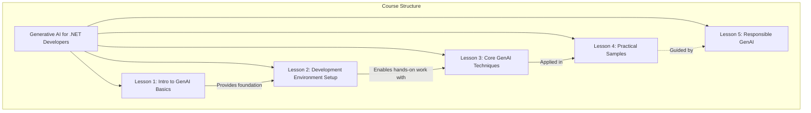
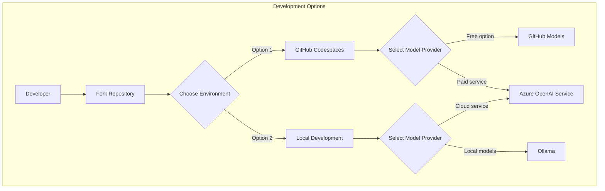
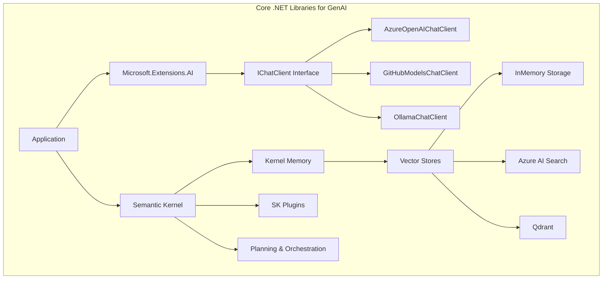
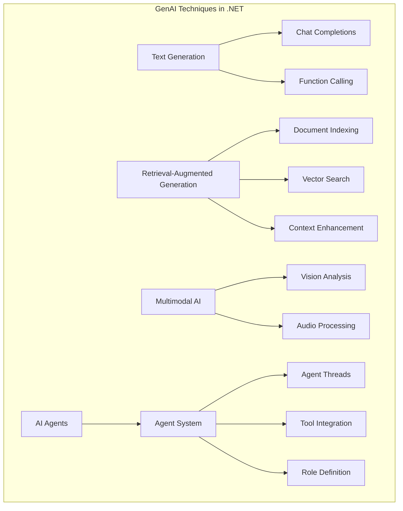
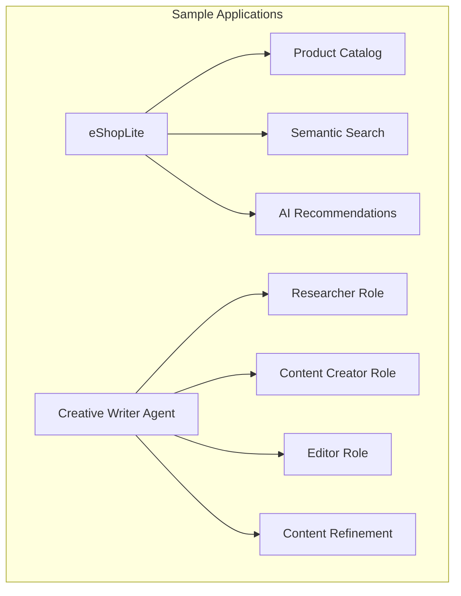

<!-- source: DeepWiki mcp.deepwiki.com · repo microsoft/Generative-AI-for-beginners-dotnet · page 1 Overview · fetched 2026-10-26 -->

# Overview

Relevant source files

The following files were used as context for generating this wiki page:

- [02-SetupDevEnvironment/src/BasicChat-03Ollama/Program.cs](02-SetupDevEnvironment/src/BasicChat-03Ollama/Program.cs)
- [README.md](README.md)

## Purpose and Scope

The Generative AI for Beginners .NET course is a comprehensive, hands-on learning resource designed specifically for .NET developers interested in incorporating generative AI capabilities into their applications. This course focuses on practical implementation rather than theory, providing working code samples, step-by-step guidance, and real-world applications to help developers quickly build production-ready generative AI features.

This overview document introduces the course structure, available development options, core technologies, and implementation techniques. For specific setup instructions, see [Development Environment Setup](#2).

Sources: [README.md:19-24](), [README.md:39-47]()

## Course Structure

The course consists of five main lessons, each focusing on different aspects of generative AI development in .NET:

Each lesson includes:
- Short instructional videos (5-10 minutes)
- Complete, runnable code samples
- Step-by-step guidance
- Reference links for deeper learning

| Lesson | Title | Key Coverage |
|--------|-------|-------------|
| 1 | Intro to Generative AI Basics | Overview of generative models and applications in .NET |
| 2 | Setting Up for .NET Development | Configuration of development environments and AI providers |
| 3 | Core Generative AI Techniques | Text generation, multimodal capabilities, function calling, RAG, agents |
| 4 | Practical .NET Generative AI Samples | Real-world implementations and complete application examples |
| 5 | Responsible Use of Generative AI | Ethical considerations, bias mitigation, and security best practices |

Sources: [README.md:56-64](), [README.md:49-54]()

## Development Environment Options

The course supports multiple development environments to accommodate different preferences and requirements:

### Key Development Choices:

1. **GitHub Codespaces**
   - Pre-configured environment with minimal setup
   - Quick start option with GitHub Models integration
   - Supports Azure OpenAI for production-grade applications

2. **Local Development**
   - Full control over development environment
   - Can use Ollama for local model execution
   - Example: `OllamaChatClient` connects to locally hosted models

Sources: [README.md:80-102](), [02-SetupDevEnvironment/src/BasicChat-03Ollama/Program.cs:4-7]()

## Core Technologies and Libraries

The course leverages several key .NET libraries for generative AI development:

### Microsoft.Extensions.AI (MEAI)
- Provides a standardized interface for working with different AI models
- Abstracts model provider specifics through the `IChatClient` interface
- Supports text generation, function calling, and multimodal features

### Semantic Kernel
- Orchestration framework for AI capabilities
- Supports memory management through vector stores
- Enables RAG implementations and agent development

Sources: [README.md:44-47]()

## GenAI Techniques Implementation

The course covers several core generative AI techniques and their implementation in .NET:

### Key Techniques:

1. **Text Generation and Function Calling**
   - Basic chat completions using various model providers
   - Function calling for structured outputs and API integrations

2. **Retrieval-Augmented Generation (RAG)**
   - Document indexing and vector embedding
   - Semantic search and knowledge retrieval
   - Context enhancement for improved AI responses

3. **Multimodal AI**
   - Vision analysis for image understanding
   - Audio processing and transcription

4. **AI Agents**
   - Building multi-role agent systems
   - Thread management for conversation context
   - Tool integration for extended capabilities

Sources: [README.md:62-63]()

## Practical Applications

The course includes complete sample applications demonstrating real-world implementations:

### eShopLite
- Demonstrates e-commerce scenarios enhanced with generative AI
- Includes semantic search and product recommendations
- Shows RAG implementation in a practical context

### Creative Writer Agent
- Multi-agent system working together on content creation
- Shows role specialization and collaboration patterns
- Demonstrates agent orchestration techniques

Sources: [README.md:63-64]()

## Getting Started

To begin using this course:

1. Fork the repository to your GitHub account
2. Choose your preferred development environment:
   - GitHub Codespaces for instant setup
   - Local development with desired model providers
3. Follow the lessons in sequence to build your generative AI skills

For detailed setup instructions, see [Development Environment Setup](#2).

Sources: [README.md:80-95]()

---

