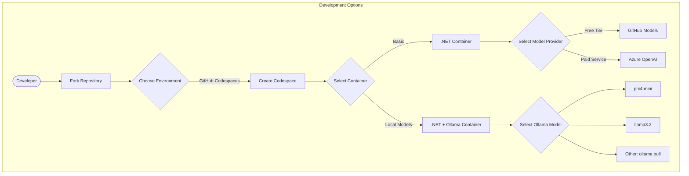
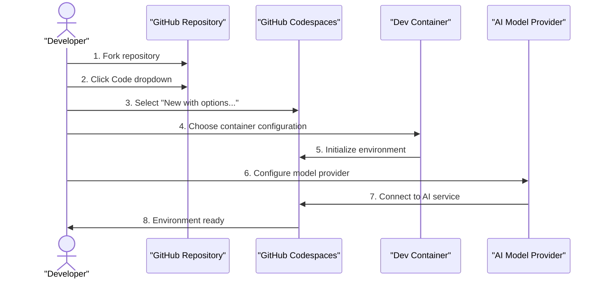
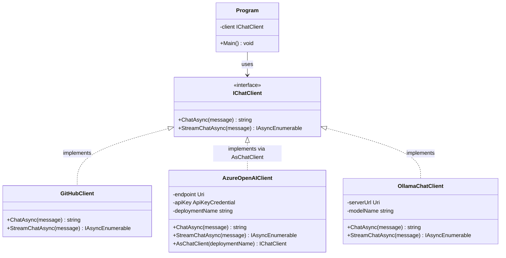

<!-- source: DeepWiki mcp.deepwiki.com · repo microsoft/Generative-AI-for-beginners-dotnet · page 2 Development Environment Setup · fetched 2026-10-26 -->

# Development Environment Setup

<details>
<summary>Relevant source files</summary>

The following files were used as context for generating this wiki page:

- [02-SetupDevEnvironment/getting-started-azure-openai.md](02-SetupDevEnvironment/getting-started-azure-openai.md)
- [02-SetupDevEnvironment/getting-started-ollama.md](02-SetupDevEnvironment/getting-started-ollama.md)
- [02-SetupDevEnvironment/images/github-models-webpage.png](02-SetupDevEnvironment/images/github-models-webpage.png)
- [02-SetupDevEnvironment/readme.md](02-SetupDevEnvironment/readme.md)
- [03-CoreGenerativeAITechniques/src/BasicChat-04OllamaSK/Program.cs](03-CoreGenerativeAITechniques/src/BasicChat-04OllamaSK/Program.cs)
- [translations/de/02-SetupDevEnvironment/getting-started-azure-openai.md](translations/de/02-SetupDevEnvironment/getting-started-azure-openai.md)
- [translations/de/02-SetupDevEnvironment/getting-started-ollama.md](translations/de/02-SetupDevEnvironment/getting-started-ollama.md)
- [translations/es/02-SetupDevEnvironment/getting-started-azure-openai.md](translations/es/02-SetupDevEnvironment/getting-started-azure-openai.md)
- [translations/es/02-SetupDevEnvironment/getting-started-ollama.md](translations/es/02-SetupDevEnvironment/getting-started-ollama.md)
- [translations/fr/02-SetupDevEnvironment/getting-started-ollama.md](translations/fr/02-SetupDevEnvironment/getting-started-ollama.md)
- [translations/ja/02-SetupDevEnvironment/getting-started-azure-openai.md](translations/ja/02-SetupDevEnvironment/getting-started-azure-openai.md)
- [translations/ja/02-SetupDevEnvironment/getting-started-ollama.md](translations/ja/02-SetupDevEnvironment/getting-started-ollama.md)
- [translations/ko/02-SetupDevEnvironment/getting-started-azure-openai.md](translations/ko/02-SetupDevEnvironment/getting-started-azure-openai.md)

</details>


This document outlines how to set up your development environment for the Generative AI for .NET Developers course. It covers creating a GitHub Codespace and configuring it to work with different AI model providers: GitHub Models, Azure OpenAI, or Ollama.

For information about the actual techniques and code samples you'll implement after setup, see [Core GenAI Techniques](#3).

## Overview of Model Provider Options

The course supports three main options for accessing AI models, each with different trade-offs:

1. **GitHub Models (Recommended)**: A free service that allows testing and interaction with various AI models directly within your development environment.

2. **Azure OpenAI**: A paid service providing enterprise-grade AI capabilities with robust security and scalability features.

3. **Ollama**: Run AI models locally within your Codespace or local machine for complete control, but with higher resource requirements.



Sources: [02-SetupDevEnvironment/readme.md:22-34](), [02-SetupDevEnvironment/getting-started-azure-openai.md:4-9](), [02-SetupDevEnvironment/getting-started-ollama.md:3-9]()

## GitHub Codespace Setup Process

Setting up your development environment begins with creating a GitHub Codespace:



To create a GitHub Codespace:

1. Open the repository by [right-clicking here](https://github.com/microsoft/Generative-AI-for-beginners-dotnet) and selecting "Open in new window"
2. Fork the repository to your GitHub account using the Fork button in the top right 
3. Click the Code dropdown button and select the Codespaces tab
4. Select the "..." option (three dots) and choose "New with options..."

Sources: [02-SetupDevEnvironment/readme.md:95-103](), [02-SetupDevEnvironment/getting-started-azure-openai.md:63-71](), [02-SetupDevEnvironment/getting-started-ollama.md:10-17]()

### Development Container Options

When creating your Codespace, you must choose one of these container configurations:

1. **C# (.NET)**: The standard container with core .NET development tools. Has a fast startup time and is recommended for GitHub Models or Azure OpenAI integration.

2. **C# (.NET) - Ollama**: Includes .NET tools plus Ollama for local model execution. Has a longer startup time (approximately 5 minutes).

Sources: [02-SetupDevEnvironment/readme.md:106-113](), [02-SetupDevEnvironment/getting-started-azure-openai.md:74-81](), [02-SetupDevEnvironment/getting-started-ollama.md:22-28]()

## Model Provider Configuration

### GitHub Models Setup (Recommended)

To configure GitHub Models:

1. **Create a Personal Access Token (PAT)**:
   - Navigate to GitHub Settings → Developer settings → Personal access tokens → Tokens (classic)
   - Generate a new token with a descriptive name (e.g., `GenAI-DotNet-Course-Token`)
   - Set an expiration date (7 days recommended)
   - No additional permissions needed

2. **Verify your setup**:
   - Open a terminal in your Codespace (Ctrl+\` on Windows, Cmd+\` on macOS)
   - Navigate to the sample project: `cd 02-SetupDevEnvironment\src\BasicChat-01MEAI`
   - Run the application: `dotnet run`

The default client implementation in the sample code works with GitHub Models automatically.

Sources: [02-SetupDevEnvironment/readme.md:53-94](), [02-SetupDevEnvironment/readme.md:120-146]()

### Azure OpenAI Setup

To use Azure OpenAI:

1. **Create Azure AI Foundry resources**:
   - Go to the [Azure AI Foundry Portal](https://ai.azure.com/)
   - Create a new hub and project
   - Deploy a language model (e.g., gpt-4o-mini)
   - Note the Model Name, Target URI, and API Key

2. **Add the API key to Codespace secrets**:
   - In your forked repository, go to Settings → Secrets and variables → Codespaces
   - Add a secret named `AZURE_AI_KEY` with your API key

3. **Update the sample code**:
   - Add required NuGet packages:
     ```bash
     dotnet add package Azure.AI.OpenAI
     dotnet add package Microsoft.Extensions.AI.OpenAI
     ```
   - Update Program.cs to use Azure OpenAI client:
     ```csharp
     var deploymentName = "gpt-4o-mini"; 
     var endpoint = new Uri("https://yourhub.openai.azure.com/");
     var apiKey = new ApiKeyCredential(Environment.GetEnvironmentVariable("AZURE_AI_SECRET"));

     IChatClient client = new AzureOpenAIClient(
         endpoint, 
         apiKey)
     .AsChatClient(deploymentName);
     ```

Sources: [02-SetupDevEnvironment/getting-started-azure-openai.md:10-132]()

### Ollama Setup

To use Ollama for local model execution:

1. **Create a Codespace with the Ollama container**:
   - Select "C# (.NET) - Ollama" as the container configuration

2. **Pull required models**:
   - Basic examples require a model like phi4-mini or llama3.2:
     ```bash
     ollama pull phi4-mini
     ```
   - For more advanced RAG examples, you'll need additional models:
     ```bash
     ollama pull all-minilm
     ```

3. **Verify your setup**:
   - Navigate to the Ollama sample directory: `cd 02-SetupDevEnvironment/src/BasicChat-03Ollama/`
   - Run the application: `dotnet run`

Ollama client initialization in code:

```csharp
IChatClient client = new OllamaChatClient(
    new Uri("http://localhost:11434/"), 
    "phi4-mini");
```

Sources: [02-SetupDevEnvironment/getting-started-ollama.md:33-80](), [02-SetupDevEnvironment/readme.md:38-52]()

## Model Integration Architecture

The course uses a consistent architecture across samples to interact with different model providers through a common interface:



This abstraction allows the same application code to work with different model providers by simply changing the client implementation. The specific implementation is determined by your configuration.

Sources: [02-SetupDevEnvironment/getting-started-azure-openai.md:126-132](), [02-SetupDevEnvironment/getting-started-ollama.md:76-80](), [03-CoreGenerativeAITechniques/src/BasicChat-04OllamaSK/Program.cs:8-15]()

## Verifying Your Setup

To confirm your environment is properly configured:

1. Open a terminal in your Codespace
2. Navigate to the appropriate sample project directory:
   - GitHub Models: `02-SetupDevEnvironment\src\BasicChat-01MEAI`
   - Azure OpenAI: `02-SetupDevEnvironment\src\BasicChat-01MEAI` (after code updates)
   - Ollama: `02-SetupDevEnvironment\src\BasicChat-03Ollama`
3. Run the application: `dotnet run`
4. A successful response will look similar to:

```
AI, or artificial intelligence, refers to the simulation of human intelligence in machines 
that are programmed to think and learn like humans. It is a broad field of computer science 
that focuses on creating systems capable of performing tasks that typically require human intelligence...
```

Sources: [02-SetupDevEnvironment/readme.md:120-146](), [02-SetupDevEnvironment/getting-started-azure-openai.md:133-148](), [02-SetupDevEnvironment/getting-started-ollama.md:33-62]()

## Model Provider Comparison

| Provider | Cost | Setup Complexity | Speed | Requirements |
|----------|------|------------------|-------|--------------|
| GitHub Models | Free tier available | Minimal (PAT token only) | Fast (cloud-based) | GitHub account |
| Azure OpenAI | Paid service | Moderate (Azure subscription, resource creation) | Fast (cloud-based) | Azure subscription |
| Ollama | Free | Higher (larger container, model downloads) | Varies with hardware | More system resources |

Sources: [02-SetupDevEnvironment/readme.md:22-34]()

## Additional Notes for Ollama Users

If working with Ollama locally (not in Codespaces), you must:

1. Install Ollama on your machine
2. Pull required models before running examples:
   - For basic examples: `ollama pull phi4-mini` or `ollama pull llama3.2`
   - For RAG examples: `ollama pull phi4-mini` and `ollama pull all-minilm`

Sources: [02-SetupDevEnvironment/readme.md:36-52]()

## Summary

This document has guided you through setting up a development environment for the Generative AI for .NET Developers course. You've learned how to:

1. Create a GitHub Codespace with the appropriate development container
2. Configure your chosen AI model provider (GitHub Models, Azure OpenAI, or Ollama)
3. Verify your setup by running a sample application

With your environment now configured, you're ready to explore [Core GenAI Techniques](#3) and start building AI-powered applications with .NET.

## Additional Resources

- [GitHub Codespaces Documentation](https://docs.github.com/en/codespaces)
- [GitHub Models Documentation](https://docs.github.com/en/github-models/prototyping-with-ai-models)
- [Azure OpenAI Documentation](https://learn.microsoft.com/azure/ai-services/)
- [Ollama Models Library](https://ollama.com/search)

Sources: [02-SetupDevEnvironment/readme.md:152-164](), [02-SetupDevEnvironment/getting-started-azure-openai.md:156-167](), [02-SetupDevEnvironment/getting-started-ollama.md:106-114]()

---

