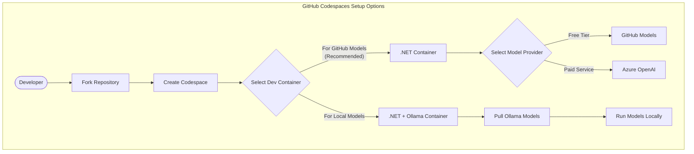
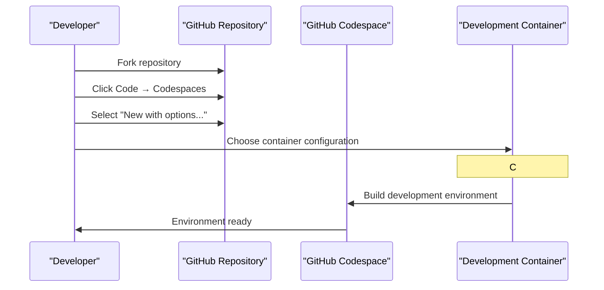
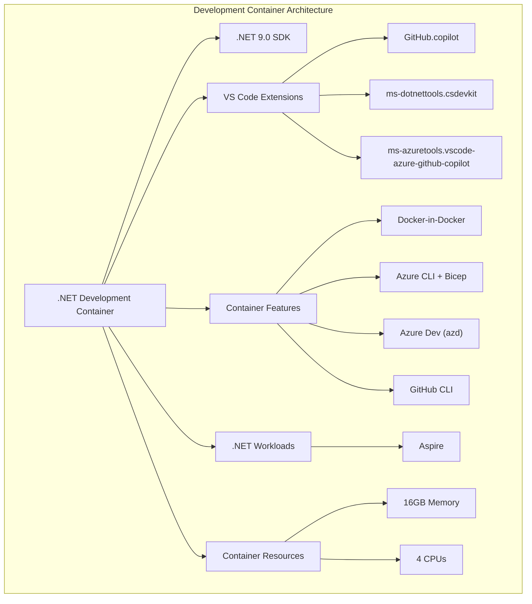
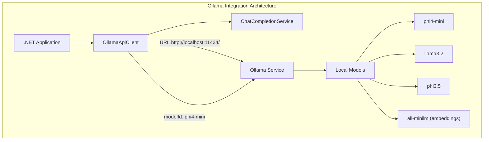

<!-- source: DeepWiki mcp.deepwiki.com · repo microsoft/Generative-AI-for-beginners-dotnet · page 2.1 GitHub Codespaces Setup · fetched 2026-10-26 -->

# GitHub Codespaces Setup

<details>
<summary>Relevant source files</summary>

The following files were used as context for generating this wiki page:

- [.devcontainer/devcontainer.json](.devcontainer/devcontainer.json)
- [02-SetupDevEnvironment/getting-started-ollama.md](02-SetupDevEnvironment/getting-started-ollama.md)
- [02-SetupDevEnvironment/images/github-models-webpage.png](02-SetupDevEnvironment/images/github-models-webpage.png)
- [02-SetupDevEnvironment/readme.md](02-SetupDevEnvironment/readme.md)
- [03-CoreGenerativeAITechniques/src/BasicChat-04OllamaSK/Program.cs](03-CoreGenerativeAITechniques/src/BasicChat-04OllamaSK/Program.cs)

</details>


## Purpose and Scope

This document provides a step-by-step guide for setting up GitHub Codespaces as the recommended development environment for the Generative AI for .NET Developers course. GitHub Codespaces offers a fully configured cloud development environment with all necessary tools pre-installed, making it ideal for working with generative AI models without complex local setup.

For alternative development environment options:
- For Azure OpenAI configuration, see [Azure OpenAI Setup](#2.2)
- For local model execution, see [Ollama Local Setup](#2.3)

Sources: [02-SetupDevEnvironment/readme.md:1-16]()

## GitHub Codespaces Overview

GitHub Codespaces provides a cloud-hosted development environment that allows you to code, build, test, and debug applications directly in your browser. For this course, Codespaces eliminates the need to configure local dependencies and ensures consistent development experiences across different machines.

### Development Environment Options



Sources: [02-SetupDevEnvironment/readme.md:22-34](), [02-SetupDevEnvironment/getting-started-ollama.md:1-28]()

## Prerequisites: GitHub Access Token Setup

Before creating your Codespace, you'll need to set up a GitHub access token to interact with GitHub Models.

### Creating a Personal Access Token

1. Navigate to GitHub Settings (profile picture → Settings)
2. Access Developer Settings (scroll down in left sidebar)
3. Select Personal access tokens → Tokens (classic)
4. Generate a new token with:
   - Descriptive name (e.g., `GenAI-DotNet-Course-Token`)
   - 7-day expiration (recommended)
   - No additional permissions needed

> **Security Tip**: Always use the minimum required scope and shortest practical expiration time for access tokens.

Sources: [02-SetupDevEnvironment/readme.md:53-93]()

## Creating Your GitHub Codespace



Follow these steps to create your Codespace:

1. Open the [repository](https://github.com/microsoft/Generative-AI-for-beginners-dotnet) in a new window
2. Fork the repository to your GitHub account using the Fork button
3. Click the Code dropdown button and select the Codespaces tab
4. Select the "..." (three dots) option and choose "New with options..."
5. Select your development container (see next section)
6. Click "Create codespace" to initiate the setup process

Sources: [02-SetupDevEnvironment/readme.md:95-118]()

## Development Container Selection

GitHub Codespaces uses development containers to provide consistent environments. For this course, two container options are available:

| Container Option | Purpose | Startup Time | Best For |
|------------------|---------|-------------|----------|
| **C# (.NET)** | Core .NET development tools | Fast | GitHub Models or Azure OpenAI integration (recommended) |
| **C# (.NET) - Ollama** | .NET tools + Ollama for local models | ~5 minutes | Running models locally without external services |

The container configuration is defined in the `.devcontainer/devcontainer.json` file, which specifies:
- Base image: .NET 9.0
- Additional features: Docker-in-Docker, Azure CLI, GitHub CLI
- VS Code extensions: GitHub Copilot, C# Dev Kit, Azure GitHub Copilot
- Port forwarding: 17057
- Post-creation commands: Installing .NET workloads including Aspire

Sources: [02-SetupDevEnvironment/readme.md:106-118](), [.devcontainer/devcontainer.json:1-48]()

## Container Components and Architecture



Sources: [.devcontainer/devcontainer.json:4-47]()

## Verifying Your Codespace Setup

After your Codespace is fully loaded, verify your setup by running a sample application:

1. Open a terminal with **Ctrl+`** (Windows) or **Cmd+`** (macOS)
2. Navigate to the sample project:
   ```bash
   cd 02-SetupDevEnvironment\src\BasicChat-01MEAI
   ```
3. Run the application:
   ```bash
   dotnet run
   ```
4. You should see a response from the AI model explaining what artificial intelligence is

### Expected Output
```
AI, or artificial intelligence, refers to the simulation of human intelligence in machines that are programmed to think and learn like humans. It is a broad field of computer science that focuses on creating systems and algorithms capable of performing tasks that typically require human intelligence. These tasks include problem-solving...
```

Sources: [02-SetupDevEnvironment/readme.md:122-146]()

## Testing with Different Models (Ollama Option)

If you're using the Ollama container, you can easily switch between different local models:

1. Pull a different model:
   ```bash
   ollama pull phi3.5
   ```

2. Update the model initialization in your application:
   ```csharp
   IChatClient client = new OllamaChatClient(new Uri("http://localhost:11434/"), "phi3.5");
   ```

The client configuration for Ollama models works through the `OllamaApiClient` class which connects to the Ollama service running locally within the container:



Sources: [02-SetupDevEnvironment/getting-started-ollama.md:33-98](), [03-CoreGenerativeAITechniques/src/BasicChat-04OllamaSK/Program.cs:1-40]()

## Troubleshooting

If you encounter issues with your Codespace setup:

- **Slow Codespace Creation**: Select a region closer to your location when creating the codespace
- **Model Access Issues**: Verify your GitHub access token is correctly set and not expired
- **Ollama Model Loading**: Ensure you've pulled the required models with `ollama pull <model-name>`
- **General Issues**: Open an issue in the [GitHub repository](https://github.com/microsoft/Generative-AI-for-beginners-dotnet/issues/new?template=Blank+issue) for assistance

Sources: [02-SetupDevEnvironment/readme.md:146-146](), [02-SetupDevEnvironment/getting-started-ollama.md:98-98]()

## Next Steps

With your development environment successfully set up, you're ready to explore the core generative AI techniques covered in this course.

👉 Proceed to [Core Generative AI Techniques](#3)

Sources: [02-SetupDevEnvironment/readme.md:160-164](), [02-SetupDevEnvironment/getting-started-ollama.md:110-114]()

---

