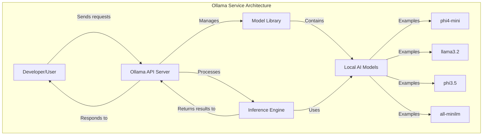
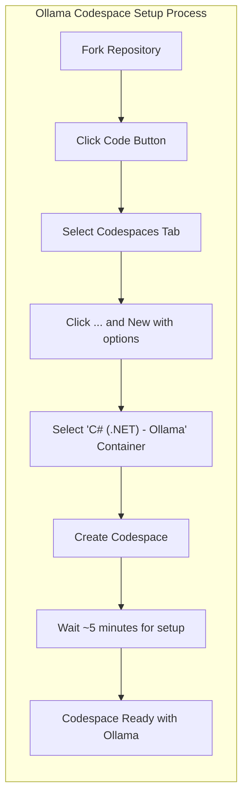
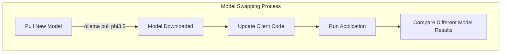
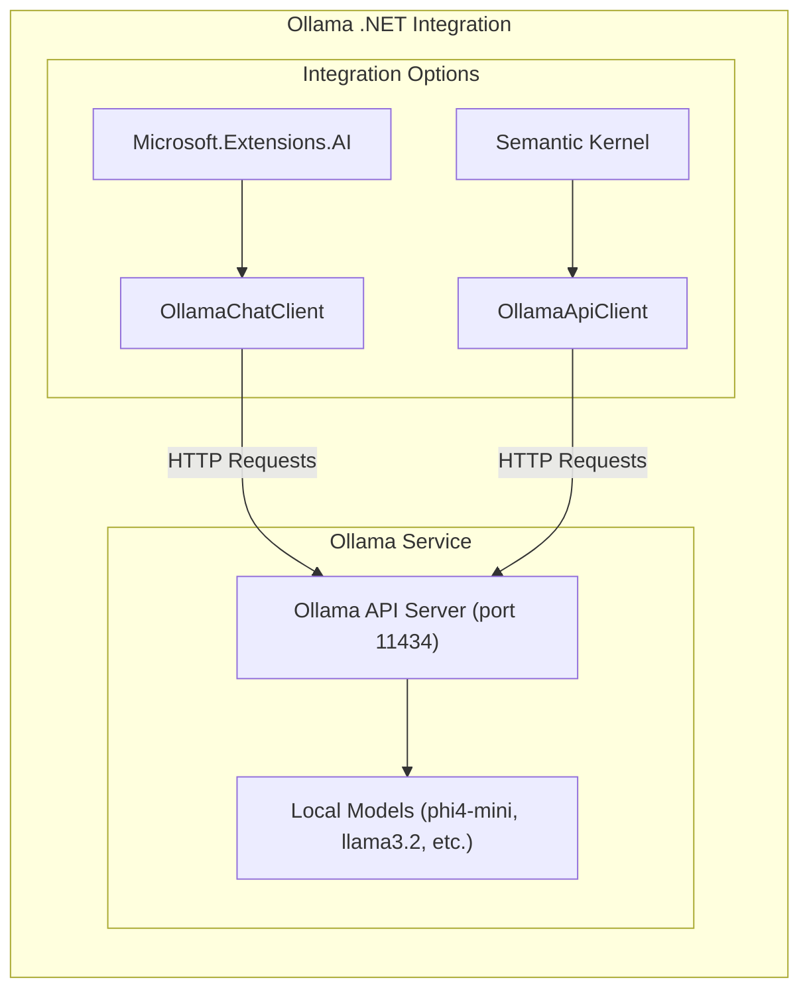
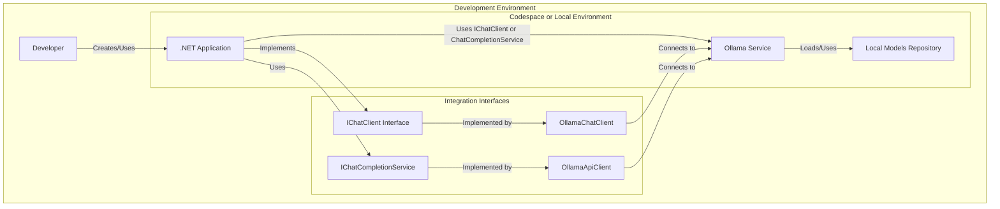

<!-- source: DeepWiki mcp.deepwiki.com · repo microsoft/Generative-AI-for-beginners-dotnet · page 2.3 Ollama Local Setup · fetched 2026-10-26 -->

# Ollama Local Setup

<details>
<summary>Relevant source files</summary>

The following files were used as context for generating this wiki page:

- [02-SetupDevEnvironment/getting-started-ollama.md](02-SetupDevEnvironment/getting-started-ollama.md)
- [02-SetupDevEnvironment/images/github-models-webpage.png](02-SetupDevEnvironment/images/github-models-webpage.png)
- [02-SetupDevEnvironment/readme.md](02-SetupDevEnvironment/readme.md)
- [03-CoreGenerativeAITechniques/src/BasicChat-04OllamaSK/Program.cs](03-CoreGenerativeAITechniques/src/BasicChat-04OllamaSK/Program.cs)

</details>


This guide explains how to set up and use Ollama for local model execution in the Generative AI for .NET Developers course. Ollama allows you to run AI models locally on your machine or within a devcontainer, without requiring connections to cloud services like GitHub Models or Azure OpenAI. This approach provides a free alternative with complete local control over model execution.

For cloud-based alternatives, see [GitHub Codespaces Setup](#2.1) or [Azure OpenAI Setup](#2.2).

## What is Ollama?

Ollama is an open-source tool that enables running various Large Language Models (LLMs) locally on your machine. It provides a simple API that makes it easy to download, run, and interact with these models through a unified interface.



Sources: [02-SetupDevEnvironment/getting-started-ollama.md:1-9](). [02-SetupDevEnvironment/readme.md:36-39]().

## Setup Options

You can set up Ollama in two ways:

1. Using GitHub Codespaces with the Ollama-enabled container
2. Installing Ollama locally on your machine

### Option 1: GitHub Codespaces Setup with Ollama

This option provides a pre-configured environment with Ollama already installed and set up.



Follow these steps to create a Codespace with Ollama:

1. Fork the repository to your GitHub account
2. Click the **Code** dropdown button and select the **Codespaces** tab
3. Click the **...** (three dots) and choose **New with options...**
4. From the **Dev container configuration** dropdown, select **C# (.NET) - Ollama**
5. Click **Create codespace**
6. Wait for the environment to be set up (approximately 5 minutes)

Sources: [02-SetupDevEnvironment/getting-started-ollama.md:10-32]().

### Option 2: Local Installation

If you prefer to run Ollama on your local machine:

1. Visit [Ollama's website](https://ollama.com) to download and install the appropriate version for your operating system
2. After installation, use the terminal to pull the required models

Sources: [02-SetupDevEnvironment/readme.md:36-39]().

## Required Models

Depending on which parts of the course you want to run, you'll need different Ollama models:

| Lesson | Project | Required Models | Pull Command |
|--------|---------|-----------------|-------------|
| Lesson 2 | [BasicChat-03Ollama](https://github.com/microsoft/Generative-AI-for-beginners-dotnet/tree/main/02-SetupDevEnvironment/src/BasicChat-03Ollama) | phi4-mini or llama3.2 | `ollama pull phi4-mini` |
| Lesson 3 | [RAGSimple-10SKOllama](https://github.com/microsoft/Generative-AI-for-beginners-dotnet/tree/main/03-CoreGenerativeAITechniques/src/RAGSimple-10SKOllama) | phi4-mini and all-minilm | `ollama pull phi4-mini`<br>`ollama pull all-minilm` |

Sources: [02-SetupDevEnvironment/readme.md:40-51]().

## Verifying Your Setup

After setting up your environment, verify that Ollama is working correctly:

1. Open a terminal (Ctrl+\` on Windows or Cmd+\` on macOS)
2. Navigate to the sample project directory:
   ```bash
   cd 02-SetupDevEnvironment/src/BasicChat-03Ollama/
   ```
3. Run the application:
   ```bash
   dotnet run
   ```
4. You should see an AI response to a predefined question about artificial intelligence

Sources: [02-SetupDevEnvironment/getting-started-ollama.md:33-62]().

## Swapping Models

One advantage of Ollama is the ability to easily switch between different models:



To try a different model:

1. Pull the desired model using the `ollama pull` command:
   ```bash
   ollama pull phi3.5
   ```

2. Modify the code to use the new model. In your application, update the model name in the client initialization:
   ```csharp
   IChatClient client = new OllamaChatClient(new Uri("http://localhost:11434/"), "phi3.5");
   ```

3. Run the application again to see the different response patterns

Sources: [02-SetupDevEnvironment/getting-started-ollama.md:64-98]().

## Integration with .NET

Ollama integrates with the .NET code in this course through two primary methods:

1. Using the `Microsoft.Extensions.AI` library with `OllamaChatClient`
2. Using Semantic Kernel with `OllamaApiClient`



### Semantic Kernel Integration Example

The code below shows how to create a chat completion service using Ollama with Semantic Kernel:

```csharp
var modelId = "phi4-mini";
var uri = "http://localhost:11434/";

// create client
var chat = new OllamaApiClient(uri, modelId)
    .AsChatCompletionService();
```

Sources: [03-CoreGenerativeAITechniques/src/BasicChat-04OllamaSK/Program.cs:7-14]().

## System Architecture

The following diagram illustrates how Ollama fits into the overall development environment architecture of the course:



Sources: [02-SetupDevEnvironment/getting-started-ollama.md:1-9](). [03-CoreGenerativeAITechniques/src/BasicChat-04OllamaSK/Program.cs:1-40]().

## Advantages and Considerations

### Advantages of Using Ollama

- Free to use with no usage limits
- Complete privacy as all processing happens locally
- No dependency on external services or API keys
- Ability to work offline once models are downloaded

### Considerations

- Requires more hardware resources than cloud-based options
- Slower startup time for the devcontainer (approximately 5 minutes)
- Model download size can be substantial (several GB for larger models)
- Inference speed depends on your local hardware capabilities

Sources: [02-SetupDevEnvironment/readme.md:26-39]().

## Summary

Ollama provides a powerful option for running AI models locally in your development environment. It offers a free and private alternative to cloud-based services, with the flexibility to swap between different models easily. By following the setup instructions in this guide, you can configure your environment to use Ollama for all the examples in this course.

Next, you'll explore how to implement core generative AI techniques using the environment you've just set up.

---

