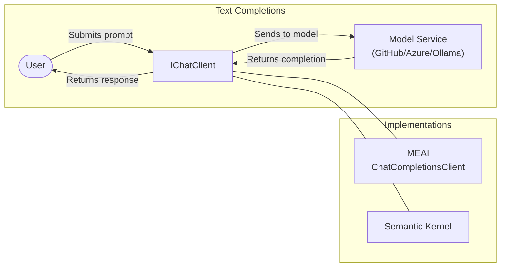
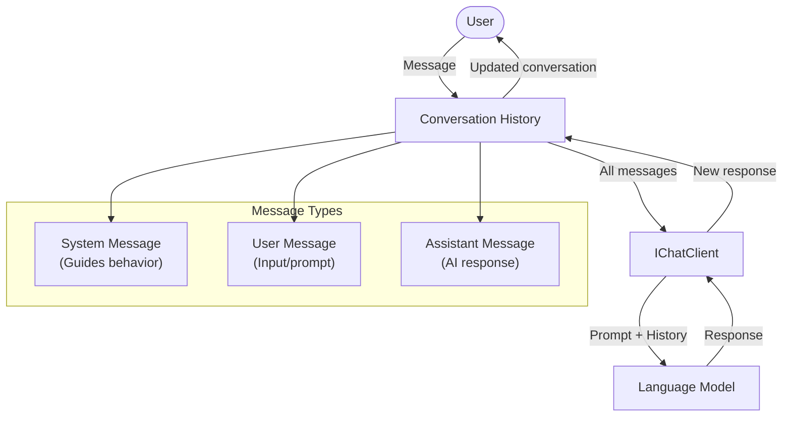
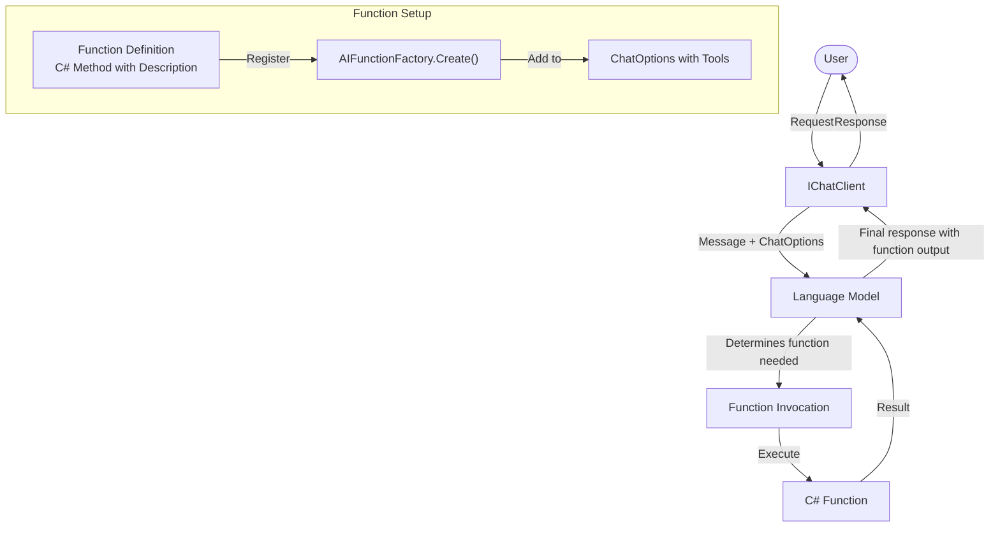
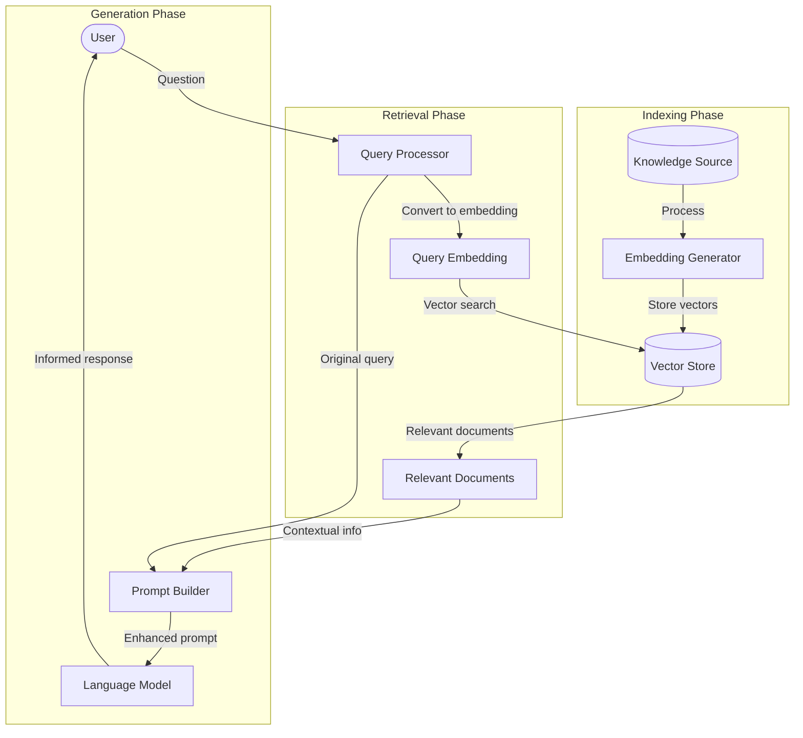
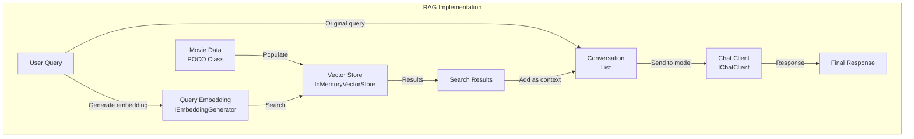
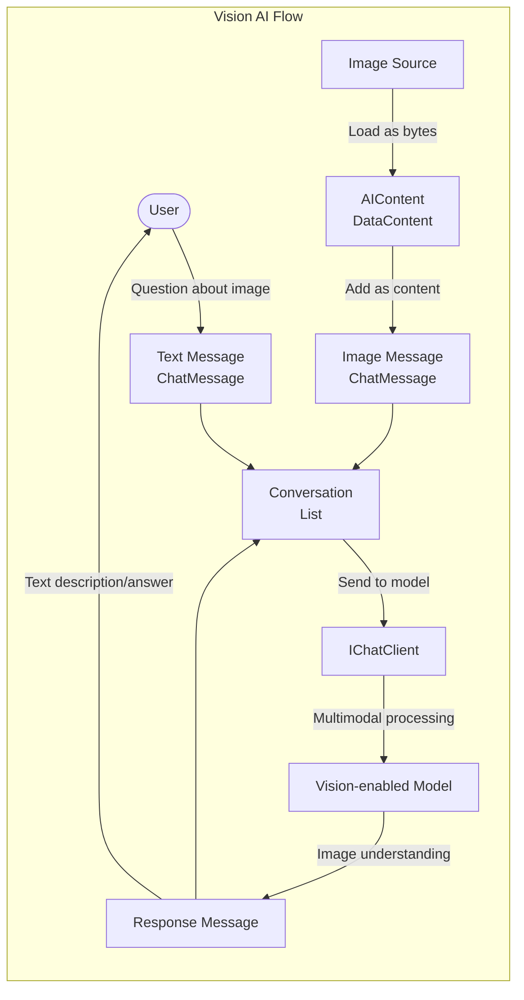
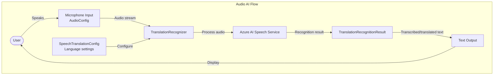
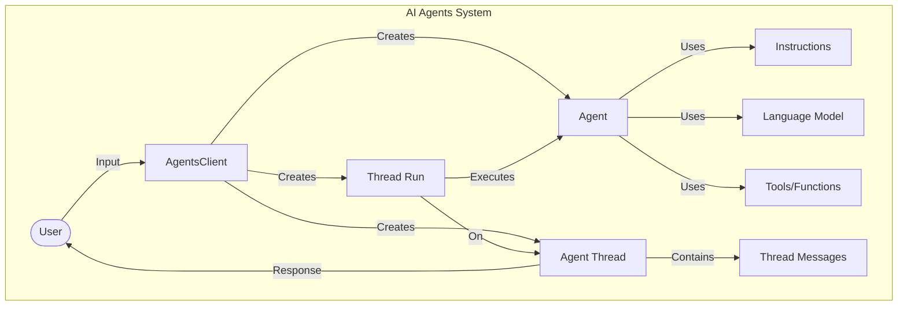
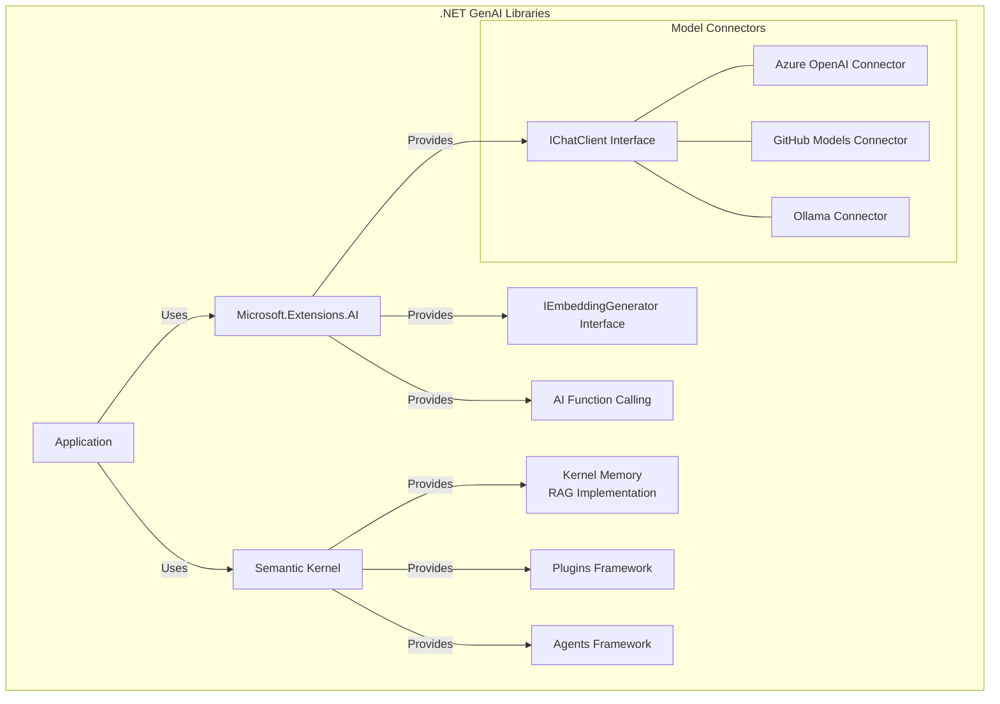

<!-- source: DeepWiki mcp.deepwiki.com · repo microsoft/Generative-AI-for-beginners-dotnet · page 3 Core GenAI Techniques · fetched 2026-10-26 -->

# Core GenAI Techniques

Relevant source files

The following files were used as context for generating this wiki page:

- [.devcontainer/Ollama/devcontainer.json](.devcontainer/Ollama/devcontainer.json)
- [03-CoreGenerativeAITechniques/01-lm-completions-functions.md](03-CoreGenerativeAITechniques/01-lm-completions-functions.md)
- [03-CoreGenerativeAITechniques/02-retrieval-augmented-generation.md](03-CoreGenerativeAITechniques/02-retrieval-augmented-generation.md)
- [03-CoreGenerativeAITechniques/03-vision-audio.md](03-CoreGenerativeAITechniques/03-vision-audio.md)
- [03-CoreGenerativeAITechniques/readme.md](03-CoreGenerativeAITechniques/readme.md)
- [03-CoreGenerativeAITechniques/src/RAGSimple-10SKOllama/Program.cs](03-CoreGenerativeAITechniques/src/RAGSimple-10SKOllama/Program.cs)
- [03-CoreGenerativeAITechniques/src/RAGSimple-10SKOllama/RAGSimple-10SKOllama.csproj](03-CoreGenerativeAITechniques/src/RAGSimple-10SKOllama/RAGSimple-10SKOllama.csproj)
- [03-CoreGenerativeAITechniques/src/RAGSimple-10SKOllama/SpectreConsoleOutput.cs](03-CoreGenerativeAITechniques/src/RAGSimple-10SKOllama/SpectreConsoleOutput.cs)
- [03-CoreGenerativeAITechniques/src/RAGSimple-15Ollama-DeepSeekR1/Program.cs](03-CoreGenerativeAITechniques/src/RAGSimple-15Ollama-DeepSeekR1/Program.cs)
- [03-CoreGenerativeAITechniques/src/RAGSimple-15Ollama-DeepSeekR1/RAGSimple-15Ollama-DeepSeekR1.csproj](03-CoreGenerativeAITechniques/src/RAGSimple-15Ollama-DeepSeekR1/RAGSimple-15Ollama-DeepSeekR1.csproj)
- [03-CoreGenerativeAITechniques/src/RAGSimple-15Ollama-DeepSeekR1/SpectreConsoleOutput.cs](03-CoreGenerativeAITechniques/src/RAGSimple-15Ollama-DeepSeekR1/SpectreConsoleOutput.cs)

This page provides an overview of the fundamental generative AI techniques used in .NET applications. The techniques covered here form the foundation for building sophisticated AI-powered applications using Microsoft's .NET ecosystem. For detailed implementation guides, refer to the specific sub-sections dedicated to each technique.

For setup of development environments, see [Development Environment Setup](#2).

## Overview of Techniques

The core generative AI techniques covered in this course include:

1. **Text Completions and Function Calling** - Basic interactions with language models through prompts and responses, including the ability to call functions based on user input
2. **Retrieval-Augmented Generation (RAG)** - Enhancing model responses with information retrieved from external data sources
3. **Vision and Audio AI** - Processing and generating visual and audio content using AI models
4. **AI Agents** - Creating autonomous AI systems that can perform complex tasks

These techniques can be implemented using various .NET libraries including Microsoft.Extensions.AI (MEAI) and Semantic Kernel.

Sources: [03-CoreGenerativeAITechniques/readme.md:1-26]()

## Text Completions and Function Calling

Text completions are the most basic form of interaction with language models, where the model generates a single response based on a provided prompt. Chat applications extend this concept by maintaining a conversation history with different message types (System, User, Assistant) for context.

Function calling allows AI to interact with external systems by calling predefined functions in your code based on user input, creating a bridge between natural language and code execution.

### Text Completions Architecture

Sources: [03-CoreGenerativeAITechniques/01-lm-completions-functions.md:13-45]()

### Chat Flow Architecture

Sources: [03-CoreGenerativeAITechniques/01-lm-completions-functions.md:53-101]()

### Function Calling Flow

Sources: [03-CoreGenerativeAITechniques/01-lm-completions-functions.md:107-166]()

## Retrieval-Augmented Generation (RAG)

RAG is a technique that augments language model responses with information retrieved from external data sources. This approach improves accuracy, provides up-to-date information, and enables domain-specific knowledge incorporation.

### RAG Architecture

Sources: [03-CoreGenerativeAITechniques/02-retrieval-augmented-generation.md:11-22](), [03-CoreGenerativeAITechniques/02-retrieval-augmented-generation.md:24-37]()

### RAG Implementation Components

Sources: [03-CoreGenerativeAITechniques/02-retrieval-augmented-generation.md:42-166]()

### Key Components of RAG

| Component | Description | Implementation |
|-----------|-------------|----------------|
| Vector Store | Stores vector representations of documents | `InMemoryVectorStore`, Azure AI Search, Qdrant |
| Embedding Generator | Converts text to vector representations | `IEmbeddingGenerator<string, Embedding<float>>` |
| Vector Search | Finds semantically similar content | `VectorSearchOptions`, `VectorizedSearchAsync()` |
| Knowledge Retrieval | Integrates retrieved information into prompts | Adding search results as `ChatRole.User` messages |

Sources: [03-CoreGenerativeAITechniques/02-retrieval-augmented-generation.md:42-166](), [03-CoreGenerativeAITechniques/src/RAGSimple-10SKOllama/Program.cs:28-128]()

## Vision and Audio AI

Vision AI enables applications to understand and interpret images, while Audio AI provides capabilities for handling spoken language and sound.

### Vision AI Architecture

Sources: [03-CoreGenerativeAITechniques/03-vision-audio.md:13-76]()

### Audio AI Architecture

Sources: [03-CoreGenerativeAITechniques/03-vision-audio.md:81-146]()

## AI Agents

AI Agents are autonomous systems that can process information, make decisions, and execute tasks based on instructions.

### AI Agents Architecture

Sources: (Based on the course structure diagram provided in the original request)

## Integration with .NET Libraries

The core generative AI techniques are implemented using key .NET libraries that provide standardized interfaces for AI functionality.

### Library Architecture

Sources: [03-CoreGenerativeAITechniques/01-lm-completions-functions.md:19-46](), [03-CoreGenerativeAITechniques/src/RAGSimple-10SKOllama/Program.cs:28-82]()

## Code Implementation Patterns

Common code patterns and interfaces used across the different generative AI techniques:

| Pattern | Description | Interfaces/Classes | Example Use Case |
|---------|-------------|-------------------|------------------|
| Chat Client | Handles communication with language models | `IChatClient`, `ChatCompletionsClient` | Text completions, function calling |
| Embedding Generation | Converts text to vector representations | `IEmbeddingGenerator`, `EmbeddingsClient` | RAG implementation, semantic search |
| Conversation History | Manages context for multi-turn conversations | `List<ChatMessage>` | Chat applications, RAG |
| Function Integration | Allows LLMs to call code | `AIFunctionFactory`, `ChatOptions` | Function calling, tools integration |
| Vector Storage | Stores and retrieves vector embeddings | `InMemoryVectorStore`, `VectorSearchOptions` | RAG implementation |
| Content Handling | Manages different content types | `AIContent`, `DataContent` | Vision AI, multimodal interactions |

Sources: [03-CoreGenerativeAITechniques/01-lm-completions-functions.md:23-45](), [03-CoreGenerativeAITechniques/01-lm-completions-functions.md:74-100](), [03-CoreGenerativeAITechniques/01-lm-completions-functions.md:123-145](), [03-CoreGenerativeAITechniques/02-retrieval-augmented-generation.md:67-131](), [03-CoreGenerativeAITechniques/03-vision-audio.md:27-75]()

## Detailed Sub-Sections

For detailed implementation guides on each core technique, refer to the following sections:

- [Text Completions and Function Calling](#3.1)
- [Retrieval-Augmented Generation (RAG)](#3.2)
- [Vision and Audio AI](#3.3)
- [AI Agents](#3.4)

---

