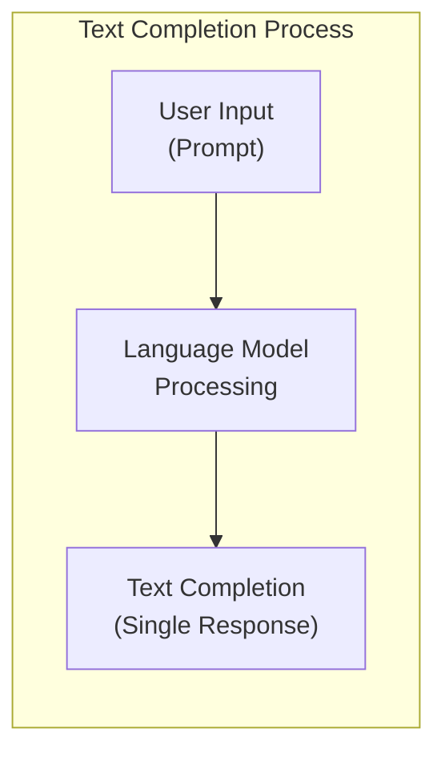
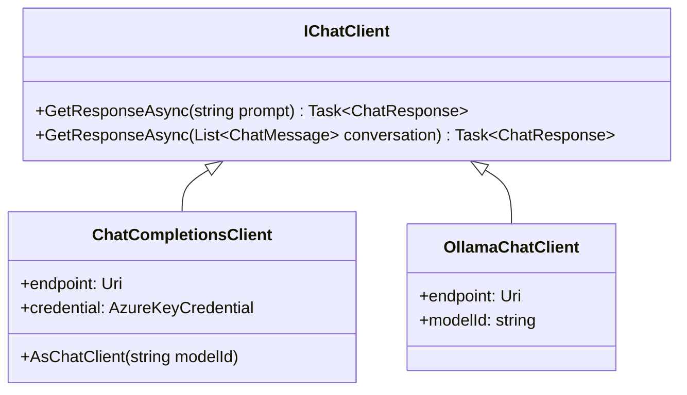
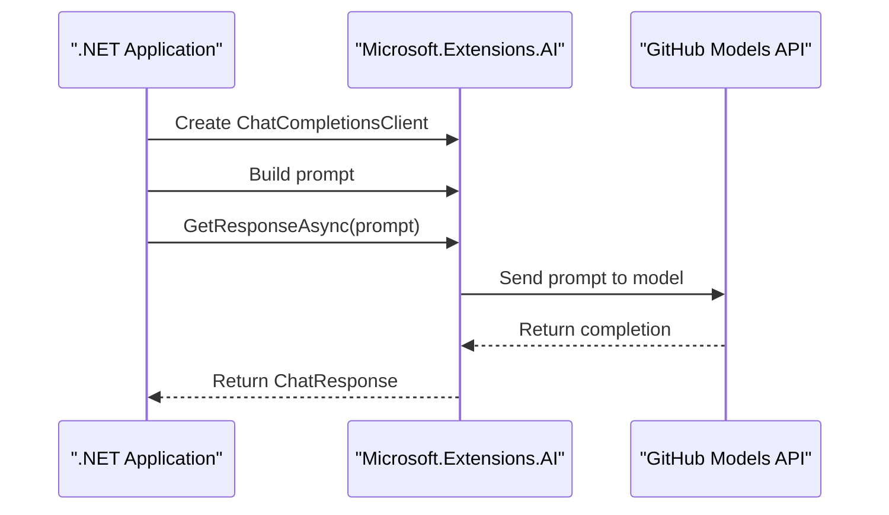
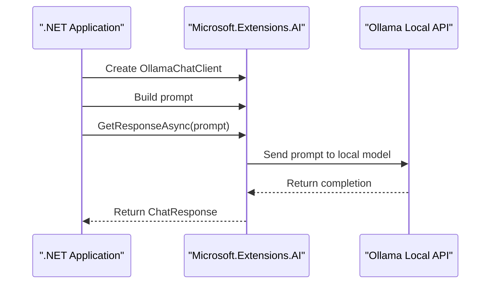
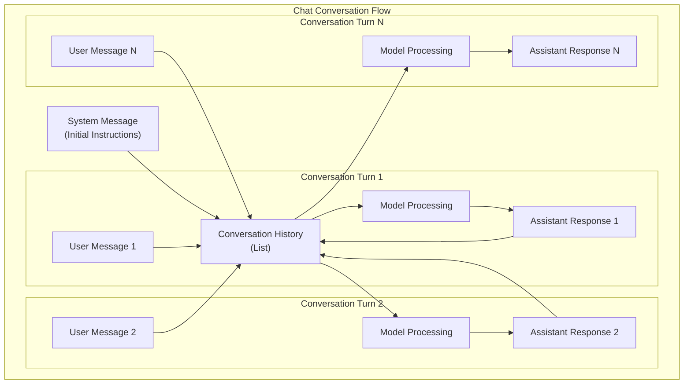
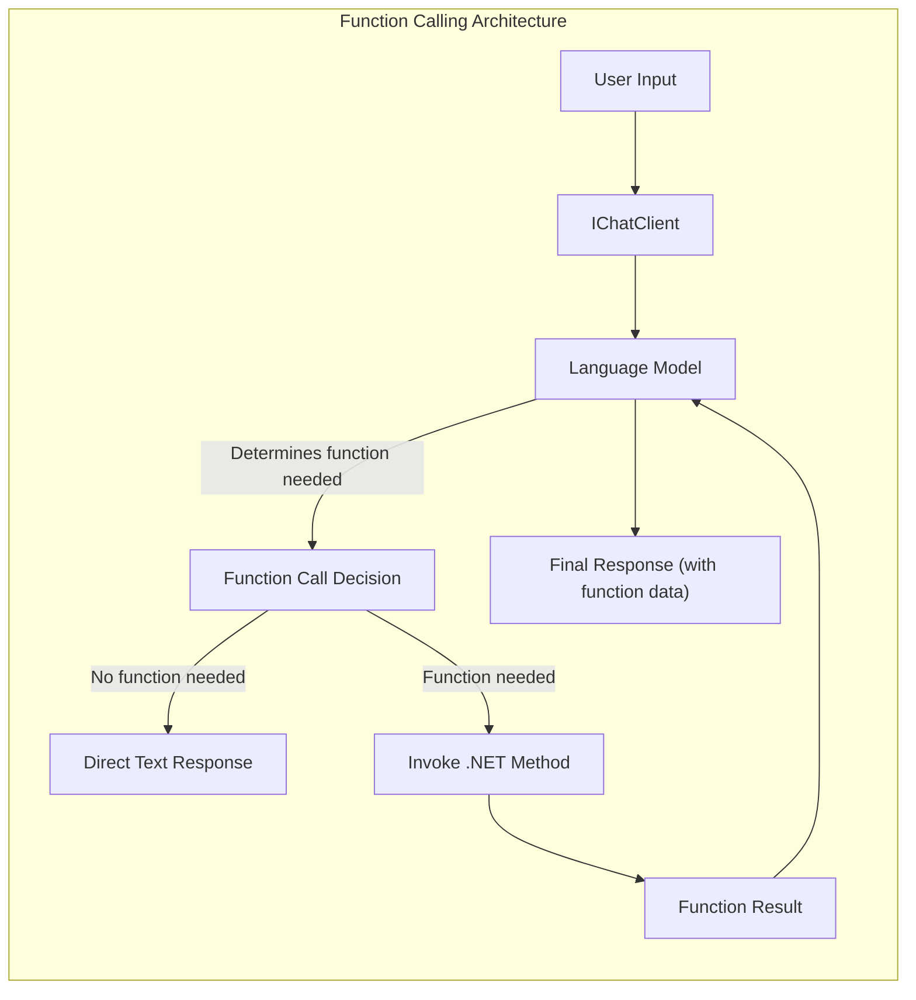
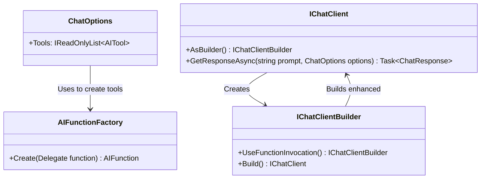
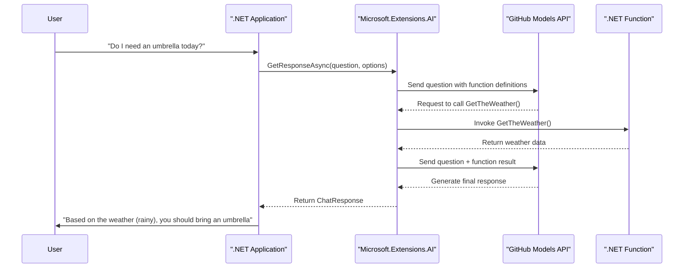
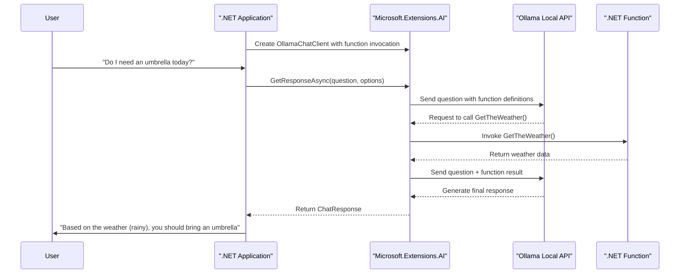
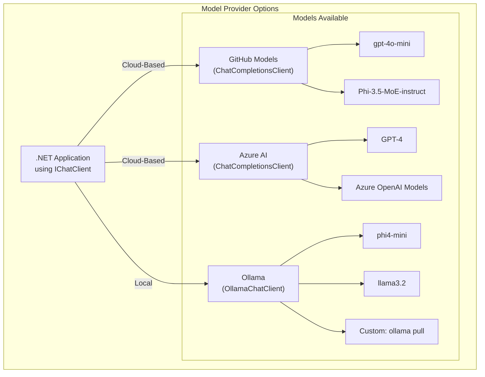

<!-- source: DeepWiki mcp.deepwiki.com · repo microsoft/Generative-AI-for-beginners-dotnet · page 3.1 Text Completions and Function Calling · fetched 2026-10-26 -->

# Text Completions and Function Calling

Relevant source files

The following files were used as context for generating this wiki page:

- [03-CoreGenerativeAITechniques/01-lm-completions-functions.md](03-CoreGenerativeAITechniques/01-lm-completions-functions.md)
- [03-CoreGenerativeAITechniques/readme.md](03-CoreGenerativeAITechniques/readme.md)
- [03-CoreGenerativeAITechniques/src/BasicChat-01MEAI/Program.cs](03-CoreGenerativeAITechniques/src/BasicChat-01MEAI/Program.cs)
- [03-CoreGenerativeAITechniques/src/BasicChat-03Ollama/Program.cs](03-CoreGenerativeAITechniques/src/BasicChat-03Ollama/Program.cs)
- [03-CoreGenerativeAITechniques/src/MEAIFunctions/MEAIFunctions.csproj](03-CoreGenerativeAITechniques/src/MEAIFunctions/MEAIFunctions.csproj)
- [03-CoreGenerativeAITechniques/src/MEAIFunctions/Program.cs](03-CoreGenerativeAITechniques/src/MEAIFunctions/Program.cs)
- [03-CoreGenerativeAITechniques/src/MEAIFunctionsOllama/MEAIFunctionsOllama.csproj](03-CoreGenerativeAITechniques/src/MEAIFunctionsOllama/MEAIFunctionsOllama.csproj)
- [03-CoreGenerativeAITechniques/src/MEAIFunctionsOllama/Program.cs](03-CoreGenerativeAITechniques/src/MEAIFunctionsOllama/Program.cs)

## Purpose and Scope

This document details the implementation of text completions and function calling in .NET applications using Microsoft.Extensions.AI (MEAI). It covers the core techniques for interacting with Large Language Models (LLMs), from single completions to conversational interfaces with function-calling capabilities. For information about more advanced techniques like Retrieval-Augmented Generation (RAG), see [Retrieval-Augmented Generation (RAG)](#3.2).

## Text Completions Overview

Text completions represent the most fundamental form of interaction with language models. A text completion is a single response generated by a model based on a provided prompt. These one-shot interactions are useful for specific tasks such as content summarization, sentiment analysis, or text transformation.

Sources: [03-CoreGenerativeAITechniques/01-lm-completions-functions.md:13-16](). [03-CoreGenerativeAITechniques/01-lm-completions-functions.md:18-45]().

### Implementation with Microsoft.Extensions.AI

The Microsoft.Extensions.AI library provides a standardized interface for text completions across different model providers. The core component is the `IChatClient` interface, which can be implemented for various model providers:

Sources: [03-CoreGenerativeAITechniques/src/BasicChat-01MEAI/Program.cs:14-17](). [03-CoreGenerativeAITechniques/src/BasicChat-03Ollama/Program.cs:4-5]().

### Text Completion Example

The basic workflow for a text completion involves:
1. Instantiating an `IChatClient` with the appropriate model provider
2. Creating a prompt
3. Sending the prompt to the model
4. Processing the response

#### Using GitHub Models (Cloud-Based)

Sources: [03-CoreGenerativeAITechniques/src/BasicChat-01MEAI/Program.cs:14-31]().

#### Using Ollama (Local Models)

Sources: [03-CoreGenerativeAITechniques/src/BasicChat-03Ollama/Program.cs:4-17]().

## Chat Applications

While text completions represent single-turn interactions, chat applications involve multi-turn conversations with the model. Building a chat application requires managing the conversation history to provide context for each new response.

### Chat Roles

Chat applications use different message roles to structure the conversation:

| Role | Description | Purpose |
|------|-------------|---------|
| System | Initial instruction that guides model behavior | Sets context, tone, and boundaries |
| User | Input from the end-user | Questions, statements, or commands |
| Assistant | Response generated by the model | The model's replies based on context |

Sources: [03-CoreGenerativeAITechniques/01-lm-completions-functions.md:58-64]().

### Managing Chat History

To maintain context during a conversation, you must track all previous messages. Each new message in the conversation adds to the context used by the model to generate the next response.

Sources: [03-CoreGenerativeAITechniques/01-lm-completions-functions.md:65-101]().

### Chat Implementation Example

The implementation pattern for a chat application involves:
1. Creating a list to store the conversation history
2. Adding a system message to set the initial context
3. In a loop:
   - Collecting user input
   - Adding the user message to the history
   - Sending the entire history to the model
   - Adding the model's response to the history
   - Displaying the response to the user

Sources: [03-CoreGenerativeAITechniques/01-lm-completions-functions.md:71-101]().

## Function Calling

Function calling enables language models to invoke specific methods in your code based on the user's input. This creates a bridge between natural language understanding and programmatic actions, allowing the model to access external systems and data.

Sources: [03-CoreGenerativeAITechniques/01-lm-completions-functions.md:107-168]().

### Implementation Steps

Setting up function calling with MEAI requires:

1. **Define the function** that the model can call, decorated with a `Description` attribute
2. **Create a `ChatOptions` object** that specifies available functions using `AIFunctionFactory.Create()`
3. **Configure the `IChatClient`** with function invocation capabilities using `.AsBuilder().UseFunctionInvocation().Build()`
4. **Pass the `ChatOptions`** when making requests to the model

Sources: [03-CoreGenerativeAITechniques/src/MEAIFunctions/Program.cs:14-33](). [03-CoreGenerativeAITechniques/01-lm-completions-functions.md:123-167]().

### Function Calling Example

The function calling process:
1. User asks a question that might require external data
2. The model determines if it needs to call a function
3. If needed, the model invokes the specified function
4. The model incorporates the function's result into its response

#### With GitHub Models

Sources: [03-CoreGenerativeAITechniques/src/MEAIFunctions/Program.cs:14-44]().

#### With Ollama (Local Models)

The same pattern applies to local models using Ollama, with the difference being the client initialization:

Sources: [03-CoreGenerativeAITechniques/src/MEAIFunctionsOllama/Program.cs:7-45]().

## Integration Options

The Microsoft.Extensions.AI library provides a consistent interface across different model providers, allowing you to use the same code patterns regardless of where the model is hosted.

Sources: [03-CoreGenerativeAITechniques/01-lm-completions-functions.md:24-50](). [03-CoreGenerativeAITechniques/src/BasicChat-01MEAI/Program.cs:14-17](). [03-CoreGenerativeAITechniques/src/BasicChat-03Ollama/Program.cs:4-5]().

## Key Dependencies

The implementation relies on the following NuGet packages:

| Package | Purpose |
|---------|---------|
| `Microsoft.Extensions.AI` | Core library for AI capabilities |
| `Microsoft.Extensions.AI.AzureAIInference` | Support for Azure AI services |
| `Microsoft.Extensions.AI.Ollama` | Support for Ollama local models |

Sources: [03-CoreGenerativeAITechniques/src/MEAIFunctions/MEAIFunctions.csproj:11-15](). [03-CoreGenerativeAITechniques/src/MEAIFunctionsOllama/MEAIFunctionsOllama.csproj:10-13]().

## Summary

Text completions and function calling form the foundation of interactive AI applications in .NET. Using Microsoft.Extensions.AI, you can implement these capabilities with a consistent programming model across different model providers, whether cloud-based or local. These techniques enable a wide range of applications, from simple text processing to complex interactive systems with access to external data and services.

For building more sophisticated applications that need to work with external data, see [Retrieval-Augmented Generation (RAG)](#3.2).

---

