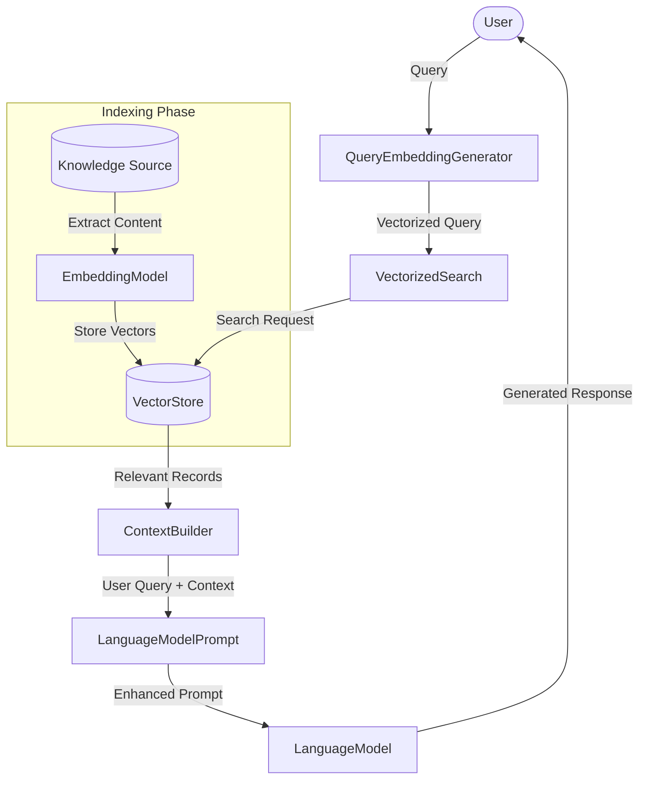
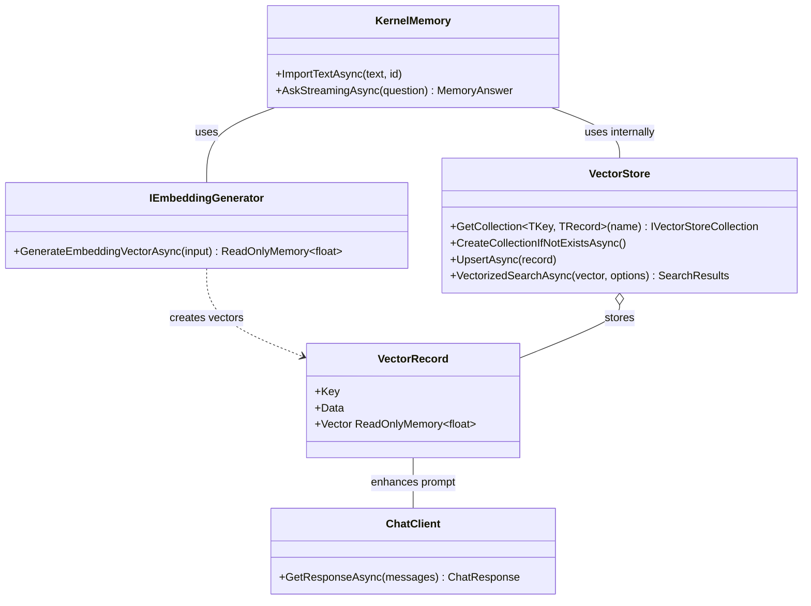
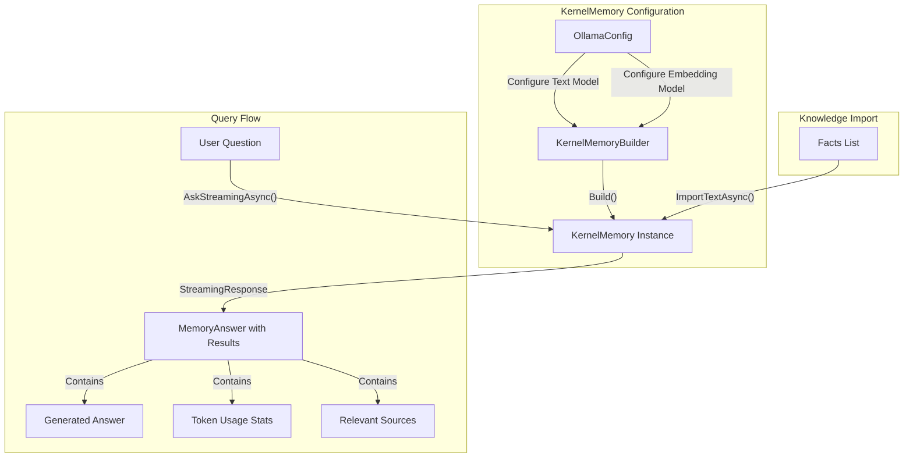
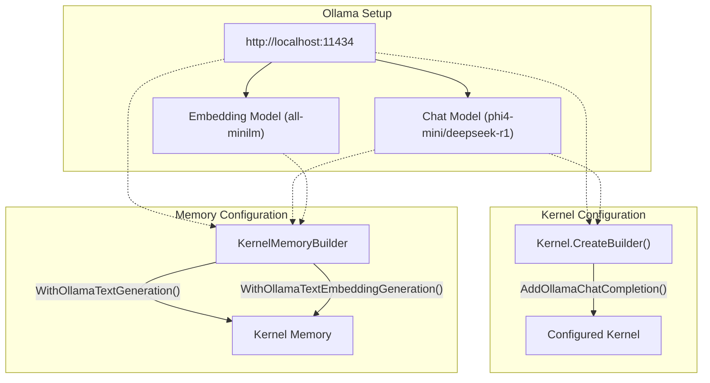

<!-- source: DeepWiki mcp.deepwiki.com · repo microsoft/Generative-AI-for-beginners-dotnet · page 3.2 Retrieval-Augmented Generation (RAG) · fetched 2026-10-26 -->

# Retrieval-Augmented Generation (RAG)

<details>
<summary>Relevant source files</summary>

The following files were used as context for generating this wiki page:

- [.devcontainer/Ollama/devcontainer.json](.devcontainer/Ollama/devcontainer.json)
- [03-CoreGenerativeAITechniques/02-retrieval-augmented-generation.md](03-CoreGenerativeAITechniques/02-retrieval-augmented-generation.md)
- [03-CoreGenerativeAITechniques/03-vision-audio.md](03-CoreGenerativeAITechniques/03-vision-audio.md)
- [03-CoreGenerativeAITechniques/src/RAGSimple-10SKOllama/Program.cs](03-CoreGenerativeAITechniques/src/RAGSimple-10SKOllama/Program.cs)
- [03-CoreGenerativeAITechniques/src/RAGSimple-10SKOllama/RAGSimple-10SKOllama.csproj](03-CoreGenerativeAITechniques/src/RAGSimple-10SKOllama/RAGSimple-10SKOllama.csproj)
- [03-CoreGenerativeAITechniques/src/RAGSimple-10SKOllama/SpectreConsoleOutput.cs](03-CoreGenerativeAITechniques/src/RAGSimple-10SKOllama/SpectreConsoleOutput.cs)
- [03-CoreGenerativeAITechniques/src/RAGSimple-15Ollama-DeepSeekR1/Program.cs](03-CoreGenerativeAITechniques/src/RAGSimple-15Ollama-DeepSeekR1/Program.cs)
- [03-CoreGenerativeAITechniques/src/RAGSimple-15Ollama-DeepSeekR1/RAGSimple-15Ollama-DeepSeekR1.csproj](03-CoreGenerativeAITechniques/src/RAGSimple-15Ollama-DeepSeekR1/RAGSimple-15Ollama-DeepSeekR1.csproj)
- [03-CoreGenerativeAITechniques/src/RAGSimple-15Ollama-DeepSeekR1/SpectreConsoleOutput.cs](03-CoreGenerativeAITechniques/src/RAGSimple-15Ollama-DeepSeekR1/SpectreConsoleOutput.cs)
- [translations/de/03-CoreGenerativeAITechniques/02-retrieval-augmented-generation.md](translations/de/03-CoreGenerativeAITechniques/02-retrieval-augmented-generation.md)
- [translations/fr/03-CoreGenerativeAITechniques/02-retrieval-augmented-generation.md](translations/fr/03-CoreGenerativeAITechniques/02-retrieval-augmented-generation.md)
- [translations/ja/03-CoreGenerativeAITechniques/02-retrieval-augmented-generation.md](translations/ja/03-CoreGenerativeAITechniques/02-retrieval-augmented-generation.md)
- [translations/ko/03-CoreGenerativeAITechniques/02-retrieval-augmented-generation.md](translations/ko/03-CoreGenerativeAITechniques/02-retrieval-augmented-generation.md)
- [translations/pt/03-CoreGenerativeAITechniques/02-retrieval-augmented-generation.md](translations/pt/03-CoreGenerativeAITechniques/02-retrieval-augmented-generation.md)
- [translations/tw/03-CoreGenerativeAITechniques/02-retrieval-augmented-generation.md](translations/tw/03-CoreGenerativeAITechniques/02-retrieval-augmented-generation.md)
- [translations/zh/03-CoreGenerativeAITechniques/02-retrieval-augmented-generation.md](translations/zh/03-CoreGenerativeAITechniques/02-retrieval-augmented-generation.md)

</details>


Retrieval-Augmented Generation (RAG) is a technique that enhances large language model responses by retrieving relevant information from external knowledge sources. This page documents the RAG implementation in the .NET Generative AI course, covering the core concepts, architecture, and implementation details in the codebase.

## Core Concepts of RAG

RAG consists of two primary phases: **Retrieval** and **Generation**.

- **Retrieval**: When a user submits a query, the system uses a retrieval mechanism to gather information from an external knowledge store (vector database, document collection, etc.)
- **Generation**: The retrieved information augments the user's prompt, allowing the AI model to produce more accurate and informed responses.

Key benefits of RAG include:
- Improved accuracy with relevant context
- Up-to-date information beyond the model's knowledge cutoff
- Domain-specific knowledge integration

Sources: [03-CoreGenerativeAITechniques/02-retrieval-augmented-generation.md:11-16](), [03-CoreGenerativeAITechniques/02-retrieval-augmented-generation.md:18-23]()

## RAG Architecture

**RAG Implementation Flow Diagram**



Sources: [03-CoreGenerativeAITechniques/02-retrieval-augmented-generation.md:11-16]()

**RAG Code Components**



Sources: [03-CoreGenerativeAITechniques/02-retrieval-augmented-generation.md:35-99](), [03-CoreGenerativeAITechniques/src/RAGSimple-10SKOllama/Program.cs:26-104]()

## Implementations of RAG

The codebase provides several implementations of RAG:

1. **Using Microsoft.Extensions.AI with Vector Data**
   - Vector store with POCO objects and attributes
   - Embedding generation from external models
   - Vector search and LLM prompt augmentation

2. **Using Semantic Kernel**
   - Integrated memory components
   - Simplified API for importing and querying knowledge

3. **Using Local Models with Ollama**
   - Self-hosted models for both embedding and text generation
   - Support for models like phi4-mini, llama3.2, and deepseek-r1

### RAG with Microsoft.Extensions.AI

This implementation uses Microsoft.Extensions.VectorData and Microsoft.Extensions.AI for embedding generation and vector storage.

**Key Components:**
- Custom POCO classes with vector attributes
- In-memory vector store
- External embedding models

**Data Model Example:**

The implementation uses a `Movie` class with specialized vector store attributes:

```
[VectorStoreRecordKey]     // Marks the unique key property
[VectorStoreRecordData]    // Marks properties that contain data
[VectorStoreRecordVector]  // Specifies vector field with dimensions
```

Sources: [03-CoreGenerativeAITechniques/02-retrieval-augmented-generation.md:46-60]()

**Implementation Flow:**
1. Define data model with vector attributes
2. Create and populate vector store
3. Generate embeddings for knowledge data
4. Process user query and generate embedding
5. Perform vector search
6. Augment LLM prompt with search results
7. Generate response

Sources: [03-CoreGenerativeAITechniques/02-retrieval-augmented-generation.md:66-132](), [03-CoreGenerativeAITechniques/02-retrieval-augmented-generation.md:142-166]()

### RAG with Semantic Kernel and Kernel Memory

This implementation uses Microsoft's Semantic Kernel framework with Kernel Memory for a more integrated approach.

**Memory Configuration Diagram**



Sources: [03-CoreGenerativeAITechniques/src/RAGSimple-10SKOllama/Program.cs:52-128]()

**Key Components:**
- `KernelMemoryBuilder` for configuration
- `OllamaConfig` for model settings
- Memory for importing and querying text data
- Streaming results with detailed source information

### Implementation with Local Models (Ollama)

The codebase includes examples of using locally-hosted models through Ollama for both text generation and embedding creation.

**Ollama Integration Diagram**



Sources: [03-CoreGenerativeAITechniques/src/RAGSimple-10SKOllama/Program.cs:32-81](), [03-CoreGenerativeAITechniques/src/RAGSimple-15Ollama-DeepSeekR1/Program.cs:32-76]()

**Key Components:**
- Ollama configuration for text and embedding models
- Kernel configuration for direct chat completion
- Memory configuration for semantic search capabilities

## Implementation Details

### Vector Storage

The codebase supports multiple vector storage options:

1. **In-Memory Vector Store**:
   - Used for development and examples
   - Provided by `Microsoft.SemanticKernel.Connectors.InMemory`

2. **Azure AI Search**:
   - Scalable managed search service
   - Supports vector search and hybrid search

3. **Qdrant**:
   - Open-source vector database

### Embedding Models

Embeddings convert text to vector representations that capture semantic meaning. The implementation supports:

1. **GitHub-hosted models**:
   - `text-embedding-3-small`
   - Through `Microsoft.Extensions.AI.AzureAIInference`

2. **Ollama-hosted models**:
   - `all-minilm`
   - Through `Microsoft.KernelMemory.AI.Ollama`

**Embedding Generation**:

```
IEmbeddingGenerator<string, Embedding<float>> generator = 
    new EmbeddingsClient(endpoint, credential).AsEmbeddingGenerator(modelId);

ReadOnlyMemory<float> vector = await generator.GenerateEmbeddingVectorAsync(text);
```

Sources: [03-CoreGenerativeAITechniques/02-retrieval-augmented-generation.md:83-99]()

### Vector Search and Context Enrichment

**Search Process**:
1. Convert user query to embedding
2. Configure search options (top results, vector property name)
3. Perform vector search based on similarity
4. Process and evaluate results

```
var queryEmbedding = await generator.GenerateEmbeddingVectorAsync(query);
var searchOptions = new VectorSearchOptions { Top = 1, VectorPropertyName = "Vector" };
var searchResults = await movies.VectorizedSearchAsync(queryEmbedding, searchOptions);
```

Sources: [03-CoreGenerativeAITechniques/02-retrieval-augmented-generation.md:111-131]()

### Response Generation

The final step in RAG is augmenting the language model's prompt with retrieved context:

1. Create conversation with system and user messages
2. Add retrieved information as additional messages
3. Send to language model for response
4. Process and display results

Sources: [03-CoreGenerativeAITechniques/02-retrieval-augmented-generation.md:142-166]()

## Integration with Development Environment

The codebase includes Docker container configurations with pre-installed Ollama models:

```
postCreateCommand: "sudo dotnet workload update && sudo dotnet workload install aspire && sudo dotnet workload list && ollama pull all-minilm && ollama pull llama3.2 && ollama pull phi4-mini"
```

Sources: [.devcontainer/Ollama/devcontainer.json:40]()

## Related Sections

- For more on text completions and function calling, see [Text Completions and Function Calling](#3.1)
- For Vision and Audio AI capabilities, see [Vision and Audio AI](#3.3)
- For information about AI Agents, see [AI Agents](#3.4)
- For Semantic Kernel details, see [Semantic Kernel](#4.2)

## Implementation Samples

The repository includes several sample implementations:

1. **RAGSimple-01SK**: Basic RAG using only Semantic Kernel
2. **RAGSimple-02MEAIVectorsMemory**: RAG using Microsoft.Extensions.AI and vector memory
3. **RAGSimple-10SKOllama**: RAG using Semantic Kernel with Ollama for local models
4. **RAGSimple-15Ollama-DeepSeekR1**: RAG using Ollama with the DeepSeek-R1 model

Sources: [03-CoreGenerativeAITechniques/02-retrieval-augmented-generation.md:38-40](), [03-CoreGenerativeAITechniques/src/RAGSimple-10SKOllama/Program.cs](), [03-CoreGenerativeAITechniques/src/RAGSimple-15Ollama-DeepSeekR1/Program.cs]()

---

