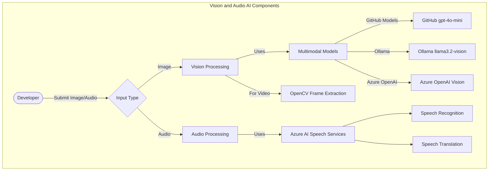
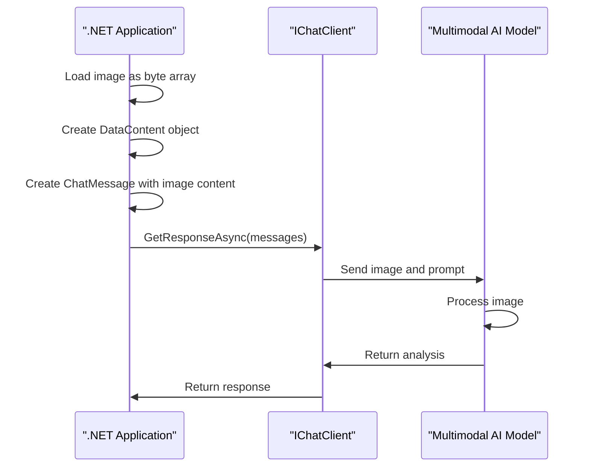
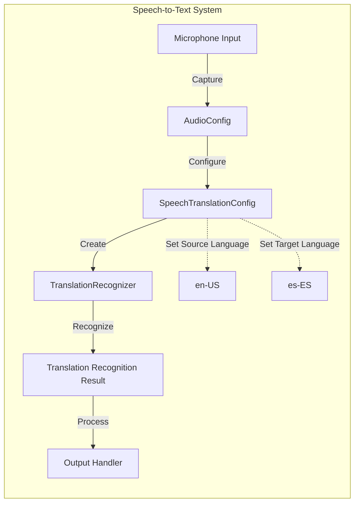
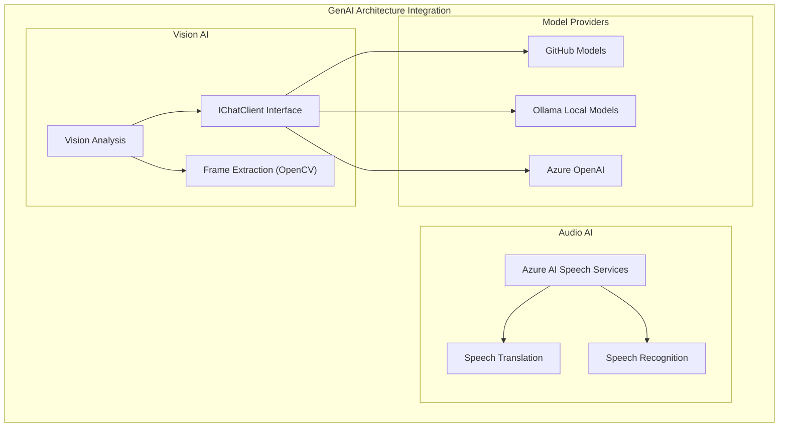

<!-- source: DeepWiki mcp.deepwiki.com · repo microsoft/Generative-AI-for-beginners-dotnet · page 3.3 Vision and Audio AI · fetched 2026-10-26 -->

# Vision and Audio AI

<details>
<summary>Relevant source files</summary>

The following files were used as context for generating this wiki page:

- [03-CoreGenerativeAITechniques/02-retrieval-augmented-generation.md](03-CoreGenerativeAITechniques/02-retrieval-augmented-generation.md)
- [03-CoreGenerativeAITechniques/03-vision-audio.md](03-CoreGenerativeAITechniques/03-vision-audio.md)
- [03-CoreGenerativeAITechniques/src/CoreGenerativeAITechniques.sln](03-CoreGenerativeAITechniques/src/CoreGenerativeAITechniques.sln)
- [03-CoreGenerativeAITechniques/src/Vision-01MEAI-GitHubModels/Program.cs](03-CoreGenerativeAITechniques/src/Vision-01MEAI-GitHubModels/Program.cs)
- [03-CoreGenerativeAITechniques/src/Vision-02MEAI-Ollama/Program.cs](03-CoreGenerativeAITechniques/src/Vision-02MEAI-Ollama/Program.cs)
- [03-CoreGenerativeAITechniques/src/Vision-03MEAI-AOAI/Program.cs](03-CoreGenerativeAITechniques/src/Vision-03MEAI-AOAI/Program.cs)
- [03-CoreGenerativeAITechniques/src/Vision-04MEAI-AOAI-Spectre/Program.cs](03-CoreGenerativeAITechniques/src/Vision-04MEAI-AOAI-Spectre/Program.cs)
- [03-CoreGenerativeAITechniques/src/Vision-04MEAI-AOAI-Spectre/Vision-04MEAI-AOAI-Spectre.csproj](03-CoreGenerativeAITechniques/src/Vision-04MEAI-AOAI-Spectre/Vision-04MEAI-AOAI-Spectre.csproj)

</details>


This document explains the implementation of vision and audio AI capabilities in the Generative AI for .NET Developers repository. It covers how to process and analyze images, videos, and audio inputs using various AI models and services.

## Overview

Vision and audio AI extend language models to handle multimedia inputs, enabling applications that can:

- Analyze images and extract information from them
- Process video content by analyzing extracted frames
- Convert speech to text and process audio inputs

These capabilities are implemented using multimodal models through the Microsoft.Extensions.AI library, and in the case of audio, through Azure AI Speech Services.



Sources: [03-CoreGenerativeAITechniques/03-vision-audio.md:1-10](), [03-CoreGenerativeAITechniques/src/CoreGenerativeAITechniques.sln:28-39]()

## Vision AI Implementation

Vision AI allows applications to process and analyze images by sending them to multimodal models. In this codebase, vision capabilities are primarily implemented through the Microsoft.Extensions.AI (MEAI) library using the `IChatClient` interface.

### Basic Image Analysis Workflow



Sources: [03-CoreGenerativeAITechniques/src/Vision-01MEAI-GitHubModels/Program.cs:1-53]()

### Implementation Options

The repository demonstrates three primary methods for implementing vision AI:

#### 1. GitHub Models (gpt-4o-mini)

GitHub Models provides a simple way to access multimodal capabilities through AI inference models:

```csharp
IChatClient chatClient = new ChatCompletionsClient(
    endpoint: new Uri("https://models.inference.ai.azure.com"),
    new AzureKeyCredential(githubToken))
    .AsChatClient("gpt-4o-mini");

// Create image content
AIContent imageContent = new DataContent(File.ReadAllBytes(imagePath), "image/jpeg");

// Add to messages
var imageMessage = new ChatMessage(ChatRole.User, [imageContent]);
messages.Add(imageMessage);

// Get response
var response = await chatClient.GetResponseAsync(messages);
```

Sources: [03-CoreGenerativeAITechniques/src/Vision-01MEAI-GitHubModels/Program.cs:13-53]()

#### 2. Ollama (Local Models)

For local execution, Ollama with vision-capable models like llama3.2-vision can be used:

```csharp
IChatClient chatClient = new OllamaChatClient(
    new Uri("http://localhost:11434/"), 
    "llama3.2-vision");

// Create image content and get response (similar to GitHub Models)
```

Sources: [03-CoreGenerativeAITechniques/src/Vision-02MEAI-Ollama/Program.cs:1-37]()

#### 3. Azure OpenAI

For production applications, Azure OpenAI can be used with GPT-4 Vision models:

```csharp
IChatClient chatClient = new AzureOpenAIClient(
    new Uri(endpoint), credential)
    .AsChatClient(modelId: modelId);

// Create image content and get response (similar to other implementations)
```

Sources: [03-CoreGenerativeAITechniques/src/Vision-03MEAI-AOAI/Program.cs:17-26]()

### Advanced Video Analysis with OpenCV

For video analysis, the codebase uses OpenCV to extract frames which are then sent to multimodal models:

```mermaid
flowchart TD
    subgraph "Video Analysis System"
        VideoFile["Video File"] -->|"Load"| OpenCV["OpenCV VideoCapture"]
        OpenCV -->|"Extract"| Frames["Video Frames"]
        Frames -->|"Sample at Intervals"| SelectedFrames["Selected Key Frames"]
        SelectedFrames -->|"Convert to"| ImageContent["AIContent Objects"]
        ImageContent -->|"Add to"| Messages["Chat Messages"]
        Messages -->|"Send to"| MultimodalModel["Multimodal Model"]
        MultimodalModel -->|"Return"| Analysis["Video Analysis Results"]
    end
```



Sources: [03-CoreGenerativeAITechniques/src/Vision-03MEAI-AOAI/Program.cs:27-59](), [03-CoreGenerativeAITechniques/src/Vision-04MEAI-AOAI-Spectre/Program.cs:21-102]()

The key steps in video analysis are:

1. Load the video using OpenCV's `VideoCapture`
2. Extract frames at regular intervals to get a representative sample
3. Convert each frame to an `AIContent` object
4. Add frames to the chat messages
5. Send the complete message set to the multimodal model
6. Process the streaming response

This approach enables analyzing the content and context of videos without sending the entire video file.

## Audio AI Implementation

Audio AI capabilities are implemented using Azure AI Speech Services. Unlike vision AI, which uses MEAI, audio processing currently requires a direct integration with Azure Cognitive Services.

### Speech-to-Text with Azure Cognitive Services



Sources: [03-CoreGenerativeAITechniques/03-vision-audio.md:83-144]()

The implementation requires:

1. Creating a `SpeechTranslationConfig` with your Azure AI Speech service key and region
2. Setting source and target languages
3. Creating an `AudioConfig` from the microphone
4. Initializing a `TranslationRecognizer`
5. Calling `RecognizeOnceAsync()` to process speech input

```csharp
var speechTranslationConfig = SpeechTranslationConfig.FromSubscription(speechKey, speechRegion);
speechTranslationConfig.SpeechRecognitionLanguage = "en-US";
speechTranslationConfig.AddTargetLanguage("es-ES");

using var audioConfig = AudioConfig.FromDefaultMicrophoneInput();
using var translationRecognizer = new TranslationRecognizer(speechTranslationConfig, audioConfig);

var translationRecognitionResult = await translationRecognizer.RecognizeOnceAsync();
```

Sources: [03-CoreGenerativeAITechniques/03-vision-audio.md:101-122]()

### Real-Time Audio Processing

The repository also includes an example of real-time audio conversation in the `Audio-02-RealTimeAudio` project. This implementation allows for continuous audio input processing rather than single-shot recognition.

## Integration with Generative AI Architecture

Vision and Audio AI components integrate with the broader architecture through standardized interfaces and consistent patterns:



Sources: [03-CoreGenerativeAITechniques/src/CoreGenerativeAITechniques.sln:28-39](), [03-CoreGenerativeAITechniques/03-vision-audio.md:1-162]()

## Model Compatibility and Requirements

The following table shows which vision and audio capabilities are supported by different model providers:

| Feature | GitHub Models | Ollama | Azure OpenAI | Azure AI Speech |
|---------|--------------|--------|-------------|-----------------|
| Basic Image Analysis | ✅ gpt-4o-mini | ✅ llama3.2-vision | ✅ GPT-4 Vision | ❌ |
| Video Analysis | ✅ | ✅ | ✅ | ❌ |
| Speech-to-Text | ❌ | ❌ | ❌ | ✅ |
| Real-time Audio | ❌ | ❌ | ❌ | ✅ |

Sources: [03-CoreGenerativeAITechniques/03-vision-audio.md:93-94](), [03-CoreGenerativeAITechniques/src/CoreGenerativeAITechniques.sln:28-39]()

## Conclusion

Vision and Audio AI capabilities extend the basic text generation abilities of AI models to handle multimedia inputs. The implementation in this repository demonstrates how to:

1. Use the `IChatClient` interface with multimodal models for image analysis
2. Process videos by extracting frames with OpenCV
3. Implement speech-to-text with Azure AI Speech Services

These capabilities enable more comprehensive AI applications that can interact with users through multiple sensory channels.

For more information on other generative AI techniques, see [Retrieval-Augmented Generation (RAG)](#3.2) or [AI Agents](#3.4).

---

