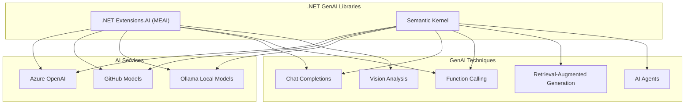
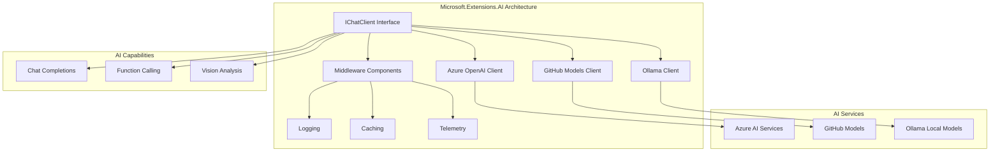
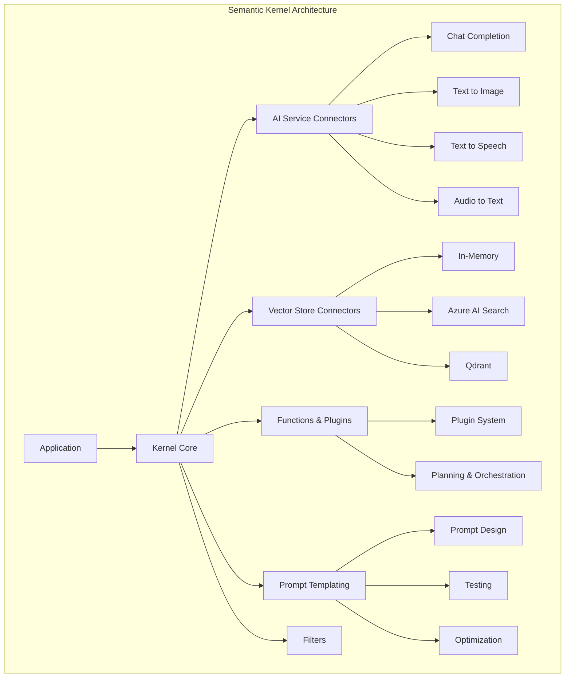
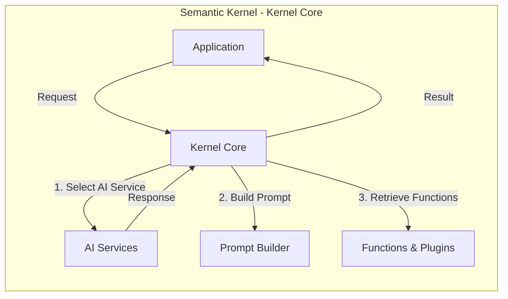
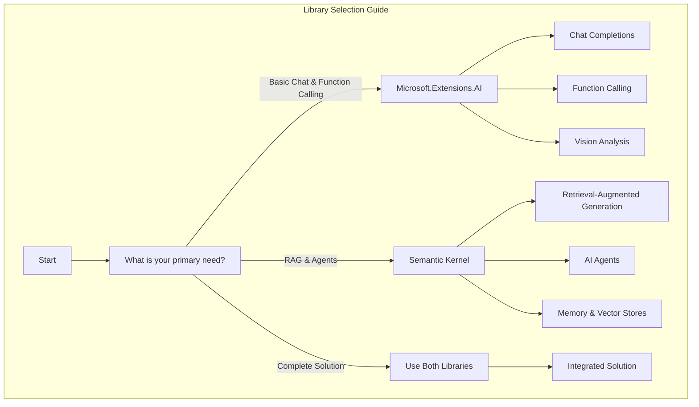
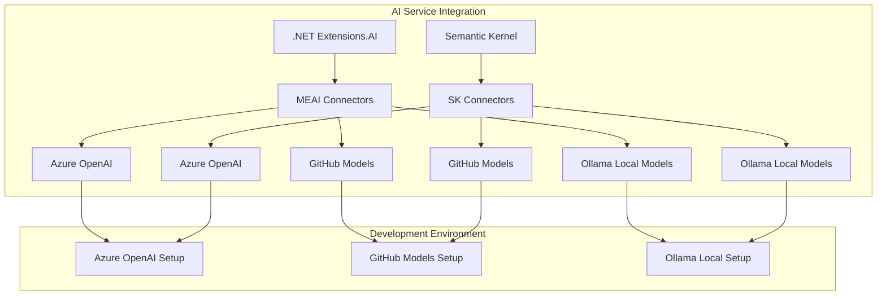

<!-- source: DeepWiki mcp.deepwiki.com · repo microsoft/Generative-AI-for-beginners-dotnet · page 4 .NET Libraries for GenAI · fetched 2026-10-26 -->

# .NET Libraries for GenAI

<details>
<summary>Relevant source files</summary>

The following files were used as context for generating this wiki page:

- [01-IntroToGenAI/images/ai-toolkit-extension.png](01-IntroToGenAI/images/ai-toolkit-extension.png)
- [01-IntroToGenAI/images/meai-architecture-diagram.png](01-IntroToGenAI/images/meai-architecture-diagram.png)
- [01-IntroToGenAI/images/semantic-kernel-core.png](01-IntroToGenAI/images/semantic-kernel-core.png)
- [01-IntroToGenAI/images/semantic-kernel.png](01-IntroToGenAI/images/semantic-kernel.png)
- [01-IntroToGenAI/readme.md](01-IntroToGenAI/readme.md)

</details>


This page provides an overview of the key .NET libraries used for generative AI development in the course. We'll focus on the primary libraries that enable .NET developers to integrate and work with generative AI models: Microsoft.Extensions.AI (MEAI) and Semantic Kernel. For specific implementation details of these libraries, see [Microsoft.Extensions.AI (MEAI)](#4.1) and [Semantic Kernel](#4.2).

## Libraries Overview

The .NET ecosystem offers robust libraries specifically designed for generative AI development. These libraries provide abstractions, interfaces, and utilities that simplify working with various AI models and services through a consistent API.



**Diagram: .NET Libraries and their capabilities for GenAI**

Sources: [01-IntroToGenAI/readme.md:59-92](), [01-IntroToGenAI/readme.md:95-117]()

## Microsoft.Extensions.AI (MEAI)

Microsoft.Extensions.AI (MEAI) provides unified abstractions and middleware to simplify integration of AI services into .NET applications. It enables developers to work with different AI services through a common interface, lowering the friction for building .NET AI applications.

### Core Components and Architecture

MEAI offers a consistent API for interacting with various AI services, allowing developers to switch between services without changing their application code.



**Diagram: Microsoft.Extensions.AI Architecture**

Sources: [01-IntroToGenAI/readme.md:64-85]()

### IChatClient Interface

The `IChatClient` interface is at the core of MEAI, providing a common API for interacting with different AI services:

```
public interface IChatClient : IDisposable 
{ 
    Task<ChatCompletion> CompleteAsync(...); 
    IAsyncEnumerable<StreamingChatCompletionUpdate> CompleteStreamingAsync(...); 
    ChatClientMetadata Metadata { get; } 
    TService? GetService<TService>(object? key = null) where TService : class; 
}
```

This interface allows developers to:
- Request chat completions synchronously or via streaming
- Access metadata about the client
- Get the underlying service if needed

With MEAI, developers can develop against the same API surface regardless of which AI service they're using, making it easier to switch between services or add new ones as needed.

Sources: [01-IntroToGenAI/readme.md:71-78]()

## Semantic Kernel

Semantic Kernel is an open-source SDK that enables developers to integrate generative AI language models into their .NET applications. It provides abstractions for AI services and memory (vector) stores, as well as tools for creating plugins that can be orchestrated by AI.

### Architecture Components



**Diagram: Semantic Kernel Architecture Components**

Sources: [01-IntroToGenAI/readme.md:95-117]()

### Kernel Core

The Kernel Core is the heart of Semantic Kernel, providing:

- Access to AI services and models
- Management of functions and plugins
- Monitoring of agents
- Active middleware for applications

It selects the best AI service for specific tasks, builds and sends prompts to the service, and returns responses to the application.



**Diagram: Semantic Kernel Kernel Core Workflow**

Sources: [01-IntroToGenAI/readme.md:102-106]()

### Key Components

Semantic Kernel includes several key components:

1. **AI Service Connectors**: Provide a common interface for interacting with different AI services like Chat Completion, Text to Image, Text to Speech, and Audio to Text.

2. **Vector Store Connectors**: Enable working with various vector stores through a consistent interface, supporting embeddings, vectors, and other data representations.

3. **Functions and Plugins**: Offer utilities for common AI tasks such as function processing, prompt templating, and text search.

4. **Prompt Templating**: Provides tools for prompt engineering, including design, testing, and optimization to enhance AI model performance.

5. **Filters**: Control when and how functions run to improve security and ensure responsible AI practices.

Sources: [01-IntroToGenAI/readme.md:108-117]()

## Library Comparison and Use Cases

Both MEAI and Semantic Kernel offer capabilities for working with AI services, but they serve different purposes and have different strengths. The following table compares key aspects of these libraries:

| Feature | Microsoft.Extensions.AI | Semantic Kernel |
|---------|------------------------|-----------------|
| Primary Focus | Unified abstraction for AI services | Comprehensive SDK for AI orchestration |
| Key Strength | Simplicity and consistency | Rich ecosystem of connectors and plugins |
| Chat Capabilities | ✓ | ✓ |
| Function Calling | ✓ | ✓ |
| RAG Support | Limited | Comprehensive |
| Agent Support | Limited | Comprehensive |
| Vector Store Integration | Limited | Multiple providers |
| Middleware Support | ✓ | ✓ (via filters) |
| Plugin System | Limited | Comprehensive |

### When to Use Each Library

- **Use Microsoft.Extensions.AI when**:
  - You need a simple, consistent way to interact with AI services
  - Your primary focus is chat completions and function calling
  - You want middleware for logging, caching, and telemetry

- **Use Semantic Kernel when**:
  - You need comprehensive RAG capabilities
  - You want to build AI agents
  - You need to work with multiple vector stores
  - You want to leverage the plugin system for extensibility

In many cases, both libraries can be used together in the same application, with MEAI providing the core AI service abstractions and Semantic Kernel providing higher-level capabilities like RAG and agents.



**Diagram: Library Selection Guide**

Sources: [01-IntroToGenAI/readme.md:59-117]()

## Integration with AI Services

Both libraries support integration with various AI services, including:

### Azure OpenAI

Azure OpenAI provides enterprise-grade models hosted on Microsoft Azure. Both MEAI and Semantic Kernel offer connectors for Azure OpenAI, allowing developers to leverage models like GPT-4 and DALL-E with enterprise security and compliance features.

For Azure OpenAI setup, see [Azure OpenAI Setup](#2.2).

### GitHub Models

GitHub Models offers free model access for development and testing. Both libraries provide connectors for GitHub Models, making it easy to get started with GenAI development without the need for paid subscriptions.

### Ollama Local Models

Ollama enables running models locally on your development machine. Both libraries support integration with Ollama, allowing developers to work with models like Llama and Phi without sending data to external services.

For Ollama setup, see [Ollama Local Setup](#2.3).



**Diagram: AI Service Integration**

Sources: [01-IntroToGenAI/readme.md:59-92]()

## Practical Applications

The libraries covered in this page are used throughout the course for various practical applications:

- **Text Completions and Function Calling**: Implemented using MEAI to interact with large language models for generating text and calling functions.
  
- **Retrieval-Augmented Generation (RAG)**: Implemented using Semantic Kernel for enhanced text generation with contextual information from external sources.
  
- **AI Agents**: Built using Semantic Kernel's agent capabilities to create autonomous AI systems that can perform complex tasks.

- **eShopLite Demo**: Uses RAG techniques to enhance an e-commerce application with AI capabilities.
  
- **Creative Writer Agent**: Leverages the agent capabilities of Semantic Kernel to create an AI system that can research, write, and edit content.

For more information on these applications, see [Core GenAI Techniques](#3) and [Practical Applications](#5).

## Conclusion

The .NET libraries for generative AI development, Microsoft.Extensions.AI and Semantic Kernel, provide powerful tools for building AI-powered applications. They offer abstractions and utilities that simplify working with different AI services and enable developers to implement various generative AI techniques.

By understanding the capabilities and use cases of these libraries, developers can choose the right tools for their specific needs and build robust AI applications with .NET.

For deeper exploration of these libraries, refer to:
- [Microsoft.Extensions.AI (MEAI)](#4.1)
- [Semantic Kernel](#4.2)
- [Core GenAI Techniques](#3)
- [Practical Applications](#5)

Sources: [01-IntroToGenAI/readme.md:124-132]()

---

