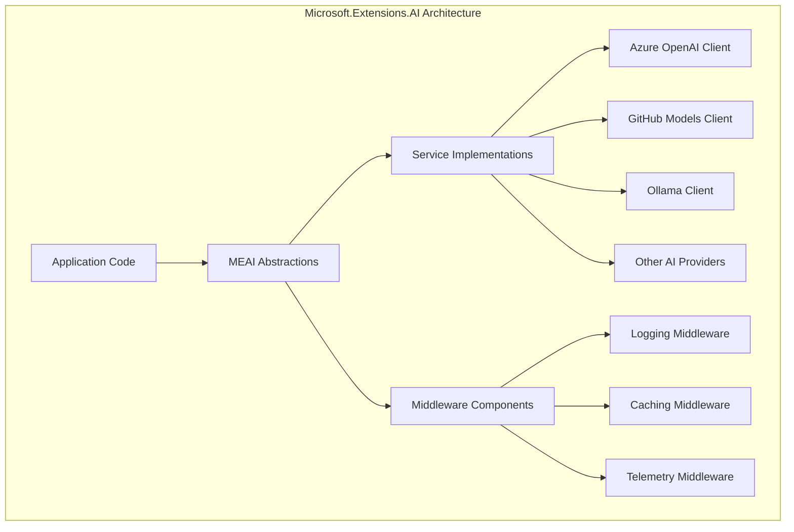
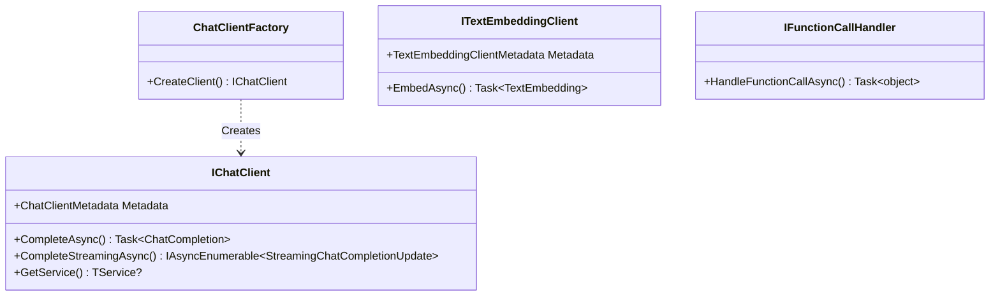
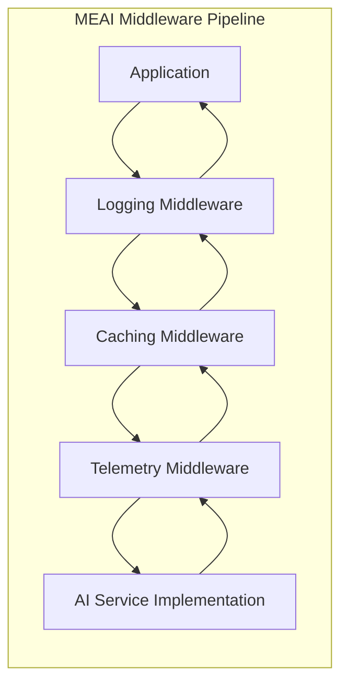
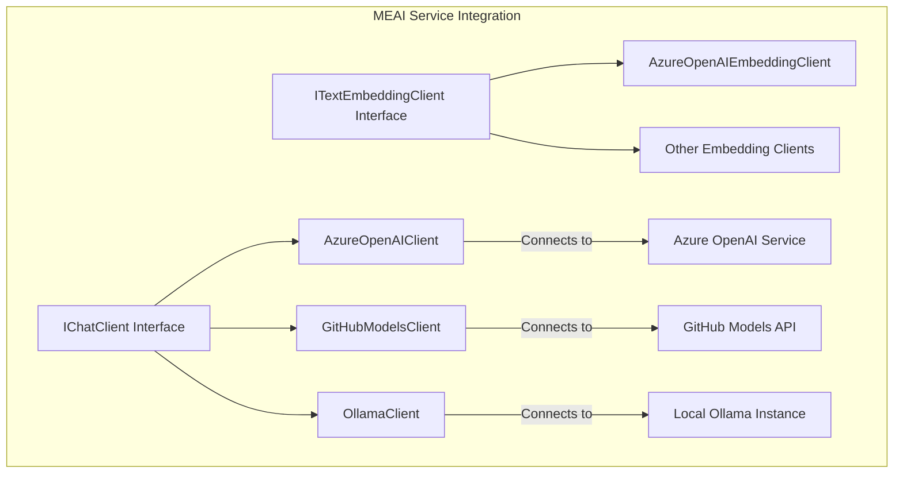
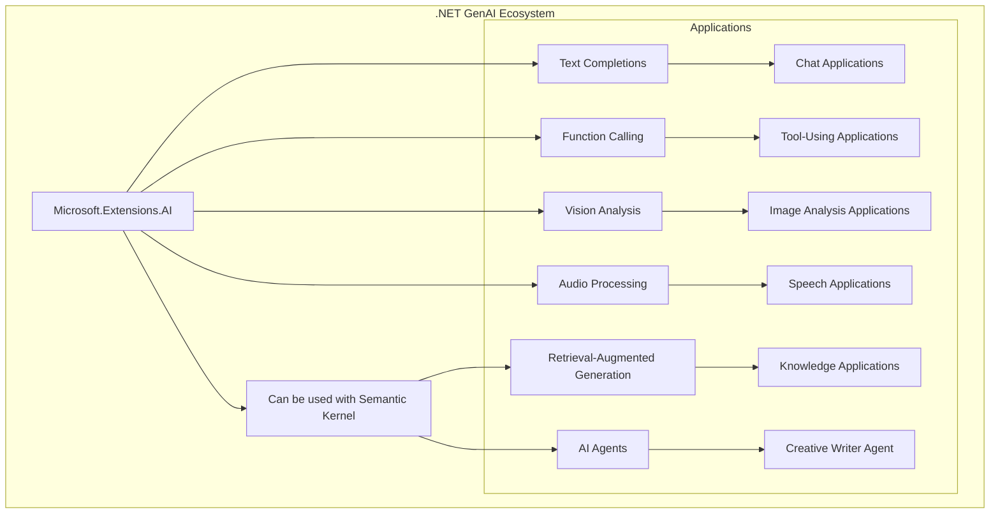

<!-- source: DeepWiki mcp.deepwiki.com · repo microsoft/Generative-AI-for-beginners-dotnet · page 4.1 Microsoft.Extensions.AI (MEAI) · fetched 2026-10-26 -->

# Microsoft.Extensions.AI (MEAI)

<details>
<summary>Relevant source files</summary>

The following files were used as context for generating this wiki page:

- [01-IntroToGenAI/readme.md](01-IntroToGenAI/readme.md)

</details>


## Purpose and Scope

Microsoft.Extensions.AI (MEAI) is a .NET library that provides unified abstractions and middleware for integrating AI services into .NET applications. This document covers the architecture, core components, and usage patterns of MEAI within the Generative AI for .NET Developers codebase. For information about Semantic Kernel, which builds on similar concepts but provides additional orchestration capabilities, see [Semantic Kernel](#4.2).

## Overview

MEAI simplifies AI development by offering a consistent API for working with different AI services like Azure OpenAI, GitHub models, and Ollama. It enables developers to switch between AI providers with minimal code changes while providing middleware capabilities for cross-cutting concerns like logging, caching, and telemetry.



Sources: [01-IntroToGenAI/readme.md:64-92]()

## Core Components

MEAI is built around a set of interfaces and implementations that provide a unified API for working with AI services. The library follows the principles of dependency injection and middleware pipelines familiar to .NET developers.

### Key Interfaces

The core of MEAI is built around several key interfaces that abstract AI capabilities:



Sources: [01-IntroToGenAI/readme.md:71-79]()

#### IChatClient

The `IChatClient` interface is the primary abstraction for chat-based interactions with AI models. It provides methods for generating completions, whether synchronously or as streaming responses.

```csharp
public interface IChatClient : IDisposable 
{ 
    Task<ChatCompletion> CompleteAsync(...); 
    IAsyncEnumerable<StreamingChatCompletionUpdate> CompleteStreamingAsync(...); 
    ChatClientMetadata Metadata { get; } 
    TService? GetService<TService>(object? key = null) where TService : class; 
}
```

This unified interface allows applications to switch between different AI providers simply by changing the implementation rather than modifying the application code.

Sources: [01-IntroToGenAI/readme.md:71-79]()

## Middleware Architecture

MEAI implements a middleware pipeline pattern that allows for cross-cutting concerns to be addressed consistently. This approach should be familiar to ASP.NET Core developers.



Each middleware component in the pipeline can:
- Process the request before it reaches the AI service
- Modify or intercept the response after it returns from the service
- Perform additional operations like logging, metrics collection, or caching

Sources: [01-IntroToGenAI/readme.md:83-84]()

## Service Implementations

MEAI provides implementations for various AI services, enabling developers to work with different models through a consistent interface.

### Supported AI Services

| Service | Description | Use Cases |
|---------|-------------|-----------|
| Azure OpenAI | Microsoft's hosted version of OpenAI models | Production applications with SLA requirements |
| GitHub Models | Models accessible through GitHub's API | Development and testing with free tier access |
| Ollama | Local model execution through Ollama | Local development, offline scenarios, privacy requirements |
| Other providers | Extensible to support additional services | Specialized needs or future AI services |

Each service implementation adheres to the same interfaces, allowing developers to switch between them based on project requirements.



Sources: [01-IntroToGenAI/readme.md:85-87]()

## Integration with .NET Applications

MEAI is designed to integrate seamlessly with .NET's dependency injection system, making it easy to register and consume AI services in your applications.

### Registration and Configuration

MEAI services can be registered in the dependency injection container during application startup:

```csharp
// Example registration pattern for MEAI services
services.AddMEAI(options => {
    options.AddAzureOpenAI(azureOptions => {
        // Configure Azure OpenAI options
    });
    
    options.AddGitHubModels(githubOptions => {
        // Configure GitHub Models options
    });
    
    options.AddOllama(ollamaOptions => {
        // Configure Ollama options
    });
});
```

### Usage Pattern

Once registered, MEAI services can be injected and used throughout the application:

```csharp
// Example injection and usage pattern
public class MyAIService
{
    private readonly IChatClient _chatClient;
    
    public MyAIService(IChatClient chatClient)
    {
        _chatClient = chatClient;
    }
    
    public async Task<string> GetCompletionAsync(string prompt)
    {
        var chatCompletion = await _chatClient.CompleteAsync(prompt);
        return chatCompletion.Content;
    }
}
```

## MEAI in the Generative AI Ecosystem

MEAI serves as a foundational library for .NET generative AI applications. It provides the core abstractions that other libraries and applications can build upon.



Sources: [01-IntroToGenAI/readme.md:64-92]()

## Key Advantages of MEAI

- **Unified API**: Consistent interfaces regardless of the underlying AI service
- **Middleware Support**: Built-in support for cross-cutting concerns
- **Provider Flexibility**: Easy switching between different AI services
- **Integration**: Seamless integration with .NET's dependency injection system
- **Extensibility**: Support for adding custom service implementations and middleware

## Conclusion

Microsoft.Extensions.AI (MEAI) provides a solid foundation for building generative AI applications in .NET. By abstracting away the details of specific AI services, MEAI allows developers to focus on their application logic while maintaining the flexibility to switch between different AI providers as needed.

The unified API, middleware support, and integration with .NET's dependency injection system make MEAI a powerful tool for .NET developers looking to incorporate generative AI capabilities into their applications.

---

