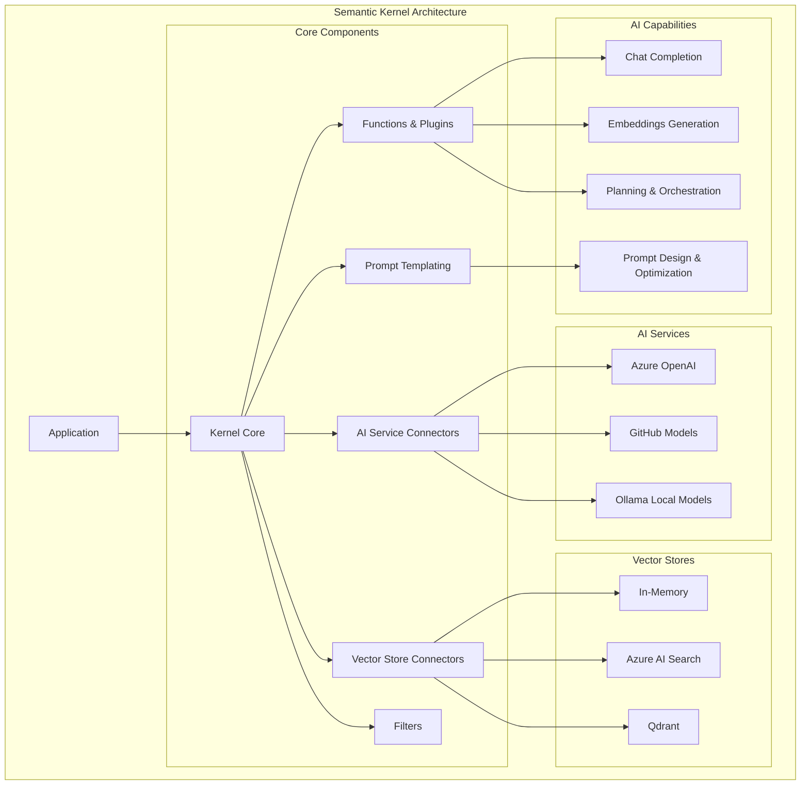
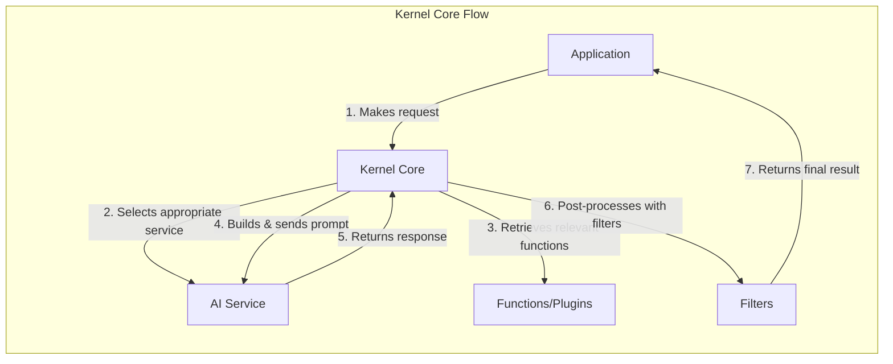
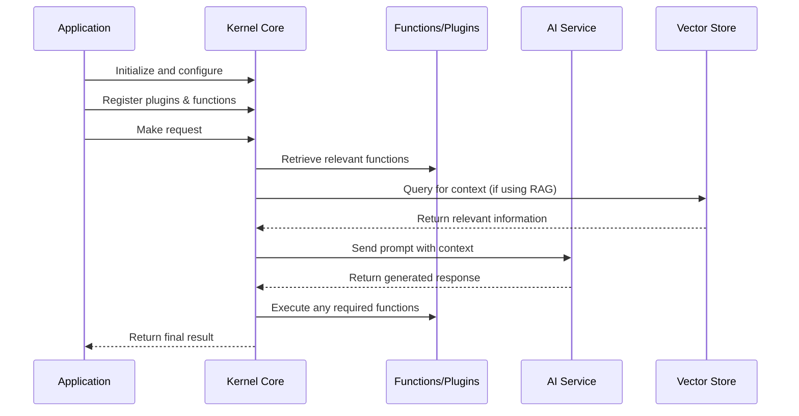
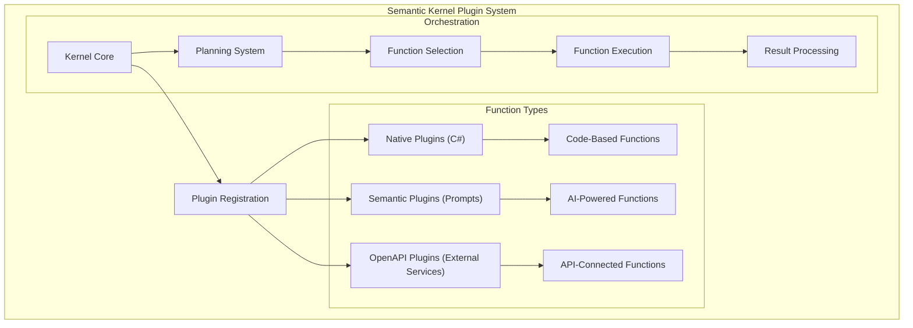
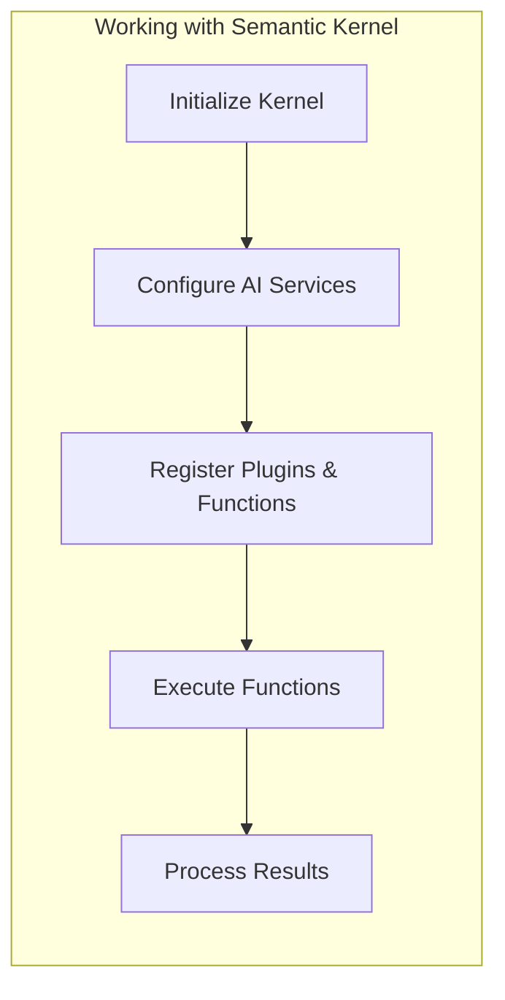
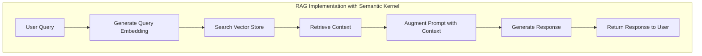
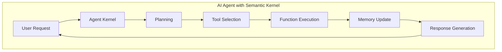

<!-- source: DeepWiki mcp.deepwiki.com · repo microsoft/Generative-AI-for-beginners-dotnet · page 4.2 Semantic Kernel · fetched 2026-10-26 -->

# Semantic Kernel

Relevant source files

The following files were used as context for generating this wiki page:

- [01-IntroToGenAI/images/ai-toolkit-extension.png](01-IntroToGenAI/images/ai-toolkit-extension.png)
- [01-IntroToGenAI/images/meai-architecture-diagram.png](01-IntroToGenAI/images/meai-architecture-diagram.png)
- [01-IntroToGenAI/images/semantic-kernel-core.png](01-IntroToGenAI/images/semantic-kernel-core.png)
- [01-IntroToGenAI/images/semantic-kernel-full-loop.png](01-IntroToGenAI/images/semantic-kernel-full-loop.png)
- [01-IntroToGenAI/images/semantic-kernel.png](01-IntroToGenAI/images/semantic-kernel.png)
- [01-IntroToGenAI/readme.md](01-IntroToGenAI/readme.md)

Semantic Kernel (SK) is an open-source SDK that enables developers to integrate generative AI capabilities into .NET applications. This document covers the architecture, core components, and usage patterns of Semantic Kernel within the Generative AI for beginners .NET course. For information about Microsoft.Extensions.AI (MEAI), see [Microsoft.Extensions.AI (MEAI)](#4.1).

## Overview

Semantic Kernel provides a framework for AI orchestration, connecting generative AI models, plugins, and memory to build AI-powered applications. It abstracts the complexities of working with different AI services and vector stores, allowing developers to focus on building intelligence into their applications rather than managing the underlying infrastructure.

Key capabilities include:
- Integration with multiple AI services through a unified interface
- Management of vector stores for retrieval-augmented generation (RAG)
- Creation and orchestration of plugins and functions
- Prompt management and optimization
- Responsible AI controls via filters

Sources: [01-IntroToGenAI/readme.md:94-122](). [01-IntroToGenAI/images/semantic-kernel.png]()

## Architecture

Semantic Kernel follows a modular architecture that enables flexible integration with various AI services and data stores.

Sources: [01-IntroToGenAI/readme.md:94-122](). [01-IntroToGenAI/images/semantic-kernel.png]()

## Core Components

### Kernel Core

The Kernel is the central component of Semantic Kernel, acting as the orchestrator that coordinates between your application, AI services, and other components. It serves as:

- A service container for registering and retrieving AI services, functions, and plugins
- A middleware layer that manages request flow between components
- A decision-maker that selects appropriate AI services for specific tasks
- A monitor for agent activities and function execution

Sources: [01-IntroToGenAI/readme.md:100-107](). [01-IntroToGenAI/images/semantic-kernel-core.png]()

### AI Service Connectors

AI Service Connectors provide a unified abstraction layer to interact with different AI providers:

- Chat and text completion services
- Embedding generation services
- Image generation and analysis services
- Audio processing services

This abstraction allows switching between different AI services (like Azure OpenAI, GitHub Models, or local Ollama models) without changing your application code.

Sources: [01-IntroToGenAI/readme.md:108-110]()

### Vector Store Connectors

Vector Store Connectors enable Semantic Kernel to work with various vector databases:

- In-Memory storage for development and testing
- Azure AI Search for enterprise-grade search capabilities
- Qdrant for high-performance vector storage

These connectors allow storing and retrieving vector embeddings, which are essential for implementing RAG patterns and semantic search.

Sources: [01-IntroToGenAI/readme.md:111-112]()

### Functions and Plugins

Functions and Plugins are the building blocks that extend Semantic Kernel's capabilities:

- **Native Functions**: Code-based functions written in C# or other supported languages
- **Semantic Functions**: AI-powered functions that use natural language to perform tasks
- **Plugins**: Collections of related functions that can be registered with the kernel

Functions can be automatically orchestrated by AI models, allowing complex workflows where an AI determines which functions to call and when.

Sources: [01-IntroToGenAI/readme.md:113-115]()

### Prompt Templating

Prompt Templating provides tools for designing, testing, and optimizing prompts:

- Template-based prompt creation with variable substitution
- Prompt versioning and management
- Utilities for testing prompt effectiveness

Effective prompt engineering is crucial for getting high-quality results from AI models, and these tools help streamline that process.

Sources: [01-IntroToGenAI/readme.md:116-117]()

### Filters

Filters provide control mechanisms around when and how functions are executed:

- Security controls to prevent unsafe operations
- Rate limiting to manage API usage
- Logging for monitoring and debugging
- Responsible AI safeguards

These filters ensure AI operations adhere to security, compliance, and ethical guidelines.

Sources: [01-IntroToGenAI/readme.md:118-119]()

## The Semantic Kernel Lifecycle

The following diagram illustrates the full interaction cycle in a Semantic Kernel application:

Sources: [01-IntroToGenAI/images/semantic-kernel-full-loop.png](). [01-IntroToGenAI/readme.md:118-122]()

## Integration with AI Services

Semantic Kernel integrates with multiple AI services through a consistent interface:

| AI Service | Description | Use Cases |
|------------|-------------|-----------|
| Azure OpenAI | Microsoft's managed OpenAI service | Production applications requiring SLAs and enterprise features |
| GitHub Models | GitHub-hosted AI models | Development and testing |
| Ollama | Local models running on your machine | Offline development, privacy-sensitive scenarios |

This unified interface allows developers to switch between AI providers based on their needs without changing application code.

Sources: [01-IntroToGenAI/readme.md:108-110]()

## Vector Store Integration

Semantic Kernel integrates with vector stores to enable retrieval-augmented generation (RAG) and semantic search:

| Vector Store | Description | Use Cases |
|--------------|-------------|-----------|
| In-Memory | Temporary storage in application memory | Development, testing, small-scale applications |
| Azure AI Search | Fully managed search service with vector capabilities | Enterprise applications, large-scale search |
| Qdrant | High-performance vector database | Applications requiring fast similarity search |

These integrations form the foundation for implementing memory in AI applications, allowing them to reference and recall information.

Sources: [01-IntroToGenAI/readme.md:111-112]()

## Creating and Using Plugins

Plugins in Semantic Kernel are collections of related functions that extend the capabilities of AI models:

Plugins can be:
- Native plugins written in C# or other supported languages
- Semantic plugins powered by AI models
- OpenAPI plugins that connect to external services

The planning system in Semantic Kernel can automatically orchestrate these plugins, deciding which functions to call based on the user's request.

Sources: [01-IntroToGenAI/readme.md:113-115]()

## Working with Semantic Kernel

To use Semantic Kernel in a .NET application, you follow these general steps:

1. Create a kernel builder
2. Configure AI services
3. Register plugins and functions
4. Execute functions through the kernel

Here's a conceptual flow of working with Semantic Kernel:

The kernel serves as the central coordination point, managing the flow between your application code, the AI services, and the various plugins and functions.

Sources: [01-IntroToGenAI/readme.md:100-107]()

## Example Use Cases

Semantic Kernel enables various AI-powered scenarios in the course, including:

### Retrieval-Augmented Generation (RAG)

RAG enhances AI responses by incorporating relevant information from a knowledge base, making responses more accurate and grounded in specific data.

### AI Agents

Agents use Semantic Kernel to reason about user requests, select appropriate tools, and generate responses that accomplish user goals.

Sources: [01-IntroToGenAI/readme.md:112-115]()

## Conclusion

Semantic Kernel provides a comprehensive framework for building AI-powered applications in .NET. By abstracting the complexities of working with different AI models and services, it allows developers to focus on creating intelligent features rather than managing infrastructure.

The core components—Kernel, AI Service Connectors, Vector Store Connectors, Functions and Plugins, Prompt Templating, and Filters—work together to provide a flexible and powerful system for AI orchestration.

Whether implementing RAG patterns, creating AI agents, or building other intelligent applications, Semantic Kernel offers the tools and abstractions needed to leverage generative AI effectively in .NET development.

---

