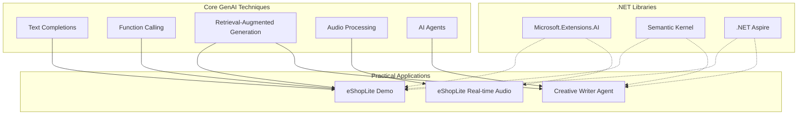
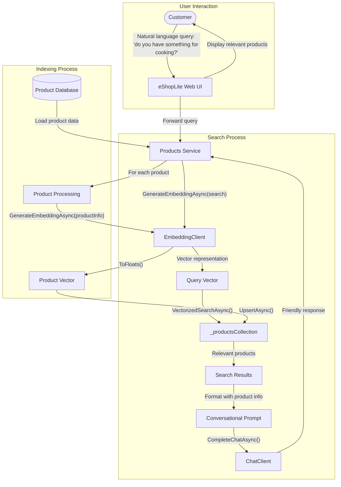
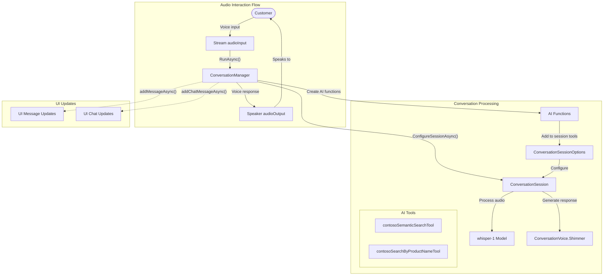
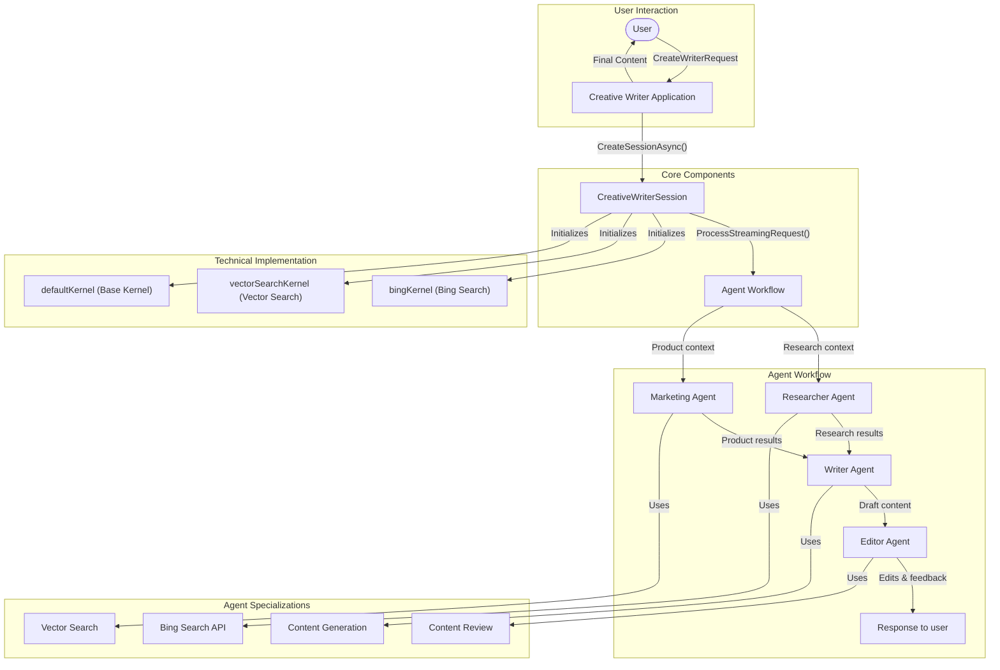
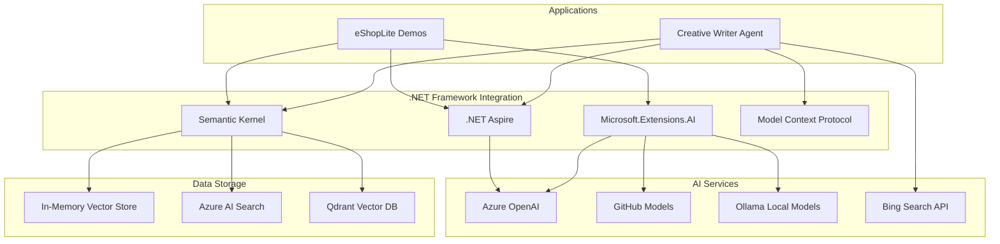

<!-- source: DeepWiki mcp.deepwiki.com · repo microsoft/Generative-AI-for-beginners-dotnet · page 5 Practical Applications · fetched 2026-10-26 -->

# Practical Applications

<details>
<summary>Relevant source files</summary>

The following files were used as context for generating this wiki page:

- [03-CoreGenerativeAITechniques/04-agents.md](03-CoreGenerativeAITechniques/04-agents.md)
- [03-CoreGenerativeAITechniques/images/project-connection-string.png](03-CoreGenerativeAITechniques/images/project-connection-string.png)
- [04-PracticalSamples/readme.md](04-PracticalSamples/readme.md)
- [04-PracticalSamples/src/src/McpSample.AppHost/Properties/launchSettings.json](04-PracticalSamples/src/src/McpSample.AppHost/Properties/launchSettings.json)
- [04-PracticalSamples/src/src/McpSample.AppHost/appsettings.Development.json](04-PracticalSamples/src/src/McpSample.AppHost/appsettings.Development.json)
- [04-PracticalSamples/src/src/McpSample.AppHost/appsettings.json](04-PracticalSamples/src/src/McpSample.AppHost/appsettings.json)
- [04-PracticalSamples/src/src/McpSample.AspNetCoreSseServer/McpEndpointRouteBuilderExtensions.cs](04-PracticalSamples/src/src/McpSample.AspNetCoreSseServer/McpEndpointRouteBuilderExtensions.cs)
- [04-PracticalSamples/src/src/McpSample.AspNetCoreSseServer/McpSample.AspNetCoreSseServer.csproj](04-PracticalSamples/src/src/McpSample.AspNetCoreSseServer/McpSample.AspNetCoreSseServer.csproj)
- [04-PracticalSamples/src/src/McpSample.AspNetCoreSseServer/Program.cs](04-PracticalSamples/src/src/McpSample.AspNetCoreSseServer/Program.cs)
- [04-PracticalSamples/src/src/McpSample.AspNetCoreSseServer/Properties/launchSettings.json](04-PracticalSamples/src/src/McpSample.AspNetCoreSseServer/Properties/launchSettings.json)
- [images/main-logo.jpg](images/main-logo.jpg)

</details>


This page provides an overview of the practical examples included in the Generative AI for beginners .NET course. These applications demonstrate real-world implementations of the GenAI techniques covered in the course, showing how they can be integrated into actual software projects.

For information about core generative AI techniques that these applications build upon, see [Core GenAI Techniques](#3).

## Overview of Practical Applications

The course includes two primary practical applications that demonstrate different aspects of generative AI:

1. **eShopLite Demos** - A sample e-commerce application for outdoor gear that showcases semantic search capabilities and real-time audio interactions
2. **Creative Writer Agent** - A multi-agent system that collaboratively generates creative content using specialized AI agents

Both examples demonstrate how to integrate generative AI capabilities into practical applications using the .NET ecosystem.

## Relationship Between Techniques and Applications

**Practical Applications Integration**



Sources: 
- [04-PracticalSamples/readme.md:1-28]()
- [03-CoreGenerativeAITechniques/04-agents.md:1-30]()

## eShopLite Demos

eShopLite is a sample e-commerce application for outdoor gear and camping enthusiasts that demonstrates how to enhance a traditional application with generative AI capabilities. The demos showcase how to integrate semantic search, conversational assistance, and real-time audio analysis in a practical application.

### eShopLite with Semantic Search - In Memory

This version of eShopLite demonstrates how to enhance product search capabilities using vector embeddings and semantic understanding. The application uses Semantic Kernel to create a search system that can understand the context of user queries and provide more relevant results than traditional keyword-based search.

**eShopLite Semantic Search Architecture**



Sources:
- [04-PracticalSamples/readme.md:30-50]()
- [04-PracticalSamples/readme.md:85-151]()

Key implementation aspects:

1. **Vector Generation**: Products are processed to generate vector embeddings that capture their semantic meaning:
   ```csharp
   var productInfo = $"[{product.Name}] is a product that costs [{product.Price}] and is described as [{product.Description}]";
   var result = await _embeddingClient.GenerateEmbeddingAsync(productInfo);
   productVector.Vector = result.Value.ToFloats();
   ```

2. **Vector Search**: User queries are converted to vectors and compared with product vectors to find semantic matches:
   ```csharp
   var result = await _embeddingClient.GenerateEmbeddingAsync(search);
   var vectorSearchQuery = result.Value.ToFloats();
   var searchResults = await _productsCollection.VectorizedSearchAsync(vectorSearchQuery, searchOptions);
   ```

3. **Enhanced Responses**: The application uses a language model to generate friendly, contextual responses based on the search results:
   ```csharp
   var prompt = @$"You are an intelligent assistant helping clients with their search about outdoor products. Generate a catchy and friendly message using the following information:
       - User Question: {search}
       - Found Product Name: {firstProduct.Name}
       - Found Product Description: {firstProduct.Description}
       - Found Product Price: {firstProduct.Price}";
   ```

The eShopLite demo uses .NET Aspire to coordinate the various services and containers required for the application.

Sources:
- [04-PracticalSamples/readme.md:56-217]()

### eShopLite with Semantic Search - Azure AI Search

This variant of the eShopLite demo uses Azure AI Search instead of an in-memory vector store. It provides a more scalable and reliable solution for real-world scenarios by leveraging Azure's cloud-based search service.

Key advantages of the Azure AI Search implementation:

- Persistent search indexes that survive application restarts
- Scalability for large product catalogs
- Advanced search features provided by Azure AI Search
- Integrated with Azure's monitoring and management capabilities

Sources:
- [04-PracticalSamples/readme.md:239-245]()

### eShopLite with Realtime Audio

The realtime audio version of eShopLite demonstrates how to implement AI-powered voice interactions using GPT-4o. This allows customers to have natural voice conversations with the e-commerce system.

**eShopLite Real-time Audio Architecture**



Sources:
- [04-PracticalSamples/readme.md:247-324]()

Key implementation aspects:

1. **Conversation Setup**: The application configures a conversation session with the necessary tools and options:
   ```csharp
   var sessionOptions = new ConversationSessionOptions()
   {
       Instructions = prompt,
       Voice = ConversationVoice.Shimmer,
       InputTranscriptionOptions = new() { Model = "whisper-1" },
   };
   ```

2. **AI Functions**: The application creates custom AI functions for semantic search and product search:
   ```csharp
   var contosoSemanticSearchTool = AIFunctionFactory.Create(_contosoProductContext.SemanticSearchOutdoorProductsAsync);
   var contosoSearchByProductNameTool = AIFunctionFactory.Create(_contosoProductContext.SearchOutdoorProductsByNameAsync);
   ```

3. **Real-time Audio Processing**: The application handles audio input and output streams to enable voice conversations:
   ```csharp
   public async Task RunAsync(
       Stream audioInput, 
       Speaker audioOutput, 
       Func<string, Task> addMessageAsync, 
       Func<string, bool, Task> addChatMessageAsync, 
       CancellationToken cancellationToken)
   ```

Sources:
- [04-PracticalSamples/readme.md:259-316]()

## Creative Writer Agent

The Creative Writer Agent is a multi-agent system that demonstrates how to build a complex AI workflow using specialized agents that collaborate to generate high-quality written content. This application showcases how AI agents can work together to achieve tasks that would be challenging for a single agent.

**Creative Writer Agent Architecture**



Sources:
- [04-PracticalSamples/readme.md:326-456]()

The system consists of four specialized agents:

1. **Researcher**: Leverages Bing Search to gather context, data, and information about the requested topic
2. **Marketing**: Interprets user intent and leverages the Vector DB for precise information retrieval
3. **Writer**: Synthesizes findings from both the Researcher and Marketing agents to create a cohesive draft
4. **Editor**: Reviews the content, suggests corrections, and determines if it's ready for publication

Key implementation aspects:

1. **Agent Initialization**: The system creates and configures specialized agents with specific prompts and roles:
   ```csharp
   ChatCompletionAgent researcherAgent = new(ReadFileForPromptTemplateConfig("./Agents/Prompts/researcher.yaml"))
   {
       Name = ResearcherName,
       Kernel = bingKernel,
       Arguments = CreateFunctionChoiceAutoBehavior(),
       LoggerFactory = bingKernel.LoggerFactory
   };
   ```

2. **Agent Interaction Flow**: Agents communicate sequentially, with each agent building on the work of previous agents:
   ```csharp
   // Populate the Writer Agent with contextual data
   writerAgent.Arguments["research_context"] = createWriterRequest.Research;
   writerAgent.Arguments["research_results"] = sbResearchResults.ToString();
   writerAgent.Arguments["product_context"] = createWriterRequest.Products;
   writerAgent.Arguments["product_results"] = sbProductResults.ToString();
   writerAgent.Arguments["assignment"] = createWriterRequest.Writing;
   ```

3. **Agent Group Configuration**: The Writer and Editor agents are organized into an agent group that manages their interactions:
   ```csharp
   AgentGroupChat chat = new(writerAgent, editorAgent)
   {
       LoggerFactory = kernel.LoggerFactory,
       ExecutionSettings = new AgentGroupChatSettings
       {
           SelectionStrategy = new SequentialSelectionStrategy() 
           { 
               InitialAgent = writerAgent
           },
           TerminationStrategy = new NoFeedbackLeftTerminationStrategy()
       }
   };
   ```

The Creative Writer Agent leverages .NET Aspire for monitoring and orchestration, providing insights into the interactions between agents and system performance.

Sources:
- [04-PracticalSamples/readme.md:367-496]()

## Implementation Tools and Frameworks

**Technology Stack Integration**



Sources:
- [04-PracticalSamples/readme.md:503-518]()
- [04-PracticalSamples/src/src/McpSample.AspNetCoreSseServer/Program.cs:1-22]()

## Monitoring and Telemetry

Both practical applications demonstrate the importance of monitoring and telemetry for GenAI applications. .NET Aspire provides powerful tools for monitoring and tracing the behavior of AI components:

1. **Tracing Capabilities**: The Aspire dashboard visualizes the flow of requests through the system, making it easier to understand how the AI components interact with each other and with other services.

2. **Telemetry Integration**: Azure Application Insights integration helps track AI model usage, performance, and user interactions.

This observability is crucial for understanding AI system behavior, identifying bottlenecks, and continuously improving the user experience.

Sources:
- [04-PracticalSamples/readme.md:225-236]()
- [04-PracticalSamples/readme.md:497-502]()

## Summary

The practical applications in this course demonstrate how to integrate generative AI capabilities into real-world .NET applications:

1. **eShopLite** showcases semantic search and real-time audio capabilities in an e-commerce context, demonstrating how GenAI can enhance traditional applications with natural language understanding and voice interactions.

2. **Creative Writer Agent** demonstrates a complex multi-agent system where specialized AI agents collaborate to produce high-quality content, showing how agents can be combined to solve complex problems.

Both examples leverage the .NET ecosystem, including .NET Aspire, Semantic Kernel, and Microsoft.Extensions.AI, to build robust and observable AI systems.

These practical examples serve as reference implementations that you can adapt and extend for your own generative AI applications.

Sources:
- [04-PracticalSamples/readme.md:503-518]()

---

