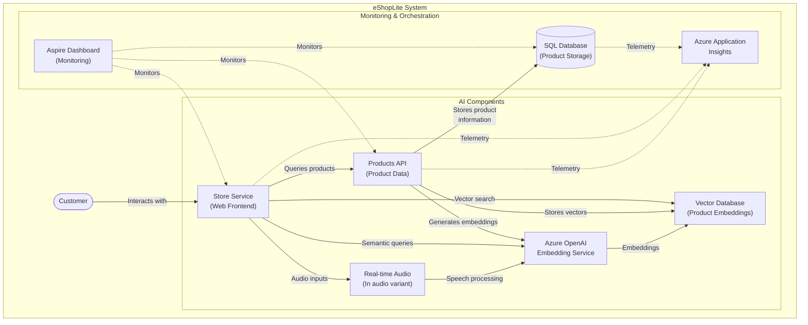
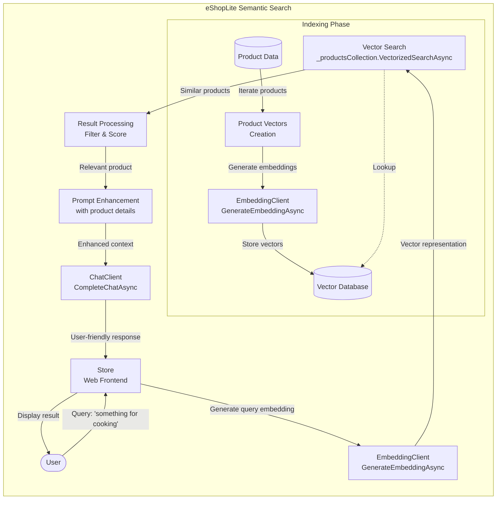
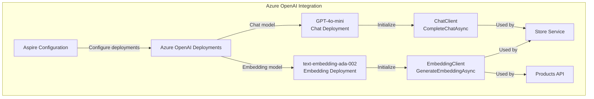

<!-- source: DeepWiki mcp.deepwiki.com · repo microsoft/Generative-AI-for-beginners-dotnet · page 5.1 eShopLite Demo · fetched 2026-10-26 -->

# eShopLite Demo

Relevant source files

The following files were used as context for generating this wiki page:

- [03-CoreGenerativeAITechniques/04-agents.md](03-CoreGenerativeAITechniques/04-agents.md)
- [03-CoreGenerativeAITechniques/images/project-connection-string.png](03-CoreGenerativeAITechniques/images/project-connection-string.png)
- [04-PracticalSamples/readme.md](04-PracticalSamples/readme.md)
- [04-PracticalSamples/src/src/McpSample.AppHost/Properties/launchSettings.json](04-PracticalSamples/src/src/McpSample.AppHost/Properties/launchSettings.json)
- [04-PracticalSamples/src/src/McpSample.AppHost/appsettings.Development.json](04-PracticalSamples/src/src/McpSample.AppHost/appsettings.Development.json)
- [04-PracticalSamples/src/src/McpSample.AppHost/appsettings.json](04-PracticalSamples/src/src/McpSample.AppHost/appsettings.json)
- [04-PracticalSamples/src/src/McpSample.AspNetCoreSseServer/McpEndpointRouteBuilderExtensions.cs](04-PracticalSamples/src/src/McpSample.AspNetCoreSseServer/McpEndpointRouteBuilderExtensions.cs)
- [04-PracticalSamples/src/src/McpSample.AspNetCoreSseServer/McpSample.AspNetCoreSseServer.csproj](04-PracticalSamples/src/src/McpSample.AspNetCoreSseServer/McpSample.AspNetCoreSseServer.csproj)
- [04-PracticalSamples/src/src/McpSample.AspNetCoreSseServer/Program.cs](04-PracticalSamples/src/src/McpSample.AspNetCoreSseServer/Program.cs)
- [04-PracticalSamples/src/src/McpSample.AspNetCoreSseServer/Properties/launchSettings.json](04-PracticalSamples/src/src/McpSample.AspNetCoreSseServer/Properties/launchSettings.json)
- [images/main-logo.jpg](images/main-logo.jpg)

## Purpose and Scope

This document details the eShopLite demonstration application, a simple e-commerce platform for outdoor gear that showcases practical Generative AI implementations in a .NET environment. The eShopLite demo illustrates how to integrate AI capabilities into a real-world application using semantic search, natural language processing, and real-time audio analysis.

For information about the Creative Writer Agent demo, see [Creative Writer Agent](#5.2).

## System Overview

eShopLite is a reference application that demonstrates different approaches to implementing Generative AI in a business context. The application provides a working e-commerce storefront enhanced with AI capabilities to improve search functionality, customer interactions, and product discovery.

Several variants of the eShopLite demo showcase different AI implementation techniques:

- **eShopLite with semantic search (in-memory)**: Uses vector embeddings stored in memory to enable semantic search capabilities
- **eShopLite with semantic search (Azure AI Search)**: Leverages Azure AI Search for more scalable semantic search
- **eShopLite with real-time audio**: Demonstrates real-time audio analysis and conversation capabilities

Sources: [04-PracticalSamples/readme.md:30-40](), [04-PracticalSamples/readme.md:38-53]()

## Architecture

eShopLite leverages .NET Aspire for application composition and monitoring, combined with containerized services for each component of the system.

### System Architecture Diagram

Sources: [04-PracticalSamples/readme.md:54-83](), [04-PracticalSamples/readme.md:226-227]()

### Component Responsibilities

| Component | Description | Responsibility |
|-----------|-------------|----------------|
| Store Service | Web frontend | Provides user interface, handles search queries, and presents results |
| Products API | Backend service | Manages product data, generates embeddings, and interfaces with databases |
| SQL Database | Relational database | Stores product information persistently |
| Vector Database | Vector storage | Stores product embedding vectors for semantic search |
| Azure OpenAI | AI service | Provides embedding generation and semantic processing |
| Aspire Dashboard | Monitoring tool | Provides visibility into service performance and interactions |
| Application Insights | Telemetry service | Collects usage data and application performance metrics |

Sources: [04-PracticalSamples/readme.md:56-66](), [04-PracticalSamples/readme.md:226-236]()

## Semantic Search Implementation

The eShopLite demo showcases two implementations of semantic search:

1. **In-memory semantic search**: Vector embeddings stored in memory
2. **Azure AI Search-based semantic search**: More scalable implementation using Azure AI Search

### Semantic Search Flow

Sources: [04-PracticalSamples/readme.md:133-150](), [04-PracticalSamples/readme.md:163-216]()

### In-Memory Implementation

The in-memory implementation uses the following components:

1. **Azure OpenAI**: Provides embedding generation through EmbeddingClient
2. **In-memory vector collection**: Stores product embedding vectors
3. **Vector similarity search**: Finds products similar to user queries

Key components in the code include:

- **EmbeddingClient**: Creates vector embeddings for products and queries
- **ChatClient**: Generates human-friendly responses based on search results
- **ProductVector**: Model that combines product data with vector representations

The search process follows these steps:

1. The user submits a natural language query (e.g., "something for cooking")
2. The system generates an embedding vector for the query
3. The query vector is compared to product vectors using similarity search
4. The most relevant products are identified based on vector similarity
5. Product details are incorporated into a prompt for the language model
6. The language model generates a natural, conversational response about the relevant products

Sources: [04-PracticalSamples/readme.md:90-97](), [04-PracticalSamples/readme.md:130-151](), [04-PracticalSamples/readme.md:164-216]()

### Azure AI Search Implementation

The Azure AI Search implementation provides greater scalability and persistence for production scenarios. It uses Azure AI Search to store and query vector embeddings, allowing for:

- Persistence of embeddings across application restarts
- Larger scale vector storage and retrieval
- Integration with other Azure services

This implementation follows the same general flow as the in-memory version but leverages Azure AI Search's vector search capabilities for improved performance and scalability.

Sources: [04-PracticalSamples/readme.md:239-245]()

## Real-Time Audio Implementation

The eShopLite with real-time audio extends the platform with spoken conversation capabilities, allowing users to interact with the system through natural voice interactions.

### Real-Time Audio Architecture

```mermaid
flowchart TD
    subgraph "eShopLite Real-time Audio"
        User([User]) -->|"Speaks query"| AudioInput["Audio Input<br>Stream"]
        
        AudioInput -->|"Audio stream"| ConversationManager["ConversationManager<br>RunAsync"]
        
        ConversationManager -->|"Configure session"| SessionOptions["ConversationSessionOptions<br>Voice & Transcription"]
        
        SessionOptions -->|"Apply options"| Session["Conversation Session<br>Start & Configure"]
        
        ConversationManager -->|"Add tools"| AIFunctions["AI Functions<br>Product Search Tools"]
        
        AIFunctions -->|"Register tools"| SessionOptions
        
        Session -->|"Process audio"| Transcription["Input Transcription<br>Whisper-1 Model"]
        
        Transcription -->|"Transcribed text"| GPT4["GPT-4o<br>Process & Respond"]
        
        GPT4 -->|"Response text"| TextToSpeech["Text-to-Speech<br>Conversion"]
        
        GPT4 -->|"Function calls"| ProductSearch["Product Search<br>Functions"]
        
        ProductSearch -->|"Search results"| GPT4
        
        TextToSpeech -->|"Audio response"| Speaker["Audio Output<br>Speaker"]
        
        Speaker -->|"Speaks response"| User
    end
```

Sources: [04-PracticalSamples/readme.md:256-263](), [04-PracticalSamples/readme.md:276-318]()

The real-time audio implementation includes:

1. **Conversation Session**: Manages the overall conversation state
2. **Input Transcription**: Converts spoken input to text using the Whisper model
3. **AI Functions**: Tools for searching products during conversation
4. **Text-to-Speech**: Converts AI responses to spoken audio

The `ConversationManager` class handles the audio processing workflow, integrating speech recognition, semantic understanding, product searches, and spoken responses into a cohesive experience.

Key components include:

- **Audio Input Stream**: Captures user's voice input
- **Conversation Session**: Maintains context throughout the interaction
- **AI Functions**: Registered tools for semantic and product name searches
- **GPT-4o**: Processes transcribed input and generates relevant responses
- **Speaker**: Outputs the AI's spoken responses

Sources: [04-PracticalSamples/readme.md:259-324]()

## Integration with Azure Services

eShopLite demonstrates integration with multiple Azure services to enable its AI capabilities:

### Azure OpenAI Configuration

The application configures Azure OpenAI deployments for chat completion and embeddings:

The system configures the Azure OpenAI client with specific model deployments, properly versioned and configured for the application's needs. This includes separate deployments for chat completion and embedding generation.

Sources: [04-PracticalSamples/readme.md:58-83](), [04-PracticalSamples/readme.md:91-125]()

### Monitoring and Telemetry

eShopLite leverages .NET Aspire and Azure Application Insights for comprehensive monitoring:

1. **.NET Aspire Dashboard**: Provides a unified view of all services, their connections, and performance metrics
2. **Azure Application Insights**: Collects detailed telemetry data on user interactions and system performance

The monitoring infrastructure enables:
- Real-time visibility into service health
- Tracing of requests across service boundaries
- Performance analysis of AI operations
- Identification of bottlenecks and areas for optimization

Sources: [04-PracticalSamples/readme.md:226-236]()

## Development Environment

### Aspire Configuration

eShopLite uses .NET Aspire for service composition and monitoring. The configuration includes:

- **AppHost**: Coordinates the various services and their connections
- **Containers**: Defines the containerized services (Store, Products, SQL)
- **References**: Establishes dependencies between services
- **Environment Variables**: Configures service parameters and connection details

Sources: [04-PracticalSamples/readme.md:56-83](), [04-PracticalSamples/src/src/McpSample.AppHost/appsettings.json:1-9](), [04-PracticalSamples/src/src/McpSample.AppHost/Properties/launchSettings.json:1-29]()

## Summary

The eShopLite demo showcases practical implementations of Generative AI in a business application context. It demonstrates:

1. **Semantic search using vector embeddings**: Enhancing product discovery with natural language understanding
2. **Integration with Azure AI services**: Leveraging cloud-based AI capabilities for production-ready applications
3. **Real-time audio processing**: Enabling voice-based interactions with AI systems
4. **Application monitoring**: Using .NET Aspire and Azure Application Insights for comprehensive system visibility

These implementations serve as reference examples for developers looking to incorporate similar AI capabilities into their own .NET applications.

Sources: [04-PracticalSamples/readme.md:503-506]()

---

