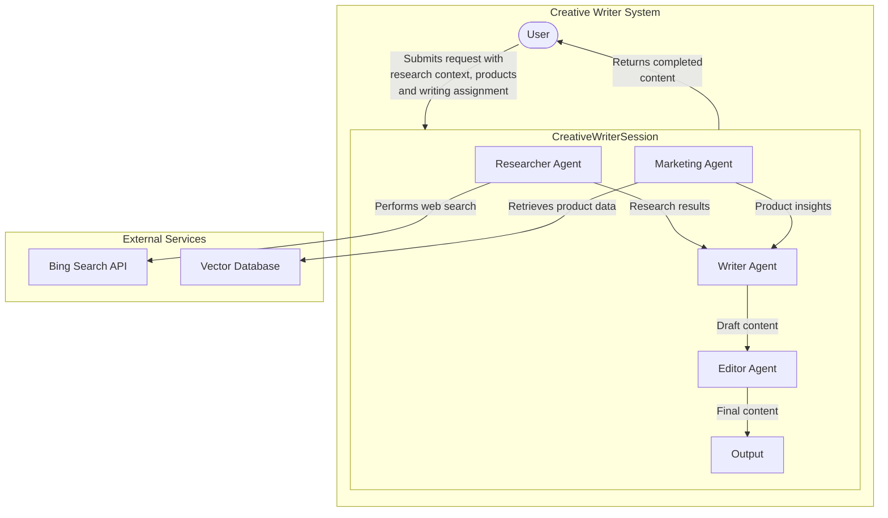
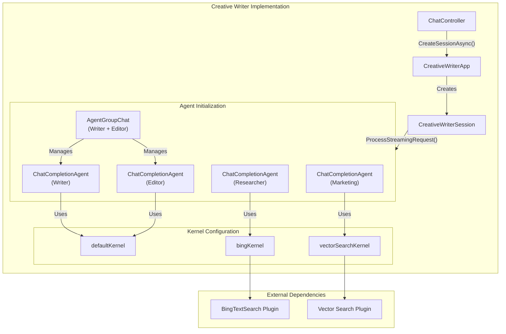
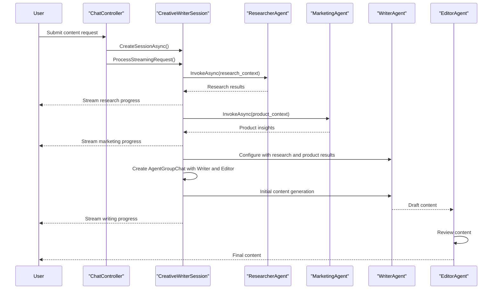

<!-- source: DeepWiki mcp.deepwiki.com · repo microsoft/Generative-AI-for-beginners-dotnet · page 5.2 Creative Writer Agent · fetched 2026-10-26 -->

# Creative Writer Agent

<details>
<summary>Relevant source files</summary>

The following files were used as context for generating this wiki page:

- [03-CoreGenerativeAITechniques/04-agents.md](03-CoreGenerativeAITechniques/04-agents.md)
- [03-CoreGenerativeAITechniques/images/project-connection-string.png](03-CoreGenerativeAITechniques/images/project-connection-string.png)
- [04-PracticalSamples/readme.md](04-PracticalSamples/readme.md)
- [images/main-logo.jpg](images/main-logo.jpg)

</details>


The Creative Writer Agent is a practical implementation of AI agent technology that generates high-quality, researched content based on user input. It demonstrates how multiple specialized AI agents can work together to produce comprehensive written materials by combining research, domain knowledge, and writing expertise.

For general information about AI agents and their capabilities, see [AI Agents](#3.4).

## Purpose and Scope

This document covers the architecture, components, and workflow of the Creative Writer Agent demo application in the Generative AI for beginners .NET course. It illustrates:

- How multiple specialized AI agents collaborate in a workflow
- Integration of external services (Bing Search, Vector Database)
- Implementation of agent-based content generation using Semantic Kernel
- Orchestration of the entire system using .NET Aspire

The Creative Writer Agent serves as a practical example of advanced agent implementation techniques that can be applied to various content generation scenarios.

Sources: [04-PracticalSamples/readme.md:327-346]()

## System Overview

The Creative Writer Agent combines four specialized AI agents that work together to produce high-quality written content:



The system accepts user input containing research topics, product information, and writing requirements, then processes this information through the specialized agents to produce a cohesive piece of content.

Sources: [04-PracticalSamples/readme.md:338-344](), [04-PracticalSamples/readme.md:347-350]()

## Agent Roles and Responsibilities

Each agent in the Creative Writer system has a specific role and responsibility:

| Agent | Primary Role | Tools Used | Output |
|-------|-------------|------------|--------|
| Researcher | Gathers contextual information and relevant data | Bing Search API | Concise research summary |
| Marketing | Interprets user intent and product context | Vector Database | Product insights and marketing angles |
| Writer | Synthesizes research and marketing insights | Language model | Draft article/content |
| Editor | Reviews and refines the content | Language model | Polished, publication-ready content |

The system is designed around a clear separation of concerns, with each agent specializing in a different aspect of the content creation process.

Sources: [04-PracticalSamples/readme.md:338-344]()

## Technical Architecture

The Creative Writer Agent is built on top of Semantic Kernel and integrated with multiple services:



The system uses multiple specialized Semantic Kernel instances to handle different aspects of the content creation process.

Sources: [04-PracticalSamples/readme.md:351-378](), [04-PracticalSamples/readme.md:394-413](), [04-PracticalSamples/readme.md:453-493]()

## Implementation Details

### Session Creation and Kernel Configuration

The Creative Writer application creates a session that encapsulates three different Semantic Kernel instances:

1. **Default Kernel**: Used for general language processing tasks
2. **Bing Kernel**: Configured with Bing search capabilities for research
3. **Vector Search Kernel**: Configured for product information retrieval

```csharp
internal async Task<CreativeWriterSession> CreateSessionAsync(HttpResponse response)
{
    // Configure default kernel with function invocation filters
    defaultKernel.FunctionInvocationFilters.Add(new FunctionInvocationFilter(response));

    // Configure Bing kernel for search capabilities
    Kernel bingKernel = defaultKernel.Clone();
    BingTextSearch textSearch = new(apiKey: configuration["BingAPIKey"]!);
    KernelPlugin searchPlugin = textSearch.CreateWithSearch("BingSearchPlugin");
    bingKernel.Plugins.Add(searchPlugin);

    // Configure vector search kernel for product data retrieval
    Kernel vectorSearchKernel = defaultKernel.Clone();
    await ConfigureVectorSearchKernel(vectorSearchKernel);

    // Return a session with all configured kernels
    return new CreativeWriterSession(defaultKernel, bingKernel, vectorSearchKernel);
}
```

Sources: [04-PracticalSamples/readme.md:371-389]()

### Agent Initialization and Configuration

Each agent is initialized with a specific prompt template that guides its behavior and defines its role:

```csharp
// Initialize the Researcher Agent
ChatCompletionAgent researcherAgent = new(ReadFileForPromptTemplateConfig("./Agents/Prompts/researcher.yaml"))
{
    Name = ResearcherName,
    Kernel = bingKernel,
    Arguments = CreateFunctionChoiceAutoBehavior(),
    LoggerFactory = bingKernel.LoggerFactory
};

// Initialize the Marketing Agent
ChatCompletionAgent marketingAgent = new(ReadFileForPromptTemplateConfig("./Agents/Prompts/marketing.yaml"))
{
    Name = MarketingName,
    Kernel = vectorSearchKernel,
    Arguments = CreateFunctionChoiceAutoBehavior(),
    LoggerFactory = vectorSearchKernel.LoggerFactory
};

// Initialize the Writer and Editor Agents
ChatCompletionAgent writerAgent = new(ReadFileForPromptTemplateConfig("./Agents/Prompts/writer.yaml"))
{
    Name = WriterName, 
    Kernel = kernel,
    Arguments = new Dictionary<string, string>(), 
    LoggerFactory = kernel.LoggerFactory 
};

ChatCompletionAgent editorAgent = new(ReadFileForPromptTemplateConfig("./Agents/Prompts/editor.yaml"))
{
    Name = EditorName, 
    Kernel = kernel, 
    LoggerFactory = kernel.LoggerFactory
};
```

Sources: [04-PracticalSamples/readme.md:394-413](), [04-PracticalSamples/readme.md:453-470]()

### Request Processing Workflow

The workflow for processing a content creation request follows these steps:

1. **Request Intake**: The system receives a request with research context, product information, and writing requirements
2. **Research Phase**: The Researcher Agent gathers information using Bing Search
3. **Marketing Phase**: The Marketing Agent retrieves product information from the Vector Database
4. **Writing Phase**: The Writer Agent synthesizes this information to create draft content
5. **Editing Phase**: The Editor Agent reviews and refines the content
6. **Response Streaming**: Results are streamed back to the client in real-time



Sources: [04-PracticalSamples/readme.md:414-449](), [04-PracticalSamples/readme.md:471-493]()

### Agent Group Chat for Writer and Editor Collaboration

The Writer and Editor agents are configured to work together through an `AgentGroupChat`, which manages their interactions:

```csharp
// Populate the Writer Agent with contextual data
writerAgent.Arguments["research_context"] = createWriterRequest.Research;
writerAgent.Arguments["research_results"] = sbResearchResults.ToString();
writerAgent.Arguments["product_context"] = createWriterRequest.Products;
writerAgent.Arguments["product_results"] = sbProductResults.ToString();
writerAgent.Arguments["assignment"] = createWriterRequest.Writing;

// Configure the Agent Group Chat
AgentGroupChat chat = new(writerAgent, editorAgent)
{
    LoggerFactory = kernel.LoggerFactory,
    ExecutionSettings = new AgentGroupChatSettings
    {
        // Start with the Writer Agent
        SelectionStrategy = new SequentialSelectionStrategy() 
        { 
            InitialAgent = writerAgent
        },
        // End when the Editor has finished
        TerminationStrategy = new NoFeedbackLeftTerminationStrategy()
    }
};
```

This setup ensures a sequential interaction where the Writer creates content first, and then the Editor reviews and finalizes it.

Sources: [04-PracticalSamples/readme.md:471-493]()

## Monitoring and Observability

The Creative Writer Agent is integrated with .NET Aspire, which provides comprehensive monitoring and telemetry:

1. **Tracing**: Visualizes the interactions between agents and components
2. **Telemetry**: Provides insights into system performance and user behavior
3. **Logging**: Captures detailed information about the execution flow

These capabilities enable developers to understand the internal workings of the system, identify potential bottlenecks, and optimize performance.

Sources: [04-PracticalSamples/readme.md:497-500]()

## Integration with Other Systems

The Creative Writer Agent demonstrates integration with several external systems:

1. **Bing Search**: Used by the Researcher Agent to gather information
2. **Vector Database**: Used by the Marketing Agent to retrieve product information
3. **Language Models**: Used by all agents for natural language understanding and generation

This modular approach allows for flexible integration with different data sources and AI services.

Sources: [04-PracticalSamples/readme.md:338-344]()

## Conclusion

The Creative Writer Agent demonstrates how multiple specialized AI agents can work together to create high-quality content. By separating concerns into research, marketing, writing, and editing phases, the system produces content that is well-researched, relevant, coherent, and polished.

This implementation showcases advanced agent orchestration techniques using Semantic Kernel and .NET Aspire, providing a template for building similar agent-based systems for other complex tasks.

Sources: [04-PracticalSamples/readme.md:503-507]()

---

