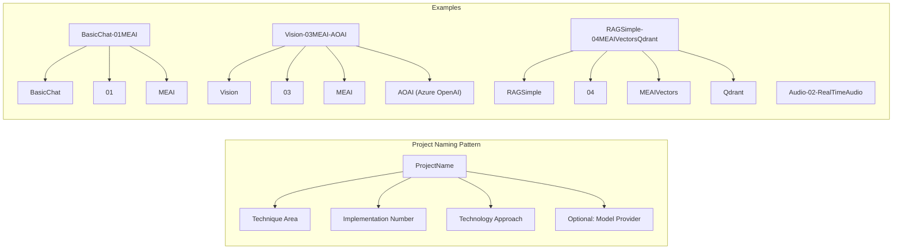
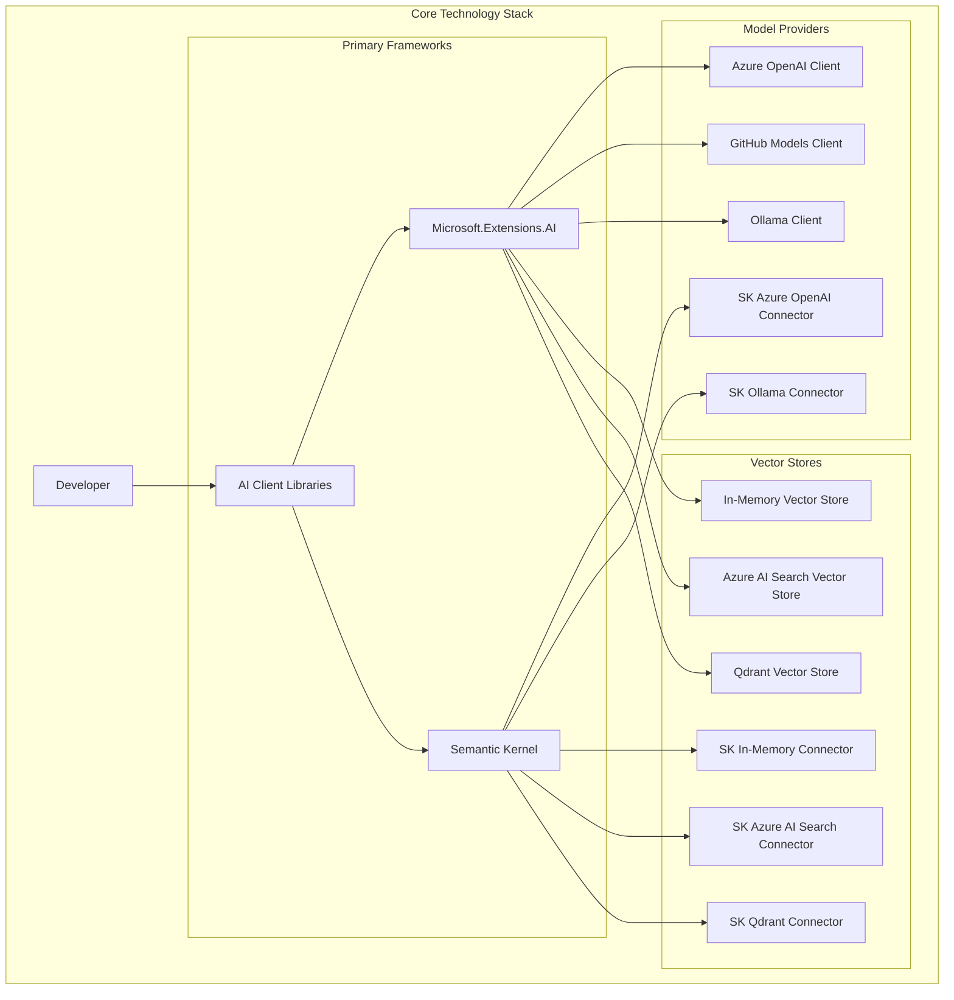
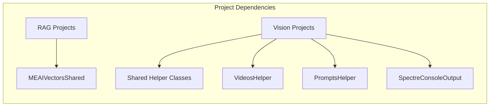
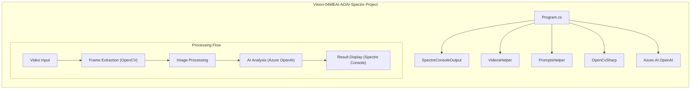

<!-- source: DeepWiki mcp.deepwiki.com · repo microsoft/Generative-AI-for-beginners-dotnet · page 7 Project Structure and Organization · fetched 2026-10-26 -->

# Project Structure and Organization

Relevant source files

The following files were used as context for generating this wiki page:

- [03-CoreGenerativeAITechniques/src/BasicChat-02SK/BasicChat-02SK.csproj](03-CoreGenerativeAITechniques/src/BasicChat-02SK/BasicChat-02SK.csproj)
- [03-CoreGenerativeAITechniques/src/BasicChat-04OllamaSK/BasicChat-04OllamaSK.csproj](03-CoreGenerativeAITechniques/src/BasicChat-04OllamaSK/BasicChat-04OllamaSK.csproj)
- [03-CoreGenerativeAITechniques/src/CoreGenerativeAITechniques.sln](03-CoreGenerativeAITechniques/src/CoreGenerativeAITechniques.sln)
- [03-CoreGenerativeAITechniques/src/RAGSimple-02MEAIVectorsMemory/RAGSimple-02MEAIVectorsMemory.csproj](03-CoreGenerativeAITechniques/src/RAGSimple-02MEAIVectorsMemory/RAGSimple-02MEAIVectorsMemory.csproj)
- [03-CoreGenerativeAITechniques/src/RAGSimple-03MEAIVectorsAISearch/RAGSimple-03MEAIVectorsAISearch.csproj](03-CoreGenerativeAITechniques/src/RAGSimple-03MEAIVectorsAISearch/RAGSimple-03MEAIVectorsAISearch.csproj)
- [03-CoreGenerativeAITechniques/src/RAGSimple-04MEAIVectorsQdrant/RAGSimple-04MEAIVectorsQdrant.csproj](03-CoreGenerativeAITechniques/src/RAGSimple-04MEAIVectorsQdrant/RAGSimple-04MEAIVectorsQdrant.csproj)
- [03-CoreGenerativeAITechniques/src/SKFunctions01/SKFunctions01.csproj](03-CoreGenerativeAITechniques/src/SKFunctions01/SKFunctions01.csproj)
- [03-CoreGenerativeAITechniques/src/Vision-04MEAI-AOAI-Spectre/Program.cs](03-CoreGenerativeAITechniques/src/Vision-04MEAI-AOAI-Spectre/Program.cs)
- [03-CoreGenerativeAITechniques/src/Vision-04MEAI-AOAI-Spectre/Vision-04MEAI-AOAI-Spectre.csproj](03-CoreGenerativeAITechniques/src/Vision-04MEAI-AOAI-Spectre/Vision-04MEAI-AOAI-Spectre.csproj)

This document provides a comprehensive overview of the project structure and organization for the Generative AI for beginners .NET course repository. It explains the repository's overall architecture, solution structure, project organization, and naming conventions. For detailed information about development environment configuration, see [Development Configuration](#7.2).

## Repository Overview

The Generative AI for beginners .NET repository is structured to provide a progressive learning path through various generative AI techniques using .NET technologies. The repository contains multiple projects organized into logical categories, each demonstrating different approaches to implementing generative AI capabilities.

The course material is divided into focused learning areas, with parallel implementations using different libraries and model providers to showcase various approaches to the same problems.

## Core Solution Structure

The solution is organized into seven primary technical categories, each containing multiple projects that demonstrate different implementations of the same concept.

```mermaid
graph TD
    subgraph "Core Solution Structure"
        direction LR
        Root["GenAI for .NET Developers"] --> BasicChat["01 Basic Chat"]
        Root --> Functions["02 Functions"]
        Root --> RAG["03 RAG"]
        Root --> Vision["04 Vision Analysis"]
        Root --> Audio["05 Audio"]
        Root --> Agents["06 Agents"]
        Root --> Reasoning["07 Reasoning"]
    end

    subgraph "Implementation Approaches"
        direction LR
        BasicChat --> MEAI_Chat["MEAI Implementations"]
        BasicChat --> SK_Chat["Semantic Kernel Implementations"]
        BasicChat --> Ollama_Chat["Ollama Implementations"]
        
        Functions --> MEAI_Func["MEAI Functions"]
        Functions --> SK_Func["SK Functions"]
        
        RAG --> MEAI_RAG["MEAI Vector Implementations"]
        RAG --> SK_RAG["SK RAG Implementations"]
        
        Vision --> Vision_MEAI["Vision with MEAI"]
        Vision --> Vision_Spectre["Vision with Spectre UI"]
        
        Audio --> Audio_Speech["Speech Processing"]
        Audio --> Audio_Realtime["Realtime Audio"]
        
        Agents --> Agents_Simple["Simple Agents"]
        Agents --> Agents_Func["Function-enabled Agents"]
        Agents --> Agents_API["API-enabled Agents"]
        
        Reasoning --> SK_Reasoning["SK Reasoning"]
    end

    classDef sectionClass stroke-width:2px;
    class Root,BasicChat,Functions,RAG,Vision,Audio,Agents,Reasoning sectionClass;
```

Sources: [03-CoreGenerativeAITechniques/src/CoreGenerativeAITechniques.sln:14-56]()

## Project Organization by Category

The solution follows a consistent pattern, with each technical category containing multiple projects that demonstrate different implementations or approaches. Below is a breakdown of each category and its associated projects.

### 1. Basic Chat Projects

Basic chat projects demonstrate fundamental text chat capabilities using different libraries and model providers:

| Project Name | Purpose | Key Technologies |
|--------------|---------|------------------|
| BasicChat-01MEAI | Basic chat using Microsoft.Extensions.AI | MEAI, Azure OpenAI/GitHub Models |
| BasicChat-02SK | Basic chat using Semantic Kernel | Semantic Kernel, Azure OpenAI |
| BasicChat-03Ollama | Basic chat using Ollama with MEAI | MEAI, Ollama |
| BasicChat-04OllamaSK | Basic chat using Ollama with Semantic Kernel | Semantic Kernel, Ollama |

Sources: [03-CoreGenerativeAITechniques/src/CoreGenerativeAITechniques.sln:6-13](), [03-CoreGenerativeAITechniques/src/BasicChat-04OllamaSK/BasicChat-04OllamaSK.csproj:1-17](), [03-CoreGenerativeAITechniques/src/BasicChat-02SK/BasicChat-02SK.csproj:1-18]()

### 2. Functions Projects

Functions projects demonstrate function calling capabilities for LLMs:

| Project Name | Purpose | Key Technologies |
|--------------|---------|------------------|
| SKFunctions01 | Function calling with Semantic Kernel | Semantic Kernel |
| MEAIFunctions | Function implementations for MEAI | MEAI, Azure OpenAI/GitHub Models |
| MEAIFunctionsOllama | Function implementations for MEAI with Ollama | MEAI, Ollama |

Sources: [03-CoreGenerativeAITechniques/src/CoreGenerativeAITechniques.sln:16-18](), [03-CoreGenerativeAITechniques/src/CoreGenerativeAITechniques.sln:52-55](), [03-CoreGenerativeAITechniques/src/SKFunctions01/SKFunctions01.csproj:1-18]()

### 3. RAG (Retrieval-Augmented Generation) Projects

RAG projects demonstrate different vector database implementations and retrieval techniques:

| Project Name | Purpose | Key Technologies |
|--------------|---------|------------------|
| RAGSimple-02MEAIVectorsMemory | RAG with in-memory vector store | MEAI, InMemory vector storage |
| RAGSimple-03MEAIVectorsAISearch | RAG with Azure AI Search | MEAI, Azure AI Search |
| RAGSimple-04MEAIVectorsQdrant | RAG with Qdrant vector database | MEAI, Qdrant |
| RAGSimple-10SKOllama | RAG with Semantic Kernel and Ollama | Semantic Kernel, Ollama |
| RAGSimple-15Ollama-DeepSeekR1 | RAG with DeepSeek R1 model | Ollama, DeepSeek models |
| MEAIVectorsShared | Shared utilities for RAG demos | Reusable components |

Sources: [03-CoreGenerativeAITechniques/src/CoreGenerativeAITechniques.sln:20-31](), [03-CoreGenerativeAITechniques/src/RAGSimple-02MEAIVectorsMemory/RAGSimple-02MEAIVectorsMemory.csproj:1-17](), [03-CoreGenerativeAITechniques/src/RAGSimple-03MEAIVectorsAISearch/RAGSimple-03MEAIVectorsAISearch.csproj:1-23](), [03-CoreGenerativeAITechniques/src/RAGSimple-04MEAIVectorsQdrant/RAGSimple-04MEAIVectorsQdrant.csproj:1-20]()

### 4-7. Other Technical Categories

The remaining categories follow similar organizational patterns:

- **Vision Analysis**: Projects demonstrating computer vision capabilities with different model providers
- **Audio**: Projects for speech recognition and real-time audio processing
- **Agents**: Projects showcasing AI agent patterns with increasing complexity
- **Reasoning**: Projects focused on reasoning capabilities in LLMs

Sources: [03-CoreGenerativeAITechniques/src/CoreGenerativeAITechniques.sln:28-58]()

## Project Naming Conventions

Projects follow a consistent naming convention that indicates the technique, implementation approach, and model provider. Understanding these naming patterns helps navigate the codebase:

Sources: [03-CoreGenerativeAITechniques/src/CoreGenerativeAITechniques.sln:6-60]()

### Key Naming Components

| Prefix/Component | Description |
|-----------------|-------------|
| BasicChat | Basic text completion projects |
| RAGSimple | Retrieval-Augmented Generation projects |
| Vision | Computer vision projects |
| Audio | Audio processing projects |
| AgentLabs | AI agent implementation projects |
| ReasoningLabs | Reasoning capability projects |
| MEAI | Microsoft.Extensions.AI implementation |
| SK | Semantic Kernel implementation |
| Ollama | Uses Ollama for local model execution |
| AOAI | Uses Azure OpenAI |
| Vectors | Uses vector embeddings |
| Memory/AISearch/Qdrant | Vector storage mechanism |
| Spectre | Uses Spectre.Console for UI |

## Technology Stack and Dependencies

The repository leverages two primary frameworks for generative AI development in .NET:

1. **Microsoft.Extensions.AI (MEAI)**: A lightweight library providing AI client interfaces
2. **Semantic Kernel (SK)**: A more comprehensive SDK with orchestration, plugins, and memory capabilities

Sources: [03-CoreGenerativeAITechniques/src/BasicChat-04OllamaSK/BasicChat-04OllamaSK.csproj:11-15](), [03-CoreGenerativeAITechniques/src/BasicChat-02SK/BasicChat-02SK.csproj:12-16](), [03-CoreGenerativeAITechniques/src/RAGSimple-02MEAIVectorsMemory/RAGSimple-02MEAIVectorsMemory.csproj:9-13](), [03-CoreGenerativeAITechniques/src/RAGSimple-03MEAIVectorsAISearch/RAGSimple-03MEAIVectorsAISearch.csproj:11-16](), [03-CoreGenerativeAITechniques/src/RAGSimple-04MEAIVectorsQdrant/RAGSimple-04MEAIVectorsQdrant.csproj:10-14]()

### Common Dependencies

The projects share common dependencies with some variations based on their specific requirements:

| Category | Package Names | Purpose |
|----------|--------------|---------|
| Core AI | Microsoft.Extensions.AI, Microsoft.SemanticKernel | Primary AI frameworks |
| Model Providers | Microsoft.Extensions.AI.Ollama, Microsoft.SemanticKernel.Connectors.Ollama | Model provider interfaces |
| Vector Storage | Microsoft.Extensions.VectorData.Abstractions, Microsoft.SemanticKernel.Connectors.InMemory, Microsoft.SemanticKernel.Connectors.AzureAISearch, Microsoft.SemanticKernel.Connectors.Qdrant | Vector database technologies |
| Configuration | Microsoft.Extensions.Configuration, Microsoft.Extensions.Configuration.UserSecrets | Configuration management |
| Specialized Tools | OpenCvSharp4, Spectre.Console | Vision processing, console UI |

Sources: [03-CoreGenerativeAITechniques/src/Vision-04MEAI-AOAI-Spectre/Vision-04MEAI-AOAI-Spectre.csproj:18-27](), [03-CoreGenerativeAITechniques/src/RAGSimple-02MEAIVectorsMemory/RAGSimple-02MEAIVectorsMemory.csproj:9-13](), [03-CoreGenerativeAITechniques/src/RAGSimple-03MEAIVectorsAISearch/RAGSimple-03MEAIVectorsAISearch.csproj:11-16](), [03-CoreGenerativeAITechniques/src/BasicChat-04OllamaSK/BasicChat-04OllamaSK.csproj:11-15]()

## Project Inter-dependencies

The solution uses shared projects and linked files to promote code reuse across demonstration projects:

Sources: [03-CoreGenerativeAITechniques/src/Vision-04MEAI-AOAI-Spectre/Vision-04MEAI-AOAI-Spectre.csproj:12-16](), [03-CoreGenerativeAITechniques/src/RAGSimple-02MEAIVectorsMemory/RAGSimple-02MEAIVectorsMemory.csproj:14-16](), [03-CoreGenerativeAITechniques/src/RAGSimple-03MEAIVectorsAISearch/RAGSimple-03MEAIVectorsAISearch.csproj:19-21](), [03-CoreGenerativeAITechniques/src/RAGSimple-04MEAIVectorsQdrant/RAGSimple-04MEAIVectorsQdrant.csproj:16-18]()

## Sample Project Structure

To illustrate a typical project structure, here's a breakdown of the Vision Analysis project implementation:

Sources: [03-CoreGenerativeAITechniques/src/Vision-04MEAI-AOAI-Spectre/Program.cs:1-157](), [03-CoreGenerativeAITechniques/src/Vision-04MEAI-AOAI-Spectre/Vision-04MEAI-AOAI-Spectre.csproj:12-27]()

## Target Frameworks and Compatibility

The course samples use either .NET 8.0 or .NET 9.0 (preview) depending on required features:

| Target Framework | Project Types | Notes |
|------------------|--------------|-------|
| .NET 8.0 | Vision projects with Spectre.Console | Stable framework for production scenarios |
| .NET 9.0 | Most RAG, Chat, and Functions examples | Preview framework with latest AI features |

Sources: [03-CoreGenerativeAITechniques/src/Vision-04MEAI-AOAI-Spectre/Vision-04MEAI-AOAI-Spectre.csproj:5](), [03-CoreGenerativeAITechniques/src/BasicChat-04OllamaSK/BasicChat-04OllamaSK.csproj:5](), [03-CoreGenerativeAITechniques/src/RAGSimple-02MEAIVectorsMemory/RAGSimple-02MEAIVectorsMemory.csproj:4]()

## Summary

The Generative AI for beginners .NET repository follows a consistent organization pattern that enables:

1. Progressive learning through increasingly complex techniques
2. Parallel implementation approaches using different libraries (MEAI vs. SK)
3. Flexibility across model providers (Azure OpenAI, GitHub Models, Ollama)
4. Shared code components for reusability
5. Standardized project structures for easier comprehension

This organizational approach allows developers to focus on the specific GenAI concepts while seeing multiple implementation options, making it easier to understand the underlying patterns regardless of the specific technology stack chosen.

---

