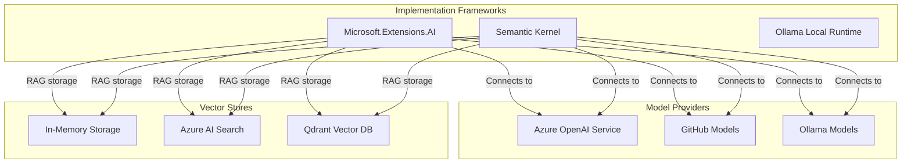
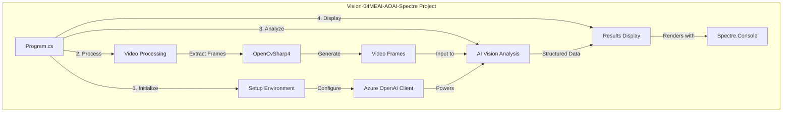
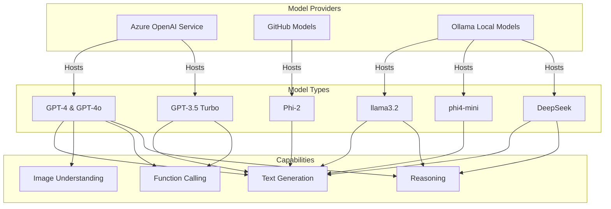

<!-- source: DeepWiki mcp.deepwiki.com · repo microsoft/Generative-AI-for-beginners-dotnet · page 7.1 Solution Structure · fetched 2026-10-26 -->

# Solution Structure

Relevant source files

The following files were used as context for generating this wiki page:

- [03-CoreGenerativeAITechniques/src/BasicChat-02SK/BasicChat-02SK.csproj](03-CoreGenerativeAITechniques/src/BasicChat-02SK/BasicChat-02SK.csproj)
- [03-CoreGenerativeAITechniques/src/BasicChat-04OllamaSK/BasicChat-04OllamaSK.csproj](03-CoreGenerativeAITechniques/src/BasicChat-04OllamaSK/BasicChat-04OllamaSK.csproj)
- [03-CoreGenerativeAITechniques/src/CoreGenerativeAITechniques.sln](03-CoreGenerativeAITechniques/src/CoreGenerativeAITechniques.sln)
- [03-CoreGenerativeAITechniques/src/RAGSimple-02MEAIVectorsMemory/RAGSimple-02MEAIVectorsMemory.csproj](03-CoreGenerativeAITechniques/src/RAGSimple-02MEAIVectorsMemory/RAGSimple-02MEAIVectorsMemory.csproj)
- [03-CoreGenerativeAITechniques/src/RAGSimple-03MEAIVectorsAISearch/RAGSimple-03MEAIVectorsAISearch.csproj](03-CoreGenerativeAITechniques/src/RAGSimple-03MEAIVectorsAISearch/RAGSimple-03MEAIVectorsAISearch.csproj)
- [03-CoreGenerativeAITechniques/src/RAGSimple-04MEAIVectorsQdrant/RAGSimple-04MEAIVectorsQdrant.csproj](03-CoreGenerativeAITechniques/src/RAGSimple-04MEAIVectorsQdrant/RAGSimple-04MEAIVectorsQdrant.csproj)
- [03-CoreGenerativeAITechniques/src/SKFunctions01/SKFunctions01.csproj](03-CoreGenerativeAITechniques/src/SKFunctions01/SKFunctions01.csproj)
- [03-CoreGenerativeAITechniques/src/Vision-04MEAI-AOAI-Spectre/Program.cs](03-CoreGenerativeAITechniques/src/Vision-04MEAI-AOAI-Spectre/Program.cs)
- [03-CoreGenerativeAITechniques/src/Vision-04MEAI-AOAI-Spectre/Vision-04MEAI-AOAI-Spectre.csproj](03-CoreGenerativeAITechniques/src/Vision-04MEAI-AOAI-Spectre/Vision-04MEAI-AOAI-Spectre.csproj)

This document provides a detailed overview of the solution structure in the Generative AI for .NET Developers course. It outlines the organization of projects, key components, and the relationships between different modules in the codebase. For information about development configuration and setup, see [Development Configuration](#7.2).

## Repository Organization

The Generative AI for .NET Developers course is organized around a modular solution structure that demonstrates various generative AI techniques through practical example projects. The primary solution file contains multiple projects grouped by technique category, allowing for a progressive learning experience from basic concepts to advanced implementations.

```mermaid
graph TD
    Solution["CoreGenerativeAITechniques.sln"]
    
    Solution --> BasicChat["01 Basic Chat"]
    Solution --> Functions["02 Functions"]
    Solution --> RAG["03 RAG"]
    Solution --> Vision["04 Vision Analysis"]
    Solution --> Audio["05 Audio"]
    Solution --> Agents["06 Agents"]
    Solution --> Reasoning["07 Reasoning"]
    
    BasicChat --> MEAI["BasicChat-01MEAI"]
    BasicChat --> SK["BasicChat-02SK"]
    BasicChat --> Ollama["BasicChat-03Ollama"]
    BasicChat --> OllamaSK["BasicChat-04OllamaSK"]
    
    Functions --> SKFunctions["SKFunctions01"]
    Functions --> MEAIFunctions["MEAIFunctions"]
    Functions --> MEAIFunctionsOllama["MEAIFunctionsOllama"]
    
    RAG --> MEAIVectorsMemory["RAGSimple-02MEAIVectorsMemory"]
    RAG --> MEAIVectorsShared["MEAIVectorsShared"]
    RAG --> MEAIVectorsAISearch["RAGSimple-03MEAIVectorsAISearch"]
    RAG --> MEAIVectorsQdrant["RAGSimple-04MEAIVectorsQdrant"]
    RAG --> SKOllama["RAGSimple-10SKOllama"]
    RAG --> OllamaDeepSeek["RAGSimple-15Ollama-DeepSeekR1"]
    
    Vision --> GitHubModels["Vision-01MEAI-GitHubModels"]
    Vision --> VisionOllama["Vision-02MEAI-Ollama"]
    Vision --> VisionAOAI["Vision-03MEAI-AOAI"]
    Vision --> VisionAOAISpectre["Vision-04MEAI-AOAI-Spectre"]
    
    Audio --> SpeechMic["Audio-01-SpeechMic"]
    Audio --> RealTimeAudio["Audio-02-RealTimeAudio"]
    
    Agents --> AgentLabsSimple["AgentLabs-01-Simple"]
    Agents --> AgentLabsFunctions["AgentLabs-02-Functions"]
    Agents --> AgentLabsOpenAPIs["AgentLabs-03-OpenAPIs"]
    
    Reasoning --> ReasoningLabsSK["ReasoningLabs-01-SK"]
```

Sources: [03-CoreGenerativeAITechniques/src/CoreGenerativeAITechniques.sln:1-385]()

## Implementation Frameworks

The solution demonstrates three primary implementation patterns for generative AI in .NET applications:

1. **Microsoft.Extensions.AI (MEAI)**: Core library providing standardized AI integration for .NET applications
2. **Semantic Kernel (SK)**: SDK for integrating LLMs with conventional programming
3. **Ollama**: Framework for running open-source large language models locally

These implementation patterns connect to various model providers and storage backends as illustrated below:

Sources: [03-CoreGenerativeAITechniques/src/BasicChat-01MEAI/BasicChat-01MEAI.csproj](), [03-CoreGenerativeAITechniques/src/BasicChat-02SK/BasicChat-02SK.csproj:1-19](), [03-CoreGenerativeAITechniques/src/BasicChat-03Ollama/BasicChat-03Ollama.csproj](), [03-CoreGenerativeAITechniques/src/BasicChat-04OllamaSK/BasicChat-04OllamaSK.csproj:1-18]()

## Project Categories and Dependencies

The solution is organized into seven primary categories, each containing multiple example projects:

### 1. Basic Chat

Projects demonstrating fundamental chat completion capabilities using different frameworks:

| Project | Purpose | Key Dependencies |
|---------|---------|------------------|
| BasicChat-01MEAI | Basic chat using Microsoft.Extensions.AI | Microsoft.Extensions.AI |
| BasicChat-02SK | Basic chat using Semantic Kernel | Microsoft.SemanticKernel |
| BasicChat-03Ollama | Basic chat using Ollama directly | Ollama client libraries |
| BasicChat-04OllamaSK | Basic chat using SK with Ollama | Microsoft.SemanticKernel.Connectors.Ollama |

Sources: [03-CoreGenerativeAITechniques/src/BasicChat-02SK/BasicChat-02SK.csproj:1-19](), [03-CoreGenerativeAITechniques/src/BasicChat-04OllamaSK/BasicChat-04OllamaSK.csproj:1-18]()

### 2. Functions

Projects demonstrating function calling capabilities with generative AI:

| Project | Purpose | Key Dependencies |
|---------|---------|------------------|
| SKFunctions01 | Function calling with Semantic Kernel | Microsoft.SemanticKernel |
| MEAIFunctions | Function calling with MEAI | Microsoft.Extensions.AI |
| MEAIFunctionsOllama | Function calling with MEAI and Ollama | Microsoft.Extensions.AI.Ollama |

Sources: [03-CoreGenerativeAITechniques/src/SKFunctions01/SKFunctions01.csproj:1-19]()

### 3. RAG (Retrieval-Augmented Generation)

Projects demonstrating RAG patterns with different vector stores:

| Project | Purpose | Key Dependencies |
|---------|---------|------------------|
| MEAIVectorsShared | Shared code for RAG examples | Vector data utilities |
| RAGSimple-02MEAIVectorsMemory | RAG with in-memory vector store | Microsoft.SemanticKernel.Connectors.InMemory |
| RAGSimple-03MEAIVectorsAISearch | RAG with Azure AI Search | Microsoft.SemanticKernel.Connectors.AzureAISearch |
| RAGSimple-04MEAIVectorsQdrant | RAG with Qdrant database | Microsoft.SemanticKernel.Connectors.Qdrant |
| RAGSimple-10SKOllama | RAG with Semantic Kernel and Ollama | Microsoft.SemanticKernel, Ollama connectors |
| RAGSimple-15Ollama-DeepSeekR1 | RAG with DeepSeek model via Ollama | Ollama connectors |

Sources: [03-CoreGenerativeAITechniques/src/RAGSimple-02MEAIVectorsMemory/RAGSimple-02MEAIVectorsMemory.csproj:1-17](), [03-CoreGenerativeAITechniques/src/RAGSimple-03MEAIVectorsAISearch/RAGSimple-03MEAIVectorsAISearch.csproj:1-24](), [03-CoreGenerativeAITechniques/src/RAGSimple-04MEAIVectorsQdrant/RAGSimple-04MEAIVectorsQdrant.csproj:1-21]()

### 4. Vision Analysis

Projects demonstrating vision AI capabilities:

| Project | Purpose | Key Dependencies |
|---------|---------|------------------|
| Vision-01MEAI-GitHubModels | Vision analysis using GitHub Models | Microsoft.Extensions.AI, OpenCvSharp4 |
| Vision-02MEAI-Ollama | Vision analysis using Ollama | Microsoft.Extensions.AI.Ollama, OpenCvSharp4 |
| Vision-03MEAI-AOAI | Vision analysis using Azure OpenAI | Azure.AI.OpenAI, OpenCvSharp4 |
| Vision-04MEAI-AOAI-Spectre | Vision analysis with rich console output | Spectre.Console, Azure.AI.OpenAI, OpenCvSharp4 |

Sources: [03-CoreGenerativeAITechniques/src/Vision-04MEAI-AOAI-Spectre/Vision-04MEAI-AOAI-Spectre.csproj:1-30](), [03-CoreGenerativeAITechniques/src/Vision-04MEAI-AOAI-Spectre/Program.cs:1-157]()

### 5. Audio

Projects demonstrating audio AI capabilities:

| Project | Purpose | Key Dependencies |
|---------|---------|------------------|
| Audio-01-SpeechMic | Speech recognition from microphone | Speech recognition libraries |
| Audio-02-RealTimeAudio | Real-time audio processing | Audio processing libraries |

### 6. Agents

Projects demonstrating AI agent capabilities:

| Project | Purpose | Key Dependencies |
|---------|---------|------------------|
| AgentLabs-01-Simple | Simple AI agent implementation | Agent framework libraries |
| AgentLabs-02-Functions | Agents with function calling | Agent framework, function libraries |
| AgentLabs-03-OpenAPIs | Agents with OpenAPI integration | Agent framework, OpenAPI libraries |

### 7. Reasoning

Projects demonstrating reasoning capabilities:

| Project | Purpose | Key Dependencies |
|---------|---------|------------------|
| ReasoningLabs-01-SK | Reasoning with Semantic Kernel | Microsoft.SemanticKernel |

## Project Structure Example: Vision Analysis

To illustrate the typical project structure, let's examine the `Vision-04MEAI-AOAI-Spectre` project which demonstrates vision analysis using Azure OpenAI with Spectre Console for enhanced output formatting:

This project demonstrates a complete workflow:
1. Setup and configuration of Azure OpenAI client
2. Video processing with frame extraction using OpenCV
3. Vision analysis with the extracted frames sent to Azure OpenAI
4. Rich console output formatting using Spectre.Console

The project structure follows the pattern found in most examples in the solution, with specialized components depending on the technique being demonstrated.

Sources: [03-CoreGenerativeAITechniques/src/Vision-04MEAI-AOAI-Spectre/Program.cs:1-157](), [03-CoreGenerativeAITechniques/src/Vision-04MEAI-AOAI-Spectre/Vision-04MEAI-AOAI-Spectre.csproj:1-30]()

## Package Dependencies

The solution uses a variety of NuGet packages across its projects. Here's a summary of the key dependencies:

| Package | Description | Projects Using |
|---------|-------------|----------------|
| Microsoft.Extensions.AI | Core AI integration library | MEAI-based projects |
| Microsoft.Extensions.AI.Ollama | Ollama integration for MEAI | Ollama projects |
| Microsoft.SemanticKernel | Core Semantic Kernel SDK | SK-based projects |
| Microsoft.SemanticKernel.Connectors.Ollama | Ollama connector for SK | SK projects using Ollama |
| Microsoft.SemanticKernel.Connectors.InMemory | In-memory vector store for SK | RAG projects with in-memory storage |
| Microsoft.SemanticKernel.Connectors.AzureAISearch | Azure AI Search connector | RAG projects with Azure AI Search |
| Microsoft.SemanticKernel.Connectors.Qdrant | Qdrant connector for SK | RAG projects with Qdrant |
| Microsoft.Extensions.VectorData.Abstractions | Vector data abstraction | RAG projects |
| OpenCvSharp4 | .NET wrapper for OpenCV | Vision projects |
| Azure.AI.OpenAI | Client for Azure OpenAI | Azure OpenAI projects |
| Spectre.Console | Rich console UI | Projects with enhanced console output |

Sources: [03-CoreGenerativeAITechniques/src/BasicChat-02SK/BasicChat-02SK.csproj:1-19](), [03-CoreGenerativeAITechniques/src/BasicChat-04OllamaSK/BasicChat-04OllamaSK.csproj:1-18](), [03-CoreGenerativeAITechniques/src/Vision-04MEAI-AOAI-Spectre/Vision-04MEAI-AOAI-Spectre.csproj:1-30](), [03-CoreGenerativeAITechniques/src/RAGSimple-02MEAIVectorsMemory/RAGSimple-02MEAIVectorsMemory.csproj:1-17](), [03-CoreGenerativeAITechniques/src/RAGSimple-03MEAIVectorsAISearch/RAGSimple-03MEAIVectorsAISearch.csproj:1-24](), [03-CoreGenerativeAITechniques/src/RAGSimple-04MEAIVectorsQdrant/RAGSimple-04MEAIVectorsQdrant.csproj:1-21](), [03-CoreGenerativeAITechniques/src/SKFunctions01/SKFunctions01.csproj:1-19]()

## Model Providers Integration

The solution demonstrates integration with multiple model providers, each supporting different capabilities:

This integration framework allows the solution to demonstrate various AI techniques with different model providers, showcasing the flexibility and interoperability of the .NET AI ecosystem.

Sources: [03-CoreGenerativeAITechniques/src/CoreGenerativeAITechniques.sln:1-385]()

## Conclusion

The solution structure for the Generative AI for .NET Developers course is designed to provide a comprehensive learning path through various generative AI techniques and implementation patterns. By organizing projects into thematic categories and demonstrating multiple implementation approaches, the solution enables developers to explore different aspects of generative AI development in .NET systematically.

Each project in the solution follows similar patterns but focuses on specific techniques, services, or integration points, providing a rich set of examples that developers can learn from and adapt to their own applications.

---

