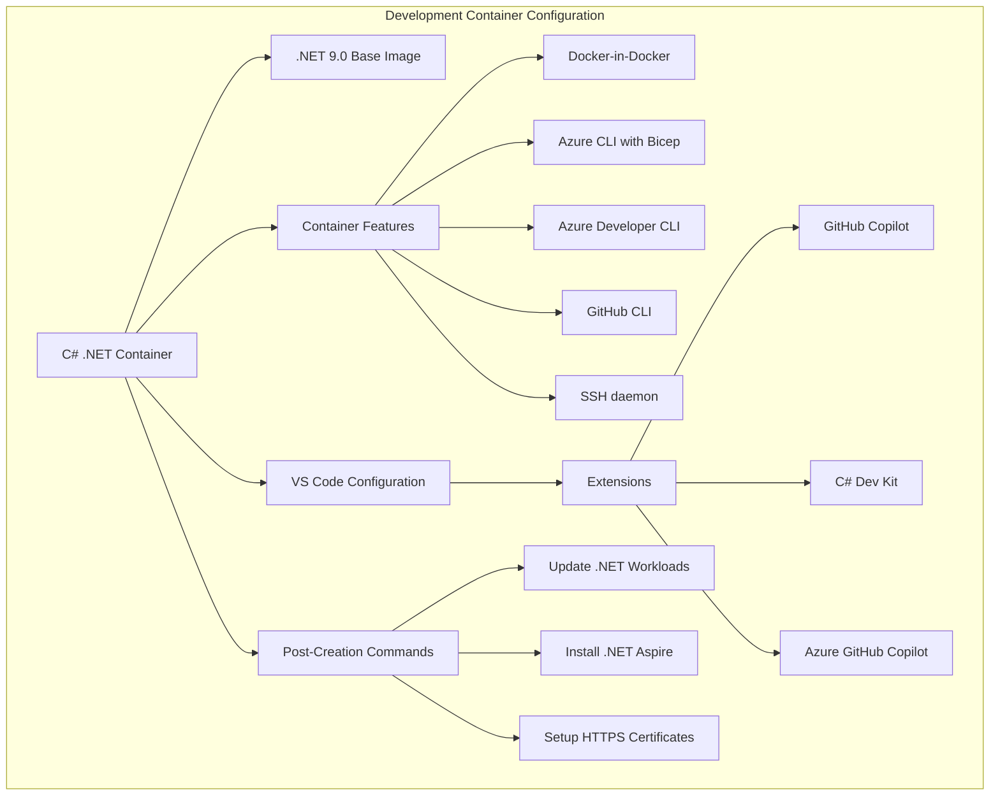
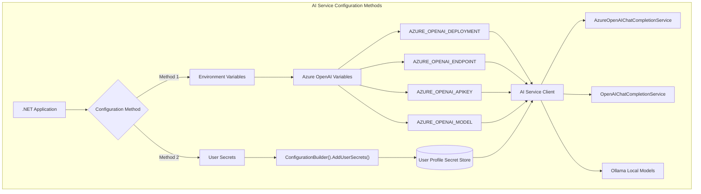
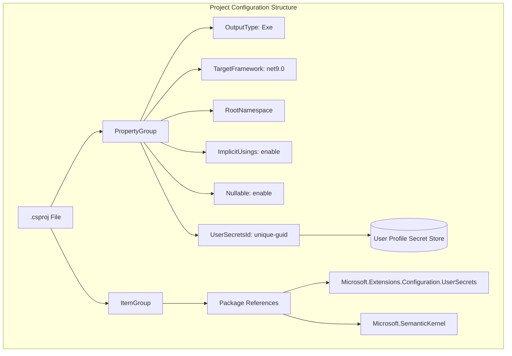

<!-- source: DeepWiki mcp.deepwiki.com · repo microsoft/Generative-AI-for-beginners-dotnet · page 7.2 Development Configuration · fetched 2026-10-26 -->

# Development Configuration

<details>
<summary>Relevant source files</summary>

The following files were used as context for generating this wiki page:

- [.devcontainer/devcontainer.json](.devcontainer/devcontainer.json)
- [.gitignore](.gitignore)
- [03-CoreGenerativeAITechniques/src/ReasoningLabs-01-SK/Program.cs](03-CoreGenerativeAITechniques/src/ReasoningLabs-01-SK/Program.cs)
- [03-CoreGenerativeAITechniques/src/ReasoningLabs-01-SK/ReasoningLabs-01-SK.csproj](03-CoreGenerativeAITechniques/src/ReasoningLabs-01-SK/ReasoningLabs-01-SK.csproj)
- [LICENSE](LICENSE)

</details>


This document provides a detailed explanation of the development configuration options and settings used throughout the Generative AI for .NET Developers course codebase. It covers development container settings, environment configuration, and project-specific configurations that ensure consistent development experiences across different environments. For information about the overall solution structure and component organization, see [Solution Structure](#7.1).

## Development Container Configuration

The repository uses GitHub Codespaces as the primary development environment, configured through a dedicated configuration file. This setup ensures a consistent experience regardless of the developer's local machine.

### Container Definition and Features

The development container is defined in the repository's devcontainer configuration file:



Sources: [.devcontainer/devcontainer.json:1-48]()

### Hardware Requirements

The development container specifies minimum hardware requirements to ensure optimal performance when working with large language models:

| Requirement | Minimum Value |
|-------------|---------------|
| Memory      | 16 GB         |
| CPUs        | 4 cores       |

Sources: [.devcontainer/devcontainer.json:44-47]()

### Port Forwarding

The container configuration includes port forwarding settings to expose services running inside the container:

- Port 17057 is forwarded for HTTP protocol access

Sources: [.devcontainer/devcontainer.json:31-36]()

## Environment Configuration

### Configuration Methods

The projects in this repository support multiple configuration methods for providing AI service credentials and other settings:



Sources: [03-CoreGenerativeAITechniques/src/ReasoningLabs-01-SK/Program.cs:1-52]()

### Storing API Keys and Endpoints

The codebase demonstrates two primary methods for handling sensitive configuration like API keys:

1. **Environment Variables**
   ```csharp
   var deploymentName = Environment.GetEnvironmentVariable("AZURE_OPENAI_DEPLOYMENT");
   var endpoint = Environment.GetEnvironmentVariable("AZURE_OPENAI_ENDPOINT");
   var apiKey = Environment.GetEnvironmentVariable("AZURE_OPENAI_APIKEY");
   var modelId = Environment.GetEnvironmentVariable("AZURE_OPENAI_MODEL");
   ```

2. **User Secrets**
   ```csharp
   var config = new ConfigurationBuilder().AddUserSecrets<Program>().Build();
   deploymentName = config["AZURE_OPENAI_DEPLOYMENT"];
   endpoint = config["AZURE_OPENAI_ENDPOINT"];
   apiKey = config["AZURE_OPENAI_APIKEY"];
   modelId = config["AZURE_OPENAI_MODEL"];
   ```

Sources: [03-CoreGenerativeAITechniques/src/ReasoningLabs-01-SK/Program.cs:9-22]()

### AI Service Client Configuration

The configuration values are then used to initialize appropriate AI service clients:

1. **Azure OpenAI Configuration**
   ```csharp
   var chatService = new AzureOpenAIChatCompletionService(
       deploymentName: deploymentName, 
       endpoint: endpoint,
       apiKey: apiKey,
       modelId: modelId
   );
   ```

2. **OpenAI API Configuration**
   ```csharp
   var chatService = new OpenAIChatCompletionService(
       modelId: "o3-mini",  // OpenAI API endpoint
       apiKey: ""  // Your OpenAI API key
   );
   ```

Sources: [03-CoreGenerativeAITechniques/src/ReasoningLabs-01-SK/Program.cs:24-39]()

## Project Configuration

### Project File Structure

The projects in this repository are configured with standard .NET project settings:



Sources: [03-CoreGenerativeAITechniques/src/ReasoningLabs-01-SK/ReasoningLabs-01-SK.csproj:1-17]()

### Key Project Settings

The sample project file demonstrates several important configuration settings:

| Setting | Value | Purpose |
|---------|-------|---------|
| TargetFramework | net9.0 | Specifies .NET 9.0 as the target framework |
| ImplicitUsings | enable | Enables implicit using directives |
| Nullable | enable | Enables nullable reference types |
| UserSecretsId | unique GUID | Identifies this project's user secrets store |

Sources: [03-CoreGenerativeAITechniques/src/ReasoningLabs-01-SK/ReasoningLabs-01-SK.csproj:3-9]()

### Common Package References

Projects typically include these key NuGet packages:

| Package | Version | Purpose |
|---------|---------|---------|
| Microsoft.Extensions.Configuration.UserSecrets | 9.0.2 | Enables user secrets management |
| Microsoft.SemanticKernel | 1.38.0 | Core SDK for working with AI models |

Additional packages might be included based on specific project requirements.

Sources: [03-CoreGenerativeAITechniques/src/ReasoningLabs-01-SK/ReasoningLabs-01-SK.csproj:12-15]()

## Source Control Configuration

### Git Ignore Settings

The repository includes a comprehensive `.gitignore` file to prevent committing sensitive information and build artifacts:

| Category | Examples |
|----------|----------|
| User-specific files | *.rsuser, *.suo, *.user |
| Build results | bin/, obj/, Debug/, Release/ |
| .NET Core files | project.lock.json, artifacts/ |
| VS Code files | .vscode/ (except specific allowed files) |
| Secrets | .env files, user secrets |

The `.gitignore` configuration helps maintain security by ensuring that sensitive configuration data like API keys and endpoints are never committed to the repository.

Sources: [.gitignore:1-401]()

## Recommended Development Workflow

Based on the configuration settings, the recommended development workflow is:

1. Fork or clone the repository
2. Open in GitHub Codespaces for the preconfigured environment
3. Configure AI service credentials using user secrets or environment variables
4. Build and run projects

For local development without Codespaces, developers should ensure they have:
- .NET 9.0 SDK
- Required workloads (especially .NET Aspire)
- Configured user secrets for API keys

Sources: [.devcontainer/devcontainer.json:1-48](), [03-CoreGenerativeAITechniques/src/ReasoningLabs-01-SK/Program.cs:1-52]()