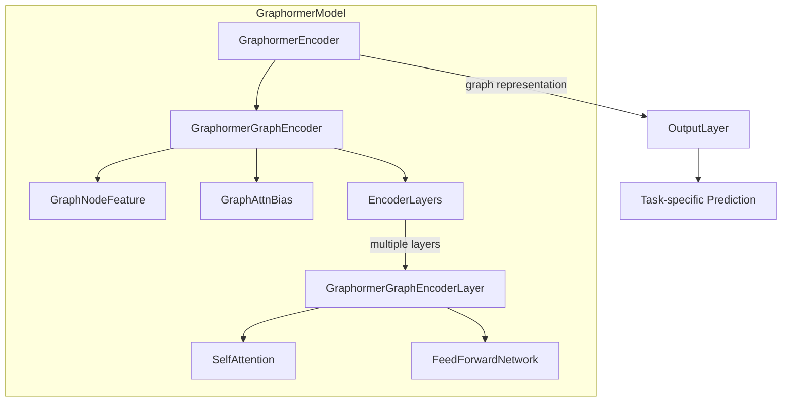
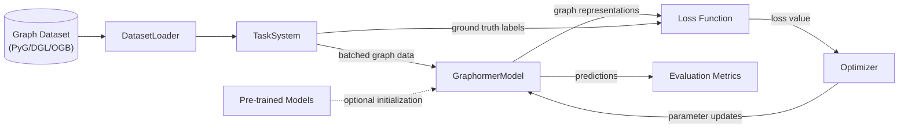
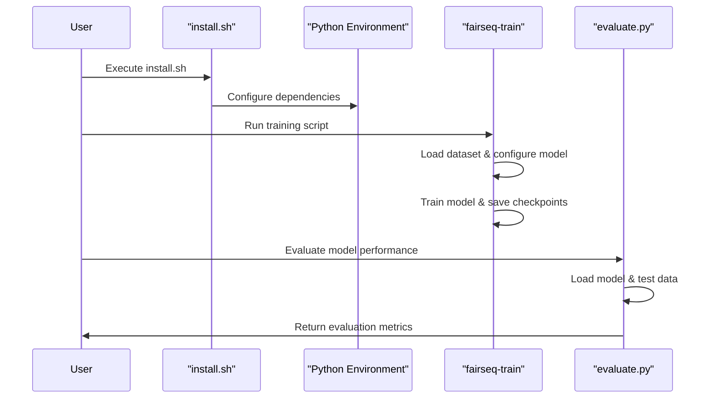

<!-- source: DeepWiki mcp.deepwiki.com · repo microsoft/Graphormer · page 1 Overview · fetched 2026-10-26 -->

# Overview

<details>
<summary>Relevant source files</summary>

The following files were used as context for generating this wiki page:

- [README.md](README.md)

</details>


Graphormer is a deep learning package designed for molecule modeling tasks. It provides a framework for researchers and developers to train custom models for applications in AI for molecule science, such as material discovery and drug discovery. This document introduces the purpose, key components, and architecture of the Graphormer system.

Sources: [README.md:1-5]()

## Purpose and Scope

Graphormer extends transformer architectures to graph-structured data, achieving state-of-the-art performance on molecular property prediction tasks. The framework has demonstrated its effectiveness by winning the 1st place in the quantum prediction track of the Open Graph Benchmark Large-Scale Challenge (KDD Cup 2021) and the Open Catalyst Challenge.

This page provides an introduction to the Graphormer repository and its high-level architecture. For installation instructions, see [Installation](#2), and for detailed model architecture information, see [Core Model Architecture](#3).

Sources: [README.md:3-4](), [README.md:13-17](), [README.md:29-31](), [README.md:41]()

## Key Features

Graphormer offers several key features that make it a powerful tool for molecule modeling:

- Support for interfaces and datasets from PyG (PyTorch Geometric), DGL (Deep Graph Library), OGB (Open Graph Benchmark), and OCP (Open Catalyst Project)
- Integration with the fairseq backbone for efficient training
- Pre-trained models on datasets such as PCQM4M and PCQM4Mv2
- Specialized components for graph encoding and processing
- Support for various graph-related tasks through a flexible task system

Sources: [README.md:13-18]()

## System Architecture

The Graphormer system consists of several interconnected components that work together to provide a comprehensive framework for graph-based deep learning.

### High-Level Architecture

Below is a diagram showing the main components of the Graphormer system and their relationships:

```mermaid
graph TD
    subgraph "Core Graphormer Framework"
        ModelSystem["Model System"] 
        TaskSystem["Task System"]
        DataSystem["Data System"]
        PretrainSystem["Pre-trained Model System"]
    end
    
    subgraph "User Interfaces & Utilities"
        Training["Training Scripts"]
        Evaluation["Evaluation Scripts"]
        Installation["Installation System"]
        Documentation["Documentation"]
    end
    
    ModelSystem <--> TaskSystem
    ModelSystem <-- "loads models" --> PretrainSystem
    TaskSystem <--> DataSystem
    
    Core --> UseAndUtilities
    
    Installation -.-> "|sets up environment|" Core
    Training --> "|configures and runs|" Core
    Evaluation --> "|tests|" Core
    Documentation -.-> "|describes|" Core
    Documentation -.-> "|guides|" UseAndUtilities
```

Sources: [README.md:13-18]()

### Core Components

1. **Model System**: Implements the Graphormer model architecture with specialized components for graph processing
2. **Task System**: Handles various graph prediction tasks (e.g., molecular property prediction, catalyst modeling)
3. **Data System**: Manages data loading and processing from different sources (PyG, DGL, OGB)
4. **Pre-trained Model System**: Provides access to pre-trained models for transfer learning

### Graphormer Model Architecture

The following diagram illustrates the component architecture of the Graphormer model:



The Graphormer model architecture adapts the transformer architecture for graph-structured data. It consists of:

- **Graphormer Encoder**: The main encoding component
- **Graph Node Feature**: Extracts and processes node features from the input graph
- **Graph Attention Bias**: Calculates attention biases based on graph structure
- **Encoder Layers**: A stack of transformer-like layers adapted for graphs
- **Self-Attention & Feed-Forward Networks**: Core components of the transformer architecture

Sources: [README.md:65-81]()

## Data Flow

The data flow through the Graphormer system during training and inference is illustrated below:



This diagram shows how:
1. Graph data is loaded from supported formats (PyG, DGL, OGB)
2. The Task System processes the data and feeds it to the Graphormer model
3. The model can optionally be initialized with pre-trained weights
4. During training, the model outputs are compared to ground truth labels to compute a loss
5. The optimizer updates model parameters based on the loss
6. During inference, model predictions are evaluated against metrics

Sources: [README.md:13-17]()

## Usage Workflow

The typical workflow for using Graphormer involves installation, training, and evaluation as shown in the sequence diagram below:



Users typically:
1. Set up the environment using the installation script
2. Train models using fairseq-based training scripts
3. Evaluate model performance using the evaluation scripts

Sources: [README.md:53-59]()

## Available Resources

Graphormer provides several resources to help users get started:

1. **Pre-trained Models**: Models trained on PCQM4M, PCQM4Mv2, and other datasets
2. **Example Scripts**: Command-line examples for common tasks
3. **Documentation**: Comprehensive documentation available online
4. **Benchmarks**: Technical reports describing performance on various datasets

For more information on these resources, see [Examples](https://github.com/microsoft/Graphormer/tree/main/examples) and the project [documentation](https://graphormer.readthedocs.io/).

Sources: [README.md:44-50]()

## Conclusion

Graphormer provides a powerful and flexible framework for graph-based deep learning with a focus on molecular modeling tasks. Its modular architecture, support for various data formats, and integration with established libraries make it suitable for both research and practical applications in fields such as material discovery and drug discovery.

To dive deeper into specific components, refer to the following pages:
- [Installation](#2) for setup instructions
- [Core Model Architecture](#3) for details on the model architecture
- [Task System](#4) for information on supported tasks
- [Data System](#5) for data handling capabilities
- [Pre-trained Models](#6) for using pre-trained models
- [Training and Evaluation](#7) for training and evaluation guidance

Sources: [README.md:1-104]()

---

