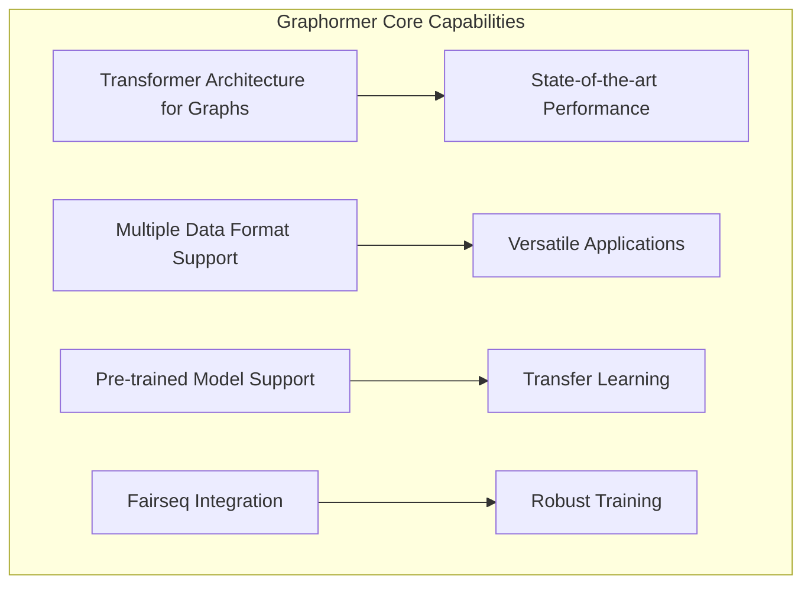
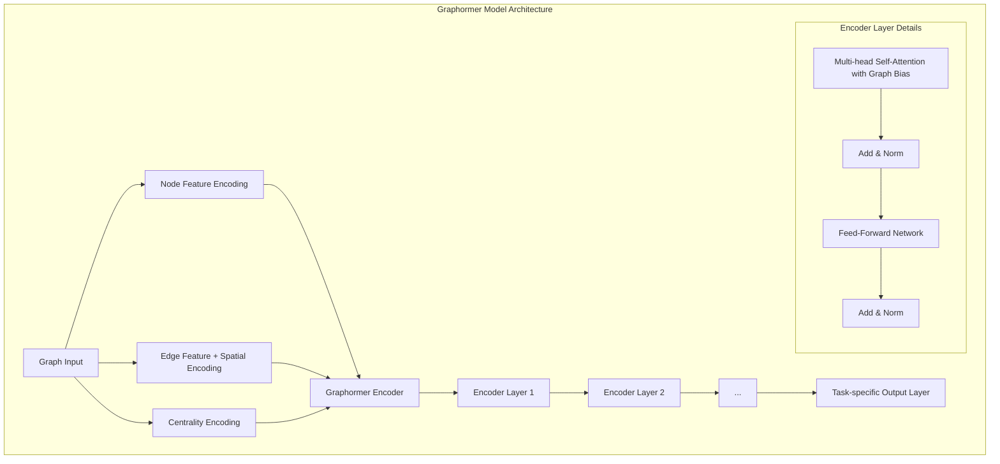
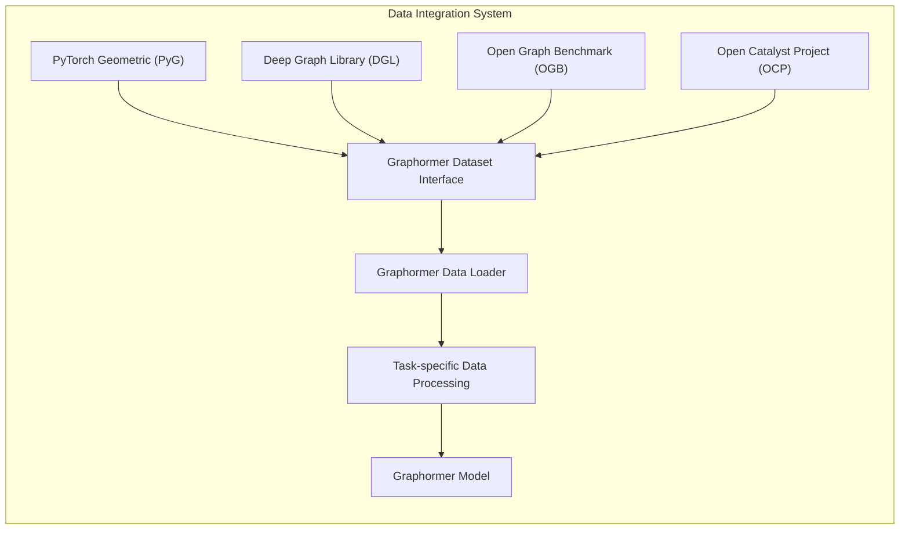
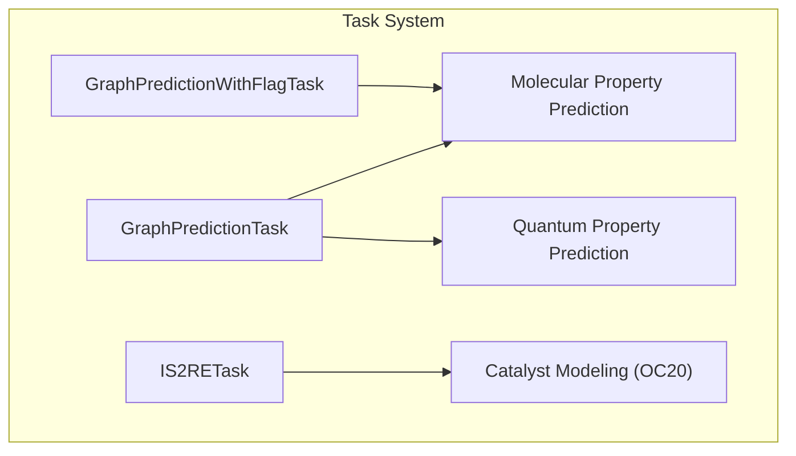
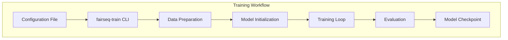

<!-- source: DeepWiki mcp.deepwiki.com · repo microsoft/Graphormer · page 1.1 Key Features · fetched 2026-10-26 -->

# Key Features

Relevant source files

The following files were used as context for generating this wiki page:

- [README.md](README.md)

This document outlines the key features and capabilities of the Graphormer framework, a deep learning package designed for molecule modeling tasks. For information about the overall system architecture, see [System Architecture](#1.2).

## Overview of Graphormer

Graphormer is a state-of-the-art graph transformer model that applies the transformer architecture to graph-structured data. Unlike traditional graph neural networks that rely on message passing, Graphormer introduces several innovative structural encoding methods that enable more powerful graph representations, leading to superior performance on various molecular modeling tasks.

Sources: [README.md:3-4](), [README.md:12-18]()

## Model Architecture Innovations

Graphormer's architecture introduces several key innovations that effectively adapt transformers for graph data:

1. **Centrality Encoding**: Incorporates graph-theoretic properties into node representations
2. **Spatial Encoding**: Captures structural information through shortest path distances between nodes
3. **Edge Encoding**: Represents edge features and connections in the attention bias
4. **Graph-level Global Attention**: Enables information exchange across the entire graph structure

Sources: [README.md:63-82]()

## Flexible Data Integration

Graphormer provides comprehensive support for various graph data formats and libraries, making it highly adaptable to different research and application contexts:

| Supported Format | Description |
|-----------------|-------------|
| PyG | PyTorch Geometric, a library for deep learning on irregular structures |
| DGL | Deep Graph Library, a package for graph neural networks |
| OGB | Open Graph Benchmark, a collection of benchmark datasets and tasks |
| OCP | Open Catalyst Project, focuses on catalyst modeling datasets |

This flexibility allows researchers to easily adapt Graphormer to their existing workflows without significant data transformation overhead.

Sources: [README.md:16]()

## Comprehensive Task Support

Graphormer supports a variety of graph-related tasks through dedicated task classes, making it adaptable to different applications in molecular science:

The modular task system allows for:
- Easy adaptation to new molecular modeling tasks
- Customization of loss functions and evaluation metrics
- Task-specific data preprocessing and augmentation

Sources: [README.md:14](), [README.md:29]()

## Pre-trained Models

Graphormer provides pre-trained models on large-scale molecular datasets, enabling transfer learning for downstream tasks:

| Pre-trained Model | Dataset | Description |
|-------------------|---------|-------------|
| PCQM4M | PCQM4M | Pre-trained on quantum chemical calculations dataset |
| PCQM4Mv2 | PCQM4Mv2 | Updated version with more molecular data |
| OC20 | Open Catalyst 2020 | For catalyst modeling applications |

These pre-trained models can significantly accelerate research by providing a strong initialization for various molecular modeling tasks, particularly valuable when working with limited labeled data.

Sources: [README.md:15]()

## Fairseq Integration

Graphormer integrates with the Fairseq framework, leveraging its robust infrastructure for:

- Distributed training across multiple GPUs and nodes
- Mixed precision training for improved computational efficiency
- Checkpointing and model serialization
- Advanced optimization techniques
- Experiment management

This integration provides a solid foundation for scaling up training to large datasets and complex models.

Sources: [README.md:17]()

## Performance Achievements

Graphormer has demonstrated exceptional performance in major competitions and benchmarks:

1. **1st place** in the quantum prediction track of the Open Graph Benchmark Large-Scale Challenge (KDD CUP 2021)
2. **Winner** of the Open Catalyst Challenge for catalyst modeling
3. **State-of-the-art** results on molecular property prediction benchmarks

These achievements validate Graphormer's effectiveness in capturing complex molecular structures and properties, making it a powerful tool for researchers in molecular science and drug discovery.

Sources: [README.md:29](), [README.md:41]()

## Technical Innovations

Graphormer introduces several technical innovations that differentiate it from traditional graph neural networks:

1. **Structural Encoding**: Novel methods to encode graph structure information into the transformer architecture
2. **Attention Mechanism**: Graph-specific attention bias that captures the connectivity patterns
3. **Scalability**: Efficient implementation that scales to large molecular graphs
4. **Generalizability**: Strong performance across diverse molecular datasets and tasks

These innovations address the limitations of previous approaches and establish a new paradigm for graph representation learning.

Sources: [README.md:63-82]()

---

