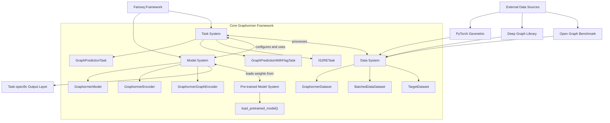
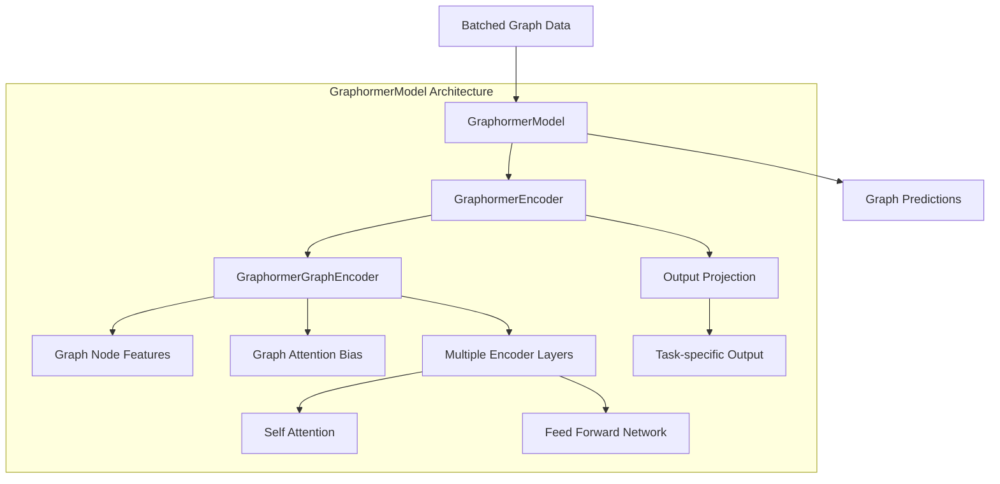
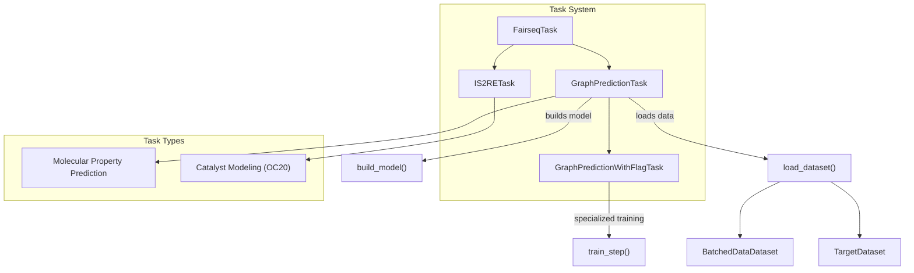
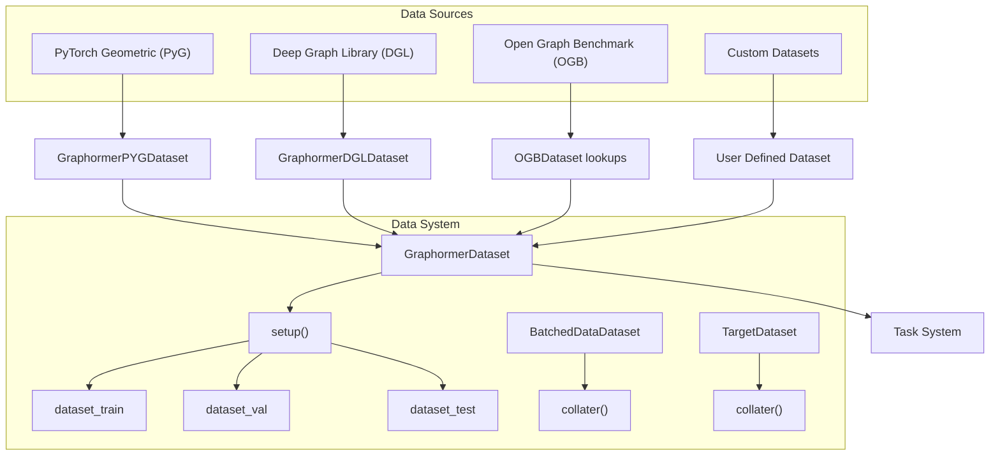
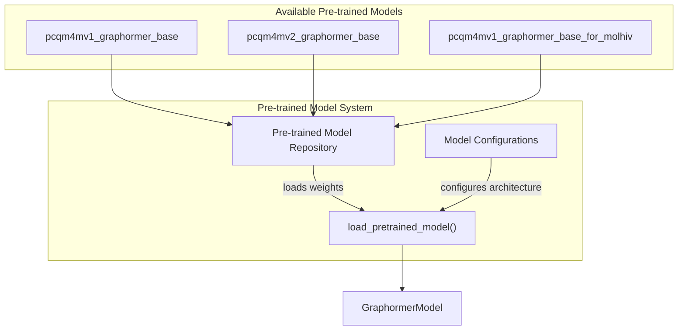
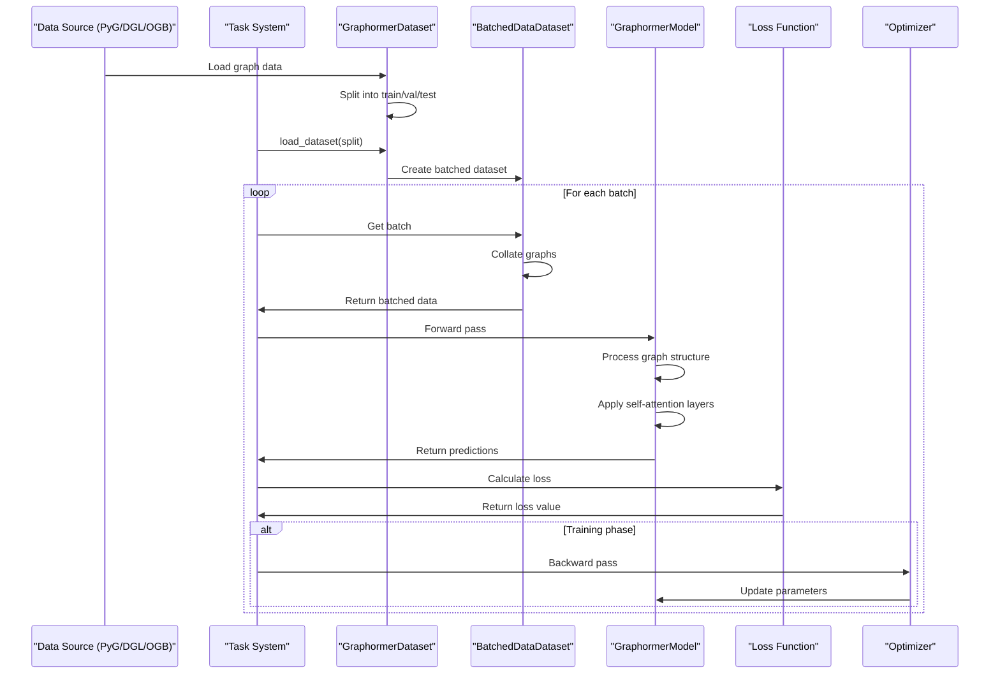

<!-- source: DeepWiki mcp.deepwiki.com · repo microsoft/Graphormer · page 1.2 System Architecture · fetched 2026-10-26 -->

# System Architecture

<details>
<summary>Relevant source files</summary>

The following files were used as context for generating this wiki page:

- [README.md](README.md)
- [examples/customized_dataset/customized_dataset.py](examples/customized_dataset/customized_dataset.py)
- [graphormer/data/dataset.py](graphormer/data/dataset.py)
- [graphormer/models/graphormer.py](graphormer/models/graphormer.py)
- [graphormer/tasks/graph_prediction.py](graphormer/tasks/graph_prediction.py)
- [graphormer/tasks/is2re.py](graphormer/tasks/is2re.py)

</details>


This document provides a comprehensive overview of the Graphormer system architecture, describing the main components, their interactions, and how data flows through the system. It explains the technical foundation of how Graphormer implements graph transformer models for molecular modeling tasks.

For information about installation procedures, see [Installation](#2), and for details about the core model design and theory, see [Core Model Architecture](#3).

## High-Level Architecture Overview

Graphormer is structured as a modular system with several key subsystems that work together to implement graph transformer functionality for molecular modeling tasks.



Sources: [graphormer/models/graphormer.py:33-152](), [graphormer/tasks/graph_prediction.py:133-221](), [graphormer/data/dataset.py:62-97]()

## Model System

The Model System is the core of the Graphormer architecture, implementing the graph transformer model that processes graph-structured data.



Sources: [graphormer/models/graphormer.py:33-152]()

The Model System consists of the following key components:

1. **GraphormerModel**: The top-level model class that inherits from `FairseqEncoderModel`. It serves as the entry point for model operations and handles initialization and loading of pre-trained models.

2. **GraphormerEncoder**: Encapsulates the encoding process and manages the conversion of graph inputs to embeddings and predictions.

3. **GraphormerGraphEncoder**: Implements the core graph transformer architecture, including specialized components for processing graph structure information.

The model includes several important architectural features:

| Feature | Description | Configuration Parameter |
|---------|-------------|-------------------------|
| Encoder Layers | Transformer encoder layers adapted for graphs | `encoder_layers` |
| Attention Heads | Multi-head self-attention mechanism | `encoder_attention_heads` |
| Embedding Dimension | Size of node embeddings | `encoder_embed_dim` |
| FFN Dimension | Feed-forward network dimension | `encoder_ffn_embed_dim` |
| Pre-LayerNorm | Apply LayerNorm before self-attention | `pre_layernorm` |
| Graph-specific Components | Special encodings for graph structure | `edge_type`, `multi_hop_max_dist` |

Sources: [graphormer/models/graphormer.py:155-252]()

## Task System

The Task System defines how Graphormer handles different graph-related machine learning tasks, providing task-specific data handling, training procedures, and evaluation methods.



Sources: [graphormer/tasks/graph_prediction.py:133-221](), [graphormer/tasks/graph_prediction.py:271-362](), [graphormer/tasks/is2re.py:240-302]()

The Task System includes the following main task implementations:

1. **GraphPredictionTask**: The base task for graph property prediction (classification or regression), which handles loading datasets, building models, and managing the training/evaluation workflow.

2. **GraphPredictionWithFlagTask**: An extended version of the graph prediction task that implements the FREE Large-scale Adversarial (FLAG) augmentation technique for improved training.

3. **IS2RETask**: A specialized task for the Initial Structure to Relaxed Energy prediction task in the Open Catalyst 2020 (OC20) dataset, which predicts material properties for catalyst discovery.

Key task configurations:

| Configuration | Description | Default |
|---------------|-------------|---------|
| `dataset_name` | Name of the dataset to use | "pcqm4m" |
| `dataset_source` | Source of graph dataset (pyg, dgl, ogb, smiles) | "pyg" |
| `max_nodes` | Maximum number of nodes per graph | 128 |
| `multi_hop_max_dist` | Maximum distance for multi-hop edges | 5 |
| `spatial_pos_max` | Maximum spatial position | 1024 |

Sources: [graphormer/tasks/graph_prediction.py:43-130]()

## Data System

The Data System handles loading, processing, and batching of graph data from various sources for use by the Graphormer model.



Sources: [graphormer/data/dataset.py:62-97](), [graphormer/data/dataset.py:20-43](), [examples/customized_dataset/customized_dataset.py:6-24]()

The Data System consists of these main components:

1. **GraphormerDataset**: The central class that manages dataset loading, processing, and splitting into train/validation/test sets. It supports multiple data sources including PyG, DGL, and OGB.

2. **BatchedDataDataset**: Handles batching of graph data and implements the collation function to create properly formatted batches for the model.

3. **TargetDataset**: Handles the target labels/values for supervised learning tasks.

4. **EpochShuffleDataset**: A wrapper that provides epoch-level shuffling of datasets.

The Data System supports customized datasets through a registration mechanism:

```python
@register_dataset("customized_qm9_dataset")
def create_customized_dataset():
    dataset = QM9(label_keys=["mu"])
    # Set up train/valid/test splits
    # ...
    return {
        "dataset": dataset,
        "train_idx": train_idx,
        "valid_idx": valid_idx,
        "test_idx": test_idx,
        "source": "dgl"
    }
```

Sources: [examples/customized_dataset/customized_dataset.py:6-24]()

## Pre-trained Model System

Graphormer supports pre-trained models through a simple loading mechanism, allowing transfer learning from models trained on large datasets.



Sources: [graphormer/models/graphormer.py:41-45](), [graphormer/models/graphormer.py:281-305]()

The pre-trained model system allows users to:

1. Specify a pre-trained model by name in the configuration
2. Optionally load or omit the output layer parameters (useful for transfer learning)
3. Access models pre-trained on large molecular datasets like PCQM4M

The system configures the model architecture automatically based on the pre-trained model specification:

```python
if args.pretrained_model_name != "none":
    self.load_state_dict(load_pretrained_model(args.pretrained_model_name))
    if not args.load_pretrained_model_output_layer:
        self.encoder.reset_output_layer_parameters()
```

Sources: [graphormer/models/graphormer.py:41-45]()

## Data Flow During Training and Inference

The following diagram illustrates how data flows through the Graphormer system during training and inference:



Sources: [graphormer/tasks/graph_prediction.py:181-221](), [graphormer/models/graphormer.py:151-152]()

During training, the system:

1. Loads data from the specified source (PyG, DGL, OGB) through the GraphormerDataset
2. The task system manages batching and feeding data to the model
3. The model processes the graph data through its transformer-based architecture
4. Loss is calculated and backpropagation updates the model parameters

During inference, the same flow is followed except for the backpropagation step.

## Comparison of Model Architectures

Graphormer provides several model architectures with different parameter sizes:

| Architecture | Embed Dim | Layers | Attention Heads | FFN Dim | Parameters | Use Case |
|--------------|-----------|--------|----------------|---------|------------|----------|
| graphormer_slim | 80 | 12 | 8 | 80 | ~0.5M | Resource-constrained environments |
| graphormer_base | 768 | 12 | 32 | 768 | ~47M | Standard usage |
| graphormer_large | 1024 | 24 | 32 | 1024 | ~130M | High-performance requirements |

Sources: [graphormer/models/graphormer.py:255-354]()

## Integration with External Libraries

Graphormer is built on top of Fairseq, a sequence modeling toolkit, and extends it for graph-structured data. It integrates with several external libraries:

1. **Fairseq**: Provides the core training infrastructure, including task management, model building, and distributed training capabilities.

2. **PyTorch Geometric (PyG)**: A library for deep learning on irregular data structures like graphs.

3. **Deep Graph Library (DGL)**: A framework for building graph neural networks.

4. **Open Graph Benchmark (OGB)**: A collection of benchmark datasets for graph-related machine learning tasks.

Graphormer provides adapters for each of these data sources, allowing users to leverage datasets from any of these libraries with minimal effort.

Sources: [graphormer/data/dataset.py:62-97]()

---

