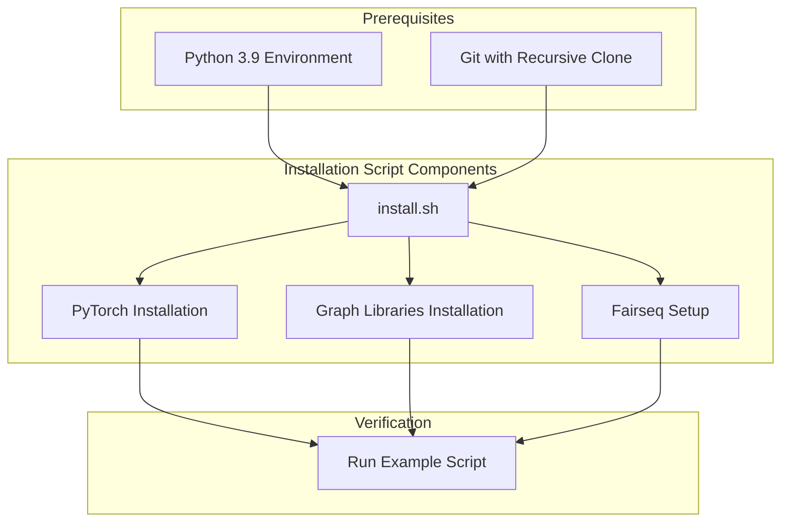
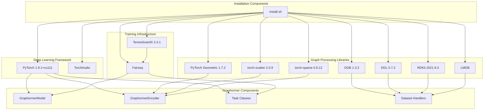
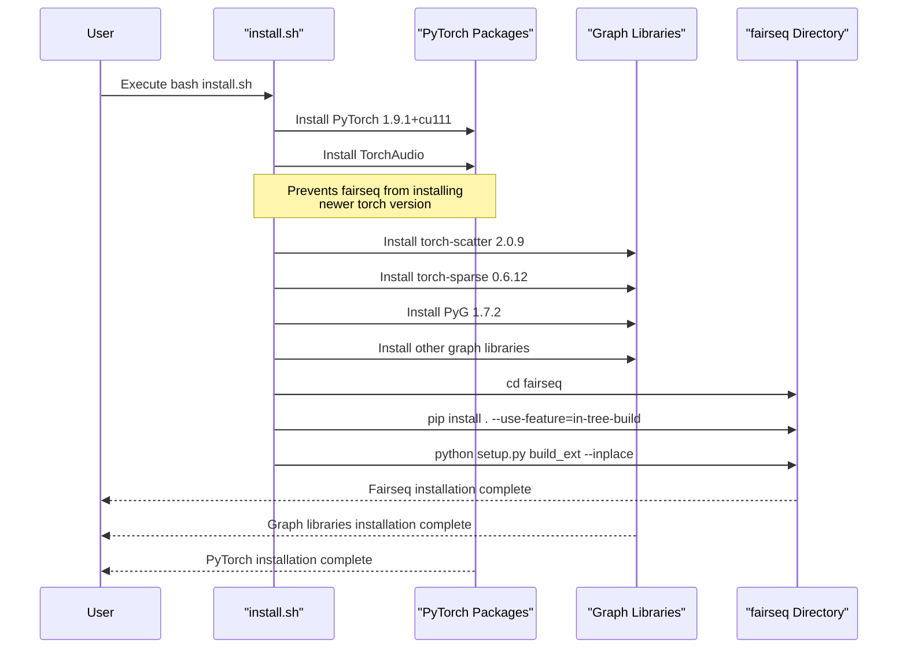

<!-- source: DeepWiki mcp.deepwiki.com · repo microsoft/Graphormer · page 2 Installation · fetched 2026-10-26 -->

# Installation

<details>
<summary>Relevant source files</summary>

The following files were used as context for generating this wiki page:

- [docs/Installation-Guide.rst](docs/Installation-Guide.rst)
- [install.sh](install.sh)

</details>


This document provides detailed instructions for setting up the Graphormer environment and installing all required dependencies. Graphormer requires specific package versions to ensure compatibility between components.

## System Requirements

- Linux operating system (currently the only supported platform)
- Python 3.9
- CUDA-capable GPU with CUDA 11.1 support (for optimal performance)

For information about using Graphormer after installation, see [Training and Evaluation](#7).

## Installation Workflow



Sources: [install.sh:1-23](), [docs/Installation-Guide.rst:1-26]()

## Step-by-Step Installation

### 1. Set Up Python Environment

Creating a dedicated virtual environment is strongly recommended to avoid package conflicts:

```bash
conda create -n graphormer python=3.9
conda activate graphormer
```

Sources: [docs/Installation-Guide.rst:10-17]()

### 2. Clone the Repository

Clone the Graphormer repository with the `--recursive` flag to include the fairseq submodule:

```bash
git clone --recursive https://github.com/microsoft/Graphormer.git
cd Graphormer
```

Sources: [docs/Installation-Guide.rst:19-25]()

### 3. Run the Installation Script

Execute the installation script to install all dependencies:

```bash
bash install.sh
```

Sources: [docs/Installation-Guide.rst:19-25]()

## Dependency Structure

The following diagram illustrates how the dependencies installed by `install.sh` relate to Graphormer's core components:



Sources: [install.sh:6-16]()

## Detailed Dependency Explanation

The `install.sh` script installs the following key dependencies:

| Component | Version | Purpose |
|-----------|---------|---------|
| PyTorch | 1.9.1+cu111 | Core deep learning framework |
| TorchAudio | - | Prevents version conflicts during fairseq installation |
| torch-scatter | 2.0.9 | Efficient scatter operations for graph data |
| torch-sparse | 0.6.12 | Sparse tensor operations for graph data |
| PyTorch Geometric | 1.7.2 | Graph neural network library |
| TensorboardX | 2.4.1 | Training visualization and logging |
| OGB | 1.3.2 | Open Graph Benchmark datasets |
| RDKit | 2021.9.3 | Molecular data processing |
| DGL | 0.7.2 | Deep Graph Library for alternative graph representations |
| LMDB | - | Lightning Memory-Mapped Database for efficient data storage |
| Fairseq | - | Sequence modeling toolkit (installed from submodule) |

Sources: [install.sh:6-16]()

## Installation Process Details



Sources: [install.sh:7-22]()

## Troubleshooting

### Missing Fairseq Submodule
If the fairseq directory is empty or incomplete, initialize and update the submodule:
```bash
git submodule update --init --recursive
```

Sources: [install.sh:19-20]()

### CUDA Version Conflicts
The installation script specifies PyTorch with CUDA 11.1 support. If your system uses a different CUDA version, you may need to modify the installation script to use compatible PyTorch wheels.

### Dependency Version Conflicts
If you encounter conflicts with existing packages, create a fresh virtual environment and reinstall Graphormer.

## Verification

After installation, verify that Graphormer is correctly installed by running one of the example scripts from the repository. For instance, to run the PCQM4Mv2 property prediction example:

```bash
cd examples/property_prediction/
bash pcqv2.sh
```

A successful run confirms that the installation is complete and the system is functioning properly.

---

