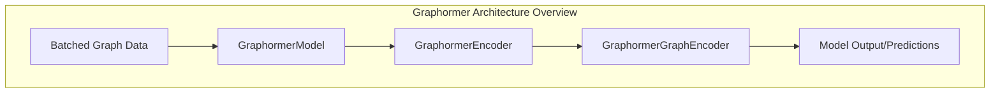
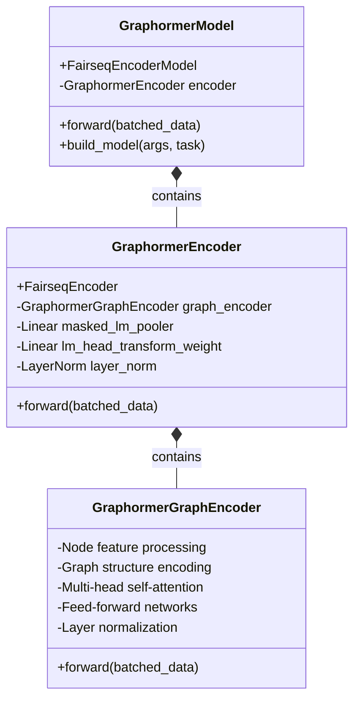
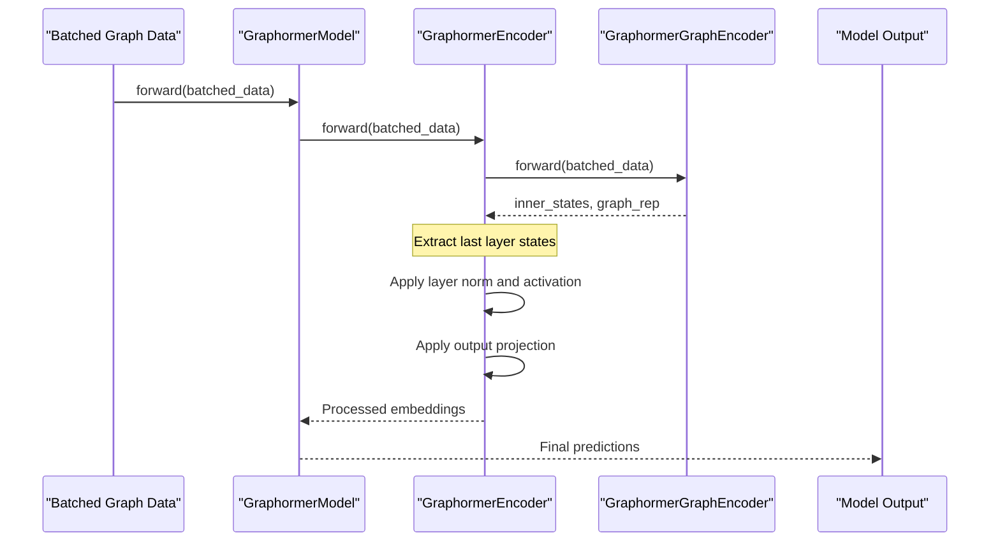
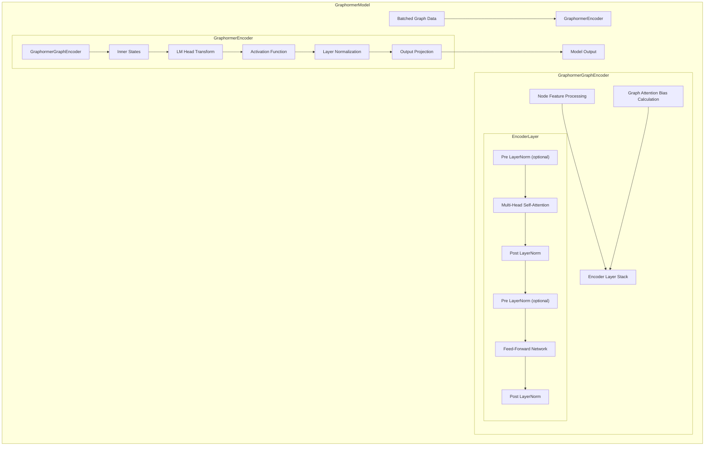

<!-- source: DeepWiki mcp.deepwiki.com · repo microsoft/Graphormer · page 3 Core Model Architecture · fetched 2026-10-26 -->

# Core Model Architecture

Relevant source files

The following files were used as context for generating this wiki page:

- [graphormer/models/graphormer.py](graphormer/models/graphormer.py)

This document describes the core architectural components of Graphormer, a graph neural network model that adapts the Transformer architecture for graph-structured data. For information about specific implementations of the graph encoder, see [Graph Encoder](#3.1). For details on the task system that uses this architecture, see [Task System](#4).

## Purpose and Overview

Graphormer extends the Transformer architecture to effectively process graph-structured data by introducing specialized graph-aware attention mechanisms and structural encodings. The model is designed to capture both node features and graph topology through its graph-aware self-attention mechanism.

Sources: [graphormer/models/graphormer.py:33-152](). [graphormer/models/graphormer.py:155-252]()

## Main Components

The Graphormer architecture consists of three primary nested components that work together to process graph data:

Sources: [graphormer/models/graphormer.py:33-152](). [graphormer/models/graphormer.py:155-252]()

### GraphormerModel

`GraphormerModel` is the top-level model class that extends `FairseqEncoderModel`. It serves as the main entry point for the model and is responsible for:

- Initializing the encoder component
- Applying parameter initialization if specified
- Loading pre-trained models when requested
- Forwarding input data to the encoder
- Defining model configuration options through command-line arguments

The model is registered using Fairseq's model registry system with the name "graphormer" to make it available for training and inference.

Sources: [graphormer/models/graphormer.py:33-152]()

### GraphormerEncoder

`GraphormerEncoder` extends `FairseqEncoder` and serves as an intermediate layer between the main model class and the graph-specific encoder. Its responsibilities include:

- Initializing the graph encoder with appropriate parameters
- Processing the encoder outputs through a transformation pipeline
- Applying layer normalization and activation functions
- Projecting embeddings to output dimensions for prediction tasks
- Managing output layer parameters

The encoder also handles the option to share input and output embeddings, which can reduce model parameters.

Sources: [graphormer/models/graphormer.py:155-252]()

### GraphormerGraphEncoder

This is the core component that implements the graph-specific processing. It's imported from the modules directory and is responsible for:

- Processing node and edge features
- Computing attention biases based on graph structure
- Implementing the multi-head self-attention mechanism
- Running the feed-forward networks in each encoder layer
- Managing the encoder layer stack

For more detailed information on this component, see [Graph Encoder](#3.1).

## Data Flow

The following sequence diagram illustrates how data flows through the Graphormer model during a forward pass:

Sources: [graphormer/models/graphormer.py:151-152](). [graphormer/models/graphormer.py:217-241]()

## Model Configurations

Graphormer comes with four pre-configured architectures that vary in size and capacity:

| Architecture | Embed Dim | Layers | Attention Heads | FFN Dim | Description |
|--------------|-----------|--------|-----------------|---------|-------------|
| Base | 1024 | 6 | 8 | 4096 | Default configuration with moderate capacity |
| Graphormer Base | 768 | 12 | 32 | 768 | Used for pre-training on PCQM4Mv1/v2 datasets |
| Graphormer Slim | 80 | 12 | 8 | 80 | Lightweight model with fewer parameters |
| Graphormer Large | 1024 | 24 | 32 | 1024 | Highest capacity with more layers and parameters |

The model architecture can be selected and configured through command-line arguments, allowing customization of:
- Dropout rates (general, attention, activation)
- Embedding dimensions
- Number of layers and attention heads
- Activation functions
- Normalization strategies (pre-layernorm vs. post-layernorm)

Sources: [graphormer/models/graphormer.py:255-354]()

## Initialization and Parameter Configuration

Graphormer provides several options for model initialization:

1. **Custom Initialization**: When `apply_graphormer_init` is set to true, the model applies specialized parameter initialization through the `init_graphormer_params` function.

2. **Pre-trained Models**: The model can load weights from pre-trained checkpoints through the `pretrained_model_name` parameter.

3. **Output Layer Resetting**: When loading pre-trained models, the option `load_pretrained_model_output_layer` controls whether to keep or reset the output layer parameters, which is useful for transfer learning to different tasks.

The base architecture defines sensible defaults for all parameters, which can be customized through command-line arguments defined in the `add_args` method.

Sources: [graphormer/models/graphormer.py:39-45](). [graphormer/models/graphormer.py:47-132]()

## Detailed Architecture Diagram

The following diagram shows a more detailed view of the internal components and their connections:

Sources: [graphormer/models/graphormer.py:33-152](). [graphormer/models/graphormer.py:155-252]()

## Key Architectural Features

1. **Graph-aware Self-attention**: Extends vanilla transformer attention by incorporating graph structural information into the attention mechanism.

2. **Structural Encodings**: Captures graph topology through specialized positional encodings including degree features and spatial information.

3. **Pre/Post LayerNorm Options**: Provides flexibility in applying layer normalization either before or after self-attention and feed-forward networks, which can affect training stability and performance.

4. **Flexible Input/Output Embedding Sharing**: Supports optional sharing of input and output embeddings to reduce model parameters.

5. **Multi-scale Architecture Variants**: Offers several model sizes (base, slim, large) to balance between computational efficiency and model capacity.

6. **Pre-training Integration**: Built-in support for loading pre-trained models with options to reset the output layer for transfer learning.

Sources: [graphormer/models/graphormer.py:39-45](). [graphormer/models/graphormer.py:124-132](). [graphormer/models/graphormer.py:255-354]()

---

