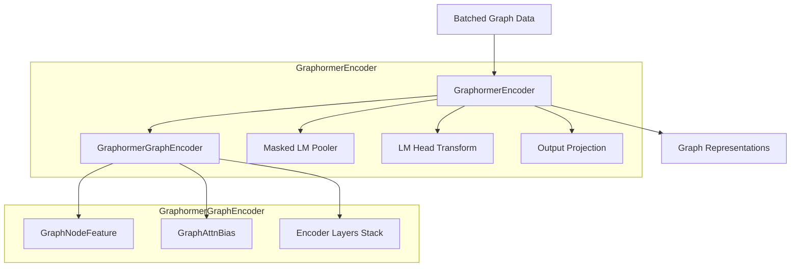
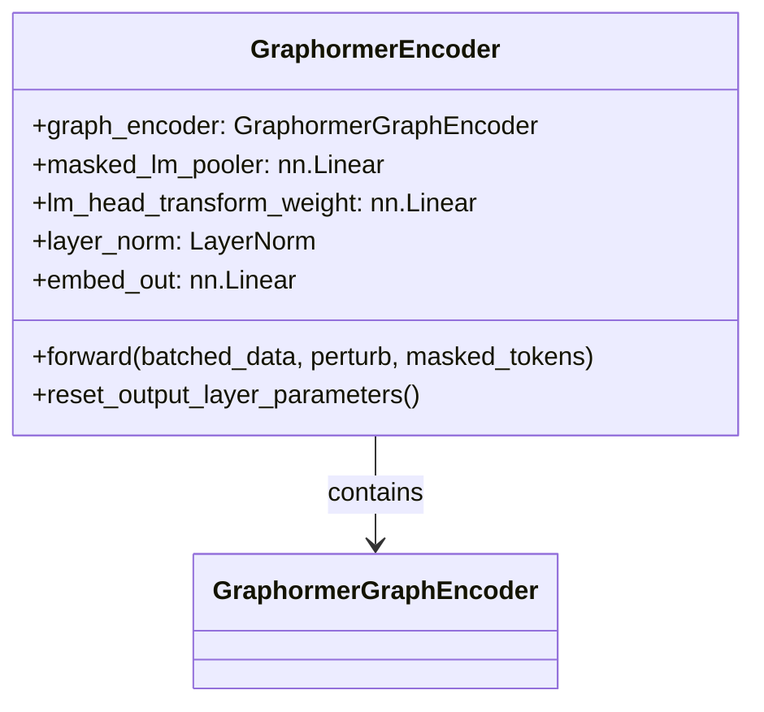
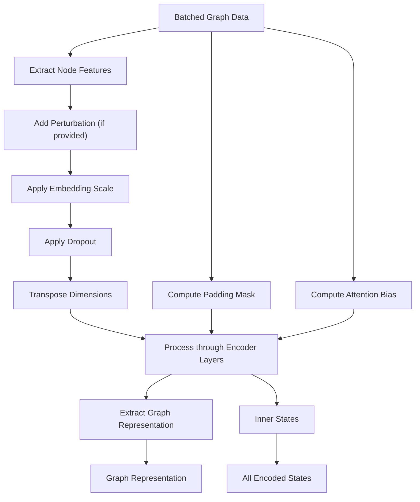
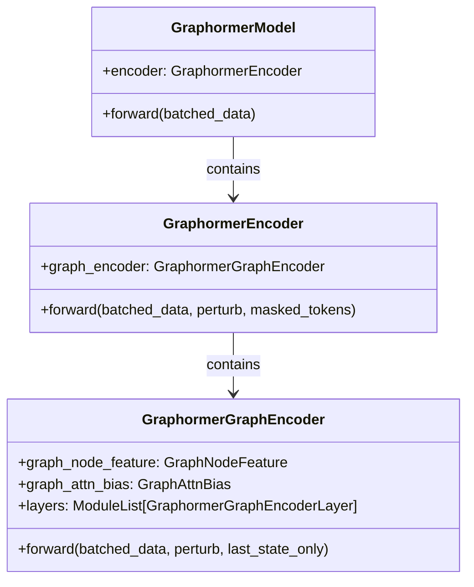

<!-- source: DeepWiki mcp.deepwiki.com · repo microsoft/Graphormer · page 3.1 Graph Encoder · fetched 2026-10-26 -->

# Graph Encoder

Relevant source files

The following files were used as context for generating this wiki page:

- [graphormer/models/graphormer.py](graphormer/models/graphormer.py)
- [graphormer/modules/graphormer_graph_encoder.py](graphormer/modules/graphormer_graph_encoder.py)

The Graph Encoder is a core component of the Graphormer architecture responsible for transforming graph-structured data into vector representations that can be used for downstream tasks such as molecular property prediction. It adapts the Transformer architecture to handle graph structures by incorporating graph-specific inductive biases.

For information about the overall Graphormer model architecture, see [Core Model Architecture](#3), and for details about specific encoder layers, see [Encoder Layers](#3.2).

## Architecture Overview

The Graph Encoder consists of two main components:
1. **GraphormerEncoder** - The high-level encoder that wraps the graph encoder implementation
2. **GraphormerGraphEncoder** - The core implementation that processes graph data

Sources: [graphormer/models/graphormer.py:155-252](), [graphormer/modules/graphormer_graph_encoder.py:45-263]()

## GraphormerEncoder

The `GraphormerEncoder` class serves as a high-level wrapper for the graph encoding process. It initializes the `GraphormerGraphEncoder` with parameters configured through the model architecture and handles additional processing for the encoded representations.

Key responsibilities include:
- Initializing and configuring the `GraphormerGraphEncoder`
- Managing the output layer for prediction tasks
- Processing the encoded representations for downstream tasks

Sources: [graphormer/models/graphormer.py:155-252]()

## GraphormerGraphEncoder

The `GraphormerGraphEncoder` is the core implementation of the graph encoding process. It processes graph-structured data by:
1. Extracting node features using `GraphNodeFeature`
2. Computing attention biases based on graph structure using `GraphAttnBias`
3. Processing these through a stack of `GraphormerGraphEncoderLayer`s

### Initialization and Parameters

The `GraphormerGraphEncoder` is initialized with parameters that define the model's capacity and behavior:

| Parameter              | Description                                           |
|------------------------|-------------------------------------------------------|
| num_atoms              | Size of atom type vocabulary                          |
| num_in_degree          | Maximum in-degree to consider                         |
| num_out_degree         | Maximum out-degree to consider                        |
| num_edges              | Size of edge type vocabulary                          |
| num_spatial            | Number of spatial embeddings                          |
| num_edge_dis           | Number of edge distance embeddings                    |
| edge_type              | Type of edge features to use                          |
| multi_hop_max_dist     | Maximum distance for multi-hop attention bias         |
| num_encoder_layers     | Number of transformer layers                          |
| embedding_dim          | Size of embeddings                                    |
| ffn_embedding_dim      | Size of feed-forward network                          |
| num_attention_heads    | Number of attention heads                             |
| dropout                | Dropout probability                                   |
| attention_dropout      | Attention dropout probability                         |
| activation_dropout     | Activation dropout probability                        |
| pre_layernorm          | Whether to apply layer norm before attention          |

Sources: [graphormer/modules/graphormer_graph_encoder.py:45-163]()

### Forward Pass

The forward pass through the `GraphormerGraphEncoder` processes batched graph data as follows:

Key steps in the forward pass:
1. Compute padding mask for multi-head attention
2. Extract node features using `GraphNodeFeature`
3. Compute attention biases using `GraphAttnBias`
4. Apply embedding scale, quantization noise, and layer normalization if configured
5. Process through the stack of encoder layers
6. Extract the graph-level representation and return it along with all encoded states

Sources: [graphormer/modules/graphormer_graph_encoder.py:192-263]()

## Key Components

### GraphNodeFeature

The `GraphNodeFeature` component processes node features such as atom types, in-degree, and out-degree. It embeds these features into vectors of the model's hidden dimension, creating the initial node representations that will be processed by the encoder layers.

### GraphAttnBias

The `GraphAttnBias` component computes attention biases based on graph structure. It uses information such as:
- Multi-hop distances between nodes
- Spatial positions of nodes
- Edge types and features

These biases are added to the attention scores in the self-attention mechanism, allowing the model to incorporate graph structural information into the attention computation.

### Encoder Layers

The `GraphormerGraphEncoder` contains a stack of `GraphormerGraphEncoderLayer`s, each consisting of:
- A multi-head self-attention mechanism
- A feed-forward network
- Layer normalization components

Each layer processes the output of the previous layer, gradually refining the node representations. The structure and function of these layers are detailed in [Encoder Layers](#3.2).

## Usage in the Graphormer Model

The Graph Encoder is used by the `GraphormerModel` class, which is the main entry point for the Graphormer architecture. The model initializes the encoder and uses it to process graph data, then passes the encoded representations to task-specific heads for prediction.

Sources: [graphormer/models/graphormer.py:33-152](), [graphormer/models/graphormer.py:155-252](), [graphormer/modules/graphormer_graph_encoder.py:45-263]()

## Configuration Examples

The Graphormer architecture provides several predefined configurations for the Graph Encoder, such as:

| Configuration | Embedding Dim | Encoder Layers | Attention Heads | FFN Dim | Description |
|---------------|---------------|----------------|-----------------|---------|-------------|
| Base          | 768           | 12             | 32              | 768     | Standard configuration for most tasks |
| Slim          | 80            | 12             | 8               | 80      | Lightweight configuration for resource-constrained environments |
| Large         | 1024          | 24             | 32              | 1024    | High-capacity configuration for complex tasks |

These configurations can be selected using the appropriate model architecture name when initializing the model.

Sources: [graphormer/models/graphormer.py:279-354]()

---

