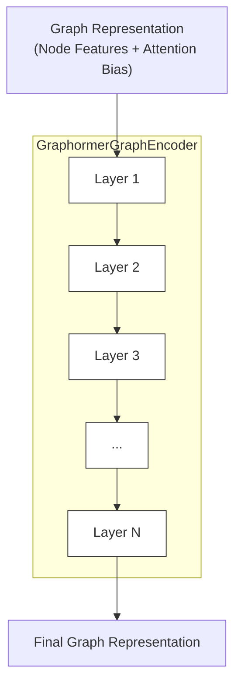
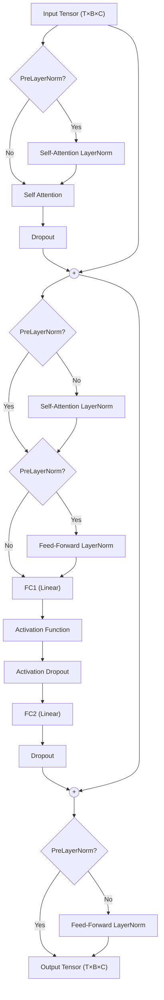
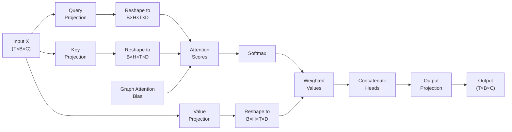
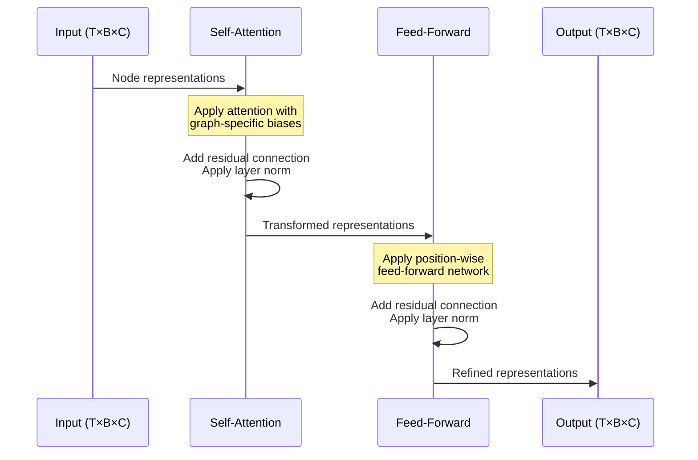
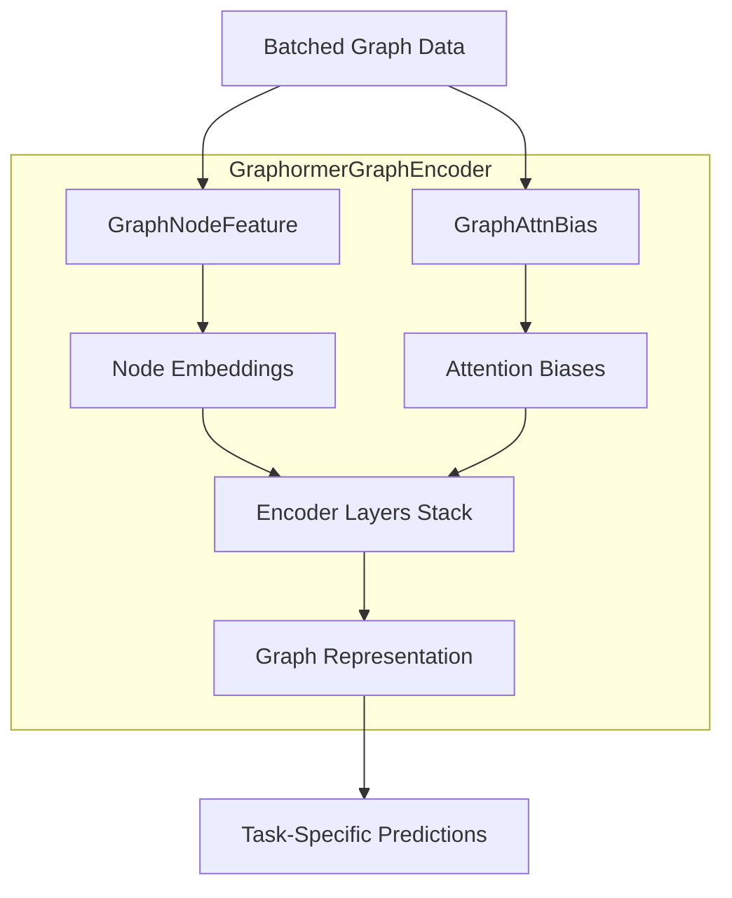

<!-- source: DeepWiki mcp.deepwiki.com · repo microsoft/Graphormer · page 3.2 Encoder Layers · fetched 2026-10-26 -->

# Encoder Layers

Relevant source files

The following files were used as context for generating this wiki page:

- [graphormer/modules/graphormer_graph_encoder.py](graphormer/modules/graphormer_graph_encoder.py)
- [graphormer/modules/graphormer_graph_encoder_layer.py](graphormer/modules/graphormer_graph_encoder_layer.py)

Encoder Layers form the core computational component of the Graphormer model. They process and transform graph representations through a series of self-attention and feed-forward neural network operations. This document explains the structure and functionality of encoder layers in the Graphormer architecture. For information about the overall Graph Encoder, see [Graph Encoder](#3.1).

## Structure and Components

The Encoder Layers in Graphormer follow a transformer-like architecture but are adapted specifically for graph data. The layers are stacked sequentially to form a deep neural network where each layer refines the graph representations.

Sources: [graphormer/modules/graphormer_graph_encoder.py:128-147]()

### Single Encoder Layer Architecture

Each encoder layer in Graphormer is implemented by the `GraphormerGraphEncoderLayer` class and contains two main processing blocks: a self-attention mechanism and a feed-forward network, each followed by residual connections and normalization layers.

Sources: [graphormer/modules/graphormer_graph_encoder_layer.py:21-150]()

## Key Components

### Self-Attention Mechanism

The self-attention module processes input graph representations by determining the relationships between different nodes in the graph. It uses multi-head attention to capture various types of relationships.

- **Implementation**: Uses `MultiheadAttention` class
- **Key Features**: 
  - Takes graph-specific attention biases into account
  - Handles padding masks for variable-sized graphs
  - Supports multiple attention heads for learning different relationship patterns

Sources: [graphormer/modules/graphormer_graph_encoder_layer.py:93-109]() [graphormer/modules/graphormer_graph_encoder_layer.py:126-134]()

### Feed-Forward Network

The feed-forward network acts as a position-wise transformation that processes each node representation independently.

- **Structure**: Two linear transformations with an activation function in between
- **Process Flow**:
  1. Input → First linear layer (`fc1`) → Activation function
  2. Activation function output → Second linear layer (`fc2`) → Output

Sources: [graphormer/modules/graphormer_graph_encoder_layer.py:71-82]() [graphormer/modules/graphormer_graph_encoder_layer.py:143-146]()

### Normalization and Residual Connections

Normalization and residual connections are essential for stable and effective training of deep neural networks:

- **Layer Normalization**: Applied either before (pre-layernorm) or after (post-layernorm) the self-attention and feed-forward modules
- **Residual Connections**: Add the input to the output of each sub-module to help with gradient flow

Sources: [graphormer/modules/graphormer_graph_encoder_layer.py:123-149]()

## Initialization and Configuration

The encoder layers are created and stacked in the `GraphormerGraphEncoder` class. The number of layers and their configuration are controlled by parameters specified during initialization.

Key configuration parameters include:

| Parameter | Description |
|-----------|-------------|
| `num_encoder_layers` | Number of encoder layers to stack |
| `embedding_dim` | Size of input and output embeddings |
| `ffn_embedding_dim` | Size of feed-forward network's hidden layer |
| `num_attention_heads` | Number of attention heads in multi-head attention |
| `dropout` | General dropout rate |
| `attention_dropout` | Dropout rate for attention weights |
| `activation_dropout` | Dropout rate after activation function |
| `activation_fn` | Activation function (e.g., "gelu", "relu") |
| `pre_layernorm` | Whether to apply layer norm before or after sub-modules |
| `layerdrop` | Probability of dropping a layer during training |

Sources: [graphormer/modules/graphormer_graph_encoder.py:46-76]() [graphormer/modules/graphormer_graph_encoder_layer.py:22-36]()

## Data Flow Through Encoder Layers

Sources: [graphormer/modules/graphormer_graph_encoder_layer.py:111-150]()

## Usage in Graphormer Model

Within the Graphormer architecture, encoder layers are used sequentially to process graph data:

1. Graph node features and attention biases are extracted from the input batched data
2. The extracted features pass through each encoder layer in sequence
3. Each layer refines the representations using self-attention and feed-forward transformations
4. The output of the final layer provides the final graph representation

Sources: [graphormer/modules/graphormer_graph_encoder.py:192-263]()

## Implementation Details

The core implementation of the encoder layers is defined in `GraphormerGraphEncoderLayer` class, which is instantiated multiple times to form a stack of layers. During forward propagation, each layer processes the output of the previous layer:

- The `GraphormerGraphEncoder` creates multiple encoder layers in its initialization
- The `forward` method of `GraphormerGraphEncoder` iterates through all layers, passing data sequentially
- Each layer processes its input and produces an output with the same dimensions
- The final layer's output represents the processed graph embeddings

The implementation supports both pre-layer normalization (Pre-LN) and post-layer normalization (Post-LN) variants, controlled by the `pre_layernorm` flag. Pre-LN tends to be more stable during training, while Post-LN follows the original transformer architecture.

Sources: [graphormer/modules/graphormer_graph_encoder.py:128-147]() [graphormer/modules/graphormer_graph_encoder.py:245-253]() [graphormer/modules/graphormer_graph_encoder_layer.py:124-149]()

---

