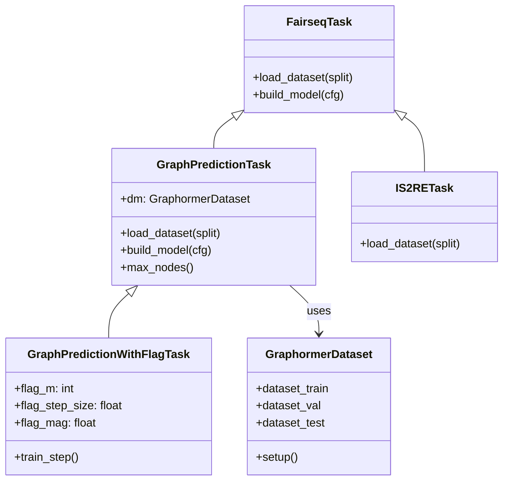
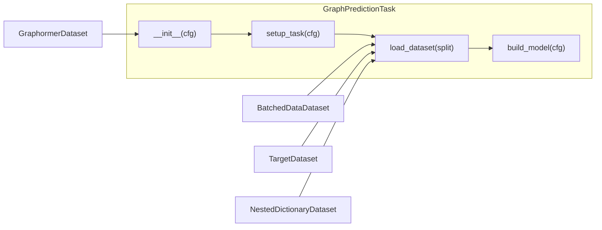
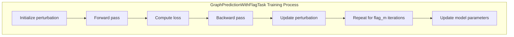
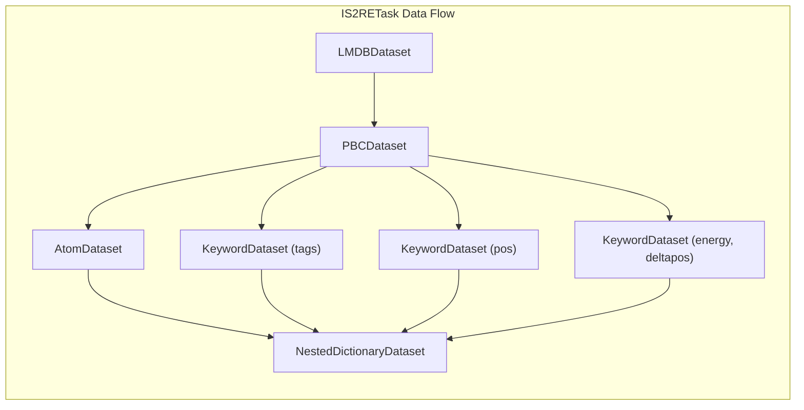
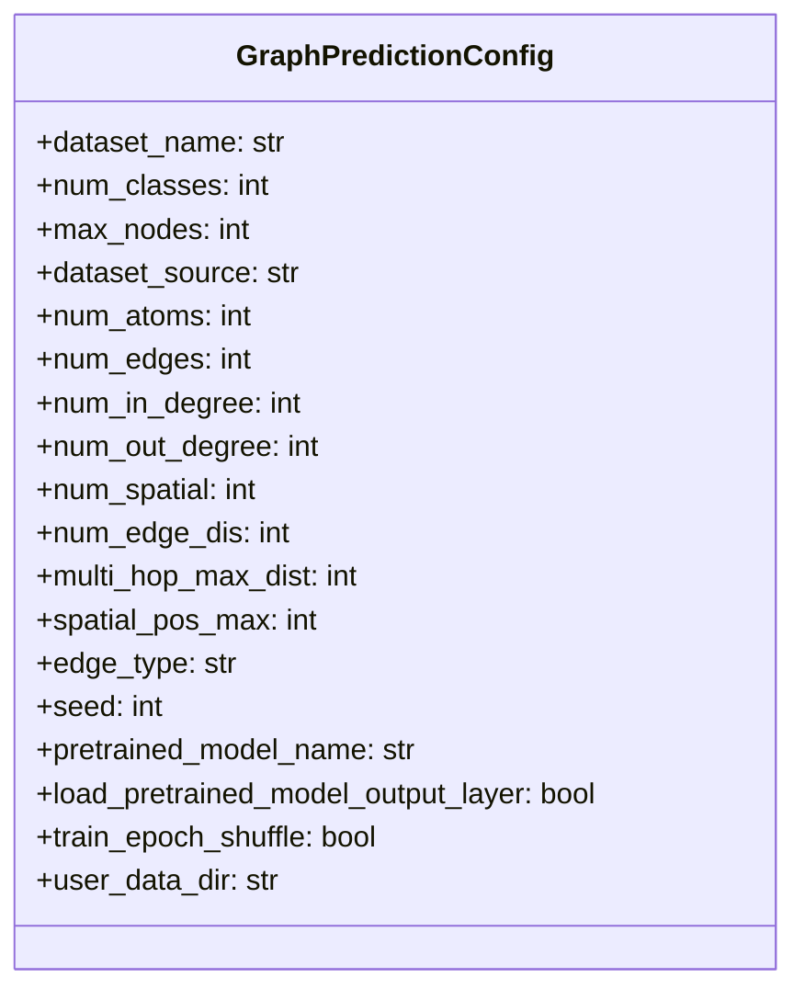
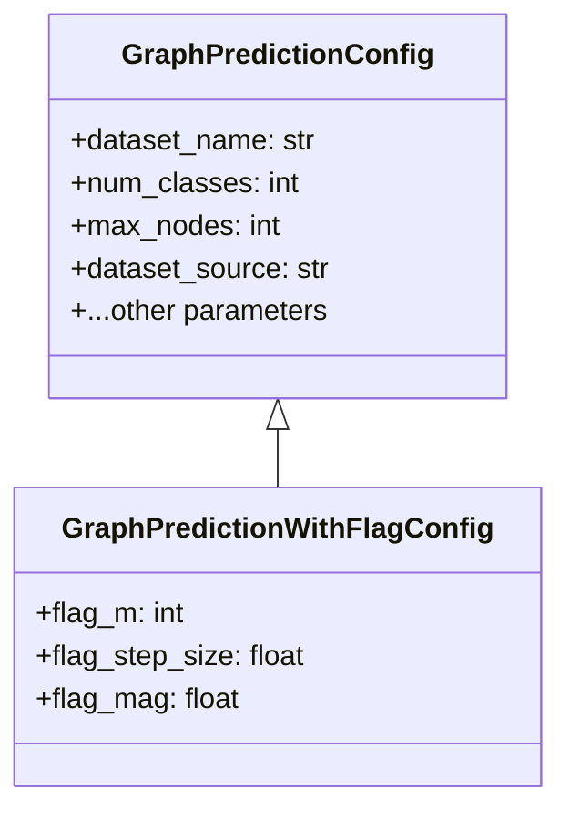
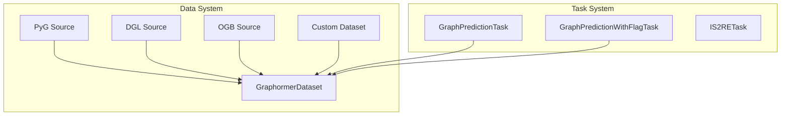
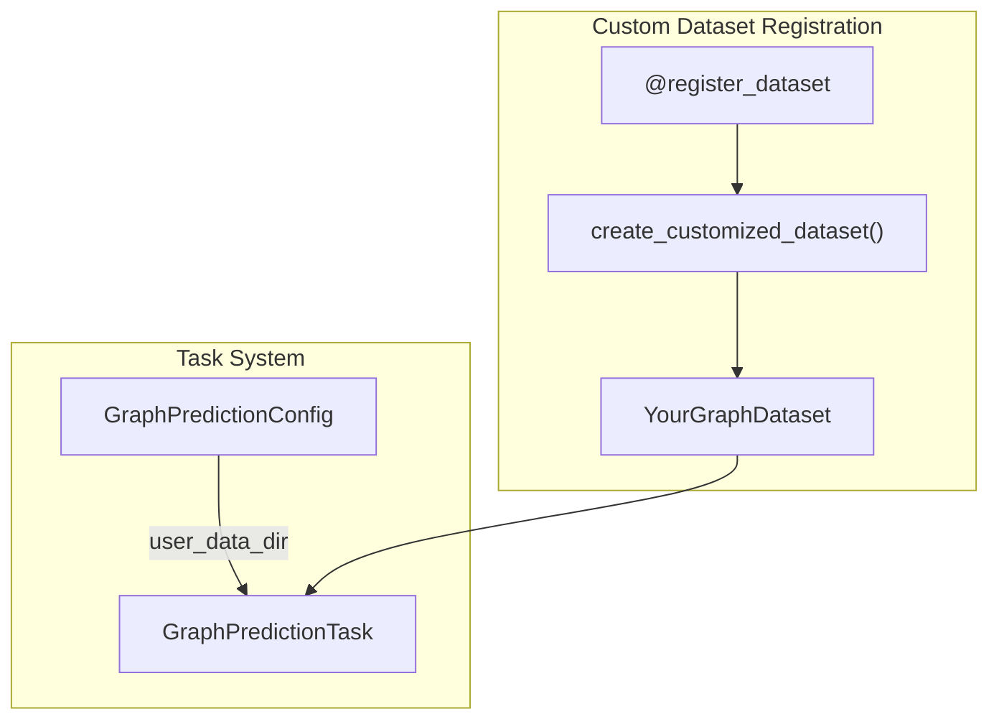
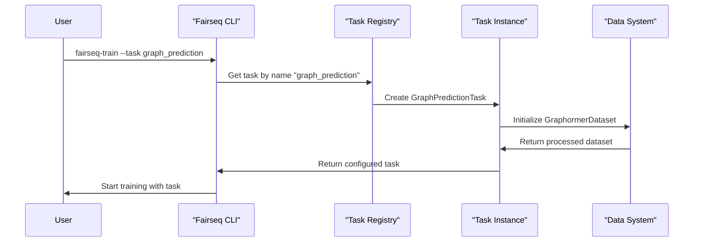

<!-- source: DeepWiki mcp.deepwiki.com · repo microsoft/Graphormer · page 4 Task System · fetched 2026-10-26 -->

# Task System

Relevant source files

The following files were used as context for generating this wiki page:

- [examples/customized_dataset/customized_dataset.py](examples/customized_dataset/customized_dataset.py)
- [graphormer/data/dataset.py](graphormer/data/dataset.py)
- [graphormer/tasks/graph_prediction.py](graphormer/tasks/graph_prediction.py)
- [graphormer/tasks/is2re.py](graphormer/tasks/is2re.py)

The Task System in Graphormer provides the framework for defining and configuring different types of graph-related tasks. It serves as the integration layer between the Data System and the Model System, handling dataset loading, preprocessing, and managing the interaction with models during training and inference.

This document covers the core task classes, configuration options, and how to use or extend the Task System. For information about the Data System that task classes interact with, see [Data System](#5).

## Task System Architecture

The Task System is built on top of Fairseq's task framework, with specialized task classes for graph-related operations. Each task class is responsible for loading appropriate datasets, configuring graph-specific parameters, and defining how graphs are processed during training and evaluation.

Sources: [graphormer/tasks/graph_prediction.py:133-247](), [graphormer/tasks/is2re.py:240-302](), [graphormer/data/dataset.py:62-97]()

## Task Types

Graphormer provides several task types to handle different graph prediction scenarios:

| Task Class | Purpose | Applicable Datasets | Source File |
|------------|---------|---------------------|------------|
| `GraphPredictionTask` | Basic graph property prediction | General graph datasets (PyG, DGL, OGB) | [graphormer/tasks/graph_prediction.py]() |
| `GraphPredictionWithFlagTask` | Enhanced graph prediction with FLAG optimization | General graph datasets | [graphormer/tasks/graph_prediction.py]() |
| `IS2RETask` | Initial Structure to Relaxed Energy prediction | OC20 dataset | [graphormer/tasks/is2re.py]() |

Sources: [graphormer/tasks/graph_prediction.py:133-247](), [graphormer/tasks/is2re.py:240-302]()

### GraphPredictionTask

The `GraphPredictionTask` is the primary task class for general graph prediction, supporting classification and regression. It handles loading graph data from various sources (PyG, DGL, OGB), processing it through the Graphormer model, and evaluating the predictions.

Sources: [graphormer/tasks/graph_prediction.py:133-247]()

### GraphPredictionWithFlagTask

The `GraphPredictionWithFlagTask` extends the basic `GraphPredictionTask` with the Free Large-scale Adversarial Gradient (FLAG) optimization technique, which adds adversarial perturbations during training to improve model robustness and generalization.

Sources: [graphormer/tasks/graph_prediction.py:271-362]()

### IS2RETask

The `IS2RETask` is specialized for the Initial Structure to Relaxed Energy prediction task from the Open Catalyst 2020 (OC20) dataset. It handles loading and processing atomic structures with periodic boundary conditions.

Sources: [graphormer/tasks/is2re.py:240-302]()

## Task Configuration

Each task type has its own configuration class that defines the parameters that can be set for that task. These configurations are passed to the task when it's created.

### GraphPredictionConfig

The `GraphPredictionConfig` dataclass defines parameters for the graph prediction task:

Key configuration parameters include:

- `dataset_name`: Name of the dataset to use (default: "pcqm4m")
- `num_classes`: Number of classes for classification or regression targets
- `max_nodes`: Maximum number of nodes per graph (default: 128)
- `dataset_source`: Source of graph dataset (options: "pyg", "dgl", "ogb", "smiles")
- Various parameters for controlling graph encoding and processing

Sources: [graphormer/tasks/graph_prediction.py:43-131]()

### GraphPredictionWithFlagConfig

The `GraphPredictionWithFlagConfig` extends the base configuration with FLAG-specific parameters:

FLAG-specific parameters:
- `flag_m`: Number of iterations to optimize perturbations (default: 3)
- `flag_step_size`: Learning rate for perturbation optimization (default: 1e-3)
- `flag_mag`: Magnitude bound for perturbations (default: 1e-3)

Sources: [graphormer/tasks/graph_prediction.py:249-268]()

## Integration with Data System

The Task System integrates closely with the Data System through the `GraphormerDataset` class, which provides a unified interface for loading datasets from different sources.

The task classes use `GraphormerDataset` to:
1. Load data from the specified source
2. Split the data into train, validation, and test sets
3. Process the data into the format required by the model

Sources: [graphormer/tasks/graph_prediction.py:139-159](), [graphormer/data/dataset.py:62-97]()

## Custom Dataset Support

The Task System provides support for using custom datasets through the `user_data_dir` parameter in `GraphPredictionConfig`. This allows researchers to bring their own dataset implementations while leveraging the existing task framework.

Example of registering a custom dataset:

Sources: [examples/customized_dataset/customized_dataset.py:1-24](), [graphormer/tasks/graph_prediction.py:139-174]()

## Task System Usage

The Task System is used by specifying the appropriate task type and configuration when training or evaluating a model. In practice, this is typically done through Fairseq's command-line interface.

### Task Creation Process

Sources: [graphormer/tasks/graph_prediction.py:133-137](), [graphormer/tasks/graph_prediction.py:176-179]()

## Advanced Feature: FLAG Training

The `GraphPredictionWithFlagTask` implements an advanced training process using the FLAG (Free Large-scale Adversarial Gradients) technique. This technique adds perturbed features during training to improve model robustness and generalization.

The FLAG training process is implemented in the `train_step` method and follows these steps:

1. Initialize a random perturbation tensor
2. Forward pass with the perturbed features
3. Calculate loss and backpropagate
4. Update the perturbation using gradient information
5. Repeat for `flag_m` iterations
6. Update model parameters

This specialized training loop demonstrates how the Task System can be extended to implement advanced training algorithms.

Sources: [graphormer/tasks/graph_prediction.py:283-362]()

## Summary

The Task System in Graphormer provides a flexible framework for handling different types of graph prediction tasks. It bridges the Data System and Model System, allowing for easy experimentation with different datasets, model architectures, and training strategies. The system's modular design makes it easy to extend with new task types or customize existing ones for specific research needs.

---

