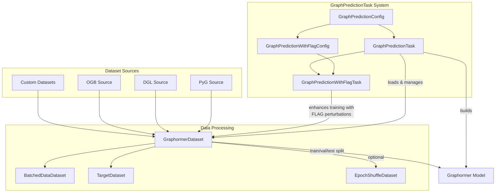
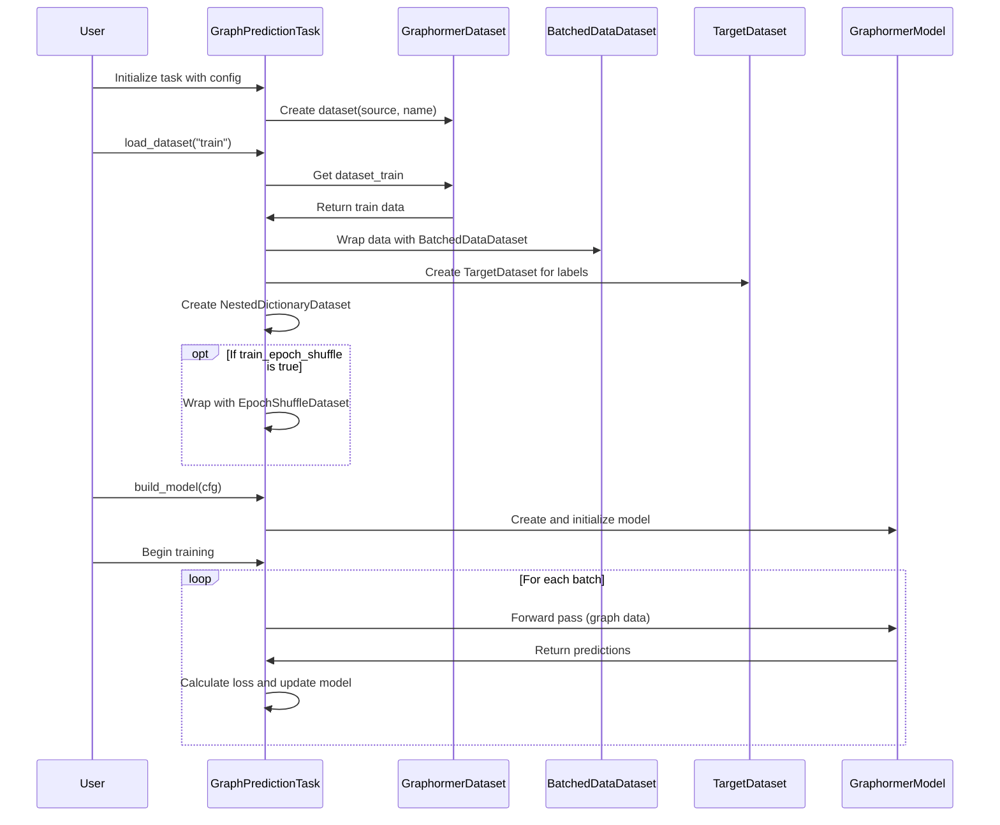
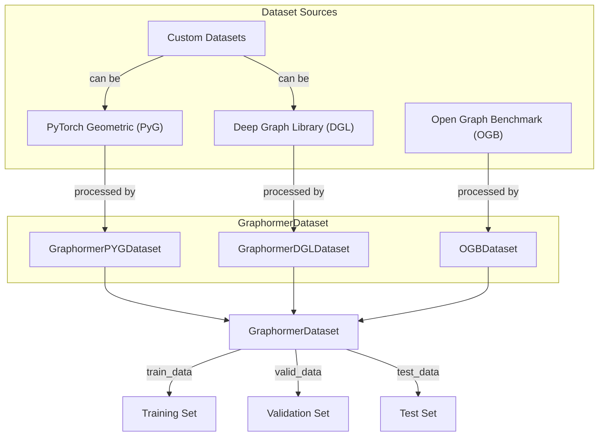
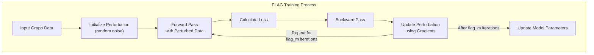
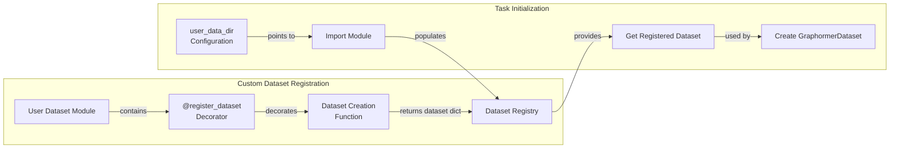
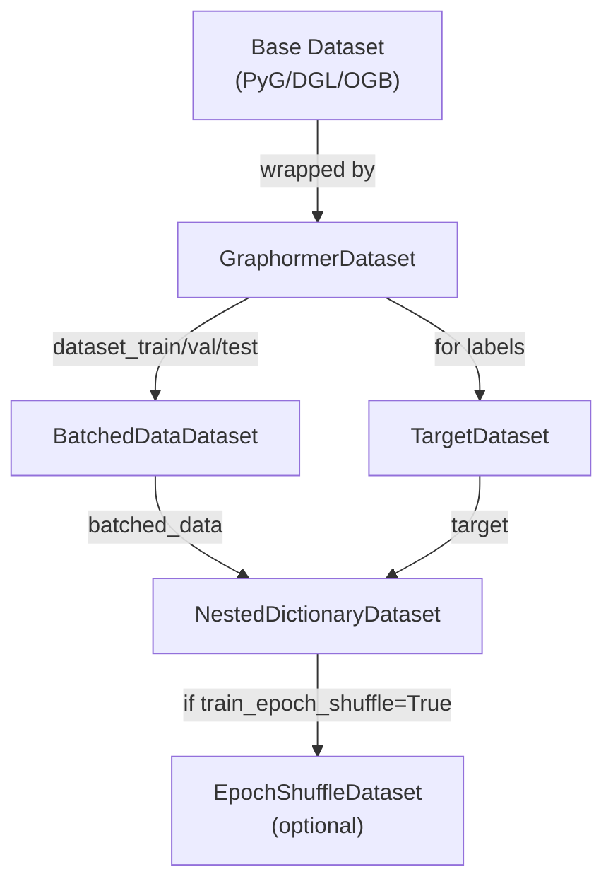
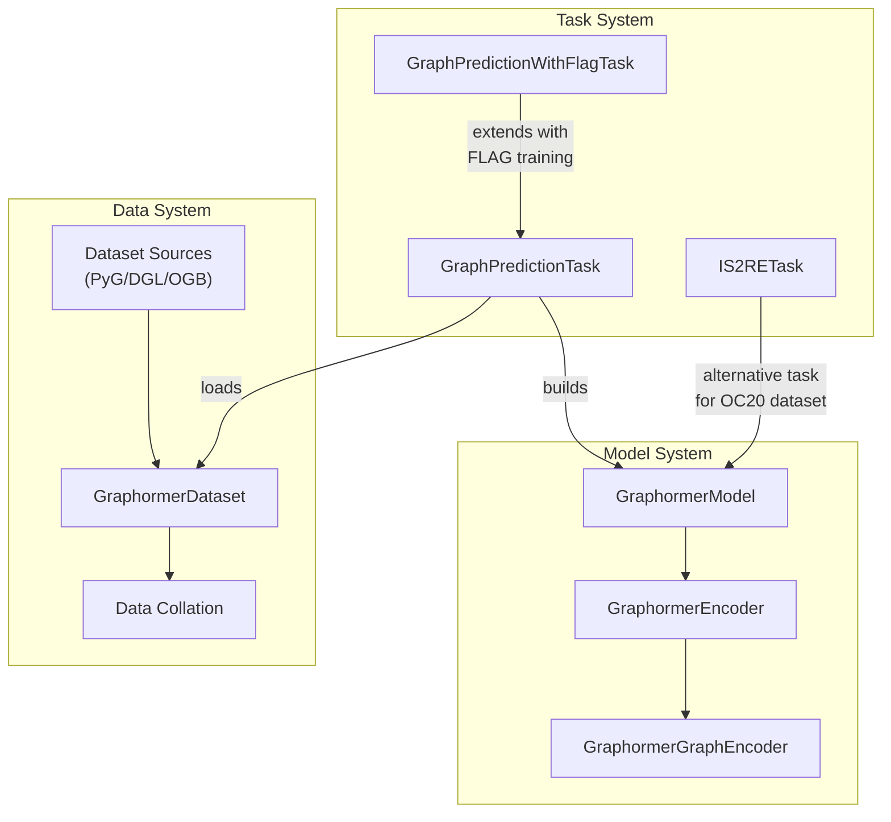

<!-- source: DeepWiki mcp.deepwiki.com · repo microsoft/Graphormer · page 4.1 Graph Prediction Task · fetched 2026-10-26 -->

# Graph Prediction Task

<details>
<summary>Relevant source files</summary>

The following files were used as context for generating this wiki page:

- [examples/customized_dataset/customized_dataset.py](examples/customized_dataset/customized_dataset.py)
- [graphormer/data/dataset.py](graphormer/data/dataset.py)
- [graphormer/tasks/graph_prediction.py](graphormer/tasks/graph_prediction.py)
- [graphormer/tasks/is2re.py](graphormer/tasks/is2re.py)

</details>


## Purpose and Scope

The Graph Prediction Task in Graphormer provides a framework for performing predictions on graph-structured data. This task handles both graph-level classification and regression problems, where the goal is to predict properties or categories of entire graphs. It implements dataset loading, model configuration, and training procedures specifically tailored for graph prediction.

For node-level or edge-level prediction tasks, different approaches would be needed. Similarly, for the specialized IS2RE (Initial Structure to Relaxed Energy) task used in catalyst modeling, see [IS2RE Task](#4.2).

Sources: [graphormer/tasks/graph_prediction.py:133-137]()

## Architecture Overview



The Graph Prediction Task is built on the FairseqTask framework and provides specialized functionality for graph-based learning tasks. It supports both standard training (GraphPredictionTask) and an advanced training approach using FLAG (Free Large-scale Adversarial Augmentation) through GraphPredictionWithFlagTask.

Sources: [graphormer/tasks/graph_prediction.py:133-246](), [graphormer/tasks/graph_prediction.py:271-362]()

## Data Flow



This diagram illustrates the data flow during task initialization, dataset loading, and the training process. The task handles dataset preparation, model creation, and coordinates the training loop.

Sources: [graphormer/tasks/graph_prediction.py:139-180](), [graphormer/tasks/graph_prediction.py:181-221](), [graphormer/tasks/graph_prediction.py:223-232]()

## Configuration Parameters

The Graph Prediction Task is highly configurable through its configuration classes. Below are the key parameters:

| Parameter | Default | Description |
|-----------|---------|-------------|
| dataset_name | "pcqm4m" | Name of the dataset to use |
| num_classes | -1 | Number of classes (for classification) or regression targets |
| max_nodes | 128 | Maximum number of nodes per graph |
| dataset_source | "pyg" | Source of graph dataset (pyg, dgl, ogb, smiles) |
| num_atoms | 512 * 9 | Number of atom types in the graph |
| num_edges | 512 * 3 | Number of edge types in the graph |
| num_in_degree | 512 | Number of in degree types in the graph |
| num_out_degree | 512 | Number of out degree types in the graph |
| multi_hop_max_dist | 5 | Maximum distance of multi-hop edges |
| spatial_pos_max | 1024 | Maximum spatial position value |
| edge_type | "multi_hop" | Edge type in the graph |
| pretrained_model_name | "none" | Name of pretrained model to use |
| train_epoch_shuffle | False | Whether to shuffle dataset at each epoch |
| user_data_dir | "" | Path to user-defined dataset module |

For FLAG training (GraphPredictionWithFlagTask), additional parameters include:

| Parameter | Default | Description |
|-----------|---------|-------------|
| flag_m | 3 | Number of iterations for FLAG optimization |
| flag_step_size | 1e-3 | Learning rate for FLAG optimization |
| flag_mag | 1e-3 | Magnitude bound for perturbations |

Sources: [graphormer/tasks/graph_prediction.py:43-131](), [graphormer/tasks/graph_prediction.py:249-268]()

## Dataset Integration

The Graph Prediction Task can work with various types of graph datasets through the GraphormerDataset class:



This diagram shows how different dataset sources are integrated into the GraphormerDataset class, which then provides train, validation, and test splits to the task.

Sources: [graphormer/data/dataset.py:62-96](), [graphormer/tasks/graph_prediction.py:139-180]()

## FLAG Training Method

The GraphPredictionWithFlagTask extends the base GraphPredictionTask to implement FLAG (Free Large-scale Adversarial Augmentation), an advanced training method that improves model robustness:



FLAG training creates adversarial perturbations to the input data during training, which helps the model become more robust to variations in the input. The process involves multiple forward and backward passes per batch, gradually refining the perturbation before updating the model parameters.

Sources: [graphormer/tasks/graph_prediction.py:271-362]()

## Custom Dataset Support

The Graph Prediction Task supports custom datasets through a registration mechanism:



To use a custom dataset:
1. Create a Python module with dataset creation functions
2. Decorate functions with `@register_dataset("dataset_name")`
3. Return a dictionary with the dataset and split indices
4. Specify the module path in `user_data_dir` configuration

Sources: [graphormer/tasks/graph_prediction.py:141-153](), [graphormer/tasks/graph_prediction.py:161-174](), [examples/customized_dataset/customized_dataset.py:1-24]()

## Example Custom Dataset Implementation

Here's how a custom dataset is registered and structured:

```python
# Structure of a custom dataset function
@register_dataset("customized_qm9_dataset")
def create_customized_dataset():
    # Load or create the dataset
    dataset = QM9(label_keys=["mu"])
    
    # Create train/valid/test splits
    train_idx, valid_idx, test_idx = ...
    
    # Return dictionary with required fields
    return {
        "dataset": dataset,         # The actual dataset object
        "train_idx": train_idx,     # Indices for training set
        "valid_idx": valid_idx,     # Indices for validation set
        "test_idx": test_idx,       # Indices for test set
        "source": "dgl"             # Dataset source (dgl or pyg)
    }
```

The task will then use this registered dataset when configured with the matching dataset name.

Sources: [examples/customized_dataset/customized_dataset.py:1-24]()

## Dataset Loading Process

When loading a dataset split (train, valid, or test), the Graph Prediction Task processes the data through several wrapper classes:



This pipeline prepares the raw graph data for efficient batch processing during training and evaluation.

Sources: [graphormer/tasks/graph_prediction.py:181-221](), [graphormer/data/dataset.py:20-59]()

## Integration with the Larger Graphormer System

The Graph Prediction Task is part of the larger Graphormer system:



The Graph Prediction Task interfaces with both the data system (for dataset handling) and the model system (for creating and training Graphormer models).

Sources: [graphormer/tasks/graph_prediction.py:133-246](), [graphormer/tasks/is2re.py:240-301]()

## Summary

The Graph Prediction Task is a central component of the Graphormer framework that:

1. Handles loading and processing of graph datasets from various sources
2. Configures and builds Graphormer models for graph prediction
3. Supports standard training and advanced FLAG training techniques
4. Enables custom dataset integration
5. Works with both classification and regression tasks on graph data

This task provides the foundation for applications like molecular property prediction and other graph-level prediction problems.

Sources: [graphormer/tasks/graph_prediction.py:133-246]()

---

