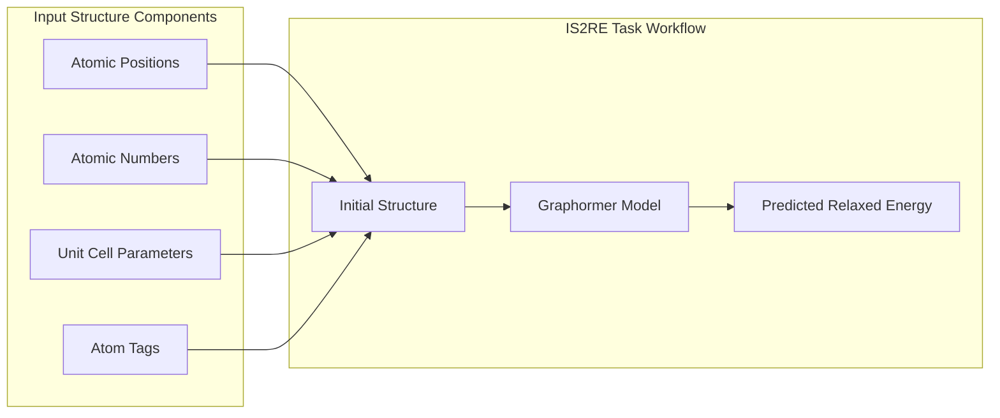
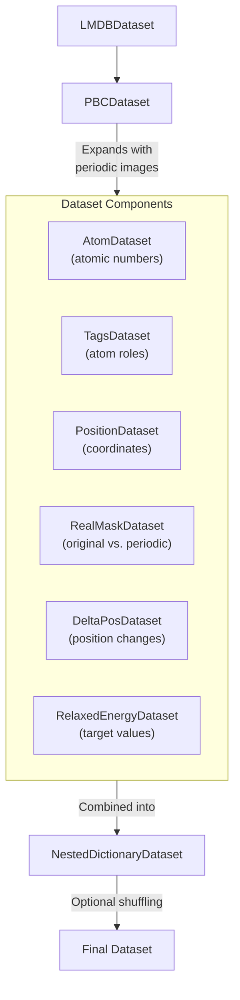
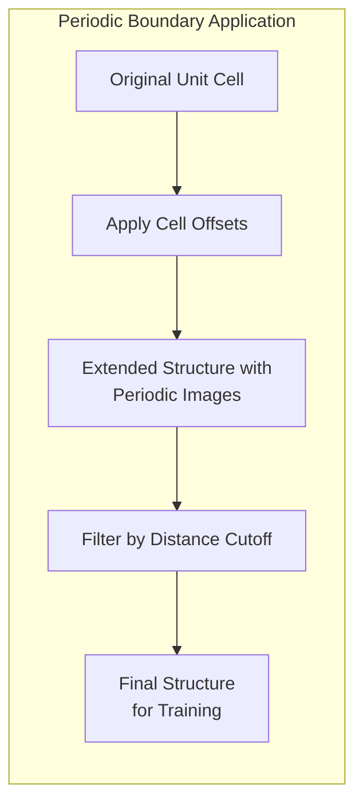
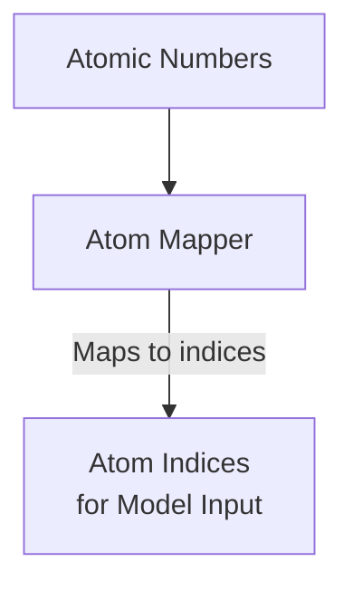
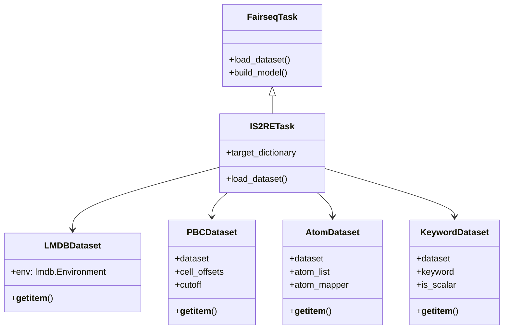

<!-- source: DeepWiki mcp.deepwiki.com · repo microsoft/Graphormer · page 4.2 IS2RE Task · fetched 2026-10-26 -->

# IS2RE Task

Relevant source files

The following files were used as context for generating this wiki page:

- [examples/customized_dataset/customized_dataset.py](examples/customized_dataset/customized_dataset.py)
- [graphormer/data/dataset.py](graphormer/data/dataset.py)
- [graphormer/tasks/graph_prediction.py](graphormer/tasks/graph_prediction.py)
- [graphormer/tasks/is2re.py](graphormer/tasks/is2re.py)

## Overview

The IS2RE (Initial Structure to Relaxed Energy) task is a specialized implementation within Graphormer for handling catalyst modeling tasks from the Open Catalyst 2020 (OC20) challenge. This task predicts the energy of a relaxed adsorption system given only the initial structure, bypassing the need for costly relaxation calculations.

For general graph prediction tasks not specific to catalyst modeling, see [Graph Prediction Task](#4.1).

## Understanding the IS2RE Task

The IS2RE task focuses on predicting relaxed energy values for catalyst systems from initial atomic configurations. This is a critical capability for computational catalyst discovery as it allows researchers to quickly evaluate candidate materials without performing expensive density functional theory (DFT) relaxations.

Sources: [graphormer/tasks/is2re.py:241-301]()

## Data Handling and Processing

The IS2RE task implements a unique data loading and processing pipeline tailored to handle periodic structures with adsorbates on catalyst surfaces.

### Data Source and Loading

Data is loaded from LMDB databases that contain atomic structures, relaxed positions, energies, and other properties relevant to catalyst systems.

Sources: [graphormer/tasks/is2re.py:25-55](), [graphormer/tasks/is2re.py:57-122](), [graphormer/tasks/is2re.py:250-301]()

### Periodic Boundary Conditions

The `PBCDataset` class applies periodic boundary conditions (PBC) to the catalyst structures, which is essential for properly representing extended surfaces. It creates additional periodic images of atoms within a cutoff distance to properly represent bonding across unit cell boundaries.

Sources: [graphormer/tasks/is2re.py:57-122]()

## Dataset Structure

The IS2RE task organizes data into several categories to handle the specialized needs of catalyst modeling.

### Dataset Splits

The task supports multiple dataset splits for comprehensive model evaluation:

| Split Type | Description |
|------------|-------------|
| train | Training data |
| val_id | In-distribution validation data |
| val_ood_ads | Out-of-distribution adsorbate validation data |
| val_ood_cat | Out-of-distribution catalyst validation data |
| val_ood_both | Out-of-distribution adsorbate and catalyst validation data |
| test_id | In-distribution test data |
| test_ood_ads | Out-of-distribution adsorbate test data |
| test_ood_cat | Out-of-distribution catalyst test data |
| test_ood_both | Out-of-distribution adsorbate and catalyst test data |

These splits enable rigorous testing of model generalization to new adsorbates, catalysts, or both.

Sources: [graphormer/tasks/is2re.py:251-261]()

### Atom Representation

The `AtomDataset` class maps atomic numbers to indices in a predefined list, handling 53 different atomic elements commonly found in catalyst systems. This provides a consistent representation of atoms across the dataset.

Sources: [graphormer/tasks/is2re.py:138-217]()

## Integration with Graphormer Framework

The IS2RE task fits into the broader Graphormer architecture as a specialized task implementation. It inherits from the `FairseqTask` base class but implements custom data handling specific to catalyst systems.

Sources: [graphormer/tasks/is2re.py:241-301](), [graphormer/tasks/graph_prediction.py:133-246]()

## Using the IS2RE Task

To use the IS2RE task, you need to:

1. Prepare your data in LMDB format with the required structure
2. Configure your Graphormer model for the IS2RE task
3. Train the model using the appropriate command-line arguments

The task can be registered and used through the Fairseq training framework by specifying "is2re" as the task name.

### Data Structure Requirements

The LMDB database for IS2RE should contain entries with the following components:

| Component | Description | Type |
|-----------|-------------|------|
| pos | Initial atomic positions | Tensor(N, 3) |
| pos_relaxed | Relaxed atomic positions | Tensor(N, 3) |
| cell | Unit cell parameters | Tensor(3, 3) |
| atomic_numbers | Atomic numbers of elements | Tensor(N) |
| tags | Atom role tags | Tensor(N) |
| y_relaxed | Relaxed energy (target value) | float |

Sources: [graphormer/tasks/is2re.py:25-55]()

### Task Output

The IS2RE task primarily outputs predictions for:
- Relaxed energy values (main target)
- Optionally, the change in atomic positions (deltapos)

These outputs are used to evaluate the model's ability to predict relaxation results without performing the actual relaxation.

## Comparison with Other Tasks

Unlike the general `GraphPredictionTask` which works with various graph types, the IS2RE task is specifically designed for materials science applications with:

1. Periodic boundary condition handling
2. Support for atomic systems with unit cells
3. Specialized atom representation
4. Handling of multiple dataset splits for generalization testing

This specialization makes it well-suited for the Open Catalyst challenge while maintaining integration with the broader Graphormer framework.

Sources: [graphormer/tasks/graph_prediction.py:133-246](), [graphormer/tasks/is2re.py:241-301]()

## Customizing the IS2RE Task

While the IS2RE task is specialized for the OC20 dataset, the implementation demonstrates how to create custom tasks for specific scientific domains. Users can follow a similar pattern to create task implementations for other specialized applications requiring periodic boundary conditions or atomic representations.

Compared to creating a custom dataset for the general `GraphPredictionTask` (as shown in [examples/customized_dataset/customized_dataset.py]()) the IS2RE task requires more specialized data handling but offers domain-specific functionality for catalyst modeling.

Sources: [examples/customized_dataset/customized_dataset.py:1-24]()

---

