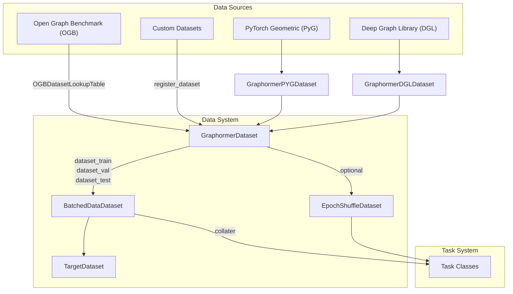
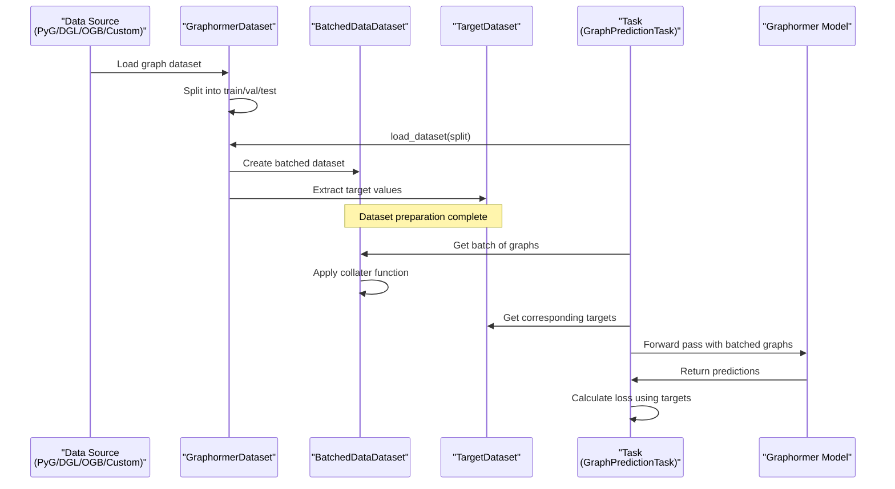
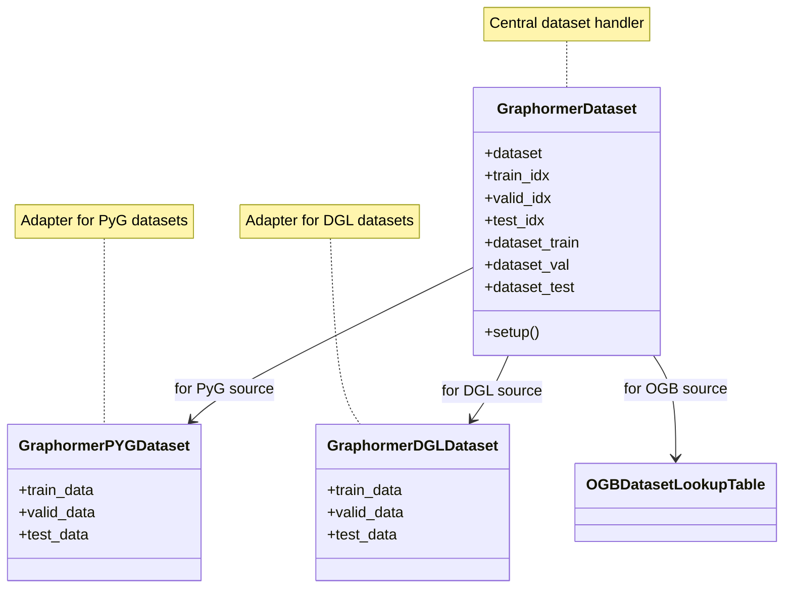
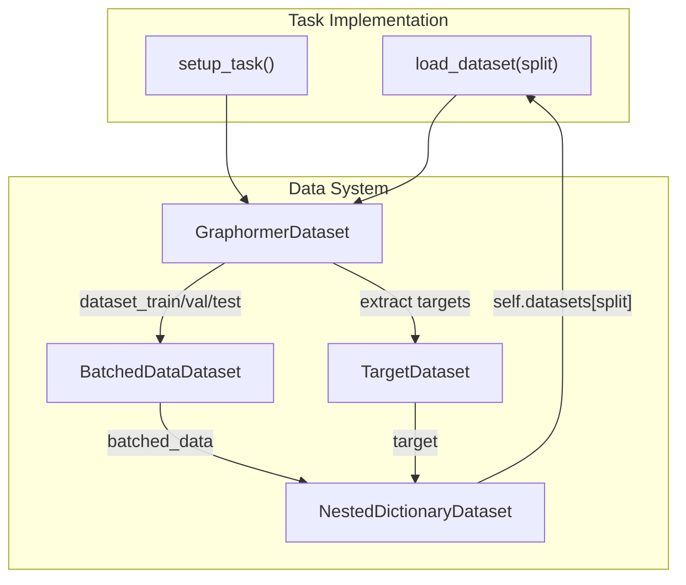
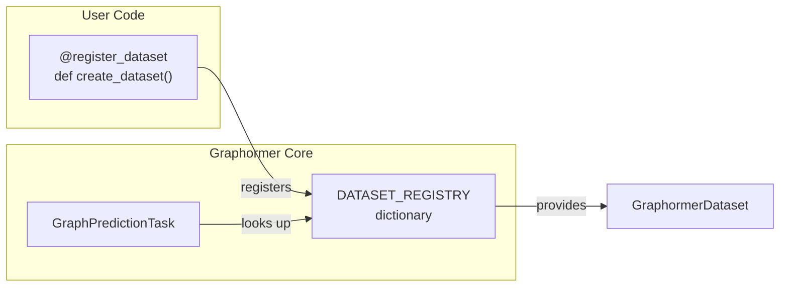

<!-- source: DeepWiki mcp.deepwiki.com · repo microsoft/Graphormer · page 5 Data System · fetched 2026-10-26 -->

# Data System

<details>
<summary>Relevant source files</summary>

The following files were used as context for generating this wiki page:

- [docs/Datasets.rst](docs/Datasets.rst)
- [examples/customized_dataset/customized_dataset.py](examples/customized_dataset/customized_dataset.py)
- [graphormer/data/dataset.py](graphormer/data/dataset.py)
- [graphormer/tasks/graph_prediction.py](graphormer/tasks/graph_prediction.py)
- [graphormer/tasks/is2re.py](graphormer/tasks/is2re.py)

</details>


The Graphormer Data System provides a flexible and extensible framework for handling graph-structured data from various sources. It's responsible for loading, processing, and batching graph data to feed into the Graphormer model. For information about specific tasks that use this data, see [Task System](#4).

## Overview

The Data System in Graphormer supports multiple graph library formats including PyTorch Geometric (PyG), Deep Graph Library (DGL), and Open Graph Benchmark (OGB), enabling researchers to work with a wide range of graph datasets. It also provides mechanisms for creating custom datasets with specialized preprocessing or splitting strategies.



Diagram: Graphormer Data System Architecture

Sources: [graphormer/data/dataset.py:62-97](), [graphormer/tasks/graph_prediction.py:25-30](), [graphormer/tasks/graph_prediction.py:133-221]()

## Data Flow During Training

The following diagram illustrates how data flows through the system during the training process:



Diagram: Data Flow in Graphormer Training Process

Sources: [graphormer/tasks/graph_prediction.py:181-221](), [graphormer/data/dataset.py:20-60]()

## Core Components

### GraphormerDataset

The `GraphormerDataset` class is the central component of the data system, responsible for:
- Loading datasets from various sources (PyG, DGL, OGB)
- Handling dataset splits (train/validation/test)
- Providing access to the processed data for the task system

```python
class GraphormerDataset:
    def __init__(
        self,
        dataset: Optional[Union[PYGDataset, DGLDataset]] = None,
        dataset_spec: Optional[str] = None,
        dataset_source: Optional[str] = None,
        seed: int = 0,
        train_idx = None,
        valid_idx = None,
        test_idx = None,
    ):
        # ...implementation...
```

The class supports both built-in datasets (by specifying the `dataset_spec` and `dataset_source`) and custom datasets (by providing a `dataset` object directly).

Sources: [graphormer/data/dataset.py:62-97]()

### BatchedDataDataset

The `BatchedDataDataset` class handles batching of graph data for efficient processing:

```python
class BatchedDataDataset(FairseqDataset):
    def __init__(
        self, dataset, max_node=128, multi_hop_max_dist=5, spatial_pos_max=1024
    ):
        # ...implementation...
```

It provides a `collater` method that transforms a list of graph samples into a batched format suitable for model input.

Sources: [graphormer/data/dataset.py:20-43]()

### TargetDataset

The `TargetDataset` class extracts and handles target values (labels) from the dataset:

```python
class TargetDataset(FairseqDataset):
    def __init__(self, dataset):
        # ...implementation...
```

It provides methods to retrieve target values and to collate them into batches.

Sources: [graphormer/data/dataset.py:46-60]()

### EpochShuffleDataset

The `EpochShuffleDataset` class provides functionality for shuffling the dataset at each epoch:

```python
class EpochShuffleDataset(BaseWrapperDataset):
    def __init__(self, dataset, num_samples, seed):
        # ...implementation...
```

This is useful for training to ensure that the model sees different batches in each epoch.

Sources: [graphormer/data/dataset.py:99-115]()

## Dataset Sources

Graphormer supports datasets from multiple sources, each with its own adapter in the data system:

| Source | Description | Implementation |
|--------|-------------|----------------|
| PyG | PyTorch Geometric datasets | GraphormerPYGDataset |
| DGL | Deep Graph Library datasets | GraphormerDGLDataset |
| OGB | Open Graph Benchmark datasets | OGBDatasetLookupTable |
| Custom | User-defined datasets | register_dataset decorator |



Diagram: Dataset Source Adapters

Sources: [graphormer/data/dataset.py:62-97](), [docs/Datasets.rst:12-19]()

## Task Integration

The data system integrates with the Task System through the task's `load_dataset` method. Here's how a task typically uses the data system:



Diagram: Task and Data System Integration

Sources: [graphormer/tasks/graph_prediction.py:181-221](), [graphormer/tasks/is2re.py:240-302]()

## Custom Datasets

Graphormer provides a mechanism for users to create and register custom datasets. This is done using the `register_dataset` decorator:



Diagram: Custom Dataset Registration

Sources: [graphormer/tasks/graph_prediction.py:139-153](), [examples/customized_dataset/customized_dataset.py:1-24]()

### Example: Custom QM9 Dataset

Here's an example of creating a custom dataset based on the QM9 dataset from DGL, with a custom splitting strategy:

```python
from graphormer.data import register_dataset
from dgl.data import QM9
import numpy as np
from sklearn.model_selection import train_test_split

@register_dataset("customized_qm9_dataset")
def create_customized_dataset():
    dataset = QM9(label_keys=["mu"])
    num_graphs = len(dataset)

    # customized dataset split
    train_valid_idx, test_idx = train_test_split(
        np.arange(num_graphs), test_size=num_graphs // 10, random_state=0
    )
    train_idx, valid_idx = train_test_split(
        train_valid_idx, test_size=num_graphs // 5, random_state=0
    )
    return {
        "dataset": dataset,
        "train_idx": train_idx,
        "valid_idx": valid_idx,
        "test_idx": test_idx,
        "source": "dgl"
    }
```

To use this custom dataset, you would:
1. Create a folder for your custom dataset implementation
2. Place your implementation file in that folder
3. Specify the folder path using `--user-data-dir` when running Graphormer
4. Set `--dataset-name` to your registered dataset name (e.g., "customized_qm9_dataset")

Sources: [examples/customized_dataset/customized_dataset.py:1-24](), [docs/Datasets.rst:82-126]()

## Configuration Parameters

The Data System is configured through several parameters in the task configuration. For example, in `GraphPredictionConfig`:

| Parameter | Description | Default Value |
|-----------|-------------|---------------|
| dataset_name | Name of the dataset | "pcqm4m" |
| dataset_source | Source of the dataset (pyg, dgl, ogb) | "pyg" |
| max_nodes | Maximum number of nodes per graph | 128 |
| multi_hop_max_dist | Maximum distance of multi-hop edges | 5 |
| spatial_pos_max | Maximum spatial position | 1024 |
| train_epoch_shuffle | Whether to shuffle the dataset at each epoch | False |
| user_data_dir | Path to the module of user-defined dataset | "" |

Sources: [graphormer/tasks/graph_prediction.py:43-130]()

## Summary

The Graphormer Data System provides a flexible and extensible framework for handling graph data from various sources. Its key features include:

1. Support for multiple graph library formats (PyG, DGL, OGB)
2. Efficient batching and processing of graph data
3. Extraction and handling of target values
4. Dataset shuffling for improved training
5. Custom dataset creation and registration

This architecture allows Graphormer to work with a wide range of graph datasets and tasks, making it a versatile tool for graph-based machine learning research.

---

