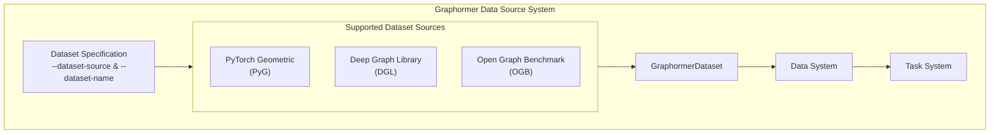
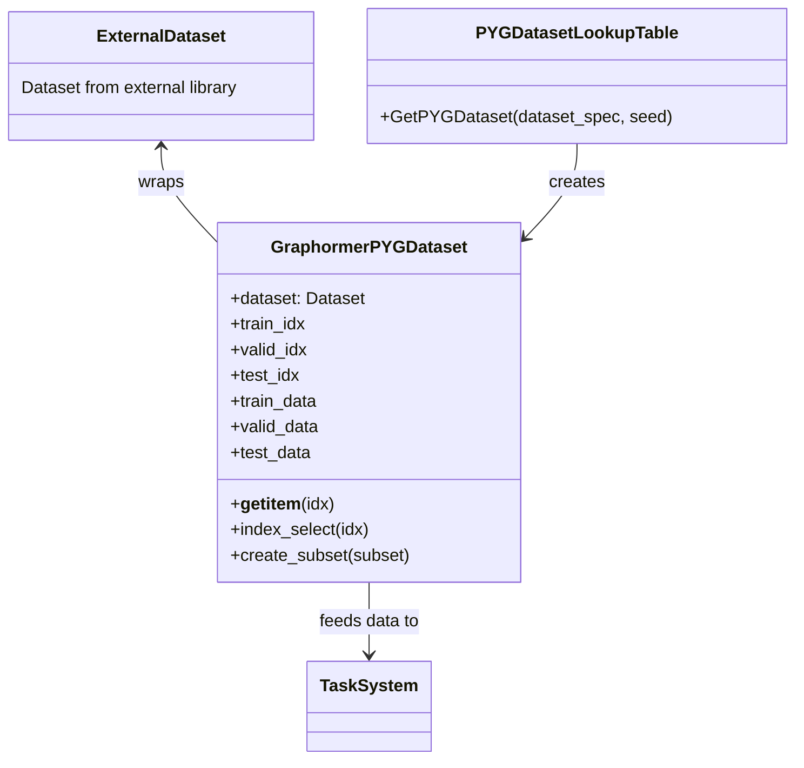
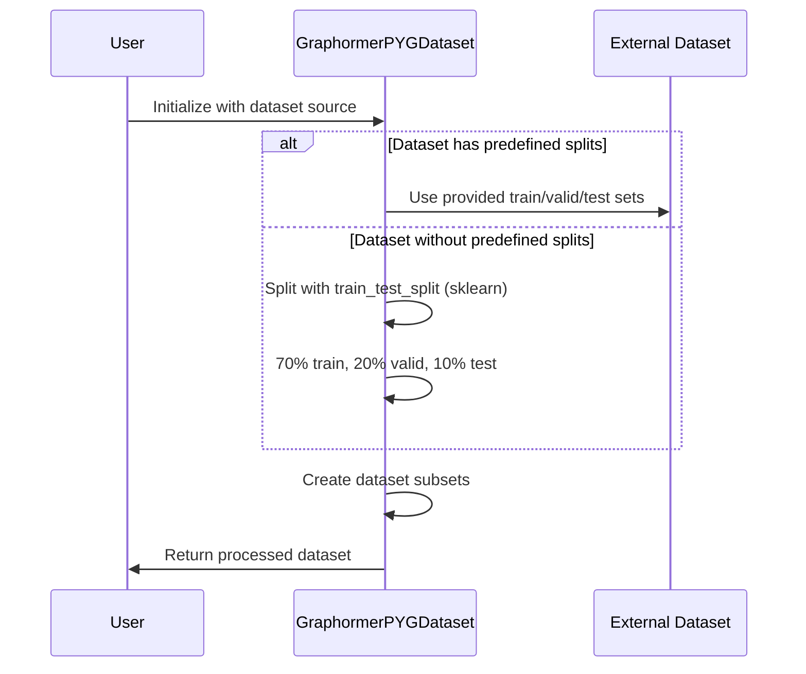
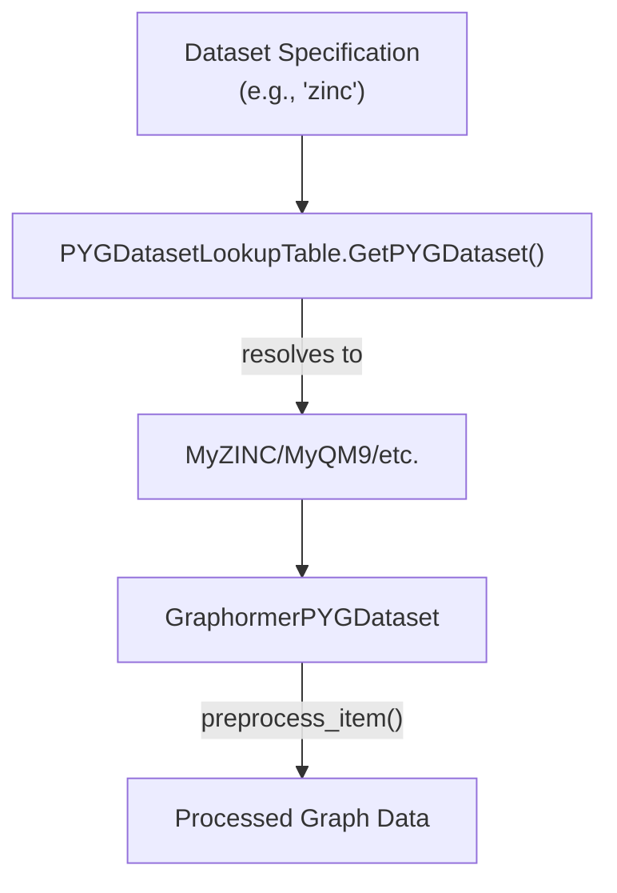
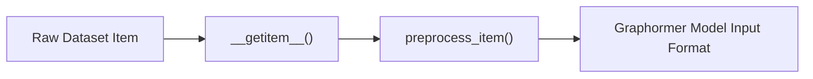
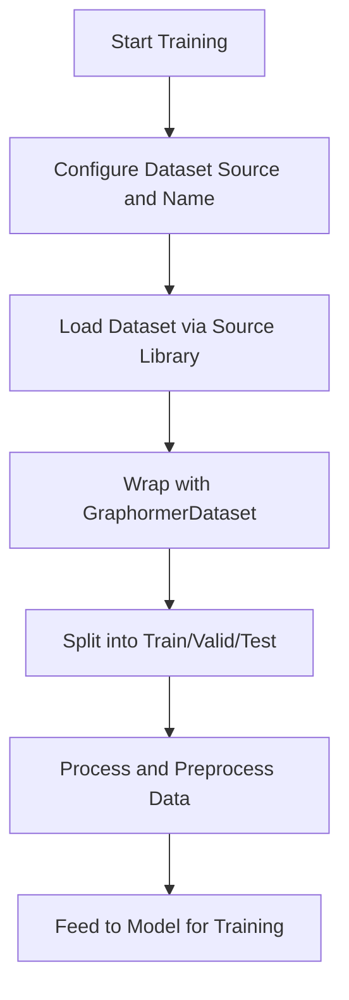

<!-- source: DeepWiki mcp.deepwiki.com · repo microsoft/Graphormer · page 5.1 Dataset Sources · fetched 2026-10-26 -->

# Dataset Sources

<details>
<summary>Relevant source files</summary>

The following files were used as context for generating this wiki page:

- [docs/Datasets.rst](docs/Datasets.rst)
- [graphormer/data/pyg_datasets/pyg_dataset.py](graphormer/data/pyg_datasets/pyg_dataset.py)
- [graphormer/data/pyg_datasets/pyg_dataset_lookup_table.py](graphormer/data/pyg_datasets/pyg_dataset_lookup_table.py)

</details>


## Purpose and Scope

This document details the various dataset sources supported by Graphormer and explains how to utilize them for graph-based machine learning tasks. Graphormer is designed to work with multiple graph library formats, providing flexibility for researchers and practitioners working with graph-structured data. For information about implementing custom datasets, see [Custom Datasets](#5.2).

## Overview of Supported Dataset Sources

Graphormer supports three major graph dataset sources:

1. **PyG (PyTorch Geometric)** - A graph neural network library built on PyTorch
2. **DGL (Deep Graph Library)** - A versatile library for deep learning on graphs
3. **OGB (Open Graph Benchmark)** - A collection of realistic, large-scale, and diverse benchmark datasets for machine learning on graphs

These sources provide access to numerous datasets suitable for various graph learning tasks, including molecular property prediction, quantum chemistry, and materials science.



Sources: [docs/Datasets.rst:12-19]()

## Dataset Source Integration with Graphormer

The following diagram illustrates how external dataset sources are wrapped and integrated into the Graphormer architecture:



Sources: [graphormer/data/pyg_datasets/pyg_dataset.py:17-106](), [graphormer/data/pyg_datasets/pyg_dataset_lookup_table.py:67-119]()

## Available Datasets by Source

The following table lists all available datasets from each supported source:

| Dataset Source | Dataset Name | Type/Task | Labels/Classes |
|----------------|--------------|-----------|----------------|
| **DGL**        | `qm7b`       | Quantum chemistry | 14 |
|                | `qm9`        | Quantum chemistry | Depends on `label_keys` |
|                | `qm9edge`    | Quantum chemistry | Depends on `label_keys` |
|                | `minigc`     | Graph classification | 8 |
|                | `gin`        | Graph isomorphism | 1 |
|                | `fakenews`   | Fake news detection | 1 |
| **PyG**        | `moleculenet` | Molecular properties | 1 |
|                | `zinc`       | Molecular graphs | 1 |
| **OGB**        | `ogbg-molhiv` | Molecular property prediction | 1 |
|                | `ogbg-molpcba` | Molecular property prediction | 128 |
|                | `pcqm4m`     | Quantum chemistry | 1 |
|                | `pcqm4mv2`   | Quantum chemistry | 1 |

Sources: [docs/Datasets.rst:34-60]()

## Dataset Source Specification

To use existing datasets from supported libraries, you can specify both the source and name using command-line parameters:

- `--dataset-source`: Specifies the source library (dgl, pyg, or ogb)
- `--dataset-name`: Specifies the dataset name within that source

For example, to use the ZINC dataset from PyTorch Geometric:

```
--dataset-source pyg --dataset-name zinc
```

When a dataset requires additional parameters, the syntax becomes:

```
--dataset-name <dataset_name>:<param_1>=<value_1>,<param_2>=<value_2>,...
```

For list parameters, values are concatenated with '+'. For example, to specify multiple label keys for QM9:

```
--dataset-name qm9:label_keys=mu+alpha+homo
```

Sources: [docs/Datasets.rst:10-25]()

## Dataset Split Handling

When dataset splits (train, validation, test) are not configured in the original dataset source, Graphormer automatically partitions the dataset with the following ratios:

- 70% for training (`train`)
- 20% for validation (`valid`)
- 10% for testing (`test`)

This is implemented in the `GraphormerPYGDataset` class:



Sources: [graphormer/data/pyg_datasets/pyg_dataset.py:18-66](), [docs/Datasets.rst:27-29]()

## Implementation Details for PyG Datasets

PyG datasets are handled through the `GraphormerPYGDataset` wrapper and the `PYGDatasetLookupTable` class. The lookup table resolves dataset specifications into actual PyG dataset instances:



The PyG dataset implementation includes custom download and process methods to properly handle distributed training environments.

Sources: [graphormer/data/pyg_datasets/pyg_dataset_lookup_table.py:11-101]()

## Data Preprocessing

When retrieving items from a dataset, Graphormer applies preprocessing through the `preprocess_item` function to convert the graph data into the format required by the model:



The preprocessing step transforms the graph data structure from the source library's format into Graphormer's internal format, which includes:
- Node features and edge features
- Graph structural information
- Labels for the prediction task

Sources: [graphormer/data/pyg_datasets/pyg_dataset.py:95-106]()

## Dataset Usage Workflow

The following diagram illustrates the typical workflow for using datasets in Graphormer:



By supporting multiple dataset sources, Graphormer provides a unified interface for working with graph data from various libraries, simplifying the process of experimenting with different datasets and tasks.

Sources: [docs/Datasets.rst:4-31]()

---

