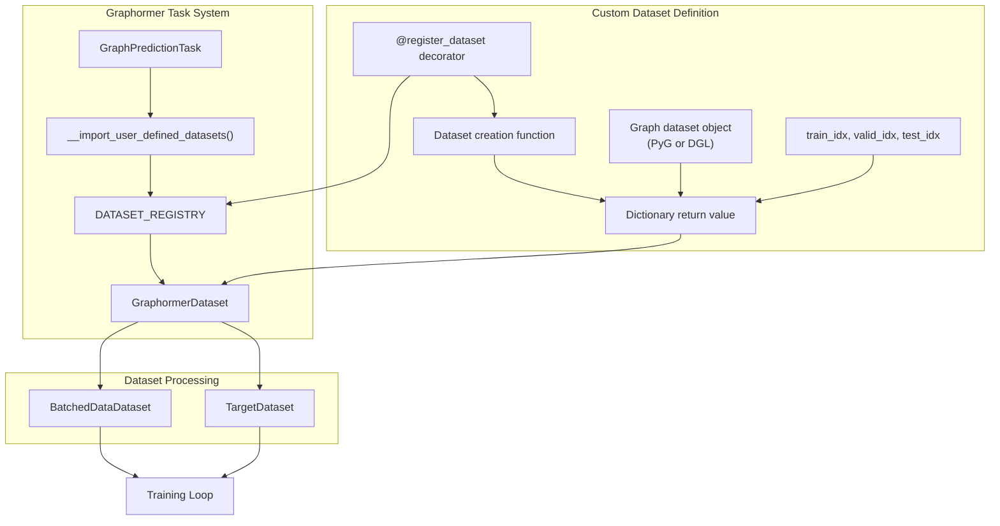
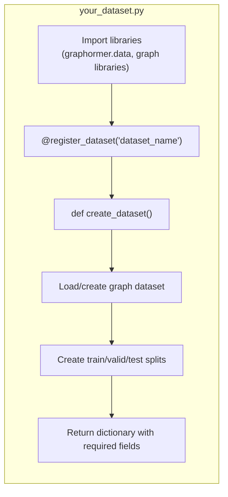
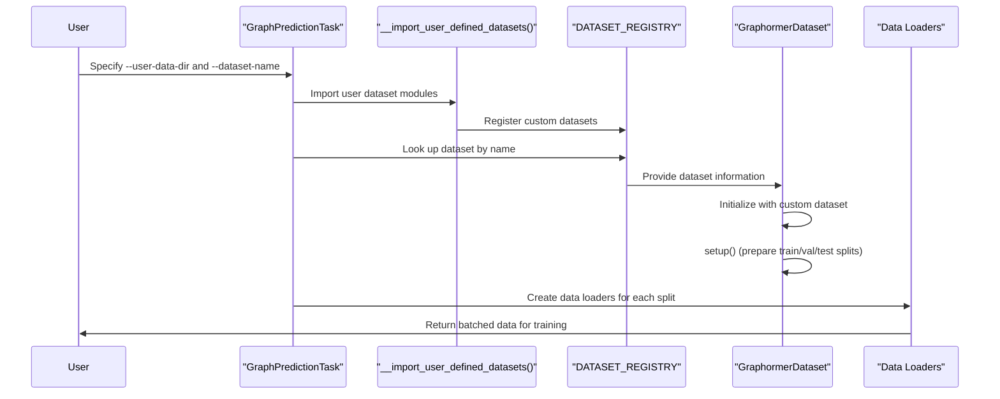
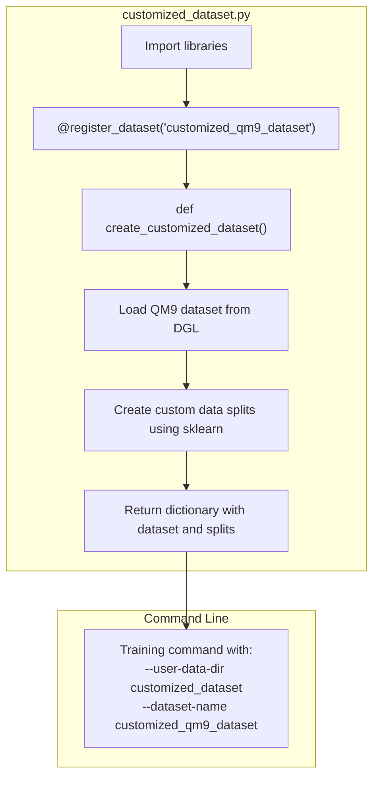
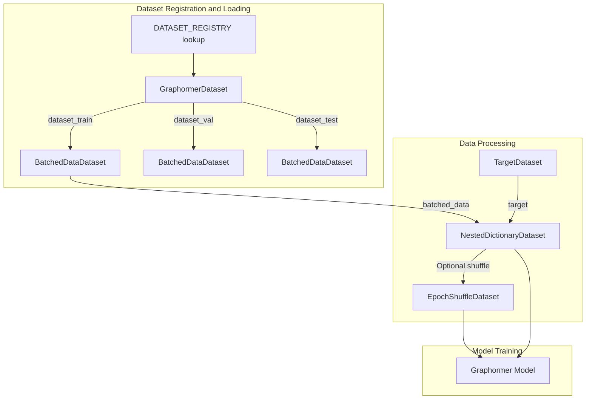

<!-- source: DeepWiki mcp.deepwiki.com · repo microsoft/Graphormer · page 5.2 Custom Datasets · fetched 2026-10-26 -->

# Custom Datasets

<details>
<summary>Relevant source files</summary>

The following files were used as context for generating this wiki page:

- [docs/Datasets.rst](docs/Datasets.rst)
- [examples/customized_dataset/customized_dataset.py](examples/customized_dataset/customized_dataset.py)
- [graphormer/data/dataset.py](graphormer/data/dataset.py)
- [graphormer/tasks/graph_prediction.py](graphormer/tasks/graph_prediction.py)
- [graphormer/tasks/is2re.py](graphormer/tasks/is2re.py)

</details>


This page documents how to create and use custom datasets with Graphormer. The system provides a flexible mechanism to integrate datasets beyond the pre-defined ones in supported graph libraries. For information about pre-defined datasets and their sources, see [Dataset Sources](#5.1).

## Dataset Integration Architecture

The following diagram illustrates how custom datasets integrate with Graphormer's overall architecture:



Sources: [graphormer/tasks/graph_prediction.py:139-153](), [graphormer/tasks/graph_prediction.py:161-174](), [graphormer/data/dataset.py:62-87]()

## Custom Dataset Components

A custom dataset in Graphormer requires these key components:

| Component | Description | Required |
|-----------|-------------|----------|
| Dataset Object | A graph dataset from PyG or DGL | Yes |
| Train/Valid/Test Indices | Custom data split indices | Yes |
| Source Identifier | The underlying graph library used ("pyg" or "dgl") | Yes |
| Registration Function | Function decorated with `@register_dataset` | Yes |

Sources: [examples/customized_dataset/customized_dataset.py:1-24](), [docs/Datasets.rst:83-127]()

## Creating a Custom Dataset

### 1. Create a directory structure

Create a folder to hold your custom dataset implementation:

```
your_project/
├── customized_dataset/
│   └── your_dataset.py
```

Sources: [docs/Datasets.rst:88-90]()

### 2. Define and register your dataset function

In your Python script, import the necessary libraries and define a function that creates and returns your dataset:



The function must return a dictionary with the following structure:

| Field | Type | Description |
|-------|------|-------------|
| `dataset` | PyG or DGL dataset | The actual graph dataset object |
| `train_idx` | numpy array | Indices for training split |
| `valid_idx` | numpy array | Indices for validation split |
| `test_idx` | numpy array | Indices for test split |
| `source` | string | Source library ("pyg" or "dgl") |

Sources: [examples/customized_dataset/customized_dataset.py:6-24](), [docs/Datasets.rst:96-121]()

## Dataset Loading Process

The following diagram illustrates how custom datasets are loaded and used during the training process:



Sources: [graphormer/tasks/graph_prediction.py:139-153](), [graphormer/tasks/graph_prediction.py:161-174](), [graphormer/data/dataset.py:89-96]()

## Using Custom Datasets

To use a custom dataset in training, you need to:

1. Create and register your dataset as described above
2. Use the `--user-data-dir` parameter to specify the directory containing your dataset definition
3. Set `--dataset-name` to the name used in your `@register_dataset` decorator

Important command-line parameters:

| Parameter | Description | Example |
|-----------|-------------|---------|
| `--user-data-dir` | Path to directory containing custom dataset definition | `--user-data-dir customized_dataset` |
| `--dataset-name` | Name of the registered dataset | `--dataset-name customized_qm9_dataset` |

**Note**: Do not use `--dataset-source` when using a custom dataset. The source is specified within the dataset definition.

Sources: [graphormer/tasks/graph_prediction.py:139-153](), [docs/Datasets.rst:124-126]()

## Example Implementation

The following example shows a custom dataset created from the QM9 dataset in DGL with a customized train/valid/test split:



The implementation includes:
1. Importing required libraries
2. Registering a dataset named `customized_qm9_dataset`
3. Creating the QM9 dataset with the desired label
4. Implementing a custom train/validation/test split (70/20/10)
5. Returning a dictionary with the required fields

Sources: [examples/customized_dataset/customized_dataset.py:1-24](), [docs/Datasets.rst:96-119]()

## Integration with Graphormer's Data System

The following diagram shows how custom datasets fit into Graphormer's data processing pipeline:



Sources: [graphormer/tasks/graph_prediction.py:181-221](), [graphormer/data/dataset.py:20-43](), [graphormer/data/dataset.py:46-59]()

## Supported Data Sources and Requirements

Graphormer supports two main graph library formats for custom datasets:

| Source | Identifier | Requirements |
|--------|------------|--------------|
| PyTorch Geometric | "pyg" | Dataset should implement the PyG interfaces |
| Deep Graph Library | "dgl" | Dataset should implement the DGL interfaces |

Your custom dataset should be based on one of these libraries and specified in the `source` field of the return dictionary.

Sources: [graphormer/data/dataset.py:62-80]()

## Advanced Usage

### Custom Data Processing

For advanced use cases, you can extend the dataset processing beyond the standard implementation:

1. Create a custom dataset class that inherits from the appropriate base class (PyG or DGL)
2. Implement custom processing methods to transform the graph data
3. Register and use the custom dataset as described above

### Multiple Custom Datasets

You can define multiple custom datasets in the same directory. The system will scan all Python files in the specified directory and register all datasets decorated with `@register_dataset`.

Sources: [graphormer/tasks/graph_prediction.py:161-174](), [docs/Datasets.rst:126-127]()

---

