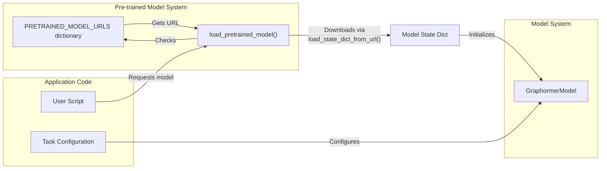
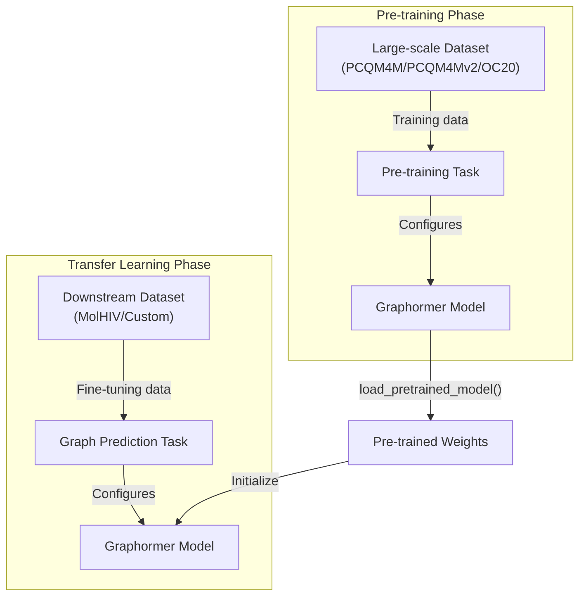
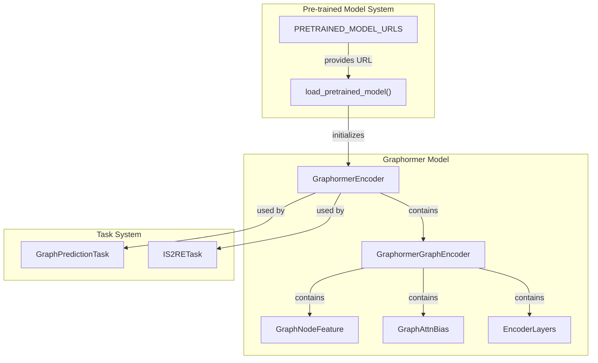

<!-- source: DeepWiki mcp.deepwiki.com · repo microsoft/Graphormer · page 6 Pre-trained Models · fetched 2026-10-26 -->

# Pre-trained Models

<details>
<summary>Relevant source files</summary>

The following files were used as context for generating this wiki page:

- [README.md](README.md)
- [graphormer/pretrain/__init__.py](graphormer/pretrain/__init__.py)

</details>


This document provides an overview of the pre-trained models available in the Graphormer framework, how to load them, and their applications for various molecular modeling tasks. For information about training your own models from scratch, see [Training and Evaluation](#7).

## Available Pre-trained Models

Graphormer offers several pre-trained models that have been trained on large-scale molecular datasets. These models can be used directly for inference or fine-tuned for specific downstream tasks.

| Model Name | Description | Dataset | Application |
|------------|-------------|---------|-------------|
| pcqm4mv1_graphormer_base | Base Graphormer model trained on PCQM4Mv1 | PCQM4Mv1 | General molecular property prediction |
| pcqm4mv2_graphormer_base | Updated base model trained on PCQM4Mv2 | PCQM4Mv2 | General molecular property prediction |
| oc20is2re_graphormer3d_base | 3D Graphormer for catalyst modeling | OC20 IS2RE | Initial Structure to Relaxed Energy prediction |
| pcqm4mv1_graphormer_base_for_molhiv | Specialized model for HIV prediction | PCQM4Mv1 | MolHIV classification task |

Sources: [graphormer/pretrain/__init__.py:4-9]()

## Model Loading Workflow

The following diagram illustrates how pre-trained models are loaded and used in the Graphormer framework:



Sources: [graphormer/pretrain/__init__.py:11-19]()

## Loading Pre-trained Models

Graphormer provides a straightforward function to load pre-trained models. The function handles downloading the model weights from the appropriate URL and returns the model state dictionary.

```python
# Example of loading a pre-trained model
from graphormer.pretrain import load_pretrained_model

# Load the PCQM4Mv2 pre-trained model
model_state = load_pretrained_model("pcqm4mv2_graphormer_base")

# The returned state can be used to initialize a Graphormer model
```

The `load_pretrained_model` function supports distributed training by handling the appropriate file naming when running in a distributed setting.

Sources: [graphormer/pretrain/__init__.py:11-19]()

## Transfer Learning Architecture

The following diagram shows how pre-trained models fit into the transfer learning workflow for fine-tuning on downstream tasks:



Sources: [graphormer/pretrain/__init__.py:4-19](), [README.md:13-18]()

## Applications of Pre-trained Models

### Molecular Property Prediction

The pre-trained models `pcqm4mv1_graphormer_base` and `pcqm4mv2_graphormer_base` are primarily designed for molecular property prediction tasks. These models were trained on the PCQM4M dataset, which contains quantum mechanical properties of molecules.

The `pcqm4mv1_graphormer_base_for_molhiv` model is specifically optimized for HIV activity prediction, demonstrating how pre-trained models can be specialized for specific molecular tasks.

### Open Catalyst Challenge

The `oc20is2re_graphormer3d_base` model is designed for the Open Catalyst 2020 (OC20) dataset, specifically for the Initial Structure to Relaxed Energy (IS2RE) task. This model leverages 3D information of molecular structures to predict catalyst properties.

Graphormer won the Open Catalyst Challenge by using these specialized pre-trained models, showcasing their effectiveness in complex molecular modeling tasks.

Sources: [README.md:13-18](), [README.md:29-31]()

## Model Integration with Graphormer Architecture

The following diagram shows how pre-trained models integrate with the overall Graphormer architecture:



Sources: [graphormer/pretrain/__init__.py:4-19]()

## Future Developments

According to the Graphormer roadmap, more pre-trained models are expected to be added to the model zoo in future releases. Advanced pre-trained versions of Graphormer are also available exclusively on Azure Quantum Elements, as mentioned in the project documentation.

Sources: [README.md:5](), [README.md:15]()

## Technical Performance

The pre-trained models have demonstrated state-of-the-art performance on several benchmarks:

- The PCQM4Mv1/v2 models helped win the 1st place in the quantum prediction track of the Open Graph Benchmark Large-Scale Challenge (KDD CUP 2021)
- The OC20 IS2RE model contributed to winning the Open Catalyst Challenge

For detailed performance metrics and benchmarks, refer to the technical report "Benchmarking Graphormer on Large-Scale Molecular Modeling Datasets" mentioned in the project documentation.

Sources: [README.md:22-23](), [README.md:28-29](), [README.md:41]()

---

